早期数字人互动是一条“意图识别—检索—生成”工作流。它能处理常见问题，但每增加一种能力，都要补标签、改分支、重新训练。一次意图判断错了，后面也很难纠正。

我们后来做了两步改造：先让模型按需调用工具，再把工具调用与回复生成拆开训练。


## 从工作流到 Agent

### 我们要接住怎样的互动

<figure class="publication-figure figure-landscape" id="blog-figure-1"><div class="figure-heading"><span class="figure-label">图 1</span><button aria-label="放大查看：图 1" class="figure-expand" type="button">查看大图 ↗</button></div><div class="figure-media"></div><figcaption class="publication-caption">数字人对弹幕进行文本与口播回复。</figcaption></figure>

- 观众在数字人直播间发送弹幕时，数字人主播会基于直播间商品信息、商家预设问答对等信息对观众进行弹幕和口播的回复；
- 我们的算法在这个场景下控制数字人主播对观众的互动行为，包括要回复什么、要不要调整讲品顺序到观众想听的商品等。

### 固定流程卡在哪里

面对快速变化的直播业务，原有“意图识别—检索—生成”的静态 Workflow 架构已遭遇严重瓶颈，主要体现在三大维度：

- 系统灵活性差，迭代受限：依赖人工标注，新增1个意图需2个月时间进行迭代，预置 FAQ 利用率不足2%，难以适应业务的快速迭代。
- 上下文感知弱，易死胡同：无法联动“宝贝口袋/讲解文案/历史弹幕”等多源信息，一旦意图误判无法反思回退，只能机械抛给人工客服。
- 并发调度缺失，能力遇颈：无法处理直播间高频的多弹幕并发，扩展更高阶的动作/语气交互极其困难。

让我们开始认真考虑换架构的，还有模型能力和推理成本的变化。当时，30B MoE 模型在单卡 H20 上已经能跑到 140 tokens/s，基座的工具使用能力也更可用了。原来需要写成分支的动作，开始有机会交给模型按上下文决定：缺什么信息就查什么，查错了还能回头。这给了我们一个可行的起点，但能做出演示和能稳定上线之间，仍然隔着延迟、事实质量和训练方式几个问题。

### 先让模型决定下一步

完成了从 Workflow 架构到 Agentic 架构的升级：

- 感知域：单维度匹配  →  全局上下文感知（弹幕+历史+商品信息融合）
- 决策域：单次死板分类  →  多次按需工具调用与自我纠错（反思机制）
- 执行域：单意图话术  →  多模态响应（调图、调顺序、融合讲解文案）

- 为了让大家更好的了解我们的agent的执行流程，这里给出一个，Agent 完整 trajectory 的示例：

```text
观众问题：索尼 XM4 和 XM5 哪个降噪好？
上下文：主播正在讲解另一款商品。
1. 分别检索 XM4、XM5 的商品信息。
2. 根据工具结果判断是否足以比较。
3. 加载对应回复规则，再生成最终回复。
```

架构的升级带来的优势是明显的，我们以实际用户 query 为例，从以下几个方面进行对比：

- 通用优势

<figure class="publication-figure figure-landscape" id="blog-figure-2"><div class="figure-heading"><span class="figure-label">图 2</span><button aria-label="放大查看：图 2" class="figure-expand" type="button">查看大图 ↗</button></div><div class="figure-media">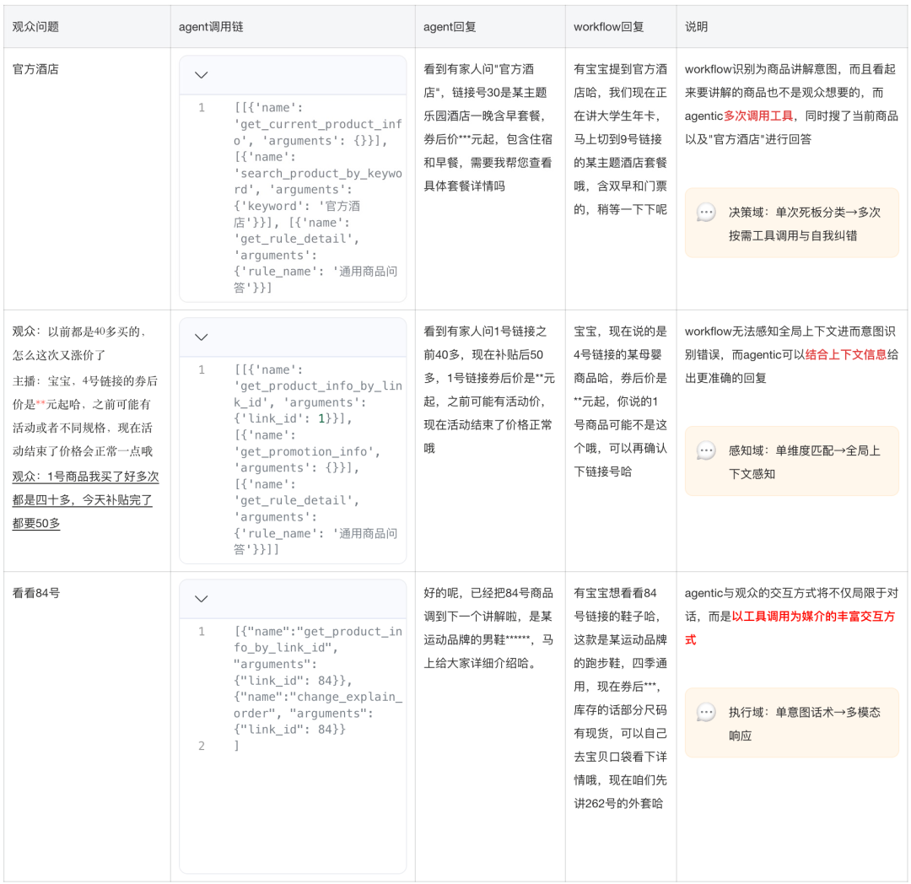</div><figcaption class="publication-caption">Workflow 与 Agentic 架构在交互行为上的对比。</figcaption></figure>

- 直播特色优势

- 一次接住多条弹幕：同一时刻，有人问补贴，有人问赠品，也有人关心发货时间。我们让 Agent 按需并发取信息，再把这些问题整理成一段回复。这里的收益不只是“同时回答更多人”，更在于不必把每条碎片问题都硬塞进一个独立、固定的流程；需要哪些工具，可以随这一轮真正缺少的信息来决定。

<figure class="publication-figure figure-landscape" id="blog-figure-3"><div class="figure-heading"><span class="figure-label">图 3</span><button aria-label="放大查看：图 3" class="figure-expand" type="button">查看大图 ↗</button></div><div class="figure-media">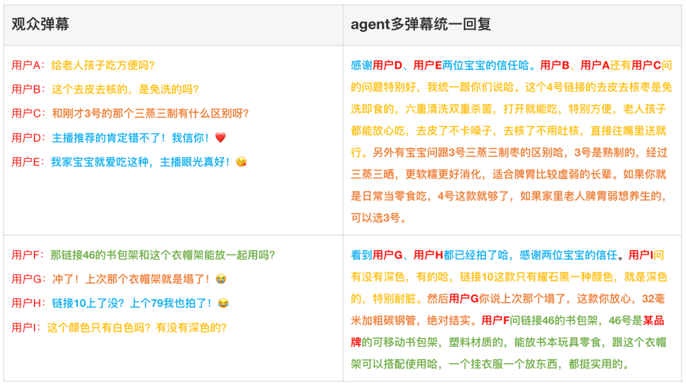</div><figcaption class="publication-caption">将多条弹幕的问题聚合后统一回复。</figcaption></figure>

- 把正在说的话也当成上下文：观众的“这个”“刚才那个”经常指向当前口播内容。我们把数字人正在讲解的文案接进来，让 Agent 判断问题时能同时看到弹幕和讲解内容。这样，它不必只靠商品列表猜指代，也更容易接住观众沿着上一段讲解提出的追问。

<figure class="publication-figure figure-landscape" id="blog-figure-4"><div class="figure-heading"><span class="figure-label">图 4</span><button aria-label="放大查看：图 4" class="figure-expand" type="button">查看大图 ↗</button></div><div class="figure-media">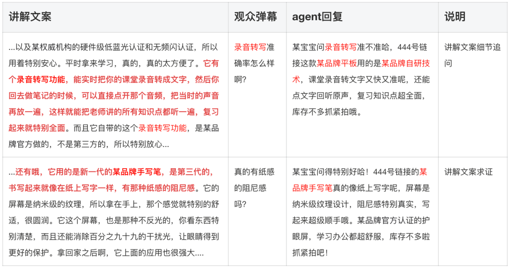</div><figcaption class="publication-caption">将当前讲解文案作为互动上下文。</figcaption></figure>

### 再把延迟和回复质量拉回可用范围

我们自研了一套 Agent 模型优化方案，来满足直播互动极低的延迟要求，并提升互动回复的正确性与帮助性：

- 先处理延迟：用大教师生成完整轨迹，再把工具调用与回复能力分别蒸馏到 30B-A3B 学生。单次工具调用生成耗时约 0.3s，单 H20 解码吞吐为 140 tokens/s。它让低延迟链路变得可行，但还不是一次完整互动的端到端耗时。
- 再处理回答质量：在互动数据上定义正确性与帮助性，用奖励引导回复模型依据工具返回的信息作答。我们尤其关注商品事实和无依据承诺：答得流畅不够，模型还需要知道哪些信息能说，哪些必须保留或继续询问。

- AgentTuning蒸馏

Agent 可以多次查资料、反思和修正，但每多走一轮都要付出推理时间，直播间对这件事很敏感。我们的做法是先采样大教师的交互轨迹，再通过 AgentTuning 让小模型学习其中的规划、工具选择和回复行为。这样做的目的，是把这些能力放进可部署的时延预算里，而不是上线时仍让大教师处理每条请求。

<figure class="publication-figure figure-landscape" id="blog-figure-5"><div class="figure-heading"><span class="figure-label">图 5</span><button aria-label="放大查看：图 5" class="figure-expand" type="button">查看大图 ↗</button></div><div class="figure-media">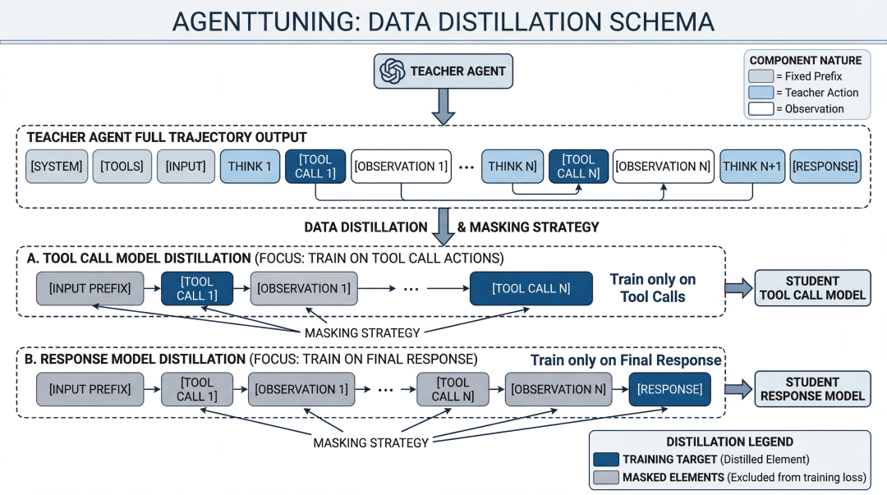</div><figcaption class="publication-caption">将教师轨迹中的工具调用与最终回复分别蒸馏。</figcaption></figure>

- 教师模型在 Agent 推理过程中与环境进行多轮交互，采样出完整的 agent 执行 trajectory，其中，我们将大模型的工具调用及回复能力分别蒸馏至两个 Qwen3-30B-A3B 的小模型中；
- 为了追求低延迟，学生模型均采用 Instruct 模型，在蒸馏时剔除掉了教师模型的思考部分序列：

- 工具调用模型仅蒸馏教师 Agent 的工具调用生成部分，截取最后一轮工具调用前的 trajectory，并 mask 掉工具调用结果；
- 回复生成模型仅蒸馏教师 Agent 最终回复生成部分，mask 掉回复前的所有序列。

- 回复模型 RLVR

蒸馏之后，学生已经能规划和调用工具，但最终回复仍可能把材料理解错，或者给出超出证据的承诺。于是，我们保留 AgentTuning 的结果，接着对回复模型做 GRPO：同一个工具链前缀下采样多条回答，再用正确性、帮助性与长度奖励比较它们。这样，优化目标直接落在最终说出口的内容上。正确性约束事实，帮助性避免模型一味保守，长度则限制无效展开；三者一起决定我们希望留下什么样的回答。

<figure class="publication-figure figure-landscape" id="blog-figure-6"><div class="figure-heading"><span class="figure-label">图 6</span><button aria-label="放大查看：图 6" class="figure-expand" type="button">查看大图 ↗</button></div><div class="figure-media">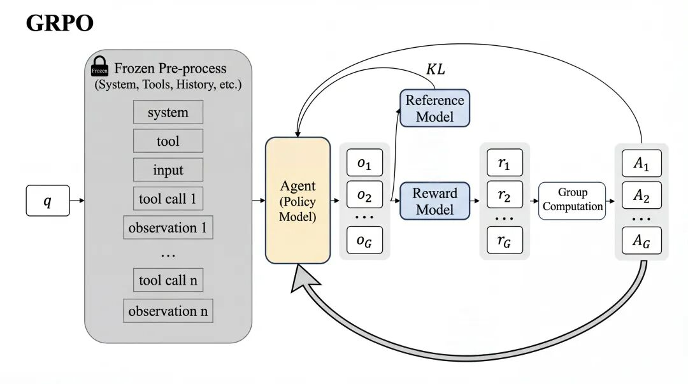</div><figcaption class="publication-caption">固定工具链前缀，仅优化最终回复的 RLVR。</figcaption></figure>

- 输入数据为教师模型预先打标好的工具调用链，对于一条前缀工具调用链模型 rollout 出多条回复组成一组；
- 对于每个回复进行事实正确性和帮助性的打分，并在组内计算均值与标准差算出组内优势，根据优势计算出 loss 对模型进行优化；
- 整体目标：

- 回复模型尽可能减少幻觉，按照工具调用结果进行回复；
- 为避免模型为了降低幻觉变得过于保守，增加帮助性鼓励模型更多的满足观众实际需求；

**实现时有个细节：** 我们在 ROLL 里保留教师轨迹的 `messages[:-1]` 作为前缀，让 rollout 只生成最后一条回复。`tokenizer.apply_chat_template` 负责把消息整理成输入格式，RLVR 则只更新这次生成的回复。先把“哪些内容是条件、哪些内容要训练”划清楚，后面的奖励和 loss 才不会落到错误的 token 上。

- 评测指标

<figure class="publication-figure figure-landscape" id="blog-figure-7"><div class="figure-heading"><span class="figure-label">图 7</span><button aria-label="放大查看：图 7" class="figure-expand" type="button">查看大图 ↗</button></div><div class="figure-media">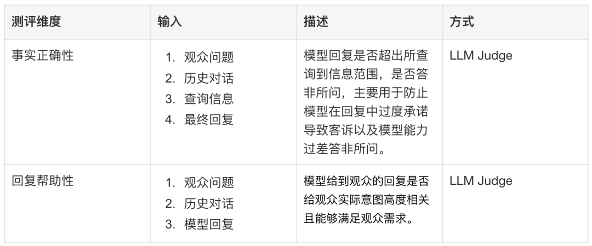</div><figcaption class="publication-caption">回复正确性与帮助性的评测口径。</figcaption></figure>

- 测评数据集

测评数据集来自于对线上流量的脱敏、筛选和清洗，测评指标采用事实正确性以及回复帮助性。

- 模型优化效果

<figure class="publication-figure figure-landscape" id="blog-figure-8"><div class="figure-heading"><span class="figure-label">图 8</span><button aria-label="放大查看：图 8" class="figure-expand" type="button">查看大图 ↗</button></div><div class="figure-media">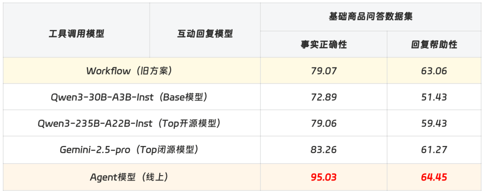</div><figcaption class="publication-caption">架构与模型优化后的离线回复质量对比。</figcaption></figure>

在这份互动评测集上，Agent 相比 Workflow 的正确性和帮助性都有提升，也高于表中 Gemini-2.5-pro 与 Qwen3-235B-A22B 的结果。对我们来说，这首先说明把规划、工具使用和回复训练配合起来，在当前业务任务上是有收益的。不同模型的输入组织和调用方式也会影响比较，因此这里保留具体场景和评测口径，不把它扩展成通用能力排名。

### 上线后看到了什么

- 人工对比：使用 Agent 线上流量在 workflow 服务上进行流量回放产出相同输入下的回复结果进行对比：

<figure class="publication-figure figure-landscape" id="blog-figure-9"><div class="figure-heading"><span class="figure-label">图 9</span><button aria-label="放大查看：图 9" class="figure-expand" type="button">查看大图 ↗</button></div><div class="figure-media">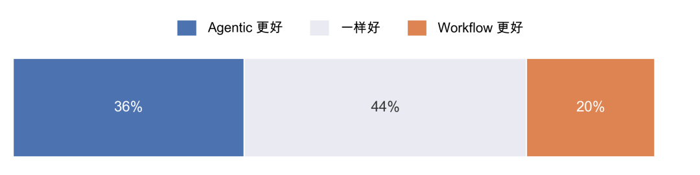</div><figcaption class="publication-caption">相同线上请求回放下的人工回复对比。</figcaption></figure>

- 延迟对比：耗时统计（单位：秒）

- 新链路使用 Instruct 模型，原 Workflow 的最终回复环节则使用 Thinking 模型。这里有一个职责上的变化：Agent 在前面已经做过规划、工具选择和信息核对，最后的回复模型可以更专注地组织已有事实，不再独自为前面所有未知情况兜底。这个拆分，也是我们理解延迟变化时需要一起看的因素。
- 同时得益于之前延迟优化上所做的工作，不管是平均延迟还是 P99 长尾延迟都相较于 Workflow 大幅降低。

<figure class="publication-figure figure-landscape" id="blog-figure-10"><div class="figure-heading"><span class="figure-label">图 10</span><button aria-label="放大查看：图 10" class="figure-expand" type="button">查看大图 ↗</button></div><div class="figure-media">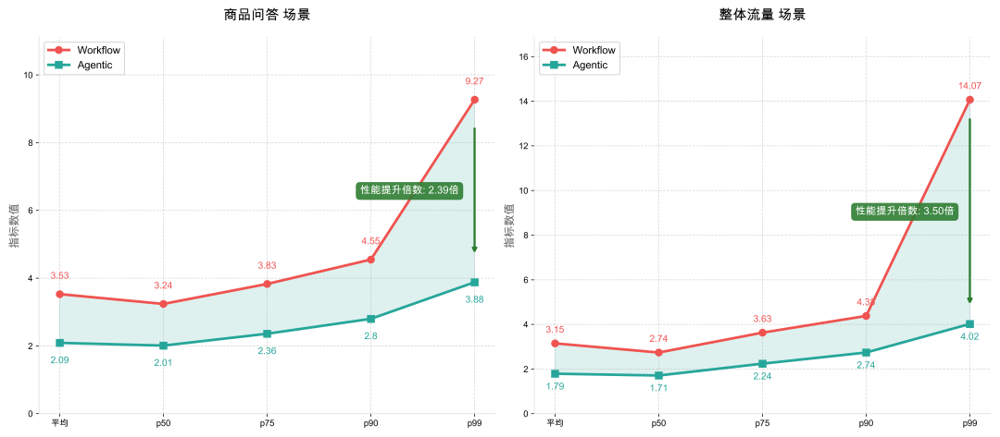</div><figcaption class="publication-caption">让策略在仿真环境中完成多轮工具交互。</figcaption></figure>

## 让学生自己进环境练习
### 蒸馏之后，还缺什么

上线版本的工具模型来自教师轨迹蒸馏，直接、有效，但它能学到的行为也受教师样本覆盖范围限制。我们接下来想试的是：让学生自己进环境调用工具，经历选择、反馈和修正，再从结果中学习。这样，遇到一条教师没有演示过的路径时，它也有机会在训练中探索，而不是只能继续等待更多标注轨迹。Agentic RL 的尝试就是从这里开始的。

### 先尝试完整交互的 RL

<figure class="publication-figure figure-landscape" id="blog-figure-11"><div class="figure-heading"><span class="figure-label">图 11</span><button aria-label="放大查看：图 11" class="figure-expand" type="button">查看大图 ↗</button></div><div class="figure-media">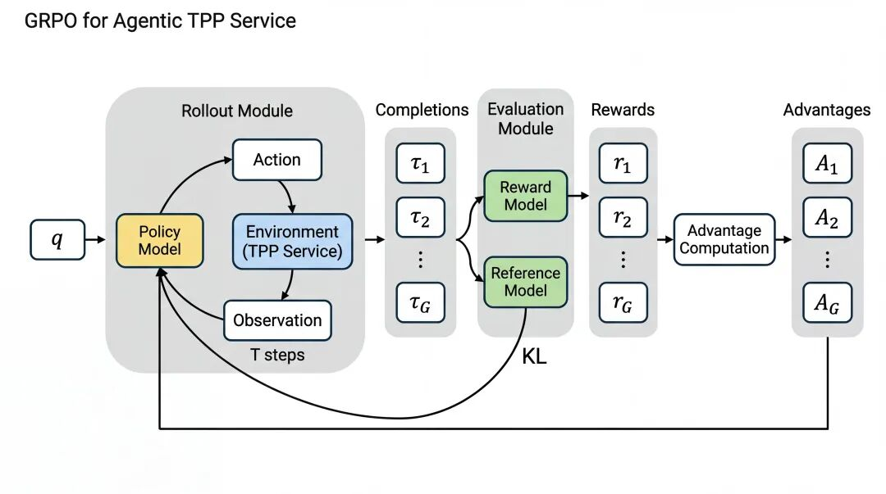</div><figcaption class="publication-caption">Rollout、环境执行和奖励计算的工程链路。</figcaption></figure>

Rollout 阶段：

1. Policy 模型在模拟环境中进行多轮工具调用交互，最终以获取回复规则并产生非工具调用回复为结束标志；
2. 针对每个 rollout 计算工具调用与最终回复奖励，并计算组内优势；

训练阶段：

1. 仅针对包含工具调用和最终回复的模型生成部分序列计算 loss，其余包含输入数据、工具返回序列均 mask 掉；
2. 采用初始化 reference model 计算 KL 散度，重要性采样部分与基础 GRPO/PPO 设置无异；
3. 参数由训练模型更新至推理模型继续下一轮 Agentic RL 训练，Agent 模型在训练过程中同时优化工具调用与回复能力。

### 训练集群和沙盒怎么配合

在 ROLL 框架下，Agentic RL 仿真环境的构建逻辑可被解耦为两大块，训练侧与远程沙盒环境侧：

- 训练集群侧：负责生成与学习这一半。Rollout 线程驱动模型产生完整交互轨迹，再调用奖励模型评分，整理 token 的训练掩码，最后把序列、掩码和分数交给训练阶段。这里要保留完整过程，同时明确哪些输出属于策略本身。
- 远程沙盒侧：负责环境这一半。需要访问内部 RPC 等受限接口、维护有状态容器，或运行即时模拟器时，训练线程不直接承担这些工作，而是通过沙盒服务完成。把环境放到这一侧，也让每轮交互的状态和工具返回更容易单独管理。

整体训练与交互流程包含以下四个关键步骤：

- 第一步，给每个 rollout 建好环境。训练进程启动后，各线程分别映射一个仿真实例，向平台服务请求建立直播间状态，再拉取基础信息、构建语义向量库，完成远程工具链的初始化。这里需要先把状态对齐，后面的模型输出才是在同一个任务条件下与环境交互。

- 第二步，让模型和环境来回交互。训练线程调用进程内的 vLLM 或 SGLang 生成输出，解析到工具请求后，再跨网络调用沙盒并取回结果。模型继续读取反馈、选择下一步，直到达到轮数限制，或者调用“获取最终回复”等终止工具。这段循环构成一次完整 rollout，不能只记录最后的回答。

- 第三步，评分并整理训练序列。Rollout 结束后，我们通过内部接口调用 LLM Judge，对整段交互给出 episode reward；同时构造 token mask，把系统提示词、输入和工具返回等非策略输出排除在 loss 之外。否则，模型可能被要求去学习环境写出的内容，而不是优化自己真正做出的决策。

- 第四步，把结果交回 ROLL 更新模型。自定义部分返回 token 序列、mask 和整条轨迹的分数，框架再计算 advantage 与 loss，通过 Megatron 做分布式更新。更新后的参数同步到 vLLM 或 SGLang，下一轮 rollout 才会用到新策略。把这次同步算进一次训练迭代，有助于排查“分数变了，实际推理模型却没变”的问题。

**实现上，接口要交对：** ROLL 已经封装了不少训练流程，我们主要实现 rollout、token mask 和 reward 计算，再把它们接回框架。Chat template 提供的 mask 未必等于任务真正需要的 loss mask，所以这部分最好按轨迹结构自己核对。尤其要检查工具返回和系统消息，不能因为格式上都是 message，就把它们都当成模型输出训练。

**比改算法更早要处理的是环境：** 我们早期最难拿到可靠结论的时候，往往不是优化公式出了问题，而是仿真不稳定，或者 reward 区分不了好坏。前者让同一策略的反馈失去可比性，后者让模型得不到清楚的方向。这些工作琐碎，却直接决定后面的训练曲线是否值得相信。

### 为什么只给最终奖励还不够

我们初期使用 Agentic RL 进行端到端训练并没有能够训练出具备良好效果的模型，主要是因为以下原因：

- 最终的正确性、帮助性奖励更多的是偏向回复模型而设计的，而模型的 Agentic 能力并没有在其中得到清晰反馈而良好的训练，反而因为不恰当的奖励而变得更差；
- 直接在最终奖励中加上基于 llm judge 的工具调用奖励后，虽然能带来对于工具调用的反馈，但由于 llm judge 不稳定的特点，奖励也变得更加模糊，强化学习训练变得更加难以收敛；
- 两段任务关注的能力也不一样。工具调用需要理解弹幕与上下文，选对接口、填对参数，并根据返回结果决定是否继续查；回复则更关心事实可靠、是否接住观众的真实需求，以及表达是否自然。把最终回复的得分直接分配给前面每次工具调用，很容易把这些差异混在一起。

## 把工具调用和回复分开训练
- 于是，我们把系统拆成工具调用 Agent 和最终回复 Agent，保留它们在同一环境里的协作，再分别设计奖励。Multi-Agent RL 在这里要优化的是两者配合后的完整互动：工具 Agent 学会把信息找齐，回复 Agent 学会把信息说对，两边的训练又能看到对方行为变化后的结果。

### 两个 Agent，怎么一起更新

- 目前我们的互动 Multi-Agent RL 实现如下，人为的分为了工具调用模型以及回复（总结）模型，在训练中，工具调用模型仅优化工具调用部分，回复模型仅优化回复部分：

<figure class="publication-figure figure-landscape" id="blog-figure-12"><div class="figure-heading"><span class="figure-label">图 12</span><button aria-label="放大查看：图 12" class="figure-expand" type="button">查看大图 ↗</button></div><div class="figure-media">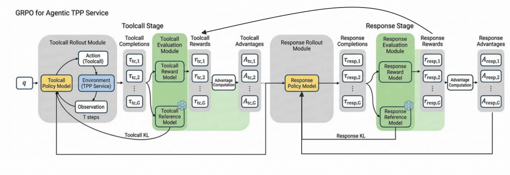</div><figcaption class="publication-caption">工具 Agent 与回复 Agent 共享环境、分别接收奖励。</figcaption></figure>

- 工具调用模型在模拟的直播互动环境中进行多轮交互，得到 K 条 Agent 工具调用路径，工具调用阶段以获取回复规则作为结束标识，如果工具调用阶段未获取回复规则则不会产生回复；

<figure class="publication-figure figure-landscape" id="blog-figure-13"><div class="figure-heading"><span class="figure-label">图 13</span><button aria-label="放大查看：图 13" class="figure-expand" type="button">查看大图 ↗</button></div><div class="figure-media">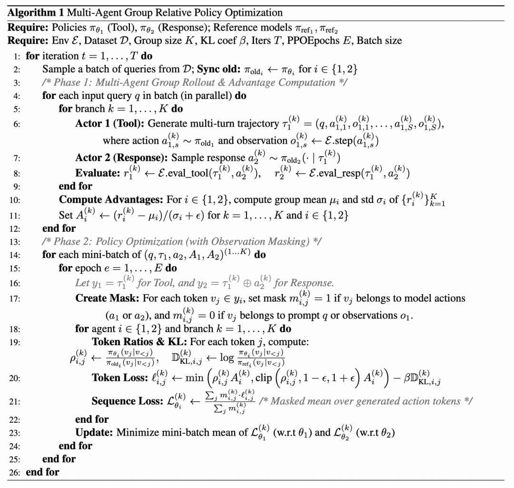</div><figcaption class="publication-caption">不同 Agent 的奖励分工。</figcaption></figure>

Rollout阶段：

1. 工具调用模型和环境服务（内部仿真环境平台）进行多轮交互，在环境判断是否工具调用结束进行回复（以超过调用轮次限制以及调用 `获取回复规则`工具作为终止符号）；
2. 工具调用模型调用结束后，回复模型以工具调用链作为前缀，按照回复规则生成回复；
3. 基于完整 trajectory 分别为工具调用阶段与回复阶段计算 reward；
4. 并基于计算好的 reward 分别为工具调用模型与回复模型赋值组合加权 reward 并计算组内优势。

训练阶段：

1. 对于工具调用模型：截取最终回复前最后一轮工具调用的 trajectoy，mask 掉其中工具调用返回结果部分，采用对应计算出的工具优势计算 loss；
2. 对于回复模型：取完整 trajectory，mask 掉非最终回复前置部分，采用对应计算出的回复优势计算 loss；
3. 对于这两个模型都采用各自的初始化 reference model 计算 KL 散度，重要性采样部分与基础 GRPO/PPO 设置无异。
4. 针对两个模型分别将参数由训练模型（megatron）更新至推理模型（vllm），并继续下一轮训练。

**我们的训练观察：** 这组任务拆成两个 Agent 后，比端到端的单 Agent RL 更容易收敛。可以把它理解为将一个较长的交互任务分成几个更接近 RLVR 的子任务：每个模型收到的反馈更直接，错误也更容易定位。但这依赖正确的环境、mask 和奖励实现，不能只靠“拆成两个模型”就期待同样的结果。

**复用现有实现时：** Multi-Agent RL 的数据组织与 step reward 很接近。如果先忽略不同 Agent 的参数归属，可以借助 step reward 的流程理解或搭建训练。ROLL 里已有 GiGPO 等实现可供参考；真正接上双模型后，还要额外确认每段序列、每项奖励和对应 checkpoint 是否归到了正确的 Agent。

**双模型还多了一件工程工作：** checkpoint 需要能自动保存并区分归属。我们用 `cluster_name` 在 `ckpt_id` 维度标识不同模型，再复用 ROLL 到 OPENLM MOS 的自动上传流程。这样，一轮协同训练的结果不会只留下一侧模型，也更方便后续成对加载和回放。

### 奖励函数设计

<figure class="publication-figure figure-landscape" id="blog-figure-14"><div class="figure-heading"><span class="figure-label">图 14</span><button aria-label="放大查看：图 14" class="figure-expand" type="button">查看大图 ↗</button></div><div class="figure-media">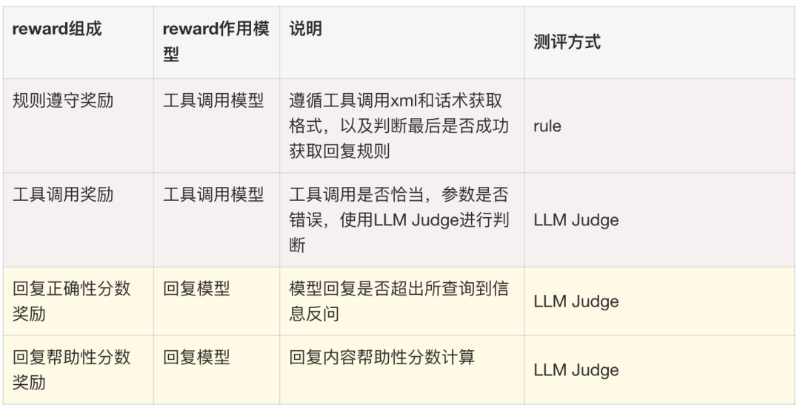</div><figcaption class="publication-caption">Multi-Agent RL 的训练曲线。</figcaption></figure>

### 训练曲线里要看什么

<figure class="publication-figure figure-landscape" id="blog-figure-15"><div class="figure-heading"><span class="figure-label">图 15</span><button aria-label="放大查看：图 15" class="figure-expand" type="button">查看大图 ↗</button></div><div class="figure-media">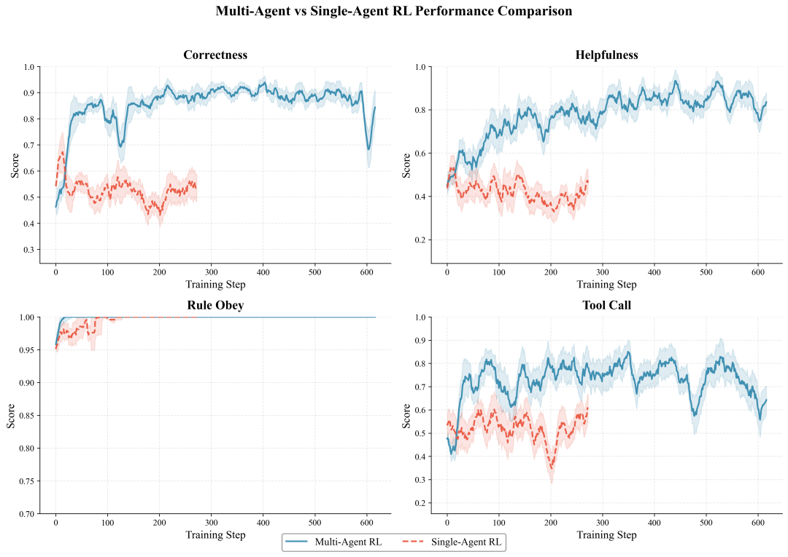</div><figcaption class="publication-caption">回复质量与工具合理性的实验结果。</figcaption></figure>

- 图中使用相同的奖励对于单 Agent Agentic RL 和多 Agent Agentic RL 进行了训练实验，均使用 GRPO 作为模型优化算法：

- 单 Agent 对4个奖励进行加权求和的方式计算组合 reward；
- 多 Agent 的回复模型采用正确性和帮助性的加权求和，工具调用模型采用规则遵守和工具调用的加权求和；

- 单 Agent 把多种奖励混在一起时，这组实验很难得到稳定改善。拆成工具与回复两个 Agent 后，反馈更贴近各自的任务，训练曲线也更容易解释。我们主要从下面两点理解这个差别：

- 正确性和帮助性主要在评最终回复。只根据最终有没有幻觉，就给前面的每次工具调用分配好坏，反馈会比较间接，甚至可能鼓励错误的路径。
- 反过来也一样：工具调用合理性关注信息获取过程，用它直接评价最终回复，仍然会漏掉事实表达和用户需求这两部分。

### 与监督微调版本比一比

<figure class="publication-figure figure-landscape" id="blog-figure-16"><div class="figure-heading"><span class="figure-label">图 16</span><button aria-label="放大查看：图 16" class="figure-expand" type="button">查看大图 ↗</button></div><div class="figure-media">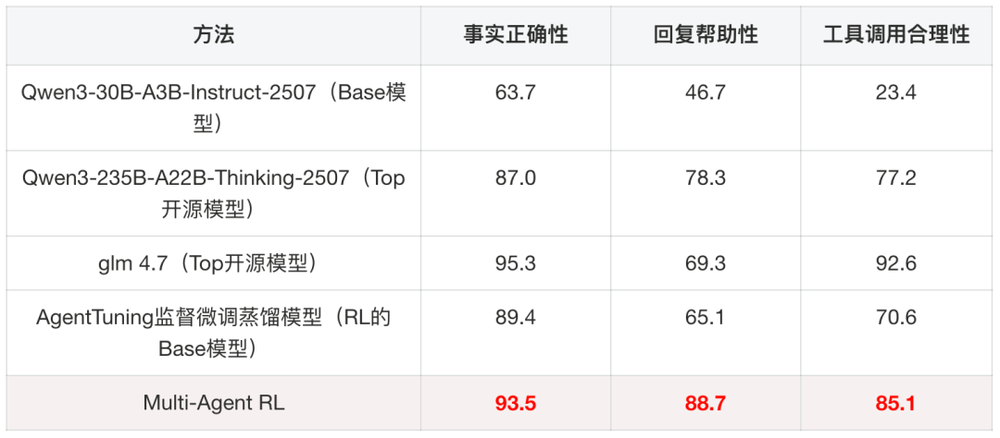</div><figcaption class="publication-caption">多智能体协同训练的消融对比。</figcaption></figure>

- 本实验与前述架构升级实验为分别设计的独立实验，主要改动来自于对事实正确性、回复帮助性 LLM Judge 的迭代升级以及蒸馏教师模型采用了更加强大的 GLM 4.7 模型；
- 为了解决此前系统仅关注最终回复效果而导致工具调用能力在优化后下降的缺陷，我们单独将工具调用合理性这一 LLM Judge 指标作为测试集指标以监控模型的工具调用能力。

- 相对这组实验的 SFT 基线，回复模型正确性提高 4.1pt，帮助性提高 23.6pt；工具模型的调用合理性提高 18.2pt。我们把两部分分开记录，再看完整系统的变化，避免只留下最终回复的一个分数。

### 收益来自哪里

<figure class="publication-figure figure-landscape" id="blog-figure-17"><div class="figure-heading"><span class="figure-label">图 17</span><button aria-label="放大查看：图 17" class="figure-expand" type="button">查看大图 ↗</button></div><div class="figure-media">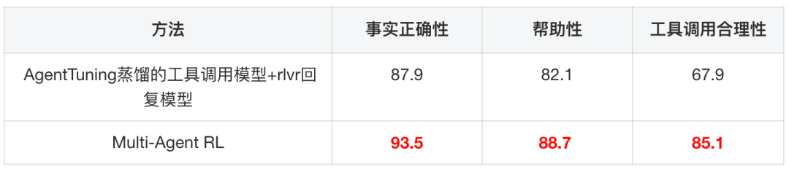</div><figcaption class="publication-caption">不同训练与奖励配置的对比。</figcaption></figure>

- 为了分清上游工具改进的作用，我们固定工具模型，只对最终回复做 RLVR，作为另一组对照。这样可以检查，收益是否仅来自回复风格更符合奖励偏好，还是也包含了更好的信息获取过程。
- 在实验中，Multi-Agent RL 方法相较于固定工具调用模型仅 rlvr 训练回复模型的方法在事实正确性上提升5.6pt，在帮助性上提升6.6pt，而工具调用合理性保持了对 SFT 模型的优势（+18.2pt）。

总结与未来展望

- 总结：

- 回头看，第一阶段主要是在补架构上的限制：让模型结合上下文选工具，替代固定的意图分支。为了把多轮决策放进直播间的延迟预算，我们再把大教师的能力蒸馏到较小的 MoE 模型，并用 RLVR 优化最终回复。工具调用生成能做到亚秒级，但完整互动仍应看前面的端到端耗时；线上 A/B 的收益也来自这一整套链路调整，不能只归到某一个模型。
- 第二阶段则把重点转向训练：先搭好仿真环境，让 Agent 自己完成多轮交互，再检查最终回复奖励能否解释前面的决策。我们补充了工具调用合理性评估，并将工具与回复拆成两个协同训练的 Agent，让较模糊的整体反馈更贴近各自的职责。这个过程让我们更能看清，收益来自哪个环节，以及哪些错误需要改奖励、哪些需要回到环境里处理。

- 当前互动算法局限与未来展望：

- 整体架构由 Workflow 升级为 Agent，基础能力已完成闭环，后续需重点扩充直播数字人专属工具，设计高阶交互功能，以充分释放 Agentic 架构及 LLM 的强大潜能；
- 当前 Multi-Agent 基本是来自于单 Agent ReAct 架构的阶段性解耦策略，更接近于 Dr.MAS 这样的串行 Multi-Agent，类似于 sub-agent、agent-swarm 等并行化 Multi-Agent 优势仍未体现出来；
- 现在的训练仍然围绕具体任务展开。新增工具或信息后，旧模型不一定能直接读懂并用好；一方面需要继续改善模型的泛化，另一方面也可以把工具使用方式写进 Skill，通过渐进式披露在运行时提供。后续 Harness 相关工作的出发点，正是如何让模型跟上这些环境变化。

## 怎么理解这些结果

线上 A/B 与离线 Multi-Agent RL 是不同阶段的实验。1.79 秒的平均端到端延迟、下降 1.36 秒，以及多轮用户比例提升 2.76%，对应的是从 Workflow 升级到 Agentic 架构后的线上对比；不能直接归因于后面的 Multi-Agent RL。

正确性 +4.1pt、帮助性 +23.6pt、工具合理性 +18.2pt，则是文中离线训练实验相对监督微调模型的变化。不同实验还涉及教师与 Judge 配置，比较时应同时看基线、输入数据和判分口径，避免把几张表拼成一个统一的因果结论。

对工程落地而言，我们更看重完整轨迹能否解释：信息缺在哪里、工具为什么被调用、奖励是否真的在鼓励目标行为。把任务拆成两个 Agent，只是让这些问题更容易定位和优化。
