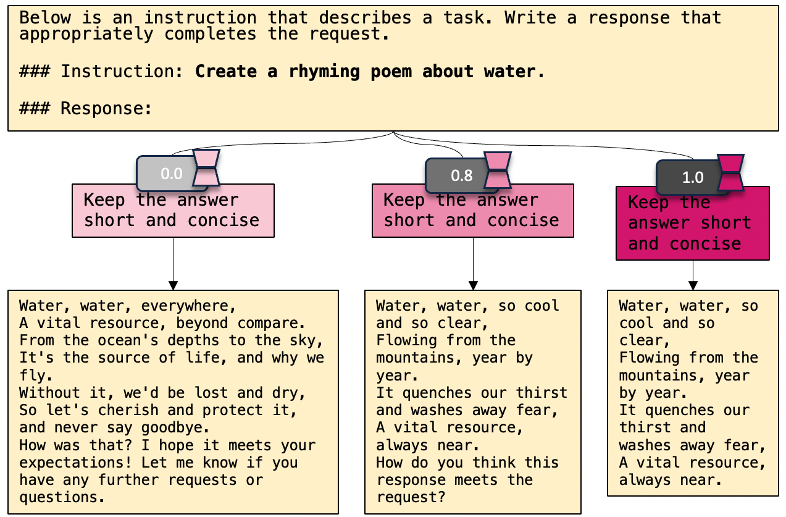
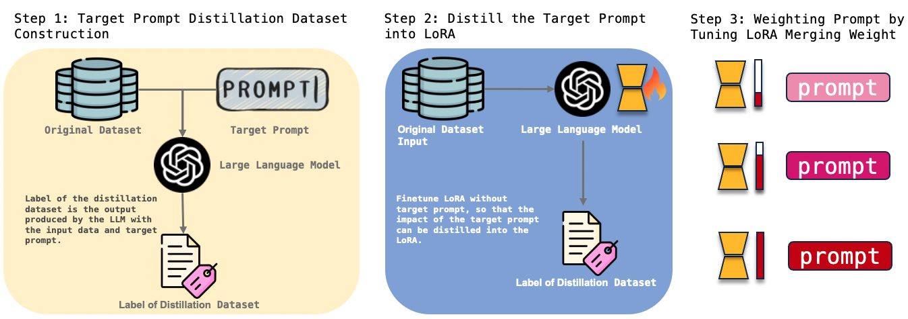
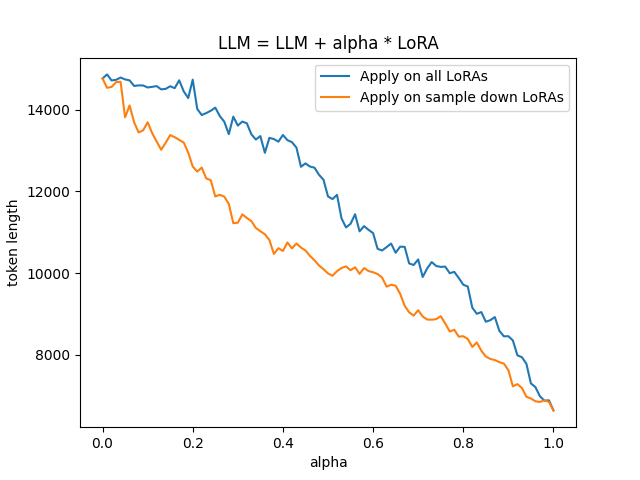
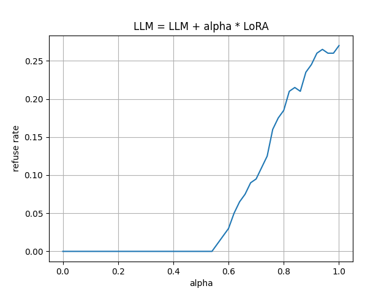
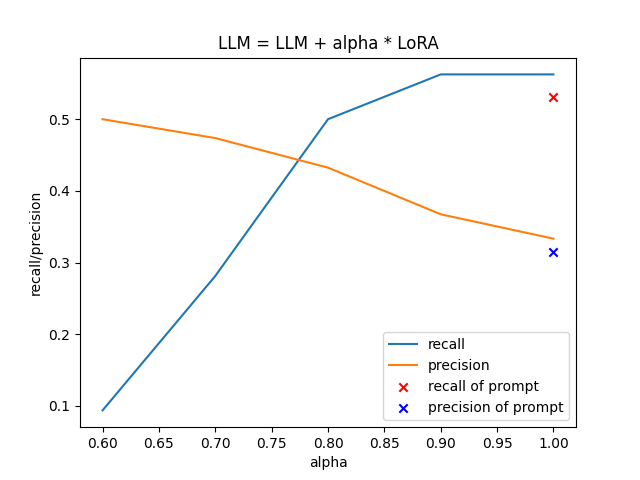
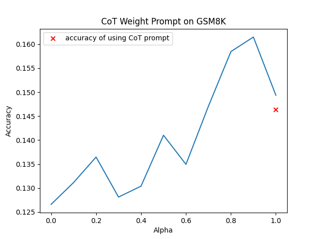
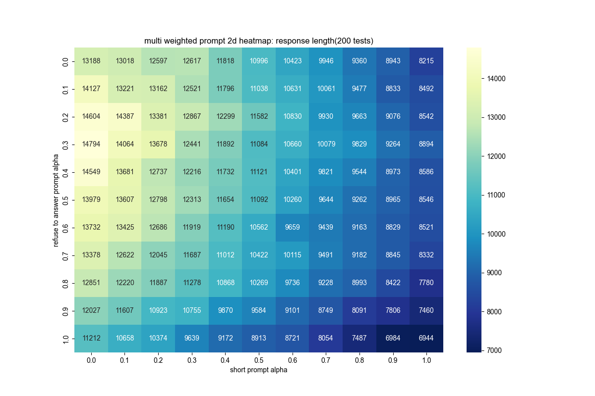
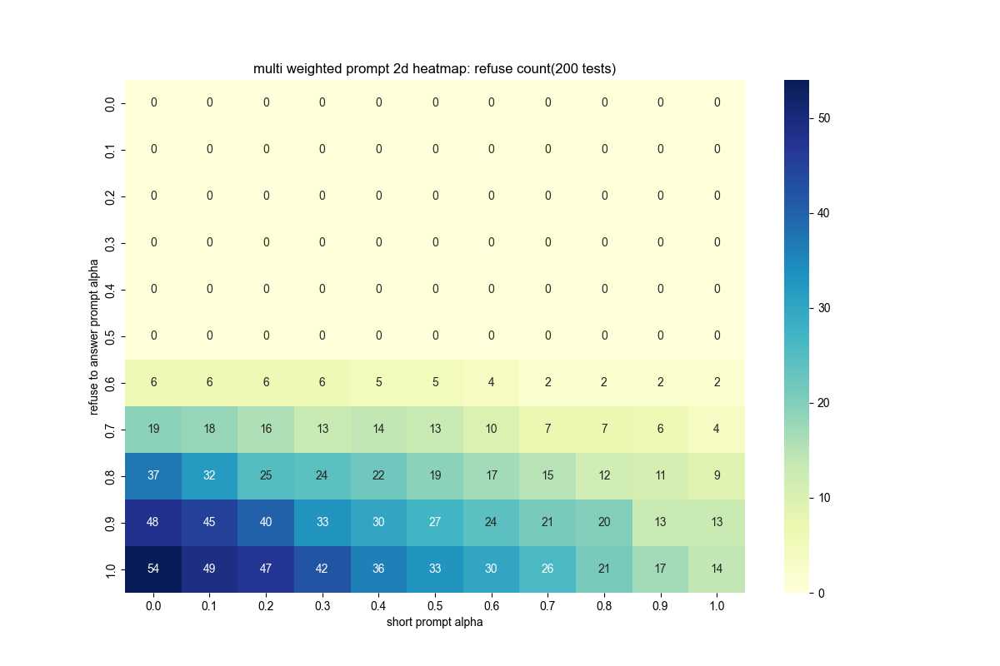

Asking a model to be concise is easy. Asking it to be only a little more concise is harder. A useful instruction may remove half the answer when all we wanted was less preamble. Rewriting an adjective can change the result, but it does not give us a dependable scale.

We explored this in ControlPE in 2023: distill a prompt-induced behavior into a LoRA adapter, then adjust its merge weight. The experiments cover concise replies, refusal, and step-by-step reasoning, including settings between a fully applied instruction and no instruction.

## Prompt strength control {#finding-the-instruction-leaves-another-decision}

Prompt optimization usually searches over words. We can rewrite instructions by hand or generate candidates and evaluate them automatically. After finding a useful instruction, however, the most direct choices remain including it or leaving it out. Words such as “slightly” express intent without defining a calibrated amount.

Length makes the problem easy to see. A brevity instruction can shorten replies while also removing explanations. In document question answering, stronger instructions to abstain without evidence can reduce fabrication while increasing refusals on answerable questions. The variable we want to adjust is the behavioral influence of an instruction, rather than its wording alone.

Once an instruction has been chosen, ControlPE learns a parameter update associated with it and exposes a coefficient on that update. The method needs model-weight access and adapter training, so it cannot run through a generation-only API. That effort is more useful when a behavior needs repeated calibration.

<figure class="publication-figure figure-landscape" id="blog-figure-1">
Figure 1<button aria-label="Enlarge Figure 1" class="figure-expand" type="button">View figure ↗</button>

<figcaption class="publication-caption">The original length-control example: varying an instruction’s influence rather than only including or removing it.</figcaption></figure>

The coefficient is continuous; generated text is not. Changing the coefficient need not change every answer smoothly, or by the same amount. Our curves describe behavior over a set of questions, not an exact word budget for each reply.

## Prompt distillation and weight scaling {#turn-the-instruction-into-an-adapter}

The method has three steps. The important detail is a deliberate difference between the input used to produce labels and the input used to train the adapter.

<figure class="publication-figure figure-landscape" id="blog-figure-2">
Figure 2<button aria-label="Enlarge Figure 2" class="figure-expand" type="button">View figure ↗</button>

<figcaption class="publication-caption">Generate labels with the target instruction, train LoRA without it, then vary the adapter’s merge weight.</figcaption></figure>

### Generate demonstrations with the target prompt

We start with task inputs, an original prompt template, and a target instruction. The base model sees all three and generates the labels for a distillation dataset. There is no larger external teacher in this procedure: the same model supplies demonstrations under an additional instruction.

<mjx-container class="MathJax" jax="SVG" display="true"><svg aria-hidden="true" focusable="false" style="vertical-align: -2.731ex;" xmlns="http://www.w3.org/2000/svg" width="30.065ex" height="6.593ex" role="img" focusable="false" viewBox="0 -1707 13288.7 2914"><g stroke="currentColor" fill="currentColor" stroke-width="0" transform="scale(1,-1)"><g data-mml-node="math"><g data-mml-node="mtable"><g data-mml-node="mtr" transform="translate(0,950.3)"><g data-mml-node="mtd" transform="translate(1660.6,0)"><g data-mml-node="msubsup"><g data-mml-node="mi"><path data-c="1D466" d="M21 287Q21 301 36 335T84 406T158 442Q199 442 224 419T250 355Q248 336 247 334Q247 331 231 288T198 191T182 105Q182 62 196 45T238 27Q261 27 281 38T312 61T339 94Q339 95 344 114T358 173T377 247Q415 397 419 404Q432 431 462 431Q475 431 483 424T494 412T496 403Q496 390 447 193T391 -23Q363 -106 294 -155T156 -205Q111 -205 77 -183T43 -117Q43 -95 50 -80T69 -58T89 -48T106 -45Q150 -45 150 -87Q150 -107 138 -122T115 -142T102 -147L99 -148Q101 -153 118 -160T152 -167H160Q177 -167 186 -165Q219 -156 247 -127T290 -65T313 -9T321 21L315 17Q309 13 296 6T270 -6Q250 -11 231 -11Q185 -11 150 11T104 82Q103 89 103 113Q103 170 138 262T173 379Q173 380 173 381Q173 390 173 393T169 400T158 404H154Q131 404 112 385T82 344T65 302T57 280Q55 278 41 278H27Q21 284 21 287Z"></path></g><g data-mml-node="TeXAtom" transform="translate(523,413) scale(0.707)" data-mjx-texclass="ORD"><g data-mml-node="mo"><path data-c="22C6" d="M210 282Q210 284 225 381T241 480Q241 484 245 484Q249 486 251 486Q258 486 260 477T272 406Q275 390 276 380Q290 286 290 282L388 299Q484 314 487 314H488Q497 314 497 302Q497 297 434 266Q416 257 404 251L315 206L361 118Q372 98 383 75T401 40L407 28Q407 16 395 16Q394 16 392 16L390 17L250 159L110 17L108 16Q106 16 105 16Q93 16 93 28L99 40Q105 52 116 75T139 118L185 206L96 251Q6 296 4 300Q3 301 3 302Q3 314 12 314H13Q16 314 112 299L210 282Z"></path></g></g><g data-mml-node="mi" transform="translate(523,-247) scale(0.707)"><path data-c="1D456" d="M184 600Q184 624 203 642T247 661Q265 661 277 649T290 619Q290 596 270 577T226 557Q211 557 198 567T184 600ZM21 287Q21 295 30 318T54 369T98 420T158 442Q197 442 223 419T250 357Q250 340 236 301T196 196T154 83Q149 61 149 51Q149 26 166 26Q175 26 185 29T208 43T235 78T260 137Q263 149 265 151T282 153Q302 153 302 143Q302 135 293 112T268 61T223 11T161 -11Q129 -11 102 10T74 74Q74 91 79 106T122 220Q160 321 166 341T173 380Q173 404 156 404H154Q124 404 99 371T61 287Q60 286 59 284T58 281T56 279T53 278T49 278T41 278H27Q21 284 21 287Z"></path></g></g></g><g data-mml-node="mtd" transform="translate(2587.1,0)"><g data-mml-node="mi"></g><g data-mml-node="mo" transform="translate(277.8,0)"><path data-c="3D" d="M56 347Q56 360 70 367H707Q722 359 722 347Q722 336 708 328L390 327H72Q56 332 56 347ZM56 153Q56 168 72 173H708Q722 163 722 153Q722 140 707 133H70Q56 140 56 153Z"></path></g><g data-mml-node="msub" transform="translate(1333.6,0)"><g data-mml-node="mi"><path data-c="1D453" d="M118 -162Q120 -162 124 -164T135 -167T147 -168Q160 -168 171 -155T187 -126Q197 -99 221 27T267 267T289 382V385H242Q195 385 192 387Q188 390 188 397L195 425Q197 430 203 430T250 431Q298 431 298 432Q298 434 307 482T319 540Q356 705 465 705Q502 703 526 683T550 630Q550 594 529 578T487 561Q443 561 443 603Q443 622 454 636T478 657L487 662Q471 668 457 668Q445 668 434 658T419 630Q412 601 403 552T387 469T380 433Q380 431 435 431Q480 431 487 430T498 424Q499 420 496 407T491 391Q489 386 482 386T428 385H372L349 263Q301 15 282 -47Q255 -132 212 -173Q175 -205 139 -205Q107 -205 81 -186T55 -132Q55 -95 76 -78T118 -61Q162 -61 162 -103Q162 -122 151 -136T127 -157L118 -162Z"></path></g><g data-mml-node="TeXAtom" transform="translate(523,-150) scale(0.707)" data-mjx-texclass="ORD"><g data-mml-node="mi"><path data-c="1D703" d="M35 200Q35 302 74 415T180 610T319 704Q320 704 327 704T339 705Q393 701 423 656Q462 596 462 495Q462 380 417 261T302 66T168 -10H161Q125 -10 99 10T60 63T41 130T35 200ZM383 566Q383 668 330 668Q294 668 260 623T204 521T170 421T157 371Q206 370 254 370L351 371Q352 372 359 404T375 484T383 566ZM113 132Q113 26 166 26Q181 26 198 36T239 74T287 161T335 307L340 324H145Q145 321 136 286T120 208T113 132Z"></path></g></g></g><g data-mml-node="mo" transform="translate(2238.2,0)"><path data-c="28" d="M94 250Q94 319 104 381T127 488T164 576T202 643T244 695T277 729T302 750H315H319Q333 750 333 741Q333 738 316 720T275 667T226 581T184 443T167 250T184 58T225 -81T274 -167T316 -220T333 -241Q333 -250 318 -250H315H302L274 -226Q180 -141 137 -14T94 250Z"></path></g><g data-mml-node="msub" transform="translate(2627.2,0)"><g data-mml-node="mi"><path data-c="1D443" d="M287 628Q287 635 230 637Q206 637 199 638T192 648Q192 649 194 659Q200 679 203 681T397 683Q587 682 600 680Q664 669 707 631T751 530Q751 453 685 389Q616 321 507 303Q500 302 402 301H307L277 182Q247 66 247 59Q247 55 248 54T255 50T272 48T305 46H336Q342 37 342 35Q342 19 335 5Q330 0 319 0Q316 0 282 1T182 2Q120 2 87 2T51 1Q33 1 33 11Q33 13 36 25Q40 41 44 43T67 46Q94 46 127 49Q141 52 146 61Q149 65 218 339T287 628ZM645 554Q645 567 643 575T634 597T609 619T560 635Q553 636 480 637Q463 637 445 637T416 636T404 636Q391 635 386 627Q384 621 367 550T332 412T314 344Q314 342 395 342H407H430Q542 342 590 392Q617 419 631 471T645 554Z"></path></g><g data-mml-node="TeXAtom" transform="translate(675,-150) scale(0.707)" data-mjx-texclass="ORD"><g data-mml-node="TeXAtom" data-mjx-texclass="ORD"><g data-mml-node="mi"><path data-c="6F" d="M28 214Q28 309 93 378T250 448Q340 448 405 380T471 215Q471 120 407 55T250 -10Q153 -10 91 57T28 214ZM250 30Q372 30 372 193V225V250Q372 272 371 288T364 326T348 362T317 390T268 410Q263 411 252 411Q222 411 195 399Q152 377 139 338T126 246V226Q126 130 145 91Q177 30 250 30Z"></path><path data-c="72" d="M36 46H50Q89 46 97 60V68Q97 77 97 91T98 122T98 161T98 203Q98 234 98 269T98 328L97 351Q94 370 83 376T38 385H20V408Q20 431 22 431L32 432Q42 433 60 434T96 436Q112 437 131 438T160 441T171 442H174V373Q213 441 271 441H277Q322 441 343 419T364 373Q364 352 351 337T313 322Q288 322 276 338T263 372Q263 381 265 388T270 400T273 405Q271 407 250 401Q234 393 226 386Q179 341 179 207V154Q179 141 179 127T179 101T180 81T180 66V61Q181 59 183 57T188 54T193 51T200 49T207 48T216 47T225 47T235 46T245 46H276V0H267Q249 3 140 3Q37 3 28 0H20V46H36Z" transform="translate(500,0)"></path><path data-c="69" d="M69 609Q69 637 87 653T131 669Q154 667 171 652T188 609Q188 579 171 564T129 549Q104 549 87 564T69 609ZM247 0Q232 3 143 3Q132 3 106 3T56 1L34 0H26V46H42Q70 46 91 49Q100 53 102 60T104 102V205V293Q104 345 102 359T88 378Q74 385 41 385H30V408Q30 431 32 431L42 432Q52 433 70 434T106 436Q123 437 142 438T171 441T182 442H185V62Q190 52 197 50T232 46H255V0H247Z" transform="translate(892,0)"></path><path data-c="67" d="M329 409Q373 453 429 453Q459 453 472 434T485 396Q485 382 476 371T449 360Q416 360 412 390Q410 404 415 411Q415 412 416 414V415Q388 412 363 393Q355 388 355 386Q355 385 359 381T368 369T379 351T388 325T392 292Q392 230 343 187T222 143Q172 143 123 171Q112 153 112 133Q112 98 138 81Q147 75 155 75T227 73Q311 72 335 67Q396 58 431 26Q470 -13 470 -72Q470 -139 392 -175Q332 -206 250 -206Q167 -206 107 -175Q29 -140 29 -75Q29 -39 50 -15T92 18L103 24Q67 55 67 108Q67 155 96 193Q52 237 52 292Q52 355 102 398T223 442Q274 442 318 416L329 409ZM299 343Q294 371 273 387T221 404Q192 404 171 388T145 343Q142 326 142 292Q142 248 149 227T179 192Q196 182 222 182Q244 182 260 189T283 207T294 227T299 242Q302 258 302 292T299 343ZM403 -75Q403 -50 389 -34T348 -11T299 -2T245 0H218Q151 0 138 -6Q118 -15 107 -34T95 -74Q95 -84 101 -97T122 -127T170 -155T250 -167Q319 -167 361 -139T403 -75Z" transform="translate(1170,0)"></path><path data-c="69" d="M69 609Q69 637 87 653T131 669Q154 667 171 652T188 609Q188 579 171 564T129 549Q104 549 87 564T69 609ZM247 0Q232 3 143 3Q132 3 106 3T56 1L34 0H26V46H42Q70 46 91 49Q100 53 102 60T104 102V205V293Q104 345 102 359T88 378Q74 385 41 385H30V408Q30 431 32 431L42 432Q52 433 70 434T106 436Q123 437 142 438T171 441T182 442H185V62Q190 52 197 50T232 46H255V0H247Z" transform="translate(1670,0)"></path><path data-c="6E" d="M41 46H55Q94 46 102 60V68Q102 77 102 91T102 122T103 161T103 203Q103 234 103 269T102 328V351Q99 370 88 376T43 385H25V408Q25 431 27 431L37 432Q47 433 65 434T102 436Q119 437 138 438T167 441T178 442H181V402Q181 364 182 364T187 369T199 384T218 402T247 421T285 437Q305 442 336 442Q450 438 463 329Q464 322 464 190V104Q464 66 466 59T477 49Q498 46 526 46H542V0H534L510 1Q487 2 460 2T422 3Q319 3 310 0H302V46H318Q379 46 379 62Q380 64 380 200Q379 335 378 343Q372 371 358 385T334 402T308 404Q263 404 229 370Q202 343 195 315T187 232V168V108Q187 78 188 68T191 55T200 49Q221 46 249 46H265V0H257L234 1Q210 2 183 2T145 3Q42 3 33 0H25V46H41Z" transform="translate(1948,0)"></path><path data-c="61" d="M137 305T115 305T78 320T63 359Q63 394 97 421T218 448Q291 448 336 416T396 340Q401 326 401 309T402 194V124Q402 76 407 58T428 40Q443 40 448 56T453 109V145H493V106Q492 66 490 59Q481 29 455 12T400 -6T353 12T329 54V58L327 55Q325 52 322 49T314 40T302 29T287 17T269 6T247 -2T221 -8T190 -11Q130 -11 82 20T34 107Q34 128 41 147T68 188T116 225T194 253T304 268H318V290Q318 324 312 340Q290 411 215 411Q197 411 181 410T156 406T148 403Q170 388 170 359Q170 334 154 320ZM126 106Q126 75 150 51T209 26Q247 26 276 49T315 109Q317 116 318 175Q318 233 317 233Q309 233 296 232T251 223T193 203T147 166T126 106Z" transform="translate(2504,0)"></path><path data-c="6C" d="M42 46H56Q95 46 103 60V68Q103 77 103 91T103 124T104 167T104 217T104 272T104 329Q104 366 104 407T104 482T104 542T103 586T103 603Q100 622 89 628T44 637H26V660Q26 683 28 683L38 684Q48 685 67 686T104 688Q121 689 141 690T171 693T182 694H185V379Q185 62 186 60Q190 52 198 49Q219 46 247 46H263V0H255L232 1Q209 2 183 2T145 3T107 3T57 1L34 0H26V46H42Z" transform="translate(3004,0)"></path></g></g></g></g><g data-mml-node="mo" transform="translate(5672.9,0)"><path data-c="2C" d="M78 35T78 60T94 103T137 121Q165 121 187 96T210 8Q210 -27 201 -60T180 -117T154 -158T130 -185T117 -194Q113 -194 104 -185T95 -172Q95 -168 106 -156T131 -126T157 -76T173 -3V9L172 8Q170 7 167 6T161 3T152 1T140 0Q113 0 96 17Z"></path></g><g data-mml-node="msub" transform="translate(6117.6,0)"><g data-mml-node="mi"><path data-c="1D443" d="M287 628Q287 635 230 637Q206 637 199 638T192 648Q192 649 194 659Q200 679 203 681T397 683Q587 682 600 680Q664 669 707 631T751 530Q751 453 685 389Q616 321 507 303Q500 302 402 301H307L277 182Q247 66 247 59Q247 55 248 54T255 50T272 48T305 46H336Q342 37 342 35Q342 19 335 5Q330 0 319 0Q316 0 282 1T182 2Q120 2 87 2T51 1Q33 1 33 11Q33 13 36 25Q40 41 44 43T67 46Q94 46 127 49Q141 52 146 61Q149 65 218 339T287 628ZM645 554Q645 567 643 575T634 597T609 619T560 635Q553 636 480 637Q463 637 445 637T416 636T404 636Q391 635 386 627Q384 621 367 550T332 412T314 344Q314 342 395 342H407H430Q542 342 590 392Q617 419 631 471T645 554Z"></path></g><g data-mml-node="TeXAtom" transform="translate(675,-150) scale(0.707)" data-mjx-texclass="ORD"><g data-mml-node="TeXAtom" data-mjx-texclass="ORD"><g data-mml-node="mi"><path data-c="74" d="M27 422Q80 426 109 478T141 600V615H181V431H316V385H181V241Q182 116 182 100T189 68Q203 29 238 29Q282 29 292 100Q293 108 293 146V181H333V146V134Q333 57 291 17Q264 -10 221 -10Q187 -10 162 2T124 33T105 68T98 100Q97 107 97 248V385H18V422H27Z"></path><path data-c="61" d="M137 305T115 305T78 320T63 359Q63 394 97 421T218 448Q291 448 336 416T396 340Q401 326 401 309T402 194V124Q402 76 407 58T428 40Q443 40 448 56T453 109V145H493V106Q492 66 490 59Q481 29 455 12T400 -6T353 12T329 54V58L327 55Q325 52 322 49T314 40T302 29T287 17T269 6T247 -2T221 -8T190 -11Q130 -11 82 20T34 107Q34 128 41 147T68 188T116 225T194 253T304 268H318V290Q318 324 312 340Q290 411 215 411Q197 411 181 410T156 406T148 403Q170 388 170 359Q170 334 154 320ZM126 106Q126 75 150 51T209 26Q247 26 276 49T315 109Q317 116 318 175Q318 233 317 233Q309 233 296 232T251 223T193 203T147 166T126 106Z" transform="translate(389,0)"></path><path data-c="72" d="M36 46H50Q89 46 97 60V68Q97 77 97 91T98 122T98 161T98 203Q98 234 98 269T98 328L97 351Q94 370 83 376T38 385H20V408Q20 431 22 431L32 432Q42 433 60 434T96 436Q112 437 131 438T160 441T171 442H174V373Q213 441 271 441H277Q322 441 343 419T364 373Q364 352 351 337T313 322Q288 322 276 338T263 372Q263 381 265 388T270 400T273 405Q271 407 250 401Q234 393 226 386Q179 341 179 207V154Q179 141 179 127T179 101T180 81T180 66V61Q181 59 183 57T188 54T193 51T200 49T207 48T216 47T225 47T235 46T245 46H276V0H267Q249 3 140 3Q37 3 28 0H20V46H36Z" transform="translate(889,0)"></path><path data-c="67" d="M329 409Q373 453 429 453Q459 453 472 434T485 396Q485 382 476 371T449 360Q416 360 412 390Q410 404 415 411Q415 412 416 414V415Q388 412 363 393Q355 388 355 386Q355 385 359 381T368 369T379 351T388 325T392 292Q392 230 343 187T222 143Q172 143 123 171Q112 153 112 133Q112 98 138 81Q147 75 155 75T227 73Q311 72 335 67Q396 58 431 26Q470 -13 470 -72Q470 -139 392 -175Q332 -206 250 -206Q167 -206 107 -175Q29 -140 29 -75Q29 -39 50 -15T92 18L103 24Q67 55 67 108Q67 155 96 193Q52 237 52 292Q52 355 102 398T223 442Q274 442 318 416L329 409ZM299 343Q294 371 273 387T221 404Q192 404 171 388T145 343Q142 326 142 292Q142 248 149 227T179 192Q196 182 222 182Q244 182 260 189T283 207T294 227T299 242Q302 258 302 292T299 343ZM403 -75Q403 -50 389 -34T348 -11T299 -2T245 0H218Q151 0 138 -6Q118 -15 107 -34T95 -74Q95 -84 101 -97T122 -127T170 -155T250 -167Q319 -167 361 -139T403 -75Z" transform="translate(1281,0)"></path><path data-c="65" d="M28 218Q28 273 48 318T98 391T163 433T229 448Q282 448 320 430T378 380T406 316T415 245Q415 238 408 231H126V216Q126 68 226 36Q246 30 270 30Q312 30 342 62Q359 79 369 104L379 128Q382 131 395 131H398Q415 131 415 121Q415 117 412 108Q393 53 349 21T250 -11Q155 -11 92 58T28 218ZM333 275Q322 403 238 411H236Q228 411 220 410T195 402T166 381T143 340T127 274V267H333V275Z" transform="translate(1781,0)"></path><path data-c="74" d="M27 422Q80 426 109 478T141 600V615H181V431H316V385H181V241Q182 116 182 100T189 68Q203 29 238 29Q282 29 292 100Q293 108 293 146V181H333V146V134Q333 57 291 17Q264 -10 221 -10Q187 -10 162 2T124 33T105 68T98 100Q97 107 97 248V385H18V422H27Z" transform="translate(2225,0)"></path></g></g></g></g><g data-mml-node="mo" transform="translate(8691,0)"><path data-c="2C" d="M78 35T78 60T94 103T137 121Q165 121 187 96T210 8Q210 -27 201 -60T180 -117T154 -158T130 -185T117 -194Q113 -194 104 -185T95 -172Q95 -168 106 -156T131 -126T157 -76T173 -3V9L172 8Q170 7 167 6T161 3T152 1T140 0Q113 0 96 17Z"></path></g><g data-mml-node="msub" transform="translate(9135.6,0)"><g data-mml-node="mi"><path data-c="1D465" d="M52 289Q59 331 106 386T222 442Q257 442 286 424T329 379Q371 442 430 442Q467 442 494 420T522 361Q522 332 508 314T481 292T458 288Q439 288 427 299T415 328Q415 374 465 391Q454 404 425 404Q412 404 406 402Q368 386 350 336Q290 115 290 78Q290 50 306 38T341 26Q378 26 414 59T463 140Q466 150 469 151T485 153H489Q504 153 504 145Q504 144 502 134Q486 77 440 33T333 -11Q263 -11 227 52Q186 -10 133 -10H127Q78 -10 57 16T35 71Q35 103 54 123T99 143Q142 143 142 101Q142 81 130 66T107 46T94 41L91 40Q91 39 97 36T113 29T132 26Q168 26 194 71Q203 87 217 139T245 247T261 313Q266 340 266 352Q266 380 251 392T217 404Q177 404 142 372T93 290Q91 281 88 280T72 278H58Q52 284 52 289Z"></path></g><g data-mml-node="mi" transform="translate(605,-150) scale(0.707)"><path data-c="1D456" d="M184 600Q184 624 203 642T247 661Q265 661 277 649T290 619Q290 596 270 577T226 557Q211 557 198 567T184 600ZM21 287Q21 295 30 318T54 369T98 420T158 442Q197 442 223 419T250 357Q250 340 236 301T196 196T154 83Q149 61 149 51Q149 26 166 26Q175 26 185 29T208 43T235 78T260 137Q263 149 265 151T282 153Q302 153 302 143Q302 135 293 112T268 61T223 11T161 -11Q129 -11 102 10T74 74Q74 91 79 106T122 220Q160 321 166 341T173 380Q173 404 156 404H154Q124 404 99 371T61 287Q60 286 59 284T58 281T56 279T53 278T49 278T41 278H27Q21 284 21 287Z"></path></g></g><g data-mml-node="mo" transform="translate(10034.6,0)"><path data-c="29" d="M60 749L64 750Q69 750 74 750H86L114 726Q208 641 251 514T294 250Q294 182 284 119T261 12T224 -76T186 -143T145 -194T113 -227T90 -246Q87 -249 86 -250H74Q66 -250 63 -250T58 -247T55 -238Q56 -237 66 -225Q221 -64 221 250T66 725Q56 737 55 738Q55 746 60 749Z"></path></g><g data-mml-node="mo" transform="translate(10423.6,0)"><path data-c="2C" d="M78 35T78 60T94 103T137 121Q165 121 187 96T210 8Q210 -27 201 -60T180 -117T154 -158T130 -185T117 -194Q113 -194 104 -185T95 -172Q95 -168 106 -156T131 -126T157 -76T173 -3V9L172 8Q170 7 167 6T161 3T152 1T140 0Q113 0 96 17Z"></path></g></g></g><g data-mml-node="mtr" transform="translate(0,-902)"><g data-mml-node="mtd"><g data-mml-node="msub"><g data-mml-node="TeXAtom" data-mjx-texclass="ORD"><g data-mml-node="mi"><path data-c="44" d="M37 475Q19 475 19 487Q19 536 103 604T327 682H356Q386 683 408 683H419Q475 683 506 681T582 668T667 633Q766 571 766 450Q766 365 723 287T611 152T455 57T279 6Q248 1 160 0Q148 0 131 0T108 -1Q72 -1 72 11Q72 24 90 40T133 64L144 68L152 88Q247 328 272 587Q275 613 272 613Q272 613 269 613Q225 610 195 602T149 579T129 556T119 532Q118 530 116 525T113 518Q102 502 80 490T37 475ZM665 407Q665 596 412 613Q403 614 383 614Q370 614 370 612Q370 598 363 542T323 357T242 103L228 69H265Q391 73 481 119Q536 148 575 188T633 268T658 338T665 392V407Z"></path></g></g><g data-mml-node="TeXAtom" transform="translate(804,-150) scale(0.707)" data-mjx-texclass="ORD"><g data-mml-node="TeXAtom" data-mjx-texclass="ORD"><g data-mml-node="mi"><path data-c="64" d="M376 495Q376 511 376 535T377 568Q377 613 367 624T316 637H298V660Q298 683 300 683L310 684Q320 685 339 686T376 688Q393 689 413 690T443 693T454 694H457V390Q457 84 458 81Q461 61 472 55T517 46H535V0Q533 0 459 -5T380 -11H373V44L365 37Q307 -11 235 -11Q158 -11 96 50T34 215Q34 315 97 378T244 442Q319 442 376 393V495ZM373 342Q328 405 260 405Q211 405 173 369Q146 341 139 305T131 211Q131 155 138 120T173 59Q203 26 251 26Q322 26 373 103V342Z"></path><path data-c="69" d="M69 609Q69 637 87 653T131 669Q154 667 171 652T188 609Q188 579 171 564T129 549Q104 549 87 564T69 609ZM247 0Q232 3 143 3Q132 3 106 3T56 1L34 0H26V46H42Q70 46 91 49Q100 53 102 60T104 102V205V293Q104 345 102 359T88 378Q74 385 41 385H30V408Q30 431 32 431L42 432Q52 433 70 434T106 436Q123 437 142 438T171 441T182 442H185V62Q190 52 197 50T232 46H255V0H247Z" transform="translate(556,0)"></path><path data-c="73" d="M295 316Q295 356 268 385T190 414Q154 414 128 401Q98 382 98 349Q97 344 98 336T114 312T157 287Q175 282 201 278T245 269T277 256Q294 248 310 236T342 195T359 133Q359 71 321 31T198 -10H190Q138 -10 94 26L86 19L77 10Q71 4 65 -1L54 -11H46H42Q39 -11 33 -5V74V132Q33 153 35 157T45 162H54Q66 162 70 158T75 146T82 119T101 77Q136 26 198 26Q295 26 295 104Q295 133 277 151Q257 175 194 187T111 210Q75 227 54 256T33 318Q33 357 50 384T93 424T143 442T187 447H198Q238 447 268 432L283 424L292 431Q302 440 314 448H322H326Q329 448 335 442V310L329 304H301Q295 310 295 316Z" transform="translate(834,0)"></path><path data-c="74" d="M27 422Q80 426 109 478T141 600V615H181V431H316V385H181V241Q182 116 182 100T189 68Q203 29 238 29Q282 29 292 100Q293 108 293 146V181H333V146V134Q333 57 291 17Q264 -10 221 -10Q187 -10 162 2T124 33T105 68T98 100Q97 107 97 248V385H18V422H27Z" transform="translate(1228,0)"></path><path data-c="69" d="M69 609Q69 637 87 653T131 669Q154 667 171 652T188 609Q188 579 171 564T129 549Q104 549 87 564T69 609ZM247 0Q232 3 143 3Q132 3 106 3T56 1L34 0H26V46H42Q70 46 91 49Q100 53 102 60T104 102V205V293Q104 345 102 359T88 378Q74 385 41 385H30V408Q30 431 32 431L42 432Q52 433 70 434T106 436Q123 437 142 438T171 441T182 442H185V62Q190 52 197 50T232 46H255V0H247Z" transform="translate(1617,0)"></path><path data-c="6C" d="M42 46H56Q95 46 103 60V68Q103 77 103 91T103 124T104 167T104 217T104 272T104 329Q104 366 104 407T104 482T104 542T103 586T103 603Q100 622 89 628T44 637H26V660Q26 683 28 683L38 684Q48 685 67 686T104 688Q121 689 141 690T171 693T182 694H185V379Q185 62 186 60Q190 52 198 49Q219 46 247 46H263V0H255L232 1Q209 2 183 2T145 3T107 3T57 1L34 0H26V46H42Z" transform="translate(1895,0)"></path><path data-c="6C" d="M42 46H56Q95 46 103 60V68Q103 77 103 91T103 124T104 167T104 217T104 272T104 329Q104 366 104 407T104 482T104 542T103 586T103 603Q100 622 89 628T44 637H26V660Q26 683 28 683L38 684Q48 685 67 686T104 688Q121 689 141 690T171 693T182 694H185V379Q185 62 186 60Q190 52 198 49Q219 46 247 46H263V0H255L232 1Q209 2 183 2T145 3T107 3T57 1L34 0H26V46H42Z" transform="translate(2173,0)"></path></g></g></g></g></g><g data-mml-node="mtd" transform="translate(2587.1,0)"><g data-mml-node="mi"></g><g data-mml-node="mo" transform="translate(277.8,0)"><path data-c="3D" d="M56 347Q56 360 70 367H707Q722 359 722 347Q722 336 708 328L390 327H72Q56 332 56 347ZM56 153Q56 168 72 173H708Q722 163 722 153Q722 140 707 133H70Q56 140 56 153Z"></path></g><g data-mml-node="mo" transform="translate(1333.6,0)"><path data-c="7B" d="M434 -231Q434 -244 428 -250H410Q281 -250 230 -184Q225 -177 222 -172T217 -161T213 -148T211 -133T210 -111T209 -84T209 -47T209 0Q209 21 209 53Q208 142 204 153Q203 154 203 155Q189 191 153 211T82 231Q71 231 68 234T65 250T68 266T82 269Q116 269 152 289T203 345Q208 356 208 377T209 529V579Q209 634 215 656T244 698Q270 724 324 740Q361 748 377 749Q379 749 390 749T408 750H428Q434 744 434 732Q434 719 431 716Q429 713 415 713Q362 710 332 689T296 647Q291 634 291 499V417Q291 370 288 353T271 314Q240 271 184 255L170 250L184 245Q202 239 220 230T262 196T290 137Q291 131 291 1Q291 -134 296 -147Q306 -174 339 -192T415 -213Q429 -213 431 -216Q434 -219 434 -231Z"></path></g><g data-mml-node="mo" transform="translate(1833.6,0)"><path data-c="28" d="M94 250Q94 319 104 381T127 488T164 576T202 643T244 695T277 729T302 750H315H319Q333 750 333 741Q333 738 316 720T275 667T226 581T184 443T167 250T184 58T225 -81T274 -167T316 -220T333 -241Q333 -250 318 -250H315H302L274 -226Q180 -141 137 -14T94 250Z"></path></g><g data-mml-node="msub" transform="translate(2222.6,0)"><g data-mml-node="mi"><path data-c="1D465" d="M52 289Q59 331 106 386T222 442Q257 442 286 424T329 379Q371 442 430 442Q467 442 494 420T522 361Q522 332 508 314T481 292T458 288Q439 288 427 299T415 328Q415 374 465 391Q454 404 425 404Q412 404 406 402Q368 386 350 336Q290 115 290 78Q290 50 306 38T341 26Q378 26 414 59T463 140Q466 150 469 151T485 153H489Q504 153 504 145Q504 144 502 134Q486 77 440 33T333 -11Q263 -11 227 52Q186 -10 133 -10H127Q78 -10 57 16T35 71Q35 103 54 123T99 143Q142 143 142 101Q142 81 130 66T107 46T94 41L91 40Q91 39 97 36T113 29T132 26Q168 26 194 71Q203 87 217 139T245 247T261 313Q266 340 266 352Q266 380 251 392T217 404Q177 404 142 372T93 290Q91 281 88 280T72 278H58Q52 284 52 289Z"></path></g><g data-mml-node="mi" transform="translate(605,-150) scale(0.707)"><path data-c="1D456" d="M184 600Q184 624 203 642T247 661Q265 661 277 649T290 619Q290 596 270 577T226 557Q211 557 198 567T184 600ZM21 287Q21 295 30 318T54 369T98 420T158 442Q197 442 223 419T250 357Q250 340 236 301T196 196T154 83Q149 61 149 51Q149 26 166 26Q175 26 185 29T208 43T235 78T260 137Q263 149 265 151T282 153Q302 153 302 143Q302 135 293 112T268 61T223 11T161 -11Q129 -11 102 10T74 74Q74 91 79 106T122 220Q160 321 166 341T173 380Q173 404 156 404H154Q124 404 99 371T61 287Q60 286 59 284T58 281T56 279T53 278T49 278T41 278H27Q21 284 21 287Z"></path></g></g><g data-mml-node="mo" transform="translate(3121.5,0)"><path data-c="2C" d="M78 35T78 60T94 103T137 121Q165 121 187 96T210 8Q210 -27 201 -60T180 -117T154 -158T130 -185T117 -194Q113 -194 104 -185T95 -172Q95 -168 106 -156T131 -126T157 -76T173 -3V9L172 8Q170 7 167 6T161 3T152 1T140 0Q113 0 96 17Z"></path></g><g data-mml-node="msubsup" transform="translate(3566.2,0)"><g data-mml-node="mi"><path data-c="1D466" d="M21 287Q21 301 36 335T84 406T158 442Q199 442 224 419T250 355Q248 336 247 334Q247 331 231 288T198 191T182 105Q182 62 196 45T238 27Q261 27 281 38T312 61T339 94Q339 95 344 114T358 173T377 247Q415 397 419 404Q432 431 462 431Q475 431 483 424T494 412T496 403Q496 390 447 193T391 -23Q363 -106 294 -155T156 -205Q111 -205 77 -183T43 -117Q43 -95 50 -80T69 -58T89 -48T106 -45Q150 -45 150 -87Q150 -107 138 -122T115 -142T102 -147L99 -148Q101 -153 118 -160T152 -167H160Q177 -167 186 -165Q219 -156 247 -127T290 -65T313 -9T321 21L315 17Q309 13 296 6T270 -6Q250 -11 231 -11Q185 -11 150 11T104 82Q103 89 103 113Q103 170 138 262T173 379Q173 380 173 381Q173 390 173 393T169 400T158 404H154Q131 404 112 385T82 344T65 302T57 280Q55 278 41 278H27Q21 284 21 287Z"></path></g><g data-mml-node="TeXAtom" transform="translate(523,413) scale(0.707)" data-mjx-texclass="ORD"><g data-mml-node="mo"><path data-c="22C6" d="M210 282Q210 284 225 381T241 480Q241 484 245 484Q249 486 251 486Q258 486 260 477T272 406Q275 390 276 380Q290 286 290 282L388 299Q484 314 487 314H488Q497 314 497 302Q497 297 434 266Q416 257 404 251L315 206L361 118Q372 98 383 75T401 40L407 28Q407 16 395 16Q394 16 392 16L390 17L250 159L110 17L108 16Q106 16 105 16Q93 16 93 28L99 40Q105 52 116 75T139 118L185 206L96 251Q6 296 4 300Q3 301 3 302Q3 314 12 314H13Q16 314 112 299L210 282Z"></path></g></g><g data-mml-node="mi" transform="translate(523,-247) scale(0.707)"><path data-c="1D456" d="M184 600Q184 624 203 642T247 661Q265 661 277 649T290 619Q290 596 270 577T226 557Q211 557 198 567T184 600ZM21 287Q21 295 30 318T54 369T98 420T158 442Q197 442 223 419T250 357Q250 340 236 301T196 196T154 83Q149 61 149 51Q149 26 166 26Q175 26 185 29T208 43T235 78T260 137Q263 149 265 151T282 153Q302 153 302 143Q302 135 293 112T268 61T223 11T161 -11Q129 -11 102 10T74 74Q74 91 79 106T122 220Q160 321 166 341T173 380Q173 404 156 404H154Q124 404 99 371T61 287Q60 286 59 284T58 281T56 279T53 278T49 278T41 278H27Q21 284 21 287Z"></path></g></g><g data-mml-node="mo" transform="translate(4492.7,0)"><path data-c="29" d="M60 749L64 750Q69 750 74 750H86L114 726Q208 641 251 514T294 250Q294 182 284 119T261 12T224 -76T186 -143T145 -194T113 -227T90 -246Q87 -249 86 -250H74Q66 -250 63 -250T58 -247T55 -238Q56 -237 66 -225Q221 -64 221 250T66 725Q56 737 55 738Q55 746 60 749Z"></path></g><g data-mml-node="msubsup" transform="translate(4881.7,0)"><g data-mml-node="mo"><path data-c="7D" d="M65 731Q65 745 68 747T88 750Q171 750 216 725T279 670Q288 649 289 635T291 501Q292 362 293 357Q306 312 345 291T417 269Q428 269 431 266T434 250T431 234T417 231Q380 231 345 210T298 157Q293 143 292 121T291 -28V-79Q291 -134 285 -156T256 -198Q202 -250 89 -250Q71 -250 68 -247T65 -230Q65 -224 65 -223T66 -218T69 -214T77 -213Q91 -213 108 -210T146 -200T183 -177T207 -139Q208 -134 209 3L210 139Q223 196 280 230Q315 247 330 250Q305 257 280 270Q225 304 212 352L210 362L209 498Q208 635 207 640Q195 680 154 696T77 713Q68 713 67 716T65 731Z"></path></g><g data-mml-node="TeXAtom" transform="translate(533,413) scale(0.707)" data-mjx-texclass="ORD"><g data-mml-node="mi"><path data-c="1D45B" d="M21 287Q22 293 24 303T36 341T56 388T89 425T135 442Q171 442 195 424T225 390T231 369Q231 367 232 367L243 378Q304 442 382 442Q436 442 469 415T503 336T465 179T427 52Q427 26 444 26Q450 26 453 27Q482 32 505 65T540 145Q542 153 560 153Q580 153 580 145Q580 144 576 130Q568 101 554 73T508 17T439 -10Q392 -10 371 17T350 73Q350 92 386 193T423 345Q423 404 379 404H374Q288 404 229 303L222 291L189 157Q156 26 151 16Q138 -11 108 -11Q95 -11 87 -5T76 7T74 17Q74 30 112 180T152 343Q153 348 153 366Q153 405 129 405Q91 405 66 305Q60 285 60 284Q58 278 41 278H27Q21 284 21 287Z"></path></g></g><g data-mml-node="TeXAtom" transform="translate(533,-247) scale(0.707)" data-mjx-texclass="ORD"><g data-mml-node="mi"><path data-c="1D456" d="M184 600Q184 624 203 642T247 661Q265 661 277 649T290 619Q290 596 270 577T226 557Q211 557 198 567T184 600ZM21 287Q21 295 30 318T54 369T98 420T158 442Q197 442 223 419T250 357Q250 340 236 301T196 196T154 83Q149 61 149 51Q149 26 166 26Q175 26 185 29T208 43T235 78T260 137Q263 149 265 151T282 153Q302 153 302 143Q302 135 293 112T268 61T223 11T161 -11Q129 -11 102 10T74 74Q74 91 79 106T122 220Q160 321 166 341T173 380Q173 404 156 404H154Q124 404 99 371T61 287Q60 286 59 284T58 281T56 279T53 278T49 278T41 278H27Q21 284 21 287Z"></path></g><g data-mml-node="mo" transform="translate(345,0)"><path data-c="3D" d="M56 347Q56 360 70 367H707Q722 359 722 347Q722 336 708 328L390 327H72Q56 332 56 347ZM56 153Q56 168 72 173H708Q722 163 722 153Q722 140 707 133H70Q56 140 56 153Z"></path></g><g data-mml-node="mn" transform="translate(1123,0)"><path data-c="31" d="M213 578L200 573Q186 568 160 563T102 556H83V602H102Q149 604 189 617T245 641T273 663Q275 666 285 666Q294 666 302 660V361L303 61Q310 54 315 52T339 48T401 46H427V0H416Q395 3 257 3Q121 3 100 0H88V46H114Q136 46 152 46T177 47T193 50T201 52T207 57T213 61V578Z"></path></g></g></g><g data-mml-node="mo" transform="translate(6612.4,0)"><path data-c="2E" d="M78 60Q78 84 95 102T138 120Q162 120 180 104T199 61Q199 36 182 18T139 0T96 17T78 60Z"></path></g></g></g></g></g></g></svg></mjx-container>\begin{aligned}y_i^{\star}&amp;=f_{\theta}(P_{\mathrm{original}},P_{\mathrm{target}},x_i),\\[5pt]\mathcal D_{\mathrm{distill}}&amp;=\{(x_i,y_i^{\star})\}_{i=1}^{n}.\end{aligned}

The original template organizes the task; the target prompt specifies the behavior to add. For brevity, the labels come from responses generated with a brevity instruction. For step-by-step reasoning, they come from generation with a reasoning instruction. The dataset retains the task input and the generated response.

Distillation still depends on the prompted base model. Poor demonstrations will not supply a missing capability, and shorter labels may omit information. Both task completion and the behavior being transferred need checking.

### Train LoRA without the target prompt {#remove-the-target-prompt-during-training}

We freeze the base model and train LoRA on those input–response pairs. Training uses the original template and task input, but omits the target instruction. The desired response still comes from the prompted generation. The adapter must therefore account for an influence that is no longer present in the text input.

<mjx-container class="MathJax" jax="SVG" display="true"><svg aria-hidden="true" focusable="false" style="vertical-align: -3.222ex;" xmlns="http://www.w3.org/2000/svg" width="43.603ex" height="5.371ex" role="img" focusable="false" viewBox="0 -950 19272.5 2374.1"><g stroke="currentColor" fill="currentColor" stroke-width="0" transform="scale(1,-1)"><g data-mml-node="math"><g data-mml-node="msub"><g data-mml-node="TeXAtom" data-mjx-texclass="ORD"><g data-mml-node="mi"><path data-c="4C" d="M62 -22T47 -22T32 -11Q32 -1 56 24T83 55Q113 96 138 172T180 320T234 473T323 609Q364 649 419 677T531 705Q559 705 578 696T604 671T615 645T618 623V611Q618 582 615 571T598 548Q581 531 558 520T518 509Q503 509 503 520Q503 523 505 536T507 560Q507 590 494 610T452 630Q423 630 410 617Q367 578 333 492T271 301T233 170Q211 123 204 112L198 103L224 102Q281 102 369 79T509 52H523Q535 64 544 87T579 128Q616 152 641 152Q656 152 656 142Q656 101 588 40T433 -22Q381 -22 289 1T156 28L141 29L131 20Q111 0 87 -11Z"></path></g></g><g data-mml-node="TeXAtom" transform="translate(723,-152.7) scale(0.707)" data-mjx-texclass="ORD"><g data-mml-node="TeXAtom" data-mjx-texclass="ORD"><g data-mml-node="mi"><path data-c="4C" d="M128 622Q121 629 117 631T101 634T58 637H25V683H36Q48 680 182 680Q324 680 348 683H360V637H333Q273 637 258 635T233 622L232 342V129Q232 57 237 52Q243 47 313 47Q384 47 410 53Q470 70 498 110T536 221Q536 226 537 238T540 261T542 272T562 273H582V268Q580 265 568 137T554 5V0H25V46H58Q100 47 109 49T128 61V622Z"></path><path data-c="6F" d="M28 214Q28 309 93 378T250 448Q340 448 405 380T471 215Q471 120 407 55T250 -10Q153 -10 91 57T28 214ZM250 30Q372 30 372 193V225V250Q372 272 371 288T364 326T348 362T317 390T268 410Q263 411 252 411Q222 411 195 399Q152 377 139 338T126 246V226Q126 130 145 91Q177 30 250 30Z" transform="translate(625,0)"></path><path data-c="52" d="M130 622Q123 629 119 631T103 634T60 637H27V683H202H236H300Q376 683 417 677T500 648Q595 600 609 517Q610 512 610 501Q610 468 594 439T556 392T511 361T472 343L456 338Q459 335 467 332Q497 316 516 298T545 254T559 211T568 155T578 94Q588 46 602 31T640 16H645Q660 16 674 32T692 87Q692 98 696 101T712 105T728 103T732 90Q732 59 716 27T672 -16Q656 -22 630 -22Q481 -16 458 90Q456 101 456 163T449 246Q430 304 373 320L363 322L297 323H231V192L232 61Q238 51 249 49T301 46H334V0H323Q302 3 181 3Q59 3 38 0H27V46H60Q102 47 111 49T130 61V622ZM491 499V509Q491 527 490 539T481 570T462 601T424 623T362 636Q360 636 340 636T304 637H283Q238 637 234 628Q231 624 231 492V360H289Q390 360 434 378T489 456Q491 467 491 499Z" transform="translate(1125,0)"></path><path data-c="41" d="M255 0Q240 3 140 3Q48 3 39 0H32V46H47Q119 49 139 88Q140 91 192 245T295 553T348 708Q351 716 366 716H376Q396 715 400 709Q402 707 508 390L617 67Q624 54 636 51T687 46H717V0H708Q699 3 581 3Q458 3 437 0H427V46H440Q510 46 510 64Q510 66 486 138L462 209H229L209 150Q189 91 189 85Q189 72 209 59T259 46H264V0H255ZM447 255L345 557L244 256Q244 255 345 255H447Z" transform="translate(1861,0)"></path></g></g></g></g><g data-mml-node="mo" transform="translate(2897,0)"><path data-c="3D" d="M56 347Q56 360 70 367H707Q722 359 722 347Q722 336 708 328L390 327H72Q56 332 56 347ZM56 153Q56 168 72 173H708Q722 163 722 153Q722 140 707 133H70Q56 140 56 153Z"></path></g><g data-mml-node="munder" transform="translate(3952.8,0)"><g data-mml-node="mo" transform="translate(1331.7,0)"><path data-c="2211" d="M60 948Q63 950 665 950H1267L1325 815Q1384 677 1388 669H1348L1341 683Q1320 724 1285 761Q1235 809 1174 838T1033 881T882 898T699 902H574H543H251L259 891Q722 258 724 252Q725 250 724 246Q721 243 460 -56L196 -356Q196 -357 407 -357Q459 -357 548 -357T676 -358Q812 -358 896 -353T1063 -332T1204 -283T1307 -196Q1328 -170 1348 -124H1388Q1388 -125 1381 -145T1356 -210T1325 -294L1267 -449L666 -450Q64 -450 61 -448Q55 -446 55 -439Q55 -437 57 -433L590 177Q590 178 557 222T452 366T322 544L56 909L55 924Q55 945 60 948Z"></path></g><g data-mml-node="TeXAtom" transform="translate(0,-1147.3) scale(0.707)" data-mjx-texclass="ORD"><g data-mml-node="mo"><path data-c="28" d="M94 250Q94 319 104 381T127 488T164 576T202 643T244 695T277 729T302 750H315H319Q333 750 333 741Q333 738 316 720T275 667T226 581T184 443T167 250T184 58T225 -81T274 -167T316 -220T333 -241Q333 -250 318 -250H315H302L274 -226Q180 -141 137 -14T94 250Z"></path></g><g data-mml-node="mi" transform="translate(389,0)"><path data-c="1D465" d="M52 289Q59 331 106 386T222 442Q257 442 286 424T329 379Q371 442 430 442Q467 442 494 420T522 361Q522 332 508 314T481 292T458 288Q439 288 427 299T415 328Q415 374 465 391Q454 404 425 404Q412 404 406 402Q368 386 350 336Q290 115 290 78Q290 50 306 38T341 26Q378 26 414 59T463 140Q466 150 469 151T485 153H489Q504 153 504 145Q504 144 502 134Q486 77 440 33T333 -11Q263 -11 227 52Q186 -10 133 -10H127Q78 -10 57 16T35 71Q35 103 54 123T99 143Q142 143 142 101Q142 81 130 66T107 46T94 41L91 40Q91 39 97 36T113 29T132 26Q168 26 194 71Q203 87 217 139T245 247T261 313Q266 340 266 352Q266 380 251 392T217 404Q177 404 142 372T93 290Q91 281 88 280T72 278H58Q52 284 52 289Z"></path></g><g data-mml-node="mo" transform="translate(961,0)"><path data-c="2C" d="M78 35T78 60T94 103T137 121Q165 121 187 96T210 8Q210 -27 201 -60T180 -117T154 -158T130 -185T117 -194Q113 -194 104 -185T95 -172Q95 -168 106 -156T131 -126T157 -76T173 -3V9L172 8Q170 7 167 6T161 3T152 1T140 0Q113 0 96 17Z"></path></g><g data-mml-node="msup" transform="translate(1239,0)"><g data-mml-node="mi"><path data-c="1D466" d="M21 287Q21 301 36 335T84 406T158 442Q199 442 224 419T250 355Q248 336 247 334Q247 331 231 288T198 191T182 105Q182 62 196 45T238 27Q261 27 281 38T312 61T339 94Q339 95 344 114T358 173T377 247Q415 397 419 404Q432 431 462 431Q475 431 483 424T494 412T496 403Q496 390 447 193T391 -23Q363 -106 294 -155T156 -205Q111 -205 77 -183T43 -117Q43 -95 50 -80T69 -58T89 -48T106 -45Q150 -45 150 -87Q150 -107 138 -122T115 -142T102 -147L99 -148Q101 -153 118 -160T152 -167H160Q177 -167 186 -165Q219 -156 247 -127T290 -65T313 -9T321 21L315 17Q309 13 296 6T270 -6Q250 -11 231 -11Q185 -11 150 11T104 82Q103 89 103 113Q103 170 138 262T173 379Q173 380 173 381Q173 390 173 393T169 400T158 404H154Q131 404 112 385T82 344T65 302T57 280Q55 278 41 278H27Q21 284 21 287Z"></path></g><g data-mml-node="TeXAtom" transform="translate(523,289) scale(0.707)" data-mjx-texclass="ORD"><g data-mml-node="mo"><path data-c="22C6" d="M210 282Q210 284 225 381T241 480Q241 484 245 484Q249 486 251 486Q258 486 260 477T272 406Q275 390 276 380Q290 286 290 282L388 299Q484 314 487 314H488Q497 314 497 302Q497 297 434 266Q416 257 404 251L315 206L361 118Q372 98 383 75T401 40L407 28Q407 16 395 16Q394 16 392 16L390 17L250 159L110 17L108 16Q106 16 105 16Q93 16 93 28L99 40Q105 52 116 75T139 118L185 206L96 251Q6 296 4 300Q3 301 3 302Q3 314 12 314H13Q16 314 112 299L210 282Z"></path></g></g></g><g data-mml-node="mo" transform="translate(2165.6,0)"><path data-c="29" d="M60 749L64 750Q69 750 74 750H86L114 726Q208 641 251 514T294 250Q294 182 284 119T261 12T224 -76T186 -143T145 -194T113 -227T90 -246Q87 -249 86 -250H74Q66 -250 63 -250T58 -247T55 -238Q56 -237 66 -225Q221 -64 221 250T66 725Q56 737 55 738Q55 746 60 749Z"></path></g><g data-mml-node="mo" transform="translate(2554.6,0)"><path data-c="2208" d="M84 250Q84 372 166 450T360 539Q361 539 377 539T419 540T469 540H568Q583 532 583 520Q583 511 570 501L466 500Q355 499 329 494Q280 482 242 458T183 409T147 354T129 306T124 272V270H568Q583 262 583 250T568 230H124V228Q124 207 134 177T167 112T231 48T328 7Q355 1 466 0H570Q583 -10 583 -20Q583 -32 568 -40H471Q464 -40 446 -40T417 -41Q262 -41 172 45Q84 127 84 250Z"></path></g><g data-mml-node="msub" transform="translate(3221.6,0)"><g data-mml-node="TeXAtom" data-mjx-texclass="ORD"><g data-mml-node="mi"><path data-c="44" d="M37 475Q19 475 19 487Q19 536 103 604T327 682H356Q386 683 408 683H419Q475 683 506 681T582 668T667 633Q766 571 766 450Q766 365 723 287T611 152T455 57T279 6Q248 1 160 0Q148 0 131 0T108 -1Q72 -1 72 11Q72 24 90 40T133 64L144 68L152 88Q247 328 272 587Q275 613 272 613Q272 613 269 613Q225 610 195 602T149 579T129 556T119 532Q118 530 116 525T113 518Q102 502 80 490T37 475ZM665 407Q665 596 412 613Q403 614 383 614Q370 614 370 612Q370 598 363 542T323 357T242 103L228 69H265Q391 73 481 119Q536 148 575 188T633 268T658 338T665 392V407Z"></path></g></g><g data-mml-node="TeXAtom" transform="translate(804,-150) scale(0.707)" data-mjx-texclass="ORD"><g data-mml-node="TeXAtom" data-mjx-texclass="ORD"><g data-mml-node="mi"><path data-c="64" d="M376 495Q376 511 376 535T377 568Q377 613 367 624T316 637H298V660Q298 683 300 683L310 684Q320 685 339 686T376 688Q393 689 413 690T443 693T454 694H457V390Q457 84 458 81Q461 61 472 55T517 46H535V0Q533 0 459 -5T380 -11H373V44L365 37Q307 -11 235 -11Q158 -11 96 50T34 215Q34 315 97 378T244 442Q319 442 376 393V495ZM373 342Q328 405 260 405Q211 405 173 369Q146 341 139 305T131 211Q131 155 138 120T173 59Q203 26 251 26Q322 26 373 103V342Z"></path><path data-c="69" d="M69 609Q69 637 87 653T131 669Q154 667 171 652T188 609Q188 579 171 564T129 549Q104 549 87 564T69 609ZM247 0Q232 3 143 3Q132 3 106 3T56 1L34 0H26V46H42Q70 46 91 49Q100 53 102 60T104 102V205V293Q104 345 102 359T88 378Q74 385 41 385H30V408Q30 431 32 431L42 432Q52 433 70 434T106 436Q123 437 142 438T171 441T182 442H185V62Q190 52 197 50T232 46H255V0H247Z" transform="translate(556,0)"></path><path data-c="73" d="M295 316Q295 356 268 385T190 414Q154 414 128 401Q98 382 98 349Q97 344 98 336T114 312T157 287Q175 282 201 278T245 269T277 256Q294 248 310 236T342 195T359 133Q359 71 321 31T198 -10H190Q138 -10 94 26L86 19L77 10Q71 4 65 -1L54 -11H46H42Q39 -11 33 -5V74V132Q33 153 35 157T45 162H54Q66 162 70 158T75 146T82 119T101 77Q136 26 198 26Q295 26 295 104Q295 133 277 151Q257 175 194 187T111 210Q75 227 54 256T33 318Q33 357 50 384T93 424T143 442T187 447H198Q238 447 268 432L283 424L292 431Q302 440 314 448H322H326Q329 448 335 442V310L329 304H301Q295 310 295 316Z" transform="translate(834,0)"></path><path data-c="74" d="M27 422Q80 426 109 478T141 600V615H181V431H316V385H181V241Q182 116 182 100T189 68Q203 29 238 29Q282 29 292 100Q293 108 293 146V181H333V146V134Q333 57 291 17Q264 -10 221 -10Q187 -10 162 2T124 33T105 68T98 100Q97 107 97 248V385H18V422H27Z" transform="translate(1228,0)"></path><path data-c="69" d="M69 609Q69 637 87 653T131 669Q154 667 171 652T188 609Q188 579 171 564T129 549Q104 549 87 564T69 609ZM247 0Q232 3 143 3Q132 3 106 3T56 1L34 0H26V46H42Q70 46 91 49Q100 53 102 60T104 102V205V293Q104 345 102 359T88 378Q74 385 41 385H30V408Q30 431 32 431L42 432Q52 433 70 434T106 436Q123 437 142 438T171 441T182 442H185V62Q190 52 197 50T232 46H255V0H247Z" transform="translate(1617,0)"></path><path data-c="6C" d="M42 46H56Q95 46 103 60V68Q103 77 103 91T103 124T104 167T104 217T104 272T104 329Q104 366 104 407T104 482T104 542T103 586T103 603Q100 622 89 628T44 637H26V660Q26 683 28 683L38 684Q48 685 67 686T104 688Q121 689 141 690T171 693T182 694H185V379Q185 62 186 60Q190 52 198 49Q219 46 247 46H263V0H255L232 1Q209 2 183 2T145 3T107 3T57 1L34 0H26V46H42Z" transform="translate(1895,0)"></path><path data-c="6C" d="M42 46H56Q95 46 103 60V68Q103 77 103 91T103 124T104 167T104 217T104 272T104 329Q104 366 104 407T104 482T104 542T103 586T103 603Q100 622 89 628T44 637H26V660Q26 683 28 683L38 684Q48 685 67 686T104 688Q121 689 141 690T171 693T182 694H185V379Q185 62 186 60Q190 52 198 49Q219 46 247 46H263V0H255L232 1Q209 2 183 2T145 3T107 3T57 1L34 0H26V46H42Z" transform="translate(2173,0)"></path></g></g></g></g></g></g><g data-mml-node="TeXAtom" data-mjx-texclass="ORD" transform="translate(8226.8,0)"><g data-mml-node="mi"><path data-c="43" d="M56 342Q56 428 89 500T174 615T283 681T391 705Q394 705 400 705T408 704Q499 704 569 636L582 624L612 663Q639 700 643 704Q644 704 647 704T653 705H657Q660 705 666 699V419L660 413H626Q620 419 619 430Q610 512 571 572T476 651Q457 658 426 658Q322 658 252 588Q173 509 173 342Q173 221 211 151Q232 111 263 84T328 45T384 29T428 24Q517 24 571 93T626 244Q626 251 632 257H660L666 251V236Q661 133 590 56T403 -21Q262 -21 159 83T56 342Z"></path><path data-c="45" d="M128 619Q121 626 117 628T101 631T58 634H25V680H597V676Q599 670 611 560T625 444V440H585V444Q584 447 582 465Q578 500 570 526T553 571T528 601T498 619T457 629T411 633T353 634Q266 634 251 633T233 622Q233 622 233 621Q232 619 232 497V376H286Q359 378 377 385Q413 401 416 469Q416 471 416 473V493H456V213H416V233Q415 268 408 288T383 317T349 328T297 330Q290 330 286 330H232V196V114Q232 57 237 52Q243 47 289 47H340H391Q428 47 452 50T505 62T552 92T584 146Q594 172 599 200T607 247T612 270V273H652V270Q651 267 632 137T610 3V0H25V46H58Q100 47 109 49T128 61V619Z" transform="translate(722,0)"></path></g></g><g data-mml-node="mstyle" transform="translate(9629.8,0)"><g data-mml-node="mspace"></g></g><g data-mml-node="mrow" transform="translate(9629.5,0)"><g data-mml-node="mo"><path data-c="28" d="M94 250Q94 319 104 381T127 488T164 576T202 643T244 695T277 729T302 750H315H319Q333 750 333 741Q333 738 316 720T275 667T226 581T184 443T167 250T184 58T225 -81T274 -167T316 -220T333 -241Q333 -250 318 -250H315H302L274 -226Q180 -141 137 -14T94 250Z"></path></g><g data-mml-node="msub" transform="translate(389,0)"><g data-mml-node="mi"><path data-c="1D453" d="M118 -162Q120 -162 124 -164T135 -167T147 -168Q160 -168 171 -155T187 -126Q197 -99 221 27T267 267T289 382V385H242Q195 385 192 387Q188 390 188 397L195 425Q197 430 203 430T250 431Q298 431 298 432Q298 434 307 482T319 540Q356 705 465 705Q502 703 526 683T550 630Q550 594 529 578T487 561Q443 561 443 603Q443 622 454 636T478 657L487 662Q471 668 457 668Q445 668 434 658T419 630Q412 601 403 552T387 469T380 433Q380 431 435 431Q480 431 487 430T498 424Q499 420 496 407T491 391Q489 386 482 386T428 385H372L349 263Q301 15 282 -47Q255 -132 212 -173Q175 -205 139 -205Q107 -205 81 -186T55 -132Q55 -95 76 -78T118 -61Q162 -61 162 -103Q162 -122 151 -136T127 -157L118 -162Z"></path></g><g data-mml-node="TeXAtom" transform="translate(523,-152.7) scale(0.707)" data-mjx-texclass="ORD"><g data-mml-node="mi"><path data-c="1D703" d="M35 200Q35 302 74 415T180 610T319 704Q320 704 327 704T339 705Q393 701 423 656Q462 596 462 495Q462 380 417 261T302 66T168 -10H161Q125 -10 99 10T60 63T41 130T35 200ZM383 566Q383 668 330 668Q294 668 260 623T204 521T170 421T157 371Q206 370 254 370L351 371Q352 372 359 404T375 484T383 566ZM113 132Q113 26 166 26Q181 26 198 36T239 74T287 161T335 307L340 324H145Q145 321 136 286T120 208T113 132Z"></path></g><g data-mml-node="mo" transform="translate(469,0)"><path data-c="2B" d="M56 237T56 250T70 270H369V420L370 570Q380 583 389 583Q402 583 409 568V270H707Q722 262 722 250T707 230H409V-68Q401 -82 391 -82H389H387Q375 -82 369 -68V230H70Q56 237 56 250Z"></path></g><g data-mml-node="mi" transform="translate(1247,0)"><path data-c="394" d="M51 0Q46 4 46 7Q46 9 215 357T388 709Q391 716 416 716Q439 716 444 709Q447 705 616 357T786 7Q786 4 781 0H51ZM507 344L384 596L137 92L383 91H630Q630 93 507 344Z"></path></g><g data-mml-node="mi" transform="translate(2080,0)"><path data-c="1D703" d="M35 200Q35 302 74 415T180 610T319 704Q320 704 327 704T339 705Q393 701 423 656Q462 596 462 495Q462 380 417 261T302 66T168 -10H161Q125 -10 99 10T60 63T41 130T35 200ZM383 566Q383 668 330 668Q294 668 260 623T204 521T170 421T157 371Q206 370 254 370L351 371Q352 372 359 404T375 484T383 566ZM113 132Q113 26 166 26Q181 26 198 36T239 74T287 161T335 307L340 324H145Q145 321 136 286T120 208T113 132Z"></path></g></g></g><g data-mml-node="mo" transform="translate(2764.4,0)"><path data-c="28" d="M94 250Q94 319 104 381T127 488T164 576T202 643T244 695T277 729T302 750H315H319Q333 750 333 741Q333 738 316 720T275 667T226 581T184 443T167 250T184 58T225 -81T274 -167T316 -220T333 -241Q333 -250 318 -250H315H302L274 -226Q180 -141 137 -14T94 250Z"></path></g><g data-mml-node="msub" transform="translate(3153.4,0)"><g data-mml-node="mi"><path data-c="1D443" d="M287 628Q287 635 230 637Q206 637 199 638T192 648Q192 649 194 659Q200 679 203 681T397 683Q587 682 600 680Q664 669 707 631T751 530Q751 453 685 389Q616 321 507 303Q500 302 402 301H307L277 182Q247 66 247 59Q247 55 248 54T255 50T272 48T305 46H336Q342 37 342 35Q342 19 335 5Q330 0 319 0Q316 0 282 1T182 2Q120 2 87 2T51 1Q33 1 33 11Q33 13 36 25Q40 41 44 43T67 46Q94 46 127 49Q141 52 146 61Q149 65 218 339T287 628ZM645 554Q645 567 643 575T634 597T609 619T560 635Q553 636 480 637Q463 637 445 637T416 636T404 636Q391 635 386 627Q384 621 367 550T332 412T314 344Q314 342 395 342H407H430Q542 342 590 392Q617 419 631 471T645 554Z"></path></g><g data-mml-node="TeXAtom" transform="translate(675,-150) scale(0.707)" data-mjx-texclass="ORD"><g data-mml-node="TeXAtom" data-mjx-texclass="ORD"><g data-mml-node="mi"><path data-c="6F" d="M28 214Q28 309 93 378T250 448Q340 448 405 380T471 215Q471 120 407 55T250 -10Q153 -10 91 57T28 214ZM250 30Q372 30 372 193V225V250Q372 272 371 288T364 326T348 362T317 390T268 410Q263 411 252 411Q222 411 195 399Q152 377 139 338T126 246V226Q126 130 145 91Q177 30 250 30Z"></path><path data-c="72" d="M36 46H50Q89 46 97 60V68Q97 77 97 91T98 122T98 161T98 203Q98 234 98 269T98 328L97 351Q94 370 83 376T38 385H20V408Q20 431 22 431L32 432Q42 433 60 434T96 436Q112 437 131 438T160 441T171 442H174V373Q213 441 271 441H277Q322 441 343 419T364 373Q364 352 351 337T313 322Q288 322 276 338T263 372Q263 381 265 388T270 400T273 405Q271 407 250 401Q234 393 226 386Q179 341 179 207V154Q179 141 179 127T179 101T180 81T180 66V61Q181 59 183 57T188 54T193 51T200 49T207 48T216 47T225 47T235 46T245 46H276V0H267Q249 3 140 3Q37 3 28 0H20V46H36Z" transform="translate(500,0)"></path><path data-c="69" d="M69 609Q69 637 87 653T131 669Q154 667 171 652T188 609Q188 579 171 564T129 549Q104 549 87 564T69 609ZM247 0Q232 3 143 3Q132 3 106 3T56 1L34 0H26V46H42Q70 46 91 49Q100 53 102 60T104 102V205V293Q104 345 102 359T88 378Q74 385 41 385H30V408Q30 431 32 431L42 432Q52 433 70 434T106 436Q123 437 142 438T171 441T182 442H185V62Q190 52 197 50T232 46H255V0H247Z" transform="translate(892,0)"></path><path data-c="67" d="M329 409Q373 453 429 453Q459 453 472 434T485 396Q485 382 476 371T449 360Q416 360 412 390Q410 404 415 411Q415 412 416 414V415Q388 412 363 393Q355 388 355 386Q355 385 359 381T368 369T379 351T388 325T392 292Q392 230 343 187T222 143Q172 143 123 171Q112 153 112 133Q112 98 138 81Q147 75 155 75T227 73Q311 72 335 67Q396 58 431 26Q470 -13 470 -72Q470 -139 392 -175Q332 -206 250 -206Q167 -206 107 -175Q29 -140 29 -75Q29 -39 50 -15T92 18L103 24Q67 55 67 108Q67 155 96 193Q52 237 52 292Q52 355 102 398T223 442Q274 442 318 416L329 409ZM299 343Q294 371 273 387T221 404Q192 404 171 388T145 343Q142 326 142 292Q142 248 149 227T179 192Q196 182 222 182Q244 182 260 189T283 207T294 227T299 242Q302 258 302 292T299 343ZM403 -75Q403 -50 389 -34T348 -11T299 -2T245 0H218Q151 0 138 -6Q118 -15 107 -34T95 -74Q95 -84 101 -97T122 -127T170 -155T250 -167Q319 -167 361 -139T403 -75Z" transform="translate(1170,0)"></path><path data-c="69" d="M69 609Q69 637 87 653T131 669Q154 667 171 652T188 609Q188 579 171 564T129 549Q104 549 87 564T69 609ZM247 0Q232 3 143 3Q132 3 106 3T56 1L34 0H26V46H42Q70 46 91 49Q100 53 102 60T104 102V205V293Q104 345 102 359T88 378Q74 385 41 385H30V408Q30 431 32 431L42 432Q52 433 70 434T106 436Q123 437 142 438T171 441T182 442H185V62Q190 52 197 50T232 46H255V0H247Z" transform="translate(1670,0)"></path><path data-c="6E" d="M41 46H55Q94 46 102 60V68Q102 77 102 91T102 122T103 161T103 203Q103 234 103 269T102 328V351Q99 370 88 376T43 385H25V408Q25 431 27 431L37 432Q47 433 65 434T102 436Q119 437 138 438T167 441T178 442H181V402Q181 364 182 364T187 369T199 384T218 402T247 421T285 437Q305 442 336 442Q450 438 463 329Q464 322 464 190V104Q464 66 466 59T477 49Q498 46 526 46H542V0H534L510 1Q487 2 460 2T422 3Q319 3 310 0H302V46H318Q379 46 379 62Q380 64 380 200Q379 335 378 343Q372 371 358 385T334 402T308 404Q263 404 229 370Q202 343 195 315T187 232V168V108Q187 78 188 68T191 55T200 49Q221 46 249 46H265V0H257L234 1Q210 2 183 2T145 3Q42 3 33 0H25V46H41Z" transform="translate(1948,0)"></path><path data-c="61" d="M137 305T115 305T78 320T63 359Q63 394 97 421T218 448Q291 448 336 416T396 340Q401 326 401 309T402 194V124Q402 76 407 58T428 40Q443 40 448 56T453 109V145H493V106Q492 66 490 59Q481 29 455 12T400 -6T353 12T329 54V58L327 55Q325 52 322 49T314 40T302 29T287 17T269 6T247 -2T221 -8T190 -11Q130 -11 82 20T34 107Q34 128 41 147T68 188T116 225T194 253T304 268H318V290Q318 324 312 340Q290 411 215 411Q197 411 181 410T156 406T148 403Q170 388 170 359Q170 334 154 320ZM126 106Q126 75 150 51T209 26Q247 26 276 49T315 109Q317 116 318 175Q318 233 317 233Q309 233 296 232T251 223T193 203T147 166T126 106Z" transform="translate(2504,0)"></path><path data-c="6C" d="M42 46H56Q95 46 103 60V68Q103 77 103 91T103 124T104 167T104 217T104 272T104 329Q104 366 104 407T104 482T104 542T103 586T103 603Q100 622 89 628T44 637H26V660Q26 683 28 683L38 684Q48 685 67 686T104 688Q121 689 141 690T171 693T182 694H185V379Q185 62 186 60Q190 52 198 49Q219 46 247 46H263V0H255L232 1Q209 2 183 2T145 3T107 3T57 1L34 0H26V46H42Z" transform="translate(3004,0)"></path></g></g></g></g><g data-mml-node="mo" transform="translate(6199.1,0)"><path data-c="2C" d="M78 35T78 60T94 103T137 121Q165 121 187 96T210 8Q210 -27 201 -60T180 -117T154 -158T130 -185T117 -194Q113 -194 104 -185T95 -172Q95 -168 106 -156T131 -126T157 -76T173 -3V9L172 8Q170 7 167 6T161 3T152 1T140 0Q113 0 96 17Z"></path></g><g data-mml-node="mi" transform="translate(6643.8,0)"><path data-c="1D465" d="M52 289Q59 331 106 386T222 442Q257 442 286 424T329 379Q371 442 430 442Q467 442 494 420T522 361Q522 332 508 314T481 292T458 288Q439 288 427 299T415 328Q415 374 465 391Q454 404 425 404Q412 404 406 402Q368 386 350 336Q290 115 290 78Q290 50 306 38T341 26Q378 26 414 59T463 140Q466 150 469 151T485 153H489Q504 153 504 145Q504 144 502 134Q486 77 440 33T333 -11Q263 -11 227 52Q186 -10 133 -10H127Q78 -10 57 16T35 71Q35 103 54 123T99 143Q142 143 142 101Q142 81 130 66T107 46T94 41L91 40Q91 39 97 36T113 29T132 26Q168 26 194 71Q203 87 217 139T245 247T261 313Q266 340 266 352Q266 380 251 392T217 404Q177 404 142 372T93 290Q91 281 88 280T72 278H58Q52 284 52 289Z"></path></g><g data-mml-node="mo" transform="translate(7215.8,0)"><path data-c="29" d="M60 749L64 750Q69 750 74 750H86L114 726Q208 641 251 514T294 250Q294 182 284 119T261 12T224 -76T186 -143T145 -194T113 -227T90 -246Q87 -249 86 -250H74Q66 -250 63 -250T58 -247T55 -238Q56 -237 66 -225Q221 -64 221 250T66 725Q56 737 55 738Q55 746 60 749Z"></path></g><g data-mml-node="mo" transform="translate(7604.8,0)"><path data-c="2C" d="M78 35T78 60T94 103T137 121Q165 121 187 96T210 8Q210 -27 201 -60T180 -117T154 -158T130 -185T117 -194Q113 -194 104 -185T95 -172Q95 -168 106 -156T131 -126T157 -76T173 -3V9L172 8Q170 7 167 6T161 3T152 1T140 0Q113 0 96 17Z"></path></g><g data-mml-node="msup" transform="translate(8049.5,0)"><g data-mml-node="mi"><path data-c="1D466" d="M21 287Q21 301 36 335T84 406T158 442Q199 442 224 419T250 355Q248 336 247 334Q247 331 231 288T198 191T182 105Q182 62 196 45T238 27Q261 27 281 38T312 61T339 94Q339 95 344 114T358 173T377 247Q415 397 419 404Q432 431 462 431Q475 431 483 424T494 412T496 403Q496 390 447 193T391 -23Q363 -106 294 -155T156 -205Q111 -205 77 -183T43 -117Q43 -95 50 -80T69 -58T89 -48T106 -45Q150 -45 150 -87Q150 -107 138 -122T115 -142T102 -147L99 -148Q101 -153 118 -160T152 -167H160Q177 -167 186 -165Q219 -156 247 -127T290 -65T313 -9T321 21L315 17Q309 13 296 6T270 -6Q250 -11 231 -11Q185 -11 150 11T104 82Q103 89 103 113Q103 170 138 262T173 379Q173 380 173 381Q173 390 173 393T169 400T158 404H154Q131 404 112 385T82 344T65 302T57 280Q55 278 41 278H27Q21 284 21 287Z"></path></g><g data-mml-node="TeXAtom" transform="translate(523,413) scale(0.707)" data-mjx-texclass="ORD"><g data-mml-node="mo"><path data-c="22C6" d="M210 282Q210 284 225 381T241 480Q241 484 245 484Q249 486 251 486Q258 486 260 477T272 406Q275 390 276 380Q290 286 290 282L388 299Q484 314 487 314H488Q497 314 497 302Q497 297 434 266Q416 257 404 251L315 206L361 118Q372 98 383 75T401 40L407 28Q407 16 395 16Q394 16 392 16L390 17L250 159L110 17L108 16Q106 16 105 16Q93 16 93 28L99 40Q105 52 116 75T139 118L185 206L96 251Q6 296 4 300Q3 301 3 302Q3 314 12 314H13Q16 314 112 299L210 282Z"></path></g></g></g><g data-mml-node="mo" transform="translate(8976,0)"><path data-c="29" d="M60 749L64 750Q69 750 74 750H86L114 726Q208 641 251 514T294 250Q294 182 284 119T261 12T224 -76T186 -143T145 -194T113 -227T90 -246Q87 -249 86 -250H74Q66 -250 63 -250T58 -247T55 -238Q56 -237 66 -225Q221 -64 221 250T66 725Q56 737 55 738Q55 746 60 749Z"></path></g></g><g data-mml-node="mo" transform="translate(18994.5,0)"><path data-c="2E" d="M78 60Q78 84 95 102T138 120Q162 120 180 104T199 61Q199 36 182 18T139 0T96 17T78 60Z"></path></g></g></g></svg></mjx-container>\mathcal L_{\mathrm{LoRA}}=\sum_{(x,y^{\star})\in\mathcal D_{\mathrm{distill}}}\mathrm{CE}\!\left(f_{\theta+\Delta\theta}(P_{\mathrm{original}},x),y^{\star}\right).

Removing the target instruction during training makes the adapter learn its effect. If the wording stays in the input, the model may continue to rely on it. At inference, the original template and trained adapter should reproduce a similar behavior without repeating the instruction.

Reproduction remains approximate. We fit outputs on finite data; we do not establish that a parameter update and a natural-language instruction are equivalent for every input. The base model, template, and data distribution remain part of the experiment. Changing them calls for another check.

### Scale the LoRA weights {#scale-the-update-not-the-base-model}

LoRA represents a weight update using two low-rank matrices. We attach a coefficient to the resulting update. In the expression below, λ is the coefficient we vary, while s is the adapter’s existing scaling factor. Keeping those concepts separate makes implementation easier to reason about.

<mjx-container class="MathJax" jax="SVG" display="true"><svg aria-hidden="true" focusable="false" style="vertical-align: -2.753ex;" xmlns="http://www.w3.org/2000/svg" width="24.902ex" height="6.638ex" role="img" focusable="false" viewBox="0 -1717 11006.6 2933.9"><g stroke="currentColor" fill="currentColor" stroke-width="0" transform="scale(1,-1)"><g data-mml-node="math"><g data-mml-node="mtable"><g data-mml-node="mtr" transform="translate(0,967)"><g data-mml-node="mtd" transform="translate(2791.8,0)"><g data-mml-node="msub"><g data-mml-node="mi"><path data-c="1D44A" d="M436 683Q450 683 486 682T553 680Q604 680 638 681T677 682Q695 682 695 674Q695 670 692 659Q687 641 683 639T661 637Q636 636 621 632T600 624T597 615Q597 603 613 377T629 138L631 141Q633 144 637 151T649 170T666 200T690 241T720 295T759 362Q863 546 877 572T892 604Q892 619 873 628T831 637Q817 637 817 647Q817 650 819 660Q823 676 825 679T839 682Q842 682 856 682T895 682T949 681Q1015 681 1034 683Q1048 683 1048 672Q1048 666 1045 655T1038 640T1028 637Q1006 637 988 631T958 617T939 600T927 584L923 578L754 282Q586 -14 585 -15Q579 -22 561 -22Q546 -22 542 -17Q539 -14 523 229T506 480L494 462Q472 425 366 239Q222 -13 220 -15T215 -19Q210 -22 197 -22Q178 -22 176 -15Q176 -12 154 304T131 622Q129 631 121 633T82 637H58Q51 644 51 648Q52 671 64 683H76Q118 680 176 680Q301 680 313 683H323Q329 677 329 674T327 656Q322 641 318 637H297Q236 634 232 620Q262 160 266 136L501 550L499 587Q496 629 489 632Q483 636 447 637Q428 637 422 639T416 648Q416 650 418 660Q419 664 420 669T421 676T424 680T428 682T436 683Z"></path></g><g data-mml-node="TeXAtom" transform="translate(977,-150) scale(0.707)" data-mjx-texclass="ORD"><g data-mml-node="mi"><path data-c="1D706" d="M166 673Q166 685 183 694H202Q292 691 316 644Q322 629 373 486T474 207T524 67Q531 47 537 34T546 15T551 6T555 2T556 -2T550 -11H482Q457 3 450 18T399 152L354 277L340 262Q327 246 293 207T236 141Q211 112 174 69Q123 9 111 -1T83 -12Q47 -12 47 20Q47 37 61 52T199 187Q229 216 266 252T321 306L338 322Q338 323 288 462T234 612Q214 657 183 657Q166 657 166 673Z"></path></g></g></g></g><g data-mml-node="mtd" transform="translate(4231,0)"><g data-mml-node="mi"></g><g data-mml-node="mo" transform="translate(277.8,0)"><path data-c="3D" d="M56 347Q56 360 70 367H707Q722 359 722 347Q722 336 708 328L390 327H72Q56 332 56 347ZM56 153Q56 168 72 173H708Q722 163 722 153Q722 140 707 133H70Q56 140 56 153Z"></path></g><g data-mml-node="msub" transform="translate(1333.6,0)"><g data-mml-node="mi"><path data-c="1D44A" d="M436 683Q450 683 486 682T553 680Q604 680 638 681T677 682Q695 682 695 674Q695 670 692 659Q687 641 683 639T661 637Q636 636 621 632T600 624T597 615Q597 603 613 377T629 138L631 141Q633 144 637 151T649 170T666 200T690 241T720 295T759 362Q863 546 877 572T892 604Q892 619 873 628T831 637Q817 637 817 647Q817 650 819 660Q823 676 825 679T839 682Q842 682 856 682T895 682T949 681Q1015 681 1034 683Q1048 683 1048 672Q1048 666 1045 655T1038 640T1028 637Q1006 637 988 631T958 617T939 600T927 584L923 578L754 282Q586 -14 585 -15Q579 -22 561 -22Q546 -22 542 -17Q539 -14 523 229T506 480L494 462Q472 425 366 239Q222 -13 220 -15T215 -19Q210 -22 197 -22Q178 -22 176 -15Q176 -12 154 304T131 622Q129 631 121 633T82 637H58Q51 644 51 648Q52 671 64 683H76Q118 680 176 680Q301 680 313 683H323Q329 677 329 674T327 656Q322 641 318 637H297Q236 634 232 620Q262 160 266 136L501 550L499 587Q496 629 489 632Q483 636 447 637Q428 637 422 639T416 648Q416 650 418 660Q419 664 420 669T421 676T424 680T428 682T436 683Z"></path></g><g data-mml-node="mn" transform="translate(977,-150) scale(0.707)"><path data-c="30" d="M96 585Q152 666 249 666Q297 666 345 640T423 548Q460 465 460 320Q460 165 417 83Q397 41 362 16T301 -15T250 -22Q224 -22 198 -16T137 16T82 83Q39 165 39 320Q39 494 96 585ZM321 597Q291 629 250 629Q208 629 178 597Q153 571 145 525T137 333Q137 175 145 125T181 46Q209 16 250 16Q290 16 318 46Q347 76 354 130T362 333Q362 478 354 524T321 597Z"></path></g></g><g data-mml-node="mo" transform="translate(2936.3,0)"><path data-c="2B" d="M56 237T56 250T70 270H369V420L370 570Q380 583 389 583Q402 583 409 568V270H707Q722 262 722 250T707 230H409V-68Q401 -82 391 -82H389H387Q375 -82 369 -68V230H70Q56 237 56 250Z"></path></g><g data-mml-node="mi" transform="translate(3936.6,0)"><path data-c="1D706" d="M166 673Q166 685 183 694H202Q292 691 316 644Q322 629 373 486T474 207T524 67Q531 47 537 34T546 15T551 6T555 2T556 -2T550 -11H482Q457 3 450 18T399 152L354 277L340 262Q327 246 293 207T236 141Q211 112 174 69Q123 9 111 -1T83 -12Q47 -12 47 20Q47 37 61 52T199 187Q229 216 266 252T321 306L338 322Q338 323 288 462T234 612Q214 657 183 657Q166 657 166 673Z"></path></g><g data-mml-node="mi" transform="translate(4519.6,0)"><path data-c="1D460" d="M131 289Q131 321 147 354T203 415T300 442Q362 442 390 415T419 355Q419 323 402 308T364 292Q351 292 340 300T328 326Q328 342 337 354T354 372T367 378Q368 378 368 379Q368 382 361 388T336 399T297 405Q249 405 227 379T204 326Q204 301 223 291T278 274T330 259Q396 230 396 163Q396 135 385 107T352 51T289 7T195 -10Q118 -10 86 19T53 87Q53 126 74 143T118 160Q133 160 146 151T160 120Q160 94 142 76T111 58Q109 57 108 57T107 55Q108 52 115 47T146 34T201 27Q237 27 263 38T301 66T318 97T323 122Q323 150 302 164T254 181T195 196T148 231Q131 256 131 289Z"></path></g><g data-mml-node="mi" transform="translate(4988.6,0)"><path data-c="1D435" d="M231 637Q204 637 199 638T194 649Q194 676 205 682Q206 683 335 683Q594 683 608 681Q671 671 713 636T756 544Q756 480 698 429T565 360L555 357Q619 348 660 311T702 219Q702 146 630 78T453 1Q446 0 242 0Q42 0 39 2Q35 5 35 10Q35 17 37 24Q42 43 47 45Q51 46 62 46H68Q95 46 128 49Q142 52 147 61Q150 65 219 339T288 628Q288 635 231 637ZM649 544Q649 574 634 600T585 634Q578 636 493 637Q473 637 451 637T416 636H403Q388 635 384 626Q382 622 352 506Q352 503 351 500L320 374H401Q482 374 494 376Q554 386 601 434T649 544ZM595 229Q595 273 572 302T512 336Q506 337 429 337Q311 337 310 336Q310 334 293 263T258 122L240 52Q240 48 252 48T333 46Q422 46 429 47Q491 54 543 105T595 229Z"></path></g><g data-mml-node="mi" transform="translate(5747.6,0)"><path data-c="1D434" d="M208 74Q208 50 254 46Q272 46 272 35Q272 34 270 22Q267 8 264 4T251 0Q249 0 239 0T205 1T141 2Q70 2 50 0H42Q35 7 35 11Q37 38 48 46H62Q132 49 164 96Q170 102 345 401T523 704Q530 716 547 716H555H572Q578 707 578 706L606 383Q634 60 636 57Q641 46 701 46Q726 46 726 36Q726 34 723 22Q720 7 718 4T704 0Q701 0 690 0T651 1T578 2Q484 2 455 0H443Q437 6 437 9T439 27Q443 40 445 43L449 46H469Q523 49 533 63L521 213H283L249 155Q208 86 208 74ZM516 260Q516 271 504 416T490 562L463 519Q447 492 400 412L310 260L413 259Q516 259 516 260Z"></path></g><g data-mml-node="mo" transform="translate(6497.6,0)"><path data-c="2C" d="M78 35T78 60T94 103T137 121Q165 121 187 96T210 8Q210 -27 201 -60T180 -117T154 -158T130 -185T117 -194Q113 -194 104 -185T95 -172Q95 -168 106 -156T131 -126T157 -76T173 -3V9L172 8Q170 7 167 6T161 3T152 1T140 0Q113 0 96 17Z"></path></g></g></g><g data-mml-node="mtr" transform="translate(0,-967)"><g data-mml-node="mtd"><g data-mml-node="mo"><path data-c="28" d="M94 250Q94 319 104 381T127 488T164 576T202 643T244 695T277 729T302 750H315H319Q333 750 333 741Q333 738 316 720T275 667T226 581T184 443T167 250T184 58T225 -81T274 -167T316 -220T333 -241Q333 -250 318 -250H315H302L274 -226Q180 -141 137 -14T94 250Z"></path></g><g data-mml-node="mi" transform="translate(389,0)"><path data-c="1D706" d="M166 673Q166 685 183 694H202Q292 691 316 644Q322 629 373 486T474 207T524 67Q531 47 537 34T546 15T551 6T555 2T556 -2T550 -11H482Q457 3 450 18T399 152L354 277L340 262Q327 246 293 207T236 141Q211 112 174 69Q123 9 111 -1T83 -12Q47 -12 47 20Q47 37 61 52T199 187Q229 216 266 252T321 306L338 322Q338 323 288 462T234 612Q214 657 183 657Q166 657 166 673Z"></path></g><g data-mml-node="mi" transform="translate(972,0)"><path data-c="1D435" d="M231 637Q204 637 199 638T194 649Q194 676 205 682Q206 683 335 683Q594 683 608 681Q671 671 713 636T756 544Q756 480 698 429T565 360L555 357Q619 348 660 311T702 219Q702 146 630 78T453 1Q446 0 242 0Q42 0 39 2Q35 5 35 10Q35 17 37 24Q42 43 47 45Q51 46 62 46H68Q95 46 128 49Q142 52 147 61Q150 65 219 339T288 628Q288 635 231 637ZM649 544Q649 574 634 600T585 634Q578 636 493 637Q473 637 451 637T416 636H403Q388 635 384 626Q382 622 352 506Q352 503 351 500L320 374H401Q482 374 494 376Q554 386 601 434T649 544ZM595 229Q595 273 572 302T512 336Q506 337 429 337Q311 337 310 336Q310 334 293 263T258 122L240 52Q240 48 252 48T333 46Q422 46 429 47Q491 54 543 105T595 229Z"></path></g><g data-mml-node="mo" transform="translate(1731,0)"><path data-c="29" d="M60 749L64 750Q69 750 74 750H86L114 726Q208 641 251 514T294 250Q294 182 284 119T261 12T224 -76T186 -143T145 -194T113 -227T90 -246Q87 -249 86 -250H74Q66 -250 63 -250T58 -247T55 -238Q56 -237 66 -225Q221 -64 221 250T66 725Q56 737 55 738Q55 746 60 749Z"></path></g><g data-mml-node="mo" transform="translate(2120,0)"><path data-c="28" d="M94 250Q94 319 104 381T127 488T164 576T202 643T244 695T277 729T302 750H315H319Q333 750 333 741Q333 738 316 720T275 667T226 581T184 443T167 250T184 58T225 -81T274 -167T316 -220T333 -241Q333 -250 318 -250H315H302L274 -226Q180 -141 137 -14T94 250Z"></path></g><g data-mml-node="mi" transform="translate(2509,0)"><path data-c="1D706" d="M166 673Q166 685 183 694H202Q292 691 316 644Q322 629 373 486T474 207T524 67Q531 47 537 34T546 15T551 6T555 2T556 -2T550 -11H482Q457 3 450 18T399 152L354 277L340 262Q327 246 293 207T236 141Q211 112 174 69Q123 9 111 -1T83 -12Q47 -12 47 20Q47 37 61 52T199 187Q229 216 266 252T321 306L338 322Q338 323 288 462T234 612Q214 657 183 657Q166 657 166 673Z"></path></g><g data-mml-node="mi" transform="translate(3092,0)"><path data-c="1D434" d="M208 74Q208 50 254 46Q272 46 272 35Q272 34 270 22Q267 8 264 4T251 0Q249 0 239 0T205 1T141 2Q70 2 50 0H42Q35 7 35 11Q37 38 48 46H62Q132 49 164 96Q170 102 345 401T523 704Q530 716 547 716H555H572Q578 707 578 706L606 383Q634 60 636 57Q641 46 701 46Q726 46 726 36Q726 34 723 22Q720 7 718 4T704 0Q701 0 690 0T651 1T578 2Q484 2 455 0H443Q437 6 437 9T439 27Q443 40 445 43L449 46H469Q523 49 533 63L521 213H283L249 155Q208 86 208 74ZM516 260Q516 271 504 416T490 562L463 519Q447 492 400 412L310 260L413 259Q516 259 516 260Z"></path></g><g data-mml-node="mo" transform="translate(3842,0)"><path data-c="29" d="M60 749L64 750Q69 750 74 750H86L114 726Q208 641 251 514T294 250Q294 182 284 119T261 12T224 -76T186 -143T145 -194T113 -227T90 -246Q87 -249 86 -250H74Q66 -250 63 -250T58 -247T55 -238Q56 -237 66 -225Q221 -64 221 250T66 725Q56 737 55 738Q55 746 60 749Z"></path></g></g><g data-mml-node="mtd" transform="translate(4231,0)"><g data-mml-node="mi"></g><g data-mml-node="mo" transform="translate(277.8,0)"><path data-c="3D" d="M56 347Q56 360 70 367H707Q722 359 722 347Q722 336 708 328L390 327H72Q56 332 56 347ZM56 153Q56 168 72 173H708Q722 163 722 153Q722 140 707 133H70Q56 140 56 153Z"></path></g><g data-mml-node="msup" transform="translate(1333.6,0)"><g data-mml-node="mi"><path data-c="1D706" d="M166 673Q166 685 183 694H202Q292 691 316 644Q322 629 373 486T474 207T524 67Q531 47 537 34T546 15T551 6T555 2T556 -2T550 -11H482Q457 3 450 18T399 152L354 277L340 262Q327 246 293 207T236 141Q211 112 174 69Q123 9 111 -1T83 -12Q47 -12 47 20Q47 37 61 52T199 187Q229 216 266 252T321 306L338 322Q338 323 288 462T234 612Q214 657 183 657Q166 657 166 673Z"></path></g><g data-mml-node="mn" transform="translate(616,413) scale(0.707)"><path data-c="32" d="M109 429Q82 429 66 447T50 491Q50 562 103 614T235 666Q326 666 387 610T449 465Q449 422 429 383T381 315T301 241Q265 210 201 149L142 93L218 92Q375 92 385 97Q392 99 409 186V189H449V186Q448 183 436 95T421 3V0H50V19V31Q50 38 56 46T86 81Q115 113 136 137Q145 147 170 174T204 211T233 244T261 278T284 308T305 340T320 369T333 401T340 431T343 464Q343 527 309 573T212 619Q179 619 154 602T119 569T109 550Q109 549 114 549Q132 549 151 535T170 489Q170 464 154 447T109 429Z"></path></g></g><g data-mml-node="mi" transform="translate(2353.1,0)"><path data-c="1D435" d="M231 637Q204 637 199 638T194 649Q194 676 205 682Q206 683 335 683Q594 683 608 681Q671 671 713 636T756 544Q756 480 698 429T565 360L555 357Q619 348 660 311T702 219Q702 146 630 78T453 1Q446 0 242 0Q42 0 39 2Q35 5 35 10Q35 17 37 24Q42 43 47 45Q51 46 62 46H68Q95 46 128 49Q142 52 147 61Q150 65 219 339T288 628Q288 635 231 637ZM649 544Q649 574 634 600T585 634Q578 636 493 637Q473 637 451 637T416 636H403Q388 635 384 626Q382 622 352 506Q352 503 351 500L320 374H401Q482 374 494 376Q554 386 601 434T649 544ZM595 229Q595 273 572 302T512 336Q506 337 429 337Q311 337 310 336Q310 334 293 263T258 122L240 52Q240 48 252 48T333 46Q422 46 429 47Q491 54 543 105T595 229Z"></path></g><g data-mml-node="mi" transform="translate(3112.1,0)"><path data-c="1D434" d="M208 74Q208 50 254 46Q272 46 272 35Q272 34 270 22Q267 8 264 4T251 0Q249 0 239 0T205 1T141 2Q70 2 50 0H42Q35 7 35 11Q37 38 48 46H62Q132 49 164 96Q170 102 345 401T523 704Q530 716 547 716H555H572Q578 707 578 706L606 383Q634 60 636 57Q641 46 701 46Q726 46 726 36Q726 34 723 22Q720 7 718 4T704 0Q701 0 690 0T651 1T578 2Q484 2 455 0H443Q437 6 437 9T439 27Q443 40 445 43L449 46H469Q523 49 533 63L521 213H283L249 155Q208 86 208 74ZM516 260Q516 271 504 416T490 562L463 519Q447 492 400 412L310 260L413 259Q516 259 516 260Z"></path></g><g data-mml-node="mo" transform="translate(3862.1,0)"><path data-c="2E" d="M78 60Q78 84 95 102T138 120Q162 120 180 104T199 61Q199 36 182 18T139 0T96 17T78 60Z"></path></g></g></g></g></g></g></svg></mjx-container>\begin{aligned}W_{\lambda}&amp;=W_0+\lambda sBA,\\[5pt](\lambda B)(\lambda A)&amp;=\lambda^2 BA.\end{aligned}

At zero, the learned update is absent. At one, it is fully applied. Intermediate values give us a range to scan without retraining. The update is linear in this coefficient; answer length, quality, and refusal behavior need not be.

Scaling both low-rank matrices by λ scales their product by λ squared. The paper compares this with single-matrix scaling and uses the latter in subsequent experiments. Before comparing coefficients between implementations, check which update each coefficient actually applies.

## Response length control {#start-with-response-length}

The experiments use LLaMA2-7B-chat, with rank-16 LoRA adapters on every attention `q_proj` and `v_proj`. Training uses batch size 128, a learning rate of 3e-4, and three epochs. These describe the historical setup, rather than defaults we would automatically recommend for another model.

For length control, the first 10,000 Alpaca instructions supply the distillation inputs. Instructions 10,001–10,100 form the test set. The reported number is the total response-token count for all 100 test instructions, not the mean length of one response.

| Configuration | Total tokens across 100 test responses |
| --- | ---: |
| Original template | 14,766 |
| With the brevity instruction | 7,096 |
| Full distilled LoRA | 6,640 |

The instruction already causes a large change, and the full adapter produces a similar brevity effect. The more useful question is what happens between the endpoints. Scanning the merge weight produces a range of response lengths without choosing another natural-language formulation each time.

<figure class="publication-figure figure-natural" id="blog-figure-3">
Figure 3<button aria-label="Enlarge Figure 3" class="figure-expand" type="button">View figure ↗</button>

<figcaption class="publication-caption">Response length under single-matrix and two-matrix scaling. Approximate linearity is an observation on this test set.</figcaption></figure>

Single-matrix scaling produces an approximately linear aggregate length curve on this test set. Quality was not established at every setting. A deployment evaluation would also need to check essential facts, required reasoning steps, and unusually long replies.

The aggregate hides individual differences. A lookup may already need only one sentence; a multi-step explanation may get shorter by losing a necessary step. The curve can identify a weight range for inspection, but the coefficient is not a fixed length budget for every answer.

## Refusals and false refusals {#refusal-is-a-trade-off-not-a-rate-to-maximize}

The second experiment uses document question answering. A reply should draw on the supplied material and abstain when that material cannot answer the question. We distill an instruction expressing that requirement, then adjust its influence between answering too readily and refusing too often.

The first 10,000 wikipedia-trivia examples supply distillation inputs. Examples 10,001–10,200 form the test set, with sufficient evidence in 80% of cases and insufficient evidence in 20%. Direct refusal is 0% without the instruction, 27% with it, and 29% with the full distilled adapter.

<figure class="publication-figure figure-natural" id="blog-figure-4">
Figure 4<button aria-label="Enlarge Figure 4" class="figure-expand" type="button">View figure ↗</button>

<figcaption class="publication-caption">Direct-refusal rate as the adapter weight changes. This measure counts an explicit refusal form, not every indirect expression of uncertainty.</figcaption></figure>

Interpreting 29% against 27% requires knowing which questions were refused. Unsupported questions should be caught without rejecting supported ones. The paper examines refusal precision and recall as well; stronger refusal influence trades them off.

<figure class="publication-figure figure-natural" id="blog-figure-5">
Figure 5<button aria-label="Enlarge Figure 5" class="figure-expand" type="button">View figure ↗</button>

<figcaption class="publication-caption">Refusal precision and recall under changing weights. How often the model refuses and whether those refusals are appropriate are separate questions.</figcaption></figure>

The scoring rule explains another feature of the curve. Direct refusal is counted through a particular explicit response. At weights of 0.1–0.5, some outputs become more cautious or avoid fabrication without using that response. The direct-refusal curve changes more visibly in the 0.6–1.0 range. A low value can therefore describe either continued unsupported answering or a different way of expressing uncertainty.

Refusal needs calibration against evidence availability. Maximizing refusals can favor an unhelpful model; maximizing answers can conceal unsupported claims. Scanning the coefficient makes the trade-off easier to inspect, with answerable and unanswerable cases checked separately.

## CoT strength and answer quality {#a-stronger-reasoning-prompt-is-not-always-better}

We next distill step-by-step reasoning. The first 10,000 Alpaca instructions again supply the demonstrations, and GSM8K supplies the evaluation task. The distillation data is therefore different from the benchmark; this procedure does not construct labels from GSM8K reference solutions.

| Configuration | GSM8K accuracy |
| --- | ---: |
| Without the step-by-step instruction | 12.6% |
| With the instruction | 14.6% |
| Full distilled LoRA | 14.9% |

<figure class="publication-figure figure-natural" id="blog-figure-6">
Figure 6<button aria-label="Enlarge Figure 6" class="figure-expand" type="button">View figure ↗</button>

<figcaption class="publication-caption">Scanning the reasoning adapter: a stronger result appears near 0.8 rather than at full strength in this experiment.</figcaption></figure>

The best region in the weight scan is around 0.8, rather than the fully applied adapter. Even when an instruction helps on average, maximizing its influence need not maximize task accuracy. A stronger tendency to reason changes the generation process without guaranteeing that the final answer improves.

The result near 0.8 belongs to the 7B model and evaluation setup from 2023. Neither that coefficient nor its accuracy gain transfers directly to other reasoning models. The experiment shows why scanning intermediate weights can reveal a useful region missed by a prompted/unprompted comparison.

## Combining LoRA adapters {#two-adapters-give-a-surface-to-calibrate}

We also combine brevity and refusal control. This experiment reuses the two adapters already trained; it does not train a new adapter for their combination. Written as a sum of updates, the idea is:

<mjx-container class="MathJax" jax="SVG" display="true"><svg aria-hidden="true" focusable="false" style="vertical-align: -0.685ex;" xmlns="http://www.w3.org/2000/svg" width="35.692ex" height="2.305ex" role="img" focusable="false" viewBox="0 -716 15776 1018.7"><g stroke="currentColor" fill="currentColor" stroke-width="0" transform="scale(1,-1)"><g data-mml-node="math"><g data-mml-node="msub"><g data-mml-node="mi"><path data-c="1D44A" d="M436 683Q450 683 486 682T553 680Q604 680 638 681T677 682Q695 682 695 674Q695 670 692 659Q687 641 683 639T661 637Q636 636 621 632T600 624T597 615Q597 603 613 377T629 138L631 141Q633 144 637 151T649 170T666 200T690 241T720 295T759 362Q863 546 877 572T892 604Q892 619 873 628T831 637Q817 637 817 647Q817 650 819 660Q823 676 825 679T839 682Q842 682 856 682T895 682T949 681Q1015 681 1034 683Q1048 683 1048 672Q1048 666 1045 655T1038 640T1028 637Q1006 637 988 631T958 617T939 600T927 584L923 578L754 282Q586 -14 585 -15Q579 -22 561 -22Q546 -22 542 -17Q539 -14 523 229T506 480L494 462Q472 425 366 239Q222 -13 220 -15T215 -19Q210 -22 197 -22Q178 -22 176 -15Q176 -12 154 304T131 622Q129 631 121 633T82 637H58Q51 644 51 648Q52 671 64 683H76Q118 680 176 680Q301 680 313 683H323Q329 677 329 674T327 656Q322 641 318 637H297Q236 634 232 620Q262 160 266 136L501 550L499 587Q496 629 489 632Q483 636 447 637Q428 637 422 639T416 648Q416 650 418 660Q419 664 420 669T421 676T424 680T428 682T436 683Z"></path></g><g data-mml-node="TeXAtom" transform="translate(977,-150) scale(0.707)" data-mjx-texclass="ORD"><g data-mml-node="mi"><path data-c="1D706" d="M166 673Q166 685 183 694H202Q292 691 316 644Q322 629 373 486T474 207T524 67Q531 47 537 34T546 15T551 6T555 2T556 -2T550 -11H482Q457 3 450 18T399 152L354 277L340 262Q327 246 293 207T236 141Q211 112 174 69Q123 9 111 -1T83 -12Q47 -12 47 20Q47 37 61 52T199 187Q229 216 266 252T321 306L338 322Q338 323 288 462T234 612Q214 657 183 657Q166 657 166 673Z"></path></g><g data-mml-node="mo" transform="translate(583,0)"><path data-c="2C" d="M78 35T78 60T94 103T137 121Q165 121 187 96T210 8Q210 -27 201 -60T180 -117T154 -158T130 -185T117 -194Q113 -194 104 -185T95 -172Q95 -168 106 -156T131 -126T157 -76T173 -3V9L172 8Q170 7 167 6T161 3T152 1T140 0Q113 0 96 17Z"></path></g><g data-mml-node="mi" transform="translate(861,0)"><path data-c="1D707" d="M58 -216Q44 -216 34 -208T23 -186Q23 -176 96 116T173 414Q186 442 219 442Q231 441 239 435T249 423T251 413Q251 401 220 279T187 142Q185 131 185 107V99Q185 26 252 26Q261 26 270 27T287 31T302 38T315 45T327 55T338 65T348 77T356 88T365 100L372 110L408 253Q444 395 448 404Q461 431 491 431Q504 431 512 424T523 412T525 402L449 84Q448 79 448 68Q448 43 455 35T476 26Q485 27 496 35Q517 55 537 131Q543 151 547 152Q549 153 557 153H561Q580 153 580 144Q580 138 575 117T555 63T523 13Q510 0 491 -8Q483 -10 467 -10Q446 -10 429 -4T402 11T385 29T376 44T374 51L368 45Q362 39 350 30T324 12T288 -4T246 -11Q199 -11 153 12L129 -85Q108 -167 104 -180T92 -202Q76 -216 58 -216Z"></path></g></g></g><g data-mml-node="mo" transform="translate(2340,0)"><path data-c="3D" d="M56 347Q56 360 70 367H707Q722 359 722 347Q722 336 708 328L390 327H72Q56 332 56 347ZM56 153Q56 168 72 173H708Q722 163 722 153Q722 140 707 133H70Q56 140 56 153Z"></path></g><g data-mml-node="msub" transform="translate(3395.8,0)"><g data-mml-node="mi"><path data-c="1D44A" d="M436 683Q450 683 486 682T553 680Q604 680 638 681T677 682Q695 682 695 674Q695 670 692 659Q687 641 683 639T661 637Q636 636 621 632T600 624T597 615Q597 603 613 377T629 138L631 141Q633 144 637 151T649 170T666 200T690 241T720 295T759 362Q863 546 877 572T892 604Q892 619 873 628T831 637Q817 637 817 647Q817 650 819 660Q823 676 825 679T839 682Q842 682 856 682T895 682T949 681Q1015 681 1034 683Q1048 683 1048 672Q1048 666 1045 655T1038 640T1028 637Q1006 637 988 631T958 617T939 600T927 584L923 578L754 282Q586 -14 585 -15Q579 -22 561 -22Q546 -22 542 -17Q539 -14 523 229T506 480L494 462Q472 425 366 239Q222 -13 220 -15T215 -19Q210 -22 197 -22Q178 -22 176 -15Q176 -12 154 304T131 622Q129 631 121 633T82 637H58Q51 644 51 648Q52 671 64 683H76Q118 680 176 680Q301 680 313 683H323Q329 677 329 674T327 656Q322 641 318 637H297Q236 634 232 620Q262 160 266 136L501 550L499 587Q496 629 489 632Q483 636 447 637Q428 637 422 639T416 648Q416 650 418 660Q419 664 420 669T421 676T424 680T428 682T436 683Z"></path></g><g data-mml-node="mn" transform="translate(977,-150) scale(0.707)"><path data-c="30" d="M96 585Q152 666 249 666Q297 666 345 640T423 548Q460 465 460 320Q460 165 417 83Q397 41 362 16T301 -15T250 -22Q224 -22 198 -16T137 16T82 83Q39 165 39 320Q39 494 96 585ZM321 597Q291 629 250 629Q208 629 178 597Q153 571 145 525T137 333Q137 175 145 125T181 46Q209 16 250 16Q290 16 318 46Q347 76 354 130T362 333Q362 478 354 524T321 597Z"></path></g></g><g data-mml-node="mo" transform="translate(4998.5,0)"><path data-c="2B" d="M56 237T56 250T70 270H369V420L370 570Q380 583 389 583Q402 583 409 568V270H707Q722 262 722 250T707 230H409V-68Q401 -82 391 -82H389H387Q375 -82 369 -68V230H70Q56 237 56 250Z"></path></g><g data-mml-node="mi" transform="translate(5998.8,0)"><path data-c="1D706" d="M166 673Q166 685 183 694H202Q292 691 316 644Q322 629 373 486T474 207T524 67Q531 47 537 34T546 15T551 6T555 2T556 -2T550 -11H482Q457 3 450 18T399 152L354 277L340 262Q327 246 293 207T236 141Q211 112 174 69Q123 9 111 -1T83 -12Q47 -12 47 20Q47 37 61 52T199 187Q229 216 266 252T321 306L338 322Q338 323 288 462T234 612Q214 657 183 657Q166 657 166 673Z"></path></g><g data-mml-node="mi" transform="translate(6581.8,0)"><path data-c="394" d="M51 0Q46 4 46 7Q46 9 215 357T388 709Q391 716 416 716Q439 716 444 709Q447 705 616 357T786 7Q786 4 781 0H51ZM507 344L384 596L137 92L383 91H630Q630 93 507 344Z"></path></g><g data-mml-node="msub" transform="translate(7414.8,0)"><g data-mml-node="mi"><path data-c="1D44A" d="M436 683Q450 683 486 682T553 680Q604 680 638 681T677 682Q695 682 695 674Q695 670 692 659Q687 641 683 639T661 637Q636 636 621 632T600 624T597 615Q597 603 613 377T629 138L631 141Q633 144 637 151T649 170T666 200T690 241T720 295T759 362Q863 546 877 572T892 604Q892 619 873 628T831 637Q817 637 817 647Q817 650 819 660Q823 676 825 679T839 682Q842 682 856 682T895 682T949 681Q1015 681 1034 683Q1048 683 1048 672Q1048 666 1045 655T1038 640T1028 637Q1006 637 988 631T958 617T939 600T927 584L923 578L754 282Q586 -14 585 -15Q579 -22 561 -22Q546 -22 542 -17Q539 -14 523 229T506 480L494 462Q472 425 366 239Q222 -13 220 -15T215 -19Q210 -22 197 -22Q178 -22 176 -15Q176 -12 154 304T131 622Q129 631 121 633T82 637H58Q51 644 51 648Q52 671 64 683H76Q118 680 176 680Q301 680 313 683H323Q329 677 329 674T327 656Q322 641 318 637H297Q236 634 232 620Q262 160 266 136L501 550L499 587Q496 629 489 632Q483 636 447 637Q428 637 422 639T416 648Q416 650 418 660Q419 664 420 669T421 676T424 680T428 682T436 683Z"></path></g><g data-mml-node="TeXAtom" transform="translate(977,-150) scale(0.707)" data-mjx-texclass="ORD"><g data-mml-node="TeXAtom" data-mjx-texclass="ORD"><g data-mml-node="mi"><path data-c="73" d="M295 316Q295 356 268 385T190 414Q154 414 128 401Q98 382 98 349Q97 344 98 336T114 312T157 287Q175 282 201 278T245 269T277 256Q294 248 310 236T342 195T359 133Q359 71 321 31T198 -10H190Q138 -10 94 26L86 19L77 10Q71 4 65 -1L54 -11H46H42Q39 -11 33 -5V74V132Q33 153 35 157T45 162H54Q66 162 70 158T75 146T82 119T101 77Q136 26 198 26Q295 26 295 104Q295 133 277 151Q257 175 194 187T111 210Q75 227 54 256T33 318Q33 357 50 384T93 424T143 442T187 447H198Q238 447 268 432L283 424L292 431Q302 440 314 448H322H326Q329 448 335 442V310L329 304H301Q295 310 295 316Z"></path><path data-c="68" d="M41 46H55Q94 46 102 60V68Q102 77 102 91T102 124T102 167T103 217T103 272T103 329Q103 366 103 407T103 482T102 542T102 586T102 603Q99 622 88 628T43 637H25V660Q25 683 27 683L37 684Q47 685 66 686T103 688Q120 689 140 690T170 693T181 694H184V367Q244 442 328 442Q451 442 463 329Q464 322 464 190V104Q464 66 466 59T477 49Q498 46 526 46H542V0H534L510 1Q487 2 460 2T422 3Q319 3 310 0H302V46H318Q379 46 379 62Q380 64 380 200Q379 335 378 343Q372 371 358 385T334 402T308 404Q263 404 229 370Q202 343 195 315T187 232V168V108Q187 78 188 68T191 55T200 49Q221 46 249 46H265V0H257L234 1Q210 2 183 2T145 3Q42 3 33 0H25V46H41Z" transform="translate(394,0)"></path><path data-c="6F" d="M28 214Q28 309 93 378T250 448Q340 448 405 380T471 215Q471 120 407 55T250 -10Q153 -10 91 57T28 214ZM250 30Q372 30 372 193V225V250Q372 272 371 288T364 326T348 362T317 390T268 410Q263 411 252 411Q222 411 195 399Q152 377 139 338T126 246V226Q126 130 145 91Q177 30 250 30Z" transform="translate(950,0)"></path><path data-c="72" d="M36 46H50Q89 46 97 60V68Q97 77 97 91T98 122T98 161T98 203Q98 234 98 269T98 328L97 351Q94 370 83 376T38 385H20V408Q20 431 22 431L32 432Q42 433 60 434T96 436Q112 437 131 438T160 441T171 442H174V373Q213 441 271 441H277Q322 441 343 419T364 373Q364 352 351 337T313 322Q288 322 276 338T263 372Q263 381 265 388T270 400T273 405Q271 407 250 401Q234 393 226 386Q179 341 179 207V154Q179 141 179 127T179 101T180 81T180 66V61Q181 59 183 57T188 54T193 51T200 49T207 48T216 47T225 47T235 46T245 46H276V0H267Q249 3 140 3Q37 3 28 0H20V46H36Z" transform="translate(1450,0)"></path><path data-c="74" d="M27 422Q80 426 109 478T141 600V615H181V431H316V385H181V241Q182 116 182 100T189 68Q203 29 238 29Q282 29 292 100Q293 108 293 146V181H333V146V134Q333 57 291 17Q264 -10 221 -10Q187 -10 162 2T124 33T105 68T98 100Q97 107 97 248V385H18V422H27Z" transform="translate(1842,0)"></path></g></g></g></g><g data-mml-node="mo" transform="translate(10241.5,0)"><path data-c="2B" d="M56 237T56 250T70 270H369V420L370 570Q380 583 389 583Q402 583 409 568V270H707Q722 262 722 250T707 230H409V-68Q401 -82 391 -82H389H387Q375 -82 369 -68V230H70Q56 237 56 250Z"></path></g><g data-mml-node="mi" transform="translate(11241.8,0)"><path data-c="1D707" d="M58 -216Q44 -216 34 -208T23 -186Q23 -176 96 116T173 414Q186 442 219 442Q231 441 239 435T249 423T251 413Q251 401 220 279T187 142Q185 131 185 107V99Q185 26 252 26Q261 26 270 27T287 31T302 38T315 45T327 55T338 65T348 77T356 88T365 100L372 110L408 253Q444 395 448 404Q461 431 491 431Q504 431 512 424T523 412T525 402L449 84Q448 79 448 68Q448 43 455 35T476 26Q485 27 496 35Q517 55 537 131Q543 151 547 152Q549 153 557 153H561Q580 153 580 144Q580 138 575 117T555 63T523 13Q510 0 491 -8Q483 -10 467 -10Q446 -10 429 -4T402 11T385 29T376 44T374 51L368 45Q362 39 350 30T324 12T288 -4T246 -11Q199 -11 153 12L129 -85Q108 -167 104 -180T92 -202Q76 -216 58 -216Z"></path></g><g data-mml-node="mi" transform="translate(11844.8,0)"><path data-c="394" d="M51 0Q46 4 46 7Q46 9 215 357T388 709Q391 716 416 716Q439 716 444 709Q447 705 616 357T786 7Q786 4 781 0H51ZM507 344L384 596L137 92L383 91H630Q630 93 507 344Z"></path></g><g data-mml-node="msub" transform="translate(12677.8,0)"><g data-mml-node="mi"><path data-c="1D44A" d="M436 683Q450 683 486 682T553 680Q604 680 638 681T677 682Q695 682 695 674Q695 670 692 659Q687 641 683 639T661 637Q636 636 621 632T600 624T597 615Q597 603 613 377T629 138L631 141Q633 144 637 151T649 170T666 200T690 241T720 295T759 362Q863 546 877 572T892 604Q892 619 873 628T831 637Q817 637 817 647Q817 650 819 660Q823 676 825 679T839 682Q842 682 856 682T895 682T949 681Q1015 681 1034 683Q1048 683 1048 672Q1048 666 1045 655T1038 640T1028 637Q1006 637 988 631T958 617T939 600T927 584L923 578L754 282Q586 -14 585 -15Q579 -22 561 -22Q546 -22 542 -17Q539 -14 523 229T506 480L494 462Q472 425 366 239Q222 -13 220 -15T215 -19Q210 -22 197 -22Q178 -22 176 -15Q176 -12 154 304T131 622Q129 631 121 633T82 637H58Q51 644 51 648Q52 671 64 683H76Q118 680 176 680Q301 680 313 683H323Q329 677 329 674T327 656Q322 641 318 637H297Q236 634 232 620Q262 160 266 136L501 550L499 587Q496 629 489 632Q483 636 447 637Q428 637 422 639T416 648Q416 650 418 660Q419 664 420 669T421 676T424 680T428 682T436 683Z"></path></g><g data-mml-node="TeXAtom" transform="translate(977,-150) scale(0.707)" data-mjx-texclass="ORD"><g data-mml-node="TeXAtom" data-mjx-texclass="ORD"><g data-mml-node="mi"><path data-c="72" d="M36 46H50Q89 46 97 60V68Q97 77 97 91T98 122T98 161T98 203Q98 234 98 269T98 328L97 351Q94 370 83 376T38 385H20V408Q20 431 22 431L32 432Q42 433 60 434T96 436Q112 437 131 438T160 441T171 442H174V373Q213 441 271 441H277Q322 441 343 419T364 373Q364 352 351 337T313 322Q288 322 276 338T263 372Q263 381 265 388T270 400T273 405Q271 407 250 401Q234 393 226 386Q179 341 179 207V154Q179 141 179 127T179 101T180 81T180 66V61Q181 59 183 57T188 54T193 51T200 49T207 48T216 47T225 47T235 46T245 46H276V0H267Q249 3 140 3Q37 3 28 0H20V46H36Z"></path><path data-c="65" d="M28 218Q28 273 48 318T98 391T163 433T229 448Q282 448 320 430T378 380T406 316T415 245Q415 238 408 231H126V216Q126 68 226 36Q246 30 270 30Q312 30 342 62Q359 79 369 104L379 128Q382 131 395 131H398Q415 131 415 121Q415 117 412 108Q393 53 349 21T250 -11Q155 -11 92 58T28 218ZM333 275Q322 403 238 411H236Q228 411 220 410T195 402T166 381T143 340T127 274V267H333V275Z" transform="translate(392,0)"></path><path data-c="66" d="M273 0Q255 3 146 3Q43 3 34 0H26V46H42Q70 46 91 49Q99 52 103 60Q104 62 104 224V385H33V431H104V497L105 564L107 574Q126 639 171 668T266 704Q267 704 275 704T289 705Q330 702 351 679T372 627Q372 604 358 590T321 576T284 590T270 627Q270 647 288 667H284Q280 668 273 668Q245 668 223 647T189 592Q183 572 182 497V431H293V385H185V225Q185 63 186 61T189 57T194 54T199 51T206 49T213 48T222 47T231 47T241 46T251 46H282V0H273Z" transform="translate(836,0)"></path><path data-c="75" d="M383 58Q327 -10 256 -10H249Q124 -10 105 89Q104 96 103 226Q102 335 102 348T96 369Q86 385 36 385H25V408Q25 431 27 431L38 432Q48 433 67 434T105 436Q122 437 142 438T172 441T184 442H187V261Q188 77 190 64Q193 49 204 40Q224 26 264 26Q290 26 311 35T343 58T363 90T375 120T379 144Q379 145 379 161T380 201T380 248V315Q380 361 370 372T320 385H302V431Q304 431 378 436T457 442H464V264Q464 84 465 81Q468 61 479 55T524 46H542V0Q540 0 467 -5T390 -11H383V58Z" transform="translate(1142,0)"></path><path data-c="73" d="M295 316Q295 356 268 385T190 414Q154 414 128 401Q98 382 98 349Q97 344 98 336T114 312T157 287Q175 282 201 278T245 269T277 256Q294 248 310 236T342 195T359 133Q359 71 321 31T198 -10H190Q138 -10 94 26L86 19L77 10Q71 4 65 -1L54 -11H46H42Q39 -11 33 -5V74V132Q33 153 35 157T45 162H54Q66 162 70 158T75 146T82 119T101 77Q136 26 198 26Q295 26 295 104Q295 133 277 151Q257 175 194 187T111 210Q75 227 54 256T33 318Q33 357 50 384T93 424T143 442T187 447H198Q238 447 268 432L283 424L292 431Q302 440 314 448H322H326Q329 448 335 442V310L329 304H301Q295 310 295 316Z" transform="translate(1698,0)"></path><path data-c="65" d="M28 218Q28 273 48 318T98 391T163 433T229 448Q282 448 320 430T378 380T406 316T415 245Q415 238 408 231H126V216Q126 68 226 36Q246 30 270 30Q312 30 342 62Q359 79 369 104L379 128Q382 131 395 131H398Q415 131 415 121Q415 117 412 108Q393 53 349 21T250 -11Q155 -11 92 58T28 218ZM333 275Q322 403 238 411H236Q228 411 220 410T195 402T166 381T143 340T127 274V267H333V275Z" transform="translate(2092,0)"></path></g></g></g></g><g data-mml-node="mo" transform="translate(15498,0)"><path data-c="2E" d="M78 60Q78 84 95 102T138 120Q162 120 180 104T199 61Q199 36 182 18T139 0T96 17T78 60Z"></path></g></g></g></svg></mjx-container>W_{\lambda,\mu}=W_0+\lambda\Delta W_{\mathrm{short}}+\mu\Delta W_{\mathrm{refuse}}.

The two coefficients scale different updates. They do not make the resulting behaviors independent. Refusals can change response length, and compression can change the wording used to express insufficient evidence. A setting that looks useful along one axis can behave differently once the other adapter is active.

<figure class="publication-figure figure-landscape" id="blog-figure-7">
Figure 7<button aria-label="Enlarge Figure 7" class="figure-expand" type="button">View figure ↗</button>

<figcaption class="publication-caption">Response length across the two adapter weights. The joint setting is a calibration surface, not two guaranteed independent controls.</figcaption></figure>

<figure class="publication-figure figure-landscape" id="blog-figure-8">
Figure 8<button aria-label="Enlarge Figure 8" class="figure-expand" type="button">View figure ↗</button>

<figcaption class="publication-caption">Refusal counts over the same joint scan. Each adapter remains adjustable, with interaction between their effects.</figcaption></figure>

The same 200 DocQA examples are used here. The Alpaca-trained brevity adapter still changes response length on wikipedia-trivia, and refusal remains adjustable. This supports reuse of these two updates, without establishing reliable composition across arbitrary tasks.

A reproduction can compare individual adapter scans with the joint scan. Establish each update’s effect first, then check how it changes in combination. A favorable joint metric may reflect side effects cancelling out rather than improvement in both intended behaviors.

The same reasoning argues against assuming that many adapters will compose cleanly. This experiment covers two specific behaviors, datasets, and updates. Each extra control would introduce another interaction to inspect. The coefficients offer a convenient experimental space, not a guarantee that the space remains easy to calibrate as it grows.

## Comparison with other control methods {#two-meanings-of-continuous-control}

ControlPE can be confused with soft prompts or prompt tuning. Those also involve continuous parameters, but this method does not replace an input instruction with trainable embeddings. The learned change lives in internal LoRA updates, while the inference input can keep the original text template. Where the update lives matters when deciding whether an existing serving stack can support it.

It also differs from changing sampling temperature. Temperature changes how the output distribution is sampled; ControlPE changes the weights used to compute that distribution. One is a generation setting, the other a learned behavioral update. In a reproduction, I would hold sampling settings fixed while scanning the adapter coefficient so that length changes have an interpretable source.

Check the adapter’s built-in scaling separately from the control coefficient. A tool may fold scaling into a matrix or apply it during the forward pass. Zero should recover the base model and full strength the trained adapter; verify those endpoints before interpreting intermediate values.

## Calibration notes {#a-calibration-pass-i-would-run}

Start calibration with three references: the original template, the target prompt added to it, and the full adapter applied to it. The first pair tests the instruction, and the third tests its transfer. If the full adapter has not learned the behavior, data or training needs attention before a finer weight scan.

Use the same held-out inputs across coefficients. Aggregate metrics help narrow the range; matched questions show which facts or steps each setting removes. For refusal, inspect answerable and unanswerable subsets separately. For reasoning, compare the generated process with final correctness rather than counting reasoning paragraphs.

Selecting a coefficient also calls for a separate final test set. Using one small set both to choose a weight and to report its performance can make calibration look more stable than it is. The paper’s length test has 100 instructions and its refusal test has 200 examples. They reveal useful trends without supporting very fine-grained subgroup conclusions. A domain change needs another check rather than inheriting a historical curve.

For two adapters, begin with a sparse grid, compare it with the individual scans, then refine a useful region. Nearby settings should also preserve task quality and the desired behavior. If only a narrow point works, its sensitivity needs investigation before deployment.

These are suggested calibration checks, not additional product tests reported in the paper. Whether the calibration survives a new base model, template, or question distribution still requires testing.

## Use cases and limitations {#how-i-would-use-the-dial}

ControlPE separates instruction choice from strength choice. The prompt defines a behavior, distillation learns a reusable update, and a weight scan finds a suitable range. Each step affects how the final coefficient should be interpreted.

A reproduction should check that the target prompt is used for labels but removed from training inputs, the base model and template remain fixed, scaling affects only the update, and evaluation data is held out. Report task and behavior metrics together to judge whether shorter, more cautious, or longer-reasoning outputs help.

The experiments cover one model family and small tests. They do not guarantee exact control of an individual reply or arbitrary adapter composition. They provide a parameter space to explore when an effective instruction still needs a different strength.
