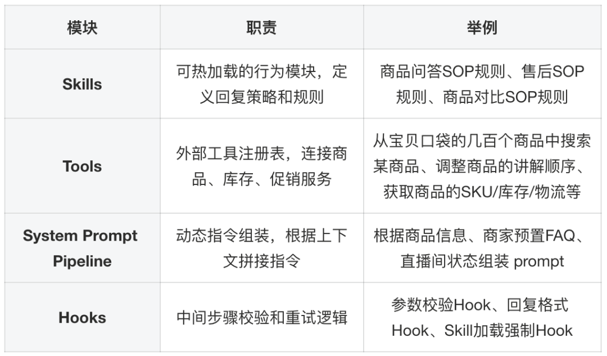
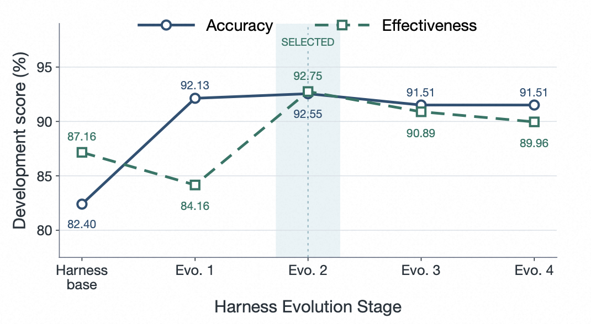
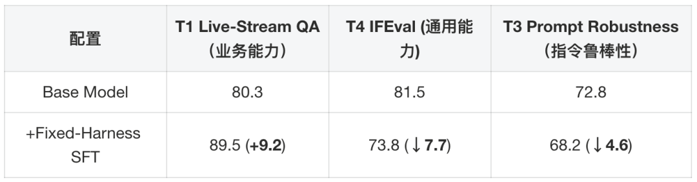
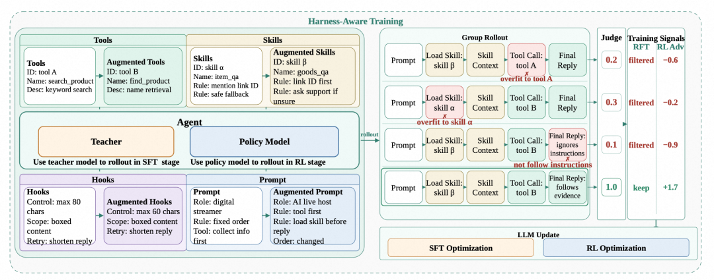
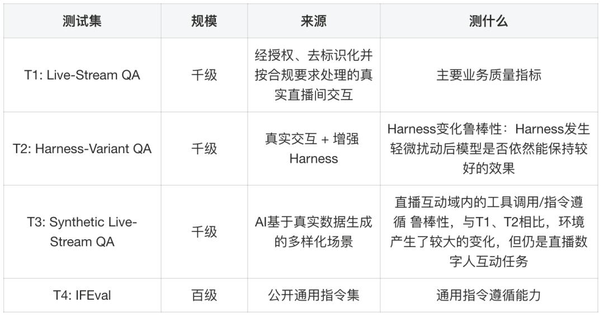
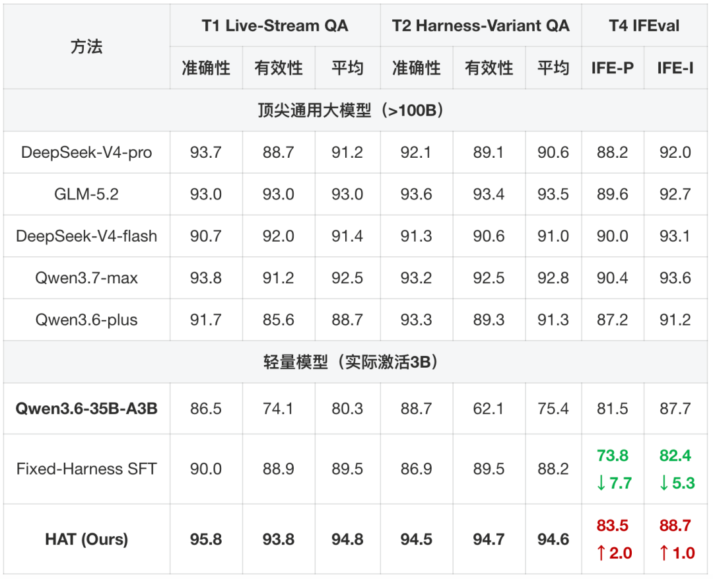
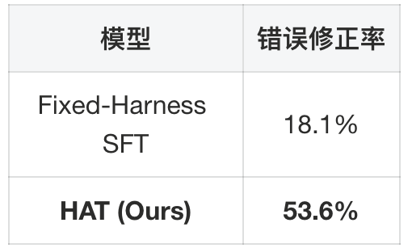
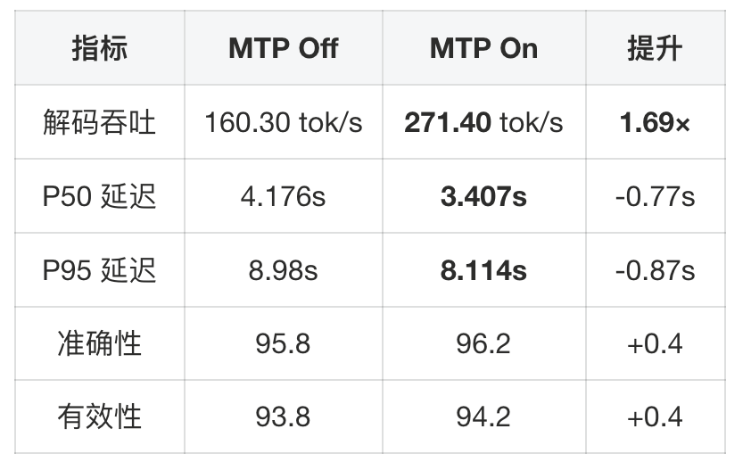

我们把直播 Agent 的规则、工具和提示词拆到了 Harness 里，希望业务改动不必每次都重新训练模型。但很快遇到另一个问题：运行环境改了，小模型未必跟得上。

大模型通常能读懂新配置，延迟却太高；小模型够快，但在固定配置上微调后，容易记住工具名、Skill 名称和提示词的写法。

Harness-Aware Training（HAT）要解决的，就是这种“上线后环境一直变，训练时却只见过一个版本”的错位。


## 先看直播间里的约束

<figure class="publication-figure figure-landscape" id="blog-figure-1"><div class="figure-heading"><span class="figure-label">图 1</span><button aria-label="放大查看：图 1" class="figure-expand" type="button">查看大图 ↗</button></div><div class="figure-media"></div><figcaption class="publication-caption">直播数字人系统中，互动 Agent 连接弹幕输入与口播输出。</figcaption></figure>

在直播电商场景中，数字人主播需要：

- 实时回答观众弹幕中的商品问题（价格、优惠、规格对比等）；
- 执行运营策略（调整讲品顺序、触发优惠话术、处理售后问题等）；
- 公开口播到整个直播间（回复会通过 TTS 合成为语音，由数字人公开说出）；

整体流程如图1所示，观众请求与直播间上下文由交互智能体处理；生成的文本回复被转换为语音，经由数字人生成器渲染后，广播至直播间。我们的互动Agent算法主要作用为接受弹幕请求（如果是多个弹幕在同一时间段内发送会合并为同一请求），理解观众意图，并通过业务工具获取能够回复的信息，最终按照业务SOP进行回复。

数字人主播的每次回复是面向整个直播间的公开发言，这意味着一次错误回复（比如虚假承诺、价格错误）可能引发客诉。这对算法的准确性要求极高。

直播数字人Agent接入Harness的核心矛盾是：Harness配置需要高频迭代，而传统 SFT 会过拟合到训练时的单一配置，使模型无法跟随演进。顶尖通用大模型虽然泛化好但延迟不可接受。我们需要一种方法，让轻量模型同时具备低延迟和 Harness 适应能力。

## 先迭代运行环境，再讨论训练

### 淘宝直播数字人Harness Agent设计

<figure class="publication-figure figure-landscape" id="blog-figure-2"><div class="figure-heading"><span class="figure-label">图 2</span><button aria-label="放大查看：图 2" class="figure-expand" type="button">查看大图 ↗</button></div><div class="figure-media"></div><figcaption class="publication-caption">可独立更新的 Harness 模块与 Agent 执行循环。</figcaption></figure>

我们将Agent的执行环境定义为一个Harness状态，它由四个独立可更新的模块组成：

每个模块的职责如下：

<figure class="publication-figure figure-landscape" id="blog-figure-3"><div class="figure-heading"><span class="figure-label">图 3</span><button aria-label="放大查看：图 3" class="figure-expand" type="button">查看大图 ↗</button></div><div class="figure-media"></div><figcaption class="publication-caption">Skills、Tools、Prompt Pipeline 与 Hooks 的职责。</figcaption></figure>

这四个模块独立于模型权重版本化管理。 修改一个Skill或新增一个Hook，不需要重新训练模型即可完成系统的迭代。每个 Skill 是一个带有Skill描述和渐进式披露完整内容的Markdown 模块。运行时规定：在产生最终回复前必须加载至少一个 Reply Skill；Strategy Skill是可选的，用于组合专门的工具调用链。Harness工作架构如图2所示。

### 运行时控制流

一个完整的请求经过以下阶段：

1. 加载与规范化上下文：校验请求，组装商品/FAQ/直播间/对话状态
2. 组装Prompt：结合基础指令、商品配置、检索上下文和已加载 Skills
3. 运行Agent Loop：在可配置的轮次限制下，策略模型可以加载 Skill、发起工具调用、处理返回结果、提出最终回复
4. 应用Hook检查：覆盖输入校验、工具参数、Skill 加载要求、回复格式、事实风险、重试控制
5. 提取与分发回复：移除内部推理字段，保留结构化轨迹，路由到下游通道

一个典型的轨迹记录如下：

```
input.danmaku = "3号链接多少钱？"
context.current_link_id = 1
call[1] = get_product_info_by_link_id(link_id=3)
result[1] = {name: "防晒霜SPF50", price: 89}
call[2] = load_skill(skill="item_qa")
reply = "3号链接是防晒霜SPF50，现在券后价89元哈。"
```

### Harness Evolution：非训练优化机制

Harness Evolution：在模型权重完全固定的情况下，通过修改 Skills、Prompts、Hooks 和 Tools 来改善 Agent 表现。它是人机协同的，而非全自动：

```
Diagnose → Confirm → Edit Harness → Evaluate → Regression Check
```

五步循环详解：

1. AI 诊断（Diagnose）：分析最新评测结果，聚类主要失败原因，附上代表性 bad case，提出根因假设；
2. 人工确认（Confirm）：开发者审查提议的 Skill/Prompt/Hook/Tool 修改，接受、修改或拒绝；
3. AI 辅助编辑（Edit）：执行确认的修改，保留版本化配置快照；
4. 人工触发评测（Evaluate）：在dev-set上运行推理和评分；
5. 回归检查与规划（Regression）：对比变更效果，检查新引入的回归，由人决定是发布、回滚、继续迭代还是停止；

停止规则： 当剩余错误是稀疏的长尾case，且局部规则添加更可能导致跨类别回归而非系统性改善时，停止迭代。

### Harness自进化迭代详细过程

<figure class="publication-figure figure-landscape" id="blog-figure-4"><div class="figure-heading"><span class="figure-label">图 4</span><button aria-label="放大查看：图 4" class="figure-expand" type="button">查看大图 ↗</button></div><div class="figure-media"></div><figcaption class="publication-caption">固定模型权重下的 Harness 迭代；后续长尾修复可能带来回归。</figcaption></figure>

从 Baseline 的 82.40 准确性 / 87.16 有效性，到 Evolution 2 的 92.55 / 92.75，两个指标分别提高了 10.15 / 5.59 个百分点——全程固定模型权重，仅对Harness组件进行非训练优化。

但这个过程也暴露了一个关键教训："更多规则" ≠ 更好的效果。Evolution 3-4 中的长尾修复在 Skills、Hooks 和全局指令之间产生了交互效应，反而导致了双指标回归。这也是我们设定早停规则的原因。

**实践提醒：**

- Harness Evolution非单调性：更多规则不一定更好，长尾 fix 容易引发跨类别回归；
- 早停很重要：当剩余 bad case 都是稀疏长尾时，继续加规则的边际收益为负；
- 人机协同：AI 负责诊断和编辑，人负责确认和决策——全自动Harness自进化目前尚不成熟；
- 版本绑定：每个发布必须绑定Harness commit，否则朝错误方向自进化后无法进行恢复。

## 把环境变化放进训练分布

### 问题定义：固定单一Harness训练导致过拟合退化

Harness Evolution 让运行环境持续变化。如果模型是通过 Fixed-Harness SFT 训练的——即只在训练时的单一 Harness 配置上做监督微调——它就会产生表层过拟合：

- 记住特定 Skill 名称，而不是理解 Skill 的语义；
- 根据熟悉的 schema 字符串选择工具，而不是读取工具描述；
- 只在特定 Prompt 格式下遵守规则。

我们的预实验结果清楚地展示了这一问题：

<figure class="publication-figure figure-landscape" id="blog-figure-5"><div class="figure-heading"><span class="figure-label">图 5</span><button aria-label="放大查看：图 5" class="figure-expand" type="button">查看大图 ↗</button></div><div class="figure-media"></div><figcaption class="publication-caption">固定 Harness 微调后的任务收益与泛化退化。</figcaption></figure>

Fixed-Harness SFT提高了业务指标，但同时显著损害了通用指令遵循能力和 Prompt 鲁棒性——而这恰恰是模型适应新 Harness 所需要的能力。

为了解决这个问题，我们提出了Harness-Aware Training，在训练中显式引入变化的Harness分布，从而使得模型能够理解其所在的Harness环境，避免拟合到一个特定的Harness上，从而达到可随着Harness进化而进化的目的。

### Harness状态增强

<figure class="publication-figure figure-landscape" id="blog-figure-6"><div class="figure-heading"><span class="figure-label">图 6</span><button aria-label="放大查看：图 6" class="figure-expand" type="button">查看大图 ↗</button></div><div class="figure-media"></div><figcaption class="publication-caption">Harness 状态增强及训练过程。</figcaption></figure>

左侧为Harness State Augmentation示例；右侧为RL/RFT示意图

Harness-State Augmentation（HSA） 是我们的核心方法。它的核心假设是：当训练数据只包含一个固定 Harness 时，模型会过拟合到某个捷径上——通过字符串匹配而非语义理解来做决策。而我们的目标是让模型没法直接通过背pattern的方式来走捷径，因此HSA沿五个维度对Harness进行扰动，每个维度针对性解决一种特定的表层依赖。

<figure class="publication-figure figure-landscape" id="blog-figure-7"><div class="figure-heading"><span class="figure-label">图 7</span><button aria-label="放大查看：图 7" class="figure-expand" type="button">查看大图 ↗</button></div><div class="figure-media"></div><figcaption class="publication-caption">HSA 覆盖的五类运行环境扰动。</figcaption></figure>

### HAT训练Pipeline

完整的训练 Pipeline 包含三个阶段，每个阶段解决一个不同的能力缺口：

#### Stage 1: HSA-SFT（增强Harness下的监督微调）

HSA-SFT 从真实直播间交互数据出发构造训练样本。流程如下：

1. 数据准备：每个样本包含观众问题、直播间/商品上下文，以及对应的 Harness 配置；
2. HSA增强：对Harness状态进维增强，强模型（DeepSeek-V4-pro）分别在原始和增强Harness下生成候选轨迹标签；
3. 质量过滤：用Judge根据准确性、有效性进行过滤，只保留高质量样本；
4. SFT 训练：学生模型在多种Harness变体下学习相同任务语义。

Hook 重试轨迹的处理策略： 生产中 Hook 可能提示格式错误并要求修正。我们希望模型学会纠错，但不希望它学会"先出错再靠重试"的策略。因此：

- 绝大多数重试轨迹：删除中间失败和 Hook 交互，只保留最终正确行为；
- 少量完整重试轨迹：保留，使模型具备理解 Hook 提醒并恢复的能力；

训练数据规模：万级数量下的RFT执行轨迹，输入数据来自真实数字人直播日志。

#### Stage 2: General OPD（通用能力恢复）

Domain-specific SFT（即便是 HSA-SFT）仍可能侵蚀通用能力。为了对抗这种退化，我们进行OPD来恢复模型在SFT过程中灾难性遗忘的通用能力：

- 教师模型：HSA-SFT 之前的基座模型（Qwen3.6-35B-A3B）；
- 数据：Tulu3通用指令数据集；
- 方法：学生以on-policy方式采样回复，最小化与基座模型分布的KL散度；

直觉解释：让学生模型在通用任务上"回忆"起它作为基座模型时的能力。

关键发现：General OPD 在 Fixed-Harness SFT 后带来 +8.5 IFEval 恢复（因为损失大），而在 HSA-SFT 后仅带来 +0.2（因为 HSA-SFT 本身就保留了更多通用能力）。这验证了HSA和OPD的互补性：HSA 预防损失，OPD 修复残余损失。

#### Stage 3: HSA-RL（仿真环境强化学习）

<figure class="publication-figure figure-landscape" id="blog-figure-8"><div class="figure-heading"><span class="figure-label">图 8</span><button aria-label="放大查看：图 8" class="figure-expand" type="button">查看大图 ↗</button></div><div class="figure-media"></div><figcaption class="publication-caption">HSA-RL 在工具调用段与回复段分别分配奖励。</figcaption></figure>

以HSA-SFT + General OPD训练的模型作为base model，在仿真环境中继续优化策略。HSA-SFT 解决了环境覆盖问题，但它是离线的——模型只从教师的最优轨迹中学习。在真实部署中，Agent 需要处理教师轨迹中从未出现的情况：工具调用返回异常、Hook 拦截触发重试、选错 Skill 需要中途恢复。只有让模型在训练中亲身经历这些情况并从后果中学习，才能获得真正的鲁棒性。

RL 训练设计：

- 优化算法基于GRPO，整合入GDPO的reward normalization策略以及GSPO的sequence-level重要性采样策略；
- 四维奖励信号：准确性（Accuracy）、有效性（Effectiveness）、工具调用合理性（Tool Rationality）、Skill选择合理性（Skill Selection）；
- 工具调用段和回复段作为两个独立的state group分别计算advantage；
- 辅助CoT长度惩罚：抑制不必要的过长推理；
- HSA应用于rollout前：部分rollout使用原始 Harness，部分使用增强Harness；

训练数据规模：千级数量的交互任务。

### 仿真环境构建

仿真环境是HSA-RL的基础。它需要实现完整的 Harness Agent 控制流，包含四个组件：

- 输入仿真：经过合规处理后的直播场景日志池中采样真实用户输入：商品问询、闲聊、购买意图、售后问题、多意图弹幕。每个输入配以模拟的直播间状态（商品列表、对话历史、观众行为信号）。
- Harness Agent调度：实现完整的Harness Agent控制流：Skill 路由逻辑、Hook 检查点触发（输入校验、参数检查、回复格式、Skill 加载强制）、多轮交互循环管理。
- 工具执行仿真：工具调用在沙盒化的服务器上执行，返回通过日志还原的真实的商品详情、价格和库存信息。同时注入受控故障（超时、格式错误、权限拒绝）以暴露模型于错误恢复场景。
- 增强Harness配置：环境在增强的Harness状态下运行，从而模拟出Harness变化的场景。

**实践提醒：**

1. 三阶段各司其职：HSA-SFT 建立Harness鲁棒性，OPD修复通用能力，HSA-RL强化真实交互；
2. 仿真环境的故障注入很关键：没有错误恢复经验的模型，线上遇到工具异常时更难恢复；
3. CoT长度惩罚：不加惩罚，模型的思维链会越来越长，直接推高线上延迟；

## 评测体系

### Benchmark介绍

我们构建了四个互补的离线评测集，总计数千条：

<figure class="publication-figure figure-landscape" id="blog-figure-9"><div class="figure-heading"><span class="figure-label">图 9</span><button aria-label="放大查看：图 9" class="figure-expand" type="button">查看大图 ↗</button></div><div class="figure-media"></div><figcaption class="publication-caption">四个互补的离线评测集。</figcaption></figure>

此外还有：

- Judge校准集：合规处理后的真实直播交互 + 人工标注，用于对齐 Judge；同时也被用于Harness的非训练优化。
- 部署回放集：测量实际端到端部署延迟；

评测维度定义：

- Accuracy（准确性）：二值指标，惩罚事实错误、无依据的商品声明、虚假承诺；
- Effectiveness（有效性）：0/0.5/1 三档，衡量回复是否满足观众意图并提供有用信息；

### Agent-as-a-Judge 与人工标注的校准

<figure class="publication-figure figure-landscape" id="blog-figure-10"><div class="figure-heading"><span class="figure-label">图 10</span><button aria-label="放大查看：图 10" class="figure-expand" type="button">查看大图 ↗</button></div><div class="figure-media"></div><figcaption class="publication-caption">Judge 与人工标注的一致率随校准迭代提高。</figcaption></figure>

我们的评测Judge 不是一个简单的 LLM 打分器，而是一个完整的 Harness Agent——它有自己的 Skills（评分规则）、Tools（商品信息验证工具）和 Hooks。评测 Judge 通过与人工标注的分歧分析进行迭代校准。并由3个模型共同投票打分。经过 6 轮迭代，Judge 与人工标注的 Accuracy 一致率从 81.54% 提升到 90.46%，Effectiveness 从 63.70% 提升到 82.2%。

校准过程：

1. 多位标注员对真实交互独立标注；
2. 使用标注后数据自动校准Agent-as-a-Judge；
3. 最终配置：Accuracy一致率 90.46%，Effectiveness一致率 82.2%；

**实践提醒：** 评测设计的工程经验

1. 评测Judge本身也可以采用Harness自进化迭代——我们做了 6 轮Judge Evolution达到 90%+ 一致率；
2. Judge 的角色、数据与配置应单独记录，并检查训练奖励与最终评测之间的依赖；
3. 校准集和测试集必须分开——校准集只用于Judge校准，不用于模型评测。

## 效果、消融与部署

### 主实验结果对比

<figure class="publication-figure figure-landscape" id="blog-figure-11"><div class="figure-heading"><span class="figure-label">图 11</span><button aria-label="放大查看：图 11" class="figure-expand" type="button">查看大图 ↗</button></div><div class="figure-media"></div><figcaption class="publication-caption">任务质量、Harness 变化与通用指令遵循的主实验。</figcaption></figure>

关键结论：

- HAT在T1上达到 94.8，超越了最强Top模型GLM-5.2的93.0——用一个35B-A3B的轻量级MoE模型超过了千亿参数级大模型；
- HAT在T2上达到 94.6，与T1几乎持平（仅差 0.2），说明对Harness变化高度鲁棒；
- Fixed-Harness SFT 的 IFEval 下降 7.7 分，HAT 反而上升了 2.0 分

<figure class="publication-figure figure-landscape" id="blog-figure-12"><div class="figure-heading"><span class="figure-label">图 12</span><button aria-label="放大查看：图 12" class="figure-expand" type="button">查看大图 ↗</button></div><div class="figure-media"></div><figcaption class="publication-caption">合成场景中的工具和提示词鲁棒性。</figcaption></figure>

T3测评集是AI生成的多样化场景。Fixed-Harness SFT 导致模型在Prompt Robustness（指令鲁棒性测评）这一测评集子集下下降了4.6分——进一步验证了表层过拟合的假设。

### 消融实验

<figure class="publication-figure figure-landscape" id="blog-figure-13"><div class="figure-heading"><span class="figure-label">图 13</span><button aria-label="放大查看：图 13" class="figure-expand" type="button">查看大图 ↗</button></div><div class="figure-media"></div><figcaption class="publication-caption">HSA、General OPD 与 RL 的阶段消融。</figcaption></figure>

**实践提醒：**

1. 固定环境微调容易产生过拟合导致泛化变差，用Harness增强（HSA）微调能兼顾任务性能和泛化能力；
2. General OPD能恢复SFT训练后灾难性遗忘导致的基础能力退化，HSA能提前防止泛化退化，这俩方法组合起来整体效果最好；
3. RL阶段虽然能继续拉高业务指标，但在固定环境下会严重掉泛化，必须配合HSA才能防止过拟合。

### Harness进化适应性实验

<figure class="publication-figure figure-landscape" id="blog-figure-14"><div class="figure-heading"><span class="figure-label">图 14</span><button aria-label="放大查看：图 14" class="figure-expand" type="button">查看大图 ↗</button></div><div class="figure-media"></div><figcaption class="publication-caption">Harness 更新后，两类模型对新规则的遵循差异。</figcaption></figure>

为了验证HAT训练后的模型在真实Harness进化过程中是否能能够真实适应Evolve后的Haress。我们从线上真实流量中抽取 1,500 条数据（500 开发 + 1,000 测试），在开发集上采用此前相同的Harness进化策略对Harness进行进化，然后将使用进化后的Harness接入两个模型进行测试：

<figure class="publication-figure figure-natural" id="blog-figure-15"><div class="figure-heading"><span class="figure-label">图 15</span><button aria-label="放大查看：图 15" class="figure-expand" type="button">查看大图 ↗</button></div><div class="figure-media"></div><figcaption class="publication-caption">独立留出流量上的 Harness 编辑效果。</figcaption></figure>

HAT 模型的错误减少率是 Fixed-Harness SFT 的近 3 倍。这意味着：当我们通过 Harness Evolution 修复线上问题时，HAT 模型能更好地理解了新的Harness并随着Harness一同完成进化。

### MTP部署加速与推理路径压缩

在单张 H20 GPU 上，我们使用 Multi-Token Prediction（MTP）来加速推理。MTP 的工作方式是：模型的 NextN 头预测未来多个 token 作为草稿，推理引擎通过 EAGLE-style 的猜测解码和验证路径来使用这些草稿。

MTP训练：

<figure class="publication-figure figure-landscape" id="blog-figure-16"><div class="figure-heading"><span class="figure-label">图 16</span><button aria-label="放大查看：图 16" class="figure-expand" type="button">查看大图 ↗</button></div><div class="figure-media"></div><figcaption class="publication-caption">领域适配过程中的 MTP 训练损失。</figcaption></figure>

我们在RL阶段采用stage1与stage2训练后的checkpoint，从Qwen3.6-35B-A3B的MTP直接初始化MTP进行训练，采用standalone模式进行训练。蓝色实线会嫁接模式训练的MTP loss曲线，绿色虚线为原生Qwen3.6-35B-A3B模型在相同RL训练配置进行MTP训练的loss曲线。随着RL训练的进行，MTP与主模型的输出分布逐渐拟合。

加速效果（Concurrency=1，单 H20）：

<figure class="publication-figure figure-landscape" id="blog-figure-17"><div class="figure-heading"><span class="figure-label">图 17</span><button aria-label="放大查看：图 17" class="figure-expand" type="button">查看大图 ↗</button></div><div class="figure-media"></div><figcaption class="publication-caption">单 H20 低并发条件下的 MTP 推理加速。</figcaption></figure>

关键工程细节：

- MTP 对 HAT checkpoint 的加速（1.69×）高于 Base checkpoint（1.11×），因为MTP在垂域数据下训练后的投机解码接受率显著更高（平均接受率0.780 vs 0.735，平均接受长度3.12 vs 2.94）；
- MTP 是低并发优化：并发线程数=1-2 效果显著，并发线程数=4-8 加速降到 1.27×/1.19×；
- 开启MTP后质量无损失，略微上升基本为波动；

**实践提醒：**

1. 任务训练会改变输出分布，未适配的 MTP 头可能失效；需要实际检查草稿接受率，并进行领域适配；
2. 开启MTP后质量无损失，略微上升基本为波动；
3. MTP可直接通过嫁接的方式在RL阶段进行训练，此时MTP训练数据直接是主模的输出，反而更能拟合主模在对应域上的输出；
4. 我们也做过freeze住主模，在RL阶段只去rollout产生数据进行MTP训练，同样能work。

推理路径压缩：

<figure class="publication-figure figure-landscape" id="blog-figure-18"><div class="figure-heading"><span class="figure-label">图 18</span><button aria-label="放大查看：图 18" class="figure-expand" type="button">查看大图 ↗</button></div><div class="figure-media"></div><figcaption class="publication-caption">分别压缩工具调用与最终回复的推理长度。</figcaption></figure>

在RL过程中，我们对工具调用和回复的CoT长度分别进行抑制，避免模型由于输出过长的CoT而导致的回复延迟过长，随着RL训练的进行，工具调用CoT从290.6token压缩到171.2token，回复CoT从93.6压缩到37.0。这直接减少了推理时的生成量，降低了线上延迟。

### 延迟表现

完整的部署延迟对比：

<figure class="publication-figure figure-landscape" id="blog-figure-19"><div class="figure-heading"><span class="figure-label">图 19</span><button aria-label="放大查看：图 19" class="figure-expand" type="button">查看大图 ↗</button></div><div class="figure-media"></div><figcaption class="publication-caption">完整 Agent 链路的部署延迟对比。</figcaption></figure>

HAT模型在单张H20上实现了3.4秒的中位数端到端Agent延迟，且P95长尾延迟仅8.1秒——而百炼API提供的DeepSeek-V4系列有 29%-39% 的请求超过15 秒。得益于在domain内对MTP的训练，实际部署模型的MTP草稿接受率为78%，而原生模型的MTP草稿接受率为73.5%，因此有着相比于base model更快的解码速度（271 tokens/s vs 216 tokens/s）。

## 这些结果能说明什么

“改了 Harness 还能用”应当在独立数据上验证。我们将新流量中的 1,500 条样本分成 500 条开发与 1,000 条测试：只在开发集上诊断和编辑 Harness，再在留出的测试集比较错误变化。固定 Harness 微调模型的错误减少 18.1%，HAT 模型减少 51.7%。这支持了对指定变化范围的适应能力，而非对任意工具或任意新业务的保证。

英文技术报告的更新版本还补充了人工盲测和线上 A/B。100 条成对请求里，64 条没有明确偏好，35 条偏好 Harness、1 条偏好 ReAct；97.2% 是 36 条非平局样本中的胜率，不能写成全部请求的胜率。线上实验按参与 UV 归一化后，商品详情页浏览量提升约 0.91%，它描述的是业务参与指标，也不能直接换算成成交提升。

部署结果同样有边界。P50 3.407 秒、P95 8.114 秒来自指定 H20 与 MTP 配置的低并发完整链路回放；高并发下的投机解码收益会减弱。评测记录应绑定模型 checkpoint、Harness 版本、工具配置与推理参数，否则后续难以复现某次收益来自哪里。

对我们来说，这项工作的主线是让系统迭代与模型训练相互配合：Harness 负责把业务变化表达清楚，HSA 负责让模型在训练中见到这种变化，评测与回放负责判断改动是否真的有效。保留这条闭环，比不断堆叠新规则更重要。
