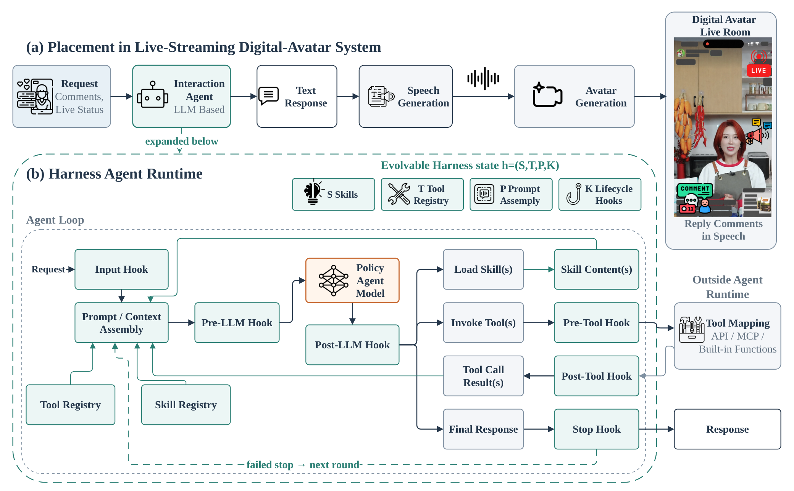
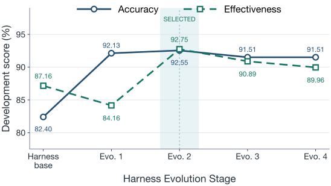
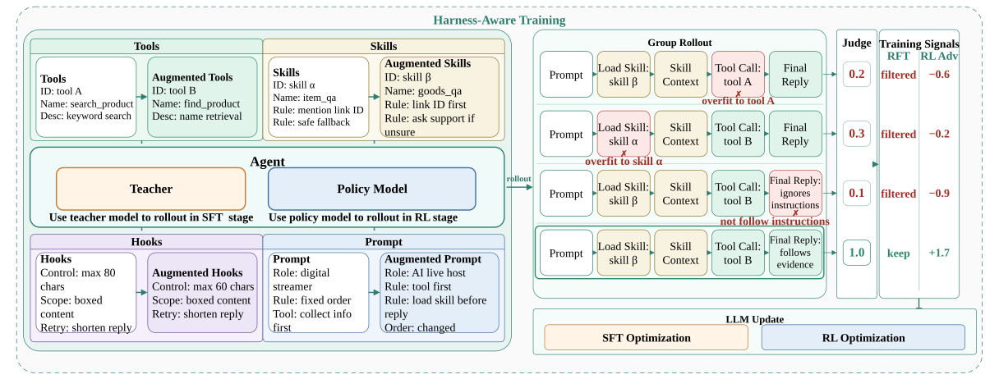
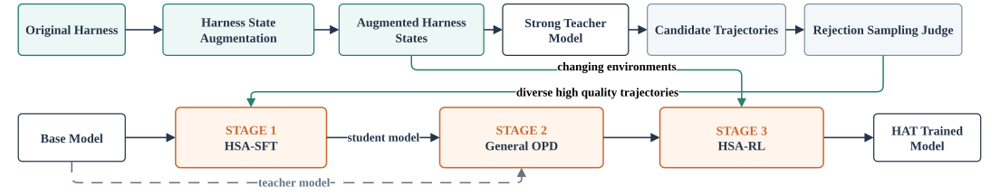
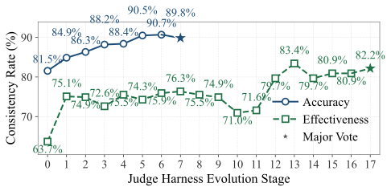
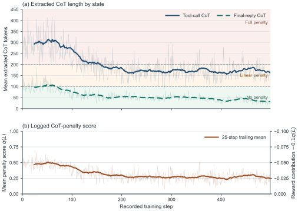
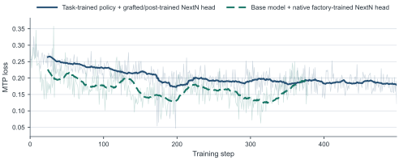

We moved business rules, tools, and prompts into a Harness so that every operational change would not require retraining. Then we met a second problem: the compact model did not always follow the updated runtime.

Large models could often interpret new configurations, but were too slow. Small models were fast, yet fixed-configuration fine-tuning encouraged them to memorize tool names, Skill identifiers, and prompt wording.

Harness-Aware Training (HAT) addresses that mismatch: the environment keeps changing after deployment, while training usually exposes the model to one version.

## The runtime has to change faster than the model

A digital-avatar host answers product questions, handles casual conversation, and invokes tools during a live stream. Unlike a private chat assistant, it may speak to the entire room. A wrong price, unsupported product claim, or invented promise can therefore affect many viewers at once. Each request must combine the viewer message with product information, live-room state, and dialogue history, then produce a useful reply within a tight latency budget.

<figure class="ltx_figure publication-figure figure-landscape" id="S2.F1">
Figure 1<button aria-label="Enlarge Figure 1" class="figure-expand" type="button">View figure ↗</button>

<figcaption class="ltx_caption ltx_centering publication-caption">The complete live-stream avatar system and its editable Harness runtime.</figcaption></figure>

The Harness Agent runtime comprises four mechanisms. <em class="ltx_emph ltx_font_italic" id="S2.SS2.p1.1.2">Skills</em> are dynamically loaded behavioral modules for Q&amp;A strategy, tool choosing, and reply style. The <em class="ltx_emph ltx_font_italic" id="S2.SS2.p1.1.4">System Prompt Pipeline</em> assembles instructions from product specifications, retrieved FAQ, living-room status, global boundary and active skill descriptions. <em class="ltx_emph ltx_font_italic" id="S2.SS2.p1.1.6">Hooks</em> validate inputs, parameters, and output formats, triggering correction or retry when needed. <em class="ltx_emph ltx_font_italic" id="S2.SS2.p1.1.8">Tool Registry</em> connects the agent to external product, inventory, and commerce services. Because these modules are versioned independently of model weights, a new skill or tool can be deployed as a harness change rather than a retraining cycle. The overview of our harness agent architecture is shown in Fig. <a class="ltx_ref" href="https://arxiv.org/html/2608.15763v5#S2.F1">1</a> (b).

In single-comment mode, the runtime handles one viewer message independently. In multi-comments mode, it aggregates related messages before responding. An available internal traffic summary groups the main viewer intents as shown in Table <a class="ltx_ref" href="https://arxiv.org/html/2608.15763v5#S2.T1.fig1">1</a>.

The Harness exposes built-in interfaces for retrieval, commerce operations, and flow control. Additional marketing interfaces are discovered dynamically from an external service through the Model Context Protocol (MCP). Table <a class="ltx_ref" href="https://arxiv.org/html/2608.15763v5#A1.T11">11</a> groups the release inventory by responsibility.

Each Skill is a versioned Markdown module with YAML metadata and behavioral directives. The runtime requires at least one Reply Skill before a substantive final response. Strategy Skills are optional and can be composed when an interaction requires a specialized tool chain. Table <a class="ltx_ref" href="https://arxiv.org/html/2608.15763v5#A1.T12">12</a> records the release inventory. Module names and versions are reconciled against the same manifest before promotion.

A request is normalized into product, FAQ, room, and dialogue context. The prompt pipeline assembles the active instructions; a bounded agent loop loads Skills and invokes tools; Hooks check parameters, required Skills, format, and factual risks. The runtime then strips internal reasoning from the spoken reply while retaining the structured trajectory for inspection.

## Evolve the Harness while keeping the policy fixed

We introduce <em class="ltx_emph ltx_font_italic" id="S2.SS3.p1.1.2">Harness Evolution</em> to denote a controlled process that improves the agent by changing skills, prompts, hooks, or tools while holding the model fixed. It is human-in-loop rather than fully autonomous: AI performs failure clustering, diagnosis, and proposed edits, a developer confirms the plan, runs evaluation, and decides whether to promote, revise, or stop. The complete operational protocol appears in Appendix <a class="ltx_ref" href="https://arxiv.org/html/2608.15763v5#A2">B</a>.

Figure <a class="ltx_ref" href="https://arxiv.org/html/2608.15763v5#S2.F2">2</a> illustrates both the value of the <em class="ltx_emph ltx_font_italic" id="S2.SS3.p3.1.3">Harness Evolution</em>. On the dev-set annotated by three annotators. Evolution 1 sharply improves Accuracy from 82.40 to 92.13 but reduces Effectiveness to 84.16. Evolution 2 reaches 92.55 Accuracy and 92.75 Effectiveness. Additional long-tail rules in Evolutions 3–4 regress one or both dimensions, so Evolution 2 is selected as the engineering early-stop checkpoint. Detailed module changes, category diagnostics, stopping logic, and evidence boundaries are reported in Appendix <a class="ltx_ref" href="https://arxiv.org/html/2608.15763v5#A2">B</a>. The evaluation Judge is also implemented as an editable harness agent as detailed in Appendix <a class="ltx_ref" href="https://arxiv.org/html/2608.15763v5#A2.SS4">B.4</a>.

<figure class="ltx_figure publication-figure figure-landscape" id="S2.F2">
Figure 2<button aria-label="Enlarge Figure 2" class="figure-expand" type="button">View figure ↗</button>

<figcaption class="ltx_caption ltx_centering publication-caption">Harness Evolution improves the development set, but additional rules can cause regressions.</figcaption></figure>

The practical cycle is diagnosis, human review, an editable Harness change, evaluation, and regression checking. The model can help cluster failures and suggest edits; people decide whether the proposal is justified and whether to deploy, revise, roll back, or stop. A long tail of isolated failures is a reason to reconsider another rule, not proof that iteration must continue.

## Expose configuration changes during training

In production, <mjx-container class="MathJax" jax="SVG"><svg aria-hidden="true" focusable="false" height="1.595ex" role="img" style="vertical-align: -0.025ex;" viewbox="0 -694 576 705" width="1.303ex" xmlns="http://www.w3.org/2000/svg"><g fill="currentColor" stroke="currentColor" stroke-width="0" transform="scale(1,-1)"><g data-mml-node="math"><g data-mml-node="mi"><path d="M137 683Q138 683 209 688T282 694Q294 694 294 685Q294 674 258 534Q220 386 220 383Q220 381 227 388Q288 442 357 442Q411 442 444 415T478 336Q478 285 440 178T402 50Q403 36 407 31T422 26Q450 26 474 56T513 138Q516 149 519 151T535 153Q555 153 555 145Q555 144 551 130Q535 71 500 33Q466 -10 419 -10H414Q367 -10 346 17T325 74Q325 90 361 192T398 345Q398 404 354 404H349Q266 404 205 306L198 293L164 158Q132 28 127 16Q114 -11 83 -11Q69 -11 59 -2T48 16Q48 30 121 320L195 616Q195 629 188 632T149 637H128Q122 643 122 645T124 664Q129 683 137 683Z" data-c="210E"></path></g></g></g></svg></mjx-container>h evolves continuously: operations teams add Skills weekly, tool interfaces are updated as upstream services change, and prompts are revised in response to emerging bad cases. A model trained at time <mjx-container class="MathJax" jax="SVG"><svg aria-hidden="true" focusable="false" height="1.441ex" role="img" style="vertical-align: -0.025ex;" viewbox="0 -626 361 637" width="0.817ex" xmlns="http://www.w3.org/2000/svg"><g fill="currentColor" stroke="currentColor" stroke-width="0" transform="scale(1,-1)"><g data-mml-node="math"><g data-mml-node="mi"><path d="M26 385Q19 392 19 395Q19 399 22 411T27 425Q29 430 36 430T87 431H140L159 511Q162 522 166 540T173 566T179 586T187 603T197 615T211 624T229 626Q247 625 254 615T261 596Q261 589 252 549T232 470L222 433Q222 431 272 431H323Q330 424 330 420Q330 398 317 385H210L174 240Q135 80 135 68Q135 26 162 26Q197 26 230 60T283 144Q285 150 288 151T303 153H307Q322 153 322 145Q322 142 319 133Q314 117 301 95T267 48T216 6T155 -11Q125 -11 98 4T59 56Q57 64 57 83V101L92 241Q127 382 128 383Q128 385 77 385H26Z" data-c="1D461"></path></g></g></g></svg></mjx-container>t observes <mjx-container class="MathJax" jax="SVG"><svg aria-hidden="true" focusable="false" height="1.927ex" role="img" style="vertical-align: -0.357ex;" viewbox="0 -694 914.3 851.8" width="2.068ex" xmlns="http://www.w3.org/2000/svg"><g fill="currentColor" stroke="currentColor" stroke-width="0" transform="scale(1,-1)"><g data-mml-node="math"><g data-mml-node="msub"><g data-mml-node="mi"><path d="M137 683Q138 683 209 688T282 694Q294 694 294 685Q294 674 258 534Q220 386 220 383Q220 381 227 388Q288 442 357 442Q411 442 444 415T478 336Q478 285 440 178T402 50Q403 36 407 31T422 26Q450 26 474 56T513 138Q516 149 519 151T535 153Q555 153 555 145Q555 144 551 130Q535 71 500 33Q466 -10 419 -10H414Q367 -10 346 17T325 74Q325 90 361 192T398 345Q398 404 354 404H349Q266 404 205 306L198 293L164 158Q132 28 127 16Q114 -11 83 -11Q69 -11 59 -2T48 16Q48 30 121 320L195 616Q195 629 188 632T149 637H128Q122 643 122 645T124 664Q129 683 137 683Z" data-c="210E"></path></g><g data-mjx-texclass="ORD" data-mml-node="TeXAtom" transform="translate(609,-150) scale(0.707)"><g data-mml-node="mi"><path d="M26 385Q19 392 19 395Q19 399 22 411T27 425Q29 430 36 430T87 431H140L159 511Q162 522 166 540T173 566T179 586T187 603T197 615T211 624T229 626Q247 625 254 615T261 596Q261 589 252 549T232 470L222 433Q222 431 272 431H323Q330 424 330 420Q330 398 317 385H210L174 240Q135 80 135 68Q135 26 162 26Q197 26 230 60T283 144Q285 150 288 151T303 153H307Q322 153 322 145Q322 142 319 133Q314 117 301 95T267 48T216 6T155 -11Q125 -11 98 4T59 56Q57 64 57 83V101L92 241Q127 382 128 383Q128 385 77 385H26Z" data-c="1D461"></path></g></g></g></g></g></svg></mjx-container>h t during training but faces <mjx-container class="MathJax" jax="SVG"><svg aria-hidden="true" focusable="false" height="2.041ex" role="img" style="vertical-align: -0.471ex;" viewbox="0 -694 5697.2 902" width="12.89ex" xmlns="http://www.w3.org/2000/svg"><g fill="currentColor" stroke="currentColor" stroke-width="0" transform="scale(1,-1)"><g data-mml-node="math"><g data-mml-node="msub"><g data-mml-node="mi"><path d="M137 683Q138 683 209 688T282 694Q294 694 294 685Q294 674 258 534Q220 386 220 383Q220 381 227 388Q288 442 357 442Q411 442 444 415T478 336Q478 285 440 178T402 50Q403 36 407 31T422 26Q450 26 474 56T513 138Q516 149 519 151T535 153Q555 153 555 145Q555 144 551 130Q535 71 500 33Q466 -10 419 -10H414Q367 -10 346 17T325 74Q325 90 361 192T398 345Q398 404 354 404H349Q266 404 205 306L198 293L164 158Q132 28 127 16Q114 -11 83 -11Q69 -11 59 -2T48 16Q48 30 121 320L195 616Q195 629 188 632T149 637H128Q122 643 122 645T124 664Q129 683 137 683Z" data-c="210E"></path></g><g data-mjx-texclass="ORD" data-mml-node="TeXAtom" transform="translate(609,-150) scale(0.707)"><g data-mml-node="mi"><path d="M26 385Q19 392 19 395Q19 399 22 411T27 425Q29 430 36 430T87 431H140L159 511Q162 522 166 540T173 566T179 586T187 603T197 615T211 624T229 626Q247 625 254 615T261 596Q261 589 252 549T232 470L222 433Q222 431 272 431H323Q330 424 330 420Q330 398 317 385H210L174 240Q135 80 135 68Q135 26 162 26Q197 26 230 60T283 144Q285 150 288 151T303 153H307Q322 153 322 145Q322 142 319 133Q314 117 301 95T267 48T216 6T155 -11Q125 -11 98 4T59 56Q57 64 57 83V101L92 241Q127 382 128 383Q128 385 77 385H26Z" data-c="1D461"></path></g><g data-mml-node="mo" transform="translate(361,0)"><path d="M56 237T56 250T70 270H369V420L370 570Q380 583 389 583Q402 583 409 568V270H707Q722 262 722 250T707 230H409V-68Q401 -82 391 -82H389H387Q375 -82 369 -68V230H70Q56 237 56 250Z" data-c="2B"></path></g><g data-mml-node="mn" transform="translate(1139,0)"><path d="M213 578L200 573Q186 568 160 563T102 556H83V602H102Q149 604 189 617T245 641T273 663Q275 666 285 666Q294 666 302 660V361L303 61Q310 54 315 52T339 48T401 46H427V0H416Q395 3 257 3Q121 3 100 0H88V46H114Q136 46 152 46T177 47T193 50T201 52T207 57T213 61V578Z" data-c="31"></path></g></g></g><g data-mml-node="mo" transform="translate(1817.9,0)"><path d="M78 35T78 60T94 103T137 121Q165 121 187 96T210 8Q210 -27 201 -60T180 -117T154 -158T130 -185T117 -194Q113 -194 104 -185T95 -172Q95 -168 106 -156T131 -126T157 -76T173 -3V9L172 8Q170 7 167 6T161 3T152 1T140 0Q113 0 96 17Z" data-c="2C"></path></g><g data-mml-node="msub" transform="translate(2262.6,0)"><g data-mml-node="mi"><path d="M137 683Q138 683 209 688T282 694Q294 694 294 685Q294 674 258 534Q220 386 220 383Q220 381 227 388Q288 442 357 442Q411 442 444 415T478 336Q478 285 440 178T402 50Q403 36 407 31T422 26Q450 26 474 56T513 138Q516 149 519 151T535 153Q555 153 555 145Q555 144 551 130Q535 71 500 33Q466 -10 419 -10H414Q367 -10 346 17T325 74Q325 90 361 192T398 345Q398 404 354 404H349Q266 404 205 306L198 293L164 158Q132 28 127 16Q114 -11 83 -11Q69 -11 59 -2T48 16Q48 30 121 320L195 616Q195 629 188 632T149 637H128Q122 643 122 645T124 664Q129 683 137 683Z" data-c="210E"></path></g><g data-mjx-texclass="ORD" data-mml-node="TeXAtom" transform="translate(609,-150) scale(0.707)"><g data-mml-node="mi"><path d="M26 385Q19 392 19 395Q19 399 22 411T27 425Q29 430 36 430T87 431H140L159 511Q162 522 166 540T173 566T179 586T187 603T197 615T211 624T229 626Q247 625 254 615T261 596Q261 589 252 549T232 470L222 433Q222 431 272 431H323Q330 424 330 420Q330 398 317 385H210L174 240Q135 80 135 68Q135 26 162 26Q197 26 230 60T283 144Q285 150 288 151T303 153H307Q322 153 322 145Q322 142 319 133Q314 117 301 95T267 48T216 6T155 -11Q125 -11 98 4T59 56Q57 64 57 83V101L92 241Q127 382 128 383Q128 385 77 385H26Z" data-c="1D461"></path></g><g data-mml-node="mo" transform="translate(361,0)"><path d="M56 237T56 250T70 270H369V420L370 570Q380 583 389 583Q402 583 409 568V270H707Q722 262 722 250T707 230H409V-68Q401 -82 391 -82H389H387Q375 -82 369 -68V230H70Q56 237 56 250Z" data-c="2B"></path></g><g data-mml-node="mn" transform="translate(1139,0)"><path d="M109 429Q82 429 66 447T50 491Q50 562 103 614T235 666Q326 666 387 610T449 465Q449 422 429 383T381 315T301 241Q265 210 201 149L142 93L218 92Q375 92 385 97Q392 99 409 186V189H449V186Q448 183 436 95T421 3V0H50V19V31Q50 38 56 46T86 81Q115 113 136 137Q145 147 170 174T204 211T233 244T261 278T284 308T305 340T320 369T333 401T340 431T343 464Q343 527 309 573T212 619Q179 619 154 602T119 569T109 550Q109 549 114 549Q132 549 151 535T170 489Q170 464 154 447T109 429Z" data-c="32"></path></g></g></g><g data-mml-node="mo" transform="translate(4080.6,0)"><path d="M78 35T78 60T94 103T137 121Q165 121 187 96T210 8Q210 -27 201 -60T180 -117T154 -158T130 -185T117 -194Q113 -194 104 -185T95 -172Q95 -168 106 -156T131 -126T157 -76T173 -3V9L172 8Q170 7 167 6T161 3T152 1T140 0Q113 0 96 17Z" data-c="2C"></path></g><g data-mml-node="mo" transform="translate(4525.2,0)"><path d="M78 60Q78 84 95 102T138 120Q162 120 180 104T199 61Q199 36 182 18T139 0T96 17T78 60ZM525 60Q525 84 542 102T585 120Q609 120 627 104T646 61Q646 36 629 18T586 0T543 17T525 60ZM972 60Q972 84 989 102T1032 120Q1056 120 1074 104T1093 61Q1093 36 1076 18T1033 0T990 17T972 60Z" data-c="2026"></path></g></g></g></svg></mjx-container>h t + 1 , h t + 2 , … after deployment.

Our training objective is twofold: (1) improve policy effectiveness when deployment draws a new harness <mjx-container class="MathJax" jax="SVG"><svg aria-hidden="true" focusable="false" height="2.383ex" role="img" style="vertical-align: -0.666ex;" viewbox="0 -759 4821.7 1053.2" width="10.909ex" xmlns="http://www.w3.org/2000/svg"><g fill="currentColor" stroke="currentColor" stroke-width="0" transform="scale(1,-1)"><g data-mml-node="math"><g data-mml-node="msup"><g data-mml-node="mi"><path d="M137 683Q138 683 209 688T282 694Q294 694 294 685Q294 674 258 534Q220 386 220 383Q220 381 227 388Q288 442 357 442Q411 442 444 415T478 336Q478 285 440 178T402 50Q403 36 407 31T422 26Q450 26 474 56T513 138Q516 149 519 151T535 153Q555 153 555 145Q555 144 551 130Q535 71 500 33Q466 -10 419 -10H414Q367 -10 346 17T325 74Q325 90 361 192T398 345Q398 404 354 404H349Q266 404 205 306L198 293L164 158Q132 28 127 16Q114 -11 83 -11Q69 -11 59 -2T48 16Q48 30 121 320L195 616Q195 629 188 632T149 637H128Q122 643 122 645T124 664Q129 683 137 683Z" data-c="210E"></path></g><g data-mjx-texclass="ORD" data-mml-node="TeXAtom" transform="translate(609,363) scale(0.707)"><g data-mml-node="mi"><path d="M79 43Q73 43 52 49T30 61Q30 68 85 293T146 528Q161 560 198 560Q218 560 240 545T262 501Q262 496 260 486Q259 479 173 263T84 45T79 43Z" data-c="2032"></path></g></g></g><g data-mml-node="mo" transform="translate(1131.2,0)"><path d="M55 166Q55 241 101 304T222 367Q260 367 296 349T362 304T421 252T484 208T554 189Q616 189 655 236T694 338Q694 350 698 358T708 367Q722 367 722 334Q722 260 677 197T562 134H554Q517 134 481 152T414 196T355 248T292 293T223 311Q179 311 145 286Q109 257 96 218T80 156T69 133Q55 133 55 166Z" data-c="223C"></path></g><g data-mml-node="msub" transform="translate(2187,0)"><g data-mjx-texclass="ORD" data-mml-node="TeXAtom"><g data-mml-node="mi"><path d="M144 470Q144 556 240 630T451 705Q564 705 564 637Q564 611 540 573Q529 559 505 547T464 534Q448 534 448 545Q448 552 455 562Q463 577 463 591Q463 600 462 604T456 616T436 627T400 635Q396 635 390 635T380 636Q291 636 258 568Q245 544 245 516Q245 463 290 438T391 410Q415 410 415 398Q415 392 407 380T376 356T326 341Q288 340 260 327Q218 311 187 276T143 208T130 151Q130 113 156 88T211 55T268 47Q349 47 403 125Q415 144 439 157T483 171Q499 171 499 160Q499 148 475 120T413 59T315 3T197 -22Q124 -22 77 14T30 105Q30 126 39 154T66 216T122 288T209 354L223 362Q144 400 144 470Z" data-c="45"></path></g></g><g data-mjx-texclass="ORD" data-mml-node="TeXAtom" transform="translate(561,-150) scale(0.707)"><g data-mml-node="mtext"><path d="M376 495Q376 511 376 535T377 568Q377 613 367 624T316 637H298V660Q298 683 300 683L310 684Q320 685 339 686T376 688Q393 689 413 690T443 693T454 694H457V390Q457 84 458 81Q461 61 472 55T517 46H535V0Q533 0 459 -5T380 -11H373V44L365 37Q307 -11 235 -11Q158 -11 96 50T34 215Q34 315 97 378T244 442Q319 442 376 393V495ZM373 342Q328 405 260 405Q211 405 173 369Q146 341 139 305T131 211Q131 155 138 120T173 59Q203 26 251 26Q322 26 373 103V342Z" data-c="64"></path><path d="M28 218Q28 273 48 318T98 391T163 433T229 448Q282 448 320 430T378 380T406 316T415 245Q415 238 408 231H126V216Q126 68 226 36Q246 30 270 30Q312 30 342 62Q359 79 369 104L379 128Q382 131 395 131H398Q415 131 415 121Q415 117 412 108Q393 53 349 21T250 -11Q155 -11 92 58T28 218ZM333 275Q322 403 238 411H236Q228 411 220 410T195 402T166 381T143 340T127 274V267H333V275Z" data-c="65" transform="translate(556,0)"></path><path d="M36 -148H50Q89 -148 97 -134V-126Q97 -119 97 -107T97 -77T98 -38T98 6T98 55T98 106Q98 140 98 177T98 243T98 296T97 335T97 351Q94 370 83 376T38 385H20V408Q20 431 22 431L32 432Q42 433 61 434T98 436Q115 437 135 438T165 441T176 442H179V416L180 390L188 397Q247 441 326 441Q407 441 464 377T522 216Q522 115 457 52T310 -11Q242 -11 190 33L182 40V-45V-101Q182 -128 184 -134T195 -145Q216 -148 244 -148H260V-194H252L228 -193Q205 -192 178 -192T140 -191Q37 -191 28 -194H20V-148H36ZM424 218Q424 292 390 347T305 402Q234 402 182 337V98Q222 26 294 26Q345 26 384 80T424 218Z" data-c="70" transform="translate(1000,0)"></path><path d="M42 46H56Q95 46 103 60V68Q103 77 103 91T103 124T104 167T104 217T104 272T104 329Q104 366 104 407T104 482T104 542T103 586T103 603Q100 622 89 628T44 637H26V660Q26 683 28 683L38 684Q48 685 67 686T104 688Q121 689 141 690T171 693T182 694H185V379Q185 62 186 60Q190 52 198 49Q219 46 247 46H263V0H255L232 1Q209 2 183 2T145 3T107 3T57 1L34 0H26V46H42Z" data-c="6C" transform="translate(1556,0)"></path><path d="M28 214Q28 309 93 378T250 448Q340 448 405 380T471 215Q471 120 407 55T250 -10Q153 -10 91 57T28 214ZM250 30Q372 30 372 193V225V250Q372 272 371 288T364 326T348 362T317 390T268 410Q263 411 252 411Q222 411 195 399Q152 377 139 338T126 246V226Q126 130 145 91Q177 30 250 30Z" data-c="6F" transform="translate(1834,0)"></path><path d="M69 -66Q91 -66 104 -80T118 -116Q118 -134 109 -145T91 -160Q84 -163 97 -166Q104 -168 111 -168Q131 -168 148 -159T175 -138T197 -106T213 -75T225 -43L242 0L170 183Q150 233 125 297Q101 358 96 368T80 381Q79 382 78 382Q66 385 34 385H19V431H26L46 430Q65 430 88 429T122 428Q129 428 142 428T171 429T200 430T224 430L233 431H241V385H232Q183 385 185 366L286 112Q286 113 332 227L376 341V350Q376 365 366 373T348 383T334 385H331V431H337H344Q351 431 361 431T382 430T405 429T422 429Q477 429 503 431H508V385H497Q441 380 422 345Q420 343 378 235T289 9T227 -131Q180 -204 113 -204Q69 -204 44 -177T19 -116Q19 -89 35 -78T69 -66Z" data-c="79" transform="translate(2334,0)"></path></g></g></g></g></g></svg></mjx-container>h ′ ∼ ℰ deploy from a specified change envelope that is broader than any single training snapshot, (2) retain general-purpose capabilities such as instruction following after domain-specific fine-tuning.

The method is proposed to solve <em class="ltx_emph ltx_font_italic" id="S3.SS2.p1.1.2">surface-form overfitting</em>: when training data contains a single, fixed harness, the objective permits shortcuts such as matching skill names by string similarity, selecting tools from memorized schema text, or following instructions only in a familiar template. The core hypothesis is that changing the surface form of the harness makes it harder for the model to rely on fixed names or templates as shortcuts. If a skill is renamed, its description rewritten, and distractors injected, functional information about the skill becomes more useful for routing than memorizing a single identifier.

We perturb the harness along five dimensions, each targeting a distinct aspect of surface-form dependence:

<em class="ltx_emph ltx_font_italic" id="S3.I1.i1.p1.1.1">Skill Identifier:</em> We expand the skill set with synthetic plausible skills and noise skills, randomly mask subsets of existing skills, rename skills, and rewrite skill descriptions by a strong language model. These changes reduce the usefulness of a fixed skill identifier.

<em class="ltx_emph ltx_font_italic" id="S3.I1.i2.p1.1.1">Skill Content:</em> Within each skill, we paraphrase individual rules, randomly mask a subset, and reorder them. This variation is intended to reduce reliance on rule position and exact wording.

<em class="ltx_emph ltx_font_italic" id="S3.I1.i3.p1.1.1">Tool Definition:</em> We rename tools, rewrite descriptions. This transformation makes name matching less reliable while preserving the tool’s function.

<em class="ltx_emph ltx_font_italic" id="S3.I1.i4.p1.1.1">System Prompt:</em> We reorder top-level instruction blocks and items within blocks, and perturb numeric constraints (e.g., response length limits, maximum interaction rounds) within operationally valid ranges.

<em class="ltx_emph ltx_font_italic" id="S3.I1.i5.p1.1.1">Hook:</em> We design controlled variants of retry behavior, message structure, and hook-triggered modifications to simulate the changes that the model may encounter after hooks are updated in production.

<figure class="ltx_figure publication-figure figure-landscape figure-wide" id="S3.F3">
Figure 3<button aria-label="Enlarge Figure 3" class="figure-expand" type="button">View figure ↗</button>

<figcaption class="ltx_caption ltx_centering publication-caption">HSA perturbs Skills, tools, prompts, and Hooks while keeping the task meaningful.</figcaption></figure>

## Three stages, three capability gaps

<figure class="ltx_figure publication-figure figure-landscape figure-wide" id="S3.F4">
Figure 4<button aria-label="Enlarge Figure 4" class="figure-expand" type="button">View figure ↗</button>

<figcaption class="ltx_caption ltx_centering publication-caption">HSA-SFT teaches the task, General OPD restores general ability, and HSA-RL practices interaction.</figcaption></figure>

### HSA-SFT: demonstrations under varied Harness states

Start from real live-room requests containing viewer messages, room state, and product context. HSA creates additional task-preserving Harness variants. A strong teacher generates candidate trajectories under both the original and augmented states, so supervision spans several ways of expressing the same operational rules.

Quality filtering checks Accuracy and Effectiveness before a trajectory reaches the student. The supervised corpus therefore teaches both how to act in the task and how to interpret the current configuration, rather than associating one tool name with one fixed behavior.

Hook retries need special treatment. Most demonstrations remove intermediate failures and retain the final valid behavior, avoiding a policy that routinely makes an avoidable error before fixing it. A smaller set keeps complete retry histories so the student can still understand a Hook message and recover when something does go wrong.

### General OPD: recover instruction following

Motivated by prior practice showing that On-Policy Distillation can improve general instruction-following ability , we add a General OPD stage after HSA-SFT. We use the pre-HSA-SFT base model as the teacher and perform on-policy distillation on the Tulu3  general instruction dataset. The student samples responses on-policy for Tulu inputs and is trained by minimizing the KL divergence between the student distribution and the base-model distribution:

### HSA-RL: learn from the policy’s own interaction

Starting from HSA-SFT plus General OPD, the policy rolls out complete interactions in the simulator. Each rollout can involve Skill selection, several tool calls, result interpretation, a retry, and the final response. This stage optimizes the student’s own behavior under changed Harness states rather than asking it to imitate another fixed collection of teacher traces.

Within the simulated environment, we optimize the policy based on Group Relative Policy Optimization (GRPO) . For each prompt, <mjx-container class="MathJax" jax="SVG"><svg aria-hidden="true" focusable="false" height="1.645ex" role="img" style="vertical-align: -0.05ex;" viewbox="0 -705 786 727" width="1.778ex" xmlns="http://www.w3.org/2000/svg"><g fill="currentColor" stroke="currentColor" stroke-width="0" transform="scale(1,-1)"><g data-mml-node="math"><g data-mml-node="mi"><path d="M50 252Q50 367 117 473T286 641T490 704Q580 704 633 653Q642 643 648 636T656 626L657 623Q660 623 684 649Q691 655 699 663T715 679T725 690L740 705H746Q760 705 760 698Q760 694 728 561Q692 422 692 421Q690 416 687 415T669 413H653Q647 419 647 422Q647 423 648 429T650 449T651 481Q651 552 619 605T510 659Q492 659 471 656T418 643T357 615T294 567T236 496T189 394T158 260Q156 242 156 221Q156 173 170 136T206 79T256 45T308 28T353 24Q407 24 452 47T514 106Q517 114 529 161T541 214Q541 222 528 224T468 227H431Q425 233 425 235T427 254Q431 267 437 273H454Q494 271 594 271Q634 271 659 271T695 272T707 272Q721 272 721 263Q721 261 719 249Q714 230 709 228Q706 227 694 227Q674 227 653 224Q646 221 643 215T629 164Q620 131 614 108Q589 6 586 3Q584 1 581 1Q571 1 553 21T530 52Q530 53 528 52T522 47Q448 -22 322 -22Q201 -22 126 55T50 252Z" data-c="1D43A"></path></g></g></g></svg></mjx-container>G complete trajectory rollouts (group size) are sampled and split into tool segments and reply segments. The reward signal is computed from 4 dimensions:

<em class="ltx_emph ltx_font_italic" id="S3.I3.i1.p1.1.1">Accuracy</em>: whether the final response contains factually correct information and follows the instructions defined in prompts or skills. Applied on reply state;

<em class="ltx_emph ltx_font_italic" id="S3.I3.i2.p1.1.1">Effectiveness</em>: whether the response adequately addresses the user’s intent with appropriate detail and actionability. Applied on reply state;

<em class="ltx_emph ltx_font_italic" id="S3.I3.i3.p1.1.1">Tool Rationality</em>: whether the tool invocation chain is logically sound and efficiently structured (no redundant calls, correct parameter usage), this reward can prevent model from overfitting to specific tools. Applied on tool state;

<em class="ltx_emph ltx_font_italic" id="S3.I3.i4.p1.1.1">Skill Selection</em>: whether the model correctly identifies the user’s intent and the current context to load the appropriate Skills, this reward can prevent model from overfitting to specific skills. Applied on tool state.

Tool and reply segments form separate groups for advantage computation. Tool rationality and Skill selection assess the interaction path; Accuracy and Effectiveness assess the final reply. The reported implementation combines GRPO with reward-dimension normalization and sequence-level importance sampling. An auxiliary length term discourages unnecessary reasoning without replacing the task rewards.

## The simulator is part of the method

Demonstrations cover the teacher’s successful paths, but a deployed student also encounters its own mistakes: a wrong Skill, malformed arguments, a tool timeout, or a Hook requesting revision. HSA-RL lets the student experience these consequences and practice recovery instead of learning only the final successful trajectory.

The simulator implements the production control flow rather than returning a single static answer. Its four parts are input sampling, Harness scheduling, sandboxed tool execution, and configuration augmentation.

Inputs come from processed live-stream scenarios, including product inquiries, casual chat, purchase intent, after-sales questions, and messages containing several intents. Each is paired with product, dialogue, and live-room context.

Scheduling handles Skill routing, parameter and response checks, required Skill loading, retries, and the bounded multi-turn loop. The sequence of state transitions is retained for training and inspection.

Sandboxed tool executors replay product details, prices, and inventory from controlled data. Fault injection adds timeouts, malformed results, or rejected operations so recovery is represented in training.

The same augmented Harness state governs both the policy and its environment. Renaming an interface without updating the executor would create a broken task, not a useful robustness example.

## Evaluate the task, configuration changes, and general ability

We organize the evaluation around the requirements in the live streaming application. For offline evaluation, Live-Stream QA and Harness-Variant QA are both built from real live-room interactions and cover the main industry scenarios in our application domain, with the available internal intent mix summarized in Appendix Table <a class="ltx_ref" href="https://arxiv.org/html/2608.15763v5#S2.T1.fig1">1</a>. Live-Stream QA tests industrial reply quality, while Harness-Variant QA tests generalization and robustness to changing Harness contexts. We also use a separate real live-room calibration cohort to align the Harness-based Agent-as-a-Judge with human labels. To test broader tool and prompt robustness, we construct synthetic Tool Robustness and Prompt Robustness subsets by expanding real-industrial scenario seeds with LLM generation and consistency validation, as shown in Appendix <a class="ltx_ref" href="https://arxiv.org/html/2608.15763v5#A3.SS3">C.3</a>. We also evaluate general instruction-following ability on the public IFEval benchmark . To test actual deployment latency and serving performance, we use a fixed complete-Agent deployment replay. Table <a class="ltx_ref" href="https://arxiv.org/html/2608.15763v5#S4.T2">2</a> summarizes the size, source, and role of each evaluation source.

For Live-Stream QA and Harness-Variant QA, we evaluate each response with Accuracy and Effectiveness using the Harness-based Agent-as-a-Judge, following the LLM-as-a-Judge paradigm . Appendix <a class="ltx_ref" href="https://arxiv.org/html/2608.15763v5#A3.SS1">C.1</a>. Accuracy is a binary metric that penalizes factual errors, unsupported product claims, false promises, and capability overreach. Effectiveness measures whether the response addresses the viewer’s intent and provides useful information, with scores of 0, 0.5, or 1. We report AVG as the per-sample arithmetic mean of Accuracy and Effectiveness, computed before rounding.

For IFEval, we use its official evaluator and report prompt-level and instruction-level accuracy (abbreviated as IFE-P and IFE-I hereafter). IFE-P measures whether the model satisfies the full prompt-level instruction set, while IFE-I measures whether individual instructions are followed.

The data-generation teacher, RL reward judge, final evaluation judge, and human calibration cohort have distinct roles. Their models, prompts, evidence access, and data overlap need to be recorded. Shared model families or rubric conventions can still create correlated errors, so automatic scores are complemented by human checks rather than treated as an independent ground truth.

<figure class="ltx_figure publication-figure figure-landscape figure-wide" id="A2.F9">
Figure 5<button aria-label="Enlarge Figure 5" class="figure-expand" type="button">View figure ↗</button>

<figcaption class="ltx_caption ltx_centering publication-caption">Judge calibration improves agreement with human labels on the development cohort.</figcaption></figure>

| Measure | Base | HAT |
| --- | ---: | ---: |
| Live-Stream QA | 80.3 | 94.8 |
| Harness-Variant QA | 75.4 | 94.6 |

HAT retains an IFEval Prompt score of 83.5. In contrast, Fixed-Harness SFT loses 7.7 points from the base model. These scores describe the reported evaluation sets, not a general ranking over every agent task.

## What the stage ablations show

Fixed-Harness SFT improves business performance but damages general instruction following. In the reported pathway, IFEval Prompt drops by 7.7 points and synthetic prompt robustness also declines. The task can therefore look better on its original configuration while the model becomes less capable of obeying the next configuration.

HSA-SFT and General OPD address different parts of this problem. Variation during SFT prevents much of the surface-form dependence; OPD recovers capability that was still lost. General OPD restores 8.5 IFEval points after fixed-Harness SFT but only 0.2 after HSA-SFT, which had already preserved more of the base model’s general ability.

RL raises the business metrics in both branches, but a fixed training environment can again sacrifice generalization. The stronger result comes from applying HSA during RL as well as SFT. This is a stage-wise ablation, not evidence that adding any augmentation to any task will necessarily help.

## Can the model follow a real Harness edit?

We construct an additional held-out evaluation set for Harness edits by sampling 1,500 cases from real online live-streaming traffic, with 500 development cases and 1,000 held-out test cases. The raw logs contain viewer comments, dialogue history, live-room context, product information, tool-use traces, and model responses. We use an automatic quality check to count bad cases where the model output is not sufficiently natural or colloquial for a live-streaming host.

The development split is used only for Harness diagnosis and editing. We analyze the bad cases on the 500-case development set and revise editable Harness components, primarily the system prompt and Skills, while keeping the model weights fixed. The resulting Harness edits are fixed and applied unchanged to both the Fixed-Harness SFT checkpoint and the HAT checkpoint. The test split is held out from this editing loop and is used to compare each model before and after applying the same Harness edits.

On the held-out test set, the Harness edits reduce the total detected error count by 18.1% for the Fixed-Harness SFT checkpoint and by 51.7% for the HAT checkpoint, relative to their respective before-edit counts. Since lower error counts are better, these results show that the same Harness edits improve both models, with a substantially larger reduction for HAT.
Figure <a class="ltx_ref" href="https://arxiv.org/html/2608.15763v5#A2.F8">8</a> in Appendix <a class="ltx_ref" href="https://arxiv.org/html/2608.15763v5#A2">B</a> provides two qualitative examples in which the Fixed-Harness SFT checkpoint continues to expose internal uncertainty after the shared prompt edit, whereas HAT follows the revised Harness instruction. These cases illustrate edit compliance but do not constitute additional quantitative evidence.

The held-out split matters here: the 500 development cases guide editing, while the 1,000 test cases evaluate the edited configuration. The 51.7% versus 18.1% error reductions support adaptation within this edit protocol; they do not establish robustness to arbitrary tools or an unseen business domain.

## Shorter reasoning and an adapted MTP head

Figure <a class="ltx_ref" href="https://arxiv.org/html/2608.15763v5#S5.F6">6</a> traces the auxiliary CoT-length term in the selected HSA-RL run. From the first to the last 100-step window, mean extracted length decreases from 290.6 to 171.2 tokens for tool-call CoT and from 93.6 to 37.0 for final-reply CoT. The mean logged penalty score <mjx-container class="MathJax" jax="SVG"><svg aria-hidden="true" focusable="false" height="2.262ex" role="img" style="vertical-align: -0.566ex;" viewbox="0 -750 1919 1000" width="4.342ex" xmlns="http://www.w3.org/2000/svg"><g fill="currentColor" stroke="currentColor" stroke-width="0" transform="scale(1,-1)"><g data-mml-node="math"><g data-mml-node="mi"><path d="M33 157Q33 258 109 349T280 441Q340 441 372 389Q373 390 377 395T388 406T404 418Q438 442 450 442Q454 442 457 439T460 434Q460 425 391 149Q320 -135 320 -139Q320 -147 365 -148H390Q396 -156 396 -157T393 -175Q389 -188 383 -194H370Q339 -192 262 -192Q234 -192 211 -192T174 -192T157 -193Q143 -193 143 -185Q143 -182 145 -170Q149 -154 152 -151T172 -148Q220 -148 230 -141Q238 -136 258 -53T279 32Q279 33 272 29Q224 -10 172 -10Q117 -10 75 30T33 157ZM352 326Q329 405 277 405Q242 405 210 374T160 293Q131 214 119 129Q119 126 119 118T118 106Q118 61 136 44T179 26Q233 26 290 98L298 109L352 326Z" data-c="1D45E"></path></g><g data-mml-node="mo" transform="translate(460,0)"><path d="M94 250Q94 319 104 381T127 488T164 576T202 643T244 695T277 729T302 750H315H319Q333 750 333 741Q333 738 316 720T275 667T226 581T184 443T167 250T184 58T225 -81T274 -167T316 -220T333 -241Q333 -250 318 -250H315H302L274 -226Q180 -141 137 -14T94 250Z" data-c="28"></path></g><g data-mml-node="mi" transform="translate(849,0)"><path d="M228 637Q194 637 192 641Q191 643 191 649Q191 673 202 682Q204 683 217 683Q271 680 344 680Q485 680 506 683H518Q524 677 524 674T522 656Q517 641 513 637H475Q406 636 394 628Q387 624 380 600T313 336Q297 271 279 198T252 88L243 52Q243 48 252 48T311 46H328Q360 46 379 47T428 54T478 72T522 106T564 161Q580 191 594 228T611 270Q616 273 628 273H641Q647 264 647 262T627 203T583 83T557 9Q555 4 553 3T537 0T494 -1Q483 -1 418 -1T294 0H116Q32 0 32 10Q32 17 34 24Q39 43 44 45Q48 46 59 46H65Q92 46 125 49Q139 52 144 61Q147 65 216 339T285 628Q285 635 228 637Z" data-c="1D43F"></path></g><g data-mml-node="mo" transform="translate(1530,0)"><path d="M60 749L64 750Q69 750 74 750H86L114 726Q208 641 251 514T294 250Q294 182 284 119T261 12T224 -76T186 -143T145 -194T113 -227T90 -246Q87 -249 86 -250H74Q66 -250 63 -250T58 -247T55 -238Q56 -237 66 -225Q221 -64 221 250T66 725Q56 737 55 738Q55 746 60 749Z" data-c="29"></path></g></g></g></svg></mjx-container>q ⁡ ( L ) moves from 0.466 to 0.272, corresponding to a raw reward contribution from <mjx-container class="MathJax" jax="SVG"><svg aria-hidden="true" focusable="false" height="1.717ex" role="img" style="vertical-align: -0.186ex;" viewbox="0 -677 3556 759" width="8.045ex" xmlns="http://www.w3.org/2000/svg"><g fill="currentColor" stroke="currentColor" stroke-width="0" transform="scale(1,-1)"><g data-mml-node="math"><g data-mml-node="mo"><path d="M84 237T84 250T98 270H679Q694 262 694 250T679 230H98Q84 237 84 250Z" data-c="2212"></path></g><g data-mml-node="mn" transform="translate(778,0)"><path d="M96 585Q152 666 249 666Q297 666 345 640T423 548Q460 465 460 320Q460 165 417 83Q397 41 362 16T301 -15T250 -22Q224 -22 198 -16T137 16T82 83Q39 165 39 320Q39 494 96 585ZM321 597Q291 629 250 629Q208 629 178 597Q153 571 145 525T137 333Q137 175 145 125T181 46Q209 16 250 16Q290 16 318 46Q347 76 354 130T362 333Q362 478 354 524T321 597Z" data-c="30"></path><path d="M78 60Q78 84 95 102T138 120Q162 120 180 104T199 61Q199 36 182 18T139 0T96 17T78 60Z" data-c="2E" transform="translate(500,0)"></path><path d="M96 585Q152 666 249 666Q297 666 345 640T423 548Q460 465 460 320Q460 165 417 83Q397 41 362 16T301 -15T250 -22Q224 -22 198 -16T137 16T82 83Q39 165 39 320Q39 494 96 585ZM321 597Q291 629 250 629Q208 629 178 597Q153 571 145 525T137 333Q137 175 145 125T181 46Q209 16 250 16Q290 16 318 46Q347 76 354 130T362 333Q362 478 354 524T321 597Z" data-c="30" transform="translate(778,0)"></path><path d="M462 0Q444 3 333 3Q217 3 199 0H190V46H221Q241 46 248 46T265 48T279 53T286 61Q287 63 287 115V165H28V211L179 442Q332 674 334 675Q336 677 355 677H373L379 671V211H471V165H379V114Q379 73 379 66T385 54Q393 47 442 46H471V0H462ZM293 211V545L74 212L183 211H293Z" data-c="34" transform="translate(1278,0)"></path><path d="M42 313Q42 476 123 571T303 666Q372 666 402 630T432 550Q432 525 418 510T379 495Q356 495 341 509T326 548Q326 592 373 601Q351 623 311 626Q240 626 194 566Q147 500 147 364L148 360Q153 366 156 373Q197 433 263 433H267Q313 433 348 414Q372 400 396 374T435 317Q456 268 456 210V192Q456 169 451 149Q440 90 387 34T253 -22Q225 -22 199 -14T143 16T92 75T56 172T42 313ZM257 397Q227 397 205 380T171 335T154 278T148 216Q148 133 160 97T198 39Q222 21 251 21Q302 21 329 59Q342 77 347 104T352 209Q352 289 347 316T329 361Q302 397 257 397Z" data-c="36" transform="translate(1778,0)"></path><path d="M42 313Q42 476 123 571T303 666Q372 666 402 630T432 550Q432 525 418 510T379 495Q356 495 341 509T326 548Q326 592 373 601Q351 623 311 626Q240 626 194 566Q147 500 147 364L148 360Q153 366 156 373Q197 433 263 433H267Q313 433 348 414Q372 400 396 374T435 317Q456 268 456 210V192Q456 169 451 149Q440 90 387 34T253 -22Q225 -22 199 -14T143 16T92 75T56 172T42 313ZM257 397Q227 397 205 380T171 335T154 278T148 216Q148 133 160 97T198 39Q222 21 251 21Q302 21 329 59Q342 77 347 104T352 209Q352 289 347 316T329 361Q302 397 257 397Z" data-c="36" transform="translate(2278,0)"></path></g></g></g></svg></mjx-container>− 0.0466 to <mjx-container class="MathJax" jax="SVG"><svg aria-hidden="true" focusable="false" height="1.715ex" role="img" style="vertical-align: -0.186ex;" viewbox="0 -676 3556 758" width="8.045ex" xmlns="http://www.w3.org/2000/svg"><g fill="currentColor" stroke="currentColor" stroke-width="0" transform="scale(1,-1)"><g data-mml-node="math"><g data-mml-node="mo"><path d="M84 237T84 250T98 270H679Q694 262 694 250T679 230H98Q84 237 84 250Z" data-c="2212"></path></g><g data-mml-node="mn" transform="translate(778,0)"><path d="M96 585Q152 666 249 666Q297 666 345 640T423 548Q460 465 460 320Q460 165 417 83Q397 41 362 16T301 -15T250 -22Q224 -22 198 -16T137 16T82 83Q39 165 39 320Q39 494 96 585ZM321 597Q291 629 250 629Q208 629 178 597Q153 571 145 525T137 333Q137 175 145 125T181 46Q209 16 250 16Q290 16 318 46Q347 76 354 130T362 333Q362 478 354 524T321 597Z" data-c="30"></path><path d="M78 60Q78 84 95 102T138 120Q162 120 180 104T199 61Q199 36 182 18T139 0T96 17T78 60Z" data-c="2E" transform="translate(500,0)"></path><path d="M96 585Q152 666 249 666Q297 666 345 640T423 548Q460 465 460 320Q460 165 417 83Q397 41 362 16T301 -15T250 -22Q224 -22 198 -16T137 16T82 83Q39 165 39 320Q39 494 96 585ZM321 597Q291 629 250 629Q208 629 178 597Q153 571 145 525T137 333Q137 175 145 125T181 46Q209 16 250 16Q290 16 318 46Q347 76 354 130T362 333Q362 478 354 524T321 597Z" data-c="30" transform="translate(778,0)"></path><path d="M109 429Q82 429 66 447T50 491Q50 562 103 614T235 666Q326 666 387 610T449 465Q449 422 429 383T381 315T301 241Q265 210 201 149L142 93L218 92Q375 92 385 97Q392 99 409 186V189H449V186Q448 183 436 95T421 3V0H50V19V31Q50 38 56 46T86 81Q115 113 136 137Q145 147 170 174T204 211T233 244T261 278T284 308T305 340T320 369T333 401T340 431T343 464Q343 527 309 573T212 619Q179 619 154 602T119 569T109 550Q109 549 114 549Q132 549 151 535T170 489Q170 464 154 447T109 429Z" data-c="32" transform="translate(1278,0)"></path><path d="M55 458Q56 460 72 567L88 674Q88 676 108 676H128V672Q128 662 143 655T195 646T364 644H485V605L417 512Q408 500 387 472T360 435T339 403T319 367T305 330T292 284T284 230T278 162T275 80Q275 66 275 52T274 28V19Q270 2 255 -10T221 -22Q210 -22 200 -19T179 0T168 40Q168 198 265 368Q285 400 349 489L395 552H302Q128 552 119 546Q113 543 108 522T98 479L95 458V455H55V458Z" data-c="37" transform="translate(1778,0)"></path><path d="M109 429Q82 429 66 447T50 491Q50 562 103 614T235 666Q326 666 387 610T449 465Q449 422 429 383T381 315T301 241Q265 210 201 149L142 93L218 92Q375 92 385 97Q392 99 409 186V189H449V186Q448 183 436 95T421 3V0H50V19V31Q50 38 56 46T86 81Q115 113 136 137Q145 147 170 174T204 211T233 244T261 278T284 308T305 340T320 369T333 401T340 431T343 464Q343 527 309 573T212 619Q179 619 154 602T119 569T109 550Q109 549 114 549Q132 549 151 535T170 489Q170 464 154 447T109 429Z" data-c="32" transform="translate(2278,0)"></path></g></g></g></svg></mjx-container>− 0.0272 before GDPO normalization. The reduction is strongest early and then reaches a noisy plateau; it diagnoses trace length only, not held-out quality or causal latency gains.

<figure class="ltx_figure publication-figure figure-landscape" id="S5.F6">
Figure 6<button aria-label="Enlarge Figure 6" class="figure-expand" type="button">View figure ↗</button>

<figcaption class="ltx_caption ltx_centering publication-caption">Tool and reply reasoning lengths decrease during the selected HSA-RL run.</figcaption></figure>

Table <a class="ltx_ref" href="https://arxiv.org/html/2608.15763v5#S5.T5">5</a> reports deployment inference performance in the application’s low-concurrency operating range. Every row uses the same fixed 100-case sample and complete Agent workflow; the API rows traverse vendor-managed serving routes, while all H20 rows use one local GPU.

At concurrency one and two, the selected MTP configuration reaches P95 8.114 and 9.047 seconds respectively, with every measured request below 15 seconds in the fixed replay set. The comparison uses complete agent executions, so tool calls, retries, and generation are included rather than timing one isolated decode.

The task policy has moved away from its base-model distribution. We initialize a grafted MTP head and adapt it using sequences produced by HSA-RL rollouts. The standalone head update uses multi-token prediction supervision from those sequences; it is not a second RL objective on the draft head.

The initially higher MTP loss moves toward the native-head training range as adaptation proceeds. That is an optimization diagnostic, not sufficient evidence of serving speed. We also measure draft acceptance, accepted length, response quality, and complete-request latency before selecting a deployment configuration.

In the C=1–2 operating range, the selected checkpoint’s decode throughput improves by 1.69× and 1.52× with MTP. The gains fall to 1.27× and 1.19× under C=4–8 stress. Quality checks use the same checkpoint with MTP switched off and on, separating the decoder change from model training gains.

<figure class="ltx_figure publication-figure figure-landscape figure-wide" id="S5.F7">
Figure 7<button aria-label="Enlarge Figure 7" class="figure-expand" type="button">View figure ↗</button>

<figcaption class="ltx_caption ltx_centering publication-caption">Standalone MTP-head adaptation uses rollout sequences from the task policy.</figcaption></figure>

The selected single-H20, MTP-enabled deployment reaches P50 3.407 seconds and P95 8.114 seconds at concurrency one. Low-concurrency replay is the relevant operating regime in this report. The acceleration declines under the higher-concurrency stress tests; it should not be extrapolated to every workload or serving engine.

## Production evidence and the limits of the claim

In the 100-request human blind test, 64 pairs are ties, 35 favor Harness, and one favors ReAct. The 97.2% non-tie win rate uses only the 36 decisive pairs. It is not a 97.2% win rate over all requests. The annotators inspect complete traces as well as final replies, which helps attribute gains to input understanding, evidence handling, and scenario-appropriate behavior.

The production A/B test uses UV-normalized item-page views and reports approximately 0.91% improvement over ReAct. It is an engagement measure under that traffic experiment, not a direct claim about purchase conversion. The offline, blind-test, and online comparisons answer different questions and retain different baselines.

For reproducibility, bind each result to the model checkpoint, Harness revision, tool registry, and serving configuration. HAT brings the kinds of runtime changes that actually occur in this business into training. Its value is the complete loop: express changes in the Harness, expose the model to them, then use held-out evaluation and deployment replay to decide whether the system improved.
