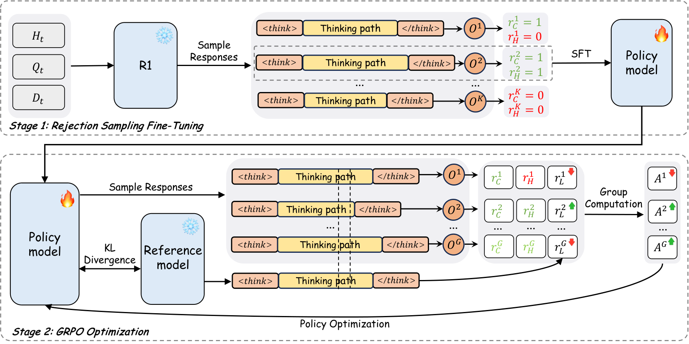
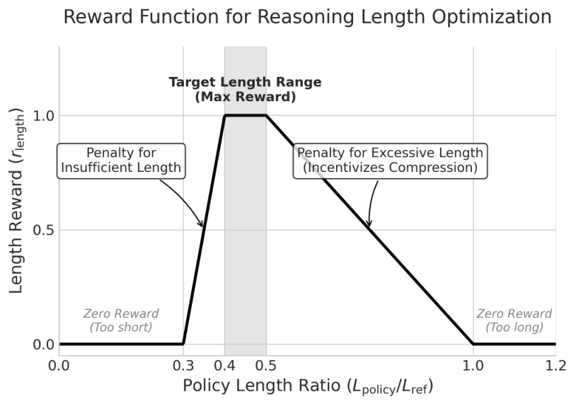
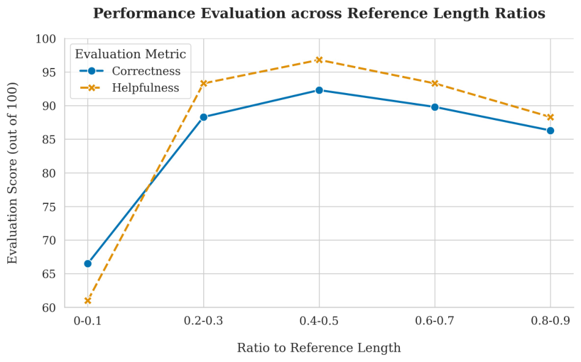
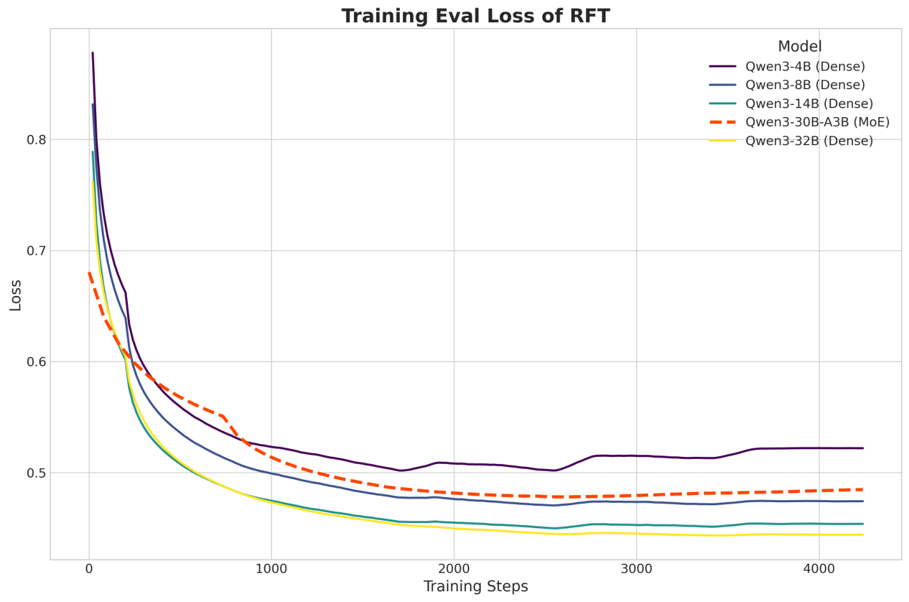

大推理模型能把商品问题答得更准，但它们也会想得很久。直播间里，回复生成时话题可能已经过去了。

直播间里的问题通常不长：“还有国补吗”“这两款差在哪”“刚才那个能退吗”。回答时却要同时对齐当前问题、历史对话和商品材料。长推理能够帮助模型梳理这些条件，但数字人无法让观众等十几秒，最终口播也不适合包含模型内部的反复推演。

LiveThinking 先用轻量学生学习商品问答，再通过强化学习减少多余推理。我们为实时电商问答选择合适的推理预算，同时保留事实质量；其他任务是否适合缩短推理，需要另行判断。

<section class="ltx_subsection" id="S3.SS2">
<h2 class="ltx_title ltx_title_subsection">正确性与帮助性评估</h2>

使用 LLM-as-a-Judge 从两个维度评估回复：

<section class="ltx_paragraph" id="S3.SS2.SSS0.Px1">
<h4 class="ltx_title ltx_font_bold ltx_title_paragraph">正确性（C）</h4>

衡量回复与商品知识的事实一致性：

<mjx-container class="MathJax" display="true" jax="SVG"><svg aria-hidden="true" focusable="false" height="5.428ex" role="img" style="vertical-align: -2.148ex;" viewbox="0 -1449.5 22709.1 2399" width="51.378ex" xmlns="http://www.w3.org/2000/svg"><g fill="currentColor" stroke="currentColor" stroke-width="0" transform="scale(1,-1)"><g data-mml-node="math"><g data-mml-node="mi"><path d="M50 252Q50 367 117 473T286 641T490 704Q580 704 633 653Q642 643 648 636T656 626L657 623Q660 623 684 649Q691 655 699 663T715 679T725 690L740 705H746Q760 705 760 698Q760 694 728 561Q692 422 692 421Q690 416 687 415T669 413H653Q647 419 647 422Q647 423 648 429T650 449T651 481Q651 552 619 605T510 659Q484 659 454 652T382 628T299 572T226 479Q194 422 175 346T156 222Q156 108 232 58Q280 24 350 24Q441 24 512 92T606 240Q610 253 612 255T628 257Q648 257 648 248Q648 243 647 239Q618 132 523 55T319 -22Q206 -22 128 53T50 252Z" data-c="1D436"></path></g><g data-mml-node="mo" transform="translate(760,0)"><path d="M94 250Q94 319 104 381T127 488T164 576T202 643T244 695T277 729T302 750H315H319Q333 750 333 741Q333 738 316 720T275 667T226 581T184 443T167 250T184 58T225 -81T274 -167T316 -220T333 -241Q333 -250 318 -250H315H302L274 -226Q180 -141 137 -14T94 250Z" data-c="28"></path></g><g data-mml-node="msub" transform="translate(1149,0)"><g data-mml-node="mi"><path d="M287 628Q287 635 230 637Q207 637 200 638T193 647Q193 655 197 667T204 682Q206 683 403 683Q570 682 590 682T630 676Q702 659 752 597T803 431Q803 275 696 151T444 3L430 1L236 0H125H72Q48 0 41 2T33 11Q33 13 36 25Q40 41 44 43T67 46Q94 46 127 49Q141 52 146 61Q149 65 218 339T287 628ZM703 469Q703 507 692 537T666 584T629 613T590 629T555 636Q553 636 541 636T512 636T479 637H436Q392 637 386 627Q384 623 313 339T242 52Q242 48 253 48T330 47Q335 47 349 47T373 46Q499 46 581 128Q617 164 640 212T683 339T703 469Z" data-c="1D437"></path></g><g data-mjx-texclass="ORD" data-mml-node="TeXAtom" transform="translate(861,-150) scale(0.707)"><g data-mml-node="mi"><path d="M26 385Q19 392 19 395Q19 399 22 411T27 425Q29 430 36 430T87 431H140L159 511Q162 522 166 540T173 566T179 586T187 603T197 615T211 624T229 626Q247 625 254 615T261 596Q261 589 252 549T232 470L222 433Q222 431 272 431H323Q330 424 330 420Q330 398 317 385H210L174 240Q135 80 135 68Q135 26 162 26Q197 26 230 60T283 144Q285 150 288 151T303 153H307Q322 153 322 145Q322 142 319 133Q314 117 301 95T267 48T216 6T155 -11Q125 -11 98 4T59 56Q57 64 57 83V101L92 241Q127 382 128 383Q128 385 77 385H26Z" data-c="1D461"></path></g></g></g><g data-mml-node="mo" transform="translate(2315.3,0)"><path d="M78 35T78 60T94 103T137 121Q165 121 187 96T210 8Q210 -27 201 -60T180 -117T154 -158T130 -185T117 -194Q113 -194 104 -185T95 -172Q95 -168 106 -156T131 -126T157 -76T173 -3V9L172 8Q170 7 167 6T161 3T152 1T140 0Q113 0 96 17Z" data-c="2C"></path></g><g data-mml-node="msub" transform="translate(2759.9,0)"><g data-mml-node="mi"><path d="M399 -80Q399 -47 400 -30T402 -11V-7L387 -11Q341 -22 303 -22Q208 -22 138 35T51 201Q50 209 50 244Q50 346 98 438T227 601Q351 704 476 704Q514 704 524 703Q621 689 680 617T740 435Q740 255 592 107Q529 47 461 16L444 8V3Q444 2 449 -24T470 -66T516 -82Q551 -82 583 -60T625 -3Q631 11 638 11Q647 11 649 2Q649 -6 639 -34T611 -100T557 -165T481 -194Q399 -194 399 -87V-80ZM636 468Q636 523 621 564T580 625T530 655T477 665Q429 665 379 640Q277 591 215 464T153 216Q153 110 207 59Q231 38 236 38V46Q236 86 269 120T347 155Q372 155 390 144T417 114T429 82T435 55L448 64Q512 108 557 185T619 334T636 468ZM314 18Q362 18 404 39L403 49Q399 104 366 115Q354 117 347 117Q344 117 341 117T337 118Q317 118 296 98T274 52Q274 18 314 18Z" data-c="1D444"></path></g><g data-mjx-texclass="ORD" data-mml-node="TeXAtom" transform="translate(824,-150) scale(0.707)"><g data-mml-node="mi"><path d="M26 385Q19 392 19 395Q19 399 22 411T27 425Q29 430 36 430T87 431H140L159 511Q162 522 166 540T173 566T179 586T187 603T197 615T211 624T229 626Q247 625 254 615T261 596Q261 589 252 549T232 470L222 433Q222 431 272 431H323Q330 424 330 420Q330 398 317 385H210L174 240Q135 80 135 68Q135 26 162 26Q197 26 230 60T283 144Q285 150 288 151T303 153H307Q322 153 322 145Q322 142 319 133Q314 117 301 95T267 48T216 6T155 -11Q125 -11 98 4T59 56Q57 64 57 83V101L92 241Q127 382 128 383Q128 385 77 385H26Z" data-c="1D461"></path></g></g></g><g data-mml-node="mo" transform="translate(3889.2,0)"><path d="M78 35T78 60T94 103T137 121Q165 121 187 96T210 8Q210 -27 201 -60T180 -117T154 -158T130 -185T117 -194Q113 -194 104 -185T95 -172Q95 -168 106 -156T131 -126T157 -76T173 -3V9L172 8Q170 7 167 6T161 3T152 1T140 0Q113 0 96 17Z" data-c="2C"></path></g><g data-mml-node="msub" transform="translate(4333.9,0)"><g data-mml-node="mi"><path d="M228 637Q194 637 192 641Q191 643 191 649Q191 673 202 682Q204 683 219 683Q260 681 355 681Q389 681 418 681T463 682T483 682Q499 682 499 672Q499 670 497 658Q492 641 487 638H485Q483 638 480 638T473 638T464 637T455 637Q416 636 405 634T387 623Q384 619 355 500Q348 474 340 442T328 395L324 380Q324 378 469 378H614L615 381Q615 384 646 504Q674 619 674 627T617 637Q594 637 587 639T580 648Q580 650 582 660Q586 677 588 679T604 682Q609 682 646 681T740 680Q802 680 835 681T871 682Q888 682 888 672Q888 645 876 638H874Q872 638 869 638T862 638T853 637T844 637Q805 636 794 634T776 623Q773 618 704 340T634 58Q634 51 638 51Q646 48 692 46H723Q729 38 729 37T726 19Q722 6 716 0H701Q664 2 567 2Q533 2 504 2T458 2T437 1Q420 1 420 10Q420 15 423 24Q428 43 433 45Q437 46 448 46H454Q481 46 514 49Q520 50 522 50T528 55T534 64T540 82T547 110T558 153Q565 181 569 198Q602 330 602 331T457 332H312L279 197Q245 63 245 58Q245 51 253 49T303 46H334Q340 38 340 37T337 19Q333 6 327 0H312Q275 2 178 2Q144 2 115 2T69 2T48 1Q31 1 31 10Q31 12 34 24Q39 43 44 45Q48 46 59 46H65Q92 46 125 49Q139 52 144 61Q147 65 216 339T285 628Q285 635 228 637Z" data-c="1D43B"></path></g><g data-mjx-texclass="ORD" data-mml-node="TeXAtom" transform="translate(864,-150) scale(0.707)"><g data-mml-node="mi"><path d="M26 385Q19 392 19 395Q19 399 22 411T27 425Q29 430 36 430T87 431H140L159 511Q162 522 166 540T173 566T179 586T187 603T197 615T211 624T229 626Q247 625 254 615T261 596Q261 589 252 549T232 470L222 433Q222 431 272 431H323Q330 424 330 420Q330 398 317 385H210L174 240Q135 80 135 68Q135 26 162 26Q197 26 230 60T283 144Q285 150 288 151T303 153H307Q322 153 322 145Q322 142 319 133Q314 117 301 95T267 48T216 6T155 -11Q125 -11 98 4T59 56Q57 64 57 83V101L92 241Q127 382 128 383Q128 385 77 385H26Z" data-c="1D461"></path></g></g></g><g data-mml-node="mo" transform="translate(5503.1,0)"><path d="M78 35T78 60T94 103T137 121Q165 121 187 96T210 8Q210 -27 201 -60T180 -117T154 -158T130 -185T117 -194Q113 -194 104 -185T95 -172Q95 -168 106 -156T131 -126T157 -76T173 -3V9L172 8Q170 7 167 6T161 3T152 1T140 0Q113 0 96 17Z" data-c="2C"></path></g><g data-mml-node="msub" transform="translate(5947.8,0)"><g data-mml-node="mi"><path d="M230 637Q203 637 198 638T193 649Q193 676 204 682Q206 683 378 683Q550 682 564 680Q620 672 658 652T712 606T733 563T739 529Q739 484 710 445T643 385T576 351T538 338L545 333Q612 295 612 223Q612 212 607 162T602 80V71Q602 53 603 43T614 25T640 16Q668 16 686 38T712 85Q717 99 720 102T735 105Q755 105 755 93Q755 75 731 36Q693 -21 641 -21H632Q571 -21 531 4T487 82Q487 109 502 166T517 239Q517 290 474 313Q459 320 449 321T378 323H309L277 193Q244 61 244 59Q244 55 245 54T252 50T269 48T302 46H333Q339 38 339 37T336 19Q332 6 326 0H311Q275 2 180 2Q146 2 117 2T71 2T50 1Q33 1 33 10Q33 12 36 24Q41 43 46 45Q50 46 61 46H67Q94 46 127 49Q141 52 146 61Q149 65 218 339T287 628Q287 635 230 637ZM630 554Q630 586 609 608T523 636Q521 636 500 636T462 637H440Q393 637 386 627Q385 624 352 494T319 361Q319 360 388 360Q466 361 492 367Q556 377 592 426Q608 449 619 486T630 554Z" data-c="1D445"></path></g><g data-mjx-texclass="ORD" data-mml-node="TeXAtom" transform="translate(792,-150) scale(0.707)"><g data-mml-node="mi"><path d="M26 385Q19 392 19 395Q19 399 22 411T27 425Q29 430 36 430T87 431H140L159 511Q162 522 166 540T173 566T179 586T187 603T197 615T211 624T229 626Q247 625 254 615T261 596Q261 589 252 549T232 470L222 433Q222 431 272 431H323Q330 424 330 420Q330 398 317 385H210L174 240Q135 80 135 68Q135 26 162 26Q197 26 230 60T283 144Q285 150 288 151T303 153H307Q322 153 322 145Q322 142 319 133Q314 117 301 95T267 48T216 6T155 -11Q125 -11 98 4T59 56Q57 64 57 83V101L92 241Q127 382 128 383Q128 385 77 385H26Z" data-c="1D461"></path></g></g></g><g data-mml-node="mo" transform="translate(7045.1,0)"><path d="M60 749L64 750Q69 750 74 750H86L114 726Q208 641 251 514T294 250Q294 182 284 119T261 12T224 -76T186 -143T145 -194T113 -227T90 -246Q87 -249 86 -250H74Q66 -250 63 -250T58 -247T55 -238Q56 -237 66 -225Q221 -64 221 250T66 725Q56 737 55 738Q55 746 60 749Z" data-c="29"></path></g><g data-mml-node="mo" transform="translate(7711.8,0)"><path d="M56 347Q56 360 70 367H707Q722 359 722 347Q722 336 708 328L390 327H72Q56 332 56 347ZM56 153Q56 168 72 173H708Q722 163 722 153Q722 140 707 133H70Q56 140 56 153Z" data-c="3D"></path></g><g data-mml-node="mrow" transform="translate(8767.6,0)"><g data-mml-node="mo" transform="translate(0 -0.5)"><path d="M618 -943L612 -949H582L568 -943Q472 -903 411 -841T332 -703Q327 -682 327 -653T325 -350Q324 -28 323 -18Q317 24 301 61T264 124T221 171T179 205T147 225T132 234Q130 238 130 250Q130 255 130 258T131 264T132 267T134 269T139 272T144 275Q207 308 256 367Q310 436 323 519Q324 529 325 851Q326 1124 326 1154T332 1205Q369 1358 566 1443L582 1450H612L618 1444V1429Q618 1413 616 1411L608 1406Q599 1402 585 1393T552 1372T515 1343T479 1305T449 1257T429 1200Q425 1180 425 1152T423 851Q422 579 422 549T416 498Q407 459 388 424T346 364T297 318T250 284T214 264T197 254L188 251L205 242Q290 200 345 138T416 3Q421 -18 421 -48T423 -349Q423 -397 423 -472Q424 -677 428 -694Q429 -697 429 -699Q434 -722 443 -743T465 -782T491 -816T519 -845T548 -868T574 -886T595 -899T610 -908L616 -910Q618 -912 618 -928V-943Z" data-c="7B"></path></g><g data-mml-node="mtable" transform="translate(750,0)"><g data-mml-node="mtr" transform="translate(0,600)"><g data-mml-node="mtd"><g data-mml-node="mn"><path d="M213 578L200 573Q186 568 160 563T102 556H83V602H102Q149 604 189 617T245 641T273 663Q275 666 285 666Q294 666 302 660V361L303 61Q310 54 315 52T339 48T401 46H427V0H416Q395 3 257 3Q121 3 100 0H88V46H114Q136 46 152 46T177 47T193 50T201 52T207 57T213 61V578Z" data-c="31"></path></g></g><g data-mml-node="mtd" transform="translate(1500,0)"><g data-mml-node="mtext"><path d="M69 609Q69 637 87 653T131 669Q154 667 171 652T188 609Q188 579 171 564T129 549Q104 549 87 564T69 609ZM247 0Q232 3 143 3Q132 3 106 3T56 1L34 0H26V46H42Q70 46 91 49Q100 53 102 60T104 102V205V293Q104 345 102 359T88 378Q74 385 41 385H30V408Q30 431 32 431L42 432Q52 433 70 434T106 436Q123 437 142 438T171 441T182 442H185V62Q190 52 197 50T232 46H255V0H247Z" data-c="69"></path><path d="M273 0Q255 3 146 3Q43 3 34 0H26V46H42Q70 46 91 49Q99 52 103 60Q104 62 104 224V385H33V431H104V497L105 564L107 574Q126 639 171 668T266 704Q267 704 275 704T289 705Q330 702 351 679T372 627Q372 604 358 590T321 576T284 590T270 627Q270 647 288 667H284Q280 668 273 668Q245 668 223 647T189 592Q183 572 182 497V431H293V385H185V225Q185 63 186 61T189 57T194 54T199 51T206 49T213 48T222 47T231 47T241 46T251 46H282V0H273Z" data-c="66" transform="translate(278,0)"></path><path d="" data-c="A0" transform="translate(584,0)"></path></g><g data-mml-node="msub" transform="translate(834,0)"><g data-mml-node="mi"><path d="M230 637Q203 637 198 638T193 649Q193 676 204 682Q206 683 378 683Q550 682 564 680Q620 672 658 652T712 606T733 563T739 529Q739 484 710 445T643 385T576 351T538 338L545 333Q612 295 612 223Q612 212 607 162T602 80V71Q602 53 603 43T614 25T640 16Q668 16 686 38T712 85Q717 99 720 102T735 105Q755 105 755 93Q755 75 731 36Q693 -21 641 -21H632Q571 -21 531 4T487 82Q487 109 502 166T517 239Q517 290 474 313Q459 320 449 321T378 323H309L277 193Q244 61 244 59Q244 55 245 54T252 50T269 48T302 46H333Q339 38 339 37T336 19Q332 6 326 0H311Q275 2 180 2Q146 2 117 2T71 2T50 1Q33 1 33 10Q33 12 36 24Q41 43 46 45Q50 46 61 46H67Q94 46 127 49Q141 52 146 61Q149 65 218 339T287 628Q287 635 230 637ZM630 554Q630 586 609 608T523 636Q521 636 500 636T462 637H440Q393 637 386 627Q385 624 352 494T319 361Q319 360 388 360Q466 361 492 367Q556 377 592 426Q608 449 619 486T630 554Z" data-c="1D445"></path></g><g data-mjx-texclass="ORD" data-mml-node="TeXAtom" transform="translate(792,-150) scale(0.707)"><g data-mml-node="mi"><path d="M26 385Q19 392 19 395Q19 399 22 411T27 425Q29 430 36 430T87 431H140L159 511Q162 522 166 540T173 566T179 586T187 603T197 615T211 624T229 626Q247 625 254 615T261 596Q261 589 252 549T232 470L222 433Q222 431 272 431H323Q330 424 330 420Q330 398 317 385H210L174 240Q135 80 135 68Q135 26 162 26Q197 26 230 60T283 144Q285 150 288 151T303 153H307Q322 153 322 145Q322 142 319 133Q314 117 301 95T267 48T216 6T155 -11Q125 -11 98 4T59 56Q57 64 57 83V101L92 241Q127 382 128 383Q128 385 77 385H26Z" data-c="1D461"></path></g></g></g><g data-mml-node="mtext" transform="translate(1931.3,0)"><path d="" data-c="A0"></path><path d="M137 305T115 305T78 320T63 359Q63 394 97 421T218 448Q291 448 336 416T396 340Q401 326 401 309T402 194V124Q402 76 407 58T428 40Q443 40 448 56T453 109V145H493V106Q492 66 490 59Q481 29 455 12T400 -6T353 12T329 54V58L327 55Q325 52 322 49T314 40T302 29T287 17T269 6T247 -2T221 -8T190 -11Q130 -11 82 20T34 107Q34 128 41 147T68 188T116 225T194 253T304 268H318V290Q318 324 312 340Q290 411 215 411Q197 411 181 410T156 406T148 403Q170 388 170 359Q170 334 154 320ZM126 106Q126 75 150 51T209 26Q247 26 276 49T315 109Q317 116 318 175Q318 233 317 233Q309 233 296 232T251 223T193 203T147 166T126 106Z" data-c="61" transform="translate(250,0)"></path><path d="M370 305T349 305T313 320T297 358Q297 381 312 396Q317 401 317 402T307 404Q281 408 258 408Q209 408 178 376Q131 329 131 219Q131 137 162 90Q203 29 272 29Q313 29 338 55T374 117Q376 125 379 127T395 129H409Q415 123 415 120Q415 116 411 104T395 71T366 33T318 2T249 -11Q163 -11 99 53T34 214Q34 318 99 383T250 448T370 421T404 357Q404 334 387 320Z" data-c="63" transform="translate(750,0)"></path><path d="M370 305T349 305T313 320T297 358Q297 381 312 396Q317 401 317 402T307 404Q281 408 258 408Q209 408 178 376Q131 329 131 219Q131 137 162 90Q203 29 272 29Q313 29 338 55T374 117Q376 125 379 127T395 129H409Q415 123 415 120Q415 116 411 104T395 71T366 33T318 2T249 -11Q163 -11 99 53T34 214Q34 318 99 383T250 448T370 421T404 357Q404 334 387 320Z" data-c="63" transform="translate(1194,0)"></path><path d="M383 58Q327 -10 256 -10H249Q124 -10 105 89Q104 96 103 226Q102 335 102 348T96 369Q86 385 36 385H25V408Q25 431 27 431L38 432Q48 433 67 434T105 436Q122 437 142 438T172 441T184 442H187V261Q188 77 190 64Q193 49 204 40Q224 26 264 26Q290 26 311 35T343 58T363 90T375 120T379 144Q379 145 379 161T380 201T380 248V315Q380 361 370 372T320 385H302V431Q304 431 378 436T457 442H464V264Q464 84 465 81Q468 61 479 55T524 46H542V0Q540 0 467 -5T390 -11H383V58Z" data-c="75" transform="translate(1638,0)"></path><path d="M36 46H50Q89 46 97 60V68Q97 77 97 91T98 122T98 161T98 203Q98 234 98 269T98 328L97 351Q94 370 83 376T38 385H20V408Q20 431 22 431L32 432Q42 433 60 434T96 436Q112 437 131 438T160 441T171 442H174V373Q213 441 271 441H277Q322 441 343 419T364 373Q364 352 351 337T313 322Q288 322 276 338T263 372Q263 381 265 388T270 400T273 405Q271 407 250 401Q234 393 226 386Q179 341 179 207V154Q179 141 179 127T179 101T180 81T180 66V61Q181 59 183 57T188 54T193 51T200 49T207 48T216 47T225 47T235 46T245 46H276V0H267Q249 3 140 3Q37 3 28 0H20V46H36Z" data-c="72" transform="translate(2194,0)"></path><path d="M137 305T115 305T78 320T63 359Q63 394 97 421T218 448Q291 448 336 416T396 340Q401 326 401 309T402 194V124Q402 76 407 58T428 40Q443 40 448 56T453 109V145H493V106Q492 66 490 59Q481 29 455 12T400 -6T353 12T329 54V58L327 55Q325 52 322 49T314 40T302 29T287 17T269 6T247 -2T221 -8T190 -11Q130 -11 82 20T34 107Q34 128 41 147T68 188T116 225T194 253T304 268H318V290Q318 324 312 340Q290 411 215 411Q197 411 181 410T156 406T148 403Q170 388 170 359Q170 334 154 320ZM126 106Q126 75 150 51T209 26Q247 26 276 49T315 109Q317 116 318 175Q318 233 317 233Q309 233 296 232T251 223T193 203T147 166T126 106Z" data-c="61" transform="translate(2586,0)"></path><path d="M27 422Q80 426 109 478T141 600V615H181V431H316V385H181V241Q182 116 182 100T189 68Q203 29 238 29Q282 29 292 100Q293 108 293 146V181H333V146V134Q333 57 291 17Q264 -10 221 -10Q187 -10 162 2T124 33T105 68T98 100Q97 107 97 248V385H18V422H27Z" data-c="74" transform="translate(3086,0)"></path><path d="M28 218Q28 273 48 318T98 391T163 433T229 448Q282 448 320 430T378 380T406 316T415 245Q415 238 408 231H126V216Q126 68 226 36Q246 30 270 30Q312 30 342 62Q359 79 369 104L379 128Q382 131 395 131H398Q415 131 415 121Q415 117 412 108Q393 53 349 21T250 -11Q155 -11 92 58T28 218ZM333 275Q322 403 238 411H236Q228 411 220 410T195 402T166 381T143 340T127 274V267H333V275Z" data-c="65" transform="translate(3475,0)"></path><path d="M42 46H56Q95 46 103 60V68Q103 77 103 91T103 124T104 167T104 217T104 272T104 329Q104 366 104 407T104 482T104 542T103 586T103 603Q100 622 89 628T44 637H26V660Q26 683 28 683L38 684Q48 685 67 686T104 688Q121 689 141 690T171 693T182 694H185V379Q185 62 186 60Q190 52 198 49Q219 46 247 46H263V0H255L232 1Q209 2 183 2T145 3T107 3T57 1L34 0H26V46H42Z" data-c="6C" transform="translate(3919,0)"></path><path d="M69 -66Q91 -66 104 -80T118 -116Q118 -134 109 -145T91 -160Q84 -163 97 -166Q104 -168 111 -168Q131 -168 148 -159T175 -138T197 -106T213 -75T225 -43L242 0L170 183Q150 233 125 297Q101 358 96 368T80 381Q79 382 78 382Q66 385 34 385H19V431H26L46 430Q65 430 88 429T122 428Q129 428 142 428T171 429T200 430T224 430L233 431H241V385H232Q183 385 185 366L286 112Q286 113 332 227L376 341V350Q376 365 366 373T348 383T334 385H331V431H337H344Q351 431 361 431T382 430T405 429T422 429Q477 429 503 431H508V385H497Q441 380 422 345Q420 343 378 235T289 9T227 -131Q180 -204 113 -204Q69 -204 44 -177T19 -116Q19 -89 35 -78T69 -66Z" data-c="79" transform="translate(4197,0)"></path><path d="" data-c="20" transform="translate(4725,0)"></path><path d="M36 46H50Q89 46 97 60V68Q97 77 97 91T98 122T98 161T98 203Q98 234 98 269T98 328L97 351Q94 370 83 376T38 385H20V408Q20 431 22 431L32 432Q42 433 60 434T96 436Q112 437 131 438T160 441T171 442H174V373Q213 441 271 441H277Q322 441 343 419T364 373Q364 352 351 337T313 322Q288 322 276 338T263 372Q263 381 265 388T270 400T273 405Q271 407 250 401Q234 393 226 386Q179 341 179 207V154Q179 141 179 127T179 101T180 81T180 66V61Q181 59 183 57T188 54T193 51T200 49T207 48T216 47T225 47T235 46T245 46H276V0H267Q249 3 140 3Q37 3 28 0H20V46H36Z" data-c="72" transform="translate(4975,0)"></path><path d="M28 218Q28 273 48 318T98 391T163 433T229 448Q282 448 320 430T378 380T406 316T415 245Q415 238 408 231H126V216Q126 68 226 36Q246 30 270 30Q312 30 342 62Q359 79 369 104L379 128Q382 131 395 131H398Q415 131 415 121Q415 117 412 108Q393 53 349 21T250 -11Q155 -11 92 58T28 218ZM333 275Q322 403 238 411H236Q228 411 220 410T195 402T166 381T143 340T127 274V267H333V275Z" data-c="65" transform="translate(5367,0)"></path><path d="M273 0Q255 3 146 3Q43 3 34 0H26V46H42Q70 46 91 49Q99 52 103 60Q104 62 104 224V385H33V431H104V497L105 564L107 574Q126 639 171 668T266 704Q267 704 275 704T289 705Q330 702 351 679T372 627Q372 604 358 590T321 576T284 590T270 627Q270 647 288 667H284Q280 668 273 668Q245 668 223 647T189 592Q183 572 182 497V431H293V385H185V225Q185 63 186 61T189 57T194 54T199 51T206 49T213 48T222 47T231 47T241 46T251 46H282V0H273Z" data-c="66" transform="translate(5811,0)"></path><path d="M42 46H56Q95 46 103 60V68Q103 77 103 91T103 124T104 167T104 217T104 272T104 329Q104 366 104 407T104 482T104 542T103 586T103 603Q100 622 89 628T44 637H26V660Q26 683 28 683L38 684Q48 685 67 686T104 688Q121 689 141 690T171 693T182 694H185V379Q185 62 186 60Q190 52 198 49Q219 46 247 46H263V0H255L232 1Q209 2 183 2T145 3T107 3T57 1L34 0H26V46H42Z" data-c="6C" transform="translate(6117,0)"></path><path d="M28 218Q28 273 48 318T98 391T163 433T229 448Q282 448 320 430T378 380T406 316T415 245Q415 238 408 231H126V216Q126 68 226 36Q246 30 270 30Q312 30 342 62Q359 79 369 104L379 128Q382 131 395 131H398Q415 131 415 121Q415 117 412 108Q393 53 349 21T250 -11Q155 -11 92 58T28 218ZM333 275Q322 403 238 411H236Q228 411 220 410T195 402T166 381T143 340T127 274V267H333V275Z" data-c="65" transform="translate(6395,0)"></path><path d="M370 305T349 305T313 320T297 358Q297 381 312 396Q317 401 317 402T307 404Q281 408 258 408Q209 408 178 376Q131 329 131 219Q131 137 162 90Q203 29 272 29Q313 29 338 55T374 117Q376 125 379 127T395 129H409Q415 123 415 120Q415 116 411 104T395 71T366 33T318 2T249 -11Q163 -11 99 53T34 214Q34 318 99 383T250 448T370 421T404 357Q404 334 387 320Z" data-c="63" transform="translate(6839,0)"></path><path d="M27 422Q80 426 109 478T141 600V615H181V431H316V385H181V241Q182 116 182 100T189 68Q203 29 238 29Q282 29 292 100Q293 108 293 146V181H333V146V134Q333 57 291 17Q264 -10 221 -10Q187 -10 162 2T124 33T105 68T98 100Q97 107 97 248V385H18V422H27Z" data-c="74" transform="translate(7283,0)"></path><path d="M295 316Q295 356 268 385T190 414Q154 414 128 401Q98 382 98 349Q97 344 98 336T114 312T157 287Q175 282 201 278T245 269T277 256Q294 248 310 236T342 195T359 133Q359 71 321 31T198 -10H190Q138 -10 94 26L86 19L77 10Q71 4 65 -1L54 -11H46H42Q39 -11 33 -5V74V132Q33 153 35 157T45 162H54Q66 162 70 158T75 146T82 119T101 77Q136 26 198 26Q295 26 295 104Q295 133 277 151Q257 175 194 187T111 210Q75 227 54 256T33 318Q33 357 50 384T93 424T143 442T187 447H198Q238 447 268 432L283 424L292 431Q302 440 314 448H322H326Q329 448 335 442V310L329 304H301Q295 310 295 316Z" data-c="73" transform="translate(7672,0)"></path><path d="" data-c="A0" transform="translate(8066,0)"></path></g><g data-mml-node="msub" transform="translate(10247.3,0)"><g data-mml-node="mi"><path d="M287 628Q287 635 230 637Q207 637 200 638T193 647Q193 655 197 667T204 682Q206 683 403 683Q570 682 590 682T630 676Q702 659 752 597T803 431Q803 275 696 151T444 3L430 1L236 0H125H72Q48 0 41 2T33 11Q33 13 36 25Q40 41 44 43T67 46Q94 46 127 49Q141 52 146 61Q149 65 218 339T287 628ZM703 469Q703 507 692 537T666 584T629 613T590 629T555 636Q553 636 541 636T512 636T479 637H436Q392 637 386 627Q384 623 313 339T242 52Q242 48 253 48T330 47Q335 47 349 47T373 46Q499 46 581 128Q617 164 640 212T683 339T703 469Z" data-c="1D437"></path></g><g data-mjx-texclass="ORD" data-mml-node="TeXAtom" transform="translate(861,-150) scale(0.707)"><g data-mml-node="mi"><path d="M26 385Q19 392 19 395Q19 399 22 411T27 425Q29 430 36 430T87 431H140L159 511Q162 522 166 540T173 566T179 586T187 603T197 615T211 624T229 626Q247 625 254 615T261 596Q261 589 252 549T232 470L222 433Q222 431 272 431H323Q330 424 330 420Q330 398 317 385H210L174 240Q135 80 135 68Q135 26 162 26Q197 26 230 60T283 144Q285 150 288 151T303 153H307Q322 153 322 145Q322 142 319 133Q314 117 301 95T267 48T216 6T155 -11Q125 -11 98 4T59 56Q57 64 57 83V101L92 241Q127 382 128 383Q128 385 77 385H26Z" data-c="1D461"></path></g></g></g><g data-mml-node="mo" transform="translate(11413.5,0)"><path d="M78 35T78 60T94 103T137 121Q165 121 187 96T210 8Q210 -27 201 -60T180 -117T154 -158T130 -185T117 -194Q113 -194 104 -185T95 -172Q95 -168 106 -156T131 -126T157 -76T173 -3V9L172 8Q170 7 167 6T161 3T152 1T140 0Q113 0 96 17Z" data-c="2C"></path></g></g></g><g data-mml-node="mtr" transform="translate(0,-600)"><g data-mml-node="mtd"><g data-mml-node="mn"><path d="M96 585Q152 666 249 666Q297 666 345 640T423 548Q460 465 460 320Q460 165 417 83Q397 41 362 16T301 -15T250 -22Q224 -22 198 -16T137 16T82 83Q39 165 39 320Q39 494 96 585ZM321 597Q291 629 250 629Q208 629 178 597Q153 571 145 525T137 333Q137 175 145 125T181 46Q209 16 250 16Q290 16 318 46Q347 76 354 130T362 333Q362 478 354 524T321 597Z" data-c="30"></path></g></g><g data-mml-node="mtd" transform="translate(1500,0)"><g data-mml-node="mtext"><path d="M28 214Q28 309 93 378T250 448Q340 448 405 380T471 215Q471 120 407 55T250 -10Q153 -10 91 57T28 214ZM250 30Q372 30 372 193V225V250Q372 272 371 288T364 326T348 362T317 390T268 410Q263 411 252 411Q222 411 195 399Q152 377 139 338T126 246V226Q126 130 145 91Q177 30 250 30Z" data-c="6F"></path><path d="M27 422Q80 426 109 478T141 600V615H181V431H316V385H181V241Q182 116 182 100T189 68Q203 29 238 29Q282 29 292 100Q293 108 293 146V181H333V146V134Q333 57 291 17Q264 -10 221 -10Q187 -10 162 2T124 33T105 68T98 100Q97 107 97 248V385H18V422H27Z" data-c="74" transform="translate(500,0)"></path><path d="M41 46H55Q94 46 102 60V68Q102 77 102 91T102 124T102 167T103 217T103 272T103 329Q103 366 103 407T103 482T102 542T102 586T102 603Q99 622 88 628T43 637H25V660Q25 683 27 683L37 684Q47 685 66 686T103 688Q120 689 140 690T170 693T181 694H184V367Q244 442 328 442Q451 442 463 329Q464 322 464 190V104Q464 66 466 59T477 49Q498 46 526 46H542V0H534L510 1Q487 2 460 2T422 3Q319 3 310 0H302V46H318Q379 46 379 62Q380 64 380 200Q379 335 378 343Q372 371 358 385T334 402T308 404Q263 404 229 370Q202 343 195 315T187 232V168V108Q187 78 188 68T191 55T200 49Q221 46 249 46H265V0H257L234 1Q210 2 183 2T145 3Q42 3 33 0H25V46H41Z" data-c="68" transform="translate(889,0)"></path><path d="M28 218Q28 273 48 318T98 391T163 433T229 448Q282 448 320 430T378 380T406 316T415 245Q415 238 408 231H126V216Q126 68 226 36Q246 30 270 30Q312 30 342 62Q359 79 369 104L379 128Q382 131 395 131H398Q415 131 415 121Q415 117 412 108Q393 53 349 21T250 -11Q155 -11 92 58T28 218ZM333 275Q322 403 238 411H236Q228 411 220 410T195 402T166 381T143 340T127 274V267H333V275Z" data-c="65" transform="translate(1445,0)"></path><path d="M36 46H50Q89 46 97 60V68Q97 77 97 91T98 122T98 161T98 203Q98 234 98 269T98 328L97 351Q94 370 83 376T38 385H20V408Q20 431 22 431L32 432Q42 433 60 434T96 436Q112 437 131 438T160 441T171 442H174V373Q213 441 271 441H277Q322 441 343 419T364 373Q364 352 351 337T313 322Q288 322 276 338T263 372Q263 381 265 388T270 400T273 405Q271 407 250 401Q234 393 226 386Q179 341 179 207V154Q179 141 179 127T179 101T180 81T180 66V61Q181 59 183 57T188 54T193 51T200 49T207 48T216 47T225 47T235 46T245 46H276V0H267Q249 3 140 3Q37 3 28 0H20V46H36Z" data-c="72" transform="translate(1889,0)"></path><path d="M90 368Q84 378 76 380T40 385H18V431H24L43 430Q62 430 84 429T116 428Q206 428 221 431H229V385H215Q177 383 177 368Q177 367 221 239L265 113L339 328L333 345Q323 374 316 379Q308 384 278 385H258V431H264Q270 428 348 428Q439 428 454 431H461V385H452Q404 385 404 369Q404 366 418 324T449 234T481 143L496 100L537 219Q579 341 579 347Q579 363 564 373T530 385H522V431H529Q541 428 624 428Q692 428 698 431H703V385H697Q696 385 691 385T682 384Q635 377 619 334L559 161Q546 124 528 71Q508 12 503 1T487 -11H479Q460 -11 456 -4Q455 -3 407 133L361 267Q359 263 266 -4Q261 -11 243 -11H238Q225 -11 220 -3L90 368Z" data-c="77" transform="translate(2281,0)"></path><path d="M69 609Q69 637 87 653T131 669Q154 667 171 652T188 609Q188 579 171 564T129 549Q104 549 87 564T69 609ZM247 0Q232 3 143 3Q132 3 106 3T56 1L34 0H26V46H42Q70 46 91 49Q100 53 102 60T104 102V205V293Q104 345 102 359T88 378Q74 385 41 385H30V408Q30 431 32 431L42 432Q52 433 70 434T106 436Q123 437 142 438T171 441T182 442H185V62Q190 52 197 50T232 46H255V0H247Z" data-c="69" transform="translate(3003,0)"></path><path d="M295 316Q295 356 268 385T190 414Q154 414 128 401Q98 382 98 349Q97 344 98 336T114 312T157 287Q175 282 201 278T245 269T277 256Q294 248 310 236T342 195T359 133Q359 71 321 31T198 -10H190Q138 -10 94 26L86 19L77 10Q71 4 65 -1L54 -11H46H42Q39 -11 33 -5V74V132Q33 153 35 157T45 162H54Q66 162 70 158T75 146T82 119T101 77Q136 26 198 26Q295 26 295 104Q295 133 277 151Q257 175 194 187T111 210Q75 227 54 256T33 318Q33 357 50 384T93 424T143 442T187 447H198Q238 447 268 432L283 424L292 431Q302 440 314 448H322H326Q329 448 335 442V310L329 304H301Q295 310 295 316Z" data-c="73" transform="translate(3281,0)"></path><path d="M28 218Q28 273 48 318T98 391T163 433T229 448Q282 448 320 430T378 380T406 316T415 245Q415 238 408 231H126V216Q126 68 226 36Q246 30 270 30Q312 30 342 62Q359 79 369 104L379 128Q382 131 395 131H398Q415 131 415 121Q415 117 412 108Q393 53 349 21T250 -11Q155 -11 92 58T28 218ZM333 275Q322 403 238 411H236Q228 411 220 410T195 402T166 381T143 340T127 274V267H333V275Z" data-c="65" transform="translate(3675,0)"></path><path d="M78 60Q78 84 95 102T138 120Q162 120 180 104T199 61Q199 36 182 18T139 0T96 17T78 60Z" data-c="2E" transform="translate(4119,0)"></path></g></g></g></g><g data-mml-node="mo" transform="translate(13941.5,0) translate(0 250)"></g></g></g></g></svg></mjx-container>C(D_{t},Q_{t},H_{t},R_{t})=\begin{cases}1&amp;\text{if }R_{t}\text{ accurately reflects }D_{t},\\
0&amp;\text{otherwise.}\end{cases}

当且仅当所有陈述都能被文档 <mjx-container class="MathJax" jax="SVG"><svg aria-hidden="true" focusable="false" height="1.902ex" role="img" style="vertical-align: -0.357ex;" viewbox="0 -683 1166.3 840.8" width="2.639ex" xmlns="http://www.w3.org/2000/svg"><g fill="currentColor" stroke="currentColor" stroke-width="0" transform="scale(1,-1)"><g data-mml-node="math"><g data-mml-node="msub"><g data-mml-node="mi"><path d="M287 628Q287 635 230 637Q207 637 200 638T193 647Q193 655 197 667T204 682Q206 683 403 683Q570 682 590 682T630 676Q702 659 752 597T803 431Q803 275 696 151T444 3L430 1L236 0H125H72Q48 0 41 2T33 11Q33 13 36 25Q40 41 44 43T67 46Q94 46 127 49Q141 52 146 61Q149 65 218 339T287 628ZM703 469Q703 507 692 537T666 584T629 613T590 629T555 636Q553 636 541 636T512 636T479 637H436Q392 637 386 627Q384 623 313 339T242 52Q242 48 253 48T330 47Q335 47 349 47T373 46Q499 46 581 128Q617 164 640 212T683 339T703 469Z" data-c="1D437"></path></g><g data-mjx-texclass="ORD" data-mml-node="TeXAtom" transform="translate(861,-150) scale(0.707)"><g data-mml-node="mi"><path d="M26 385Q19 392 19 395Q19 399 22 411T27 425Q29 430 36 430T87 431H140L159 511Q162 522 166 540T173 566T179 586T187 603T197 615T211 624T229 626Q247 625 254 615T261 596Q261 589 252 549T232 470L222 433Q222 431 272 431H323Q330 424 330 420Q330 398 317 385H210L174 240Q135 80 135 68Q135 26 162 26Q197 26 230 60T283 144Q285 150 288 151T303 153H307Q322 153 322 145Q322 142 319 133Q314 117 301 95T267 48T216 6T155 -11Q125 -11 98 4T59 56Q57 64 57 83V101L92 241Q127 382 128 383Q128 385 77 385H26Z" data-c="1D461"></path></g></g></g></g></g></svg></mjx-container>D t 验证、与历史 <mjx-container class="MathJax" jax="SVG"><svg aria-hidden="true" focusable="false" height="1.902ex" role="img" style="vertical-align: -0.357ex;" viewbox="0 -683 1169.3 840.8" width="2.645ex" xmlns="http://www.w3.org/2000/svg"><g fill="currentColor" stroke="currentColor" stroke-width="0" transform="scale(1,-1)"><g data-mml-node="math"><g data-mml-node="msub"><g data-mml-node="mi"><path d="M228 637Q194 637 192 641Q191 643 191 649Q191 673 202 682Q204 683 219 683Q260 681 355 681Q389 681 418 681T463 682T483 682Q499 682 499 672Q499 670 497 658Q492 641 487 638H485Q483 638 480 638T473 638T464 637T455 637Q416 636 405 634T387 623Q384 619 355 500Q348 474 340 442T328 395L324 380Q324 378 469 378H614L615 381Q615 384 646 504Q674 619 674 627T617 637Q594 637 587 639T580 648Q580 650 582 660Q586 677 588 679T604 682Q609 682 646 681T740 680Q802 680 835 681T871 682Q888 682 888 672Q888 645 876 638H874Q872 638 869 638T862 638T853 637T844 637Q805 636 794 634T776 623Q773 618 704 340T634 58Q634 51 638 51Q646 48 692 46H723Q729 38 729 37T726 19Q722 6 716 0H701Q664 2 567 2Q533 2 504 2T458 2T437 1Q420 1 420 10Q420 15 423 24Q428 43 433 45Q437 46 448 46H454Q481 46 514 49Q520 50 522 50T528 55T534 64T540 82T547 110T558 153Q565 181 569 198Q602 330 602 331T457 332H312L279 197Q245 63 245 58Q245 51 253 49T303 46H334Q340 38 340 37T337 19Q333 6 327 0H312Q275 2 178 2Q144 2 115 2T69 2T48 1Q31 1 31 10Q31 12 34 24Q39 43 44 45Q48 46 59 46H65Q92 46 125 49Q139 52 144 61Q147 65 216 339T285 628Q285 635 228 637Z" data-c="1D43B"></path></g><g data-mjx-texclass="ORD" data-mml-node="TeXAtom" transform="translate(864,-150) scale(0.707)"><g data-mml-node="mi"><path d="M26 385Q19 392 19 395Q19 399 22 411T27 425Q29 430 36 430T87 431H140L159 511Q162 522 166 540T173 566T179 586T187 603T197 615T211 624T229 626Q247 625 254 615T261 596Q261 589 252 549T232 470L222 433Q222 431 272 431H323Q330 424 330 420Q330 398 317 385H210L174 240Q135 80 135 68Q135 26 162 26Q197 26 230 60T283 144Q285 150 288 151T303 153H307Q322 153 322 145Q322 142 319 133Q314 117 301 95T267 48T216 6T155 -11Q125 -11 98 4T59 56Q57 64 57 83V101L92 241Q127 382 128 383Q128 385 77 385H26Z" data-c="1D461"></path></g></g></g></g></g></svg></mjx-container>H t 保持逻辑一致，并直接且切题地回答当前问题 <mjx-container class="MathJax" jax="SVG"><svg aria-hidden="true" focusable="false" height="2.032ex" role="img" style="vertical-align: -0.439ex;" viewbox="0 -704 1129.3 898" width="2.555ex" xmlns="http://www.w3.org/2000/svg"><g fill="currentColor" stroke="currentColor" stroke-width="0" transform="scale(1,-1)"><g data-mml-node="math"><g data-mml-node="msub"><g data-mml-node="mi"><path d="M399 -80Q399 -47 400 -30T402 -11V-7L387 -11Q341 -22 303 -22Q208 -22 138 35T51 201Q50 209 50 244Q50 346 98 438T227 601Q351 704 476 704Q514 704 524 703Q621 689 680 617T740 435Q740 255 592 107Q529 47 461 16L444 8V3Q444 2 449 -24T470 -66T516 -82Q551 -82 583 -60T625 -3Q631 11 638 11Q647 11 649 2Q649 -6 639 -34T611 -100T557 -165T481 -194Q399 -194 399 -87V-80ZM636 468Q636 523 621 564T580 625T530 655T477 665Q429 665 379 640Q277 591 215 464T153 216Q153 110 207 59Q231 38 236 38V46Q236 86 269 120T347 155Q372 155 390 144T417 114T429 82T435 55L448 64Q512 108 557 185T619 334T636 468ZM314 18Q362 18 404 39L403 49Q399 104 366 115Q354 117 347 117Q344 117 341 117T337 118Q317 118 296 98T274 52Q274 18 314 18Z" data-c="1D444"></path></g><g data-mjx-texclass="ORD" data-mml-node="TeXAtom" transform="translate(824,-150) scale(0.707)"><g data-mml-node="mi"><path d="M26 385Q19 392 19 395Q19 399 22 411T27 425Q29 430 36 430T87 431H140L159 511Q162 522 166 540T173 566T179 586T187 603T197 615T211 624T229 626Q247 625 254 615T261 596Q261 589 252 549T232 470L222 433Q222 431 272 431H323Q330 424 330 420Q330 398 317 385H210L174 240Q135 80 135 68Q135 26 162 26Q197 26 230 60T283 144Q285 150 288 151T303 153H307Q322 153 322 145Q322 142 319 133Q314 117 301 95T267 48T216 6T155 -11Q125 -11 98 4T59 56Q57 64 57 83V101L92 241Q127 382 128 383Q128 385 77 385H26Z" data-c="1D461"></path></g></g></g></g></g></svg></mjx-container>Q t 时，回复被判为正确。这既要求事实可靠，也排除答非所问。

</section>
<section class="ltx_paragraph" id="S3.SS2.SSS0.Px2">
<h4 class="ltx_title ltx_font_bold ltx_title_paragraph">帮助性（H）</h4>

正确性是基础，但单独优化它可能使模型过度保守，为减少幻觉而只生成极少信息。此类回复虽然事实无误，却无法有效帮助用户，体验较差。

因此引入帮助性作为补充，鼓励模型在准确性与实用性之间取得平衡，提供更丰富、有价值的信息：

<mjx-container class="MathJax" display="true" jax="SVG"><svg aria-hidden="true" focusable="false" height="5.428ex" role="img" style="vertical-align: -2.148ex;" viewbox="0 -1449.5 24878.2 2399" width="56.286ex" xmlns="http://www.w3.org/2000/svg"><g fill="currentColor" stroke="currentColor" stroke-width="0" transform="scale(1,-1)"><g data-mml-node="math"><g data-mml-node="mi"><path d="M228 637Q194 637 192 641Q191 643 191 649Q191 673 202 682Q204 683 219 683Q260 681 355 681Q389 681 418 681T463 682T483 682Q499 682 499 672Q499 670 497 658Q492 641 487 638H485Q483 638 480 638T473 638T464 637T455 637Q416 636 405 634T387 623Q384 619 355 500Q348 474 340 442T328 395L324 380Q324 378 469 378H614L615 381Q615 384 646 504Q674 619 674 627T617 637Q594 637 587 639T580 648Q580 650 582 660Q586 677 588 679T604 682Q609 682 646 681T740 680Q802 680 835 681T871 682Q888 682 888 672Q888 645 876 638H874Q872 638 869 638T862 638T853 637T844 637Q805 636 794 634T776 623Q773 618 704 340T634 58Q634 51 638 51Q646 48 692 46H723Q729 38 729 37T726 19Q722 6 716 0H701Q664 2 567 2Q533 2 504 2T458 2T437 1Q420 1 420 10Q420 15 423 24Q428 43 433 45Q437 46 448 46H454Q481 46 514 49Q520 50 522 50T528 55T534 64T540 82T547 110T558 153Q565 181 569 198Q602 330 602 331T457 332H312L279 197Q245 63 245 58Q245 51 253 49T303 46H334Q340 38 340 37T337 19Q333 6 327 0H312Q275 2 178 2Q144 2 115 2T69 2T48 1Q31 1 31 10Q31 12 34 24Q39 43 44 45Q48 46 59 46H65Q92 46 125 49Q139 52 144 61Q147 65 216 339T285 628Q285 635 228 637Z" data-c="1D43B"></path></g><g data-mml-node="mo" transform="translate(888,0)"><path d="M94 250Q94 319 104 381T127 488T164 576T202 643T244 695T277 729T302 750H315H319Q333 750 333 741Q333 738 316 720T275 667T226 581T184 443T167 250T184 58T225 -81T274 -167T316 -220T333 -241Q333 -250 318 -250H315H302L274 -226Q180 -141 137 -14T94 250Z" data-c="28"></path></g><g data-mml-node="msub" transform="translate(1277,0)"><g data-mml-node="mi"><path d="M399 -80Q399 -47 400 -30T402 -11V-7L387 -11Q341 -22 303 -22Q208 -22 138 35T51 201Q50 209 50 244Q50 346 98 438T227 601Q351 704 476 704Q514 704 524 703Q621 689 680 617T740 435Q740 255 592 107Q529 47 461 16L444 8V3Q444 2 449 -24T470 -66T516 -82Q551 -82 583 -60T625 -3Q631 11 638 11Q647 11 649 2Q649 -6 639 -34T611 -100T557 -165T481 -194Q399 -194 399 -87V-80ZM636 468Q636 523 621 564T580 625T530 655T477 665Q429 665 379 640Q277 591 215 464T153 216Q153 110 207 59Q231 38 236 38V46Q236 86 269 120T347 155Q372 155 390 144T417 114T429 82T435 55L448 64Q512 108 557 185T619 334T636 468ZM314 18Q362 18 404 39L403 49Q399 104 366 115Q354 117 347 117Q344 117 341 117T337 118Q317 118 296 98T274 52Q274 18 314 18Z" data-c="1D444"></path></g><g data-mjx-texclass="ORD" data-mml-node="TeXAtom" transform="translate(824,-150) scale(0.707)"><g data-mml-node="mi"><path d="M26 385Q19 392 19 395Q19 399 22 411T27 425Q29 430 36 430T87 431H140L159 511Q162 522 166 540T173 566T179 586T187 603T197 615T211 624T229 626Q247 625 254 615T261 596Q261 589 252 549T232 470L222 433Q222 431 272 431H323Q330 424 330 420Q330 398 317 385H210L174 240Q135 80 135 68Q135 26 162 26Q197 26 230 60T283 144Q285 150 288 151T303 153H307Q322 153 322 145Q322 142 319 133Q314 117 301 95T267 48T216 6T155 -11Q125 -11 98 4T59 56Q57 64 57 83V101L92 241Q127 382 128 383Q128 385 77 385H26Z" data-c="1D461"></path></g></g></g><g data-mml-node="mo" transform="translate(2406.3,0)"><path d="M78 35T78 60T94 103T137 121Q165 121 187 96T210 8Q210 -27 201 -60T180 -117T154 -158T130 -185T117 -194Q113 -194 104 -185T95 -172Q95 -168 106 -156T131 -126T157 -76T173 -3V9L172 8Q170 7 167 6T161 3T152 1T140 0Q113 0 96 17Z" data-c="2C"></path></g><g data-mml-node="msub" transform="translate(2850.9,0)"><g data-mml-node="mi"><path d="M228 637Q194 637 192 641Q191 643 191 649Q191 673 202 682Q204 683 219 683Q260 681 355 681Q389 681 418 681T463 682T483 682Q499 682 499 672Q499 670 497 658Q492 641 487 638H485Q483 638 480 638T473 638T464 637T455 637Q416 636 405 634T387 623Q384 619 355 500Q348 474 340 442T328 395L324 380Q324 378 469 378H614L615 381Q615 384 646 504Q674 619 674 627T617 637Q594 637 587 639T580 648Q580 650 582 660Q586 677 588 679T604 682Q609 682 646 681T740 680Q802 680 835 681T871 682Q888 682 888 672Q888 645 876 638H874Q872 638 869 638T862 638T853 637T844 637Q805 636 794 634T776 623Q773 618 704 340T634 58Q634 51 638 51Q646 48 692 46H723Q729 38 729 37T726 19Q722 6 716 0H701Q664 2 567 2Q533 2 504 2T458 2T437 1Q420 1 420 10Q420 15 423 24Q428 43 433 45Q437 46 448 46H454Q481 46 514 49Q520 50 522 50T528 55T534 64T540 82T547 110T558 153Q565 181 569 198Q602 330 602 331T457 332H312L279 197Q245 63 245 58Q245 51 253 49T303 46H334Q340 38 340 37T337 19Q333 6 327 0H312Q275 2 178 2Q144 2 115 2T69 2T48 1Q31 1 31 10Q31 12 34 24Q39 43 44 45Q48 46 59 46H65Q92 46 125 49Q139 52 144 61Q147 65 216 339T285 628Q285 635 228 637Z" data-c="1D43B"></path></g><g data-mjx-texclass="ORD" data-mml-node="TeXAtom" transform="translate(864,-150) scale(0.707)"><g data-mml-node="mi"><path d="M26 385Q19 392 19 395Q19 399 22 411T27 425Q29 430 36 430T87 431H140L159 511Q162 522 166 540T173 566T179 586T187 603T197 615T211 624T229 626Q247 625 254 615T261 596Q261 589 252 549T232 470L222 433Q222 431 272 431H323Q330 424 330 420Q330 398 317 385H210L174 240Q135 80 135 68Q135 26 162 26Q197 26 230 60T283 144Q285 150 288 151T303 153H307Q322 153 322 145Q322 142 319 133Q314 117 301 95T267 48T216 6T155 -11Q125 -11 98 4T59 56Q57 64 57 83V101L92 241Q127 382 128 383Q128 385 77 385H26Z" data-c="1D461"></path></g></g></g><g data-mml-node="mo" transform="translate(4020.2,0)"><path d="M78 35T78 60T94 103T137 121Q165 121 187 96T210 8Q210 -27 201 -60T180 -117T154 -158T130 -185T117 -194Q113 -194 104 -185T95 -172Q95 -168 106 -156T131 -126T157 -76T173 -3V9L172 8Q170 7 167 6T161 3T152 1T140 0Q113 0 96 17Z" data-c="2C"></path></g><g data-mml-node="msub" transform="translate(4464.9,0)"><g data-mml-node="mi"><path d="M230 637Q203 637 198 638T193 649Q193 676 204 682Q206 683 378 683Q550 682 564 680Q620 672 658 652T712 606T733 563T739 529Q739 484 710 445T643 385T576 351T538 338L545 333Q612 295 612 223Q612 212 607 162T602 80V71Q602 53 603 43T614 25T640 16Q668 16 686 38T712 85Q717 99 720 102T735 105Q755 105 755 93Q755 75 731 36Q693 -21 641 -21H632Q571 -21 531 4T487 82Q487 109 502 166T517 239Q517 290 474 313Q459 320 449 321T378 323H309L277 193Q244 61 244 59Q244 55 245 54T252 50T269 48T302 46H333Q339 38 339 37T336 19Q332 6 326 0H311Q275 2 180 2Q146 2 117 2T71 2T50 1Q33 1 33 10Q33 12 36 24Q41 43 46 45Q50 46 61 46H67Q94 46 127 49Q141 52 146 61Q149 65 218 339T287 628Q287 635 230 637ZM630 554Q630 586 609 608T523 636Q521 636 500 636T462 637H440Q393 637 386 627Q385 624 352 494T319 361Q319 360 388 360Q466 361 492 367Q556 377 592 426Q608 449 619 486T630 554Z" data-c="1D445"></path></g><g data-mjx-texclass="ORD" data-mml-node="TeXAtom" transform="translate(792,-150) scale(0.707)"><g data-mml-node="mi"><path d="M26 385Q19 392 19 395Q19 399 22 411T27 425Q29 430 36 430T87 431H140L159 511Q162 522 166 540T173 566T179 586T187 603T197 615T211 624T229 626Q247 625 254 615T261 596Q261 589 252 549T232 470L222 433Q222 431 272 431H323Q330 424 330 420Q330 398 317 385H210L174 240Q135 80 135 68Q135 26 162 26Q197 26 230 60T283 144Q285 150 288 151T303 153H307Q322 153 322 145Q322 142 319 133Q314 117 301 95T267 48T216 6T155 -11Q125 -11 98 4T59 56Q57 64 57 83V101L92 241Q127 382 128 383Q128 385 77 385H26Z" data-c="1D461"></path></g></g></g><g data-mml-node="mo" transform="translate(5562.1,0)"><path d="M60 749L64 750Q69 750 74 750H86L114 726Q208 641 251 514T294 250Q294 182 284 119T261 12T224 -76T186 -143T145 -194T113 -227T90 -246Q87 -249 86 -250H74Q66 -250 63 -250T58 -247T55 -238Q56 -237 66 -225Q221 -64 221 250T66 725Q56 737 55 738Q55 746 60 749Z" data-c="29"></path></g><g data-mml-node="mo" transform="translate(6228.9,0)"><path d="M56 347Q56 360 70 367H707Q722 359 722 347Q722 336 708 328L390 327H72Q56 332 56 347ZM56 153Q56 168 72 173H708Q722 163 722 153Q722 140 707 133H70Q56 140 56 153Z" data-c="3D"></path></g><g data-mml-node="mrow" transform="translate(7284.7,0)"><g data-mml-node="mo" transform="translate(0 -0.5)"><path d="M618 -943L612 -949H582L568 -943Q472 -903 411 -841T332 -703Q327 -682 327 -653T325 -350Q324 -28 323 -18Q317 24 301 61T264 124T221 171T179 205T147 225T132 234Q130 238 130 250Q130 255 130 258T131 264T132 267T134 269T139 272T144 275Q207 308 256 367Q310 436 323 519Q324 529 325 851Q326 1124 326 1154T332 1205Q369 1358 566 1443L582 1450H612L618 1444V1429Q618 1413 616 1411L608 1406Q599 1402 585 1393T552 1372T515 1343T479 1305T449 1257T429 1200Q425 1180 425 1152T423 851Q422 579 422 549T416 498Q407 459 388 424T346 364T297 318T250 284T214 264T197 254L188 251L205 242Q290 200 345 138T416 3Q421 -18 421 -48T423 -349Q423 -397 423 -472Q424 -677 428 -694Q429 -697 429 -699Q434 -722 443 -743T465 -782T491 -816T519 -845T548 -868T574 -886T595 -899T610 -908L616 -910Q618 -912 618 -928V-943Z" data-c="7B"></path></g><g data-mml-node="mtable" transform="translate(750,0)"><g data-mml-node="mtr" transform="translate(0,600)"><g data-mml-node="mtd"><g data-mml-node="mn"><path d="M213 578L200 573Q186 568 160 563T102 556H83V602H102Q149 604 189 617T245 641T273 663Q275 666 285 666Q294 666 302 660V361L303 61Q310 54 315 52T339 48T401 46H427V0H416Q395 3 257 3Q121 3 100 0H88V46H114Q136 46 152 46T177 47T193 50T201 52T207 57T213 61V578Z" data-c="31"></path></g></g><g data-mml-node="mtd" transform="translate(1500,0)"><g data-mml-node="mtext"><path d="M69 609Q69 637 87 653T131 669Q154 667 171 652T188 609Q188 579 171 564T129 549Q104 549 87 564T69 609ZM247 0Q232 3 143 3Q132 3 106 3T56 1L34 0H26V46H42Q70 46 91 49Q100 53 102 60T104 102V205V293Q104 345 102 359T88 378Q74 385 41 385H30V408Q30 431 32 431L42 432Q52 433 70 434T106 436Q123 437 142 438T171 441T182 442H185V62Q190 52 197 50T232 46H255V0H247Z" data-c="69"></path><path d="M273 0Q255 3 146 3Q43 3 34 0H26V46H42Q70 46 91 49Q99 52 103 60Q104 62 104 224V385H33V431H104V497L105 564L107 574Q126 639 171 668T266 704Q267 704 275 704T289 705Q330 702 351 679T372 627Q372 604 358 590T321 576T284 590T270 627Q270 647 288 667H284Q280 668 273 668Q245 668 223 647T189 592Q183 572 182 497V431H293V385H185V225Q185 63 186 61T189 57T194 54T199 51T206 49T213 48T222 47T231 47T241 46T251 46H282V0H273Z" data-c="66" transform="translate(278,0)"></path><path d="" data-c="A0" transform="translate(584,0)"></path></g><g data-mml-node="msub" transform="translate(834,0)"><g data-mml-node="mi"><path d="M230 637Q203 637 198 638T193 649Q193 676 204 682Q206 683 378 683Q550 682 564 680Q620 672 658 652T712 606T733 563T739 529Q739 484 710 445T643 385T576 351T538 338L545 333Q612 295 612 223Q612 212 607 162T602 80V71Q602 53 603 43T614 25T640 16Q668 16 686 38T712 85Q717 99 720 102T735 105Q755 105 755 93Q755 75 731 36Q693 -21 641 -21H632Q571 -21 531 4T487 82Q487 109 502 166T517 239Q517 290 474 313Q459 320 449 321T378 323H309L277 193Q244 61 244 59Q244 55 245 54T252 50T269 48T302 46H333Q339 38 339 37T336 19Q332 6 326 0H311Q275 2 180 2Q146 2 117 2T71 2T50 1Q33 1 33 10Q33 12 36 24Q41 43 46 45Q50 46 61 46H67Q94 46 127 49Q141 52 146 61Q149 65 218 339T287 628Q287 635 230 637ZM630 554Q630 586 609 608T523 636Q521 636 500 636T462 637H440Q393 637 386 627Q385 624 352 494T319 361Q319 360 388 360Q466 361 492 367Q556 377 592 426Q608 449 619 486T630 554Z" data-c="1D445"></path></g><g data-mjx-texclass="ORD" data-mml-node="TeXAtom" transform="translate(792,-150) scale(0.707)"><g data-mml-node="mi"><path d="M26 385Q19 392 19 395Q19 399 22 411T27 425Q29 430 36 430T87 431H140L159 511Q162 522 166 540T173 566T179 586T187 603T197 615T211 624T229 626Q247 625 254 615T261 596Q261 589 252 549T232 470L222 433Q222 431 272 431H323Q330 424 330 420Q330 398 317 385H210L174 240Q135 80 135 68Q135 26 162 26Q197 26 230 60T283 144Q285 150 288 151T303 153H307Q322 153 322 145Q322 142 319 133Q314 117 301 95T267 48T216 6T155 -11Q125 -11 98 4T59 56Q57 64 57 83V101L92 241Q127 382 128 383Q128 385 77 385H26Z" data-c="1D461"></path></g></g></g><g data-mml-node="mtext" transform="translate(1931.3,0)"><path d="" data-c="A0"></path><path d="M36 -148H50Q89 -148 97 -134V-126Q97 -119 97 -107T97 -77T98 -38T98 6T98 55T98 106Q98 140 98 177T98 243T98 296T97 335T97 351Q94 370 83 376T38 385H20V408Q20 431 22 431L32 432Q42 433 61 434T98 436Q115 437 135 438T165 441T176 442H179V416L180 390L188 397Q247 441 326 441Q407 441 464 377T522 216Q522 115 457 52T310 -11Q242 -11 190 33L182 40V-45V-101Q182 -128 184 -134T195 -145Q216 -148 244 -148H260V-194H252L228 -193Q205 -192 178 -192T140 -191Q37 -191 28 -194H20V-148H36ZM424 218Q424 292 390 347T305 402Q234 402 182 337V98Q222 26 294 26Q345 26 384 80T424 218Z" data-c="70" transform="translate(250,0)"></path><path d="M36 46H50Q89 46 97 60V68Q97 77 97 91T98 122T98 161T98 203Q98 234 98 269T98 328L97 351Q94 370 83 376T38 385H20V408Q20 431 22 431L32 432Q42 433 60 434T96 436Q112 437 131 438T160 441T171 442H174V373Q213 441 271 441H277Q322 441 343 419T364 373Q364 352 351 337T313 322Q288 322 276 338T263 372Q263 381 265 388T270 400T273 405Q271 407 250 401Q234 393 226 386Q179 341 179 207V154Q179 141 179 127T179 101T180 81T180 66V61Q181 59 183 57T188 54T193 51T200 49T207 48T216 47T225 47T235 46T245 46H276V0H267Q249 3 140 3Q37 3 28 0H20V46H36Z" data-c="72" transform="translate(806,0)"></path><path d="M28 214Q28 309 93 378T250 448Q340 448 405 380T471 215Q471 120 407 55T250 -10Q153 -10 91 57T28 214ZM250 30Q372 30 372 193V225V250Q372 272 371 288T364 326T348 362T317 390T268 410Q263 411 252 411Q222 411 195 399Q152 377 139 338T126 246V226Q126 130 145 91Q177 30 250 30Z" data-c="6F" transform="translate(1198,0)"></path><path d="M137 305T115 305T78 320T63 359Q63 394 97 421T218 448Q291 448 336 416T396 340Q401 326 401 309T402 194V124Q402 76 407 58T428 40Q443 40 448 56T453 109V145H493V106Q492 66 490 59Q481 29 455 12T400 -6T353 12T329 54V58L327 55Q325 52 322 49T314 40T302 29T287 17T269 6T247 -2T221 -8T190 -11Q130 -11 82 20T34 107Q34 128 41 147T68 188T116 225T194 253T304 268H318V290Q318 324 312 340Q290 411 215 411Q197 411 181 410T156 406T148 403Q170 388 170 359Q170 334 154 320ZM126 106Q126 75 150 51T209 26Q247 26 276 49T315 109Q317 116 318 175Q318 233 317 233Q309 233 296 232T251 223T193 203T147 166T126 106Z" data-c="61" transform="translate(1698,0)"></path><path d="M370 305T349 305T313 320T297 358Q297 381 312 396Q317 401 317 402T307 404Q281 408 258 408Q209 408 178 376Q131 329 131 219Q131 137 162 90Q203 29 272 29Q313 29 338 55T374 117Q376 125 379 127T395 129H409Q415 123 415 120Q415 116 411 104T395 71T366 33T318 2T249 -11Q163 -11 99 53T34 214Q34 318 99 383T250 448T370 421T404 357Q404 334 387 320Z" data-c="63" transform="translate(2198,0)"></path><path d="M27 422Q80 426 109 478T141 600V615H181V431H316V385H181V241Q182 116 182 100T189 68Q203 29 238 29Q282 29 292 100Q293 108 293 146V181H333V146V134Q333 57 291 17Q264 -10 221 -10Q187 -10 162 2T124 33T105 68T98 100Q97 107 97 248V385H18V422H27Z" data-c="74" transform="translate(2642,0)"></path><path d="M69 609Q69 637 87 653T131 669Q154 667 171 652T188 609Q188 579 171 564T129 549Q104 549 87 564T69 609ZM247 0Q232 3 143 3Q132 3 106 3T56 1L34 0H26V46H42Q70 46 91 49Q100 53 102 60T104 102V205V293Q104 345 102 359T88 378Q74 385 41 385H30V408Q30 431 32 431L42 432Q52 433 70 434T106 436Q123 437 142 438T171 441T182 442H185V62Q190 52 197 50T232 46H255V0H247Z" data-c="69" transform="translate(3031,0)"></path><path d="M338 431Q344 429 422 429Q479 429 503 431H508V385H497Q439 381 423 345Q421 341 356 172T288 -2Q283 -11 263 -11Q244 -11 239 -2Q99 359 98 364Q93 378 82 381T43 385H19V431H25L33 430Q41 430 53 430T79 430T104 429T122 428Q217 428 232 431H240V385H226Q187 384 184 370Q184 366 235 234L286 102L377 341V349Q377 363 367 372T349 383T335 385H331V431H338Z" data-c="76" transform="translate(3309,0)"></path><path d="M28 218Q28 273 48 318T98 391T163 433T229 448Q282 448 320 430T378 380T406 316T415 245Q415 238 408 231H126V216Q126 68 226 36Q246 30 270 30Q312 30 342 62Q359 79 369 104L379 128Q382 131 395 131H398Q415 131 415 121Q415 117 412 108Q393 53 349 21T250 -11Q155 -11 92 58T28 218ZM333 275Q322 403 238 411H236Q228 411 220 410T195 402T166 381T143 340T127 274V267H333V275Z" data-c="65" transform="translate(3837,0)"></path><path d="M42 46H56Q95 46 103 60V68Q103 77 103 91T103 124T104 167T104 217T104 272T104 329Q104 366 104 407T104 482T104 542T103 586T103 603Q100 622 89 628T44 637H26V660Q26 683 28 683L38 684Q48 685 67 686T104 688Q121 689 141 690T171 693T182 694H185V379Q185 62 186 60Q190 52 198 49Q219 46 247 46H263V0H255L232 1Q209 2 183 2T145 3T107 3T57 1L34 0H26V46H42Z" data-c="6C" transform="translate(4281,0)"></path><path d="M69 -66Q91 -66 104 -80T118 -116Q118 -134 109 -145T91 -160Q84 -163 97 -166Q104 -168 111 -168Q131 -168 148 -159T175 -138T197 -106T213 -75T225 -43L242 0L170 183Q150 233 125 297Q101 358 96 368T80 381Q79 382 78 382Q66 385 34 385H19V431H26L46 430Q65 430 88 429T122 428Q129 428 142 428T171 429T200 430T224 430L233 431H241V385H232Q183 385 185 366L286 112Q286 113 332 227L376 341V350Q376 365 366 373T348 383T334 385H331V431H337H344Q351 431 361 431T382 430T405 429T422 429Q477 429 503 431H508V385H497Q441 380 422 345Q420 343 378 235T289 9T227 -131Q180 -204 113 -204Q69 -204 44 -177T19 -116Q19 -89 35 -78T69 -66Z" data-c="79" transform="translate(4559,0)"></path><path d="" data-c="20" transform="translate(5087,0)"></path><path d="M137 305T115 305T78 320T63 359Q63 394 97 421T218 448Q291 448 336 416T396 340Q401 326 401 309T402 194V124Q402 76 407 58T428 40Q443 40 448 56T453 109V145H493V106Q492 66 490 59Q481 29 455 12T400 -6T353 12T329 54V58L327 55Q325 52 322 49T314 40T302 29T287 17T269 6T247 -2T221 -8T190 -11Q130 -11 82 20T34 107Q34 128 41 147T68 188T116 225T194 253T304 268H318V290Q318 324 312 340Q290 411 215 411Q197 411 181 410T156 406T148 403Q170 388 170 359Q170 334 154 320ZM126 106Q126 75 150 51T209 26Q247 26 276 49T315 109Q317 116 318 175Q318 233 317 233Q309 233 296 232T251 223T193 203T147 166T126 106Z" data-c="61" transform="translate(5337,0)"></path><path d="M295 316Q295 356 268 385T190 414Q154 414 128 401Q98 382 98 349Q97 344 98 336T114 312T157 287Q175 282 201 278T245 269T277 256Q294 248 310 236T342 195T359 133Q359 71 321 31T198 -10H190Q138 -10 94 26L86 19L77 10Q71 4 65 -1L54 -11H46H42Q39 -11 33 -5V74V132Q33 153 35 157T45 162H54Q66 162 70 158T75 146T82 119T101 77Q136 26 198 26Q295 26 295 104Q295 133 277 151Q257 175 194 187T111 210Q75 227 54 256T33 318Q33 357 50 384T93 424T143 442T187 447H198Q238 447 268 432L283 424L292 431Q302 440 314 448H322H326Q329 448 335 442V310L329 304H301Q295 310 295 316Z" data-c="73" transform="translate(5837,0)"></path><path d="M295 316Q295 356 268 385T190 414Q154 414 128 401Q98 382 98 349Q97 344 98 336T114 312T157 287Q175 282 201 278T245 269T277 256Q294 248 310 236T342 195T359 133Q359 71 321 31T198 -10H190Q138 -10 94 26L86 19L77 10Q71 4 65 -1L54 -11H46H42Q39 -11 33 -5V74V132Q33 153 35 157T45 162H54Q66 162 70 158T75 146T82 119T101 77Q136 26 198 26Q295 26 295 104Q295 133 277 151Q257 175 194 187T111 210Q75 227 54 256T33 318Q33 357 50 384T93 424T143 442T187 447H198Q238 447 268 432L283 424L292 431Q302 440 314 448H322H326Q329 448 335 442V310L329 304H301Q295 310 295 316Z" data-c="73" transform="translate(6231,0)"></path><path d="M69 609Q69 637 87 653T131 669Q154 667 171 652T188 609Q188 579 171 564T129 549Q104 549 87 564T69 609ZM247 0Q232 3 143 3Q132 3 106 3T56 1L34 0H26V46H42Q70 46 91 49Q100 53 102 60T104 102V205V293Q104 345 102 359T88 378Q74 385 41 385H30V408Q30 431 32 431L42 432Q52 433 70 434T106 436Q123 437 142 438T171 441T182 442H185V62Q190 52 197 50T232 46H255V0H247Z" data-c="69" transform="translate(6625,0)"></path><path d="M295 316Q295 356 268 385T190 414Q154 414 128 401Q98 382 98 349Q97 344 98 336T114 312T157 287Q175 282 201 278T245 269T277 256Q294 248 310 236T342 195T359 133Q359 71 321 31T198 -10H190Q138 -10 94 26L86 19L77 10Q71 4 65 -1L54 -11H46H42Q39 -11 33 -5V74V132Q33 153 35 157T45 162H54Q66 162 70 158T75 146T82 119T101 77Q136 26 198 26Q295 26 295 104Q295 133 277 151Q257 175 194 187T111 210Q75 227 54 256T33 318Q33 357 50 384T93 424T143 442T187 447H198Q238 447 268 432L283 424L292 431Q302 440 314 448H322H326Q329 448 335 442V310L329 304H301Q295 310 295 316Z" data-c="73" transform="translate(6903,0)"></path><path d="M27 422Q80 426 109 478T141 600V615H181V431H316V385H181V241Q182 116 182 100T189 68Q203 29 238 29Q282 29 292 100Q293 108 293 146V181H333V146V134Q333 57 291 17Q264 -10 221 -10Q187 -10 162 2T124 33T105 68T98 100Q97 107 97 248V385H18V422H27Z" data-c="74" transform="translate(7297,0)"></path><path d="M295 316Q295 356 268 385T190 414Q154 414 128 401Q98 382 98 349Q97 344 98 336T114 312T157 287Q175 282 201 278T245 269T277 256Q294 248 310 236T342 195T359 133Q359 71 321 31T198 -10H190Q138 -10 94 26L86 19L77 10Q71 4 65 -1L54 -11H46H42Q39 -11 33 -5V74V132Q33 153 35 157T45 162H54Q66 162 70 158T75 146T82 119T101 77Q136 26 198 26Q295 26 295 104Q295 133 277 151Q257 175 194 187T111 210Q75 227 54 256T33 318Q33 357 50 384T93 424T143 442T187 447H198Q238 447 268 432L283 424L292 431Q302 440 314 448H322H326Q329 448 335 442V310L329 304H301Q295 310 295 316Z" data-c="73" transform="translate(7686,0)"></path><path d="" data-c="20" transform="translate(8080,0)"></path><path d="M27 422Q80 426 109 478T141 600V615H181V431H316V385H181V241Q182 116 182 100T189 68Q203 29 238 29Q282 29 292 100Q293 108 293 146V181H333V146V134Q333 57 291 17Q264 -10 221 -10Q187 -10 162 2T124 33T105 68T98 100Q97 107 97 248V385H18V422H27Z" data-c="74" transform="translate(8330,0)"></path><path d="M41 46H55Q94 46 102 60V68Q102 77 102 91T102 124T102 167T103 217T103 272T103 329Q103 366 103 407T103 482T102 542T102 586T102 603Q99 622 88 628T43 637H25V660Q25 683 27 683L37 684Q47 685 66 686T103 688Q120 689 140 690T170 693T181 694H184V367Q244 442 328 442Q451 442 463 329Q464 322 464 190V104Q464 66 466 59T477 49Q498 46 526 46H542V0H534L510 1Q487 2 460 2T422 3Q319 3 310 0H302V46H318Q379 46 379 62Q380 64 380 200Q379 335 378 343Q372 371 358 385T334 402T308 404Q263 404 229 370Q202 343 195 315T187 232V168V108Q187 78 188 68T191 55T200 49Q221 46 249 46H265V0H257L234 1Q210 2 183 2T145 3Q42 3 33 0H25V46H41Z" data-c="68" transform="translate(8719,0)"></path><path d="M28 218Q28 273 48 318T98 391T163 433T229 448Q282 448 320 430T378 380T406 316T415 245Q415 238 408 231H126V216Q126 68 226 36Q246 30 270 30Q312 30 342 62Q359 79 369 104L379 128Q382 131 395 131H398Q415 131 415 121Q415 117 412 108Q393 53 349 21T250 -11Q155 -11 92 58T28 218ZM333 275Q322 403 238 411H236Q228 411 220 410T195 402T166 381T143 340T127 274V267H333V275Z" data-c="65" transform="translate(9275,0)"></path><path d="" data-c="20" transform="translate(9719,0)"></path><path d="M383 58Q327 -10 256 -10H249Q124 -10 105 89Q104 96 103 226Q102 335 102 348T96 369Q86 385 36 385H25V408Q25 431 27 431L38 432Q48 433 67 434T105 436Q122 437 142 438T172 441T184 442H187V261Q188 77 190 64Q193 49 204 40Q224 26 264 26Q290 26 311 35T343 58T363 90T375 120T379 144Q379 145 379 161T380 201T380 248V315Q380 361 370 372T320 385H302V431Q304 431 378 436T457 442H464V264Q464 84 465 81Q468 61 479 55T524 46H542V0Q540 0 467 -5T390 -11H383V58Z" data-c="75" transform="translate(9969,0)"></path><path d="M295 316Q295 356 268 385T190 414Q154 414 128 401Q98 382 98 349Q97 344 98 336T114 312T157 287Q175 282 201 278T245 269T277 256Q294 248 310 236T342 195T359 133Q359 71 321 31T198 -10H190Q138 -10 94 26L86 19L77 10Q71 4 65 -1L54 -11H46H42Q39 -11 33 -5V74V132Q33 153 35 157T45 162H54Q66 162 70 158T75 146T82 119T101 77Q136 26 198 26Q295 26 295 104Q295 133 277 151Q257 175 194 187T111 210Q75 227 54 256T33 318Q33 357 50 384T93 424T143 442T187 447H198Q238 447 268 432L283 424L292 431Q302 440 314 448H322H326Q329 448 335 442V310L329 304H301Q295 310 295 316Z" data-c="73" transform="translate(10525,0)"></path><path d="M28 218Q28 273 48 318T98 391T163 433T229 448Q282 448 320 430T378 380T406 316T415 245Q415 238 408 231H126V216Q126 68 226 36Q246 30 270 30Q312 30 342 62Q359 79 369 104L379 128Q382 131 395 131H398Q415 131 415 121Q415 117 412 108Q393 53 349 21T250 -11Q155 -11 92 58T28 218ZM333 275Q322 403 238 411H236Q228 411 220 410T195 402T166 381T143 340T127 274V267H333V275Z" data-c="65" transform="translate(10919,0)"></path><path d="M36 46H50Q89 46 97 60V68Q97 77 97 91T98 122T98 161T98 203Q98 234 98 269T98 328L97 351Q94 370 83 376T38 385H20V408Q20 431 22 431L32 432Q42 433 60 434T96 436Q112 437 131 438T160 441T171 442H174V373Q213 441 271 441H277Q322 441 343 419T364 373Q364 352 351 337T313 322Q288 322 276 338T263 372Q263 381 265 388T270 400T273 405Q271 407 250 401Q234 393 226 386Q179 341 179 207V154Q179 141 179 127T179 101T180 81T180 66V61Q181 59 183 57T188 54T193 51T200 49T207 48T216 47T225 47T235 46T245 46H276V0H267Q249 3 140 3Q37 3 28 0H20V46H36Z" data-c="72" transform="translate(11363,0)"></path><path d="" data-c="A0" transform="translate(11755,0)"></path></g><g data-mml-node="msub" transform="translate(13936.3,0)"><g data-mml-node="mi"><path d="M399 -80Q399 -47 400 -30T402 -11V-7L387 -11Q341 -22 303 -22Q208 -22 138 35T51 201Q50 209 50 244Q50 346 98 438T227 601Q351 704 476 704Q514 704 524 703Q621 689 680 617T740 435Q740 255 592 107Q529 47 461 16L444 8V3Q444 2 449 -24T470 -66T516 -82Q551 -82 583 -60T625 -3Q631 11 638 11Q647 11 649 2Q649 -6 639 -34T611 -100T557 -165T481 -194Q399 -194 399 -87V-80ZM636 468Q636 523 621 564T580 625T530 655T477 665Q429 665 379 640Q277 591 215 464T153 216Q153 110 207 59Q231 38 236 38V46Q236 86 269 120T347 155Q372 155 390 144T417 114T429 82T435 55L448 64Q512 108 557 185T619 334T636 468ZM314 18Q362 18 404 39L403 49Q399 104 366 115Q354 117 347 117Q344 117 341 117T337 118Q317 118 296 98T274 52Q274 18 314 18Z" data-c="1D444"></path></g><g data-mjx-texclass="ORD" data-mml-node="TeXAtom" transform="translate(824,-150) scale(0.707)"><g data-mml-node="mi"><path d="M26 385Q19 392 19 395Q19 399 22 411T27 425Q29 430 36 430T87 431H140L159 511Q162 522 166 540T173 566T179 586T187 603T197 615T211 624T229 626Q247 625 254 615T261 596Q261 589 252 549T232 470L222 433Q222 431 272 431H323Q330 424 330 420Q330 398 317 385H210L174 240Q135 80 135 68Q135 26 162 26Q197 26 230 60T283 144Q285 150 288 151T303 153H307Q322 153 322 145Q322 142 319 133Q314 117 301 95T267 48T216 6T155 -11Q125 -11 98 4T59 56Q57 64 57 83V101L92 241Q127 382 128 383Q128 385 77 385H26Z" data-c="1D461"></path></g></g></g><g data-mml-node="mo" transform="translate(15065.5,0)"><path d="M78 35T78 60T94 103T137 121Q165 121 187 96T210 8Q210 -27 201 -60T180 -117T154 -158T130 -185T117 -194Q113 -194 104 -185T95 -172Q95 -168 106 -156T131 -126T157 -76T173 -3V9L172 8Q170 7 167 6T161 3T152 1T140 0Q113 0 96 17Z" data-c="2C"></path></g></g></g><g data-mml-node="mtr" transform="translate(0,-600)"><g data-mml-node="mtd"><g data-mml-node="mn"><path d="M96 585Q152 666 249 666Q297 666 345 640T423 548Q460 465 460 320Q460 165 417 83Q397 41 362 16T301 -15T250 -22Q224 -22 198 -16T137 16T82 83Q39 165 39 320Q39 494 96 585ZM321 597Q291 629 250 629Q208 629 178 597Q153 571 145 525T137 333Q137 175 145 125T181 46Q209 16 250 16Q290 16 318 46Q347 76 354 130T362 333Q362 478 354 524T321 597Z" data-c="30"></path></g></g><g data-mml-node="mtd" transform="translate(1500,0)"><g data-mml-node="mtext"><path d="M28 214Q28 309 93 378T250 448Q340 448 405 380T471 215Q471 120 407 55T250 -10Q153 -10 91 57T28 214ZM250 30Q372 30 372 193V225V250Q372 272 371 288T364 326T348 362T317 390T268 410Q263 411 252 411Q222 411 195 399Q152 377 139 338T126 246V226Q126 130 145 91Q177 30 250 30Z" data-c="6F"></path><path d="M27 422Q80 426 109 478T141 600V615H181V431H316V385H181V241Q182 116 182 100T189 68Q203 29 238 29Q282 29 292 100Q293 108 293 146V181H333V146V134Q333 57 291 17Q264 -10 221 -10Q187 -10 162 2T124 33T105 68T98 100Q97 107 97 248V385H18V422H27Z" data-c="74" transform="translate(500,0)"></path><path d="M41 46H55Q94 46 102 60V68Q102 77 102 91T102 124T102 167T103 217T103 272T103 329Q103 366 103 407T103 482T102 542T102 586T102 603Q99 622 88 628T43 637H25V660Q25 683 27 683L37 684Q47 685 66 686T103 688Q120 689 140 690T170 693T181 694H184V367Q244 442 328 442Q451 442 463 329Q464 322 464 190V104Q464 66 466 59T477 49Q498 46 526 46H542V0H534L510 1Q487 2 460 2T422 3Q319 3 310 0H302V46H318Q379 46 379 62Q380 64 380 200Q379 335 378 343Q372 371 358 385T334 402T308 404Q263 404 229 370Q202 343 195 315T187 232V168V108Q187 78 188 68T191 55T200 49Q221 46 249 46H265V0H257L234 1Q210 2 183 2T145 3Q42 3 33 0H25V46H41Z" data-c="68" transform="translate(889,0)"></path><path d="M28 218Q28 273 48 318T98 391T163 433T229 448Q282 448 320 430T378 380T406 316T415 245Q415 238 408 231H126V216Q126 68 226 36Q246 30 270 30Q312 30 342 62Q359 79 369 104L379 128Q382 131 395 131H398Q415 131 415 121Q415 117 412 108Q393 53 349 21T250 -11Q155 -11 92 58T28 218ZM333 275Q322 403 238 411H236Q228 411 220 410T195 402T166 381T143 340T127 274V267H333V275Z" data-c="65" transform="translate(1445,0)"></path><path d="M36 46H50Q89 46 97 60V68Q97 77 97 91T98 122T98 161T98 203Q98 234 98 269T98 328L97 351Q94 370 83 376T38 385H20V408Q20 431 22 431L32 432Q42 433 60 434T96 436Q112 437 131 438T160 441T171 442H174V373Q213 441 271 441H277Q322 441 343 419T364 373Q364 352 351 337T313 322Q288 322 276 338T263 372Q263 381 265 388T270 400T273 405Q271 407 250 401Q234 393 226 386Q179 341 179 207V154Q179 141 179 127T179 101T180 81T180 66V61Q181 59 183 57T188 54T193 51T200 49T207 48T216 47T225 47T235 46T245 46H276V0H267Q249 3 140 3Q37 3 28 0H20V46H36Z" data-c="72" transform="translate(1889,0)"></path><path d="M90 368Q84 378 76 380T40 385H18V431H24L43 430Q62 430 84 429T116 428Q206 428 221 431H229V385H215Q177 383 177 368Q177 367 221 239L265 113L339 328L333 345Q323 374 316 379Q308 384 278 385H258V431H264Q270 428 348 428Q439 428 454 431H461V385H452Q404 385 404 369Q404 366 418 324T449 234T481 143L496 100L537 219Q579 341 579 347Q579 363 564 373T530 385H522V431H529Q541 428 624 428Q692 428 698 431H703V385H697Q696 385 691 385T682 384Q635 377 619 334L559 161Q546 124 528 71Q508 12 503 1T487 -11H479Q460 -11 456 -4Q455 -3 407 133L361 267Q359 263 266 -4Q261 -11 243 -11H238Q225 -11 220 -3L90 368Z" data-c="77" transform="translate(2281,0)"></path><path d="M69 609Q69 637 87 653T131 669Q154 667 171 652T188 609Q188 579 171 564T129 549Q104 549 87 564T69 609ZM247 0Q232 3 143 3Q132 3 106 3T56 1L34 0H26V46H42Q70 46 91 49Q100 53 102 60T104 102V205V293Q104 345 102 359T88 378Q74 385 41 385H30V408Q30 431 32 431L42 432Q52 433 70 434T106 436Q123 437 142 438T171 441T182 442H185V62Q190 52 197 50T232 46H255V0H247Z" data-c="69" transform="translate(3003,0)"></path><path d="M295 316Q295 356 268 385T190 414Q154 414 128 401Q98 382 98 349Q97 344 98 336T114 312T157 287Q175 282 201 278T245 269T277 256Q294 248 310 236T342 195T359 133Q359 71 321 31T198 -10H190Q138 -10 94 26L86 19L77 10Q71 4 65 -1L54 -11H46H42Q39 -11 33 -5V74V132Q33 153 35 157T45 162H54Q66 162 70 158T75 146T82 119T101 77Q136 26 198 26Q295 26 295 104Q295 133 277 151Q257 175 194 187T111 210Q75 227 54 256T33 318Q33 357 50 384T93 424T143 442T187 447H198Q238 447 268 432L283 424L292 431Q302 440 314 448H322H326Q329 448 335 442V310L329 304H301Q295 310 295 316Z" data-c="73" transform="translate(3281,0)"></path><path d="M28 218Q28 273 48 318T98 391T163 433T229 448Q282 448 320 430T378 380T406 316T415 245Q415 238 408 231H126V216Q126 68 226 36Q246 30 270 30Q312 30 342 62Q359 79 369 104L379 128Q382 131 395 131H398Q415 131 415 121Q415 117 412 108Q393 53 349 21T250 -11Q155 -11 92 58T28 218ZM333 275Q322 403 238 411H236Q228 411 220 410T195 402T166 381T143 340T127 274V267H333V275Z" data-c="65" transform="translate(3675,0)"></path><path d="M78 60Q78 84 95 102T138 120Q162 120 180 104T199 61Q199 36 182 18T139 0T96 17T78 60Z" data-c="2E" transform="translate(4119,0)"></path></g></g></g></g><g data-mml-node="mo" transform="translate(17593.5,0) translate(0 250)"></g></g></g></g></svg></mjx-container>H(Q_{t},H_{t},R_{t})=\begin{cases}1&amp;\text{if }R_{t}\text{ proactively assists the user }Q_{t},\\
0&amp;\text{otherwise.}\end{cases}

有帮助的回复不仅正确回答问题，还应基于文档主动提供相关补充信息，结合对话语境 <mjx-container class="MathJax" jax="SVG"><svg aria-hidden="true" focusable="false" height="1.902ex" role="img" style="vertical-align: -0.357ex;" viewbox="0 -683 1169.3 840.8" width="2.645ex" xmlns="http://www.w3.org/2000/svg"><g fill="currentColor" stroke="currentColor" stroke-width="0" transform="scale(1,-1)"><g data-mml-node="math"><g data-mml-node="msub"><g data-mml-node="mi"><path d="M228 637Q194 637 192 641Q191 643 191 649Q191 673 202 682Q204 683 219 683Q260 681 355 681Q389 681 418 681T463 682T483 682Q499 682 499 672Q499 670 497 658Q492 641 487 638H485Q483 638 480 638T473 638T464 637T455 637Q416 636 405 634T387 623Q384 619 355 500Q348 474 340 442T328 395L324 380Q324 378 469 378H614L615 381Q615 384 646 504Q674 619 674 627T617 637Q594 637 587 639T580 648Q580 650 582 660Q586 677 588 679T604 682Q609 682 646 681T740 680Q802 680 835 681T871 682Q888 682 888 672Q888 645 876 638H874Q872 638 869 638T862 638T853 637T844 637Q805 636 794 634T776 623Q773 618 704 340T634 58Q634 51 638 51Q646 48 692 46H723Q729 38 729 37T726 19Q722 6 716 0H701Q664 2 567 2Q533 2 504 2T458 2T437 1Q420 1 420 10Q420 15 423 24Q428 43 433 45Q437 46 448 46H454Q481 46 514 49Q520 50 522 50T528 55T534 64T540 82T547 110T558 153Q565 181 569 198Q602 330 602 331T457 332H312L279 197Q245 63 245 58Q245 51 253 49T303 46H334Q340 38 340 37T337 19Q333 6 327 0H312Q275 2 178 2Q144 2 115 2T69 2T48 1Q31 1 31 10Q31 12 34 24Q39 43 44 45Q48 46 59 46H65Q92 46 125 49Q139 52 144 61Q147 65 216 339T285 628Q285 635 228 637Z" data-c="1D43B"></path></g><g data-mjx-texclass="ORD" data-mml-node="TeXAtom" transform="translate(864,-150) scale(0.707)"><g data-mml-node="mi"><path d="M26 385Q19 392 19 395Q19 399 22 411T27 425Q29 430 36 430T87 431H140L159 511Q162 522 166 540T173 566T179 586T187 603T197 615T211 624T229 626Q247 625 254 615T261 596Q261 589 252 549T232 470L222 433Q222 431 272 431H323Q330 424 330 420Q330 398 317 385H210L174 240Q135 80 135 68Q135 26 162 26Q197 26 230 60T283 144Q285 150 288 151T303 153H307Q322 153 322 145Q322 142 319 133Q314 117 301 95T267 48T216 6T155 -11Q125 -11 98 4T59 56Q57 64 57 83V101L92 241Q127 382 128 383Q128 385 77 385H26Z" data-c="1D461"></path></g></g></g></g></g></svg></mjx-container>H t 预判并满足用户隐含需求。

</section>
<section class="ltx_paragraph" id="S3.SS2.SSS0.Px3">
<h4 class="ltx_title ltx_font_bold ltx_title_paragraph">LLM Judge 校验</h4>

接入数据生产和训练前，我们用人工标注校准 Judge。数百条回复各由两人判断正确性与帮助性，分歧样本剔除，两组正负样本分别平衡到 1:1。调整评审提示词后，正确性集准确率为 83%，帮助性集为 84%。后续使用自动评分时，也要考虑 Judge 自身的可靠程度。

<figure class="ltx_figure publication-figure figure-landscape" id="S3.F2">
图 1<button aria-label="放大查看：图 1" class="figure-expand" type="button">查看大图 ↗</button>

<figcaption class="ltx_caption ltx_centering publication-caption">两阶段训练：先通过 RFT 蒸馏，再用 GRPO 优化推理效率。</figcaption></figure>
</section>
</section>

<section class="ltx_section" id="S4">
<h2 class="ltx_title ltx_title_section">轨迹蒸馏与强化学习</h2>

第一阶段通过 RFT 将电商推理能力迁移到轻量模型；第二阶段采用 GRPO 压缩推理路径，在保持回复质量的同时提高效率。

<section class="ltx_subsection" id="S4.SS1">
<h3 class="ltx_title ltx_title_subsection">拒绝采样微调</h3>

我们采用三个步骤，将 670B 推理 MoE 教师（激活 37B）的能力迁移至轻量学生模型：

<section class="ltx_paragraph" id="S4.SS1.SSS0.Px1">
<h4 class="ltx_title ltx_font_bold ltx_title_paragraph">教师生成数据</h4>

先从无标注的电商语料 <mjx-container class="MathJax" jax="SVG"><svg aria-hidden="true" focusable="false" height="3.182ex" role="img" style="vertical-align: -0.783ex;" viewbox="0 -1060.7 11109.6 1406.6" width="25.135ex" xmlns="http://www.w3.org/2000/svg"><g fill="currentColor" stroke="currentColor" stroke-width="0" transform="scale(1,-1)"><g data-mml-node="math"><g data-mjx-texclass="ORD" data-mml-node="TeXAtom"><g data-mml-node="mi"><path d="M8 592Q8 616 70 649T193 683Q246 683 246 631Q246 587 205 492T124 297T83 143Q83 101 100 75T154 48Q202 48 287 135T450 342T560 553Q589 635 593 640Q603 656 626 668T669 683H670Q687 683 687 672T670 616T617 463T547 220Q525 137 521 68Q521 54 522 50T533 42L543 47Q573 61 588 61Q604 61 604 47Q599 16 506 -22Q486 -28 468 -28T436 -18T421 18Q421 92 468 258Q468 259 467 257T459 248Q426 206 391 167T303 81T194 6T83 -22Q66 -22 58 -20Q25 -11 4 19T-17 99Q-17 146 8 220T64 358T120 488T146 586Q146 604 141 608T123 613H120Q99 613 72 597T25 580Q8 580 8 592Z" data-c="55"></path></g></g><g data-mml-node="mo" transform="translate(964.8,0)"><path d="M56 347Q56 360 70 367H707Q722 359 722 347Q722 336 708 328L390 327H72Q56 332 56 347ZM56 153Q56 168 72 173H708Q722 163 722 153Q722 140 707 133H70Q56 140 56 153Z" data-c="3D"></path></g><g data-mml-node="mo" transform="translate(2020.6,0)"><path d="M434 -231Q434 -244 428 -250H410Q281 -250 230 -184Q225 -177 222 -172T217 -161T213 -148T211 -133T210 -111T209 -84T209 -47T209 0Q209 21 209 53Q208 142 204 153Q203 154 203 155Q189 191 153 211T82 231Q71 231 68 234T65 250T68 266T82 269Q116 269 152 289T203 345Q208 356 208 377T209 529V579Q209 634 215 656T244 698Q270 724 324 740Q361 748 377 749Q379 749 390 749T408 750H428Q434 744 434 732Q434 719 431 716Q429 713 415 713Q362 710 332 689T296 647Q291 634 291 499V417Q291 370 288 353T271 314Q240 271 184 255L170 250L184 245Q202 239 220 230T262 196T290 137Q291 131 291 1Q291 -134 296 -147Q306 -174 339 -192T415 -213Q429 -213 431 -216Q434 -219 434 -231Z" data-c="7B"></path></g><g data-mml-node="mo" transform="translate(2520.6,0)"><path d="M94 250Q94 319 104 381T127 488T164 576T202 643T244 695T277 729T302 750H315H319Q333 750 333 741Q333 738 316 720T275 667T226 581T184 443T167 250T184 58T225 -81T274 -167T316 -220T333 -241Q333 -250 318 -250H315H302L274 -226Q180 -141 137 -14T94 250Z" data-c="28"></path></g><g data-mml-node="msubsup" transform="translate(2909.6,0)"><g data-mml-node="mi"><path d="M287 628Q287 635 230 637Q207 637 200 638T193 647Q193 655 197 667T204 682Q206 683 403 683Q570 682 590 682T630 676Q702 659 752 597T803 431Q803 275 696 151T444 3L430 1L236 0H125H72Q48 0 41 2T33 11Q33 13 36 25Q40 41 44 43T67 46Q94 46 127 49Q141 52 146 61Q149 65 218 339T287 628ZM703 469Q703 507 692 537T666 584T629 613T590 629T555 636Q553 636 541 636T512 636T479 637H436Q392 637 386 627Q384 623 313 339T242 52Q242 48 253 48T330 47Q335 47 349 47T373 46Q499 46 581 128Q617 164 640 212T683 339T703 469Z" data-c="1D437"></path></g><g data-mjx-texclass="ORD" data-mml-node="TeXAtom" transform="translate(861,530.4) scale(0.707)"><g data-mml-node="mo"><path d="M94 250Q94 319 104 381T127 488T164 576T202 643T244 695T277 729T302 750H315H319Q333 750 333 741Q333 738 316 720T275 667T226 581T184 443T167 250T184 58T225 -81T274 -167T316 -220T333 -241Q333 -250 318 -250H315H302L274 -226Q180 -141 137 -14T94 250Z" data-c="28"></path></g><g data-mml-node="mi" transform="translate(389,0)"><path d="M184 600Q184 624 203 642T247 661Q265 661 277 649T290 619Q290 596 270 577T226 557Q211 557 198 567T184 600ZM21 287Q21 295 30 318T54 369T98 420T158 442Q197 442 223 419T250 357Q250 340 236 301T196 196T154 83Q149 61 149 51Q149 26 166 26Q175 26 185 29T208 43T235 78T260 137Q263 149 265 151T282 153Q302 153 302 143Q302 135 293 112T268 61T223 11T161 -11Q129 -11 102 10T74 74Q74 91 79 106T122 220Q160 321 166 341T173 380Q173 404 156 404H154Q124 404 99 371T61 287Q60 286 59 284T58 281T56 279T53 278T49 278T41 278H27Q21 284 21 287Z" data-c="1D456"></path></g><g data-mml-node="mo" transform="translate(734,0)"><path d="M60 749L64 750Q69 750 74 750H86L114 726Q208 641 251 514T294 250Q294 182 284 119T261 12T224 -76T186 -143T145 -194T113 -227T90 -246Q87 -249 86 -250H74Q66 -250 63 -250T58 -247T55 -238Q56 -237 66 -225Q221 -64 221 250T66 725Q56 737 55 738Q55 746 60 749Z" data-c="29"></path></g></g><g data-mjx-texclass="ORD" data-mml-node="TeXAtom" transform="translate(861,-269) scale(0.707)"><g data-mml-node="mi"><path d="M26 385Q19 392 19 395Q19 399 22 411T27 425Q29 430 36 430T87 431H140L159 511Q162 522 166 540T173 566T179 586T187 603T197 615T211 624T229 626Q247 625 254 615T261 596Q261 589 252 549T232 470L222 433Q222 431 272 431H323Q330 424 330 420Q330 398 317 385H210L174 240Q135 80 135 68Q135 26 162 26Q197 26 230 60T283 144Q285 150 288 151T303 153H307Q322 153 322 145Q322 142 319 133Q314 117 301 95T267 48T216 6T155 -11Q125 -11 98 4T59 56Q57 64 57 83V101L92 241Q127 382 128 383Q128 385 77 385H26Z" data-c="1D461"></path></g></g></g><g data-mml-node="mo" transform="translate(4614.6,0)"><path d="M78 35T78 60T94 103T137 121Q165 121 187 96T210 8Q210 -27 201 -60T180 -117T154 -158T130 -185T117 -194Q113 -194 104 -185T95 -172Q95 -168 106 -156T131 -126T157 -76T173 -3V9L172 8Q170 7 167 6T161 3T152 1T140 0Q113 0 96 17Z" data-c="2C"></path></g><g data-mml-node="msubsup" transform="translate(5059.3,0)"><g data-mml-node="mi"><path d="M399 -80Q399 -47 400 -30T402 -11V-7L387 -11Q341 -22 303 -22Q208 -22 138 35T51 201Q50 209 50 244Q50 346 98 438T227 601Q351 704 476 704Q514 704 524 703Q621 689 680 617T740 435Q740 255 592 107Q529 47 461 16L444 8V3Q444 2 449 -24T470 -66T516 -82Q551 -82 583 -60T625 -3Q631 11 638 11Q647 11 649 2Q649 -6 639 -34T611 -100T557 -165T481 -194Q399 -194 399 -87V-80ZM636 468Q636 523 621 564T580 625T530 655T477 665Q429 665 379 640Q277 591 215 464T153 216Q153 110 207 59Q231 38 236 38V46Q236 86 269 120T347 155Q372 155 390 144T417 114T429 82T435 55L448 64Q512 108 557 185T619 334T636 468ZM314 18Q362 18 404 39L403 49Q399 104 366 115Q354 117 347 117Q344 117 341 117T337 118Q317 118 296 98T274 52Q274 18 314 18Z" data-c="1D444"></path></g><g data-mjx-texclass="ORD" data-mml-node="TeXAtom" transform="translate(824,530.4) scale(0.707)"><g data-mml-node="mo"><path d="M94 250Q94 319 104 381T127 488T164 576T202 643T244 695T277 729T302 750H315H319Q333 750 333 741Q333 738 316 720T275 667T226 581T184 443T167 250T184 58T225 -81T274 -167T316 -220T333 -241Q333 -250 318 -250H315H302L274 -226Q180 -141 137 -14T94 250Z" data-c="28"></path></g><g data-mml-node="mi" transform="translate(389,0)"><path d="M184 600Q184 624 203 642T247 661Q265 661 277 649T290 619Q290 596 270 577T226 557Q211 557 198 567T184 600ZM21 287Q21 295 30 318T54 369T98 420T158 442Q197 442 223 419T250 357Q250 340 236 301T196 196T154 83Q149 61 149 51Q149 26 166 26Q175 26 185 29T208 43T235 78T260 137Q263 149 265 151T282 153Q302 153 302 143Q302 135 293 112T268 61T223 11T161 -11Q129 -11 102 10T74 74Q74 91 79 106T122 220Q160 321 166 341T173 380Q173 404 156 404H154Q124 404 99 371T61 287Q60 286 59 284T58 281T56 279T53 278T49 278T41 278H27Q21 284 21 287Z" data-c="1D456"></path></g><g data-mml-node="mo" transform="translate(734,0)"><path d="M60 749L64 750Q69 750 74 750H86L114 726Q208 641 251 514T294 250Q294 182 284 119T261 12T224 -76T186 -143T145 -194T113 -227T90 -246Q87 -249 86 -250H74Q66 -250 63 -250T58 -247T55 -238Q56 -237 66 -225Q221 -64 221 250T66 725Q56 737 55 738Q55 746 60 749Z" data-c="29"></path></g></g><g data-mjx-texclass="ORD" data-mml-node="TeXAtom" transform="translate(824,-269) scale(0.707)"><g data-mml-node="mi"><path d="M26 385Q19 392 19 395Q19 399 22 411T27 425Q29 430 36 430T87 431H140L159 511Q162 522 166 540T173 566T179 586T187 603T197 615T211 624T229 626Q247 625 254 615T261 596Q261 589 252 549T232 470L222 433Q222 431 272 431H323Q330 424 330 420Q330 398 317 385H210L174 240Q135 80 135 68Q135 26 162 26Q197 26 230 60T283 144Q285 150 288 151T303 153H307Q322 153 322 145Q322 142 319 133Q314 117 301 95T267 48T216 6T155 -11Q125 -11 98 4T59 56Q57 64 57 83V101L92 241Q127 382 128 383Q128 385 77 385H26Z" data-c="1D461"></path></g></g></g><g data-mml-node="mo" transform="translate(6727.4,0)"><path d="M78 35T78 60T94 103T137 121Q165 121 187 96T210 8Q210 -27 201 -60T180 -117T154 -158T130 -185T117 -194Q113 -194 104 -185T95 -172Q95 -168 106 -156T131 -126T157 -76T173 -3V9L172 8Q170 7 167 6T161 3T152 1T140 0Q113 0 96 17Z" data-c="2C"></path></g><g data-mml-node="msubsup" transform="translate(7172.1,0)"><g data-mml-node="mi"><path d="M228 637Q194 637 192 641Q191 643 191 649Q191 673 202 682Q204 683 219 683Q260 681 355 681Q389 681 418 681T463 682T483 682Q499 682 499 672Q499 670 497 658Q492 641 487 638H485Q483 638 480 638T473 638T464 637T455 637Q416 636 405 634T387 623Q384 619 355 500Q348 474 340 442T328 395L324 380Q324 378 469 378H614L615 381Q615 384 646 504Q674 619 674 627T617 637Q594 637 587 639T580 648Q580 650 582 660Q586 677 588 679T604 682Q609 682 646 681T740 680Q802 680 835 681T871 682Q888 682 888 672Q888 645 876 638H874Q872 638 869 638T862 638T853 637T844 637Q805 636 794 634T776 623Q773 618 704 340T634 58Q634 51 638 51Q646 48 692 46H723Q729 38 729 37T726 19Q722 6 716 0H701Q664 2 567 2Q533 2 504 2T458 2T437 1Q420 1 420 10Q420 15 423 24Q428 43 433 45Q437 46 448 46H454Q481 46 514 49Q520 50 522 50T528 55T534 64T540 82T547 110T558 153Q565 181 569 198Q602 330 602 331T457 332H312L279 197Q245 63 245 58Q245 51 253 49T303 46H334Q340 38 340 37T337 19Q333 6 327 0H312Q275 2 178 2Q144 2 115 2T69 2T48 1Q31 1 31 10Q31 12 34 24Q39 43 44 45Q48 46 59 46H65Q92 46 125 49Q139 52 144 61Q147 65 216 339T285 628Q285 635 228 637Z" data-c="1D43B"></path></g><g data-mjx-texclass="ORD" data-mml-node="TeXAtom" transform="translate(973.9,530.4) scale(0.707)"><g data-mml-node="mo"><path d="M94 250Q94 319 104 381T127 488T164 576T202 643T244 695T277 729T302 750H315H319Q333 750 333 741Q333 738 316 720T275 667T226 581T184 443T167 250T184 58T225 -81T274 -167T316 -220T333 -241Q333 -250 318 -250H315H302L274 -226Q180 -141 137 -14T94 250Z" data-c="28"></path></g><g data-mml-node="mi" transform="translate(389,0)"><path d="M184 600Q184 624 203 642T247 661Q265 661 277 649T290 619Q290 596 270 577T226 557Q211 557 198 567T184 600ZM21 287Q21 295 30 318T54 369T98 420T158 442Q197 442 223 419T250 357Q250 340 236 301T196 196T154 83Q149 61 149 51Q149 26 166 26Q175 26 185 29T208 43T235 78T260 137Q263 149 265 151T282 153Q302 153 302 143Q302 135 293 112T268 61T223 11T161 -11Q129 -11 102 10T74 74Q74 91 79 106T122 220Q160 321 166 341T173 380Q173 404 156 404H154Q124 404 99 371T61 287Q60 286 59 284T58 281T56 279T53 278T49 278T41 278H27Q21 284 21 287Z" data-c="1D456"></path></g><g data-mml-node="mo" transform="translate(734,0)"><path d="M60 749L64 750Q69 750 74 750H86L114 726Q208 641 251 514T294 250Q294 182 284 119T261 12T224 -76T186 -143T145 -194T113 -227T90 -246Q87 -249 86 -250H74Q66 -250 63 -250T58 -247T55 -238Q56 -237 66 -225Q221 -64 221 250T66 725Q56 737 55 738Q55 746 60 749Z" data-c="29"></path></g></g><g data-mjx-texclass="ORD" data-mml-node="TeXAtom" transform="translate(864,-269) scale(0.707)"><g data-mml-node="mi"><path d="M26 385Q19 392 19 395Q19 399 22 411T27 425Q29 430 36 430T87 431H140L159 511Q162 522 166 540T173 566T179 586T187 603T197 615T211 624T229 626Q247 625 254 615T261 596Q261 589 252 549T232 470L222 433Q222 431 272 431H323Q330 424 330 420Q330 398 317 385H210L174 240Q135 80 135 68Q135 26 162 26Q197 26 230 60T283 144Q285 150 288 151T303 153H307Q322 153 322 145Q322 142 319 133Q314 117 301 95T267 48T216 6T155 -11Q125 -11 98 4T59 56Q57 64 57 83V101L92 241Q127 382 128 383Q128 385 77 385H26Z" data-c="1D461"></path></g></g></g><g data-mml-node="mo" transform="translate(8990,0)"><path d="M60 749L64 750Q69 750 74 750H86L114 726Q208 641 251 514T294 250Q294 182 284 119T261 12T224 -76T186 -143T145 -194T113 -227T90 -246Q87 -249 86 -250H74Q66 -250 63 -250T58 -247T55 -238Q56 -237 66 -225Q221 -64 221 250T66 725Q56 737 55 738Q55 746 60 749Z" data-c="29"></path></g><g data-mml-node="msubsup" transform="translate(9379,0)"><g data-mml-node="mo"><path d="M65 731Q65 745 68 747T88 750Q171 750 216 725T279 670Q288 649 289 635T291 501Q292 362 293 357Q306 312 345 291T417 269Q428 269 431 266T434 250T431 234T417 231Q380 231 345 210T298 157Q293 143 292 121T291 -28V-79Q291 -134 285 -156T256 -198Q202 -250 89 -250Q71 -250 68 -247T65 -230Q65 -224 65 -223T66 -218T69 -214T77 -213Q91 -213 108 -210T146 -200T183 -177T207 -139Q208 -134 209 3L210 139Q223 196 280 230Q315 247 330 250Q305 257 280 270Q225 304 212 352L210 362L209 498Q208 635 207 640Q195 680 154 696T77 713Q68 713 67 716T65 731Z" data-c="7D"></path></g><g data-mjx-texclass="ORD" data-mml-node="TeXAtom" transform="translate(533,363) scale(0.707)"><g data-mml-node="mi"><path d="M234 637Q231 637 226 637Q201 637 196 638T191 649Q191 676 202 682Q204 683 299 683Q376 683 387 683T401 677Q612 181 616 168L670 381Q723 592 723 606Q723 633 659 637Q635 637 635 648Q635 650 637 660Q641 676 643 679T653 683Q656 683 684 682T767 680Q817 680 843 681T873 682Q888 682 888 672Q888 650 880 642Q878 637 858 637Q787 633 769 597L620 7Q618 0 599 0Q585 0 582 2Q579 5 453 305L326 604L261 344Q196 88 196 79Q201 46 268 46H278Q284 41 284 38T282 19Q278 6 272 0H259Q228 2 151 2Q123 2 100 2T63 2T46 1Q31 1 31 10Q31 14 34 26T39 40Q41 46 62 46Q130 49 150 85Q154 91 221 362L289 634Q287 635 234 637Z" data-c="1D441"></path></g></g><g data-mjx-texclass="ORD" data-mml-node="TeXAtom" transform="translate(533,-287.9) scale(0.707)"><g data-mml-node="mi"><path d="M184 600Q184 624 203 642T247 661Q265 661 277 649T290 619Q290 596 270 577T226 557Q211 557 198 567T184 600ZM21 287Q21 295 30 318T54 369T98 420T158 442Q197 442 223 419T250 357Q250 340 236 301T196 196T154 83Q149 61 149 51Q149 26 166 26Q175 26 185 29T208 43T235 78T260 137Q263 149 265 151T282 153Q302 153 302 143Q302 135 293 112T268 61T223 11T161 -11Q129 -11 102 10T74 74Q74 91 79 106T122 220Q160 321 166 341T173 380Q173 404 156 404H154Q124 404 99 371T61 287Q60 286 59 284T58 281T56 279T53 278T49 278T41 278H27Q21 284 21 287Z" data-c="1D456"></path></g><g data-mml-node="mo" transform="translate(345,0)"><path d="M56 347Q56 360 70 367H707Q722 359 722 347Q722 336 708 328L390 327H72Q56 332 56 347ZM56 153Q56 168 72 173H708Q722 163 722 153Q722 140 707 133H70Q56 140 56 153Z" data-c="3D"></path></g><g data-mml-node="mn" transform="translate(1123,0)"><path d="M213 578L200 573Q186 568 160 563T102 556H83V602H102Q149 604 189 617T245 641T273 663Q275 666 285 666Q294 666 302 660V361L303 61Q310 54 315 52T339 48T401 46H427V0H416Q395 3 257 3Q121 3 100 0H88V46H114Q136 46 152 46T177 47T193 50T201 52T207 57T213 61V578Z" data-c="31"></path></g></g></g></g></g></svg></mjx-container>𝒰 = { ( D t ( i ) , Q t ( i ) , H t ( i ) ) } i = 1 N 出发。我们用教师 <mjx-container class="MathJax" jax="SVG"><svg aria-hidden="true" focusable="false" height="2.137ex" role="img" style="vertical-align: -0.592ex;" viewbox="0 -683 2699.8 944.6" width="6.108ex" xmlns="http://www.w3.org/2000/svg"><g fill="currentColor" stroke="currentColor" stroke-width="0" transform="scale(1,-1)"><g data-mml-node="math"><g data-mml-node="msub"><g data-mml-node="mi"><path d="M287 628Q287 635 230 637Q206 637 199 638T192 648Q192 649 194 659Q200 679 203 681T397 683Q587 682 600 680Q664 669 707 631T751 530Q751 453 685 389Q616 321 507 303Q500 302 402 301H307L277 182Q247 66 247 59Q247 55 248 54T255 50T272 48T305 46H336Q342 37 342 35Q342 19 335 5Q330 0 319 0Q316 0 282 1T182 2Q120 2 87 2T51 1Q33 1 33 11Q33 13 36 25Q40 41 44 43T67 46Q94 46 127 49Q141 52 146 61Q149 65 218 339T287 628ZM645 554Q645 567 643 575T634 597T609 619T560 635Q553 636 480 637Q463 637 445 637T416 636T404 636Q391 635 386 627Q384 621 367 550T332 412T314 344Q314 342 395 342H407H430Q542 342 590 392Q617 419 631 471T645 554Z" data-c="1D443"></path></g><g data-mjx-texclass="ORD" data-mml-node="TeXAtom" transform="translate(675,-150) scale(0.707)"><g data-mml-node="msub"><g data-mml-node="mi"><path d="M35 200Q35 302 74 415T180 610T319 704Q320 704 327 704T339 705Q393 701 423 656Q462 596 462 495Q462 380 417 261T302 66T168 -10H161Q125 -10 99 10T60 63T41 130T35 200ZM383 566Q383 668 330 668Q294 668 260 623T204 521T170 421T157 371Q206 370 254 370L351 371Q352 372 359 404T375 484T383 566ZM113 132Q113 26 166 26Q181 26 198 36T239 74T287 161T335 307L340 324H145Q145 321 136 286T120 208T113 132Z" data-c="1D703"></path></g><g data-mjx-texclass="ORD" data-mml-node="TeXAtom" transform="translate(502,-150) scale(0.707)"><g data-mml-node="mtext"><path d="M27 422Q80 426 109 478T141 600V615H181V431H316V385H181V241Q182 116 182 100T189 68Q203 29 238 29Q282 29 292 100Q293 108 293 146V181H333V146V134Q333 57 291 17Q264 -10 221 -10Q187 -10 162 2T124 33T105 68T98 100Q97 107 97 248V385H18V422H27Z" data-c="74"></path><path d="M28 218Q28 273 48 318T98 391T163 433T229 448Q282 448 320 430T378 380T406 316T415 245Q415 238 408 231H126V216Q126 68 226 36Q246 30 270 30Q312 30 342 62Q359 79 369 104L379 128Q382 131 395 131H398Q415 131 415 121Q415 117 412 108Q393 53 349 21T250 -11Q155 -11 92 58T28 218ZM333 275Q322 403 238 411H236Q228 411 220 410T195 402T166 381T143 340T127 274V267H333V275Z" data-c="65" transform="translate(389,0)"></path><path d="M137 305T115 305T78 320T63 359Q63 394 97 421T218 448Q291 448 336 416T396 340Q401 326 401 309T402 194V124Q402 76 407 58T428 40Q443 40 448 56T453 109V145H493V106Q492 66 490 59Q481 29 455 12T400 -6T353 12T329 54V58L327 55Q325 52 322 49T314 40T302 29T287 17T269 6T247 -2T221 -8T190 -11Q130 -11 82 20T34 107Q34 128 41 147T68 188T116 225T194 253T304 268H318V290Q318 324 312 340Q290 411 215 411Q197 411 181 410T156 406T148 403Q170 388 170 359Q170 334 154 320ZM126 106Q126 75 150 51T209 26Q247 26 276 49T315 109Q317 116 318 175Q318 233 317 233Q309 233 296 232T251 223T193 203T147 166T126 106Z" data-c="61" transform="translate(833,0)"></path><path d="M370 305T349 305T313 320T297 358Q297 381 312 396Q317 401 317 402T307 404Q281 408 258 408Q209 408 178 376Q131 329 131 219Q131 137 162 90Q203 29 272 29Q313 29 338 55T374 117Q376 125 379 127T395 129H409Q415 123 415 120Q415 116 411 104T395 71T366 33T318 2T249 -11Q163 -11 99 53T34 214Q34 318 99 383T250 448T370 421T404 357Q404 334 387 320Z" data-c="63" transform="translate(1333,0)"></path><path d="M41 46H55Q94 46 102 60V68Q102 77 102 91T102 124T102 167T103 217T103 272T103 329Q103 366 103 407T103 482T102 542T102 586T102 603Q99 622 88 628T43 637H25V660Q25 683 27 683L37 684Q47 685 66 686T103 688Q120 689 140 690T170 693T181 694H184V367Q244 442 328 442Q451 442 463 329Q464 322 464 190V104Q464 66 466 59T477 49Q498 46 526 46H542V0H534L510 1Q487 2 460 2T422 3Q319 3 310 0H302V46H318Q379 46 379 62Q380 64 380 200Q379 335 378 343Q372 371 358 385T334 402T308 404Q263 404 229 370Q202 343 195 315T187 232V168V108Q187 78 188 68T191 55T200 49Q221 46 249 46H265V0H257L234 1Q210 2 183 2T145 3Q42 3 33 0H25V46H41Z" data-c="68" transform="translate(1777,0)"></path><path d="M28 218Q28 273 48 318T98 391T163 433T229 448Q282 448 320 430T378 380T406 316T415 245Q415 238 408 231H126V216Q126 68 226 36Q246 30 270 30Q312 30 342 62Q359 79 369 104L379 128Q382 131 395 131H398Q415 131 415 121Q415 117 412 108Q393 53 349 21T250 -11Q155 -11 92 58T28 218ZM333 275Q322 403 238 411H236Q228 411 220 410T195 402T166 381T143 340T127 274V267H333V275Z" data-c="65" transform="translate(2333,0)"></path><path d="M36 46H50Q89 46 97 60V68Q97 77 97 91T98 122T98 161T98 203Q98 234 98 269T98 328L97 351Q94 370 83 376T38 385H20V408Q20 431 22 431L32 432Q42 433 60 434T96 436Q112 437 131 438T160 441T171 442H174V373Q213 441 271 441H277Q322 441 343 419T364 373Q364 352 351 337T313 322Q288 322 276 338T263 372Q263 381 265 388T270 400T273 405Q271 407 250 401Q234 393 226 386Q179 341 179 207V154Q179 141 179 127T179 101T180 81T180 66V61Q181 59 183 57T188 54T193 51T200 49T207 48T216 47T225 47T235 46T245 46H276V0H267Q249 3 140 3Q37 3 28 0H20V46H36Z" data-c="72" transform="translate(2777,0)"></path></g></g></g></g></g></g></g></svg></mjx-container>P θ teacher 做温度采样，为每个输入 <mjx-container class="MathJax" jax="SVG"><svg aria-hidden="true" focusable="false" height="1.52ex" role="img" style="vertical-align: -0.025ex;" viewbox="0 -661 345 672" width="0.781ex" xmlns="http://www.w3.org/2000/svg"><g fill="currentColor" stroke="currentColor" stroke-width="0" transform="scale(1,-1)"><g data-mml-node="math"><g data-mml-node="mi"><path d="M184 600Q184 624 203 642T247 661Q265 661 277 649T290 619Q290 596 270 577T226 557Q211 557 198 567T184 600ZM21 287Q21 295 30 318T54 369T98 420T158 442Q197 442 223 419T250 357Q250 340 236 301T196 196T154 83Q149 61 149 51Q149 26 166 26Q175 26 185 29T208 43T235 78T260 137Q263 149 265 151T282 153Q302 153 302 143Q302 135 293 112T268 61T223 11T161 -11Q129 -11 102 10T74 74Q74 91 79 106T122 220Q160 321 166 341T173 380Q173 404 156 404H154Q124 404 99 371T61 287Q60 286 59 284T58 281T56 279T53 278T49 278T41 278H27Q21 284 21 287Z" data-c="1D456"></path></g></g></g></svg></mjx-container>i 生成 <mjx-container class="MathJax" jax="SVG"><svg aria-hidden="true" focusable="false" height="1.595ex" role="img" style="vertical-align: -0.025ex;" viewbox="0 -694 521 705" width="1.179ex" xmlns="http://www.w3.org/2000/svg"><g fill="currentColor" stroke="currentColor" stroke-width="0" transform="scale(1,-1)"><g data-mml-node="math"><g data-mml-node="mi"><path d="M121 647Q121 657 125 670T137 683Q138 683 209 688T282 694Q294 694 294 686Q294 679 244 477Q194 279 194 272Q213 282 223 291Q247 309 292 354T362 415Q402 442 438 442Q468 442 485 423T503 369Q503 344 496 327T477 302T456 291T438 288Q418 288 406 299T394 328Q394 353 410 369T442 390L458 393Q446 405 434 405H430Q398 402 367 380T294 316T228 255Q230 254 243 252T267 246T293 238T320 224T342 206T359 180T365 147Q365 130 360 106T354 66Q354 26 381 26Q429 26 459 145Q461 153 479 153H483Q499 153 499 144Q499 139 496 130Q455 -11 378 -11Q333 -11 305 15T277 90Q277 108 280 121T283 145Q283 167 269 183T234 206T200 217T182 220H180Q168 178 159 139T145 81T136 44T129 20T122 7T111 -2Q98 -11 83 -11Q66 -11 57 -1T48 16Q48 26 85 176T158 471L195 616Q196 629 188 632T149 637H144Q134 637 131 637T124 640T121 647Z" data-c="1D458"></path></g></g></g></svg></mjx-container>k 条候选轨迹 <mjx-container class="MathJax" jax="SVG"><svg aria-hidden="true" focusable="false" height="3.395ex" role="img" style="vertical-align: -0.995ex;" viewbox="0 -1060.7 7749.6 1500.7" width="17.533ex" xmlns="http://www.w3.org/2000/svg"><g fill="currentColor" stroke="currentColor" stroke-width="0" transform="scale(1,-1)"><g data-mml-node="math"><g data-mml-node="mo"><path d="M434 -231Q434 -244 428 -250H410Q281 -250 230 -184Q225 -177 222 -172T217 -161T213 -148T211 -133T210 -111T209 -84T209 -47T209 0Q209 21 209 53Q208 142 204 153Q203 154 203 155Q189 191 153 211T82 231Q71 231 68 234T65 250T68 266T82 269Q116 269 152 289T203 345Q208 356 208 377T209 529V579Q209 634 215 656T244 698Q270 724 324 740Q361 748 377 749Q379 749 390 749T408 750H428Q434 744 434 732Q434 719 431 716Q429 713 415 713Q362 710 332 689T296 647Q291 634 291 499V417Q291 370 288 353T271 314Q240 271 184 255L170 250L184 245Q202 239 220 230T262 196T290 137Q291 131 291 1Q291 -134 296 -147Q306 -174 339 -192T415 -213Q429 -213 431 -216Q434 -219 434 -231Z" data-c="7B"></path></g><g data-mml-node="mo" transform="translate(500,0)"><path d="M94 250Q94 319 104 381T127 488T164 576T202 643T244 695T277 729T302 750H315H319Q333 750 333 741Q333 738 316 720T275 667T226 581T184 443T167 250T184 58T225 -81T274 -167T316 -220T333 -241Q333 -250 318 -250H315H302L274 -226Q180 -141 137 -14T94 250Z" data-c="28"></path></g><g data-mml-node="msubsup" transform="translate(889,0)"><g data-mml-node="mi"><path d="M40 437Q21 437 21 445Q21 450 37 501T71 602L88 651Q93 669 101 677H569H659Q691 677 697 676T704 667Q704 661 687 553T668 444Q668 437 649 437Q640 437 637 437T631 442L629 445Q629 451 635 490T641 551Q641 586 628 604T573 629Q568 630 515 631Q469 631 457 630T439 622Q438 621 368 343T298 60Q298 48 386 46Q418 46 427 45T436 36Q436 31 433 22Q429 4 424 1L422 0Q419 0 415 0Q410 0 363 1T228 2Q99 2 64 0H49Q43 6 43 9T45 27Q49 40 55 46H83H94Q174 46 189 55Q190 56 191 56Q196 59 201 76T241 233Q258 301 269 344Q339 619 339 625Q339 630 310 630H279Q212 630 191 624Q146 614 121 583T67 467Q60 445 57 441T43 437H40Z" data-c="1D447"></path></g><g data-mjx-texclass="ORD" data-mml-node="TeXAtom" transform="translate(793,530.4) scale(0.707)"><g data-mml-node="mo"><path d="M94 250Q94 319 104 381T127 488T164 576T202 643T244 695T277 729T302 750H315H319Q333 750 333 741Q333 738 316 720T275 667T226 581T184 443T167 250T184 58T225 -81T274 -167T316 -220T333 -241Q333 -250 318 -250H315H302L274 -226Q180 -141 137 -14T94 250Z" data-c="28"></path></g><g data-mml-node="mi" transform="translate(389,0)"><path d="M184 600Q184 624 203 642T247 661Q265 661 277 649T290 619Q290 596 270 577T226 557Q211 557 198 567T184 600ZM21 287Q21 295 30 318T54 369T98 420T158 442Q197 442 223 419T250 357Q250 340 236 301T196 196T154 83Q149 61 149 51Q149 26 166 26Q175 26 185 29T208 43T235 78T260 137Q263 149 265 151T282 153Q302 153 302 143Q302 135 293 112T268 61T223 11T161 -11Q129 -11 102 10T74 74Q74 91 79 106T122 220Q160 321 166 341T173 380Q173 404 156 404H154Q124 404 99 371T61 287Q60 286 59 284T58 281T56 279T53 278T49 278T41 278H27Q21 284 21 287Z" data-c="1D456"></path></g><g data-mml-node="mo" transform="translate(734,0)"><path d="M78 35T78 60T94 103T137 121Q165 121 187 96T210 8Q210 -27 201 -60T180 -117T154 -158T130 -185T117 -194Q113 -194 104 -185T95 -172Q95 -168 106 -156T131 -126T157 -76T173 -3V9L172 8Q170 7 167 6T161 3T152 1T140 0Q113 0 96 17Z" data-c="2C"></path></g><g data-mml-node="mi" transform="translate(1012,0)"><path d="M297 596Q297 627 318 644T361 661Q378 661 389 651T403 623Q403 595 384 576T340 557Q322 557 310 567T297 596ZM288 376Q288 405 262 405Q240 405 220 393T185 362T161 325T144 293L137 279Q135 278 121 278H107Q101 284 101 286T105 299Q126 348 164 391T252 441Q253 441 260 441T272 442Q296 441 316 432Q341 418 354 401T367 348V332L318 133Q267 -67 264 -75Q246 -125 194 -164T75 -204Q25 -204 7 -183T-12 -137Q-12 -110 7 -91T53 -71Q70 -71 82 -81T95 -112Q95 -148 63 -167Q69 -168 77 -168Q111 -168 139 -140T182 -74L193 -32Q204 11 219 72T251 197T278 308T289 365Q289 372 288 376Z" data-c="1D457"></path></g><g data-mml-node="mo" transform="translate(1424,0)"><path d="M60 749L64 750Q69 750 74 750H86L114 726Q208 641 251 514T294 250Q294 182 284 119T261 12T224 -76T186 -143T145 -194T113 -227T90 -246Q87 -249 86 -250H74Q66 -250 63 -250T58 -247T55 -238Q56 -237 66 -225Q221 -64 221 250T66 725Q56 737 55 738Q55 746 60 749Z" data-c="29"></path></g></g><g data-mjx-texclass="ORD" data-mml-node="TeXAtom" transform="translate(617,-269) scale(0.707)"><g data-mml-node="mi"><path d="M26 385Q19 392 19 395Q19 399 22 411T27 425Q29 430 36 430T87 431H140L159 511Q162 522 166 540T173 566T179 586T187 603T197 615T211 624T229 626Q247 625 254 615T261 596Q261 589 252 549T232 470L222 433Q222 431 272 431H323Q330 424 330 420Q330 398 317 385H210L174 240Q135 80 135 68Q135 26 162 26Q197 26 230 60T283 144Q285 150 288 151T303 153H307Q322 153 322 145Q322 142 319 133Q314 117 301 95T267 48T216 6T155 -11Q125 -11 98 4T59 56Q57 64 57 83V101L92 241Q127 382 128 383Q128 385 77 385H26Z" data-c="1D461"></path></g></g></g><g data-mml-node="mo" transform="translate(3014,0)"><path d="M78 35T78 60T94 103T137 121Q165 121 187 96T210 8Q210 -27 201 -60T180 -117T154 -158T130 -185T117 -194Q113 -194 104 -185T95 -172Q95 -168 106 -156T131 -126T157 -76T173 -3V9L172 8Q170 7 167 6T161 3T152 1T140 0Q113 0 96 17Z" data-c="2C"></path></g><g data-mml-node="msubsup" transform="translate(3458.7,0)"><g data-mml-node="mi"><path d="M230 637Q203 637 198 638T193 649Q193 676 204 682Q206 683 378 683Q550 682 564 680Q620 672 658 652T712 606T733 563T739 529Q739 484 710 445T643 385T576 351T538 338L545 333Q612 295 612 223Q612 212 607 162T602 80V71Q602 53 603 43T614 25T640 16Q668 16 686 38T712 85Q717 99 720 102T735 105Q755 105 755 93Q755 75 731 36Q693 -21 641 -21H632Q571 -21 531 4T487 82Q487 109 502 166T517 239Q517 290 474 313Q459 320 449 321T378 323H309L277 193Q244 61 244 59Q244 55 245 54T252 50T269 48T302 46H333Q339 38 339 37T336 19Q332 6 326 0H311Q275 2 180 2Q146 2 117 2T71 2T50 1Q33 1 33 10Q33 12 36 24Q41 43 46 45Q50 46 61 46H67Q94 46 127 49Q141 52 146 61Q149 65 218 339T287 628Q287 635 230 637ZM630 554Q630 586 609 608T523 636Q521 636 500 636T462 637H440Q393 637 386 627Q385 624 352 494T319 361Q319 360 388 360Q466 361 492 367Q556 377 592 426Q608 449 619 486T630 554Z" data-c="1D445"></path></g><g data-mjx-texclass="ORD" data-mml-node="TeXAtom" transform="translate(792,530.4) scale(0.707)"><g data-mml-node="mo"><path d="M94 250Q94 319 104 381T127 488T164 576T202 643T244 695T277 729T302 750H315H319Q333 750 333 741Q333 738 316 720T275 667T226 581T184 443T167 250T184 58T225 -81T274 -167T316 -220T333 -241Q333 -250 318 -250H315H302L274 -226Q180 -141 137 -14T94 250Z" data-c="28"></path></g><g data-mml-node="mi" transform="translate(389,0)"><path d="M184 600Q184 624 203 642T247 661Q265 661 277 649T290 619Q290 596 270 577T226 557Q211 557 198 567T184 600ZM21 287Q21 295 30 318T54 369T98 420T158 442Q197 442 223 419T250 357Q250 340 236 301T196 196T154 83Q149 61 149 51Q149 26 166 26Q175 26 185 29T208 43T235 78T260 137Q263 149 265 151T282 153Q302 153 302 143Q302 135 293 112T268 61T223 11T161 -11Q129 -11 102 10T74 74Q74 91 79 106T122 220Q160 321 166 341T173 380Q173 404 156 404H154Q124 404 99 371T61 287Q60 286 59 284T58 281T56 279T53 278T49 278T41 278H27Q21 284 21 287Z" data-c="1D456"></path></g><g data-mml-node="mo" transform="translate(734,0)"><path d="M78 35T78 60T94 103T137 121Q165 121 187 96T210 8Q210 -27 201 -60T180 -117T154 -158T130 -185T117 -194Q113 -194 104 -185T95 -172Q95 -168 106 -156T131 -126T157 -76T173 -3V9L172 8Q170 7 167 6T161 3T152 1T140 0Q113 0 96 17Z" data-c="2C"></path></g><g data-mml-node="mi" transform="translate(1012,0)"><path d="M297 596Q297 627 318 644T361 661Q378 661 389 651T403 623Q403 595 384 576T340 557Q322 557 310 567T297 596ZM288 376Q288 405 262 405Q240 405 220 393T185 362T161 325T144 293L137 279Q135 278 121 278H107Q101 284 101 286T105 299Q126 348 164 391T252 441Q253 441 260 441T272 442Q296 441 316 432Q341 418 354 401T367 348V332L318 133Q267 -67 264 -75Q246 -125 194 -164T75 -204Q25 -204 7 -183T-12 -137Q-12 -110 7 -91T53 -71Q70 -71 82 -81T95 -112Q95 -148 63 -167Q69 -168 77 -168Q111 -168 139 -140T182 -74L193 -32Q204 11 219 72T251 197T278 308T289 365Q289 372 288 376Z" data-c="1D457"></path></g><g data-mml-node="mo" transform="translate(1424,0)"><path d="M60 749L64 750Q69 750 74 750H86L114 726Q208 641 251 514T294 250Q294 182 284 119T261 12T224 -76T186 -143T145 -194T113 -227T90 -246Q87 -249 86 -250H74Q66 -250 63 -250T58 -247T55 -238Q56 -237 66 -225Q221 -64 221 250T66 725Q56 737 55 738Q55 746 60 749Z" data-c="29"></path></g></g><g data-mjx-texclass="ORD" data-mml-node="TeXAtom" transform="translate(792,-269) scale(0.707)"><g data-mml-node="mi"><path d="M26 385Q19 392 19 395Q19 399 22 411T27 425Q29 430 36 430T87 431H140L159 511Q162 522 166 540T173 566T179 586T187 603T197 615T211 624T229 626Q247 625 254 615T261 596Q261 589 252 549T232 470L222 433Q222 431 272 431H323Q330 424 330 420Q330 398 317 385H210L174 240Q135 80 135 68Q135 26 162 26Q197 26 230 60T283 144Q285 150 288 151T303 153H307Q322 153 322 145Q322 142 319 133Q314 117 301 95T267 48T216 6T155 -11Q125 -11 98 4T59 56Q57 64 57 83V101L92 241Q127 382 128 383Q128 385 77 385H26Z" data-c="1D461"></path></g></g></g><g data-mml-node="mo" transform="translate(5582.6,0)"><path d="M60 749L64 750Q69 750 74 750H86L114 726Q208 641 251 514T294 250Q294 182 284 119T261 12T224 -76T186 -143T145 -194T113 -227T90 -246Q87 -249 86 -250H74Q66 -250 63 -250T58 -247T55 -238Q56 -237 66 -225Q221 -64 221 250T66 725Q56 737 55 738Q55 746 60 749Z" data-c="29"></path></g><g data-mml-node="msubsup" transform="translate(5971.6,0)"><g data-mml-node="mo"><path d="M65 731Q65 745 68 747T88 750Q171 750 216 725T279 670Q288 649 289 635T291 501Q292 362 293 357Q306 312 345 291T417 269Q428 269 431 266T434 250T431 234T417 231Q380 231 345 210T298 157Q293 143 292 121T291 -28V-79Q291 -134 285 -156T256 -198Q202 -250 89 -250Q71 -250 68 -247T65 -230Q65 -224 65 -223T66 -218T69 -214T77 -213Q91 -213 108 -210T146 -200T183 -177T207 -139Q208 -134 209 3L210 139Q223 196 280 230Q315 247 330 250Q305 257 280 270Q225 304 212 352L210 362L209 498Q208 635 207 640Q195 680 154 696T77 713Q68 713 67 716T65 731Z" data-c="7D"></path></g><g data-mjx-texclass="ORD" data-mml-node="TeXAtom" transform="translate(533,363) scale(0.707)"><g data-mml-node="mi"><path d="M121 647Q121 657 125 670T137 683Q138 683 209 688T282 694Q294 694 294 686Q294 679 244 477Q194 279 194 272Q213 282 223 291Q247 309 292 354T362 415Q402 442 438 442Q468 442 485 423T503 369Q503 344 496 327T477 302T456 291T438 288Q418 288 406 299T394 328Q394 353 410 369T442 390L458 393Q446 405 434 405H430Q398 402 367 380T294 316T228 255Q230 254 243 252T267 246T293 238T320 224T342 206T359 180T365 147Q365 130 360 106T354 66Q354 26 381 26Q429 26 459 145Q461 153 479 153H483Q499 153 499 144Q499 139 496 130Q455 -11 378 -11Q333 -11 305 15T277 90Q277 108 280 121T283 145Q283 167 269 183T234 206T200 217T182 220H180Q168 178 159 139T145 81T136 44T129 20T122 7T111 -2Q98 -11 83 -11Q66 -11 57 -1T48 16Q48 26 85 176T158 471L195 616Q196 629 188 632T149 637H144Q134 637 131 637T124 640T121 647Z" data-c="1D458"></path></g></g><g data-mjx-texclass="ORD" data-mml-node="TeXAtom" transform="translate(533,-295.7) scale(0.707)"><g data-mml-node="mi"><path d="M297 596Q297 627 318 644T361 661Q378 661 389 651T403 623Q403 595 384 576T340 557Q322 557 310 567T297 596ZM288 376Q288 405 262 405Q240 405 220 393T185 362T161 325T144 293L137 279Q135 278 121 278H107Q101 284 101 286T105 299Q126 348 164 391T252 441Q253 441 260 441T272 442Q296 441 316 432Q341 418 354 401T367 348V332L318 133Q267 -67 264 -75Q246 -125 194 -164T75 -204Q25 -204 7 -183T-12 -137Q-12 -110 7 -91T53 -71Q70 -71 82 -81T95 -112Q95 -148 63 -167Q69 -168 77 -168Q111 -168 139 -140T182 -74L193 -32Q204 11 219 72T251 197T278 308T289 365Q289 372 288 376Z" data-c="1D457"></path></g><g data-mml-node="mo" transform="translate(412,0)"><path d="M56 347Q56 360 70 367H707Q722 359 722 347Q722 336 708 328L390 327H72Q56 332 56 347ZM56 153Q56 168 72 173H708Q722 163 722 153Q722 140 707 133H70Q56 140 56 153Z" data-c="3D"></path></g><g data-mml-node="mn" transform="translate(1190,0)"><path d="M213 578L200 573Q186 568 160 563T102 556H83V602H102Q149 604 189 617T245 641T273 663Q275 666 285 666Q294 666 302 660V361L303 61Q310 54 315 52T339 48T401 46H427V0H416Q395 3 257 3Q121 3 100 0H88V46H114Q136 46 152 46T177 47T193 50T201 52T207 57T213 61V578Z" data-c="31"></path></g></g></g></g></g></svg></mjx-container>{ ( T t ( i , j ) , R t ( i , j ) ) } j = 1 k。每条都保留原始问题、材料和生成结果，后面才能对照检查：这段推理最终是否真的给出了有依据、也有帮助的回答。

</section>
<section class="ltx_paragraph" id="S4.SS1.SSS0.Px2">
<h4 class="ltx_title ltx_font_bold ltx_title_paragraph">LLM Judge 过滤</h4>

教师轨迹先交给 DeepSeek-R1 Judge，按前述正确性与帮助性标准过滤，两项都通过才用于学生训练。

对输入 <mjx-container class="MathJax" jax="SVG"><svg aria-hidden="true" focusable="false" height="1.52ex" role="img" style="vertical-align: -0.025ex;" viewbox="0 -661 345 672" width="0.781ex" xmlns="http://www.w3.org/2000/svg"><g fill="currentColor" stroke="currentColor" stroke-width="0" transform="scale(1,-1)"><g data-mml-node="math"><g data-mml-node="mi"><path d="M184 600Q184 624 203 642T247 661Q265 661 277 649T290 619Q290 596 270 577T226 557Q211 557 198 567T184 600ZM21 287Q21 295 30 318T54 369T98 420T158 442Q197 442 223 419T250 357Q250 340 236 301T196 196T154 83Q149 61 149 51Q149 26 166 26Q175 26 185 29T208 43T235 78T260 137Q263 149 265 151T282 153Q302 153 302 143Q302 135 293 112T268 61T223 11T161 -11Q129 -11 102 10T74 74Q74 91 79 106T122 220Q160 321 166 341T173 380Q173 404 156 404H154Q124 404 99 371T61 287Q60 286 59 284T58 281T56 279T53 278T49 278T41 278H27Q21 284 21 287Z" data-c="1D456"></path></g></g></g></svg></mjx-container>i 的 <mjx-container class="MathJax" jax="SVG"><svg aria-hidden="true" focusable="false" height="1.595ex" role="img" style="vertical-align: -0.025ex;" viewbox="0 -694 521 705" width="1.179ex" xmlns="http://www.w3.org/2000/svg"><g fill="currentColor" stroke="currentColor" stroke-width="0" transform="scale(1,-1)"><g data-mml-node="math"><g data-mml-node="mi"><path d="M121 647Q121 657 125 670T137 683Q138 683 209 688T282 694Q294 694 294 686Q294 679 244 477Q194 279 194 272Q213 282 223 291Q247 309 292 354T362 415Q402 442 438 442Q468 442 485 423T503 369Q503 344 496 327T477 302T456 291T438 288Q418 288 406 299T394 328Q394 353 410 369T442 390L458 393Q446 405 434 405H430Q398 402 367 380T294 316T228 255Q230 254 243 252T267 246T293 238T320 224T342 206T359 180T365 147Q365 130 360 106T354 66Q354 26 381 26Q429 26 459 145Q461 153 479 153H483Q499 153 499 144Q499 139 496 130Q455 -11 378 -11Q333 -11 305 15T277 90Q277 108 280 121T283 145Q283 167 269 183T234 206T200 217T182 220H180Q168 178 159 139T145 81T136 44T129 20T122 7T111 -2Q98 -11 83 -11Q66 -11 57 -1T48 16Q48 26 85 176T158 471L195 616Q196 629 188 632T149 637H144Q134 637 131 637T124 640T121 647Z" data-c="1D458"></path></g></g></g></svg></mjx-container>k 条候选，若有轨迹 <mjx-container class="MathJax" jax="SVG"><svg aria-hidden="true" focusable="false" height="3.026ex" role="img" style="vertical-align: -0.626ex;" viewbox="0 -1060.7 5471.6 1337.5" width="12.379ex" xmlns="http://www.w3.org/2000/svg"><g fill="currentColor" stroke="currentColor" stroke-width="0" transform="scale(1,-1)"><g data-mml-node="math"><g data-mml-node="mo"><path d="M94 250Q94 319 104 381T127 488T164 576T202 643T244 695T277 729T302 750H315H319Q333 750 333 741Q333 738 316 720T275 667T226 581T184 443T167 250T184 58T225 -81T274 -167T316 -220T333 -241Q333 -250 318 -250H315H302L274 -226Q180 -141 137 -14T94 250Z" data-c="28"></path></g><g data-mml-node="msubsup" transform="translate(389,0)"><g data-mml-node="mi"><path d="M40 437Q21 437 21 445Q21 450 37 501T71 602L88 651Q93 669 101 677H569H659Q691 677 697 676T704 667Q704 661 687 553T668 444Q668 437 649 437Q640 437 637 437T631 442L629 445Q629 451 635 490T641 551Q641 586 628 604T573 629Q568 630 515 631Q469 631 457 630T439 622Q438 621 368 343T298 60Q298 48 386 46Q418 46 427 45T436 36Q436 31 433 22Q429 4 424 1L422 0Q419 0 415 0Q410 0 363 1T228 2Q99 2 64 0H49Q43 6 43 9T45 27Q49 40 55 46H83H94Q174 46 189 55Q190 56 191 56Q196 59 201 76T241 233Q258 301 269 344Q339 619 339 625Q339 630 310 630H279Q212 630 191 624Q146 614 121 583T67 467Q60 445 57 441T43 437H40Z" data-c="1D447"></path></g><g data-mjx-texclass="ORD" data-mml-node="TeXAtom" transform="translate(793,530.4) scale(0.707)"><g data-mml-node="mo"><path d="M94 250Q94 319 104 381T127 488T164 576T202 643T244 695T277 729T302 750H315H319Q333 750 333 741Q333 738 316 720T275 667T226 581T184 443T167 250T184 58T225 -81T274 -167T316 -220T333 -241Q333 -250 318 -250H315H302L274 -226Q180 -141 137 -14T94 250Z" data-c="28"></path></g><g data-mml-node="mi" transform="translate(389,0)"><path d="M184 600Q184 624 203 642T247 661Q265 661 277 649T290 619Q290 596 270 577T226 557Q211 557 198 567T184 600ZM21 287Q21 295 30 318T54 369T98 420T158 442Q197 442 223 419T250 357Q250 340 236 301T196 196T154 83Q149 61 149 51Q149 26 166 26Q175 26 185 29T208 43T235 78T260 137Q263 149 265 151T282 153Q302 153 302 143Q302 135 293 112T268 61T223 11T161 -11Q129 -11 102 10T74 74Q74 91 79 106T122 220Q160 321 166 341T173 380Q173 404 156 404H154Q124 404 99 371T61 287Q60 286 59 284T58 281T56 279T53 278T49 278T41 278H27Q21 284 21 287Z" data-c="1D456"></path></g><g data-mml-node="mo" transform="translate(734,0)"><path d="M78 35T78 60T94 103T137 121Q165 121 187 96T210 8Q210 -27 201 -60T180 -117T154 -158T130 -185T117 -194Q113 -194 104 -185T95 -172Q95 -168 106 -156T131 -126T157 -76T173 -3V9L172 8Q170 7 167 6T161 3T152 1T140 0Q113 0 96 17Z" data-c="2C"></path></g><g data-mml-node="mi" transform="translate(1012,0)"><path d="M297 596Q297 627 318 644T361 661Q378 661 389 651T403 623Q403 595 384 576T340 557Q322 557 310 567T297 596ZM288 376Q288 405 262 405Q240 405 220 393T185 362T161 325T144 293L137 279Q135 278 121 278H107Q101 284 101 286T105 299Q126 348 164 391T252 441Q253 441 260 441T272 442Q296 441 316 432Q341 418 354 401T367 348V332L318 133Q267 -67 264 -75Q246 -125 194 -164T75 -204Q25 -204 7 -183T-12 -137Q-12 -110 7 -91T53 -71Q70 -71 82 -81T95 -112Q95 -148 63 -167Q69 -168 77 -168Q111 -168 139 -140T182 -74L193 -32Q204 11 219 72T251 197T278 308T289 365Q289 372 288 376Z" data-c="1D457"></path></g><g data-mml-node="mo" transform="translate(1424,0)"><path d="M60 749L64 750Q69 750 74 750H86L114 726Q208 641 251 514T294 250Q294 182 284 119T261 12T224 -76T186 -143T145 -194T113 -227T90 -246Q87 -249 86 -250H74Q66 -250 63 -250T58 -247T55 -238Q56 -237 66 -225Q221 -64 221 250T66 725Q56 737 55 738Q55 746 60 749Z" data-c="29"></path></g></g><g data-mjx-texclass="ORD" data-mml-node="TeXAtom" transform="translate(617,-269) scale(0.707)"><g data-mml-node="mi"><path d="M26 385Q19 392 19 395Q19 399 22 411T27 425Q29 430 36 430T87 431H140L159 511Q162 522 166 540T173 566T179 586T187 603T197 615T211 624T229 626Q247 625 254 615T261 596Q261 589 252 549T232 470L222 433Q222 431 272 431H323Q330 424 330 420Q330 398 317 385H210L174 240Q135 80 135 68Q135 26 162 26Q197 26 230 60T283 144Q285 150 288 151T303 153H307Q322 153 322 145Q322 142 319 133Q314 117 301 95T267 48T216 6T155 -11Q125 -11 98 4T59 56Q57 64 57 83V101L92 241Q127 382 128 383Q128 385 77 385H26Z" data-c="1D461"></path></g></g></g><g data-mml-node="mo" transform="translate(2514,0)"><path d="M78 35T78 60T94 103T137 121Q165 121 187 96T210 8Q210 -27 201 -60T180 -117T154 -158T130 -185T117 -194Q113 -194 104 -185T95 -172Q95 -168 106 -156T131 -126T157 -76T173 -3V9L172 8Q170 7 167 6T161 3T152 1T140 0Q113 0 96 17Z" data-c="2C"></path></g><g data-mml-node="msubsup" transform="translate(2958.7,0)"><g data-mml-node="mi"><path d="M230 637Q203 637 198 638T193 649Q193 676 204 682Q206 683 378 683Q550 682 564 680Q620 672 658 652T712 606T733 563T739 529Q739 484 710 445T643 385T576 351T538 338L545 333Q612 295 612 223Q612 212 607 162T602 80V71Q602 53 603 43T614 25T640 16Q668 16 686 38T712 85Q717 99 720 102T735 105Q755 105 755 93Q755 75 731 36Q693 -21 641 -21H632Q571 -21 531 4T487 82Q487 109 502 166T517 239Q517 290 474 313Q459 320 449 321T378 323H309L277 193Q244 61 244 59Q244 55 245 54T252 50T269 48T302 46H333Q339 38 339 37T336 19Q332 6 326 0H311Q275 2 180 2Q146 2 117 2T71 2T50 1Q33 1 33 10Q33 12 36 24Q41 43 46 45Q50 46 61 46H67Q94 46 127 49Q141 52 146 61Q149 65 218 339T287 628Q287 635 230 637ZM630 554Q630 586 609 608T523 636Q521 636 500 636T462 637H440Q393 637 386 627Q385 624 352 494T319 361Q319 360 388 360Q466 361 492 367Q556 377 592 426Q608 449 619 486T630 554Z" data-c="1D445"></path></g><g data-mjx-texclass="ORD" data-mml-node="TeXAtom" transform="translate(792,530.4) scale(0.707)"><g data-mml-node="mo"><path d="M94 250Q94 319 104 381T127 488T164 576T202 643T244 695T277 729T302 750H315H319Q333 750 333 741Q333 738 316 720T275 667T226 581T184 443T167 250T184 58T225 -81T274 -167T316 -220T333 -241Q333 -250 318 -250H315H302L274 -226Q180 -141 137 -14T94 250Z" data-c="28"></path></g><g data-mml-node="mi" transform="translate(389,0)"><path d="M184 600Q184 624 203 642T247 661Q265 661 277 649T290 619Q290 596 270 577T226 557Q211 557 198 567T184 600ZM21 287Q21 295 30 318T54 369T98 420T158 442Q197 442 223 419T250 357Q250 340 236 301T196 196T154 83Q149 61 149 51Q149 26 166 26Q175 26 185 29T208 43T235 78T260 137Q263 149 265 151T282 153Q302 153 302 143Q302 135 293 112T268 61T223 11T161 -11Q129 -11 102 10T74 74Q74 91 79 106T122 220Q160 321 166 341T173 380Q173 404 156 404H154Q124 404 99 371T61 287Q60 286 59 284T58 281T56 279T53 278T49 278T41 278H27Q21 284 21 287Z" data-c="1D456"></path></g><g data-mml-node="mo" transform="translate(734,0)"><path d="M78 35T78 60T94 103T137 121Q165 121 187 96T210 8Q210 -27 201 -60T180 -117T154 -158T130 -185T117 -194Q113 -194 104 -185T95 -172Q95 -168 106 -156T131 -126T157 -76T173 -3V9L172 8Q170 7 167 6T161 3T152 1T140 0Q113 0 96 17Z" data-c="2C"></path></g><g data-mml-node="mi" transform="translate(1012,0)"><path d="M297 596Q297 627 318 644T361 661Q378 661 389 651T403 623Q403 595 384 576T340 557Q322 557 310 567T297 596ZM288 376Q288 405 262 405Q240 405 220 393T185 362T161 325T144 293L137 279Q135 278 121 278H107Q101 284 101 286T105 299Q126 348 164 391T252 441Q253 441 260 441T272 442Q296 441 316 432Q341 418 354 401T367 348V332L318 133Q267 -67 264 -75Q246 -125 194 -164T75 -204Q25 -204 7 -183T-12 -137Q-12 -110 7 -91T53 -71Q70 -71 82 -81T95 -112Q95 -148 63 -167Q69 -168 77 -168Q111 -168 139 -140T182 -74L193 -32Q204 11 219 72T251 197T278 308T289 365Q289 372 288 376Z" data-c="1D457"></path></g><g data-mml-node="mo" transform="translate(1424,0)"><path d="M60 749L64 750Q69 750 74 750H86L114 726Q208 641 251 514T294 250Q294 182 284 119T261 12T224 -76T186 -143T145 -194T113 -227T90 -246Q87 -249 86 -250H74Q66 -250 63 -250T58 -247T55 -238Q56 -237 66 -225Q221 -64 221 250T66 725Q56 737 55 738Q55 746 60 749Z" data-c="29"></path></g></g><g data-mjx-texclass="ORD" data-mml-node="TeXAtom" transform="translate(792,-269) scale(0.707)"><g data-mml-node="mi"><path d="M26 385Q19 392 19 395Q19 399 22 411T27 425Q29 430 36 430T87 431H140L159 511Q162 522 166 540T173 566T179 586T187 603T197 615T211 624T229 626Q247 625 254 615T261 596Q261 589 252 549T232 470L222 433Q222 431 272 431H323Q330 424 330 420Q330 398 317 385H210L174 240Q135 80 135 68Q135 26 162 26Q197 26 230 60T283 144Q285 150 288 151T303 153H307Q322 153 322 145Q322 142 319 133Q314 117 301 95T267 48T216 6T155 -11Q125 -11 98 4T59 56Q57 64 57 83V101L92 241Q127 382 128 383Q128 385 77 385H26Z" data-c="1D461"></path></g></g></g><g data-mml-node="mo" transform="translate(5082.6,0)"><path d="M60 749L64 750Q69 750 74 750H86L114 726Q208 641 251 514T294 250Q294 182 284 119T261 12T224 -76T186 -143T145 -194T113 -227T90 -246Q87 -249 86 -250H74Q66 -250 63 -250T58 -247T55 -238Q56 -237 66 -225Q221 -64 221 250T66 725Q56 737 55 738Q55 746 60 749Z" data-c="29"></path></g></g></g></svg></mjx-container>( T t ( i , j ) , R t ( i , j ) ) 同时通过两项检查，就选一条放入蒸馏集 <mjx-container class="MathJax" jax="SVG"><svg aria-hidden="true" focusable="false" height="1.902ex" role="img" style="vertical-align: -0.357ex;" viewbox="0 -683 2587.1 840.8" width="5.853ex" xmlns="http://www.w3.org/2000/svg"><g fill="currentColor" stroke="currentColor" stroke-width="0" transform="scale(1,-1)"><g data-mml-node="math"><g data-mml-node="msub"><g data-mjx-texclass="ORD" data-mml-node="TeXAtom"><g data-mml-node="mi"><path d="M37 475Q19 475 19 487Q19 536 103 604T327 682H356Q386 683 408 683H419Q475 683 506 681T582 668T667 633Q766 571 766 450Q766 365 723 287T611 152T455 57T279 6Q248 1 160 0Q148 0 131 0T108 -1Q72 -1 72 11Q72 24 90 40T133 64L144 68L152 88Q247 328 272 587Q275 613 272 613Q272 613 269 613Q225 610 195 602T149 579T129 556T119 532Q118 530 116 525T113 518Q102 502 80 490T37 475ZM665 407Q665 596 412 613Q403 614 383 614Q370 614 370 612Q370 598 363 542T323 357T242 103L228 69H265Q391 73 481 119Q536 148 575 188T633 268T658 338T665 392V407Z" data-c="44"></path></g></g><g data-mjx-texclass="ORD" data-mml-node="TeXAtom" transform="translate(804,-150) scale(0.707)"><g data-mml-node="mtext"><path d="M376 495Q376 511 376 535T377 568Q377 613 367 624T316 637H298V660Q298 683 300 683L310 684Q320 685 339 686T376 688Q393 689 413 690T443 693T454 694H457V390Q457 84 458 81Q461 61 472 55T517 46H535V0Q533 0 459 -5T380 -11H373V44L365 37Q307 -11 235 -11Q158 -11 96 50T34 215Q34 315 97 378T244 442Q319 442 376 393V495ZM373 342Q328 405 260 405Q211 405 173 369Q146 341 139 305T131 211Q131 155 138 120T173 59Q203 26 251 26Q322 26 373 103V342Z" data-c="64"></path><path d="M69 609Q69 637 87 653T131 669Q154 667 171 652T188 609Q188 579 171 564T129 549Q104 549 87 564T69 609ZM247 0Q232 3 143 3Q132 3 106 3T56 1L34 0H26V46H42Q70 46 91 49Q100 53 102 60T104 102V205V293Q104 345 102 359T88 378Q74 385 41 385H30V408Q30 431 32 431L42 432Q52 433 70 434T106 436Q123 437 142 438T171 441T182 442H185V62Q190 52 197 50T232 46H255V0H247Z" data-c="69" transform="translate(556,0)"></path><path d="M295 316Q295 356 268 385T190 414Q154 414 128 401Q98 382 98 349Q97 344 98 336T114 312T157 287Q175 282 201 278T245 269T277 256Q294 248 310 236T342 195T359 133Q359 71 321 31T198 -10H190Q138 -10 94 26L86 19L77 10Q71 4 65 -1L54 -11H46H42Q39 -11 33 -5V74V132Q33 153 35 157T45 162H54Q66 162 70 158T75 146T82 119T101 77Q136 26 198 26Q295 26 295 104Q295 133 277 151Q257 175 194 187T111 210Q75 227 54 256T33 318Q33 357 50 384T93 424T143 442T187 447H198Q238 447 268 432L283 424L292 431Q302 440 314 448H322H326Q329 448 335 442V310L329 304H301Q295 310 295 316Z" data-c="73" transform="translate(834,0)"></path><path d="M27 422Q80 426 109 478T141 600V615H181V431H316V385H181V241Q182 116 182 100T189 68Q203 29 238 29Q282 29 292 100Q293 108 293 146V181H333V146V134Q333 57 291 17Q264 -10 221 -10Q187 -10 162 2T124 33T105 68T98 100Q97 107 97 248V385H18V422H27Z" data-c="74" transform="translate(1228,0)"></path><path d="M69 609Q69 637 87 653T131 669Q154 667 171 652T188 609Q188 579 171 564T129 549Q104 549 87 564T69 609ZM247 0Q232 3 143 3Q132 3 106 3T56 1L34 0H26V46H42Q70 46 91 49Q100 53 102 60T104 102V205V293Q104 345 102 359T88 378Q74 385 41 385H30V408Q30 431 32 431L42 432Q52 433 70 434T106 436Q123 437 142 438T171 441T182 442H185V62Q190 52 197 50T232 46H255V0H247Z" data-c="69" transform="translate(1617,0)"></path><path d="M42 46H56Q95 46 103 60V68Q103 77 103 91T103 124T104 167T104 217T104 272T104 329Q104 366 104 407T104 482T104 542T103 586T103 603Q100 622 89 628T44 637H26V660Q26 683 28 683L38 684Q48 685 67 686T104 688Q121 689 141 690T171 693T182 694H185V379Q185 62 186 60Q190 52 198 49Q219 46 247 46H263V0H255L232 1Q209 2 183 2T145 3T107 3T57 1L34 0H26V46H42Z" data-c="6C" transform="translate(1895,0)"></path><path d="M42 46H56Q95 46 103 60V68Q103 77 103 91T103 124T104 167T104 217T104 272T104 329Q104 366 104 407T104 482T104 542T103 586T103 603Q100 622 89 628T44 637H26V660Q26 683 28 683L38 684Q48 685 67 686T104 688Q121 689 141 690T171 693T182 694H185V379Q185 62 186 60Q190 52 198 49Q219 46 247 46H263V0H255L232 1Q209 2 183 2T145 3T107 3T57 1L34 0H26V46H42Z" data-c="6C" transform="translate(2173,0)"></path></g></g></g></g></g></svg></mjx-container>𝒟 distill；若 <mjx-container class="MathJax" jax="SVG"><svg aria-hidden="true" focusable="false" height="1.595ex" role="img" style="vertical-align: -0.025ex;" viewbox="0 -694 521 705" width="1.179ex" xmlns="http://www.w3.org/2000/svg"><g fill="currentColor" stroke="currentColor" stroke-width="0" transform="scale(1,-1)"><g data-mml-node="math"><g data-mml-node="mi"><path d="M121 647Q121 657 125 670T137 683Q138 683 209 688T282 694Q294 694 294 686Q294 679 244 477Q194 279 194 272Q213 282 223 291Q247 309 292 354T362 415Q402 442 438 442Q468 442 485 423T503 369Q503 344 496 327T477 302T456 291T438 288Q418 288 406 299T394 328Q394 353 410 369T442 390L458 393Q446 405 434 405H430Q398 402 367 380T294 316T228 255Q230 254 243 252T267 246T293 238T320 224T342 206T359 180T365 147Q365 130 360 106T354 66Q354 26 381 26Q429 26 459 145Q461 153 479 153H483Q499 153 499 144Q499 139 496 130Q455 -11 378 -11Q333 -11 305 15T277 90Q277 108 280 121T283 145Q283 167 269 183T234 206T200 217T182 220H180Q168 178 159 139T145 81T136 44T129 20T122 7T111 -2Q98 -11 83 -11Q66 -11 57 -1T48 16Q48 26 85 176T158 471L195 616Q196 629 188 632T149 637H144Q134 637 131 637T124 640T121 647Z" data-c="1D458"></path></g></g></g></svg></mjx-container>k 条都不合格，则舍弃这个输入。过滤后的集合为：

<mjx-container class="MathJax" display="true" jax="SVG"><svg aria-hidden="true" focusable="false" height="6.95ex" role="img" style="vertical-align: -3.013ex;" viewbox="0 -1740.2 22832.7 3071.9" width="51.658ex" xmlns="http://www.w3.org/2000/svg"><g fill="currentColor" stroke="currentColor" stroke-width="0" transform="scale(1,-1)"><g data-mml-node="math"><g data-mml-node="msub"><g data-mjx-texclass="ORD" data-mml-node="TeXAtom"><g data-mml-node="mi"><path d="M37 475Q19 475 19 487Q19 536 103 604T327 682H356Q386 683 408 683H419Q475 683 506 681T582 668T667 633Q766 571 766 450Q766 365 723 287T611 152T455 57T279 6Q248 1 160 0Q148 0 131 0T108 -1Q72 -1 72 11Q72 24 90 40T133 64L144 68L152 88Q247 328 272 587Q275 613 272 613Q272 613 269 613Q225 610 195 602T149 579T129 556T119 532Q118 530 116 525T113 518Q102 502 80 490T37 475ZM665 407Q665 596 412 613Q403 614 383 614Q370 614 370 612Q370 598 363 542T323 357T242 103L228 69H265Q391 73 481 119Q536 148 575 188T633 268T658 338T665 392V407Z" data-c="44"></path></g></g><g data-mjx-texclass="ORD" data-mml-node="TeXAtom" transform="translate(804,-150) scale(0.707)"><g data-mml-node="mtext"><path d="M376 495Q376 511 376 535T377 568Q377 613 367 624T316 637H298V660Q298 683 300 683L310 684Q320 685 339 686T376 688Q393 689 413 690T443 693T454 694H457V390Q457 84 458 81Q461 61 472 55T517 46H535V0Q533 0 459 -5T380 -11H373V44L365 37Q307 -11 235 -11Q158 -11 96 50T34 215Q34 315 97 378T244 442Q319 442 376 393V495ZM373 342Q328 405 260 405Q211 405 173 369Q146 341 139 305T131 211Q131 155 138 120T173 59Q203 26 251 26Q322 26 373 103V342Z" data-c="64"></path><path d="M69 609Q69 637 87 653T131 669Q154 667 171 652T188 609Q188 579 171 564T129 549Q104 549 87 564T69 609ZM247 0Q232 3 143 3Q132 3 106 3T56 1L34 0H26V46H42Q70 46 91 49Q100 53 102 60T104 102V205V293Q104 345 102 359T88 378Q74 385 41 385H30V408Q30 431 32 431L42 432Q52 433 70 434T106 436Q123 437 142 438T171 441T182 442H185V62Q190 52 197 50T232 46H255V0H247Z" data-c="69" transform="translate(556,0)"></path><path d="M295 316Q295 356 268 385T190 414Q154 414 128 401Q98 382 98 349Q97 344 98 336T114 312T157 287Q175 282 201 278T245 269T277 256Q294 248 310 236T342 195T359 133Q359 71 321 31T198 -10H190Q138 -10 94 26L86 19L77 10Q71 4 65 -1L54 -11H46H42Q39 -11 33 -5V74V132Q33 153 35 157T45 162H54Q66 162 70 158T75 146T82 119T101 77Q136 26 198 26Q295 26 295 104Q295 133 277 151Q257 175 194 187T111 210Q75 227 54 256T33 318Q33 357 50 384T93 424T143 442T187 447H198Q238 447 268 432L283 424L292 431Q302 440 314 448H322H326Q329 448 335 442V310L329 304H301Q295 310 295 316Z" data-c="73" transform="translate(834,0)"></path><path d="M27 422Q80 426 109 478T141 600V615H181V431H316V385H181V241Q182 116 182 100T189 68Q203 29 238 29Q282 29 292 100Q293 108 293 146V181H333V146V134Q333 57 291 17Q264 -10 221 -10Q187 -10 162 2T124 33T105 68T98 100Q97 107 97 248V385H18V422H27Z" data-c="74" transform="translate(1228,0)"></path><path d="M69 609Q69 637 87 653T131 669Q154 667 171 652T188 609Q188 579 171 564T129 549Q104 549 87 564T69 609ZM247 0Q232 3 143 3Q132 3 106 3T56 1L34 0H26V46H42Q70 46 91 49Q100 53 102 60T104 102V205V293Q104 345 102 359T88 378Q74 385 41 385H30V408Q30 431 32 431L42 432Q52 433 70 434T106 436Q123 437 142 438T171 441T182 442H185V62Q190 52 197 50T232 46H255V0H247Z" data-c="69" transform="translate(1617,0)"></path><path d="M42 46H56Q95 46 103 60V68Q103 77 103 91T103 124T104 167T104 217T104 272T104 329Q104 366 104 407T104 482T104 542T103 586T103 603Q100 622 89 628T44 637H26V660Q26 683 28 683L38 684Q48 685 67 686T104 688Q121 689 141 690T171 693T182 694H185V379Q185 62 186 60Q190 52 198 49Q219 46 247 46H263V0H255L232 1Q209 2 183 2T145 3T107 3T57 1L34 0H26V46H42Z" data-c="6C" transform="translate(1895,0)"></path><path d="M42 46H56Q95 46 103 60V68Q103 77 103 91T103 124T104 167T104 217T104 272T104 329Q104 366 104 407T104 482T104 542T103 586T103 603Q100 622 89 628T44 637H26V660Q26 683 28 683L38 684Q48 685 67 686T104 688Q121 689 141 690T171 693T182 694H185V379Q185 62 186 60Q190 52 198 49Q219 46 247 46H263V0H255L232 1Q209 2 183 2T145 3T107 3T57 1L34 0H26V46H42Z" data-c="6C" transform="translate(2173,0)"></path></g></g></g><g data-mml-node="mo" transform="translate(2864.9,0)"><path d="M84 346Q84 468 166 546T360 635Q361 635 370 635T395 635T430 636T475 636T524 636H679Q694 628 694 616Q694 607 681 597L522 596H470H441Q366 596 338 592T266 568Q244 557 224 542T179 500T139 433T124 346V341Q124 253 185 185Q244 121 328 103Q348 98 366 98T522 96H681Q694 86 694 76Q694 64 679 56H526Q510 56 480 56T434 55Q350 55 289 71T172 141Q84 223 84 346ZM104 -131T104 -118T118 -98H679Q694 -106 694 -118T679 -138H118Q104 -131 104 -118Z" data-c="2286"></path></g><g data-mml-node="munderover" transform="translate(3920.7,0)"><g data-mml-node="mo" transform="translate(18.3,0) translate(0 -0.5)"><path d="M56 911Q58 926 71 938T103 950Q120 950 134 939T152 911Q153 907 153 463Q153 16 154 6Q165 -143 279 -247T556 -352Q716 -352 830 -248T956 6Q957 16 957 463Q957 907 958 911Q962 928 975 939T1006 950T1037 939T1054 911Q1055 906 1055 451Q1054 -5 1053 -16Q1029 -207 889 -328T555 -449Q363 -449 226 -331T62 -45Q57 -16 57 25T55 451Q55 906 56 911Z" data-c="22C3"></path></g><g data-mjx-texclass="ORD" data-mml-node="TeXAtom" transform="translate(0,-1087.4) scale(0.707)"><g data-mml-node="mi"><path d="M184 600Q184 624 203 642T247 661Q265 661 277 649T290 619Q290 596 270 577T226 557Q211 557 198 567T184 600ZM21 287Q21 295 30 318T54 369T98 420T158 442Q197 442 223 419T250 357Q250 340 236 301T196 196T154 83Q149 61 149 51Q149 26 166 26Q175 26 185 29T208 43T235 78T260 137Q263 149 265 151T282 153Q302 153 302 143Q302 135 293 112T268 61T223 11T161 -11Q129 -11 102 10T74 74Q74 91 79 106T122 220Q160 321 166 341T173 380Q173 404 156 404H154Q124 404 99 371T61 287Q60 286 59 284T58 281T56 279T53 278T49 278T41 278H27Q21 284 21 287Z" data-c="1D456"></path></g><g data-mml-node="mo" transform="translate(345,0)"><path d="M56 347Q56 360 70 367H707Q722 359 722 347Q722 336 708 328L390 327H72Q56 332 56 347ZM56 153Q56 168 72 173H708Q722 163 722 153Q722 140 707 133H70Q56 140 56 153Z" data-c="3D"></path></g><g data-mml-node="mn" transform="translate(1123,0)"><path d="M213 578L200 573Q186 568 160 563T102 556H83V602H102Q149 604 189 617T245 641T273 663Q275 666 285 666Q294 666 302 660V361L303 61Q310 54 315 52T339 48T401 46H427V0H416Q395 3 257 3Q121 3 100 0H88V46H114Q136 46 152 46T177 47T193 50T201 52T207 57T213 61V578Z" data-c="31"></path></g></g><g data-mjx-texclass="ORD" data-mml-node="TeXAtom" transform="translate(259.9,1149.5) scale(0.707)"><g data-mml-node="mi"><path d="M234 637Q231 637 226 637Q201 637 196 638T191 649Q191 676 202 682Q204 683 299 683Q376 683 387 683T401 677Q612 181 616 168L670 381Q723 592 723 606Q723 633 659 637Q635 637 635 648Q635 650 637 660Q641 676 643 679T653 683Q656 683 684 682T767 680Q817 680 843 681T873 682Q888 682 888 672Q888 650 880 642Q878 637 858 637Q787 633 769 597L620 7Q618 0 599 0Q585 0 582 2Q579 5 453 305L326 604L261 344Q196 88 196 79Q201 46 268 46H278Q284 41 284 38T282 19Q278 6 272 0H259Q228 2 151 2Q123 2 100 2T63 2T46 1Q31 1 31 10Q31 14 34 26T39 40Q41 46 62 46Q130 49 150 85Q154 91 221 362L289 634Q287 635 234 637Z" data-c="1D441"></path></g></g></g><g data-mml-node="munderover" transform="translate(5235,0)"><g data-mml-node="mo" transform="translate(42,0) translate(0 -0.5)"><path d="M56 911Q58 926 71 938T103 950Q120 950 134 939T152 911Q153 907 153 463Q153 16 154 6Q165 -143 279 -247T556 -352Q716 -352 830 -248T956 6Q957 16 957 463Q957 907 958 911Q962 928 975 939T1006 950T1037 939T1054 911Q1055 906 1055 451Q1054 -5 1053 -16Q1029 -207 889 -328T555 -449Q363 -449 226 -331T62 -45Q57 -16 57 25T55 451Q55 906 56 911Z" data-c="22C3"></path></g><g data-mjx-texclass="ORD" data-mml-node="TeXAtom" transform="translate(0,-1087.4) scale(0.707)"><g data-mml-node="mi"><path d="M297 596Q297 627 318 644T361 661Q378 661 389 651T403 623Q403 595 384 576T340 557Q322 557 310 567T297 596ZM288 376Q288 405 262 405Q240 405 220 393T185 362T161 325T144 293L137 279Q135 278 121 278H107Q101 284 101 286T105 299Q126 348 164 391T252 441Q253 441 260 441T272 442Q296 441 316 432Q341 418 354 401T367 348V332L318 133Q267 -67 264 -75Q246 -125 194 -164T75 -204Q25 -204 7 -183T-12 -137Q-12 -110 7 -91T53 -71Q70 -71 82 -81T95 -112Q95 -148 63 -167Q69 -168 77 -168Q111 -168 139 -140T182 -74L193 -32Q204 11 219 72T251 197T278 308T289 365Q289 372 288 376Z" data-c="1D457"></path></g><g data-mml-node="mo" transform="translate(412,0)"><path d="M56 347Q56 360 70 367H707Q722 359 722 347Q722 336 708 328L390 327H72Q56 332 56 347ZM56 153Q56 168 72 173H708Q722 163 722 153Q722 140 707 133H70Q56 140 56 153Z" data-c="3D"></path></g><g data-mml-node="mn" transform="translate(1190,0)"><path d="M213 578L200 573Q186 568 160 563T102 556H83V602H102Q149 604 189 617T245 641T273 663Q275 666 285 666Q294 666 302 660V361L303 61Q310 54 315 52T339 48T401 46H427V0H416Q395 3 257 3Q121 3 100 0H88V46H114Q136 46 152 46T177 47T193 50T201 52T207 57T213 61V578Z" data-c="31"></path></g></g><g data-mjx-texclass="ORD" data-mml-node="TeXAtom" transform="translate(413.3,1149.5) scale(0.707)"><g data-mml-node="mi"><path d="M121 647Q121 657 125 670T137 683Q138 683 209 688T282 694Q294 694 294 686Q294 679 244 477Q194 279 194 272Q213 282 223 291Q247 309 292 354T362 415Q402 442 438 442Q468 442 485 423T503 369Q503 344 496 327T477 302T456 291T438 288Q418 288 406 299T394 328Q394 353 410 369T442 390L458 393Q446 405 434 405H430Q398 402 367 380T294 316T228 255Q230 254 243 252T267 246T293 238T320 224T342 206T359 180T365 147Q365 130 360 106T354 66Q354 26 381 26Q429 26 459 145Q461 153 479 153H483Q499 153 499 144Q499 139 496 130Q455 -11 378 -11Q333 -11 305 15T277 90Q277 108 280 121T283 145Q283 167 269 183T234 206T200 217T182 220H180Q168 178 159 139T145 81T136 44T129 20T122 7T111 -2Q98 -11 83 -11Q66 -11 57 -1T48 16Q48 26 85 176T158 471L195 616Q196 629 188 632T149 637H144Q134 637 131 637T124 640T121 647Z" data-c="1D458"></path></g></g></g><g data-mml-node="mrow" transform="translate(6596.7,0)"><g data-mml-node="mo" transform="translate(0 -0.5)"><path d="M547 -643L541 -649H528Q515 -649 503 -645Q324 -582 293 -466Q289 -449 289 -428T287 -200L286 42L284 53Q274 98 248 135T196 190T146 222L121 235Q119 239 119 250Q119 262 121 266T133 273Q262 336 284 449L286 460L287 701Q287 737 287 794Q288 949 292 963Q293 966 293 967Q325 1080 508 1148Q516 1150 527 1150H541L547 1144V1130Q547 1117 546 1115T536 1109Q480 1086 437 1046T381 950L379 940L378 699Q378 657 378 594Q377 452 374 438Q373 437 373 436Q350 348 243 282Q192 257 186 254L176 251L188 245Q211 236 234 223T287 189T340 135T373 65Q373 64 374 63Q377 49 378 -93Q378 -156 378 -198L379 -438L381 -449Q393 -504 436 -544T536 -608Q544 -611 545 -613T547 -629V-643Z" data-c="7B"></path></g><g data-mml-node="msup" transform="translate(667,0)"><g data-mml-node="mi"><path d="M39 284Q18 284 18 294Q18 301 45 338T99 398Q134 425 164 429Q170 431 332 431Q492 431 497 429Q517 424 517 402Q517 388 508 376T485 360Q479 358 389 358T299 356Q298 355 283 274T251 109T233 20Q228 5 215 -4T186 -13Q153 -13 153 20V30L203 192Q214 228 227 272T248 336L254 357Q254 358 208 358Q206 358 197 358T183 359Q105 359 61 295Q56 287 53 286T39 284Z" data-c="1D70F"></path></g><g data-mjx-texclass="ORD" data-mml-node="TeXAtom" transform="translate(604,413) scale(0.707)"><g data-mml-node="mo"><path d="M94 250Q94 319 104 381T127 488T164 576T202 643T244 695T277 729T302 750H315H319Q333 750 333 741Q333 738 316 720T275 667T226 581T184 443T167 250T184 58T225 -81T274 -167T316 -220T333 -241Q333 -250 318 -250H315H302L274 -226Q180 -141 137 -14T94 250Z" data-c="28"></path></g><g data-mml-node="mi" transform="translate(389,0)"><path d="M184 600Q184 624 203 642T247 661Q265 661 277 649T290 619Q290 596 270 577T226 557Q211 557 198 567T184 600ZM21 287Q21 295 30 318T54 369T98 420T158 442Q197 442 223 419T250 357Q250 340 236 301T196 196T154 83Q149 61 149 51Q149 26 166 26Q175 26 185 29T208 43T235 78T260 137Q263 149 265 151T282 153Q302 153 302 143Q302 135 293 112T268 61T223 11T161 -11Q129 -11 102 10T74 74Q74 91 79 106T122 220Q160 321 166 341T173 380Q173 404 156 404H154Q124 404 99 371T61 287Q60 286 59 284T58 281T56 279T53 278T49 278T41 278H27Q21 284 21 287Z" data-c="1D456"></path></g><g data-mml-node="mo" transform="translate(734,0)"><path d="M78 35T78 60T94 103T137 121Q165 121 187 96T210 8Q210 -27 201 -60T180 -117T154 -158T130 -185T117 -194Q113 -194 104 -185T95 -172Q95 -168 106 -156T131 -126T157 -76T173 -3V9L172 8Q170 7 167 6T161 3T152 1T140 0Q113 0 96 17Z" data-c="2C"></path></g><g data-mml-node="mi" transform="translate(1012,0)"><path d="M297 596Q297 627 318 644T361 661Q378 661 389 651T403 623Q403 595 384 576T340 557Q322 557 310 567T297 596ZM288 376Q288 405 262 405Q240 405 220 393T185 362T161 325T144 293L137 279Q135 278 121 278H107Q101 284 101 286T105 299Q126 348 164 391T252 441Q253 441 260 441T272 442Q296 441 316 432Q341 418 354 401T367 348V332L318 133Q267 -67 264 -75Q246 -125 194 -164T75 -204Q25 -204 7 -183T-12 -137Q-12 -110 7 -91T53 -71Q70 -71 82 -81T95 -112Q95 -148 63 -167Q69 -168 77 -168Q111 -168 139 -140T182 -74L193 -32Q204 11 219 72T251 197T278 308T289 365Q289 372 288 376Z" data-c="1D457"></path></g><g data-mml-node="mo" transform="translate(1424,0)"><path d="M60 749L64 750Q69 750 74 750H86L114 726Q208 641 251 514T294 250Q294 182 284 119T261 12T224 -76T186 -143T145 -194T113 -227T90 -246Q87 -249 86 -250H74Q66 -250 63 -250T58 -247T55 -238Q56 -237 66 -225Q221 -64 221 250T66 725Q56 737 55 738Q55 746 60 749Z" data-c="29"></path></g></g></g><g data-mml-node="mo" transform="translate(2880.8,0)"><path d="M139 -249H137Q125 -249 119 -235V251L120 737Q130 750 139 750Q152 750 159 735V-235Q151 -249 141 -249H139Z" data-c="2223"></path></g><g data-mml-node="mi" transform="translate(3436.5,0)"><path d="M50 252Q50 367 117 473T286 641T490 704Q580 704 633 653Q642 643 648 636T656 626L657 623Q660 623 684 649Q691 655 699 663T715 679T725 690L740 705H746Q760 705 760 698Q760 694 728 561Q692 422 692 421Q690 416 687 415T669 413H653Q647 419 647 422Q647 423 648 429T650 449T651 481Q651 552 619 605T510 659Q484 659 454 652T382 628T299 572T226 479Q194 422 175 346T156 222Q156 108 232 58Q280 24 350 24Q441 24 512 92T606 240Q610 253 612 255T628 257Q648 257 648 248Q648 243 647 239Q618 132 523 55T319 -22Q206 -22 128 53T50 252Z" data-c="1D436"></path></g><g data-mml-node="mo" transform="translate(4196.5,0)"><path d="M94 250Q94 319 104 381T127 488T164 576T202 643T244 695T277 729T302 750H315H319Q333 750 333 741Q333 738 316 720T275 667T226 581T184 443T167 250T184 58T225 -81T274 -167T316 -220T333 -241Q333 -250 318 -250H315H302L274 -226Q180 -141 137 -14T94 250Z" data-c="28"></path></g><g data-mml-node="msup" transform="translate(4585.5,0)"><g data-mml-node="mi"><path d="M39 284Q18 284 18 294Q18 301 45 338T99 398Q134 425 164 429Q170 431 332 431Q492 431 497 429Q517 424 517 402Q517 388 508 376T485 360Q479 358 389 358T299 356Q298 355 283 274T251 109T233 20Q228 5 215 -4T186 -13Q153 -13 153 20V30L203 192Q214 228 227 272T248 336L254 357Q254 358 208 358Q206 358 197 358T183 359Q105 359 61 295Q56 287 53 286T39 284Z" data-c="1D70F"></path></g><g data-mjx-texclass="ORD" data-mml-node="TeXAtom" transform="translate(604,413) scale(0.707)"><g data-mml-node="mo"><path d="M94 250Q94 319 104 381T127 488T164 576T202 643T244 695T277 729T302 750H315H319Q333 750 333 741Q333 738 316 720T275 667T226 581T184 443T167 250T184 58T225 -81T274 -167T316 -220T333 -241Q333 -250 318 -250H315H302L274 -226Q180 -141 137 -14T94 250Z" data-c="28"></path></g><g data-mml-node="mi" transform="translate(389,0)"><path d="M184 600Q184 624 203 642T247 661Q265 661 277 649T290 619Q290 596 270 577T226 557Q211 557 198 567T184 600ZM21 287Q21 295 30 318T54 369T98 420T158 442Q197 442 223 419T250 357Q250 340 236 301T196 196T154 83Q149 61 149 51Q149 26 166 26Q175 26 185 29T208 43T235 78T260 137Q263 149 265 151T282 153Q302 153 302 143Q302 135 293 112T268 61T223 11T161 -11Q129 -11 102 10T74 74Q74 91 79 106T122 220Q160 321 166 341T173 380Q173 404 156 404H154Q124 404 99 371T61 287Q60 286 59 284T58 281T56 279T53 278T49 278T41 278H27Q21 284 21 287Z" data-c="1D456"></path></g><g data-mml-node="mo" transform="translate(734,0)"><path d="M78 35T78 60T94 103T137 121Q165 121 187 96T210 8Q210 -27 201 -60T180 -117T154 -158T130 -185T117 -194Q113 -194 104 -185T95 -172Q95 -168 106 -156T131 -126T157 -76T173 -3V9L172 8Q170 7 167 6T161 3T152 1T140 0Q113 0 96 17Z" data-c="2C"></path></g><g data-mml-node="mi" transform="translate(1012,0)"><path d="M297 596Q297 627 318 644T361 661Q378 661 389 651T403 623Q403 595 384 576T340 557Q322 557 310 567T297 596ZM288 376Q288 405 262 405Q240 405 220 393T185 362T161 325T144 293L137 279Q135 278 121 278H107Q101 284 101 286T105 299Q126 348 164 391T252 441Q253 441 260 441T272 442Q296 441 316 432Q341 418 354 401T367 348V332L318 133Q267 -67 264 -75Q246 -125 194 -164T75 -204Q25 -204 7 -183T-12 -137Q-12 -110 7 -91T53 -71Q70 -71 82 -81T95 -112Q95 -148 63 -167Q69 -168 77 -168Q111 -168 139 -140T182 -74L193 -32Q204 11 219 72T251 197T278 308T289 365Q289 372 288 376Z" data-c="1D457"></path></g><g data-mml-node="mo" transform="translate(1424,0)"><path d="M60 749L64 750Q69 750 74 750H86L114 726Q208 641 251 514T294 250Q294 182 284 119T261 12T224 -76T186 -143T145 -194T113 -227T90 -246Q87 -249 86 -250H74Q66 -250 63 -250T58 -247T55 -238Q56 -237 66 -225Q221 -64 221 250T66 725Q56 737 55 738Q55 746 60 749Z" data-c="29"></path></g></g></g><g data-mml-node="mo" transform="translate(6521.5,0)"><path d="M60 749L64 750Q69 750 74 750H86L114 726Q208 641 251 514T294 250Q294 182 284 119T261 12T224 -76T186 -143T145 -194T113 -227T90 -246Q87 -249 86 -250H74Q66 -250 63 -250T58 -247T55 -238Q56 -237 66 -225Q221 -64 221 250T66 725Q56 737 55 738Q55 746 60 749Z" data-c="29"></path></g><g data-mml-node="mo" transform="translate(7188.3,0)"><path d="M56 347Q56 360 70 367H707Q722 359 722 347Q722 336 708 328L390 327H72Q56 332 56 347ZM56 153Q56 168 72 173H708Q722 163 722 153Q722 140 707 133H70Q56 140 56 153Z" data-c="3D"></path></g><g data-mml-node="mn" transform="translate(8244.1,0)"><path d="M213 578L200 573Q186 568 160 563T102 556H83V602H102Q149 604 189 617T245 641T273 663Q275 666 285 666Q294 666 302 660V361L303 61Q310 54 315 52T339 48T401 46H427V0H416Q395 3 257 3Q121 3 100 0H88V46H114Q136 46 152 46T177 47T193 50T201 52T207 57T213 61V578Z" data-c="31"></path></g><g data-mml-node="mo" transform="translate(8966.3,0)"><path d="M318 591Q325 598 333 598Q344 598 348 591Q349 590 414 445T545 151T611 -4Q609 -22 591 -22Q588 -22 586 -21T581 -20T577 -17T575 -13T572 -9T570 -4L333 528L96 -4Q87 -20 80 -21Q78 -22 75 -22Q57 -22 55 -4Q55 2 120 150T251 444T318 591Z" data-c="2227"></path></g><g data-mml-node="mi" transform="translate(9855.5,0)"><path d="M228 637Q194 637 192 641Q191 643 191 649Q191 673 202 682Q204 683 219 683Q260 681 355 681Q389 681 418 681T463 682T483 682Q499 682 499 672Q499 670 497 658Q492 641 487 638H485Q483 638 480 638T473 638T464 637T455 637Q416 636 405 634T387 623Q384 619 355 500Q348 474 340 442T328 395L324 380Q324 378 469 378H614L615 381Q615 384 646 504Q674 619 674 627T617 637Q594 637 587 639T580 648Q580 650 582 660Q586 677 588 679T604 682Q609 682 646 681T740 680Q802 680 835 681T871 682Q888 682 888 672Q888 645 876 638H874Q872 638 869 638T862 638T853 637T844 637Q805 636 794 634T776 623Q773 618 704 340T634 58Q634 51 638 51Q646 48 692 46H723Q729 38 729 37T726 19Q722 6 716 0H701Q664 2 567 2Q533 2 504 2T458 2T437 1Q420 1 420 10Q420 15 423 24Q428 43 433 45Q437 46 448 46H454Q481 46 514 49Q520 50 522 50T528 55T534 64T540 82T547 110T558 153Q565 181 569 198Q602 330 602 331T457 332H312L279 197Q245 63 245 58Q245 51 253 49T303 46H334Q340 38 340 37T337 19Q333 6 327 0H312Q275 2 178 2Q144 2 115 2T69 2T48 1Q31 1 31 10Q31 12 34 24Q39 43 44 45Q48 46 59 46H65Q92 46 125 49Q139 52 144 61Q147 65 216 339T285 628Q285 635 228 637Z" data-c="1D43B"></path></g><g data-mml-node="mo" transform="translate(10743.5,0)"><path d="M94 250Q94 319 104 381T127 488T164 576T202 643T244 695T277 729T302 750H315H319Q333 750 333 741Q333 738 316 720T275 667T226 581T184 443T167 250T184 58T225 -81T274 -167T316 -220T333 -241Q333 -250 318 -250H315H302L274 -226Q180 -141 137 -14T94 250Z" data-c="28"></path></g><g data-mml-node="msup" transform="translate(11132.5,0)"><g data-mml-node="mi"><path d="M39 284Q18 284 18 294Q18 301 45 338T99 398Q134 425 164 429Q170 431 332 431Q492 431 497 429Q517 424 517 402Q517 388 508 376T485 360Q479 358 389 358T299 356Q298 355 283 274T251 109T233 20Q228 5 215 -4T186 -13Q153 -13 153 20V30L203 192Q214 228 227 272T248 336L254 357Q254 358 208 358Q206 358 197 358T183 359Q105 359 61 295Q56 287 53 286T39 284Z" data-c="1D70F"></path></g><g data-mjx-texclass="ORD" data-mml-node="TeXAtom" transform="translate(604,413) scale(0.707)"><g data-mml-node="mo"><path d="M94 250Q94 319 104 381T127 488T164 576T202 643T244 695T277 729T302 750H315H319Q333 750 333 741Q333 738 316 720T275 667T226 581T184 443T167 250T184 58T225 -81T274 -167T316 -220T333 -241Q333 -250 318 -250H315H302L274 -226Q180 -141 137 -14T94 250Z" data-c="28"></path></g><g data-mml-node="mi" transform="translate(389,0)"><path d="M184 600Q184 624 203 642T247 661Q265 661 277 649T290 619Q290 596 270 577T226 557Q211 557 198 567T184 600ZM21 287Q21 295 30 318T54 369T98 420T158 442Q197 442 223 419T250 357Q250 340 236 301T196 196T154 83Q149 61 149 51Q149 26 166 26Q175 26 185 29T208 43T235 78T260 137Q263 149 265 151T282 153Q302 153 302 143Q302 135 293 112T268 61T223 11T161 -11Q129 -11 102 10T74 74Q74 91 79 106T122 220Q160 321 166 341T173 380Q173 404 156 404H154Q124 404 99 371T61 287Q60 286 59 284T58 281T56 279T53 278T49 278T41 278H27Q21 284 21 287Z" data-c="1D456"></path></g><g data-mml-node="mo" transform="translate(734,0)"><path d="M78 35T78 60T94 103T137 121Q165 121 187 96T210 8Q210 -27 201 -60T180 -117T154 -158T130 -185T117 -194Q113 -194 104 -185T95 -172Q95 -168 106 -156T131 -126T157 -76T173 -3V9L172 8Q170 7 167 6T161 3T152 1T140 0Q113 0 96 17Z" data-c="2C"></path></g><g data-mml-node="mi" transform="translate(1012,0)"><path d="M297 596Q297 627 318 644T361 661Q378 661 389 651T403 623Q403 595 384 576T340 557Q322 557 310 567T297 596ZM288 376Q288 405 262 405Q240 405 220 393T185 362T161 325T144 293L137 279Q135 278 121 278H107Q101 284 101 286T105 299Q126 348 164 391T252 441Q253 441 260 441T272 442Q296 441 316 432Q341 418 354 401T367 348V332L318 133Q267 -67 264 -75Q246 -125 194 -164T75 -204Q25 -204 7 -183T-12 -137Q-12 -110 7 -91T53 -71Q70 -71 82 -81T95 -112Q95 -148 63 -167Q69 -168 77 -168Q111 -168 139 -140T182 -74L193 -32Q204 11 219 72T251 197T278 308T289 365Q289 372 288 376Z" data-c="1D457"></path></g><g data-mml-node="mo" transform="translate(1424,0)"><path d="M60 749L64 750Q69 750 74 750H86L114 726Q208 641 251 514T294 250Q294 182 284 119T261 12T224 -76T186 -143T145 -194T113 -227T90 -246Q87 -249 86 -250H74Q66 -250 63 -250T58 -247T55 -238Q56 -237 66 -225Q221 -64 221 250T66 725Q56 737 55 738Q55 746 60 749Z" data-c="29"></path></g></g></g><g data-mml-node="mo" transform="translate(13068.5,0)"><path d="M60 749L64 750Q69 750 74 750H86L114 726Q208 641 251 514T294 250Q294 182 284 119T261 12T224 -76T186 -143T145 -194T113 -227T90 -246Q87 -249 86 -250H74Q66 -250 63 -250T58 -247T55 -238Q56 -237 66 -225Q221 -64 221 250T66 725Q56 737 55 738Q55 746 60 749Z" data-c="29"></path></g><g data-mml-node="mo" transform="translate(13735.3,0)"><path d="M56 347Q56 360 70 367H707Q722 359 722 347Q722 336 708 328L390 327H72Q56 332 56 347ZM56 153Q56 168 72 173H708Q722 163 722 153Q722 140 707 133H70Q56 140 56 153Z" data-c="3D"></path></g><g data-mml-node="mn" transform="translate(14791.1,0)"><path d="M213 578L200 573Q186 568 160 563T102 556H83V602H102Q149 604 189 617T245 641T273 663Q275 666 285 666Q294 666 302 660V361L303 61Q310 54 315 52T339 48T401 46H427V0H416Q395 3 257 3Q121 3 100 0H88V46H114Q136 46 152 46T177 47T193 50T201 52T207 57T213 61V578Z" data-c="31"></path></g><g data-mml-node="mo" transform="translate(15291.1,0) translate(0 -0.5)"><path d="M119 1130Q119 1144 121 1147T135 1150H139Q151 1150 182 1138T252 1105T326 1046T373 964Q378 942 378 702Q378 469 379 462Q386 394 439 339Q482 296 535 272Q544 268 545 266T547 251Q547 241 547 238T542 231T531 227T510 217T477 194Q390 129 379 39Q378 32 378 -201Q378 -441 373 -463Q342 -580 165 -644Q152 -649 139 -649Q125 -649 122 -646T119 -629Q119 -622 119 -619T121 -614T124 -610T132 -607T143 -602Q195 -579 235 -539T285 -447Q286 -435 287 -199T289 51Q294 74 300 91T329 138T390 197Q412 213 436 226T475 244L489 250L472 258Q455 265 430 279T377 313T327 366T293 434Q289 451 289 472T287 699Q286 941 285 948Q279 978 262 1005T227 1048T184 1080T151 1100T129 1109L127 1110Q119 1113 119 1130Z" data-c="7D"></path></g></g><g data-mml-node="mo" transform="translate(22554.7,0)"><path d="M78 35T78 60T94 103T137 121Q165 121 187 96T210 8Q210 -27 201 -60T180 -117T154 -158T130 -185T117 -194Q113 -194 104 -185T95 -172Q95 -168 106 -156T131 -126T157 -76T173 -3V9L172 8Q170 7 167 6T161 3T152 1T140 0Q113 0 96 17Z" data-c="2C"></path></g></g></g></svg></mjx-container>\mathcal{D}_{\text{distill}}\subseteq\bigcup_{i=1}^{N}\bigcup_{j=1}^{k}\left\{\tau^{(i,j)}\mid C(\tau^{(i,j)})=1\land H(\tau^{(i,j)})=1\right\},

其中 <mjx-container class="MathJax" jax="SVG"><svg aria-hidden="true" focusable="false" height="3.026ex" role="img" style="vertical-align: -0.626ex;" viewbox="0 -1060.7 15266.3 1337.5" width="34.539ex" xmlns="http://www.w3.org/2000/svg"><g fill="currentColor" stroke="currentColor" stroke-width="0" transform="scale(1,-1)"><g data-mml-node="math"><g data-mml-node="msup"><g data-mml-node="mi"><path d="M39 284Q18 284 18 294Q18 301 45 338T99 398Q134 425 164 429Q170 431 332 431Q492 431 497 429Q517 424 517 402Q517 388 508 376T485 360Q479 358 389 358T299 356Q298 355 283 274T251 109T233 20Q228 5 215 -4T186 -13Q153 -13 153 20V30L203 192Q214 228 227 272T248 336L254 357Q254 358 208 358Q206 358 197 358T183 359Q105 359 61 295Q56 287 53 286T39 284Z" data-c="1D70F"></path></g><g data-mjx-texclass="ORD" data-mml-node="TeXAtom" transform="translate(604,363) scale(0.707)"><g data-mml-node="mo"><path d="M94 250Q94 319 104 381T127 488T164 576T202 643T244 695T277 729T302 750H315H319Q333 750 333 741Q333 738 316 720T275 667T226 581T184 443T167 250T184 58T225 -81T274 -167T316 -220T333 -241Q333 -250 318 -250H315H302L274 -226Q180 -141 137 -14T94 250Z" data-c="28"></path></g><g data-mml-node="mi" transform="translate(389,0)"><path d="M184 600Q184 624 203 642T247 661Q265 661 277 649T290 619Q290 596 270 577T226 557Q211 557 198 567T184 600ZM21 287Q21 295 30 318T54 369T98 420T158 442Q197 442 223 419T250 357Q250 340 236 301T196 196T154 83Q149 61 149 51Q149 26 166 26Q175 26 185 29T208 43T235 78T260 137Q263 149 265 151T282 153Q302 153 302 143Q302 135 293 112T268 61T223 11T161 -11Q129 -11 102 10T74 74Q74 91 79 106T122 220Q160 321 166 341T173 380Q173 404 156 404H154Q124 404 99 371T61 287Q60 286 59 284T58 281T56 279T53 278T49 278T41 278H27Q21 284 21 287Z" data-c="1D456"></path></g><g data-mml-node="mo" transform="translate(734,0)"><path d="M78 35T78 60T94 103T137 121Q165 121 187 96T210 8Q210 -27 201 -60T180 -117T154 -158T130 -185T117 -194Q113 -194 104 -185T95 -172Q95 -168 106 -156T131 -126T157 -76T173 -3V9L172 8Q170 7 167 6T161 3T152 1T140 0Q113 0 96 17Z" data-c="2C"></path></g><g data-mml-node="mi" transform="translate(1012,0)"><path d="M297 596Q297 627 318 644T361 661Q378 661 389 651T403 623Q403 595 384 576T340 557Q322 557 310 567T297 596ZM288 376Q288 405 262 405Q240 405 220 393T185 362T161 325T144 293L137 279Q135 278 121 278H107Q101 284 101 286T105 299Q126 348 164 391T252 441Q253 441 260 441T272 442Q296 441 316 432Q341 418 354 401T367 348V332L318 133Q267 -67 264 -75Q246 -125 194 -164T75 -204Q25 -204 7 -183T-12 -137Q-12 -110 7 -91T53 -71Q70 -71 82 -81T95 -112Q95 -148 63 -167Q69 -168 77 -168Q111 -168 139 -140T182 -74L193 -32Q204 11 219 72T251 197T278 308T289 365Q289 372 288 376Z" data-c="1D457"></path></g><g data-mml-node="mo" transform="translate(1424,0)"><path d="M60 749L64 750Q69 750 74 750H86L114 726Q208 641 251 514T294 250Q294 182 284 119T261 12T224 -76T186 -143T145 -194T113 -227T90 -246Q87 -249 86 -250H74Q66 -250 63 -250T58 -247T55 -238Q56 -237 66 -225Q221 -64 221 250T66 725Q56 737 55 738Q55 746 60 749Z" data-c="29"></path></g></g></g><g data-mml-node="mo" transform="translate(2213.8,0)"><path d="M56 347Q56 360 70 367H707Q722 359 722 347Q722 336 708 328L390 327H72Q56 332 56 347ZM56 153Q56 168 72 173H708Q722 163 722 153Q722 140 707 133H70Q56 140 56 153Z" data-c="3D"></path></g><g data-mml-node="mo" transform="translate(3269.5,0)"><path d="M94 250Q94 319 104 381T127 488T164 576T202 643T244 695T277 729T302 750H315H319Q333 750 333 741Q333 738 316 720T275 667T226 581T184 443T167 250T184 58T225 -81T274 -167T316 -220T333 -241Q333 -250 318 -250H315H302L274 -226Q180 -141 137 -14T94 250Z" data-c="28"></path></g><g data-mml-node="msubsup" transform="translate(3658.5,0)"><g data-mml-node="mi"><path d="M287 628Q287 635 230 637Q207 637 200 638T193 647Q193 655 197 667T204 682Q206 683 403 683Q570 682 590 682T630 676Q702 659 752 597T803 431Q803 275 696 151T444 3L430 1L236 0H125H72Q48 0 41 2T33 11Q33 13 36 25Q40 41 44 43T67 46Q94 46 127 49Q141 52 146 61Q149 65 218 339T287 628ZM703 469Q703 507 692 537T666 584T629 613T590 629T555 636Q553 636 541 636T512 636T479 637H436Q392 637 386 627Q384 623 313 339T242 52Q242 48 253 48T330 47Q335 47 349 47T373 46Q499 46 581 128Q617 164 640 212T683 339T703 469Z" data-c="1D437"></path></g><g data-mjx-texclass="ORD" data-mml-node="TeXAtom" transform="translate(861,530.4) scale(0.707)"><g data-mml-node="mo"><path d="M94 250Q94 319 104 381T127 488T164 576T202 643T244 695T277 729T302 750H315H319Q333 750 333 741Q333 738 316 720T275 667T226 581T184 443T167 250T184 58T225 -81T274 -167T316 -220T333 -241Q333 -250 318 -250H315H302L274 -226Q180 -141 137 -14T94 250Z" data-c="28"></path></g><g data-mml-node="mi" transform="translate(389,0)"><path d="M184 600Q184 624 203 642T247 661Q265 661 277 649T290 619Q290 596 270 577T226 557Q211 557 198 567T184 600ZM21 287Q21 295 30 318T54 369T98 420T158 442Q197 442 223 419T250 357Q250 340 236 301T196 196T154 83Q149 61 149 51Q149 26 166 26Q175 26 185 29T208 43T235 78T260 137Q263 149 265 151T282 153Q302 153 302 143Q302 135 293 112T268 61T223 11T161 -11Q129 -11 102 10T74 74Q74 91 79 106T122 220Q160 321 166 341T173 380Q173 404 156 404H154Q124 404 99 371T61 287Q60 286 59 284T58 281T56 279T53 278T49 278T41 278H27Q21 284 21 287Z" data-c="1D456"></path></g><g data-mml-node="mo" transform="translate(734,0)"><path d="M60 749L64 750Q69 750 74 750H86L114 726Q208 641 251 514T294 250Q294 182 284 119T261 12T224 -76T186 -143T145 -194T113 -227T90 -246Q87 -249 86 -250H74Q66 -250 63 -250T58 -247T55 -238Q56 -237 66 -225Q221 -64 221 250T66 725Q56 737 55 738Q55 746 60 749Z" data-c="29"></path></g></g><g data-mjx-texclass="ORD" data-mml-node="TeXAtom" transform="translate(861,-269) scale(0.707)"><g data-mml-node="mi"><path d="M26 385Q19 392 19 395Q19 399 22 411T27 425Q29 430 36 430T87 431H140L159 511Q162 522 166 540T173 566T179 586T187 603T197 615T211 624T229 626Q247 625 254 615T261 596Q261 589 252 549T232 470L222 433Q222 431 272 431H323Q330 424 330 420Q330 398 317 385H210L174 240Q135 80 135 68Q135 26 162 26Q197 26 230 60T283 144Q285 150 288 151T303 153H307Q322 153 322 145Q322 142 319 133Q314 117 301 95T267 48T216 6T155 -11Q125 -11 98 4T59 56Q57 64 57 83V101L92 241Q127 382 128 383Q128 385 77 385H26Z" data-c="1D461"></path></g></g></g><g data-mml-node="mo" transform="translate(5363.6,0)"><path d="M78 35T78 60T94 103T137 121Q165 121 187 96T210 8Q210 -27 201 -60T180 -117T154 -158T130 -185T117 -194Q113 -194 104 -185T95 -172Q95 -168 106 -156T131 -126T157 -76T173 -3V9L172 8Q170 7 167 6T161 3T152 1T140 0Q113 0 96 17Z" data-c="2C"></path></g><g data-mml-node="msubsup" transform="translate(5808.3,0)"><g data-mml-node="mi"><path d="M399 -80Q399 -47 400 -30T402 -11V-7L387 -11Q341 -22 303 -22Q208 -22 138 35T51 201Q50 209 50 244Q50 346 98 438T227 601Q351 704 476 704Q514 704 524 703Q621 689 680 617T740 435Q740 255 592 107Q529 47 461 16L444 8V3Q444 2 449 -24T470 -66T516 -82Q551 -82 583 -60T625 -3Q631 11 638 11Q647 11 649 2Q649 -6 639 -34T611 -100T557 -165T481 -194Q399 -194 399 -87V-80ZM636 468Q636 523 621 564T580 625T530 655T477 665Q429 665 379 640Q277 591 215 464T153 216Q153 110 207 59Q231 38 236 38V46Q236 86 269 120T347 155Q372 155 390 144T417 114T429 82T435 55L448 64Q512 108 557 185T619 334T636 468ZM314 18Q362 18 404 39L403 49Q399 104 366 115Q354 117 347 117Q344 117 341 117T337 118Q317 118 296 98T274 52Q274 18 314 18Z" data-c="1D444"></path></g><g data-mjx-texclass="ORD" data-mml-node="TeXAtom" transform="translate(824,530.4) scale(0.707)"><g data-mml-node="mo"><path d="M94 250Q94 319 104 381T127 488T164 576T202 643T244 695T277 729T302 750H315H319Q333 750 333 741Q333 738 316 720T275 667T226 581T184 443T167 250T184 58T225 -81T274 -167T316 -220T333 -241Q333 -250 318 -250H315H302L274 -226Q180 -141 137 -14T94 250Z" data-c="28"></path></g><g data-mml-node="mi" transform="translate(389,0)"><path d="M184 600Q184 624 203 642T247 661Q265 661 277 649T290 619Q290 596 270 577T226 557Q211 557 198 567T184 600ZM21 287Q21 295 30 318T54 369T98 420T158 442Q197 442 223 419T250 357Q250 340 236 301T196 196T154 83Q149 61 149 51Q149 26 166 26Q175 26 185 29T208 43T235 78T260 137Q263 149 265 151T282 153Q302 153 302 143Q302 135 293 112T268 61T223 11T161 -11Q129 -11 102 10T74 74Q74 91 79 106T122 220Q160 321 166 341T173 380Q173 404 156 404H154Q124 404 99 371T61 287Q60 286 59 284T58 281T56 279T53 278T49 278T41 278H27Q21 284 21 287Z" data-c="1D456"></path></g><g data-mml-node="mo" transform="translate(734,0)"><path d="M60 749L64 750Q69 750 74 750H86L114 726Q208 641 251 514T294 250Q294 182 284 119T261 12T224 -76T186 -143T145 -194T113 -227T90 -246Q87 -249 86 -250H74Q66 -250 63 -250T58 -247T55 -238Q56 -237 66 -225Q221 -64 221 250T66 725Q56 737 55 738Q55 746 60 749Z" data-c="29"></path></g></g><g data-mjx-texclass="ORD" data-mml-node="TeXAtom" transform="translate(824,-269) scale(0.707)"><g data-mml-node="mi"><path d="M26 385Q19 392 19 395Q19 399 22 411T27 425Q29 430 36 430T87 431H140L159 511Q162 522 166 540T173 566T179 586T187 603T197 615T211 624T229 626Q247 625 254 615T261 596Q261 589 252 549T232 470L222 433Q222 431 272 431H323Q330 424 330 420Q330 398 317 385H210L174 240Q135 80 135 68Q135 26 162 26Q197 26 230 60T283 144Q285 150 288 151T303 153H307Q322 153 322 145Q322 142 319 133Q314 117 301 95T267 48T216 6T155 -11Q125 -11 98 4T59 56Q57 64 57 83V101L92 241Q127 382 128 383Q128 385 77 385H26Z" data-c="1D461"></path></g></g></g><g data-mml-node="mo" transform="translate(7476.4,0)"><path d="M78 35T78 60T94 103T137 121Q165 121 187 96T210 8Q210 -27 201 -60T180 -117T154 -158T130 -185T117 -194Q113 -194 104 -185T95 -172Q95 -168 106 -156T131 -126T157 -76T173 -3V9L172 8Q170 7 167 6T161 3T152 1T140 0Q113 0 96 17Z" data-c="2C"></path></g><g data-mml-node="msubsup" transform="translate(7921,0)"><g data-mml-node="mi"><path d="M228 637Q194 637 192 641Q191 643 191 649Q191 673 202 682Q204 683 219 683Q260 681 355 681Q389 681 418 681T463 682T483 682Q499 682 499 672Q499 670 497 658Q492 641 487 638H485Q483 638 480 638T473 638T464 637T455 637Q416 636 405 634T387 623Q384 619 355 500Q348 474 340 442T328 395L324 380Q324 378 469 378H614L615 381Q615 384 646 504Q674 619 674 627T617 637Q594 637 587 639T580 648Q580 650 582 660Q586 677 588 679T604 682Q609 682 646 681T740 680Q802 680 835 681T871 682Q888 682 888 672Q888 645 876 638H874Q872 638 869 638T862 638T853 637T844 637Q805 636 794 634T776 623Q773 618 704 340T634 58Q634 51 638 51Q646 48 692 46H723Q729 38 729 37T726 19Q722 6 716 0H701Q664 2 567 2Q533 2 504 2T458 2T437 1Q420 1 420 10Q420 15 423 24Q428 43 433 45Q437 46 448 46H454Q481 46 514 49Q520 50 522 50T528 55T534 64T540 82T547 110T558 153Q565 181 569 198Q602 330 602 331T457 332H312L279 197Q245 63 245 58Q245 51 253 49T303 46H334Q340 38 340 37T337 19Q333 6 327 0H312Q275 2 178 2Q144 2 115 2T69 2T48 1Q31 1 31 10Q31 12 34 24Q39 43 44 45Q48 46 59 46H65Q92 46 125 49Q139 52 144 61Q147 65 216 339T285 628Q285 635 228 637Z" data-c="1D43B"></path></g><g data-mjx-texclass="ORD" data-mml-node="TeXAtom" transform="translate(973.9,530.4) scale(0.707)"><g data-mml-node="mo"><path d="M94 250Q94 319 104 381T127 488T164 576T202 643T244 695T277 729T302 750H315H319Q333 750 333 741Q333 738 316 720T275 667T226 581T184 443T167 250T184 58T225 -81T274 -167T316 -220T333 -241Q333 -250 318 -250H315H302L274 -226Q180 -141 137 -14T94 250Z" data-c="28"></path></g><g data-mml-node="mi" transform="translate(389,0)"><path d="M184 600Q184 624 203 642T247 661Q265 661 277 649T290 619Q290 596 270 577T226 557Q211 557 198 567T184 600ZM21 287Q21 295 30 318T54 369T98 420T158 442Q197 442 223 419T250 357Q250 340 236 301T196 196T154 83Q149 61 149 51Q149 26 166 26Q175 26 185 29T208 43T235 78T260 137Q263 149 265 151T282 153Q302 153 302 143Q302 135 293 112T268 61T223 11T161 -11Q129 -11 102 10T74 74Q74 91 79 106T122 220Q160 321 166 341T173 380Q173 404 156 404H154Q124 404 99 371T61 287Q60 286 59 284T58 281T56 279T53 278T49 278T41 278H27Q21 284 21 287Z" data-c="1D456"></path></g><g data-mml-node="mo" transform="translate(734,0)"><path d="M60 749L64 750Q69 750 74 750H86L114 726Q208 641 251 514T294 250Q294 182 284 119T261 12T224 -76T186 -143T145 -194T113 -227T90 -246Q87 -249 86 -250H74Q66 -250 63 -250T58 -247T55 -238Q56 -237 66 -225Q221 -64 221 250T66 725Q56 737 55 738Q55 746 60 749Z" data-c="29"></path></g></g><g data-mjx-texclass="ORD" data-mml-node="TeXAtom" transform="translate(864,-269) scale(0.707)"><g data-mml-node="mi"><path d="M26 385Q19 392 19 395Q19 399 22 411T27 425Q29 430 36 430T87 431H140L159 511Q162 522 166 540T173 566T179 586T187 603T197 615T211 624T229 626Q247 625 254 615T261 596Q261 589 252 549T232 470L222 433Q222 431 272 431H323Q330 424 330 420Q330 398 317 385H210L174 240Q135 80 135 68Q135 26 162 26Q197 26 230 60T283 144Q285 150 288 151T303 153H307Q322 153 322 145Q322 142 319 133Q314 117 301 95T267 48T216 6T155 -11Q125 -11 98 4T59 56Q57 64 57 83V101L92 241Q127 382 128 383Q128 385 77 385H26Z" data-c="1D461"></path></g></g></g><g data-mml-node="mo" transform="translate(9739,0)"><path d="M78 35T78 60T94 103T137 121Q165 121 187 96T210 8Q210 -27 201 -60T180 -117T154 -158T130 -185T117 -194Q113 -194 104 -185T95 -172Q95 -168 106 -156T131 -126T157 -76T173 -3V9L172 8Q170 7 167 6T161 3T152 1T140 0Q113 0 96 17Z" data-c="2C"></path></g><g data-mml-node="msubsup" transform="translate(10183.6,0)"><g data-mml-node="mi"><path d="M40 437Q21 437 21 445Q21 450 37 501T71 602L88 651Q93 669 101 677H569H659Q691 677 697 676T704 667Q704 661 687 553T668 444Q668 437 649 437Q640 437 637 437T631 442L629 445Q629 451 635 490T641 551Q641 586 628 604T573 629Q568 630 515 631Q469 631 457 630T439 622Q438 621 368 343T298 60Q298 48 386 46Q418 46 427 45T436 36Q436 31 433 22Q429 4 424 1L422 0Q419 0 415 0Q410 0 363 1T228 2Q99 2 64 0H49Q43 6 43 9T45 27Q49 40 55 46H83H94Q174 46 189 55Q190 56 191 56Q196 59 201 76T241 233Q258 301 269 344Q339 619 339 625Q339 630 310 630H279Q212 630 191 624Q146 614 121 583T67 467Q60 445 57 441T43 437H40Z" data-c="1D447"></path></g><g data-mjx-texclass="ORD" data-mml-node="TeXAtom" transform="translate(793,530.4) scale(0.707)"><g data-mml-node="mo"><path d="M94 250Q94 319 104 381T127 488T164 576T202 643T244 695T277 729T302 750H315H319Q333 750 333 741Q333 738 316 720T275 667T226 581T184 443T167 250T184 58T225 -81T274 -167T316 -220T333 -241Q333 -250 318 -250H315H302L274 -226Q180 -141 137 -14T94 250Z" data-c="28"></path></g><g data-mml-node="mi" transform="translate(389,0)"><path d="M184 600Q184 624 203 642T247 661Q265 661 277 649T290 619Q290 596 270 577T226 557Q211 557 198 567T184 600ZM21 287Q21 295 30 318T54 369T98 420T158 442Q197 442 223 419T250 357Q250 340 236 301T196 196T154 83Q149 61 149 51Q149 26 166 26Q175 26 185 29T208 43T235 78T260 137Q263 149 265 151T282 153Q302 153 302 143Q302 135 293 112T268 61T223 11T161 -11Q129 -11 102 10T74 74Q74 91 79 106T122 220Q160 321 166 341T173 380Q173 404 156 404H154Q124 404 99 371T61 287Q60 286 59 284T58 281T56 279T53 278T49 278T41 278H27Q21 284 21 287Z" data-c="1D456"></path></g><g data-mml-node="mo" transform="translate(734,0)"><path d="M78 35T78 60T94 103T137 121Q165 121 187 96T210 8Q210 -27 201 -60T180 -117T154 -158T130 -185T117 -194Q113 -194 104 -185T95 -172Q95 -168 106 -156T131 -126T157 -76T173 -3V9L172 8Q170 7 167 6T161 3T152 1T140 0Q113 0 96 17Z" data-c="2C"></path></g><g data-mml-node="mi" transform="translate(1012,0)"><path d="M297 596Q297 627 318 644T361 661Q378 661 389 651T403 623Q403 595 384 576T340 557Q322 557 310 567T297 596ZM288 376Q288 405 262 405Q240 405 220 393T185 362T161 325T144 293L137 279Q135 278 121 278H107Q101 284 101 286T105 299Q126 348 164 391T252 441Q253 441 260 441T272 442Q296 441 316 432Q341 418 354 401T367 348V332L318 133Q267 -67 264 -75Q246 -125 194 -164T75 -204Q25 -204 7 -183T-12 -137Q-12 -110 7 -91T53 -71Q70 -71 82 -81T95 -112Q95 -148 63 -167Q69 -168 77 -168Q111 -168 139 -140T182 -74L193 -32Q204 11 219 72T251 197T278 308T289 365Q289 372 288 376Z" data-c="1D457"></path></g><g data-mml-node="mo" transform="translate(1424,0)"><path d="M60 749L64 750Q69 750 74 750H86L114 726Q208 641 251 514T294 250Q294 182 284 119T261 12T224 -76T186 -143T145 -194T113 -227T90 -246Q87 -249 86 -250H74Q66 -250 63 -250T58 -247T55 -238Q56 -237 66 -225Q221 -64 221 250T66 725Q56 737 55 738Q55 746 60 749Z" data-c="29"></path></g></g><g data-mjx-texclass="ORD" data-mml-node="TeXAtom" transform="translate(617,-269) scale(0.707)"><g data-mml-node="mi"><path d="M26 385Q19 392 19 395Q19 399 22 411T27 425Q29 430 36 430T87 431H140L159 511Q162 522 166 540T173 566T179 586T187 603T197 615T211 624T229 626Q247 625 254 615T261 596Q261 589 252 549T232 470L222 433Q222 431 272 431H323Q330 424 330 420Q330 398 317 385H210L174 240Q135 80 135 68Q135 26 162 26Q197 26 230 60T283 144Q285 150 288 151T303 153H307Q322 153 322 145Q322 142 319 133Q314 117 301 95T267 48T216 6T155 -11Q125 -11 98 4T59 56Q57 64 57 83V101L92 241Q127 382 128 383Q128 385 77 385H26Z" data-c="1D461"></path></g></g></g><g data-mml-node="mo" transform="translate(12308.6,0)"><path d="M78 35T78 60T94 103T137 121Q165 121 187 96T210 8Q210 -27 201 -60T180 -117T154 -158T130 -185T117 -194Q113 -194 104 -185T95 -172Q95 -168 106 -156T131 -126T157 -76T173 -3V9L172 8Q170 7 167 6T161 3T152 1T140 0Q113 0 96 17Z" data-c="2C"></path></g><g data-mml-node="msubsup" transform="translate(12753.3,0)"><g data-mml-node="mi"><path d="M230 637Q203 637 198 638T193 649Q193 676 204 682Q206 683 378 683Q550 682 564 680Q620 672 658 652T712 606T733 563T739 529Q739 484 710 445T643 385T576 351T538 338L545 333Q612 295 612 223Q612 212 607 162T602 80V71Q602 53 603 43T614 25T640 16Q668 16 686 38T712 85Q717 99 720 102T735 105Q755 105 755 93Q755 75 731 36Q693 -21 641 -21H632Q571 -21 531 4T487 82Q487 109 502 166T517 239Q517 290 474 313Q459 320 449 321T378 323H309L277 193Q244 61 244 59Q244 55 245 54T252 50T269 48T302 46H333Q339 38 339 37T336 19Q332 6 326 0H311Q275 2 180 2Q146 2 117 2T71 2T50 1Q33 1 33 10Q33 12 36 24Q41 43 46 45Q50 46 61 46H67Q94 46 127 49Q141 52 146 61Q149 65 218 339T287 628Q287 635 230 637ZM630 554Q630 586 609 608T523 636Q521 636 500 636T462 637H440Q393 637 386 627Q385 624 352 494T319 361Q319 360 388 360Q466 361 492 367Q556 377 592 426Q608 449 619 486T630 554Z" data-c="1D445"></path></g><g data-mjx-texclass="ORD" data-mml-node="TeXAtom" transform="translate(792,530.4) scale(0.707)"><g data-mml-node="mo"><path d="M94 250Q94 319 104 381T127 488T164 576T202 643T244 695T277 729T302 750H315H319Q333 750 333 741Q333 738 316 720T275 667T226 581T184 443T167 250T184 58T225 -81T274 -167T316 -220T333 -241Q333 -250 318 -250H315H302L274 -226Q180 -141 137 -14T94 250Z" data-c="28"></path></g><g data-mml-node="mi" transform="translate(389,0)"><path d="M184 600Q184 624 203 642T247 661Q265 661 277 649T290 619Q290 596 270 577T226 557Q211 557 198 567T184 600ZM21 287Q21 295 30 318T54 369T98 420T158 442Q197 442 223 419T250 357Q250 340 236 301T196 196T154 83Q149 61 149 51Q149 26 166 26Q175 26 185 29T208 43T235 78T260 137Q263 149 265 151T282 153Q302 153 302 143Q302 135 293 112T268 61T223 11T161 -11Q129 -11 102 10T74 74Q74 91 79 106T122 220Q160 321 166 341T173 380Q173 404 156 404H154Q124 404 99 371T61 287Q60 286 59 284T58 281T56 279T53 278T49 278T41 278H27Q21 284 21 287Z" data-c="1D456"></path></g><g data-mml-node="mo" transform="translate(734,0)"><path d="M78 35T78 60T94 103T137 121Q165 121 187 96T210 8Q210 -27 201 -60T180 -117T154 -158T130 -185T117 -194Q113 -194 104 -185T95 -172Q95 -168 106 -156T131 -126T157 -76T173 -3V9L172 8Q170 7 167 6T161 3T152 1T140 0Q113 0 96 17Z" data-c="2C"></path></g><g data-mml-node="mi" transform="translate(1012,0)"><path d="M297 596Q297 627 318 644T361 661Q378 661 389 651T403 623Q403 595 384 576T340 557Q322 557 310 567T297 596ZM288 376Q288 405 262 405Q240 405 220 393T185 362T161 325T144 293L137 279Q135 278 121 278H107Q101 284 101 286T105 299Q126 348 164 391T252 441Q253 441 260 441T272 442Q296 441 316 432Q341 418 354 401T367 348V332L318 133Q267 -67 264 -75Q246 -125 194 -164T75 -204Q25 -204 7 -183T-12 -137Q-12 -110 7 -91T53 -71Q70 -71 82 -81T95 -112Q95 -148 63 -167Q69 -168 77 -168Q111 -168 139 -140T182 -74L193 -32Q204 11 219 72T251 197T278 308T289 365Q289 372 288 376Z" data-c="1D457"></path></g><g data-mml-node="mo" transform="translate(1424,0)"><path d="M60 749L64 750Q69 750 74 750H86L114 726Q208 641 251 514T294 250Q294 182 284 119T261 12T224 -76T186 -143T145 -194T113 -227T90 -246Q87 -249 86 -250H74Q66 -250 63 -250T58 -247T55 -238Q56 -237 66 -225Q221 -64 221 250T66 725Q56 737 55 738Q55 746 60 749Z" data-c="29"></path></g></g><g data-mjx-texclass="ORD" data-mml-node="TeXAtom" transform="translate(792,-269) scale(0.707)"><g data-mml-node="mi"><path d="M26 385Q19 392 19 395Q19 399 22 411T27 425Q29 430 36 430T87 431H140L159 511Q162 522 166 540T173 566T179 586T187 603T197 615T211 624T229 626Q247 625 254 615T261 596Q261 589 252 549T232 470L222 433Q222 431 272 431H323Q330 424 330 420Q330 398 317 385H210L174 240Q135 80 135 68Q135 26 162 26Q197 26 230 60T283 144Q285 150 288 151T303 153H307Q322 153 322 145Q322 142 319 133Q314 117 301 95T267 48T216 6T155 -11Q125 -11 98 4T59 56Q57 64 57 83V101L92 241Q127 382 128 383Q128 385 77 385H26Z" data-c="1D461"></path></g></g></g><g data-mml-node="mo" transform="translate(14877.3,0)"><path d="M60 749L64 750Q69 750 74 750H86L114 726Q208 641 251 514T294 250Q294 182 284 119T261 12T224 -76T186 -143T145 -194T113 -227T90 -246Q87 -249 86 -250H74Q66 -250 63 -250T58 -247T55 -238Q56 -237 66 -225Q221 -64 221 250T66 725Q56 737 55 738Q55 746 60 749Z" data-c="29"></path></g></g></g></svg></mjx-container>τ ( i , j ) = ( D t ( i ) , Q t ( i ) , H t ( i ) , T t ( i , j ) , R t ( i , j ) )，分别应用正确性判别 <mjx-container class="MathJax" jax="SVG"><svg aria-hidden="true" focusable="false" height="2.262ex" role="img" style="vertical-align: -0.566ex;" viewbox="0 -750 1816 1000" width="4.109ex" xmlns="http://www.w3.org/2000/svg"><g fill="currentColor" stroke="currentColor" stroke-width="0" transform="scale(1,-1)"><g data-mml-node="math"><g data-mml-node="mi"><path d="M50 252Q50 367 117 473T286 641T490 704Q580 704 633 653Q642 643 648 636T656 626L657 623Q660 623 684 649Q691 655 699 663T715 679T725 690L740 705H746Q760 705 760 698Q760 694 728 561Q692 422 692 421Q690 416 687 415T669 413H653Q647 419 647 422Q647 423 648 429T650 449T651 481Q651 552 619 605T510 659Q484 659 454 652T382 628T299 572T226 479Q194 422 175 346T156 222Q156 108 232 58Q280 24 350 24Q441 24 512 92T606 240Q610 253 612 255T628 257Q648 257 648 248Q648 243 647 239Q618 132 523 55T319 -22Q206 -22 128 53T50 252Z" data-c="1D436"></path></g><g data-mml-node="mo" transform="translate(760,0)"><path d="M94 250Q94 319 104 381T127 488T164 576T202 643T244 695T277 729T302 750H315H319Q333 750 333 741Q333 738 316 720T275 667T226 581T184 443T167 250T184 58T225 -81T274 -167T316 -220T333 -241Q333 -250 318 -250H315H302L274 -226Q180 -141 137 -14T94 250Z" data-c="28"></path></g><g data-mml-node="mo" transform="translate(1149,0)"><path d="M78 250Q78 274 95 292T138 310Q162 310 180 294T199 251Q199 226 182 208T139 190T96 207T78 250Z" data-c="22C5"></path></g><g data-mml-node="mo" transform="translate(1427,0)"><path d="M60 749L64 750Q69 750 74 750H86L114 726Q208 641 251 514T294 250Q294 182 284 119T261 12T224 -76T186 -143T145 -194T113 -227T90 -246Q87 -249 86 -250H74Q66 -250 63 -250T58 -247T55 -238Q56 -237 66 -225Q221 -64 221 250T66 725Q56 737 55 738Q55 746 60 749Z" data-c="29"></path></g></g></g></svg></mjx-container>C ⁡ ( ⋅ ) 与帮助性判别 <mjx-container class="MathJax" jax="SVG"><svg aria-hidden="true" focusable="false" height="2.262ex" role="img" style="vertical-align: -0.566ex;" viewbox="0 -750 1944 1000" width="4.398ex" xmlns="http://www.w3.org/2000/svg"><g fill="currentColor" stroke="currentColor" stroke-width="0" transform="scale(1,-1)"><g data-mml-node="math"><g data-mml-node="mi"><path d="M228 637Q194 637 192 641Q191 643 191 649Q191 673 202 682Q204 683 219 683Q260 681 355 681Q389 681 418 681T463 682T483 682Q499 682 499 672Q499 670 497 658Q492 641 487 638H485Q483 638 480 638T473 638T464 637T455 637Q416 636 405 634T387 623Q384 619 355 500Q348 474 340 442T328 395L324 380Q324 378 469 378H614L615 381Q615 384 646 504Q674 619 674 627T617 637Q594 637 587 639T580 648Q580 650 582 660Q586 677 588 679T604 682Q609 682 646 681T740 680Q802 680 835 681T871 682Q888 682 888 672Q888 645 876 638H874Q872 638 869 638T862 638T853 637T844 637Q805 636 794 634T776 623Q773 618 704 340T634 58Q634 51 638 51Q646 48 692 46H723Q729 38 729 37T726 19Q722 6 716 0H701Q664 2 567 2Q533 2 504 2T458 2T437 1Q420 1 420 10Q420 15 423 24Q428 43 433 45Q437 46 448 46H454Q481 46 514 49Q520 50 522 50T528 55T534 64T540 82T547 110T558 153Q565 181 569 198Q602 330 602 331T457 332H312L279 197Q245 63 245 58Q245 51 253 49T303 46H334Q340 38 340 37T337 19Q333 6 327 0H312Q275 2 178 2Q144 2 115 2T69 2T48 1Q31 1 31 10Q31 12 34 24Q39 43 44 45Q48 46 59 46H65Q92 46 125 49Q139 52 144 61Q147 65 216 339T285 628Q285 635 228 637Z" data-c="1D43B"></path></g><g data-mml-node="mo" transform="translate(888,0)"><path d="M94 250Q94 319 104 381T127 488T164 576T202 643T244 695T277 729T302 750H315H319Q333 750 333 741Q333 738 316 720T275 667T226 581T184 443T167 250T184 58T225 -81T274 -167T316 -220T333 -241Q333 -250 318 -250H315H302L274 -226Q180 -141 137 -14T94 250Z" data-c="28"></path></g><g data-mml-node="mo" transform="translate(1277,0)"><path d="M78 250Q78 274 95 292T138 310Q162 310 180 294T199 251Q199 226 182 208T139 190T96 207T78 250Z" data-c="22C5"></path></g><g data-mml-node="mo" transform="translate(1555,0)"><path d="M60 749L64 750Q69 750 74 750H86L114 726Q208 641 251 514T294 250Q294 182 284 119T261 12T224 -76T186 -143T145 -194T113 -227T90 -246Q87 -249 86 -250H74Q66 -250 63 -250T58 -247T55 -238Q56 -237 66 -225Q221 -64 221 250T66 725Q56 737 55 738Q55 746 60 749Z" data-c="29"></path></g></g></g></svg></mjx-container>H ⁡ ( ⋅ )。子集符号 <mjx-container class="MathJax" jax="SVG"><svg aria-hidden="true" focusable="false" height="1.751ex" role="img" style="vertical-align: -0.312ex;" viewbox="0 -636 778 774" width="1.76ex" xmlns="http://www.w3.org/2000/svg"><g fill="currentColor" stroke="currentColor" stroke-width="0" transform="scale(1,-1)"><g data-mml-node="math"><g data-mml-node="mo"><path d="M84 346Q84 468 166 546T360 635Q361 635 370 635T395 635T430 636T475 636T524 636H679Q694 628 694 616Q694 607 681 597L522 596H470H441Q366 596 338 592T266 568Q244 557 224 542T179 500T139 433T124 346V341Q124 253 185 185Q244 121 328 103Q348 98 366 98T522 96H681Q694 86 694 76Q694 64 679 56H526Q510 56 480 56T434 55Q350 55 289 71T172 141Q84 223 84 346ZM104 -131T104 -118T118 -98H679Q694 -106 694 -118T679 -138H118Q104 -131 104 -118Z" data-c="2286"></path></g></g></g></svg></mjx-container>⊆ 表示每个原始输入至多选取一条轨迹。

</section>
<section class="ltx_paragraph" id="S4.SS1.SSS0.Px3">
<h4 class="ltx_title ltx_font_bold ltx_title_paragraph">MoE 学生模型微调</h4>

学生 <mjx-container class="MathJax" jax="SVG"><svg aria-hidden="true" focusable="false" height="1.954ex" role="img" style="vertical-align: -0.023ex;" viewbox="0 -853.7 2874.1 863.7" width="6.503ex" xmlns="http://www.w3.org/2000/svg"><g fill="currentColor" stroke="currentColor" stroke-width="0" transform="scale(1,-1)"><g data-mml-node="math"><g data-mml-node="msup"><g data-mml-node="mi"><path d="M35 200Q35 302 74 415T180 610T319 704Q320 704 327 704T339 705Q393 701 423 656Q462 596 462 495Q462 380 417 261T302 66T168 -10H161Q125 -10 99 10T60 63T41 130T35 200ZM383 566Q383 668 330 668Q294 668 260 623T204 521T170 421T157 371Q206 370 254 370L351 371Q352 372 359 404T375 484T383 566ZM113 132Q113 26 166 26Q181 26 198 36T239 74T287 161T335 307L340 324H145Q145 321 136 286T120 208T113 132Z" data-c="1D703"></path></g><g data-mjx-texclass="ORD" data-mml-node="TeXAtom" transform="translate(502,363) scale(0.707)"><g data-mml-node="mtext"><path d="M295 316Q295 356 268 385T190 414Q154 414 128 401Q98 382 98 349Q97 344 98 336T114 312T157 287Q175 282 201 278T245 269T277 256Q294 248 310 236T342 195T359 133Q359 71 321 31T198 -10H190Q138 -10 94 26L86 19L77 10Q71 4 65 -1L54 -11H46H42Q39 -11 33 -5V74V132Q33 153 35 157T45 162H54Q66 162 70 158T75 146T82 119T101 77Q136 26 198 26Q295 26 295 104Q295 133 277 151Q257 175 194 187T111 210Q75 227 54 256T33 318Q33 357 50 384T93 424T143 442T187 447H198Q238 447 268 432L283 424L292 431Q302 440 314 448H322H326Q329 448 335 442V310L329 304H301Q295 310 295 316Z" data-c="73"></path><path d="M27 422Q80 426 109 478T141 600V615H181V431H316V385H181V241Q182 116 182 100T189 68Q203 29 238 29Q282 29 292 100Q293 108 293 146V181H333V146V134Q333 57 291 17Q264 -10 221 -10Q187 -10 162 2T124 33T105 68T98 100Q97 107 97 248V385H18V422H27Z" data-c="74" transform="translate(394,0)"></path><path d="M383 58Q327 -10 256 -10H249Q124 -10 105 89Q104 96 103 226Q102 335 102 348T96 369Q86 385 36 385H25V408Q25 431 27 431L38 432Q48 433 67 434T105 436Q122 437 142 438T172 441T184 442H187V261Q188 77 190 64Q193 49 204 40Q224 26 264 26Q290 26 311 35T343 58T363 90T375 120T379 144Q379 145 379 161T380 201T380 248V315Q380 361 370 372T320 385H302V431Q304 431 378 436T457 442H464V264Q464 84 465 81Q468 61 479 55T524 46H542V0Q540 0 467 -5T390 -11H383V58Z" data-c="75" transform="translate(783,0)"></path><path d="M376 495Q376 511 376 535T377 568Q377 613 367 624T316 637H298V660Q298 683 300 683L310 684Q320 685 339 686T376 688Q393 689 413 690T443 693T454 694H457V390Q457 84 458 81Q461 61 472 55T517 46H535V0Q533 0 459 -5T380 -11H373V44L365 37Q307 -11 235 -11Q158 -11 96 50T34 215Q34 315 97 378T244 442Q319 442 376 393V495ZM373 342Q328 405 260 405Q211 405 173 369Q146 341 139 305T131 211Q131 155 138 120T173 59Q203 26 251 26Q322 26 373 103V342Z" data-c="64" transform="translate(1339,0)"></path><path d="M28 218Q28 273 48 318T98 391T163 433T229 448Q282 448 320 430T378 380T406 316T415 245Q415 238 408 231H126V216Q126 68 226 36Q246 30 270 30Q312 30 342 62Q359 79 369 104L379 128Q382 131 395 131H398Q415 131 415 121Q415 117 412 108Q393 53 349 21T250 -11Q155 -11 92 58T28 218ZM333 275Q322 403 238 411H236Q228 411 220 410T195 402T166 381T143 340T127 274V267H333V275Z" data-c="65" transform="translate(1895,0)"></path><path d="M41 46H55Q94 46 102 60V68Q102 77 102 91T102 122T103 161T103 203Q103 234 103 269T102 328V351Q99 370 88 376T43 385H25V408Q25 431 27 431L37 432Q47 433 65 434T102 436Q119 437 138 438T167 441T178 442H181V402Q181 364 182 364T187 369T199 384T218 402T247 421T285 437Q305 442 336 442Q450 438 463 329Q464 322 464 190V104Q464 66 466 59T477 49Q498 46 526 46H542V0H534L510 1Q487 2 460 2T422 3Q319 3 310 0H302V46H318Q379 46 379 62Q380 64 380 200Q379 335 378 343Q372 371 358 385T334 402T308 404Q263 404 229 370Q202 343 195 315T187 232V168V108Q187 78 188 68T191 55T200 49Q221 46 249 46H265V0H257L234 1Q210 2 183 2T145 3Q42 3 33 0H25V46H41Z" data-c="6E" transform="translate(2339,0)"></path><path d="M27 422Q80 426 109 478T141 600V615H181V431H316V385H181V241Q182 116 182 100T189 68Q203 29 238 29Q282 29 292 100Q293 108 293 146V181H333V146V134Q333 57 291 17Q264 -10 221 -10Q187 -10 162 2T124 33T105 68T98 100Q97 107 97 248V385H18V422H27Z" data-c="74" transform="translate(2895,0)"></path></g></g></g></g></g></svg></mjx-container>θ student 是 MoE 模型，训练目标结合主要的序列生成损失与负载均衡辅助损失：

<mjx-container class="MathJax" display="true" jax="SVG"><svg aria-hidden="true" focusable="false" height="1.97ex" role="img" style="vertical-align: -0.375ex;" viewbox="0 -705 11519.4 870.6" width="26.062ex" xmlns="http://www.w3.org/2000/svg"><g fill="currentColor" stroke="currentColor" stroke-width="0" transform="scale(1,-1)"><g data-mml-node="math"><g data-mml-node="msub"><g data-mjx-texclass="ORD" data-mml-node="TeXAtom"><g data-mml-node="mi"><path d="M62 -22T47 -22T32 -11Q32 -1 56 24T83 55Q113 96 138 172T180 320T234 473T323 609Q364 649 419 677T531 705Q559 705 578 696T604 671T615 645T618 623V611Q618 582 615 571T598 548Q581 531 558 520T518 509Q503 509 503 520Q503 523 505 536T507 560Q507 590 494 610T452 630Q423 630 410 617Q367 578 333 492T271 301T233 170Q211 123 204 112L198 103L224 102Q281 102 369 79T509 52H523Q535 64 544 87T579 128Q616 152 641 152Q656 152 656 142Q656 101 588 40T433 -22Q381 -22 289 1T156 28L141 29L131 20Q111 0 87 -11Z" data-c="4C"></path></g></g><g data-mjx-texclass="ORD" data-mml-node="TeXAtom" transform="translate(723,-150) scale(0.707)"><g data-mml-node="mtext"><path d="M27 422Q80 426 109 478T141 600V615H181V431H316V385H181V241Q182 116 182 100T189 68Q203 29 238 29Q282 29 292 100Q293 108 293 146V181H333V146V134Q333 57 291 17Q264 -10 221 -10Q187 -10 162 2T124 33T105 68T98 100Q97 107 97 248V385H18V422H27Z" data-c="74"></path><path d="M28 214Q28 309 93 378T250 448Q340 448 405 380T471 215Q471 120 407 55T250 -10Q153 -10 91 57T28 214ZM250 30Q372 30 372 193V225V250Q372 272 371 288T364 326T348 362T317 390T268 410Q263 411 252 411Q222 411 195 399Q152 377 139 338T126 246V226Q126 130 145 91Q177 30 250 30Z" data-c="6F" transform="translate(389,0)"></path><path d="M27 422Q80 426 109 478T141 600V615H181V431H316V385H181V241Q182 116 182 100T189 68Q203 29 238 29Q282 29 292 100Q293 108 293 146V181H333V146V134Q333 57 291 17Q264 -10 221 -10Q187 -10 162 2T124 33T105 68T98 100Q97 107 97 248V385H18V422H27Z" data-c="74" transform="translate(889,0)"></path><path d="M137 305T115 305T78 320T63 359Q63 394 97 421T218 448Q291 448 336 416T396 340Q401 326 401 309T402 194V124Q402 76 407 58T428 40Q443 40 448 56T453 109V145H493V106Q492 66 490 59Q481 29 455 12T400 -6T353 12T329 54V58L327 55Q325 52 322 49T314 40T302 29T287 17T269 6T247 -2T221 -8T190 -11Q130 -11 82 20T34 107Q34 128 41 147T68 188T116 225T194 253T304 268H318V290Q318 324 312 340Q290 411 215 411Q197 411 181 410T156 406T148 403Q170 388 170 359Q170 334 154 320ZM126 106Q126 75 150 51T209 26Q247 26 276 49T315 109Q317 116 318 175Q318 233 317 233Q309 233 296 232T251 223T193 203T147 166T126 106Z" data-c="61" transform="translate(1278,0)"></path><path d="M42 46H56Q95 46 103 60V68Q103 77 103 91T103 124T104 167T104 217T104 272T104 329Q104 366 104 407T104 482T104 542T103 586T103 603Q100 622 89 628T44 637H26V660Q26 683 28 683L38 684Q48 685 67 686T104 688Q121 689 141 690T171 693T182 694H185V379Q185 62 186 60Q190 52 198 49Q219 46 247 46H263V0H255L232 1Q209 2 183 2T145 3T107 3T57 1L34 0H26V46H42Z" data-c="6C" transform="translate(1778,0)"></path></g></g></g><g data-mml-node="mo" transform="translate(2504.6,0)"><path d="M56 347Q56 360 70 367H707Q722 359 722 347Q722 336 708 328L390 327H72Q56 332 56 347ZM56 153Q56 168 72 173H708Q722 163 722 153Q722 140 707 133H70Q56 140 56 153Z" data-c="3D"></path></g><g data-mml-node="msub" transform="translate(3560.4,0)"><g data-mjx-texclass="ORD" data-mml-node="TeXAtom"><g data-mml-node="mi"><path d="M62 -22T47 -22T32 -11Q32 -1 56 24T83 55Q113 96 138 172T180 320T234 473T323 609Q364 649 419 677T531 705Q559 705 578 696T604 671T615 645T618 623V611Q618 582 615 571T598 548Q581 531 558 520T518 509Q503 509 503 520Q503 523 505 536T507 560Q507 590 494 610T452 630Q423 630 410 617Q367 578 333 492T271 301T233 170Q211 123 204 112L198 103L224 102Q281 102 369 79T509 52H523Q535 64 544 87T579 128Q616 152 641 152Q656 152 656 142Q656 101 588 40T433 -22Q381 -22 289 1T156 28L141 29L131 20Q111 0 87 -11Z" data-c="4C"></path></g></g><g data-mjx-texclass="ORD" data-mml-node="TeXAtom" transform="translate(723,-150) scale(0.707)"><g data-mml-node="mtext"><path d="M55 507Q55 590 112 647T243 704H257Q342 704 405 641L426 672Q431 679 436 687T446 700L449 704Q450 704 453 704T459 705H463Q466 705 472 699V462L466 456H448Q437 456 435 459T430 479Q413 605 329 646Q292 662 254 662Q201 662 168 626T135 542Q135 508 152 480T200 435Q210 431 286 412T370 389Q427 367 463 314T500 191Q500 110 448 45T301 -21Q245 -21 201 -4T140 27L122 41Q118 36 107 21T87 -7T78 -21Q76 -22 68 -22H64Q61 -22 55 -16V101Q55 220 56 222Q58 227 76 227H89Q95 221 95 214Q95 182 105 151T139 90T205 42T305 24Q352 24 386 62T420 155Q420 198 398 233T340 281Q284 295 266 300Q261 301 239 306T206 314T174 325T141 343T112 367T85 402Q55 451 55 507Z" data-c="53"></path><path d="M128 619Q121 626 117 628T101 631T58 634H25V680H582V676Q584 670 596 560T610 444V440H570V444Q563 493 561 501Q555 538 543 563T516 601T477 622T431 631T374 633H334H286Q252 633 244 631T233 621Q232 619 232 490V363H284Q287 363 303 363T327 364T349 367T372 373T389 385Q407 403 410 459V480H450V200H410V221Q407 276 389 296Q381 303 371 307T348 313T327 316T303 317T284 317H232V189L233 61Q240 54 245 52T270 48T333 46H360V0H348Q324 3 182 3Q51 3 36 0H25V46H58Q100 47 109 49T128 61V619Z" data-c="46" transform="translate(556,0)"></path><path d="M36 443Q37 448 46 558T55 671V677H666V671Q667 666 676 556T685 443V437H645V443Q645 445 642 478T631 544T610 593Q593 614 555 625Q534 630 478 630H451H443Q417 630 414 618Q413 616 413 339V63Q420 53 439 50T528 46H558V0H545L361 3Q186 1 177 0H164V46H194Q264 46 283 49T309 63V339V550Q309 620 304 625T271 630H244H224Q154 630 119 601Q101 585 93 554T81 486T76 443V437H36V443Z" data-c="54" transform="translate(1209,0)"></path></g></g></g><g data-mml-node="mo" transform="translate(5921,0)"><path d="M56 237T56 250T70 270H369V420L370 570Q380 583 389 583Q402 583 409 568V270H707Q722 262 722 250T707 230H409V-68Q401 -82 391 -82H389H387Q375 -82 369 -68V230H70Q56 237 56 250Z" data-c="2B"></path></g><g data-mml-node="msub" transform="translate(6921.2,0)"><g data-mml-node="mi"><path d="M166 673Q166 685 183 694H202Q292 691 316 644Q322 629 373 486T474 207T524 67Q531 47 537 34T546 15T551 6T555 2T556 -2T550 -11H482Q457 3 450 18T399 152L354 277L340 262Q327 246 293 207T236 141Q211 112 174 69Q123 9 111 -1T83 -12Q47 -12 47 20Q47 37 61 52T199 187Q229 216 266 252T321 306L338 322Q338 323 288 462T234 612Q214 657 183 657Q166 657 166 673Z" data-c="1D706"></path></g><g data-mjx-texclass="ORD" data-mml-node="TeXAtom" transform="translate(616,-150) scale(0.707)"><g data-mml-node="mtext"><path d="M137 305T115 305T78 320T63 359Q63 394 97 421T218 448Q291 448 336 416T396 340Q401 326 401 309T402 194V124Q402 76 407 58T428 40Q443 40 448 56T453 109V145H493V106Q492 66 490 59Q481 29 455 12T400 -6T353 12T329 54V58L327 55Q325 52 322 49T314 40T302 29T287 17T269 6T247 -2T221 -8T190 -11Q130 -11 82 20T34 107Q34 128 41 147T68 188T116 225T194 253T304 268H318V290Q318 324 312 340Q290 411 215 411Q197 411 181 410T156 406T148 403Q170 388 170 359Q170 334 154 320ZM126 106Q126 75 150 51T209 26Q247 26 276 49T315 109Q317 116 318 175Q318 233 317 233Q309 233 296 232T251 223T193 203T147 166T126 106Z" data-c="61"></path><path d="M383 58Q327 -10 256 -10H249Q124 -10 105 89Q104 96 103 226Q102 335 102 348T96 369Q86 385 36 385H25V408Q25 431 27 431L38 432Q48 433 67 434T105 436Q122 437 142 438T172 441T184 442H187V261Q188 77 190 64Q193 49 204 40Q224 26 264 26Q290 26 311 35T343 58T363 90T375 120T379 144Q379 145 379 161T380 201T380 248V315Q380 361 370 372T320 385H302V431Q304 431 378 436T457 442H464V264Q464 84 465 81Q468 61 479 55T524 46H542V0Q540 0 467 -5T390 -11H383V58Z" data-c="75" transform="translate(500,0)"></path><path d="M201 0Q189 3 102 3Q26 3 17 0H11V46H25Q48 47 67 52T96 61T121 78T139 96T160 122T180 150L226 210L168 288Q159 301 149 315T133 336T122 351T113 363T107 370T100 376T94 379T88 381T80 383Q74 383 44 385H16V431H23Q59 429 126 429Q219 429 229 431H237V385Q201 381 201 369Q201 367 211 353T239 315T268 274L272 270L297 304Q329 345 329 358Q329 364 327 369T322 376T317 380T310 384L307 385H302V431H309Q324 428 408 428Q487 428 493 431H499V385H492Q443 385 411 368Q394 360 377 341T312 257L296 236L358 151Q424 61 429 57T446 50Q464 46 499 46H516V0H510H502Q494 1 482 1T457 2T432 2T414 3Q403 3 377 3T327 1L304 0H295V46H298Q309 46 320 51T331 63Q331 65 291 120L250 175Q249 174 219 133T185 88Q181 83 181 74Q181 63 188 55T206 46Q208 46 208 23V0H201Z" data-c="78" transform="translate(1056,0)"></path></g></g></g><g data-mml-node="mo" transform="translate(8929.5,0)"><path d="M78 250Q78 274 95 292T138 310Q162 310 180 294T199 251Q199 226 182 208T139 190T96 207T78 250Z" data-c="22C5"></path></g><g data-mml-node="msub" transform="translate(9429.7,0)"><g data-mjx-texclass="ORD" data-mml-node="TeXAtom"><g data-mml-node="mi"><path d="M62 -22T47 -22T32 -11Q32 -1 56 24T83 55Q113 96 138 172T180 320T234 473T323 609Q364 649 419 677T531 705Q559 705 578 696T604 671T615 645T618 623V611Q618 582 615 571T598 548Q581 531 558 520T518 509Q503 509 503 520Q503 523 505 536T507 560Q507 590 494 610T452 630Q423 630 410 617Q367 578 333 492T271 301T233 170Q211 123 204 112L198 103L224 102Q281 102 369 79T509 52H523Q535 64 544 87T579 128Q616 152 641 152Q656 152 656 142Q656 101 588 40T433 -22Q381 -22 289 1T156 28L141 29L131 20Q111 0 87 -11Z" data-c="4C"></path></g></g><g data-mjx-texclass="ORD" data-mml-node="TeXAtom" transform="translate(723,-150) scale(0.707)"><g data-mml-node="mtext"><path d="M137 305T115 305T78 320T63 359Q63 394 97 421T218 448Q291 448 336 416T396 340Q401 326 401 309T402 194V124Q402 76 407 58T428 40Q443 40 448 56T453 109V145H493V106Q492 66 490 59Q481 29 455 12T400 -6T353 12T329 54V58L327 55Q325 52 322 49T314 40T302 29T287 17T269 6T247 -2T221 -8T190 -11Q130 -11 82 20T34 107Q34 128 41 147T68 188T116 225T194 253T304 268H318V290Q318 324 312 340Q290 411 215 411Q197 411 181 410T156 406T148 403Q170 388 170 359Q170 334 154 320ZM126 106Q126 75 150 51T209 26Q247 26 276 49T315 109Q317 116 318 175Q318 233 317 233Q309 233 296 232T251 223T193 203T147 166T126 106Z" data-c="61"></path><path d="M383 58Q327 -10 256 -10H249Q124 -10 105 89Q104 96 103 226Q102 335 102 348T96 369Q86 385 36 385H25V408Q25 431 27 431L38 432Q48 433 67 434T105 436Q122 437 142 438T172 441T184 442H187V261Q188 77 190 64Q193 49 204 40Q224 26 264 26Q290 26 311 35T343 58T363 90T375 120T379 144Q379 145 379 161T380 201T380 248V315Q380 361 370 372T320 385H302V431Q304 431 378 436T457 442H464V264Q464 84 465 81Q468 61 479 55T524 46H542V0Q540 0 467 -5T390 -11H383V58Z" data-c="75" transform="translate(500,0)"></path><path d="M201 0Q189 3 102 3Q26 3 17 0H11V46H25Q48 47 67 52T96 61T121 78T139 96T160 122T180 150L226 210L168 288Q159 301 149 315T133 336T122 351T113 363T107 370T100 376T94 379T88 381T80 383Q74 383 44 385H16V431H23Q59 429 126 429Q219 429 229 431H237V385Q201 381 201 369Q201 367 211 353T239 315T268 274L272 270L297 304Q329 345 329 358Q329 364 327 369T322 376T317 380T310 384L307 385H302V431H309Q324 428 408 428Q487 428 493 431H499V385H492Q443 385 411 368Q394 360 377 341T312 257L296 236L358 151Q424 61 429 57T446 50Q464 46 499 46H516V0H510H502Q494 1 482 1T457 2T432 2T414 3Q403 3 377 3T327 1L304 0H295V46H298Q309 46 320 51T331 63Q331 65 291 120L250 175Q249 174 219 133T185 88Q181 83 181 74Q181 63 188 55T206 46Q208 46 208 23V0H201Z" data-c="78" transform="translate(1056,0)"></path></g><g data-mml-node="mo" transform="translate(1584,0)"><path d="M78 60Q78 84 95 102T138 120Q162 120 180 104T199 61Q199 36 182 18T139 0T96 17T78 60Z" data-c="2E"></path></g></g></g></g></g></svg></mjx-container>\mathcal{L}_{\text{total}}=\mathcal{L}_{\text{SFT}}+\lambda_{\text{aux}}\cdot\mathcal{L}_{\text{aux}.}

主任务损失 <mjx-container class="MathJax" jax="SVG"><svg aria-hidden="true" focusable="false" height="1.97ex" role="img" style="vertical-align: -0.375ex;" viewbox="0 -705 2138.4 870.6" width="4.838ex" xmlns="http://www.w3.org/2000/svg"><g fill="currentColor" stroke="currentColor" stroke-width="0" transform="scale(1,-1)"><g data-mml-node="math"><g data-mml-node="msub"><g data-mjx-texclass="ORD" data-mml-node="TeXAtom"><g data-mml-node="mi"><path d="M62 -22T47 -22T32 -11Q32 -1 56 24T83 55Q113 96 138 172T180 320T234 473T323 609Q364 649 419 677T531 705Q559 705 578 696T604 671T615 645T618 623V611Q618 582 615 571T598 548Q581 531 558 520T518 509Q503 509 503 520Q503 523 505 536T507 560Q507 590 494 610T452 630Q423 630 410 617Q367 578 333 492T271 301T233 170Q211 123 204 112L198 103L224 102Q281 102 369 79T509 52H523Q535 64 544 87T579 128Q616 152 641 152Q656 152 656 142Q656 101 588 40T433 -22Q381 -22 289 1T156 28L141 29L131 20Q111 0 87 -11Z" data-c="4C"></path></g></g><g data-mjx-texclass="ORD" data-mml-node="TeXAtom" transform="translate(723,-150) scale(0.707)"><g data-mml-node="mtext"><path d="M55 507Q55 590 112 647T243 704H257Q342 704 405 641L426 672Q431 679 436 687T446 700L449 704Q450 704 453 704T459 705H463Q466 705 472 699V462L466 456H448Q437 456 435 459T430 479Q413 605 329 646Q292 662 254 662Q201 662 168 626T135 542Q135 508 152 480T200 435Q210 431 286 412T370 389Q427 367 463 314T500 191Q500 110 448 45T301 -21Q245 -21 201 -4T140 27L122 41Q118 36 107 21T87 -7T78 -21Q76 -22 68 -22H64Q61 -22 55 -16V101Q55 220 56 222Q58 227 76 227H89Q95 221 95 214Q95 182 105 151T139 90T205 42T305 24Q352 24 386 62T420 155Q420 198 398 233T340 281Q284 295 266 300Q261 301 239 306T206 314T174 325T141 343T112 367T85 402Q55 451 55 507Z" data-c="53"></path><path d="M128 619Q121 626 117 628T101 631T58 634H25V680H582V676Q584 670 596 560T610 444V440H570V444Q563 493 561 501Q555 538 543 563T516 601T477 622T431 631T374 633H334H286Q252 633 244 631T233 621Q232 619 232 490V363H284Q287 363 303 363T327 364T349 367T372 373T389 385Q407 403 410 459V480H450V200H410V221Q407 276 389 296Q381 303 371 307T348 313T327 316T303 317T284 317H232V189L233 61Q240 54 245 52T270 48T333 46H360V0H348Q324 3 182 3Q51 3 36 0H25V46H58Q100 47 109 49T128 61V619Z" data-c="46" transform="translate(556,0)"></path><path d="M36 443Q37 448 46 558T55 671V677H666V671Q667 666 676 556T685 443V437H645V443Q645 445 642 478T631 544T610 593Q593 614 555 625Q534 630 478 630H451H443Q417 630 414 618Q413 616 413 339V63Q420 53 439 50T528 46H558V0H545L361 3Q186 1 177 0H164V46H194Q264 46 283 49T309 63V339V550Q309 620 304 625T271 630H244H224Q154 630 119 601Q101 585 93 554T81 486T76 443V437H36V443Z" data-c="54" transform="translate(1209,0)"></path></g></g></g></g></g></svg></mjx-container>ℒ SFT 使模型重建教师输出：

<mjx-container class="MathJax" display="true" jax="SVG"><svg aria-hidden="true" focusable="false" height="7.018ex" role="img" style="vertical-align: -2.827ex;" viewbox="0 -1852.5 23960.4 3102" width="54.209ex" xmlns="http://www.w3.org/2000/svg"><g fill="currentColor" stroke="currentColor" stroke-width="0" transform="scale(1,-1)"><g data-mml-node="math"><g data-mml-node="msub"><g data-mjx-texclass="ORD" data-mml-node="TeXAtom"><g data-mml-node="mi"><path d="M62 -22T47 -22T32 -11Q32 -1 56 24T83 55Q113 96 138 172T180 320T234 473T323 609Q364 649 419 677T531 705Q559 705 578 696T604 671T615 645T618 623V611Q618 582 615 571T598 548Q581 531 558 520T518 509Q503 509 503 520Q503 523 505 536T507 560Q507 590 494 610T452 630Q423 630 410 617Q367 578 333 492T271 301T233 170Q211 123 204 112L198 103L224 102Q281 102 369 79T509 52H523Q535 64 544 87T579 128Q616 152 641 152Q656 152 656 142Q656 101 588 40T433 -22Q381 -22 289 1T156 28L141 29L131 20Q111 0 87 -11Z" data-c="4C"></path></g></g><g data-mjx-texclass="ORD" data-mml-node="TeXAtom" transform="translate(723,-150) scale(0.707)"><g data-mml-node="mtext"><path d="M55 507Q55 590 112 647T243 704H257Q342 704 405 641L426 672Q431 679 436 687T446 700L449 704Q450 704 453 704T459 705H463Q466 705 472 699V462L466 456H448Q437 456 435 459T430 479Q413 605 329 646Q292 662 254 662Q201 662 168 626T135 542Q135 508 152 480T200 435Q210 431 286 412T370 389Q427 367 463 314T500 191Q500 110 448 45T301 -21Q245 -21 201 -4T140 27L122 41Q118 36 107 21T87 -7T78 -21Q76 -22 68 -22H64Q61 -22 55 -16V101Q55 220 56 222Q58 227 76 227H89Q95 221 95 214Q95 182 105 151T139 90T205 42T305 24Q352 24 386 62T420 155Q420 198 398 233T340 281Q284 295 266 300Q261 301 239 306T206 314T174 325T141 343T112 367T85 402Q55 451 55 507Z" data-c="53"></path><path d="M128 619Q121 626 117 628T101 631T58 634H25V680H582V676Q584 670 596 560T610 444V440H570V444Q563 493 561 501Q555 538 543 563T516 601T477 622T431 631T374 633H334H286Q252 633 244 631T233 621Q232 619 232 490V363H284Q287 363 303 363T327 364T349 367T372 373T389 385Q407 403 410 459V480H450V200H410V221Q407 276 389 296Q381 303 371 307T348 313T327 316T303 317T284 317H232V189L233 61Q240 54 245 52T270 48T333 46H360V0H348Q324 3 182 3Q51 3 36 0H25V46H58Q100 47 109 49T128 61V619Z" data-c="46" transform="translate(556,0)"></path><path d="M36 443Q37 448 46 558T55 671V677H666V671Q667 666 676 556T685 443V437H645V443Q645 445 642 478T631 544T610 593Q593 614 555 625Q534 630 478 630H451H443Q417 630 414 618Q413 616 413 339V63Q420 53 439 50T528 46H558V0H545L361 3Q186 1 177 0H164V46H194Q264 46 283 49T309 63V339V550Q309 620 304 625T271 630H244H224Q154 630 119 601Q101 585 93 554T81 486T76 443V437H36V443Z" data-c="54" transform="translate(1209,0)"></path></g></g></g><g data-mml-node="mo" transform="translate(2416.2,0)"><path d="M56 347Q56 360 70 367H707Q722 359 722 347Q722 336 708 328L390 327H72Q56 332 56 347ZM56 153Q56 168 72 173H708Q722 163 722 153Q722 140 707 133H70Q56 140 56 153Z" data-c="3D"></path></g><g data-mml-node="mo" transform="translate(3472,0)"><path d="M84 237T84 250T98 270H679Q694 262 694 250T679 230H98Q84 237 84 250Z" data-c="2212"></path></g><g data-mml-node="msub" transform="translate(4250,0)"><g data-mjx-texclass="ORD" data-mml-node="TeXAtom"><g data-mml-node="mi"><path d="M12 666Q12 675 24 683H582Q590 680 593 672V588Q593 514 591 502T575 490Q567 490 563 495T555 517Q552 556 517 590Q486 623 445 634T340 648H282Q266 636 264 620T260 492V370H277Q329 375 358 391T404 439Q420 480 420 506Q420 529 436 529Q445 529 451 521Q455 517 455 361Q455 333 455 298T456 253Q456 217 453 207T437 197Q420 196 420 217Q420 240 406 270Q377 328 284 335H260V201Q261 174 261 134Q262 73 264 61T278 38Q281 36 282 35H331Q400 35 449 50Q571 93 602 179Q605 203 622 203Q629 203 634 197T640 183Q638 181 624 95T604 3L600 -1H24Q12 5 12 16Q12 35 51 35Q92 38 97 52Q102 60 102 341T97 632Q91 645 51 648Q12 648 12 666ZM137 341Q137 131 136 89T130 37Q129 36 129 35H235Q233 41 231 48L226 61V623L231 635L235 648H129Q132 641 133 638T135 603T137 517T137 341ZM557 603V648H504Q504 646 515 639Q527 634 542 619L557 603ZM420 317V397L406 383Q394 370 380 363L366 355Q373 350 382 346Q400 333 409 328L420 317ZM582 61L586 88Q585 88 582 83Q557 61 526 46L511 37L542 35H577Q577 36 578 39T580 49T582 61Z" data-c="1D53C"></path></g></g><g data-mjx-texclass="ORD" data-mml-node="TeXAtom" transform="translate(700,-176.7) scale(0.707)"><g data-mml-node="mo"><path d="M94 250Q94 319 104 381T127 488T164 576T202 643T244 695T277 729T302 750H315H319Q333 750 333 741Q333 738 316 720T275 667T226 581T184 443T167 250T184 58T225 -81T274 -167T316 -220T333 -241Q333 -250 318 -250H315H302L274 -226Q180 -141 137 -14T94 250Z" data-c="28"></path></g><g data-mml-node="mi" transform="translate(389,0)"><path d="M287 628Q287 635 230 637Q207 637 200 638T193 647Q193 655 197 667T204 682Q206 683 403 683Q570 682 590 682T630 676Q702 659 752 597T803 431Q803 275 696 151T444 3L430 1L236 0H125H72Q48 0 41 2T33 11Q33 13 36 25Q40 41 44 43T67 46Q94 46 127 49Q141 52 146 61Q149 65 218 339T287 628ZM703 469Q703 507 692 537T666 584T629 613T590 629T555 636Q553 636 541 636T512 636T479 637H436Q392 637 386 627Q384 623 313 339T242 52Q242 48 253 48T330 47Q335 47 349 47T373 46Q499 46 581 128Q617 164 640 212T683 339T703 469Z" data-c="1D437"></path></g><g data-mml-node="mo" transform="translate(1217,0)"><path d="M78 35T78 60T94 103T137 121Q165 121 187 96T210 8Q210 -27 201 -60T180 -117T154 -158T130 -185T117 -194Q113 -194 104 -185T95 -172Q95 -168 106 -156T131 -126T157 -76T173 -3V9L172 8Q170 7 167 6T161 3T152 1T140 0Q113 0 96 17Z" data-c="2C"></path></g><g data-mml-node="mi" transform="translate(1495,0)"><path d="M399 -80Q399 -47 400 -30T402 -11V-7L387 -11Q341 -22 303 -22Q208 -22 138 35T51 201Q50 209 50 244Q50 346 98 438T227 601Q351 704 476 704Q514 704 524 703Q621 689 680 617T740 435Q740 255 592 107Q529 47 461 16L444 8V3Q444 2 449 -24T470 -66T516 -82Q551 -82 583 -60T625 -3Q631 11 638 11Q647 11 649 2Q649 -6 639 -34T611 -100T557 -165T481 -194Q399 -194 399 -87V-80ZM636 468Q636 523 621 564T580 625T530 655T477 665Q429 665 379 640Q277 591 215 464T153 216Q153 110 207 59Q231 38 236 38V46Q236 86 269 120T347 155Q372 155 390 144T417 114T429 82T435 55L448 64Q512 108 557 185T619 334T636 468ZM314 18Q362 18 404 39L403 49Q399 104 366 115Q354 117 347 117Q344 117 341 117T337 118Q317 118 296 98T274 52Q274 18 314 18Z" data-c="1D444"></path></g><g data-mml-node="mo" transform="translate(2286,0)"><path d="M78 35T78 60T94 103T137 121Q165 121 187 96T210 8Q210 -27 201 -60T180 -117T154 -158T130 -185T117 -194Q113 -194 104 -185T95 -172Q95 -168 106 -156T131 -126T157 -76T173 -3V9L172 8Q170 7 167 6T161 3T152 1T140 0Q113 0 96 17Z" data-c="2C"></path></g><g data-mml-node="mi" transform="translate(2564,0)"><path d="M228 637Q194 637 192 641Q191 643 191 649Q191 673 202 682Q204 683 219 683Q260 681 355 681Q389 681 418 681T463 682T483 682Q499 682 499 672Q499 670 497 658Q492 641 487 638H485Q483 638 480 638T473 638T464 637T455 637Q416 636 405 634T387 623Q384 619 355 500Q348 474 340 442T328 395L324 380Q324 378 469 378H614L615 381Q615 384 646 504Q674 619 674 627T617 637Q594 637 587 639T580 648Q580 650 582 660Q586 677 588 679T604 682Q609 682 646 681T740 680Q802 680 835 681T871 682Q888 682 888 672Q888 645 876 638H874Q872 638 869 638T862 638T853 637T844 637Q805 636 794 634T776 623Q773 618 704 340T634 58Q634 51 638 51Q646 48 692 46H723Q729 38 729 37T726 19Q722 6 716 0H701Q664 2 567 2Q533 2 504 2T458 2T437 1Q420 1 420 10Q420 15 423 24Q428 43 433 45Q437 46 448 46H454Q481 46 514 49Q520 50 522 50T528 55T534 64T540 82T547 110T558 153Q565 181 569 198Q602 330 602 331T457 332H312L279 197Q245 63 245 58Q245 51 253 49T303 46H334Q340 38 340 37T337 19Q333 6 327 0H312Q275 2 178 2Q144 2 115 2T69 2T48 1Q31 1 31 10Q31 12 34 24Q39 43 44 45Q48 46 59 46H65Q92 46 125 49Q139 52 144 61Q147 65 216 339T285 628Q285 635 228 637Z" data-c="1D43B"></path></g><g data-mml-node="mo" transform="translate(3452,0)"><path d="M78 35T78 60T94 103T137 121Q165 121 187 96T210 8Q210 -27 201 -60T180 -117T154 -158T130 -185T117 -194Q113 -194 104 -185T95 -172Q95 -168 106 -156T131 -126T157 -76T173 -3V9L172 8Q170 7 167 6T161 3T152 1T140 0Q113 0 96 17Z" data-c="2C"></path></g><g data-mml-node="mi" transform="translate(3730,0)"><path d="M40 437Q21 437 21 445Q21 450 37 501T71 602L88 651Q93 669 101 677H569H659Q691 677 697 676T704 667Q704 661 687 553T668 444Q668 437 649 437Q640 437 637 437T631 442L629 445Q629 451 635 490T641 551Q641 586 628 604T573 629Q568 630 515 631Q469 631 457 630T439 622Q438 621 368 343T298 60Q298 48 386 46Q418 46 427 45T436 36Q436 31 433 22Q429 4 424 1L422 0Q419 0 415 0Q410 0 363 1T228 2Q99 2 64 0H49Q43 6 43 9T45 27Q49 40 55 46H83H94Q174 46 189 55Q190 56 191 56Q196 59 201 76T241 233Q258 301 269 344Q339 619 339 625Q339 630 310 630H279Q212 630 191 624Q146 614 121 583T67 467Q60 445 57 441T43 437H40Z" data-c="1D447"></path></g><g data-mml-node="mo" transform="translate(4434,0)"><path d="M78 35T78 60T94 103T137 121Q165 121 187 96T210 8Q210 -27 201 -60T180 -117T154 -158T130 -185T117 -194Q113 -194 104 -185T95 -172Q95 -168 106 -156T131 -126T157 -76T173 -3V9L172 8Q170 7 167 6T161 3T152 1T140 0Q113 0 96 17Z" data-c="2C"></path></g><g data-mml-node="mi" transform="translate(4712,0)"><path d="M230 637Q203 637 198 638T193 649Q193 676 204 682Q206 683 378 683Q550 682 564 680Q620 672 658 652T712 606T733 563T739 529Q739 484 710 445T643 385T576 351T538 338L545 333Q612 295 612 223Q612 212 607 162T602 80V71Q602 53 603 43T614 25T640 16Q668 16 686 38T712 85Q717 99 720 102T735 105Q755 105 755 93Q755 75 731 36Q693 -21 641 -21H632Q571 -21 531 4T487 82Q487 109 502 166T517 239Q517 290 474 313Q459 320 449 321T378 323H309L277 193Q244 61 244 59Q244 55 245 54T252 50T269 48T302 46H333Q339 38 339 37T336 19Q332 6 326 0H311Q275 2 180 2Q146 2 117 2T71 2T50 1Q33 1 33 10Q33 12 36 24Q41 43 46 45Q50 46 61 46H67Q94 46 127 49Q141 52 146 61Q149 65 218 339T287 628Q287 635 230 637ZM630 554Q630 586 609 608T523 636Q521 636 500 636T462 637H440Q393 637 386 627Q385 624 352 494T319 361Q319 360 388 360Q466 361 492 367Q556 377 592 426Q608 449 619 486T630 554Z" data-c="1D445"></path></g><g data-mml-node="mo" transform="translate(5471,0)"><path d="M60 749L64 750Q69 750 74 750H86L114 726Q208 641 251 514T294 250Q294 182 284 119T261 12T224 -76T186 -143T145 -194T113 -227T90 -246Q87 -249 86 -250H74Q66 -250 63 -250T58 -247T55 -238Q56 -237 66 -225Q221 -64 221 250T66 725Q56 737 55 738Q55 746 60 749Z" data-c="29"></path></g><g data-mml-node="mo" transform="translate(5860,0)"><path d="M55 166Q55 241 101 304T222 367Q260 367 296 349T362 304T421 252T484 208T554 189Q616 189 655 236T694 338Q694 350 698 358T708 367Q722 367 722 334Q722 260 677 197T562 134H554Q517 134 481 152T414 196T355 248T292 293T223 311Q179 311 145 286Q109 257 96 218T80 156T69 133Q55 133 55 166Z" data-c="223C"></path></g><g data-mml-node="msub" transform="translate(6638,0)"><g data-mjx-texclass="ORD" data-mml-node="TeXAtom"><g data-mml-node="mi"><path d="M37 475Q19 475 19 487Q19 536 103 604T327 682H356Q386 683 408 683H419Q475 683 506 681T582 668T667 633Q766 571 766 450Q766 365 723 287T611 152T455 57T279 6Q248 1 160 0Q148 0 131 0T108 -1Q72 -1 72 11Q72 24 90 40T133 64L144 68L152 88Q247 328 272 587Q275 613 272 613Q272 613 269 613Q225 610 195 602T149 579T129 556T119 532Q118 530 116 525T113 518Q102 502 80 490T37 475ZM665 407Q665 596 412 613Q403 614 383 614Q370 614 370 612Q370 598 363 542T323 357T242 103L228 69H265Q391 73 481 119Q536 148 575 188T633 268T658 338T665 392V407Z" data-c="44"></path></g></g><g data-mjx-texclass="ORD" data-mml-node="TeXAtom" transform="translate(804,-150) scale(0.707)"><g data-mml-node="mtext"><path d="M376 495Q376 511 376 535T377 568Q377 613 367 624T316 637H298V660Q298 683 300 683L310 684Q320 685 339 686T376 688Q393 689 413 690T443 693T454 694H457V390Q457 84 458 81Q461 61 472 55T517 46H535V0Q533 0 459 -5T380 -11H373V44L365 37Q307 -11 235 -11Q158 -11 96 50T34 215Q34 315 97 378T244 442Q319 442 376 393V495ZM373 342Q328 405 260 405Q211 405 173 369Q146 341 139 305T131 211Q131 155 138 120T173 59Q203 26 251 26Q322 26 373 103V342Z" data-c="64"></path><path d="M69 609Q69 637 87 653T131 669Q154 667 171 652T188 609Q188 579 171 564T129 549Q104 549 87 564T69 609ZM247 0Q232 3 143 3Q132 3 106 3T56 1L34 0H26V46H42Q70 46 91 49Q100 53 102 60T104 102V205V293Q104 345 102 359T88 378Q74 385 41 385H30V408Q30 431 32 431L42 432Q52 433 70 434T106 436Q123 437 142 438T171 441T182 442H185V62Q190 52 197 50T232 46H255V0H247Z" data-c="69" transform="translate(556,0)"></path><path d="M295 316Q295 356 268 385T190 414Q154 414 128 401Q98 382 98 349Q97 344 98 336T114 312T157 287Q175 282 201 278T245 269T277 256Q294 248 310 236T342 195T359 133Q359 71 321 31T198 -10H190Q138 -10 94 26L86 19L77 10Q71 4 65 -1L54 -11H46H42Q39 -11 33 -5V74V132Q33 153 35 157T45 162H54Q66 162 70 158T75 146T82 119T101 77Q136 26 198 26Q295 26 295 104Q295 133 277 151Q257 175 194 187T111 210Q75 227 54 256T33 318Q33 357 50 384T93 424T143 442T187 447H198Q238 447 268 432L283 424L292 431Q302 440 314 448H322H326Q329 448 335 442V310L329 304H301Q295 310 295 316Z" data-c="73" transform="translate(834,0)"></path><path d="M27 422Q80 426 109 478T141 600V615H181V431H316V385H181V241Q182 116 182 100T189 68Q203 29 238 29Q282 29 292 100Q293 108 293 146V181H333V146V134Q333 57 291 17Q264 -10 221 -10Q187 -10 162 2T124 33T105 68T98 100Q97 107 97 248V385H18V422H27Z" data-c="74" transform="translate(1228,0)"></path><path d="M69 609Q69 637 87 653T131 669Q154 667 171 652T188 609Q188 579 171 564T129 549Q104 549 87 564T69 609ZM247 0Q232 3 143 3Q132 3 106 3T56 1L34 0H26V46H42Q70 46 91 49Q100 53 102 60T104 102V205V293Q104 345 102 359T88 378Q74 385 41 385H30V408Q30 431 32 431L42 432Q52 433 70 434T106 436Q123 437 142 438T171 441T182 442H185V62Q190 52 197 50T232 46H255V0H247Z" data-c="69" transform="translate(1617,0)"></path><path d="M42 46H56Q95 46 103 60V68Q103 77 103 91T103 124T104 167T104 217T104 272T104 329Q104 366 104 407T104 482T104 542T103 586T103 603Q100 622 89 628T44 637H26V660Q26 683 28 683L38 684Q48 685 67 686T104 688Q121 689 141 690T171 693T182 694H185V379Q185 62 186 60Q190 52 198 49Q219 46 247 46H263V0H255L232 1Q209 2 183 2T145 3T107 3T57 1L34 0H26V46H42Z" data-c="6C" transform="translate(1895,0)"></path><path d="M42 46H56Q95 46 103 60V68Q103 77 103 91T103 124T104 167T104 217T104 272T104 329Q104 366 104 407T104 482T104 542T103 586T103 603Q100 622 89 628T44 637H26V660Q26 683 28 683L38 684Q48 685 67 686T104 688Q121 689 141 690T171 693T182 694H185V379Q185 62 186 60Q190 52 198 49Q219 46 247 46H263V0H255L232 1Q209 2 183 2T145 3T107 3T57 1L34 0H26V46H42Z" data-c="6C" transform="translate(2173,0)"></path></g></g></g></g></g><g data-mml-node="mrow" transform="translate(11689.8,0)"><g data-mml-node="mo" transform="translate(0 -0.5)"><path d="M269 -1249V1750H577V1677H342V-1176H577V-1249H269Z" data-c="5B"></path></g><g data-mml-node="munderover" transform="translate(583,0)"><g data-mml-node="mo"><path d="M60 948Q63 950 665 950H1267L1325 815Q1384 677 1388 669H1348L1341 683Q1320 724 1285 761Q1235 809 1174 838T1033 881T882 898T699 902H574H543H251L259 891Q722 258 724 252Q725 250 724 246Q721 243 460 -56L196 -356Q196 -357 407 -357Q459 -357 548 -357T676 -358Q812 -358 896 -353T1063 -332T1204 -283T1307 -196Q1328 -170 1348 -124H1388Q1388 -125 1381 -145T1356 -210T1325 -294L1267 -449L666 -450Q64 -450 61 -448Q55 -446 55 -439Q55 -437 57 -433L590 177Q590 178 557 222T452 366T322 544L56 909L55 924Q55 945 60 948Z" data-c="2211"></path></g><g data-mjx-texclass="ORD" data-mml-node="TeXAtom" transform="translate(148.2,-1087.9) scale(0.707)"><g data-mml-node="mi"><path d="M184 600Q184 624 203 642T247 661Q265 661 277 649T290 619Q290 596 270 577T226 557Q211 557 198 567T184 600ZM21 287Q21 295 30 318T54 369T98 420T158 442Q197 442 223 419T250 357Q250 340 236 301T196 196T154 83Q149 61 149 51Q149 26 166 26Q175 26 185 29T208 43T235 78T260 137Q263 149 265 151T282 153Q302 153 302 143Q302 135 293 112T268 61T223 11T161 -11Q129 -11 102 10T74 74Q74 91 79 106T122 220Q160 321 166 341T173 380Q173 404 156 404H154Q124 404 99 371T61 287Q60 286 59 284T58 281T56 279T53 278T49 278T41 278H27Q21 284 21 287Z" data-c="1D456"></path></g><g data-mml-node="mo" transform="translate(345,0)"><path d="M56 347Q56 360 70 367H707Q722 359 722 347Q722 336 708 328L390 327H72Q56 332 56 347ZM56 153Q56 168 72 173H708Q722 163 722 153Q722 140 707 133H70Q56 140 56 153Z" data-c="3D"></path></g><g data-mml-node="mn" transform="translate(1123,0)"><path d="M213 578L200 573Q186 568 160 563T102 556H83V602H102Q149 604 189 617T245 641T273 663Q275 666 285 666Q294 666 302 660V361L303 61Q310 54 315 52T339 48T401 46H427V0H416Q395 3 257 3Q121 3 100 0H88V46H114Q136 46 152 46T177 47T193 50T201 52T207 57T213 61V578Z" data-c="31"></path></g></g><g data-mjx-texclass="ORD" data-mml-node="TeXAtom" transform="translate(329.4,1269.6) scale(0.707)"><g data-mml-node="msub"><g data-mml-node="mi"><path d="M228 637Q194 637 192 641Q191 643 191 649Q191 673 202 682Q204 683 217 683Q271 680 344 680Q485 680 506 683H518Q524 677 524 674T522 656Q517 641 513 637H475Q406 636 394 628Q387 624 380 600T313 336Q297 271 279 198T252 88L243 52Q243 48 252 48T311 46H328Q360 46 379 47T428 54T478 72T522 106T564 161Q580 191 594 228T611 270Q616 273 628 273H641Q647 264 647 262T627 203T583 83T557 9Q555 4 553 3T537 0T494 -1Q483 -1 418 -1T294 0H116Q32 0 32 10Q32 17 34 24Q39 43 44 45Q48 46 59 46H65Q92 46 125 49Q139 52 144 61Q147 65 216 339T285 628Q285 635 228 637Z" data-c="1D43F"></path></g><g data-mjx-texclass="ORD" data-mml-node="TeXAtom" transform="translate(714,-150) scale(0.707)"><g data-mml-node="mi"><path d="M21 287Q21 301 36 335T84 406T158 442Q199 442 224 419T250 355Q248 336 247 334Q247 331 231 288T198 191T182 105Q182 62 196 45T238 27Q261 27 281 38T312 61T339 94Q339 95 344 114T358 173T377 247Q415 397 419 404Q432 431 462 431Q475 431 483 424T494 412T496 403Q496 390 447 193T391 -23Q363 -106 294 -155T156 -205Q111 -205 77 -183T43 -117Q43 -95 50 -80T69 -58T89 -48T106 -45Q150 -45 150 -87Q150 -107 138 -122T115 -142T102 -147L99 -148Q101 -153 118 -160T152 -167H160Q177 -167 186 -165Q219 -156 247 -127T290 -65T313 -9T321 21L315 17Q309 13 296 6T270 -6Q250 -11 231 -11Q185 -11 150 11T104 82Q103 89 103 113Q103 170 138 262T173 379Q173 380 173 381Q173 390 173 393T169 400T158 404H154Q131 404 112 385T82 344T65 302T57 280Q55 278 41 278H27Q21 284 21 287Z" data-c="1D466"></path></g></g></g></g></g><g data-mml-node="mi" transform="translate(2193.7,0)"><path d="M42 46H56Q95 46 103 60V68Q103 77 103 91T103 124T104 167T104 217T104 272T104 329Q104 366 104 407T104 482T104 542T103 586T103 603Q100 622 89 628T44 637H26V660Q26 683 28 683L38 684Q48 685 67 686T104 688Q121 689 141 690T171 693T182 694H185V379Q185 62 186 60Q190 52 198 49Q219 46 247 46H263V0H255L232 1Q209 2 183 2T145 3T107 3T57 1L34 0H26V46H42Z" data-c="6C"></path><path d="M28 214Q28 309 93 378T250 448Q340 448 405 380T471 215Q471 120 407 55T250 -10Q153 -10 91 57T28 214ZM250 30Q372 30 372 193V225V250Q372 272 371 288T364 326T348 362T317 390T268 410Q263 411 252 411Q222 411 195 399Q152 377 139 338T126 246V226Q126 130 145 91Q177 30 250 30Z" data-c="6F" transform="translate(278,0)"></path><path d="M329 409Q373 453 429 453Q459 453 472 434T485 396Q485 382 476 371T449 360Q416 360 412 390Q410 404 415 411Q415 412 416 414V415Q388 412 363 393Q355 388 355 386Q355 385 359 381T368 369T379 351T388 325T392 292Q392 230 343 187T222 143Q172 143 123 171Q112 153 112 133Q112 98 138 81Q147 75 155 75T227 73Q311 72 335 67Q396 58 431 26Q470 -13 470 -72Q470 -139 392 -175Q332 -206 250 -206Q167 -206 107 -175Q29 -140 29 -75Q29 -39 50 -15T92 18L103 24Q67 55 67 108Q67 155 96 193Q52 237 52 292Q52 355 102 398T223 442Q274 442 318 416L329 409ZM299 343Q294 371 273 387T221 404Q192 404 171 388T145 343Q142 326 142 292Q142 248 149 227T179 192Q196 182 222 182Q244 182 260 189T283 207T294 227T299 242Q302 258 302 292T299 343ZM403 -75Q403 -50 389 -34T348 -11T299 -2T245 0H218Q151 0 138 -6Q118 -15 107 -34T95 -74Q95 -84 101 -97T122 -127T170 -155T250 -167Q319 -167 361 -139T403 -75Z" data-c="67" transform="translate(778,0)"></path></g><g data-mml-node="mo" transform="translate(3471.7,0)"><path d="" data-c="2061"></path></g><g data-mml-node="msub" transform="translate(3638.3,0)"><g data-mml-node="mi"><path d="M287 628Q287 635 230 637Q206 637 199 638T192 648Q192 649 194 659Q200 679 203 681T397 683Q587 682 600 680Q664 669 707 631T751 530Q751 453 685 389Q616 321 507 303Q500 302 402 301H307L277 182Q247 66 247 59Q247 55 248 54T255 50T272 48T305 46H336Q342 37 342 35Q342 19 335 5Q330 0 319 0Q316 0 282 1T182 2Q120 2 87 2T51 1Q33 1 33 11Q33 13 36 25Q40 41 44 43T67 46Q94 46 127 49Q141 52 146 61Q149 65 218 339T287 628ZM645 554Q645 567 643 575T634 597T609 619T560 635Q553 636 480 637Q463 637 445 637T416 636T404 636Q391 635 386 627Q384 621 367 550T332 412T314 344Q314 342 395 342H407H430Q542 342 590 392Q617 419 631 471T645 554Z" data-c="1D443"></path></g><g data-mjx-texclass="ORD" data-mml-node="TeXAtom" transform="translate(675,-197.8) scale(0.707)"><g data-mml-node="msup"><g data-mml-node="mi"><path d="M35 200Q35 302 74 415T180 610T319 704Q320 704 327 704T339 705Q393 701 423 656Q462 596 462 495Q462 380 417 261T302 66T168 -10H161Q125 -10 99 10T60 63T41 130T35 200ZM383 566Q383 668 330 668Q294 668 260 623T204 521T170 421T157 371Q206 370 254 370L351 371Q352 372 359 404T375 484T383 566ZM113 132Q113 26 166 26Q181 26 198 36T239 74T287 161T335 307L340 324H145Q145 321 136 286T120 208T113 132Z" data-c="1D703"></path></g><g data-mjx-texclass="ORD" data-mml-node="TeXAtom" transform="translate(502,289) scale(0.707)"><g data-mml-node="mtext"><path d="M295 316Q295 356 268 385T190 414Q154 414 128 401Q98 382 98 349Q97 344 98 336T114 312T157 287Q175 282 201 278T245 269T277 256Q294 248 310 236T342 195T359 133Q359 71 321 31T198 -10H190Q138 -10 94 26L86 19L77 10Q71 4 65 -1L54 -11H46H42Q39 -11 33 -5V74V132Q33 153 35 157T45 162H54Q66 162 70 158T75 146T82 119T101 77Q136 26 198 26Q295 26 295 104Q295 133 277 151Q257 175 194 187T111 210Q75 227 54 256T33 318Q33 357 50 384T93 424T143 442T187 447H198Q238 447 268 432L283 424L292 431Q302 440 314 448H322H326Q329 448 335 442V310L329 304H301Q295 310 295 316Z" data-c="73"></path><path d="M27 422Q80 426 109 478T141 600V615H181V431H316V385H181V241Q182 116 182 100T189 68Q203 29 238 29Q282 29 292 100Q293 108 293 146V181H333V146V134Q333 57 291 17Q264 -10 221 -10Q187 -10 162 2T124 33T105 68T98 100Q97 107 97 248V385H18V422H27Z" data-c="74" transform="translate(394,0)"></path><path d="M383 58Q327 -10 256 -10H249Q124 -10 105 89Q104 96 103 226Q102 335 102 348T96 369Q86 385 36 385H25V408Q25 431 27 431L38 432Q48 433 67 434T105 436Q122 437 142 438T172 441T184 442H187V261Q188 77 190 64Q193 49 204 40Q224 26 264 26Q290 26 311 35T343 58T363 90T375 120T379 144Q379 145 379 161T380 201T380 248V315Q380 361 370 372T320 385H302V431Q304 431 378 436T457 442H464V264Q464 84 465 81Q468 61 479 55T524 46H542V0Q540 0 467 -5T390 -11H383V58Z" data-c="75" transform="translate(783,0)"></path><path d="M376 495Q376 511 376 535T377 568Q377 613 367 624T316 637H298V660Q298 683 300 683L310 684Q320 685 339 686T376 688Q393 689 413 690T443 693T454 694H457V390Q457 84 458 81Q461 61 472 55T517 46H535V0Q533 0 459 -5T380 -11H373V44L365 37Q307 -11 235 -11Q158 -11 96 50T34 215Q34 315 97 378T244 442Q319 442 376 393V495ZM373 342Q328 405 260 405Q211 405 173 369Q146 341 139 305T131 211Q131 155 138 120T173 59Q203 26 251 26Q322 26 373 103V342Z" data-c="64" transform="translate(1339,0)"></path><path d="M28 218Q28 273 48 318T98 391T163 433T229 448Q282 448 320 430T378 380T406 316T415 245Q415 238 408 231H126V216Q126 68 226 36Q246 30 270 30Q312 30 342 62Q359 79 369 104L379 128Q382 131 395 131H398Q415 131 415 121Q415 117 412 108Q393 53 349 21T250 -11Q155 -11 92 58T28 218ZM333 275Q322 403 238 411H236Q228 411 220 410T195 402T166 381T143 340T127 274V267H333V275Z" data-c="65" transform="translate(1895,0)"></path><path d="M41 46H55Q94 46 102 60V68Q102 77 102 91T102 122T103 161T103 203Q103 234 103 269T102 328V351Q99 370 88 376T43 385H25V408Q25 431 27 431L37 432Q47 433 65 434T102 436Q119 437 138 438T167 441T178 442H181V402Q181 364 182 364T187 369T199 384T218 402T247 421T285 437Q305 442 336 442Q450 438 463 329Q464 322 464 190V104Q464 66 466 59T477 49Q498 46 526 46H542V0H534L510 1Q487 2 460 2T422 3Q319 3 310 0H302V46H318Q379 46 379 62Q380 64 380 200Q379 335 378 343Q372 371 358 385T334 402T308 404Q263 404 229 370Q202 343 195 315T187 232V168V108Q187 78 188 68T191 55T200 49Q221 46 249 46H265V0H257L234 1Q210 2 183 2T145 3Q42 3 33 0H25V46H41Z" data-c="6E" transform="translate(2339,0)"></path><path d="M27 422Q80 426 109 478T141 600V615H181V431H316V385H181V241Q182 116 182 100T189 68Q203 29 238 29Q282 29 292 100Q293 108 293 146V181H333V146V134Q333 57 291 17Q264 -10 221 -10Q187 -10 162 2T124 33T105 68T98 100Q97 107 97 248V385H18V422H27Z" data-c="74" transform="translate(2895,0)"></path></g></g></g></g></g><g data-mml-node="mrow" transform="translate(6562.3,0)"><g data-mml-node="mo"><path d="M94 250Q94 319 104 381T127 488T164 576T202 643T244 695T277 729T302 750H315H319Q333 750 333 741Q333 738 316 720T275 667T226 581T184 443T167 250T184 58T225 -81T274 -167T316 -220T333 -241Q333 -250 318 -250H315H302L274 -226Q180 -141 137 -14T94 250Z" data-c="28"></path></g><g data-mml-node="msub" transform="translate(389,0)"><g data-mml-node="mi"><path d="M21 287Q21 301 36 335T84 406T158 442Q199 442 224 419T250 355Q248 336 247 334Q247 331 231 288T198 191T182 105Q182 62 196 45T238 27Q261 27 281 38T312 61T339 94Q339 95 344 114T358 173T377 247Q415 397 419 404Q432 431 462 431Q475 431 483 424T494 412T496 403Q496 390 447 193T391 -23Q363 -106 294 -155T156 -205Q111 -205 77 -183T43 -117Q43 -95 50 -80T69 -58T89 -48T106 -45Q150 -45 150 -87Q150 -107 138 -122T115 -142T102 -147L99 -148Q101 -153 118 -160T152 -167H160Q177 -167 186 -165Q219 -156 247 -127T290 -65T313 -9T321 21L315 17Q309 13 296 6T270 -6Q250 -11 231 -11Q185 -11 150 11T104 82Q103 89 103 113Q103 170 138 262T173 379Q173 380 173 381Q173 390 173 393T169 400T158 404H154Q131 404 112 385T82 344T65 302T57 280Q55 278 41 278H27Q21 284 21 287Z" data-c="1D466"></path></g><g data-mjx-texclass="ORD" data-mml-node="TeXAtom" transform="translate(523,-150) scale(0.707)"><g data-mml-node="mi"><path d="M184 600Q184 624 203 642T247 661Q265 661 277 649T290 619Q290 596 270 577T226 557Q211 557 198 567T184 600ZM21 287Q21 295 30 318T54 369T98 420T158 442Q197 442 223 419T250 357Q250 340 236 301T196 196T154 83Q149 61 149 51Q149 26 166 26Q175 26 185 29T208 43T235 78T260 137Q263 149 265 151T282 153Q302 153 302 143Q302 135 293 112T268 61T223 11T161 -11Q129 -11 102 10T74 74Q74 91 79 106T122 220Q160 321 166 341T173 380Q173 404 156 404H154Q124 404 99 371T61 287Q60 286 59 284T58 281T56 279T53 278T49 278T41 278H27Q21 284 21 287Z" data-c="1D456"></path></g></g></g><g data-mml-node="mo" transform="translate(1483.7,0)"><path d="M139 -249H137Q125 -249 119 -235V251L120 737Q130 750 139 750Q152 750 159 735V-235Q151 -249 141 -249H139Z" data-c="2223"></path></g><g data-mjx-texclass="ORD" data-mml-node="TeXAtom" transform="translate(2039.5,0)"><g data-mml-node="mi"><path d="M227 0Q212 3 121 3Q40 3 28 0H21V62H117L245 213L109 382H26V444H34Q49 441 143 441Q247 441 265 444H274V382H246L281 339Q315 297 316 297Q320 297 354 341L389 382H352V444H360Q375 441 466 441Q547 441 559 444H566V382H471L355 246L504 63L545 62H586V0H578Q563 3 469 3Q365 3 347 0H338V62H366Q366 63 326 112T285 163L198 63L217 62H235V0H227Z" data-c="1D431"></path></g></g><g data-mml-node="mo" transform="translate(2646.5,0)"><path d="M78 35T78 60T94 103T137 121Q165 121 187 96T210 8Q210 -27 201 -60T180 -117T154 -158T130 -185T117 -194Q113 -194 104 -185T95 -172Q95 -168 106 -156T131 -126T157 -76T173 -3V9L172 8Q170 7 167 6T161 3T152 1T140 0Q113 0 96 17Z" data-c="2C"></path></g><g data-mml-node="msub" transform="translate(3091.2,0)"><g data-mml-node="mi"><path d="M21 287Q21 301 36 335T84 406T158 442Q199 442 224 419T250 355Q248 336 247 334Q247 331 231 288T198 191T182 105Q182 62 196 45T238 27Q261 27 281 38T312 61T339 94Q339 95 344 114T358 173T377 247Q415 397 419 404Q432 431 462 431Q475 431 483 424T494 412T496 403Q496 390 447 193T391 -23Q363 -106 294 -155T156 -205Q111 -205 77 -183T43 -117Q43 -95 50 -80T69 -58T89 -48T106 -45Q150 -45 150 -87Q150 -107 138 -122T115 -142T102 -147L99 -148Q101 -153 118 -160T152 -167H160Q177 -167 186 -165Q219 -156 247 -127T290 -65T313 -9T321 21L315 17Q309 13 296 6T270 -6Q250 -11 231 -11Q185 -11 150 11T104 82Q103 89 103 113Q103 170 138 262T173 379Q173 380 173 381Q173 390 173 393T169 400T158 404H154Q131 404 112 385T82 344T65 302T57 280Q55 278 41 278H27Q21 284 21 287Z" data-c="1D466"></path></g><g data-mjx-texclass="ORD" data-mml-node="TeXAtom" transform="translate(523,-150) scale(0.707)"><g data-mml-node="mo"><path d="M694 -11T694 -19T688 -33T678 -40Q671 -40 524 29T234 166L90 235Q83 240 83 250Q83 261 91 266Q664 540 678 540Q681 540 687 534T694 519T687 505Q686 504 417 376L151 250L417 124Q686 -4 687 -5Q694 -11 694 -19Z" data-c="3C"></path></g><g data-mml-node="mi" transform="translate(778,0)"><path d="M184 600Q184 624 203 642T247 661Q265 661 277 649T290 619Q290 596 270 577T226 557Q211 557 198 567T184 600ZM21 287Q21 295 30 318T54 369T98 420T158 442Q197 442 223 419T250 357Q250 340 236 301T196 196T154 83Q149 61 149 51Q149 26 166 26Q175 26 185 29T208 43T235 78T260 137Q263 149 265 151T282 153Q302 153 302 143Q302 135 293 112T268 61T223 11T161 -11Q129 -11 102 10T74 74Q74 91 79 106T122 220Q160 321 166 341T173 380Q173 404 156 404H154Q124 404 99 371T61 287Q60 286 59 284T58 281T56 279T53 278T49 278T41 278H27Q21 284 21 287Z" data-c="1D456"></path></g></g></g><g data-mml-node="mo" transform="translate(4458.3,0)"><path d="M60 749L64 750Q69 750 74 750H86L114 726Q208 641 251 514T294 250Q294 182 284 119T261 12T224 -76T186 -143T145 -194T113 -227T90 -246Q87 -249 86 -250H74Q66 -250 63 -250T58 -247T55 -238Q56 -237 66 -225Q221 -64 221 250T66 725Q56 737 55 738Q55 746 60 749Z" data-c="29"></path></g></g><g data-mml-node="mo" transform="translate(11409.6,0) translate(0 -0.5)"><path d="M5 1677V1750H313V-1249H5V-1176H240V1677H5Z" data-c="5D"></path></g></g><g data-mml-node="mo" transform="translate(23682.4,0)"><path d="M78 35T78 60T94 103T137 121Q165 121 187 96T210 8Q210 -27 201 -60T180 -117T154 -158T130 -185T117 -194Q113 -194 104 -185T95 -172Q95 -168 106 -156T131 -126T157 -76T173 -3V9L172 8Q170 7 167 6T161 3T152 1T140 0Q113 0 96 17Z" data-c="2C"></path></g></g></g></svg></mjx-container>\mathcal{L}_{\text{SFT}}=-\mathbb{E}_{(D,Q,H,T,R)\sim\mathcal{D}_{\text{distill}}}\left[\sum_{i=1}^{L_{y}}\log P_{\theta^{\text{student}}}\left(y_{i}\mid\mathbf{x},y_{&lt;i}\right)\right],

输入 <mjx-container class="MathJax" jax="SVG"><svg aria-hidden="true" focusable="false" height="2.262ex" role="img" style="vertical-align: -0.566ex;" viewbox="0 -750 5892.9 1000" width="13.332ex" xmlns="http://www.w3.org/2000/svg"><g fill="currentColor" stroke="currentColor" stroke-width="0" transform="scale(1,-1)"><g data-mml-node="math"><g data-mjx-texclass="ORD" data-mml-node="TeXAtom"><g data-mml-node="mi"><path d="M227 0Q212 3 121 3Q40 3 28 0H21V62H117L245 213L109 382H26V444H34Q49 441 143 441Q247 441 265 444H274V382H246L281 339Q315 297 316 297Q320 297 354 341L389 382H352V444H360Q375 441 466 441Q547 441 559 444H566V382H471L355 246L504 63L545 62H586V0H578Q563 3 469 3Q365 3 347 0H338V62H366Q366 63 326 112T285 163L198 63L217 62H235V0H227Z" data-c="1D431"></path></g></g><g data-mml-node="mo" transform="translate(884.8,0)"><path d="M56 347Q56 360 70 367H707Q722 359 722 347Q722 336 708 328L390 327H72Q56 332 56 347ZM56 153Q56 168 72 173H708Q722 163 722 153Q722 140 707 133H70Q56 140 56 153Z" data-c="3D"></path></g><g data-mml-node="mo" transform="translate(1940.6,0)"><path d="M118 -250V750H255V710H158V-210H255V-250H118Z" data-c="5B"></path></g><g data-mml-node="mi" transform="translate(2218.6,0)"><path d="M287 628Q287 635 230 637Q207 637 200 638T193 647Q193 655 197 667T204 682Q206 683 403 683Q570 682 590 682T630 676Q702 659 752 597T803 431Q803 275 696 151T444 3L430 1L236 0H125H72Q48 0 41 2T33 11Q33 13 36 25Q40 41 44 43T67 46Q94 46 127 49Q141 52 146 61Q149 65 218 339T287 628ZM703 469Q703 507 692 537T666 584T629 613T590 629T555 636Q553 636 541 636T512 636T479 637H436Q392 637 386 627Q384 623 313 339T242 52Q242 48 253 48T330 47Q335 47 349 47T373 46Q499 46 581 128Q617 164 640 212T683 339T703 469Z" data-c="1D437"></path></g><g data-mml-node="mo" transform="translate(3046.6,0)"><path d="M78 370Q78 394 95 412T138 430Q162 430 180 414T199 371Q199 346 182 328T139 310T96 327T78 370ZM78 60Q78 85 94 103T137 121Q202 121 202 8Q202 -44 183 -94T144 -169T118 -194Q115 -194 106 -186T95 -174Q94 -171 107 -155T137 -107T160 -38Q161 -32 162 -22T165 -4T165 4Q165 5 161 4T142 0Q110 0 94 18T78 60Z" data-c="3B"></path></g><g data-mml-node="mi" transform="translate(3491.2,0)"><path d="M399 -80Q399 -47 400 -30T402 -11V-7L387 -11Q341 -22 303 -22Q208 -22 138 35T51 201Q50 209 50 244Q50 346 98 438T227 601Q351 704 476 704Q514 704 524 703Q621 689 680 617T740 435Q740 255 592 107Q529 47 461 16L444 8V3Q444 2 449 -24T470 -66T516 -82Q551 -82 583 -60T625 -3Q631 11 638 11Q647 11 649 2Q649 -6 639 -34T611 -100T557 -165T481 -194Q399 -194 399 -87V-80ZM636 468Q636 523 621 564T580 625T530 655T477 665Q429 665 379 640Q277 591 215 464T153 216Q153 110 207 59Q231 38 236 38V46Q236 86 269 120T347 155Q372 155 390 144T417 114T429 82T435 55L448 64Q512 108 557 185T619 334T636 468ZM314 18Q362 18 404 39L403 49Q399 104 366 115Q354 117 347 117Q344 117 341 117T337 118Q317 118 296 98T274 52Q274 18 314 18Z" data-c="1D444"></path></g><g data-mml-node="mo" transform="translate(4282.2,0)"><path d="M78 370Q78 394 95 412T138 430Q162 430 180 414T199 371Q199 346 182 328T139 310T96 327T78 370ZM78 60Q78 85 94 103T137 121Q202 121 202 8Q202 -44 183 -94T144 -169T118 -194Q115 -194 106 -186T95 -174Q94 -171 107 -155T137 -107T160 -38Q161 -32 162 -22T165 -4T165 4Q165 5 161 4T142 0Q110 0 94 18T78 60Z" data-c="3B"></path></g><g data-mml-node="mi" transform="translate(4726.9,0)"><path d="M228 637Q194 637 192 641Q191 643 191 649Q191 673 202 682Q204 683 219 683Q260 681 355 681Q389 681 418 681T463 682T483 682Q499 682 499 672Q499 670 497 658Q492 641 487 638H485Q483 638 480 638T473 638T464 637T455 637Q416 636 405 634T387 623Q384 619 355 500Q348 474 340 442T328 395L324 380Q324 378 469 378H614L615 381Q615 384 646 504Q674 619 674 627T617 637Q594 637 587 639T580 648Q580 650 582 660Q586 677 588 679T604 682Q609 682 646 681T740 680Q802 680 835 681T871 682Q888 682 888 672Q888 645 876 638H874Q872 638 869 638T862 638T853 637T844 637Q805 636 794 634T776 623Q773 618 704 340T634 58Q634 51 638 51Q646 48 692 46H723Q729 38 729 37T726 19Q722 6 716 0H701Q664 2 567 2Q533 2 504 2T458 2T437 1Q420 1 420 10Q420 15 423 24Q428 43 433 45Q437 46 448 46H454Q481 46 514 49Q520 50 522 50T528 55T534 64T540 82T547 110T558 153Q565 181 569 198Q602 330 602 331T457 332H312L279 197Q245 63 245 58Q245 51 253 49T303 46H334Q340 38 340 37T337 19Q333 6 327 0H312Q275 2 178 2Q144 2 115 2T69 2T48 1Q31 1 31 10Q31 12 34 24Q39 43 44 45Q48 46 59 46H65Q92 46 125 49Q139 52 144 61Q147 65 216 339T285 628Q285 635 228 637Z" data-c="1D43B"></path></g><g data-mml-node="mo" transform="translate(5614.9,0)"><path d="M22 710V750H159V-250H22V-210H119V710H22Z" data-c="5D"></path></g></g></g></svg></mjx-container>𝐱 = [ D ; Q ; H ] 为拼接后的上下文，目标序列 <mjx-container class="MathJax" jax="SVG"><svg aria-hidden="true" focusable="false" height="2.262ex" role="img" style="vertical-align: -0.566ex;" viewbox="0 -750 4287.2 1000" width="9.7ex" xmlns="http://www.w3.org/2000/svg"><g fill="currentColor" stroke="currentColor" stroke-width="0" transform="scale(1,-1)"><g data-mml-node="math"><g data-mml-node="mi"><path d="M21 287Q21 301 36 335T84 406T158 442Q199 442 224 419T250 355Q248 336 247 334Q247 331 231 288T198 191T182 105Q182 62 196 45T238 27Q261 27 281 38T312 61T339 94Q339 95 344 114T358 173T377 247Q415 397 419 404Q432 431 462 431Q475 431 483 424T494 412T496 403Q496 390 447 193T391 -23Q363 -106 294 -155T156 -205Q111 -205 77 -183T43 -117Q43 -95 50 -80T69 -58T89 -48T106 -45Q150 -45 150 -87Q150 -107 138 -122T115 -142T102 -147L99 -148Q101 -153 118 -160T152 -167H160Q177 -167 186 -165Q219 -156 247 -127T290 -65T313 -9T321 21L315 17Q309 13 296 6T270 -6Q250 -11 231 -11Q185 -11 150 11T104 82Q103 89 103 113Q103 170 138 262T173 379Q173 380 173 381Q173 390 173 393T169 400T158 404H154Q131 404 112 385T82 344T65 302T57 280Q55 278 41 278H27Q21 284 21 287Z" data-c="1D466"></path></g><g data-mml-node="mo" transform="translate(767.8,0)"><path d="M56 347Q56 360 70 367H707Q722 359 722 347Q722 336 708 328L390 327H72Q56 332 56 347ZM56 153Q56 168 72 173H708Q722 163 722 153Q722 140 707 133H70Q56 140 56 153Z" data-c="3D"></path></g><g data-mml-node="mo" transform="translate(1823.6,0)"><path d="M118 -250V750H255V710H158V-210H255V-250H118Z" data-c="5B"></path></g><g data-mml-node="mi" transform="translate(2101.6,0)"><path d="M40 437Q21 437 21 445Q21 450 37 501T71 602L88 651Q93 669 101 677H569H659Q691 677 697 676T704 667Q704 661 687 553T668 444Q668 437 649 437Q640 437 637 437T631 442L629 445Q629 451 635 490T641 551Q641 586 628 604T573 629Q568 630 515 631Q469 631 457 630T439 622Q438 621 368 343T298 60Q298 48 386 46Q418 46 427 45T436 36Q436 31 433 22Q429 4 424 1L422 0Q419 0 415 0Q410 0 363 1T228 2Q99 2 64 0H49Q43 6 43 9T45 27Q49 40 55 46H83H94Q174 46 189 55Q190 56 191 56Q196 59 201 76T241 233Q258 301 269 344Q339 619 339 625Q339 630 310 630H279Q212 630 191 624Q146 614 121 583T67 467Q60 445 57 441T43 437H40Z" data-c="1D447"></path></g><g data-mml-node="mo" transform="translate(2805.6,0)"><path d="M78 370Q78 394 95 412T138 430Q162 430 180 414T199 371Q199 346 182 328T139 310T96 327T78 370ZM78 60Q78 85 94 103T137 121Q202 121 202 8Q202 -44 183 -94T144 -169T118 -194Q115 -194 106 -186T95 -174Q94 -171 107 -155T137 -107T160 -38Q161 -32 162 -22T165 -4T165 4Q165 5 161 4T142 0Q110 0 94 18T78 60Z" data-c="3B"></path></g><g data-mml-node="mi" transform="translate(3250.2,0)"><path d="M230 637Q203 637 198 638T193 649Q193 676 204 682Q206 683 378 683Q550 682 564 680Q620 672 658 652T712 606T733 563T739 529Q739 484 710 445T643 385T576 351T538 338L545 333Q612 295 612 223Q612 212 607 162T602 80V71Q602 53 603 43T614 25T640 16Q668 16 686 38T712 85Q717 99 720 102T735 105Q755 105 755 93Q755 75 731 36Q693 -21 641 -21H632Q571 -21 531 4T487 82Q487 109 502 166T517 239Q517 290 474 313Q459 320 449 321T378 323H309L277 193Q244 61 244 59Q244 55 245 54T252 50T269 48T302 46H333Q339 38 339 37T336 19Q332 6 326 0H311Q275 2 180 2Q146 2 117 2T71 2T50 1Q33 1 33 10Q33 12 36 24Q41 43 46 45Q50 46 61 46H67Q94 46 127 49Q141 52 146 61Q149 65 218 339T287 628Q287 635 230 637ZM630 554Q630 586 609 608T523 636Q521 636 500 636T462 637H440Q393 637 386 627Q385 624 352 494T319 361Q319 360 388 360Q466 361 492 367Q556 377 592 426Q608 449 619 486T630 554Z" data-c="1D445"></path></g><g data-mml-node="mo" transform="translate(4009.2,0)"><path d="M22 710V750H159V-250H22V-210H119V710H22Z" data-c="5D"></path></g></g></g></svg></mjx-container>y = [ T ; R ] 编码思考 <mjx-container class="MathJax" jax="SVG"><svg aria-hidden="true" focusable="false" height="1.532ex" role="img" style="vertical-align: 0;" viewbox="0 -677 704 677" width="1.593ex" xmlns="http://www.w3.org/2000/svg"><g fill="currentColor" stroke="currentColor" stroke-width="0" transform="scale(1,-1)"><g data-mml-node="math"><g data-mml-node="mi"><path d="M40 437Q21 437 21 445Q21 450 37 501T71 602L88 651Q93 669 101 677H569H659Q691 677 697 676T704 667Q704 661 687 553T668 444Q668 437 649 437Q640 437 637 437T631 442L629 445Q629 451 635 490T641 551Q641 586 628 604T573 629Q568 630 515 631Q469 631 457 630T439 622Q438 621 368 343T298 60Q298 48 386 46Q418 46 427 45T436 36Q436 31 433 22Q429 4 424 1L422 0Q419 0 415 0Q410 0 363 1T228 2Q99 2 64 0H49Q43 6 43 9T45 27Q49 40 55 46H83H94Q174 46 189 55Q190 56 191 56Q196 59 201 76T241 233Q258 301 269 344Q339 619 339 625Q339 630 310 630H279Q212 630 191 624Q146 614 121 583T67 467Q60 445 57 441T43 437H40Z" data-c="1D447"></path></g></g></g></svg></mjx-container>T 和回复 <mjx-container class="MathJax" jax="SVG"><svg aria-hidden="true" focusable="false" height="1.593ex" role="img" style="vertical-align: -0.048ex;" viewbox="0 -683 759 704" width="1.717ex" xmlns="http://www.w3.org/2000/svg"><g fill="currentColor" stroke="currentColor" stroke-width="0" transform="scale(1,-1)"><g data-mml-node="math"><g data-mml-node="mi"><path d="M230 637Q203 637 198 638T193 649Q193 676 204 682Q206 683 378 683Q550 682 564 680Q620 672 658 652T712 606T733 563T739 529Q739 484 710 445T643 385T576 351T538 338L545 333Q612 295 612 223Q612 212 607 162T602 80V71Q602 53 603 43T614 25T640 16Q668 16 686 38T712 85Q717 99 720 102T735 105Q755 105 755 93Q755 75 731 36Q693 -21 641 -21H632Q571 -21 531 4T487 82Q487 109 502 166T517 239Q517 290 474 313Q459 320 449 321T378 323H309L277 193Q244 61 244 59Q244 55 245 54T252 50T269 48T302 46H333Q339 38 339 37T336 19Q332 6 326 0H311Q275 2 180 2Q146 2 117 2T71 2T50 1Q33 1 33 10Q33 12 36 24Q41 43 46 45Q50 46 61 46H67Q94 46 127 49Q141 52 146 61Q149 65 218 339T287 628Q287 635 230 637ZM630 554Q630 586 609 608T523 636Q521 636 500 636T462 637H440Q393 637 386 627Q385 624 352 494T319 361Q319 360 388 360Q466 361 492 367Q556 377 592 426Q608 449 619 486T630 554Z" data-c="1D445"></path></g></g></g></svg></mjx-container>R。MoE 辅助损失 <mjx-container class="MathJax" jax="SVG"><svg aria-hidden="true" focusable="false" height="1.952ex" role="img" style="vertical-align: -0.357ex;" viewbox="0 -705 1893.1 862.8" width="4.283ex" xmlns="http://www.w3.org/2000/svg"><g fill="currentColor" stroke="currentColor" stroke-width="0" transform="scale(1,-1)"><g data-mml-node="math"><g data-mml-node="msub"><g data-mjx-texclass="ORD" data-mml-node="TeXAtom"><g data-mml-node="mi"><path d="M62 -22T47 -22T32 -11Q32 -1 56 24T83 55Q113 96 138 172T180 320T234 473T323 609Q364 649 419 677T531 705Q559 705 578 696T604 671T615 645T618 623V611Q618 582 615 571T598 548Q581 531 558 520T518 509Q503 509 503 520Q503 523 505 536T507 560Q507 590 494 610T452 630Q423 630 410 617Q367 578 333 492T271 301T233 170Q211 123 204 112L198 103L224 102Q281 102 369 79T509 52H523Q535 64 544 87T579 128Q616 152 641 152Q656 152 656 142Q656 101 588 40T433 -22Q381 -22 289 1T156 28L141 29L131 20Q111 0 87 -11Z" data-c="4C"></path></g></g><g data-mjx-texclass="ORD" data-mml-node="TeXAtom" transform="translate(723,-150) scale(0.707)"><g data-mml-node="mtext"><path d="M137 305T115 305T78 320T63 359Q63 394 97 421T218 448Q291 448 336 416T396 340Q401 326 401 309T402 194V124Q402 76 407 58T428 40Q443 40 448 56T453 109V145H493V106Q492 66 490 59Q481 29 455 12T400 -6T353 12T329 54V58L327 55Q325 52 322 49T314 40T302 29T287 17T269 6T247 -2T221 -8T190 -11Q130 -11 82 20T34 107Q34 128 41 147T68 188T116 225T194 253T304 268H318V290Q318 324 312 340Q290 411 215 411Q197 411 181 410T156 406T148 403Q170 388 170 359Q170 334 154 320ZM126 106Q126 75 150 51T209 26Q247 26 276 49T315 109Q317 116 318 175Q318 233 317 233Q309 233 296 232T251 223T193 203T147 166T126 106Z" data-c="61"></path><path d="M383 58Q327 -10 256 -10H249Q124 -10 105 89Q104 96 103 226Q102 335 102 348T96 369Q86 385 36 385H25V408Q25 431 27 431L38 432Q48 433 67 434T105 436Q122 437 142 438T172 441T184 442H187V261Q188 77 190 64Q193 49 204 40Q224 26 264 26Q290 26 311 35T343 58T363 90T375 120T379 144Q379 145 379 161T380 201T380 248V315Q380 361 370 372T320 385H302V431Q304 431 378 436T457 442H464V264Q464 84 465 81Q468 61 479 55T524 46H542V0Q540 0 467 -5T390 -11H383V58Z" data-c="75" transform="translate(500,0)"></path><path d="M201 0Q189 3 102 3Q26 3 17 0H11V46H25Q48 47 67 52T96 61T121 78T139 96T160 122T180 150L226 210L168 288Q159 301 149 315T133 336T122 351T113 363T107 370T100 376T94 379T88 381T80 383Q74 383 44 385H16V431H23Q59 429 126 429Q219 429 229 431H237V385Q201 381 201 369Q201 367 211 353T239 315T268 274L272 270L297 304Q329 345 329 358Q329 364 327 369T322 376T317 380T310 384L307 385H302V431H309Q324 428 408 428Q487 428 493 431H499V385H492Q443 385 411 368Q394 360 377 341T312 257L296 236L358 151Q424 61 429 57T446 50Q464 46 499 46H516V0H510H502Q494 1 482 1T457 2T432 2T414 3Q403 3 377 3T327 1L304 0H295V46H298Q309 46 320 51T331 63Q331 65 291 120L250 175Q249 174 219 133T185 88Q181 83 181 74Q181 63 188 55T206 46Q208 46 208 23V0H201Z" data-c="78" transform="translate(1056,0)"></path></g></g></g></g></g></svg></mjx-container>ℒ aux 促进 token 在专家间均衡路由，其权重由 <mjx-container class="MathJax" jax="SVG"><svg aria-hidden="true" focusable="false" height="1.927ex" role="img" style="vertical-align: -0.357ex;" viewbox="0 -694 1786.1 851.8" width="4.041ex" xmlns="http://www.w3.org/2000/svg"><g fill="currentColor" stroke="currentColor" stroke-width="0" transform="scale(1,-1)"><g data-mml-node="math"><g data-mml-node="msub"><g data-mml-node="mi"><path d="M166 673Q166 685 183 694H202Q292 691 316 644Q322 629 373 486T474 207T524 67Q531 47 537 34T546 15T551 6T555 2T556 -2T550 -11H482Q457 3 450 18T399 152L354 277L340 262Q327 246 293 207T236 141Q211 112 174 69Q123 9 111 -1T83 -12Q47 -12 47 20Q47 37 61 52T199 187Q229 216 266 252T321 306L338 322Q338 323 288 462T234 612Q214 657 183 657Q166 657 166 673Z" data-c="1D706"></path></g><g data-mjx-texclass="ORD" data-mml-node="TeXAtom" transform="translate(616,-150) scale(0.707)"><g data-mml-node="mtext"><path d="M137 305T115 305T78 320T63 359Q63 394 97 421T218 448Q291 448 336 416T396 340Q401 326 401 309T402 194V124Q402 76 407 58T428 40Q443 40 448 56T453 109V145H493V106Q492 66 490 59Q481 29 455 12T400 -6T353 12T329 54V58L327 55Q325 52 322 49T314 40T302 29T287 17T269 6T247 -2T221 -8T190 -11Q130 -11 82 20T34 107Q34 128 41 147T68 188T116 225T194 253T304 268H318V290Q318 324 312 340Q290 411 215 411Q197 411 181 410T156 406T148 403Q170 388 170 359Q170 334 154 320ZM126 106Q126 75 150 51T209 26Q247 26 276 49T315 109Q317 116 318 175Q318 233 317 233Q309 233 296 232T251 223T193 203T147 166T126 106Z" data-c="61"></path><path d="M383 58Q327 -10 256 -10H249Q124 -10 105 89Q104 96 103 226Q102 335 102 348T96 369Q86 385 36 385H25V408Q25 431 27 431L38 432Q48 433 67 434T105 436Q122 437 142 438T172 441T184 442H187V261Q188 77 190 64Q193 49 204 40Q224 26 264 26Q290 26 311 35T343 58T363 90T375 120T379 144Q379 145 379 161T380 201T380 248V315Q380 361 370 372T320 385H302V431Q304 431 378 436T457 442H464V264Q464 84 465 81Q468 61 479 55T524 46H542V0Q540 0 467 -5T390 -11H383V58Z" data-c="75" transform="translate(500,0)"></path><path d="M201 0Q189 3 102 3Q26 3 17 0H11V46H25Q48 47 67 52T96 61T121 78T139 96T160 122T180 150L226 210L168 288Q159 301 149 315T133 336T122 351T113 363T107 370T100 376T94 379T88 381T80 383Q74 383 44 385H16V431H23Q59 429 126 429Q219 429 229 431H237V385Q201 381 201 369Q201 367 211 353T239 315T268 274L272 270L297 304Q329 345 329 358Q329 364 327 369T322 376T317 380T310 384L307 385H302V431H309Q324 428 408 428Q487 428 493 431H499V385H492Q443 385 411 368Q394 360 377 341T312 257L296 236L358 151Q424 61 429 57T446 50Q464 46 499 46H516V0H510H502Q494 1 482 1T457 2T432 2T414 3Q403 3 377 3T327 1L304 0H295V46H298Q309 46 320 51T331 63Q331 65 291 120L250 175Q249 174 219 133T185 88Q181 83 181 74Q181 63 188 55T206 46Q208 46 208 23V0H201Z" data-c="78" transform="translate(1056,0)"></path></g></g></g></g></g></svg></mjx-container>λ aux 控制，以稳定训练并形成有效的专家分工。

</section>
</section>
<section class="ltx_subsection" id="S4.SS2">
<h3 class="ltx_title ltx_title_subsection">推理质量与长度优化</h3>

RFT（第 <a class="ltx_ref" href="https://arxiv.org/html/2510.07685v1#S4.SS1">4.1</a> 节）既迁移知识，也继承教师冗长的推理。我们进一步使用强化学习联合优化效率、正确性与帮助性。

<section class="ltx_paragraph" id="S4.SS2.SSS0.Px1">
<h4 class="ltx_title ltx_font_bold ltx_title_paragraph">强化学习建模</h4>

将回复生成建模为马尔可夫决策过程。状态 <mjx-container class="MathJax" jax="SVG"><svg aria-hidden="true" focusable="false" height="1.357ex" role="img" style="vertical-align: -0.357ex;" viewbox="0 -442 807.3 599.8" width="1.826ex" xmlns="http://www.w3.org/2000/svg"><g fill="currentColor" stroke="currentColor" stroke-width="0" transform="scale(1,-1)"><g data-mml-node="math"><g data-mml-node="msub"><g data-mml-node="mi"><path d="M131 289Q131 321 147 354T203 415T300 442Q362 442 390 415T419 355Q419 323 402 308T364 292Q351 292 340 300T328 326Q328 342 337 354T354 372T367 378Q368 378 368 379Q368 382 361 388T336 399T297 405Q249 405 227 379T204 326Q204 301 223 291T278 274T330 259Q396 230 396 163Q396 135 385 107T352 51T289 7T195 -10Q118 -10 86 19T53 87Q53 126 74 143T118 160Q133 160 146 151T160 120Q160 94 142 76T111 58Q109 57 108 57T107 55Q108 52 115 47T146 34T201 27Q237 27 263 38T301 66T318 97T323 122Q323 150 302 164T254 181T195 196T148 231Q131 256 131 289Z" data-c="1D460"></path></g><g data-mjx-texclass="ORD" data-mml-node="TeXAtom" transform="translate(502,-150) scale(0.707)"><g data-mml-node="mi"><path d="M26 385Q19 392 19 395Q19 399 22 411T27 425Q29 430 36 430T87 431H140L159 511Q162 522 166 540T173 566T179 586T187 603T197 615T211 624T229 626Q247 625 254 615T261 596Q261 589 252 549T232 470L222 433Q222 431 272 431H323Q330 424 330 420Q330 398 317 385H210L174 240Q135 80 135 68Q135 26 162 26Q197 26 230 60T283 144Q285 150 288 151T303 153H307Q322 153 322 145Q322 142 319 133Q314 117 301 95T267 48T216 6T155 -11Q125 -11 98 4T59 56Q57 64 57 83V101L92 241Q127 382 128 383Q128 385 77 385H26Z" data-c="1D461"></path></g></g></g></g></g></svg></mjx-container>s t 是拼接上下文 <mjx-container class="MathJax" jax="SVG"><svg aria-hidden="true" focusable="false" height="2.262ex" role="img" style="vertical-align: -0.566ex;" viewbox="0 -750 4910.1 1000" width="11.109ex" xmlns="http://www.w3.org/2000/svg"><g fill="currentColor" stroke="currentColor" stroke-width="0" transform="scale(1,-1)"><g data-mml-node="math"><g data-mml-node="mo"><path d="M118 -250V750H255V710H158V-210H255V-250H118Z" data-c="5B"></path></g><g data-mml-node="msub" transform="translate(278,0)"><g data-mml-node="mi"><path d="M287 628Q287 635 230 637Q207 637 200 638T193 647Q193 655 197 667T204 682Q206 683 403 683Q570 682 590 682T630 676Q702 659 752 597T803 431Q803 275 696 151T444 3L430 1L236 0H125H72Q48 0 41 2T33 11Q33 13 36 25Q40 41 44 43T67 46Q94 46 127 49Q141 52 146 61Q149 65 218 339T287 628ZM703 469Q703 507 692 537T666 584T629 613T590 629T555 636Q553 636 541 636T512 636T479 637H436Q392 637 386 627Q384 623 313 339T242 52Q242 48 253 48T330 47Q335 47 349 47T373 46Q499 46 581 128Q617 164 640 212T683 339T703 469Z" data-c="1D437"></path></g><g data-mjx-texclass="ORD" data-mml-node="TeXAtom" transform="translate(861,-150) scale(0.707)"><g data-mml-node="mi"><path d="M26 385Q19 392 19 395Q19 399 22 411T27 425Q29 430 36 430T87 431H140L159 511Q162 522 166 540T173 566T179 586T187 603T197 615T211 624T229 626Q247 625 254 615T261 596Q261 589 252 549T232 470L222 433Q222 431 272 431H323Q330 424 330 420Q330 398 317 385H210L174 240Q135 80 135 68Q135 26 162 26Q197 26 230 60T283 144Q285 150 288 151T303 153H307Q322 153 322 145Q322 142 319 133Q314 117 301 95T267 48T216 6T155 -11Q125 -11 98 4T59 56Q57 64 57 83V101L92 241Q127 382 128 383Q128 385 77 385H26Z" data-c="1D461"></path></g></g></g><g data-mml-node="mo" transform="translate(1444.3,0)"><path d="M78 370Q78 394 95 412T138 430Q162 430 180 414T199 371Q199 346 182 328T139 310T96 327T78 370ZM78 60Q78 85 94 103T137 121Q202 121 202 8Q202 -44 183 -94T144 -169T118 -194Q115 -194 106 -186T95 -174Q94 -171 107 -155T137 -107T160 -38Q161 -32 162 -22T165 -4T165 4Q165 5 161 4T142 0Q110 0 94 18T78 60Z" data-c="3B"></path></g><g data-mml-node="msub" transform="translate(1888.9,0)"><g data-mml-node="mi"><path d="M399 -80Q399 -47 400 -30T402 -11V-7L387 -11Q341 -22 303 -22Q208 -22 138 35T51 201Q50 209 50 244Q50 346 98 438T227 601Q351 704 476 704Q514 704 524 703Q621 689 680 617T740 435Q740 255 592 107Q529 47 461 16L444 8V3Q444 2 449 -24T470 -66T516 -82Q551 -82 583 -60T625 -3Q631 11 638 11Q647 11 649 2Q649 -6 639 -34T611 -100T557 -165T481 -194Q399 -194 399 -87V-80ZM636 468Q636 523 621 564T580 625T530 655T477 665Q429 665 379 640Q277 591 215 464T153 216Q153 110 207 59Q231 38 236 38V46Q236 86 269 120T347 155Q372 155 390 144T417 114T429 82T435 55L448 64Q512 108 557 185T619 334T636 468ZM314 18Q362 18 404 39L403 49Q399 104 366 115Q354 117 347 117Q344 117 341 117T337 118Q317 118 296 98T274 52Q274 18 314 18Z" data-c="1D444"></path></g><g data-mjx-texclass="ORD" data-mml-node="TeXAtom" transform="translate(824,-150) scale(0.707)"><g data-mml-node="mi"><path d="M26 385Q19 392 19 395Q19 399 22 411T27 425Q29 430 36 430T87 431H140L159 511Q162 522 166 540T173 566T179 586T187 603T197 615T211 624T229 626Q247 625 254 615T261 596Q261 589 252 549T232 470L222 433Q222 431 272 431H323Q330 424 330 420Q330 398 317 385H210L174 240Q135 80 135 68Q135 26 162 26Q197 26 230 60T283 144Q285 150 288 151T303 153H307Q322 153 322 145Q322 142 319 133Q314 117 301 95T267 48T216 6T155 -11Q125 -11 98 4T59 56Q57 64 57 83V101L92 241Q127 382 128 383Q128 385 77 385H26Z" data-c="1D461"></path></g></g></g><g data-mml-node="mo" transform="translate(3018.2,0)"><path d="M78 370Q78 394 95 412T138 430Q162 430 180 414T199 371Q199 346 182 328T139 310T96 327T78 370ZM78 60Q78 85 94 103T137 121Q202 121 202 8Q202 -44 183 -94T144 -169T118 -194Q115 -194 106 -186T95 -174Q94 -171 107 -155T137 -107T160 -38Q161 -32 162 -22T165 -4T165 4Q165 5 161 4T142 0Q110 0 94 18T78 60Z" data-c="3B"></path></g><g data-mml-node="msub" transform="translate(3462.9,0)"><g data-mml-node="mi"><path d="M228 637Q194 637 192 641Q191 643 191 649Q191 673 202 682Q204 683 219 683Q260 681 355 681Q389 681 418 681T463 682T483 682Q499 682 499 672Q499 670 497 658Q492 641 487 638H485Q483 638 480 638T473 638T464 637T455 637Q416 636 405 634T387 623Q384 619 355 500Q348 474 340 442T328 395L324 380Q324 378 469 378H614L615 381Q615 384 646 504Q674 619 674 627T617 637Q594 637 587 639T580 648Q580 650 582 660Q586 677 588 679T604 682Q609 682 646 681T740 680Q802 680 835 681T871 682Q888 682 888 672Q888 645 876 638H874Q872 638 869 638T862 638T853 637T844 637Q805 636 794 634T776 623Q773 618 704 340T634 58Q634 51 638 51Q646 48 692 46H723Q729 38 729 37T726 19Q722 6 716 0H701Q664 2 567 2Q533 2 504 2T458 2T437 1Q420 1 420 10Q420 15 423 24Q428 43 433 45Q437 46 448 46H454Q481 46 514 49Q520 50 522 50T528 55T534 64T540 82T547 110T558 153Q565 181 569 198Q602 330 602 331T457 332H312L279 197Q245 63 245 58Q245 51 253 49T303 46H334Q340 38 340 37T337 19Q333 6 327 0H312Q275 2 178 2Q144 2 115 2T69 2T48 1Q31 1 31 10Q31 12 34 24Q39 43 44 45Q48 46 59 46H65Q92 46 125 49Q139 52 144 61Q147 65 216 339T285 628Q285 635 228 637Z" data-c="1D43B"></path></g><g data-mjx-texclass="ORD" data-mml-node="TeXAtom" transform="translate(864,-150) scale(0.707)"><g data-mml-node="mi"><path d="M26 385Q19 392 19 395Q19 399 22 411T27 425Q29 430 36 430T87 431H140L159 511Q162 522 166 540T173 566T179 586T187 603T197 615T211 624T229 626Q247 625 254 615T261 596Q261 589 252 549T232 470L222 433Q222 431 272 431H323Q330 424 330 420Q330 398 317 385H210L174 240Q135 80 135 68Q135 26 162 26Q197 26 230 60T283 144Q285 150 288 151T303 153H307Q322 153 322 145Q322 142 319 133Q314 117 301 95T267 48T216 6T155 -11Q125 -11 98 4T59 56Q57 64 57 83V101L92 241Q127 382 128 383Q128 385 77 385H26Z" data-c="1D461"></path></g></g></g><g data-mml-node="mo" transform="translate(4632.1,0)"><path d="M22 710V750H159V-250H22V-210H119V710H22Z" data-c="5D"></path></g></g></g></svg></mjx-container>[ D t ; Q t ; H t ]；动作 <mjx-container class="MathJax" jax="SVG"><svg aria-hidden="true" focusable="false" height="1.355ex" role="img" style="vertical-align: -0.357ex;" viewbox="0 -441 867.3 598.8" width="1.962ex" xmlns="http://www.w3.org/2000/svg"><g fill="currentColor" stroke="currentColor" stroke-width="0" transform="scale(1,-1)"><g data-mml-node="math"><g data-mml-node="msub"><g data-mml-node="mi"><path d="M33 157Q33 258 109 349T280 441Q331 441 370 392Q386 422 416 422Q429 422 439 414T449 394Q449 381 412 234T374 68Q374 43 381 35T402 26Q411 27 422 35Q443 55 463 131Q469 151 473 152Q475 153 483 153H487Q506 153 506 144Q506 138 501 117T481 63T449 13Q436 0 417 -8Q409 -10 393 -10Q359 -10 336 5T306 36L300 51Q299 52 296 50Q294 48 292 46Q233 -10 172 -10Q117 -10 75 30T33 157ZM351 328Q351 334 346 350T323 385T277 405Q242 405 210 374T160 293Q131 214 119 129Q119 126 119 118T118 106Q118 61 136 44T179 26Q217 26 254 59T298 110Q300 114 325 217T351 328Z" data-c="1D44E"></path></g><g data-mjx-texclass="ORD" data-mml-node="TeXAtom" transform="translate(562,-150) scale(0.707)"><g data-mml-node="mi"><path d="M26 385Q19 392 19 395Q19 399 22 411T27 425Q29 430 36 430T87 431H140L159 511Q162 522 166 540T173 566T179 586T187 603T197 615T211 624T229 626Q247 625 254 615T261 596Q261 589 252 549T232 470L222 433Q222 431 272 431H323Q330 424 330 420Q330 398 317 385H210L174 240Q135 80 135 68Q135 26 162 26Q197 26 230 60T283 144Q285 150 288 151T303 153H307Q322 153 322 145Q322 142 319 133Q314 117 301 95T267 48T216 6T155 -11Q125 -11 98 4T59 56Q57 64 57 83V101L92 241Q127 382 128 383Q128 385 77 385H26Z" data-c="1D461"></path></g></g></g></g></g></svg></mjx-container>a t 是参数为 <mjx-container class="MathJax" jax="SVG"><svg aria-hidden="true" focusable="false" height="1.618ex" role="img" style="vertical-align: -0.023ex;" viewbox="0 -705 469 715" width="1.061ex" xmlns="http://www.w3.org/2000/svg"><g fill="currentColor" stroke="currentColor" stroke-width="0" transform="scale(1,-1)"><g data-mml-node="math"><g data-mml-node="mi"><path d="M35 200Q35 302 74 415T180 610T319 704Q320 704 327 704T339 705Q393 701 423 656Q462 596 462 495Q462 380 417 261T302 66T168 -10H161Q125 -10 99 10T60 63T41 130T35 200ZM383 566Q383 668 330 668Q294 668 260 623T204 521T170 421T157 371Q206 370 254 370L351 371Q352 372 359 404T375 484T383 566ZM113 132Q113 26 166 26Q181 26 198 36T239 74T287 161T335 307L340 324H145Q145 321 136 286T120 208T113 132Z" data-c="1D703"></path></g></g></g></svg></mjx-container>θ 的学生策略 <mjx-container class="MathJax" jax="SVG"><svg aria-hidden="true" focusable="false" height="1.33ex" role="img" style="vertical-align: -0.355ex;" viewbox="0 -431 984.6 588.1" width="2.228ex" xmlns="http://www.w3.org/2000/svg"><g fill="currentColor" stroke="currentColor" stroke-width="0" transform="scale(1,-1)"><g data-mml-node="math"><g data-mml-node="msub"><g data-mml-node="mi"><path d="M132 -11Q98 -11 98 22V33L111 61Q186 219 220 334L228 358H196Q158 358 142 355T103 336Q92 329 81 318T62 297T53 285Q51 284 38 284Q19 284 19 294Q19 300 38 329T93 391T164 429Q171 431 389 431Q549 431 553 430Q573 423 573 402Q573 371 541 360Q535 358 472 358H408L405 341Q393 269 393 222Q393 170 402 129T421 65T431 37Q431 20 417 5T381 -10Q370 -10 363 -7T347 17T331 77Q330 86 330 121Q330 170 339 226T357 318T367 358H269L268 354Q268 351 249 275T206 114T175 17Q164 -11 132 -11Z" data-c="1D70B"></path></g><g data-mjx-texclass="ORD" data-mml-node="TeXAtom" transform="translate(603,-150) scale(0.707)"><g data-mml-node="mi"><path d="M35 200Q35 302 74 415T180 610T319 704Q320 704 327 704T339 705Q393 701 423 656Q462 596 462 495Q462 380 417 261T302 66T168 -10H161Q125 -10 99 10T60 63T41 130T35 200ZM383 566Q383 668 330 668Q294 668 260 623T204 521T170 421T157 371Q206 370 254 370L351 371Q352 372 359 404T375 484T383 566ZM113 132Q113 26 166 26Q181 26 198 36T239 74T287 161T335 307L340 324H145Q145 321 136 286T120 208T113 132Z" data-c="1D703"></path></g></g></g></g></g></svg></mjx-container>π θ 自回归生成的 token 序列 <mjx-container class="MathJax" jax="SVG"><svg aria-hidden="true" focusable="false" height="2.262ex" role="img" style="vertical-align: -0.566ex;" viewbox="0 -750 3020.2 1000" width="6.833ex" xmlns="http://www.w3.org/2000/svg"><g fill="currentColor" stroke="currentColor" stroke-width="0" transform="scale(1,-1)"><g data-mml-node="math"><g data-mml-node="mo"><path d="M118 -250V750H255V710H158V-210H255V-250H118Z" data-c="5B"></path></g><g data-mml-node="msub" transform="translate(278,0)"><g data-mml-node="mi"><path d="M40 437Q21 437 21 445Q21 450 37 501T71 602L88 651Q93 669 101 677H569H659Q691 677 697 676T704 667Q704 661 687 553T668 444Q668 437 649 437Q640 437 637 437T631 442L629 445Q629 451 635 490T641 551Q641 586 628 604T573 629Q568 630 515 631Q469 631 457 630T439 622Q438 621 368 343T298 60Q298 48 386 46Q418 46 427 45T436 36Q436 31 433 22Q429 4 424 1L422 0Q419 0 415 0Q410 0 363 1T228 2Q99 2 64 0H49Q43 6 43 9T45 27Q49 40 55 46H83H94Q174 46 189 55Q190 56 191 56Q196 59 201 76T241 233Q258 301 269 344Q339 619 339 625Q339 630 310 630H279Q212 630 191 624Q146 614 121 583T67 467Q60 445 57 441T43 437H40Z" data-c="1D447"></path></g><g data-mjx-texclass="ORD" data-mml-node="TeXAtom" transform="translate(617,-150) scale(0.707)"><g data-mml-node="mi"><path d="M26 385Q19 392 19 395Q19 399 22 411T27 425Q29 430 36 430T87 431H140L159 511Q162 522 166 540T173 566T179 586T187 603T197 615T211 624T229 626Q247 625 254 615T261 596Q261 589 252 549T232 470L222 433Q222 431 272 431H323Q330 424 330 420Q330 398 317 385H210L174 240Q135 80 135 68Q135 26 162 26Q197 26 230 60T283 144Q285 150 288 151T303 153H307Q322 153 322 145Q322 142 319 133Q314 117 301 95T267 48T216 6T155 -11Q125 -11 98 4T59 56Q57 64 57 83V101L92 241Q127 382 128 383Q128 385 77 385H26Z" data-c="1D461"></path></g></g></g><g data-mml-node="mo" transform="translate(1200.3,0)"><path d="M78 370Q78 394 95 412T138 430Q162 430 180 414T199 371Q199 346 182 328T139 310T96 327T78 370ZM78 60Q78 85 94 103T137 121Q202 121 202 8Q202 -44 183 -94T144 -169T118 -194Q115 -194 106 -186T95 -174Q94 -171 107 -155T137 -107T160 -38Q161 -32 162 -22T165 -4T165 4Q165 5 161 4T142 0Q110 0 94 18T78 60Z" data-c="3B"></path></g><g data-mml-node="msub" transform="translate(1644.9,0)"><g data-mml-node="mi"><path d="M230 637Q203 637 198 638T193 649Q193 676 204 682Q206 683 378 683Q550 682 564 680Q620 672 658 652T712 606T733 563T739 529Q739 484 710 445T643 385T576 351T538 338L545 333Q612 295 612 223Q612 212 607 162T602 80V71Q602 53 603 43T614 25T640 16Q668 16 686 38T712 85Q717 99 720 102T735 105Q755 105 755 93Q755 75 731 36Q693 -21 641 -21H632Q571 -21 531 4T487 82Q487 109 502 166T517 239Q517 290 474 313Q459 320 449 321T378 323H309L277 193Q244 61 244 59Q244 55 245 54T252 50T269 48T302 46H333Q339 38 339 37T336 19Q332 6 326 0H311Q275 2 180 2Q146 2 117 2T71 2T50 1Q33 1 33 10Q33 12 36 24Q41 43 46 45Q50 46 61 46H67Q94 46 127 49Q141 52 146 61Q149 65 218 339T287 628Q287 635 230 637ZM630 554Q630 586 609 608T523 636Q521 636 500 636T462 637H440Q393 637 386 627Q385 624 352 494T319 361Q319 360 388 360Q466 361 492 367Q556 377 592 426Q608 449 619 486T630 554Z" data-c="1D445"></path></g><g data-mjx-texclass="ORD" data-mml-node="TeXAtom" transform="translate(792,-150) scale(0.707)"><g data-mml-node="mi"><path d="M26 385Q19 392 19 395Q19 399 22 411T27 425Q29 430 36 430T87 431H140L159 511Q162 522 166 540T173 566T179 586T187 603T197 615T211 624T229 626Q247 625 254 615T261 596Q261 589 252 549T232 470L222 433Q222 431 272 431H323Q330 424 330 420Q330 398 317 385H210L174 240Q135 80 135 68Q135 26 162 26Q197 26 230 60T283 144Q285 150 288 151T303 153H307Q322 153 322 145Q322 142 319 133Q314 117 301 95T267 48T216 6T155 -11Q125 -11 98 4T59 56Q57 64 57 83V101L92 241Q127 382 128 383Q128 385 77 385H26Z" data-c="1D461"></path></g></g></g><g data-mml-node="mo" transform="translate(2742.2,0)"><path d="M22 710V750H159V-250H22V-210H119V710H22Z" data-c="5D"></path></g></g></g></svg></mjx-container>[ T t ; R t ]。一个 episode 包含完整动作 <mjx-container class="MathJax" jax="SVG"><svg aria-hidden="true" focusable="false" height="1.355ex" role="img" style="vertical-align: -0.357ex;" viewbox="0 -441 867.3 598.8" width="1.962ex" xmlns="http://www.w3.org/2000/svg"><g fill="currentColor" stroke="currentColor" stroke-width="0" transform="scale(1,-1)"><g data-mml-node="math"><g data-mml-node="msub"><g data-mml-node="mi"><path d="M33 157Q33 258 109 349T280 441Q331 441 370 392Q386 422 416 422Q429 422 439 414T449 394Q449 381 412 234T374 68Q374 43 381 35T402 26Q411 27 422 35Q443 55 463 131Q469 151 473 152Q475 153 483 153H487Q506 153 506 144Q506 138 501 117T481 63T449 13Q436 0 417 -8Q409 -10 393 -10Q359 -10 336 5T306 36L300 51Q299 52 296 50Q294 48 292 46Q233 -10 172 -10Q117 -10 75 30T33 157ZM351 328Q351 334 346 350T323 385T277 405Q242 405 210 374T160 293Q131 214 119 129Q119 126 119 118T118 106Q118 61 136 44T179 26Q217 26 254 59T298 110Q300 114 325 217T351 328Z" data-c="1D44E"></path></g><g data-mjx-texclass="ORD" data-mml-node="TeXAtom" transform="translate(562,-150) scale(0.707)"><g data-mml-node="mi"><path d="M26 385Q19 392 19 395Q19 399 22 411T27 425Q29 430 36 430T87 431H140L159 511Q162 522 166 540T173 566T179 586T187 603T197 615T211 624T229 626Q247 625 254 615T261 596Q261 589 252 549T232 470L222 433Q222 431 272 431H323Q330 424 330 420Q330 398 317 385H210L174 240Q135 80 135 68Q135 26 162 26Q197 26 230 60T283 144Q285 150 288 151T303 153H307Q322 153 322 145Q322 142 319 133Q314 117 301 95T267 48T216 6T155 -11Q125 -11 98 4T59 56Q57 64 57 83V101L92 241Q127 382 128 383Q128 385 77 385H26Z" data-c="1D461"></path></g></g></g></g></g></svg></mjx-container>a t 的生成，并在输出 EOS 时终止。

</section>
<section class="ltx_paragraph" id="S4.SS2.SSS0.Px2">
<h4 class="ltx_title ltx_font_bold ltx_title_paragraph">奖励设计</h4>

奖励包含长度、正确性和帮助性三项，分别约束生成开销、商品事实和观众需求。只优化长度可能让模型少说话，却没解决问题，因此需要与质量奖励配合。

长度奖励 <mjx-container class="MathJax" jax="SVG"><svg aria-hidden="true" focusable="false" height="1.669ex" role="img" style="vertical-align: -0.669ex;" viewbox="0 -442 2459.5 737.7" width="5.564ex" xmlns="http://www.w3.org/2000/svg"><g fill="currentColor" stroke="currentColor" stroke-width="0" transform="scale(1,-1)"><g data-mml-node="math"><g data-mml-node="msub"><g data-mml-node="mi"><path d="M21 287Q22 290 23 295T28 317T38 348T53 381T73 411T99 433T132 442Q161 442 183 430T214 408T225 388Q227 382 228 382T236 389Q284 441 347 441H350Q398 441 422 400Q430 381 430 363Q430 333 417 315T391 292T366 288Q346 288 334 299T322 328Q322 376 378 392Q356 405 342 405Q286 405 239 331Q229 315 224 298T190 165Q156 25 151 16Q138 -11 108 -11Q95 -11 87 -5T76 7T74 17Q74 30 114 189T154 366Q154 405 128 405Q107 405 92 377T68 316T57 280Q55 278 41 278H27Q21 284 21 287Z" data-c="1D45F"></path></g><g data-mjx-texclass="ORD" data-mml-node="TeXAtom" transform="translate(484,-150) scale(0.707)"><g data-mjx-texclass="ORD" data-mml-node="TeXAtom"><g data-mml-node="mi"><path d="M42 46H56Q95 46 103 60V68Q103 77 103 91T103 124T104 167T104 217T104 272T104 329Q104 366 104 407T104 482T104 542T103 586T103 603Q100 622 89 628T44 637H26V660Q26 683 28 683L38 684Q48 685 67 686T104 688Q121 689 141 690T171 693T182 694H185V379Q185 62 186 60Q190 52 198 49Q219 46 247 46H263V0H255L232 1Q209 2 183 2T145 3T107 3T57 1L34 0H26V46H42Z" data-c="6C"></path><path d="M28 218Q28 273 48 318T98 391T163 433T229 448Q282 448 320 430T378 380T406 316T415 245Q415 238 408 231H126V216Q126 68 226 36Q246 30 270 30Q312 30 342 62Q359 79 369 104L379 128Q382 131 395 131H398Q415 131 415 121Q415 117 412 108Q393 53 349 21T250 -11Q155 -11 92 58T28 218ZM333 275Q322 403 238 411H236Q228 411 220 410T195 402T166 381T143 340T127 274V267H333V275Z" data-c="65" transform="translate(278,0)"></path><path d="M41 46H55Q94 46 102 60V68Q102 77 102 91T102 122T103 161T103 203Q103 234 103 269T102 328V351Q99 370 88 376T43 385H25V408Q25 431 27 431L37 432Q47 433 65 434T102 436Q119 437 138 438T167 441T178 442H181V402Q181 364 182 364T187 369T199 384T218 402T247 421T285 437Q305 442 336 442Q450 438 463 329Q464 322 464 190V104Q464 66 466 59T477 49Q498 46 526 46H542V0H534L510 1Q487 2 460 2T422 3Q319 3 310 0H302V46H318Q379 46 379 62Q380 64 380 200Q379 335 378 343Q372 371 358 385T334 402T308 404Q263 404 229 370Q202 343 195 315T187 232V168V108Q187 78 188 68T191 55T200 49Q221 46 249 46H265V0H257L234 1Q210 2 183 2T145 3Q42 3 33 0H25V46H41Z" data-c="6E" transform="translate(722,0)"></path><path d="M329 409Q373 453 429 453Q459 453 472 434T485 396Q485 382 476 371T449 360Q416 360 412 390Q410 404 415 411Q415 412 416 414V415Q388 412 363 393Q355 388 355 386Q355 385 359 381T368 369T379 351T388 325T392 292Q392 230 343 187T222 143Q172 143 123 171Q112 153 112 133Q112 98 138 81Q147 75 155 75T227 73Q311 72 335 67Q396 58 431 26Q470 -13 470 -72Q470 -139 392 -175Q332 -206 250 -206Q167 -206 107 -175Q29 -140 29 -75Q29 -39 50 -15T92 18L103 24Q67 55 67 108Q67 155 96 193Q52 237 52 292Q52 355 102 398T223 442Q274 442 318 416L329 409ZM299 343Q294 371 273 387T221 404Q192 404 171 388T145 343Q142 326 142 292Q142 248 149 227T179 192Q196 182 222 182Q244 182 260 189T283 207T294 227T299 242Q302 258 302 292T299 343ZM403 -75Q403 -50 389 -34T348 -11T299 -2T245 0H218Q151 0 138 -6Q118 -15 107 -34T95 -74Q95 -84 101 -97T122 -127T170 -155T250 -167Q319 -167 361 -139T403 -75Z" data-c="67" transform="translate(1278,0)"></path><path d="M27 422Q80 426 109 478T141 600V615H181V431H316V385H181V241Q182 116 182 100T189 68Q203 29 238 29Q282 29 292 100Q293 108 293 146V181H333V146V134Q333 57 291 17Q264 -10 221 -10Q187 -10 162 2T124 33T105 68T98 100Q97 107 97 248V385H18V422H27Z" data-c="74" transform="translate(1778,0)"></path><path d="M41 46H55Q94 46 102 60V68Q102 77 102 91T102 124T102 167T103 217T103 272T103 329Q103 366 103 407T103 482T102 542T102 586T102 603Q99 622 88 628T43 637H25V660Q25 683 27 683L37 684Q47 685 66 686T103 688Q120 689 140 690T170 693T181 694H184V367Q244 442 328 442Q451 442 463 329Q464 322 464 190V104Q464 66 466 59T477 49Q498 46 526 46H542V0H534L510 1Q487 2 460 2T422 3Q319 3 310 0H302V46H318Q379 46 379 62Q380 64 380 200Q379 335 378 343Q372 371 358 385T334 402T308 404Q263 404 229 370Q202 343 195 315T187 232V168V108Q187 78 188 68T191 55T200 49Q221 46 249 46H265V0H257L234 1Q210 2 183 2T145 3Q42 3 33 0H25V46H41Z" data-c="68" transform="translate(2167,0)"></path></g></g></g></g></g></g></svg></mjx-container>r length：相对于参考模型的输出优化推理效率：

<mjx-container class="MathJax" display="true" jax="SVG"><svg aria-hidden="true" focusable="false" height="19.739ex" role="img" style="vertical-align: -9.304ex;" viewbox="0 -4612.3 22067.1 8724.7" width="49.926ex" xmlns="http://www.w3.org/2000/svg"><g fill="currentColor" stroke="currentColor" stroke-width="0" transform="scale(1,-1)"><g data-mml-node="math"><g data-mml-node="mtable"><g data-mml-node="mtr" transform="translate(0,3862.3)"><g data-mml-node="mtd"><g data-mml-node="mstyle"><g data-mml-node="msub"><g data-mml-node="mi"><path d="M228 637Q194 637 192 641Q191 643 191 649Q191 673 202 682Q204 683 217 683Q271 680 344 680Q485 680 506 683H518Q524 677 524 674T522 656Q517 641 513 637H475Q406 636 394 628Q387 624 380 600T313 336Q297 271 279 198T252 88L243 52Q243 48 252 48T311 46H328Q360 46 379 47T428 54T478 72T522 106T564 161Q580 191 594 228T611 270Q616 273 628 273H641Q647 264 647 262T627 203T583 83T557 9Q555 4 553 3T537 0T494 -1Q483 -1 418 -1T294 0H116Q32 0 32 10Q32 17 34 24Q39 43 44 45Q48 46 59 46H65Q92 46 125 49Q139 52 144 61Q147 65 216 339T285 628Q285 635 228 637Z" data-c="1D43F"></path></g><g data-mjx-texclass="ORD" data-mml-node="TeXAtom" transform="translate(714,-150) scale(0.707)"><g data-mjx-texclass="ORD" data-mml-node="TeXAtom"><g data-mml-node="mi"><path d="M383 58Q327 -10 256 -10H249Q124 -10 105 89Q104 96 103 226Q102 335 102 348T96 369Q86 385 36 385H25V408Q25 431 27 431L38 432Q48 433 67 434T105 436Q122 437 142 438T172 441T184 442H187V261Q188 77 190 64Q193 49 204 40Q224 26 264 26Q290 26 311 35T343 58T363 90T375 120T379 144Q379 145 379 161T380 201T380 248V315Q380 361 370 372T320 385H302V431Q304 431 378 436T457 442H464V264Q464 84 465 81Q468 61 479 55T524 46H542V0Q540 0 467 -5T390 -11H383V58Z" data-c="75"></path><path d="M36 -148H50Q89 -148 97 -134V-126Q97 -119 97 -107T97 -77T98 -38T98 6T98 55T98 106Q98 140 98 177T98 243T98 296T97 335T97 351Q94 370 83 376T38 385H20V408Q20 431 22 431L32 432Q42 433 61 434T98 436Q115 437 135 438T165 441T176 442H179V416L180 390L188 397Q247 441 326 441Q407 441 464 377T522 216Q522 115 457 52T310 -11Q242 -11 190 33L182 40V-45V-101Q182 -128 184 -134T195 -145Q216 -148 244 -148H260V-194H252L228 -193Q205 -192 178 -192T140 -191Q37 -191 28 -194H20V-148H36ZM424 218Q424 292 390 347T305 402Q234 402 182 337V98Q222 26 294 26Q345 26 384 80T424 218Z" data-c="70" transform="translate(556,0)"></path><path d="M36 -148H50Q89 -148 97 -134V-126Q97 -119 97 -107T97 -77T98 -38T98 6T98 55T98 106Q98 140 98 177T98 243T98 296T97 335T97 351Q94 370 83 376T38 385H20V408Q20 431 22 431L32 432Q42 433 61 434T98 436Q115 437 135 438T165 441T176 442H179V416L180 390L188 397Q247 441 326 441Q407 441 464 377T522 216Q522 115 457 52T310 -11Q242 -11 190 33L182 40V-45V-101Q182 -128 184 -134T195 -145Q216 -148 244 -148H260V-194H252L228 -193Q205 -192 178 -192T140 -191Q37 -191 28 -194H20V-148H36ZM424 218Q424 292 390 347T305 402Q234 402 182 337V98Q222 26 294 26Q345 26 384 80T424 218Z" data-c="70" transform="translate(1112,0)"></path><path d="M28 218Q28 273 48 318T98 391T163 433T229 448Q282 448 320 430T378 380T406 316T415 245Q415 238 408 231H126V216Q126 68 226 36Q246 30 270 30Q312 30 342 62Q359 79 369 104L379 128Q382 131 395 131H398Q415 131 415 121Q415 117 412 108Q393 53 349 21T250 -11Q155 -11 92 58T28 218ZM333 275Q322 403 238 411H236Q228 411 220 410T195 402T166 381T143 340T127 274V267H333V275Z" data-c="65" transform="translate(1668,0)"></path><path d="M36 46H50Q89 46 97 60V68Q97 77 97 91T98 122T98 161T98 203Q98 234 98 269T98 328L97 351Q94 370 83 376T38 385H20V408Q20 431 22 431L32 432Q42 433 60 434T96 436Q112 437 131 438T160 441T171 442H174V373Q213 441 271 441H277Q322 441 343 419T364 373Q364 352 351 337T313 322Q288 322 276 338T263 372Q263 381 265 388T270 400T273 405Q271 407 250 401Q234 393 226 386Q179 341 179 207V154Q179 141 179 127T179 101T180 81T180 66V61Q181 59 183 57T188 54T193 51T200 49T207 48T216 47T225 47T235 46T245 46H276V0H267Q249 3 140 3Q37 3 28 0H20V46H36Z" data-c="72" transform="translate(2112,0)"></path></g></g></g></g></g></g><g data-mml-node="mtd" transform="translate(2534.6,0)"><g data-mml-node="mstyle"><g data-mml-node="mo"><path d="M56 347Q56 360 70 367H707Q722 359 722 347Q722 336 708 328L390 327H72Q56 332 56 347ZM56 153Q56 168 72 173H708Q722 163 722 153Q722 140 707 133H70Q56 140 56 153Z" data-c="3D"></path></g><g data-mml-node="msub" transform="translate(1055.8,0)"><g data-mml-node="mi"><path d="M166 673Q166 685 183 694H202Q292 691 316 644Q322 629 373 486T474 207T524 67Q531 47 537 34T546 15T551 6T555 2T556 -2T550 -11H482Q457 3 450 18T399 152L354 277L340 262Q327 246 293 207T236 141Q211 112 174 69Q123 9 111 -1T83 -12Q47 -12 47 20Q47 37 61 52T199 187Q229 216 266 252T321 306L338 322Q338 323 288 462T234 612Q214 657 183 657Q166 657 166 673Z" data-c="1D706"></path></g><g data-mjx-texclass="ORD" data-mml-node="TeXAtom" transform="translate(616,-150) scale(0.707)"><g data-mjx-texclass="ORD" data-mml-node="TeXAtom"><g data-mml-node="mi"><path d="M383 58Q327 -10 256 -10H249Q124 -10 105 89Q104 96 103 226Q102 335 102 348T96 369Q86 385 36 385H25V408Q25 431 27 431L38 432Q48 433 67 434T105 436Q122 437 142 438T172 441T184 442H187V261Q188 77 190 64Q193 49 204 40Q224 26 264 26Q290 26 311 35T343 58T363 90T375 120T379 144Q379 145 379 161T380 201T380 248V315Q380 361 370 372T320 385H302V431Q304 431 378 436T457 442H464V264Q464 84 465 81Q468 61 479 55T524 46H542V0Q540 0 467 -5T390 -11H383V58Z" data-c="75"></path><path d="M36 -148H50Q89 -148 97 -134V-126Q97 -119 97 -107T97 -77T98 -38T98 6T98 55T98 106Q98 140 98 177T98 243T98 296T97 335T97 351Q94 370 83 376T38 385H20V408Q20 431 22 431L32 432Q42 433 61 434T98 436Q115 437 135 438T165 441T176 442H179V416L180 390L188 397Q247 441 326 441Q407 441 464 377T522 216Q522 115 457 52T310 -11Q242 -11 190 33L182 40V-45V-101Q182 -128 184 -134T195 -145Q216 -148 244 -148H260V-194H252L228 -193Q205 -192 178 -192T140 -191Q37 -191 28 -194H20V-148H36ZM424 218Q424 292 390 347T305 402Q234 402 182 337V98Q222 26 294 26Q345 26 384 80T424 218Z" data-c="70" transform="translate(556,0)"></path><path d="M36 -148H50Q89 -148 97 -134V-126Q97 -119 97 -107T97 -77T98 -38T98 6T98 55T98 106Q98 140 98 177T98 243T98 296T97 335T97 351Q94 370 83 376T38 385H20V408Q20 431 22 431L32 432Q42 433 61 434T98 436Q115 437 135 438T165 441T176 442H179V416L180 390L188 397Q247 441 326 441Q407 441 464 377T522 216Q522 115 457 52T310 -11Q242 -11 190 33L182 40V-45V-101Q182 -128 184 -134T195 -145Q216 -148 244 -148H260V-194H252L228 -193Q205 -192 178 -192T140 -191Q37 -191 28 -194H20V-148H36ZM424 218Q424 292 390 347T305 402Q234 402 182 337V98Q222 26 294 26Q345 26 384 80T424 218Z" data-c="70" transform="translate(1112,0)"></path><path d="M28 218Q28 273 48 318T98 391T163 433T229 448Q282 448 320 430T378 380T406 316T415 245Q415 238 408 231H126V216Q126 68 226 36Q246 30 270 30Q312 30 342 62Q359 79 369 104L379 128Q382 131 395 131H398Q415 131 415 121Q415 117 412 108Q393 53 349 21T250 -11Q155 -11 92 58T28 218ZM333 275Q322 403 238 411H236Q228 411 220 410T195 402T166 381T143 340T127 274V267H333V275Z" data-c="65" transform="translate(1668,0)"></path><path d="M36 46H50Q89 46 97 60V68Q97 77 97 91T98 122T98 161T98 203Q98 234 98 269T98 328L97 351Q94 370 83 376T38 385H20V408Q20 431 22 431L32 432Q42 433 60 434T96 436Q112 437 131 438T160 441T171 442H174V373Q213 441 271 441H277Q322 441 343 419T364 373Q364 352 351 337T313 322Q288 322 276 338T263 372Q263 381 265 388T270 400T273 405Q271 407 250 401Q234 393 226 386Q179 341 179 207V154Q179 141 179 127T179 101T180 81T180 66V61Q181 59 183 57T188 54T193 51T200 49T207 48T216 47T225 47T235 46T245 46H276V0H267Q249 3 140 3Q37 3 28 0H20V46H36Z" data-c="72" transform="translate(2112,0)"></path></g></g></g></g><g data-mml-node="msub" transform="translate(3492.4,0)"><g data-mml-node="mi"><path d="M228 637Q194 637 192 641Q191 643 191 649Q191 673 202 682Q204 683 217 683Q271 680 344 680Q485 680 506 683H518Q524 677 524 674T522 656Q517 641 513 637H475Q406 636 394 628Q387 624 380 600T313 336Q297 271 279 198T252 88L243 52Q243 48 252 48T311 46H328Q360 46 379 47T428 54T478 72T522 106T564 161Q580 191 594 228T611 270Q616 273 628 273H641Q647 264 647 262T627 203T583 83T557 9Q555 4 553 3T537 0T494 -1Q483 -1 418 -1T294 0H116Q32 0 32 10Q32 17 34 24Q39 43 44 45Q48 46 59 46H65Q92 46 125 49Q139 52 144 61Q147 65 216 339T285 628Q285 635 228 637Z" data-c="1D43F"></path></g><g data-mjx-texclass="ORD" data-mml-node="TeXAtom" transform="translate(714,-150) scale(0.707)"><g data-mjx-texclass="ORD" data-mml-node="TeXAtom"><g data-mml-node="mi"><path d="M36 46H50Q89 46 97 60V68Q97 77 97 91T98 122T98 161T98 203Q98 234 98 269T98 328L97 351Q94 370 83 376T38 385H20V408Q20 431 22 431L32 432Q42 433 60 434T96 436Q112 437 131 438T160 441T171 442H174V373Q213 441 271 441H277Q322 441 343 419T364 373Q364 352 351 337T313 322Q288 322 276 338T263 372Q263 381 265 388T270 400T273 405Q271 407 250 401Q234 393 226 386Q179 341 179 207V154Q179 141 179 127T179 101T180 81T180 66V61Q181 59 183 57T188 54T193 51T200 49T207 48T216 47T225 47T235 46T245 46H276V0H267Q249 3 140 3Q37 3 28 0H20V46H36Z" data-c="72"></path><path d="M28 218Q28 273 48 318T98 391T163 433T229 448Q282 448 320 430T378 380T406 316T415 245Q415 238 408 231H126V216Q126 68 226 36Q246 30 270 30Q312 30 342 62Q359 79 369 104L379 128Q382 131 395 131H398Q415 131 415 121Q415 117 412 108Q393 53 349 21T250 -11Q155 -11 92 58T28 218ZM333 275Q322 403 238 411H236Q228 411 220 410T195 402T166 381T143 340T127 274V267H333V275Z" data-c="65" transform="translate(392,0)"></path><path d="M273 0Q255 3 146 3Q43 3 34 0H26V46H42Q70 46 91 49Q99 52 103 60Q104 62 104 224V385H33V431H104V497L105 564L107 574Q126 639 171 668T266 704Q267 704 275 704T289 705Q330 702 351 679T372 627Q372 604 358 590T321 576T284 590T270 627Q270 647 288 667H284Q280 668 273 668Q245 668 223 647T189 592Q183 572 182 497V431H293V385H185V225Q185 63 186 61T189 57T194 54T199 51T206 49T213 48T222 47T231 47T241 46T251 46H282V0H273Z" data-c="66" transform="translate(836,0)"></path></g></g></g></g><g data-mml-node="mo" transform="translate(5110.6,0)"><path d="M78 35T78 60T94 103T137 121Q165 121 187 96T210 8Q210 -27 201 -60T180 -117T154 -158T130 -185T117 -194Q113 -194 104 -185T95 -172Q95 -168 106 -156T131 -126T157 -76T173 -3V9L172 8Q170 7 167 6T161 3T152 1T140 0Q113 0 96 17Z" data-c="2C"></path></g><g data-mml-node="mstyle" transform="translate(5388.6,0)"><g data-mml-node="mspace"></g></g><g data-mml-node="msub" transform="translate(6555.2,0)"><g data-mml-node="mi"><path d="M228 637Q194 637 192 641Q191 643 191 649Q191 673 202 682Q204 683 217 683Q271 680 344 680Q485 680 506 683H518Q524 677 524 674T522 656Q517 641 513 637H475Q406 636 394 628Q387 624 380 600T313 336Q297 271 279 198T252 88L243 52Q243 48 252 48T311 46H328Q360 46 379 47T428 54T478 72T522 106T564 161Q580 191 594 228T611 270Q616 273 628 273H641Q647 264 647 262T627 203T583 83T557 9Q555 4 553 3T537 0T494 -1Q483 -1 418 -1T294 0H116Q32 0 32 10Q32 17 34 24Q39 43 44 45Q48 46 59 46H65Q92 46 125 49Q139 52 144 61Q147 65 216 339T285 628Q285 635 228 637Z" data-c="1D43F"></path></g><g data-mjx-texclass="ORD" data-mml-node="TeXAtom" transform="translate(714,-150) scale(0.707)"><g data-mjx-texclass="ORD" data-mml-node="TeXAtom"><g data-mml-node="mi"><path d="M42 46H56Q95 46 103 60V68Q103 77 103 91T103 124T104 167T104 217T104 272T104 329Q104 366 104 407T104 482T104 542T103 586T103 603Q100 622 89 628T44 637H26V660Q26 683 28 683L38 684Q48 685 67 686T104 688Q121 689 141 690T171 693T182 694H185V379Q185 62 186 60Q190 52 198 49Q219 46 247 46H263V0H255L232 1Q209 2 183 2T145 3T107 3T57 1L34 0H26V46H42Z" data-c="6C"></path><path d="M28 214Q28 309 93 378T250 448Q340 448 405 380T471 215Q471 120 407 55T250 -10Q153 -10 91 57T28 214ZM250 30Q372 30 372 193V225V250Q372 272 371 288T364 326T348 362T317 390T268 410Q263 411 252 411Q222 411 195 399Q152 377 139 338T126 246V226Q126 130 145 91Q177 30 250 30Z" data-c="6F" transform="translate(278,0)"></path><path d="M90 368Q84 378 76 380T40 385H18V431H24L43 430Q62 430 84 429T116 428Q206 428 221 431H229V385H215Q177 383 177 368Q177 367 221 239L265 113L339 328L333 345Q323 374 316 379Q308 384 278 385H258V431H264Q270 428 348 428Q439 428 454 431H461V385H452Q404 385 404 369Q404 366 418 324T449 234T481 143L496 100L537 219Q579 341 579 347Q579 363 564 373T530 385H522V431H529Q541 428 624 428Q692 428 698 431H703V385H697Q696 385 691 385T682 384Q635 377 619 334L559 161Q546 124 528 71Q508 12 503 1T487 -11H479Q460 -11 456 -4Q455 -3 407 133L361 267Q359 263 266 -4Q261 -11 243 -11H238Q225 -11 220 -3L90 368Z" data-c="77" transform="translate(778,0)"></path><path d="M28 218Q28 273 48 318T98 391T163 433T229 448Q282 448 320 430T378 380T406 316T415 245Q415 238 408 231H126V216Q126 68 226 36Q246 30 270 30Q312 30 342 62Q359 79 369 104L379 128Q382 131 395 131H398Q415 131 415 121Q415 117 412 108Q393 53 349 21T250 -11Q155 -11 92 58T28 218ZM333 275Q322 403 238 411H236Q228 411 220 410T195 402T166 381T143 340T127 274V267H333V275Z" data-c="65" transform="translate(1500,0)"></path><path d="M36 46H50Q89 46 97 60V68Q97 77 97 91T98 122T98 161T98 203Q98 234 98 269T98 328L97 351Q94 370 83 376T38 385H20V408Q20 431 22 431L32 432Q42 433 60 434T96 436Q112 437 131 438T160 441T171 442H174V373Q213 441 271 441H277Q322 441 343 419T364 373Q364 352 351 337T313 322Q288 322 276 338T263 372Q263 381 265 388T270 400T273 405Q271 407 250 401Q234 393 226 386Q179 341 179 207V154Q179 141 179 127T179 101T180 81T180 66V61Q181 59 183 57T188 54T193 51T200 49T207 48T216 47T225 47T235 46T245 46H276V0H267Q249 3 140 3Q37 3 28 0H20V46H36Z" data-c="72" transform="translate(1944,0)"></path></g></g></g></g><g data-mml-node="mo" transform="translate(9248.8,0)"><path d="M56 347Q56 360 70 367H707Q722 359 722 347Q722 336 708 328L390 327H72Q56 332 56 347ZM56 153Q56 168 72 173H708Q722 163 722 153Q722 140 707 133H70Q56 140 56 153Z" data-c="3D"></path></g><g data-mml-node="msub" transform="translate(10304.6,0)"><g data-mml-node="mi"><path d="M166 673Q166 685 183 694H202Q292 691 316 644Q322 629 373 486T474 207T524 67Q531 47 537 34T546 15T551 6T555 2T556 -2T550 -11H482Q457 3 450 18T399 152L354 277L340 262Q327 246 293 207T236 141Q211 112 174 69Q123 9 111 -1T83 -12Q47 -12 47 20Q47 37 61 52T199 187Q229 216 266 252T321 306L338 322Q338 323 288 462T234 612Q214 657 183 657Q166 657 166 673Z" data-c="1D706"></path></g><g data-mjx-texclass="ORD" data-mml-node="TeXAtom" transform="translate(616,-150) scale(0.707)"><g data-mjx-texclass="ORD" data-mml-node="TeXAtom"><g data-mml-node="mi"><path d="M42 46H56Q95 46 103 60V68Q103 77 103 91T103 124T104 167T104 217T104 272T104 329Q104 366 104 407T104 482T104 542T103 586T103 603Q100 622 89 628T44 637H26V660Q26 683 28 683L38 684Q48 685 67 686T104 688Q121 689 141 690T171 693T182 694H185V379Q185 62 186 60Q190 52 198 49Q219 46 247 46H263V0H255L232 1Q209 2 183 2T145 3T107 3T57 1L34 0H26V46H42Z" data-c="6C"></path><path d="M28 214Q28 309 93 378T250 448Q340 448 405 380T471 215Q471 120 407 55T250 -10Q153 -10 91 57T28 214ZM250 30Q372 30 372 193V225V250Q372 272 371 288T364 326T348 362T317 390T268 410Q263 411 252 411Q222 411 195 399Q152 377 139 338T126 246V226Q126 130 145 91Q177 30 250 30Z" data-c="6F" transform="translate(278,0)"></path><path d="M90 368Q84 378 76 380T40 385H18V431H24L43 430Q62 430 84 429T116 428Q206 428 221 431H229V385H215Q177 383 177 368Q177 367 221 239L265 113L339 328L333 345Q323 374 316 379Q308 384 278 385H258V431H264Q270 428 348 428Q439 428 454 431H461V385H452Q404 385 404 369Q404 366 418 324T449 234T481 143L496 100L537 219Q579 341 579 347Q579 363 564 373T530 385H522V431H529Q541 428 624 428Q692 428 698 431H703V385H697Q696 385 691 385T682 384Q635 377 619 334L559 161Q546 124 528 71Q508 12 503 1T487 -11H479Q460 -11 456 -4Q455 -3 407 133L361 267Q359 263 266 -4Q261 -11 243 -11H238Q225 -11 220 -3L90 368Z" data-c="77" transform="translate(778,0)"></path><path d="M28 218Q28 273 48 318T98 391T163 433T229 448Q282 448 320 430T378 380T406 316T415 245Q415 238 408 231H126V216Q126 68 226 36Q246 30 270 30Q312 30 342 62Q359 79 369 104L379 128Q382 131 395 131H398Q415 131 415 121Q415 117 412 108Q393 53 349 21T250 -11Q155 -11 92 58T28 218ZM333 275Q322 403 238 411H236Q228 411 220 410T195 402T166 381T143 340T127 274V267H333V275Z" data-c="65" transform="translate(1500,0)"></path><path d="M36 46H50Q89 46 97 60V68Q97 77 97 91T98 122T98 161T98 203Q98 234 98 269T98 328L97 351Q94 370 83 376T38 385H20V408Q20 431 22 431L32 432Q42 433 60 434T96 436Q112 437 131 438T160 441T171 442H174V373Q213 441 271 441H277Q322 441 343 419T364 373Q364 352 351 337T313 322Q288 322 276 338T263 372Q263 381 265 388T270 400T273 405Q271 407 250 401Q234 393 226 386Q179 341 179 207V154Q179 141 179 127T179 101T180 81T180 66V61Q181 59 183 57T188 54T193 51T200 49T207 48T216 47T225 47T235 46T245 46H276V0H267Q249 3 140 3Q37 3 28 0H20V46H36Z" data-c="72" transform="translate(1944,0)"></path></g></g></g></g><g data-mml-node="msub" transform="translate(12622.4,0)"><g data-mml-node="mi"><path d="M228 637Q194 637 192 641Q191 643 191 649Q191 673 202 682Q204 683 217 683Q271 680 344 680Q485 680 506 683H518Q524 677 524 674T522 656Q517 641 513 637H475Q406 636 394 628Q387 624 380 600T313 336Q297 271 279 198T252 88L243 52Q243 48 252 48T311 46H328Q360 46 379 47T428 54T478 72T522 106T564 161Q580 191 594 228T611 270Q616 273 628 273H641Q647 264 647 262T627 203T583 83T557 9Q555 4 553 3T537 0T494 -1Q483 -1 418 -1T294 0H116Q32 0 32 10Q32 17 34 24Q39 43 44 45Q48 46 59 46H65Q92 46 125 49Q139 52 144 61Q147 65 216 339T285 628Q285 635 228 637Z" data-c="1D43F"></path></g><g data-mjx-texclass="ORD" data-mml-node="TeXAtom" transform="translate(714,-150) scale(0.707)"><g data-mjx-texclass="ORD" data-mml-node="TeXAtom"><g data-mml-node="mi"><path d="M36 46H50Q89 46 97 60V68Q97 77 97 91T98 122T98 161T98 203Q98 234 98 269T98 328L97 351Q94 370 83 376T38 385H20V408Q20 431 22 431L32 432Q42 433 60 434T96 436Q112 437 131 438T160 441T171 442H174V373Q213 441 271 441H277Q322 441 343 419T364 373Q364 352 351 337T313 322Q288 322 276 338T263 372Q263 381 265 388T270 400T273 405Q271 407 250 401Q234 393 226 386Q179 341 179 207V154Q179 141 179 127T179 101T180 81T180 66V61Q181 59 183 57T188 54T193 51T200 49T207 48T216 47T225 47T235 46T245 46H276V0H267Q249 3 140 3Q37 3 28 0H20V46H36Z" data-c="72"></path><path d="M28 218Q28 273 48 318T98 391T163 433T229 448Q282 448 320 430T378 380T406 316T415 245Q415 238 408 231H126V216Q126 68 226 36Q246 30 270 30Q312 30 342 62Q359 79 369 104L379 128Q382 131 395 131H398Q415 131 415 121Q415 117 412 108Q393 53 349 21T250 -11Q155 -11 92 58T28 218ZM333 275Q322 403 238 411H236Q228 411 220 410T195 402T166 381T143 340T127 274V267H333V275Z" data-c="65" transform="translate(392,0)"></path><path d="M273 0Q255 3 146 3Q43 3 34 0H26V46H42Q70 46 91 49Q99 52 103 60Q104 62 104 224V385H33V431H104V497L105 564L107 574Q126 639 171 668T266 704Q267 704 275 704T289 705Q330 702 351 679T372 627Q372 604 358 590T321 576T284 590T270 627Q270 647 288 667H284Q280 668 273 668Q245 668 223 647T189 592Q183 572 182 497V431H293V385H185V225Q185 63 186 61T189 57T194 54T199 51T206 49T213 48T222 47T231 47T241 46T251 46H282V0H273Z" data-c="66" transform="translate(836,0)"></path></g></g><g data-mml-node="mo" transform="translate(1208,0)"><path d="M78 35T78 60T94 103T137 121Q165 121 187 96T210 8Q210 -27 201 -60T180 -117T154 -158T130 -185T117 -194Q113 -194 104 -185T95 -172Q95 -168 106 -156T131 -126T157 -76T173 -3V9L172 8Q170 7 167 6T161 3T152 1T140 0Q113 0 96 17Z" data-c="2C"></path></g></g></g></g></g></g><g data-mml-node="mtr" transform="translate(0,680.9)"><g data-mml-node="mtd" transform="translate(2014.6,0)"><g data-mml-node="mstyle"><g data-mml-node="mi"><path d="M366 683Q367 683 438 688T511 694Q523 694 523 686Q523 679 450 384T375 83T374 68Q374 26 402 26Q411 27 422 35Q443 55 463 131Q469 151 473 152Q475 153 483 153H487H491Q506 153 506 145Q506 140 503 129Q490 79 473 48T445 8T417 -8Q409 -10 393 -10Q359 -10 336 5T306 36L300 51Q299 52 296 50Q294 48 292 46Q233 -10 172 -10Q117 -10 75 30T33 157Q33 205 53 255T101 341Q148 398 195 420T280 442Q336 442 364 400Q369 394 369 396Q370 400 396 505T424 616Q424 629 417 632T378 637H357Q351 643 351 645T353 664Q358 683 366 683ZM352 326Q329 405 277 405Q242 405 210 374T160 293Q131 214 119 129Q119 126 119 118T118 106Q118 61 136 44T179 26Q233 26 290 98L298 109L352 326Z" data-c="1D451"></path></g></g></g><g data-mml-node="mtd" transform="translate(2534.6,0)"><g data-mml-node="mstyle"><g data-mml-node="mo"><path d="M56 347Q56 360 70 367H707Q722 359 722 347Q722 336 708 328L390 327H72Q56 332 56 347ZM56 153Q56 168 72 173H708Q722 163 722 153Q722 140 707 133H70Q56 140 56 153Z" data-c="3D"></path></g><g data-mml-node="mrow" transform="translate(1055.8,0)"><g data-mml-node="mo"><path d="M712 899L718 893V876V865Q718 854 704 846Q627 793 577 710T510 525Q510 524 509 521Q505 493 504 349Q504 345 504 334Q504 277 504 240Q504 -2 503 -4Q502 -8 494 -9T444 -10Q392 -10 390 -9Q387 -8 386 -5Q384 5 384 230Q384 262 384 312T383 382Q383 481 392 535T434 656Q510 806 664 892L677 899H712Z" data-c="23A7" transform="translate(0,1095.2)"></path><path d="M718 -893L712 -899H677L666 -893Q542 -825 468 -714T385 -476Q384 -466 384 -282Q384 3 385 5L389 9Q392 10 444 10Q486 10 494 9T503 4Q504 2 504 -239V-310V-366Q504 -470 508 -513T530 -609Q546 -657 569 -698T617 -767T661 -812T699 -843T717 -856T718 -876V-893Z" data-c="23A9" transform="translate(0,-595.2)"></path><path d="M389 1159Q391 1160 455 1160Q496 1160 498 1159Q501 1158 502 1155Q504 1145 504 924Q504 691 503 682Q494 549 425 439T243 259L229 250L243 241Q349 175 421 66T503 -182Q504 -191 504 -424Q504 -600 504 -629T499 -659H498Q496 -660 444 -660T390 -659Q387 -658 386 -655Q384 -645 384 -425V-282Q384 -176 377 -116T342 10Q325 54 301 92T255 155T214 196T183 222T171 232Q170 233 170 250T171 268Q171 269 191 284T240 331T300 407T354 524T383 679Q384 691 384 925Q384 1152 385 1155L389 1159Z" data-c="23A8" transform="translate(0,0)"></path><svg aria-hidden="true" focusable="false" height="125.2" viewbox="0 22.1 889 125.2" width="889" x="0" y="1060"><path d="M384 150V266Q384 304 389 309Q391 310 455 310Q496 310 498 309Q502 308 503 298Q504 283 504 150Q504 32 504 12T499 -9H498Q496 -10 444 -10T390 -9Q386 -8 385 2Q384 17 384 150Z" data-c="23AA" transform="scale(1,0.616)"></path></svg><svg aria-hidden="true" focusable="false" height="125.2" viewbox="0 22.1 889 125.2" width="889" x="0" y="-685.2"><path d="M384 150V266Q384 304 389 309Q391 310 455 310Q496 310 498 309Q502 308 503 298Q504 283 504 150Q504 32 504 12T499 -9H498Q496 -10 444 -10T390 -9Q386 -8 385 2Q384 17 384 150Z" data-c="23AA" transform="scale(1,0.616)"></path></svg></g><g data-mml-node="mtable" transform="translate(889,0)"><g data-mml-node="mtr" transform="translate(0,1244.2)"><g data-mml-node="mtd"><g data-mml-node="mo"><path d="M41 46H55Q94 46 102 60V68Q102 77 102 91T102 122T103 161T103 203Q103 234 103 269T102 328V351Q99 370 88 376T43 385H25V408Q25 431 27 431L37 432Q47 433 65 434T102 436Q119 437 138 438T167 441T178 442H181V402Q181 364 182 364T187 369T199 384T218 402T247 421T285 437Q305 442 336 442Q351 442 364 440T387 434T406 426T421 417T432 406T441 395T448 384T452 374T455 366L457 361L460 365Q463 369 466 373T475 384T488 397T503 410T523 422T546 432T572 439T603 442Q729 442 740 329Q741 322 741 190V104Q741 66 743 59T754 49Q775 46 803 46H819V0H811L788 1Q764 2 737 2T699 3Q596 3 587 0H579V46H595Q656 46 656 62Q657 64 657 200Q656 335 655 343Q649 371 635 385T611 402T585 404Q540 404 506 370Q479 343 472 315T464 232V168V108Q464 78 465 68T468 55T477 49Q498 46 526 46H542V0H534L510 1Q487 2 460 2T422 3Q319 3 310 0H302V46H318Q379 46 379 62Q380 64 380 200Q379 335 378 343Q372 371 358 385T334 402T308 404Q263 404 229 370Q202 343 195 315T187 232V168V108Q187 78 188 68T191 55T200 49Q221 46 249 46H265V0H257L234 1Q210 2 183 2T145 3Q42 3 33 0H25V46H41Z" data-c="6D"></path><path d="M137 305T115 305T78 320T63 359Q63 394 97 421T218 448Q291 448 336 416T396 340Q401 326 401 309T402 194V124Q402 76 407 58T428 40Q443 40 448 56T453 109V145H493V106Q492 66 490 59Q481 29 455 12T400 -6T353 12T329 54V58L327 55Q325 52 322 49T314 40T302 29T287 17T269 6T247 -2T221 -8T190 -11Q130 -11 82 20T34 107Q34 128 41 147T68 188T116 225T194 253T304 268H318V290Q318 324 312 340Q290 411 215 411Q197 411 181 410T156 406T148 403Q170 388 170 359Q170 334 154 320ZM126 106Q126 75 150 51T209 26Q247 26 276 49T315 109Q317 116 318 175Q318 233 317 233Q309 233 296 232T251 223T193 203T147 166T126 106Z" data-c="61" transform="translate(833,0)"></path><path d="M201 0Q189 3 102 3Q26 3 17 0H11V46H25Q48 47 67 52T96 61T121 78T139 96T160 122T180 150L226 210L168 288Q159 301 149 315T133 336T122 351T113 363T107 370T100 376T94 379T88 381T80 383Q74 383 44 385H16V431H23Q59 429 126 429Q219 429 229 431H237V385Q201 381 201 369Q201 367 211 353T239 315T268 274L272 270L297 304Q329 345 329 358Q329 364 327 369T322 376T317 380T310 384L307 385H302V431H309Q324 428 408 428Q487 428 493 431H499V385H492Q443 385 411 368Q394 360 377 341T312 257L296 236L358 151Q424 61 429 57T446 50Q464 46 499 46H516V0H510H502Q494 1 482 1T457 2T432 2T414 3Q403 3 377 3T327 1L304 0H295V46H298Q309 46 320 51T331 63Q331 65 291 120L250 175Q249 174 219 133T185 88Q181 83 181 74Q181 63 188 55T206 46Q208 46 208 23V0H201Z" data-c="78" transform="translate(1333,0)"></path></g><g data-mml-node="mo" transform="translate(1861,0)"><path d="M94 250Q94 319 104 381T127 488T164 576T202 643T244 695T277 729T302 750H315H319Q333 750 333 741Q333 738 316 720T275 667T226 581T184 443T167 250T184 58T225 -81T274 -167T316 -220T333 -241Q333 -250 318 -250H315H302L274 -226Q180 -141 137 -14T94 250Z" data-c="28"></path></g><g data-mml-node="msub" transform="translate(2250,0)"><g data-mml-node="mi"><path d="M228 637Q194 637 192 641Q191 643 191 649Q191 673 202 682Q204 683 217 683Q271 680 344 680Q485 680 506 683H518Q524 677 524 674T522 656Q517 641 513 637H475Q406 636 394 628Q387 624 380 600T313 336Q297 271 279 198T252 88L243 52Q243 48 252 48T311 46H328Q360 46 379 47T428 54T478 72T522 106T564 161Q580 191 594 228T611 270Q616 273 628 273H641Q647 264 647 262T627 203T583 83T557 9Q555 4 553 3T537 0T494 -1Q483 -1 418 -1T294 0H116Q32 0 32 10Q32 17 34 24Q39 43 44 45Q48 46 59 46H65Q92 46 125 49Q139 52 144 61Q147 65 216 339T285 628Q285 635 228 637Z" data-c="1D43F"></path></g><g data-mjx-texclass="ORD" data-mml-node="TeXAtom" transform="translate(714,-150) scale(0.707)"><g data-mjx-texclass="ORD" data-mml-node="TeXAtom"><g data-mml-node="mi"><path d="M42 46H56Q95 46 103 60V68Q103 77 103 91T103 124T104 167T104 217T104 272T104 329Q104 366 104 407T104 482T104 542T103 586T103 603Q100 622 89 628T44 637H26V660Q26 683 28 683L38 684Q48 685 67 686T104 688Q121 689 141 690T171 693T182 694H185V379Q185 62 186 60Q190 52 198 49Q219 46 247 46H263V0H255L232 1Q209 2 183 2T145 3T107 3T57 1L34 0H26V46H42Z" data-c="6C"></path><path d="M28 214Q28 309 93 378T250 448Q340 448 405 380T471 215Q471 120 407 55T250 -10Q153 -10 91 57T28 214ZM250 30Q372 30 372 193V225V250Q372 272 371 288T364 326T348 362T317 390T268 410Q263 411 252 411Q222 411 195 399Q152 377 139 338T126 246V226Q126 130 145 91Q177 30 250 30Z" data-c="6F" transform="translate(278,0)"></path><path d="M90 368Q84 378 76 380T40 385H18V431H24L43 430Q62 430 84 429T116 428Q206 428 221 431H229V385H215Q177 383 177 368Q177 367 221 239L265 113L339 328L333 345Q323 374 316 379Q308 384 278 385H258V431H264Q270 428 348 428Q439 428 454 431H461V385H452Q404 385 404 369Q404 366 418 324T449 234T481 143L496 100L537 219Q579 341 579 347Q579 363 564 373T530 385H522V431H529Q541 428 624 428Q692 428 698 431H703V385H697Q696 385 691 385T682 384Q635 377 619 334L559 161Q546 124 528 71Q508 12 503 1T487 -11H479Q460 -11 456 -4Q455 -3 407 133L361 267Q359 263 266 -4Q261 -11 243 -11H238Q225 -11 220 -3L90 368Z" data-c="77" transform="translate(778,0)"></path><path d="M28 218Q28 273 48 318T98 391T163 433T229 448Q282 448 320 430T378 380T406 316T415 245Q415 238 408 231H126V216Q126 68 226 36Q246 30 270 30Q312 30 342 62Q359 79 369 104L379 128Q382 131 395 131H398Q415 131 415 121Q415 117 412 108Q393 53 349 21T250 -11Q155 -11 92 58T28 218ZM333 275Q322 403 238 411H236Q228 411 220 410T195 402T166 381T143 340T127 274V267H333V275Z" data-c="65" transform="translate(1500,0)"></path><path d="M36 46H50Q89 46 97 60V68Q97 77 97 91T98 122T98 161T98 203Q98 234 98 269T98 328L97 351Q94 370 83 376T38 385H20V408Q20 431 22 431L32 432Q42 433 60 434T96 436Q112 437 131 438T160 441T171 442H174V373Q213 441 271 441H277Q322 441 343 419T364 373Q364 352 351 337T313 322Q288 322 276 338T263 372Q263 381 265 388T270 400T273 405Q271 407 250 401Q234 393 226 386Q179 341 179 207V154Q179 141 179 127T179 101T180 81T180 66V61Q181 59 183 57T188 54T193 51T200 49T207 48T216 47T225 47T235 46T245 46H276V0H267Q249 3 140 3Q37 3 28 0H20V46H36Z" data-c="72" transform="translate(1944,0)"></path></g></g></g></g><g data-mml-node="mo" transform="translate(4888,0)"><path d="M84 237T84 250T98 270H679Q694 262 694 250T679 230H98Q84 237 84 250Z" data-c="2212"></path></g><g data-mml-node="msub" transform="translate(5888.2,0)"><g data-mml-node="mi"><path d="M228 637Q194 637 192 641Q191 643 191 649Q191 673 202 682Q204 683 217 683Q271 680 344 680Q485 680 506 683H518Q524 677 524 674T522 656Q517 641 513 637H475Q406 636 394 628Q387 624 380 600T313 336Q297 271 279 198T252 88L243 52Q243 48 252 48T311 46H328Q360 46 379 47T428 54T478 72T522 106T564 161Q580 191 594 228T611 270Q616 273 628 273H641Q647 264 647 262T627 203T583 83T557 9Q555 4 553 3T537 0T494 -1Q483 -1 418 -1T294 0H116Q32 0 32 10Q32 17 34 24Q39 43 44 45Q48 46 59 46H65Q92 46 125 49Q139 52 144 61Q147 65 216 339T285 628Q285 635 228 637Z" data-c="1D43F"></path></g><g data-mjx-texclass="ORD" data-mml-node="TeXAtom" transform="translate(714,-150) scale(0.707)"><g data-mjx-texclass="ORD" data-mml-node="TeXAtom"><g data-mml-node="mi"><path d="M36 -148H50Q89 -148 97 -134V-126Q97 -119 97 -107T97 -77T98 -38T98 6T98 55T98 106Q98 140 98 177T98 243T98 296T97 335T97 351Q94 370 83 376T38 385H20V408Q20 431 22 431L32 432Q42 433 61 434T98 436Q115 437 135 438T165 441T176 442H179V416L180 390L188 397Q247 441 326 441Q407 441 464 377T522 216Q522 115 457 52T310 -11Q242 -11 190 33L182 40V-45V-101Q182 -128 184 -134T195 -145Q216 -148 244 -148H260V-194H252L228 -193Q205 -192 178 -192T140 -191Q37 -191 28 -194H20V-148H36ZM424 218Q424 292 390 347T305 402Q234 402 182 337V98Q222 26 294 26Q345 26 384 80T424 218Z" data-c="70"></path><path d="M28 214Q28 309 93 378T250 448Q340 448 405 380T471 215Q471 120 407 55T250 -10Q153 -10 91 57T28 214ZM250 30Q372 30 372 193V225V250Q372 272 371 288T364 326T348 362T317 390T268 410Q263 411 252 411Q222 411 195 399Q152 377 139 338T126 246V226Q126 130 145 91Q177 30 250 30Z" data-c="6F" transform="translate(556,0)"></path><path d="M42 46H56Q95 46 103 60V68Q103 77 103 91T103 124T104 167T104 217T104 272T104 329Q104 366 104 407T104 482T104 542T103 586T103 603Q100 622 89 628T44 637H26V660Q26 683 28 683L38 684Q48 685 67 686T104 688Q121 689 141 690T171 693T182 694H185V379Q185 62 186 60Q190 52 198 49Q219 46 247 46H263V0H255L232 1Q209 2 183 2T145 3T107 3T57 1L34 0H26V46H42Z" data-c="6C" transform="translate(1056,0)"></path><path d="M69 609Q69 637 87 653T131 669Q154 667 171 652T188 609Q188 579 171 564T129 549Q104 549 87 564T69 609ZM247 0Q232 3 143 3Q132 3 106 3T56 1L34 0H26V46H42Q70 46 91 49Q100 53 102 60T104 102V205V293Q104 345 102 359T88 378Q74 385 41 385H30V408Q30 431 32 431L42 432Q52 433 70 434T106 436Q123 437 142 438T171 441T182 442H185V62Q190 52 197 50T232 46H255V0H247Z" data-c="69" transform="translate(1334,0)"></path><path d="M370 305T349 305T313 320T297 358Q297 381 312 396Q317 401 317 402T307 404Q281 408 258 408Q209 408 178 376Q131 329 131 219Q131 137 162 90Q203 29 272 29Q313 29 338 55T374 117Q376 125 379 127T395 129H409Q415 123 415 120Q415 116 411 104T395 71T366 33T318 2T249 -11Q163 -11 99 53T34 214Q34 318 99 383T250 448T370 421T404 357Q404 334 387 320Z" data-c="63" transform="translate(1612,0)"></path><path d="M69 -66Q91 -66 104 -80T118 -116Q118 -134 109 -145T91 -160Q84 -163 97 -166Q104 -168 111 -168Q131 -168 148 -159T175 -138T197 -106T213 -75T225 -43L242 0L170 183Q150 233 125 297Q101 358 96 368T80 381Q79 382 78 382Q66 385 34 385H19V431H26L46 430Q65 430 88 429T122 428Q129 428 142 428T171 429T200 430T224 430L233 431H241V385H232Q183 385 185 366L286 112Q286 113 332 227L376 341V350Q376 365 366 373T348 383T334 385H331V431H337H344Q351 431 361 431T382 430T405 429T422 429Q477 429 503 431H508V385H497Q441 380 422 345Q420 343 378 235T289 9T227 -131Q180 -204 113 -204Q69 -204 44 -177T19 -116Q19 -89 35 -78T69 -66Z" data-c="79" transform="translate(2056,0)"></path></g></g></g></g><g data-mml-node="mo" transform="translate(8479.4,0)"><path d="M78 35T78 60T94 103T137 121Q165 121 187 96T210 8Q210 -27 201 -60T180 -117T154 -158T130 -185T117 -194Q113 -194 104 -185T95 -172Q95 -168 106 -156T131 -126T157 -76T173 -3V9L172 8Q170 7 167 6T161 3T152 1T140 0Q113 0 96 17Z" data-c="2C"></path></g><g data-mml-node="mn" transform="translate(8924.1,0)"><path d="M96 585Q152 666 249 666Q297 666 345 640T423 548Q460 465 460 320Q460 165 417 83Q397 41 362 16T301 -15T250 -22Q224 -22 198 -16T137 16T82 83Q39 165 39 320Q39 494 96 585ZM321 597Q291 629 250 629Q208 629 178 597Q153 571 145 525T137 333Q137 175 145 125T181 46Q209 16 250 16Q290 16 318 46Q347 76 354 130T362 333Q362 478 354 524T321 597Z" data-c="30"></path></g><g data-mml-node="mo" transform="translate(9424.1,0)"><path d="M60 749L64 750Q69 750 74 750H86L114 726Q208 641 251 514T294 250Q294 182 284 119T261 12T224 -76T186 -143T145 -194T113 -227T90 -246Q87 -249 86 -250H74Q66 -250 63 -250T58 -247T55 -238Q56 -237 66 -225Q221 -64 221 250T66 725Q56 737 55 738Q55 746 60 749Z" data-c="29"></path></g></g><g data-mml-node="mtd" transform="translate(10931.9,0)"><g data-mml-node="msub"><g data-mml-node="mi"><path d="M228 637Q194 637 192 641Q191 643 191 649Q191 673 202 682Q204 683 217 683Q271 680 344 680Q485 680 506 683H518Q524 677 524 674T522 656Q517 641 513 637H475Q406 636 394 628Q387 624 380 600T313 336Q297 271 279 198T252 88L243 52Q243 48 252 48T311 46H328Q360 46 379 47T428 54T478 72T522 106T564 161Q580 191 594 228T611 270Q616 273 628 273H641Q647 264 647 262T627 203T583 83T557 9Q555 4 553 3T537 0T494 -1Q483 -1 418 -1T294 0H116Q32 0 32 10Q32 17 34 24Q39 43 44 45Q48 46 59 46H65Q92 46 125 49Q139 52 144 61Q147 65 216 339T285 628Q285 635 228 637Z" data-c="1D43F"></path></g><g data-mjx-texclass="ORD" data-mml-node="TeXAtom" transform="translate(714,-150) scale(0.707)"><g data-mjx-texclass="ORD" data-mml-node="TeXAtom"><g data-mml-node="mi"><path d="M36 -148H50Q89 -148 97 -134V-126Q97 -119 97 -107T97 -77T98 -38T98 6T98 55T98 106Q98 140 98 177T98 243T98 296T97 335T97 351Q94 370 83 376T38 385H20V408Q20 431 22 431L32 432Q42 433 61 434T98 436Q115 437 135 438T165 441T176 442H179V416L180 390L188 397Q247 441 326 441Q407 441 464 377T522 216Q522 115 457 52T310 -11Q242 -11 190 33L182 40V-45V-101Q182 -128 184 -134T195 -145Q216 -148 244 -148H260V-194H252L228 -193Q205 -192 178 -192T140 -191Q37 -191 28 -194H20V-148H36ZM424 218Q424 292 390 347T305 402Q234 402 182 337V98Q222 26 294 26Q345 26 384 80T424 218Z" data-c="70"></path><path d="M28 214Q28 309 93 378T250 448Q340 448 405 380T471 215Q471 120 407 55T250 -10Q153 -10 91 57T28 214ZM250 30Q372 30 372 193V225V250Q372 272 371 288T364 326T348 362T317 390T268 410Q263 411 252 411Q222 411 195 399Q152 377 139 338T126 246V226Q126 130 145 91Q177 30 250 30Z" data-c="6F" transform="translate(556,0)"></path><path d="M42 46H56Q95 46 103 60V68Q103 77 103 91T103 124T104 167T104 217T104 272T104 329Q104 366 104 407T104 482T104 542T103 586T103 603Q100 622 89 628T44 637H26V660Q26 683 28 683L38 684Q48 685 67 686T104 688Q121 689 141 690T171 693T182 694H185V379Q185 62 186 60Q190 52 198 49Q219 46 247 46H263V0H255L232 1Q209 2 183 2T145 3T107 3T57 1L34 0H26V46H42Z" data-c="6C" transform="translate(1056,0)"></path><path d="M69 609Q69 637 87 653T131 669Q154 667 171 652T188 609Q188 579 171 564T129 549Q104 549 87 564T69 609ZM247 0Q232 3 143 3Q132 3 106 3T56 1L34 0H26V46H42Q70 46 91 49Q100 53 102 60T104 102V205V293Q104 345 102 359T88 378Q74 385 41 385H30V408Q30 431 32 431L42 432Q52 433 70 434T106 436Q123 437 142 438T171 441T182 442H185V62Q190 52 197 50T232 46H255V0H247Z" data-c="69" transform="translate(1334,0)"></path><path d="M370 305T349 305T313 320T297 358Q297 381 312 396Q317 401 317 402T307 404Q281 408 258 408Q209 408 178 376Q131 329 131 219Q131 137 162 90Q203 29 272 29Q313 29 338 55T374 117Q376 125 379 127T395 129H409Q415 123 415 120Q415 116 411 104T395 71T366 33T318 2T249 -11Q163 -11 99 53T34 214Q34 318 99 383T250 448T370 421T404 357Q404 334 387 320Z" data-c="63" transform="translate(1612,0)"></path><path d="M69 -66Q91 -66 104 -80T118 -116Q118 -134 109 -145T91 -160Q84 -163 97 -166Q104 -168 111 -168Q131 -168 148 -159T175 -138T197 -106T213 -75T225 -43L242 0L170 183Q150 233 125 297Q101 358 96 368T80 381Q79 382 78 382Q66 385 34 385H19V431H26L46 430Q65 430 88 429T122 428Q129 428 142 428T171 429T200 430T224 430L233 431H241V385H232Q183 385 185 366L286 112Q286 113 332 227L376 341V350Q376 365 366 373T348 383T334 385H331V431H337H344Q351 431 361 431T382 430T405 429T422 429Q477 429 503 431H508V385H497Q441 380 422 345Q420 343 378 235T289 9T227 -131Q180 -204 113 -204Q69 -204 44 -177T19 -116Q19 -89 35 -78T69 -66Z" data-c="79" transform="translate(2056,0)"></path></g></g></g></g><g data-mml-node="mo" transform="translate(2868.9,0)"><path d="M694 -11T694 -19T688 -33T678 -40Q671 -40 524 29T234 166L90 235Q83 240 83 250Q83 261 91 266Q664 540 678 540Q681 540 687 534T694 519T687 505Q686 504 417 376L151 250L417 124Q686 -4 687 -5Q694 -11 694 -19Z" data-c="3C"></path></g><g data-mml-node="msub" transform="translate(3924.7,0)"><g data-mml-node="mi"><path d="M228 637Q194 637 192 641Q191 643 191 649Q191 673 202 682Q204 683 217 683Q271 680 344 680Q485 680 506 683H518Q524 677 524 674T522 656Q517 641 513 637H475Q406 636 394 628Q387 624 380 600T313 336Q297 271 279 198T252 88L243 52Q243 48 252 48T311 46H328Q360 46 379 47T428 54T478 72T522 106T564 161Q580 191 594 228T611 270Q616 273 628 273H641Q647 264 647 262T627 203T583 83T557 9Q555 4 553 3T537 0T494 -1Q483 -1 418 -1T294 0H116Q32 0 32 10Q32 17 34 24Q39 43 44 45Q48 46 59 46H65Q92 46 125 49Q139 52 144 61Q147 65 216 339T285 628Q285 635 228 637Z" data-c="1D43F"></path></g><g data-mjx-texclass="ORD" data-mml-node="TeXAtom" transform="translate(714,-150) scale(0.707)"><g data-mjx-texclass="ORD" data-mml-node="TeXAtom"><g data-mml-node="mi"><path d="M42 46H56Q95 46 103 60V68Q103 77 103 91T103 124T104 167T104 217T104 272T104 329Q104 366 104 407T104 482T104 542T103 586T103 603Q100 622 89 628T44 637H26V660Q26 683 28 683L38 684Q48 685 67 686T104 688Q121 689 141 690T171 693T182 694H185V379Q185 62 186 60Q190 52 198 49Q219 46 247 46H263V0H255L232 1Q209 2 183 2T145 3T107 3T57 1L34 0H26V46H42Z" data-c="6C"></path><path d="M28 214Q28 309 93 378T250 448Q340 448 405 380T471 215Q471 120 407 55T250 -10Q153 -10 91 57T28 214ZM250 30Q372 30 372 193V225V250Q372 272 371 288T364 326T348 362T317 390T268 410Q263 411 252 411Q222 411 195 399Q152 377 139 338T126 246V226Q126 130 145 91Q177 30 250 30Z" data-c="6F" transform="translate(278,0)"></path><path d="M90 368Q84 378 76 380T40 385H18V431H24L43 430Q62 430 84 429T116 428Q206 428 221 431H229V385H215Q177 383 177 368Q177 367 221 239L265 113L339 328L333 345Q323 374 316 379Q308 384 278 385H258V431H264Q270 428 348 428Q439 428 454 431H461V385H452Q404 385 404 369Q404 366 418 324T449 234T481 143L496 100L537 219Q579 341 579 347Q579 363 564 373T530 385H522V431H529Q541 428 624 428Q692 428 698 431H703V385H697Q696 385 691 385T682 384Q635 377 619 334L559 161Q546 124 528 71Q508 12 503 1T487 -11H479Q460 -11 456 -4Q455 -3 407 133L361 267Q359 263 266 -4Q261 -11 243 -11H238Q225 -11 220 -3L90 368Z" data-c="77" transform="translate(778,0)"></path><path d="M28 218Q28 273 48 318T98 391T163 433T229 448Q282 448 320 430T378 380T406 316T415 245Q415 238 408 231H126V216Q126 68 226 36Q246 30 270 30Q312 30 342 62Q359 79 369 104L379 128Q382 131 395 131H398Q415 131 415 121Q415 117 412 108Q393 53 349 21T250 -11Q155 -11 92 58T28 218ZM333 275Q322 403 238 411H236Q228 411 220 410T195 402T166 381T143 340T127 274V267H333V275Z" data-c="65" transform="translate(1500,0)"></path><path d="M36 46H50Q89 46 97 60V68Q97 77 97 91T98 122T98 161T98 203Q98 234 98 269T98 328L97 351Q94 370 83 376T38 385H20V408Q20 431 22 431L32 432Q42 433 60 434T96 436Q112 437 131 438T160 441T171 442H174V373Q213 441 271 441H277Q322 441 343 419T364 373Q364 352 351 337T313 322Q288 322 276 338T263 372Q263 381 265 388T270 400T273 405Q271 407 250 401Q234 393 226 386Q179 341 179 207V154Q179 141 179 127T179 101T180 81T180 66V61Q181 59 183 57T188 54T193 51T200 49T207 48T216 47T225 47T235 46T245 46H276V0H267Q249 3 140 3Q37 3 28 0H20V46H36Z" data-c="72" transform="translate(1944,0)"></path></g></g><g data-mml-node="mo" transform="translate(2336,0)"><path d="M78 35T78 60T94 103T137 121Q165 121 187 96T210 8Q210 -27 201 -60T180 -117T154 -158T130 -185T117 -194Q113 -194 104 -185T95 -172Q95 -168 106 -156T131 -126T157 -76T173 -3V9L172 8Q170 7 167 6T161 3T152 1T140 0Q113 0 96 17Z" data-c="2C"></path></g></g></g></g></g><g data-mml-node="mtr" transform="translate(0,0)"><g data-mml-node="mtd"><g data-mml-node="mo"><path d="M41 46H55Q94 46 102 60V68Q102 77 102 91T102 122T103 161T103 203Q103 234 103 269T102 328V351Q99 370 88 376T43 385H25V408Q25 431 27 431L37 432Q47 433 65 434T102 436Q119 437 138 438T167 441T178 442H181V402Q181 364 182 364T187 369T199 384T218 402T247 421T285 437Q305 442 336 442Q351 442 364 440T387 434T406 426T421 417T432 406T441 395T448 384T452 374T455 366L457 361L460 365Q463 369 466 373T475 384T488 397T503 410T523 422T546 432T572 439T603 442Q729 442 740 329Q741 322 741 190V104Q741 66 743 59T754 49Q775 46 803 46H819V0H811L788 1Q764 2 737 2T699 3Q596 3 587 0H579V46H595Q656 46 656 62Q657 64 657 200Q656 335 655 343Q649 371 635 385T611 402T585 404Q540 404 506 370Q479 343 472 315T464 232V168V108Q464 78 465 68T468 55T477 49Q498 46 526 46H542V0H534L510 1Q487 2 460 2T422 3Q319 3 310 0H302V46H318Q379 46 379 62Q380 64 380 200Q379 335 378 343Q372 371 358 385T334 402T308 404Q263 404 229 370Q202 343 195 315T187 232V168V108Q187 78 188 68T191 55T200 49Q221 46 249 46H265V0H257L234 1Q210 2 183 2T145 3Q42 3 33 0H25V46H41Z" data-c="6D"></path><path d="M137 305T115 305T78 320T63 359Q63 394 97 421T218 448Q291 448 336 416T396 340Q401 326 401 309T402 194V124Q402 76 407 58T428 40Q443 40 448 56T453 109V145H493V106Q492 66 490 59Q481 29 455 12T400 -6T353 12T329 54V58L327 55Q325 52 322 49T314 40T302 29T287 17T269 6T247 -2T221 -8T190 -11Q130 -11 82 20T34 107Q34 128 41 147T68 188T116 225T194 253T304 268H318V290Q318 324 312 340Q290 411 215 411Q197 411 181 410T156 406T148 403Q170 388 170 359Q170 334 154 320ZM126 106Q126 75 150 51T209 26Q247 26 276 49T315 109Q317 116 318 175Q318 233 317 233Q309 233 296 232T251 223T193 203T147 166T126 106Z" data-c="61" transform="translate(833,0)"></path><path d="M201 0Q189 3 102 3Q26 3 17 0H11V46H25Q48 47 67 52T96 61T121 78T139 96T160 122T180 150L226 210L168 288Q159 301 149 315T133 336T122 351T113 363T107 370T100 376T94 379T88 381T80 383Q74 383 44 385H16V431H23Q59 429 126 429Q219 429 229 431H237V385Q201 381 201 369Q201 367 211 353T239 315T268 274L272 270L297 304Q329 345 329 358Q329 364 327 369T322 376T317 380T310 384L307 385H302V431H309Q324 428 408 428Q487 428 493 431H499V385H492Q443 385 411 368Q394 360 377 341T312 257L296 236L358 151Q424 61 429 57T446 50Q464 46 499 46H516V0H510H502Q494 1 482 1T457 2T432 2T414 3Q403 3 377 3T327 1L304 0H295V46H298Q309 46 320 51T331 63Q331 65 291 120L250 175Q249 174 219 133T185 88Q181 83 181 74Q181 63 188 55T206 46Q208 46 208 23V0H201Z" data-c="78" transform="translate(1333,0)"></path></g><g data-mml-node="mo" transform="translate(1861,0)"><path d="M94 250Q94 319 104 381T127 488T164 576T202 643T244 695T277 729T302 750H315H319Q333 750 333 741Q333 738 316 720T275 667T226 581T184 443T167 250T184 58T225 -81T274 -167T316 -220T333 -241Q333 -250 318 -250H315H302L274 -226Q180 -141 137 -14T94 250Z" data-c="28"></path></g><g data-mml-node="msub" transform="translate(2250,0)"><g data-mml-node="mi"><path d="M228 637Q194 637 192 641Q191 643 191 649Q191 673 202 682Q204 683 217 683Q271 680 344 680Q485 680 506 683H518Q524 677 524 674T522 656Q517 641 513 637H475Q406 636 394 628Q387 624 380 600T313 336Q297 271 279 198T252 88L243 52Q243 48 252 48T311 46H328Q360 46 379 47T428 54T478 72T522 106T564 161Q580 191 594 228T611 270Q616 273 628 273H641Q647 264 647 262T627 203T583 83T557 9Q555 4 553 3T537 0T494 -1Q483 -1 418 -1T294 0H116Q32 0 32 10Q32 17 34 24Q39 43 44 45Q48 46 59 46H65Q92 46 125 49Q139 52 144 61Q147 65 216 339T285 628Q285 635 228 637Z" data-c="1D43F"></path></g><g data-mjx-texclass="ORD" data-mml-node="TeXAtom" transform="translate(714,-150) scale(0.707)"><g data-mjx-texclass="ORD" data-mml-node="TeXAtom"><g data-mml-node="mi"><path d="M36 -148H50Q89 -148 97 -134V-126Q97 -119 97 -107T97 -77T98 -38T98 6T98 55T98 106Q98 140 98 177T98 243T98 296T97 335T97 351Q94 370 83 376T38 385H20V408Q20 431 22 431L32 432Q42 433 61 434T98 436Q115 437 135 438T165 441T176 442H179V416L180 390L188 397Q247 441 326 441Q407 441 464 377T522 216Q522 115 457 52T310 -11Q242 -11 190 33L182 40V-45V-101Q182 -128 184 -134T195 -145Q216 -148 244 -148H260V-194H252L228 -193Q205 -192 178 -192T140 -191Q37 -191 28 -194H20V-148H36ZM424 218Q424 292 390 347T305 402Q234 402 182 337V98Q222 26 294 26Q345 26 384 80T424 218Z" data-c="70"></path><path d="M28 214Q28 309 93 378T250 448Q340 448 405 380T471 215Q471 120 407 55T250 -10Q153 -10 91 57T28 214ZM250 30Q372 30 372 193V225V250Q372 272 371 288T364 326T348 362T317 390T268 410Q263 411 252 411Q222 411 195 399Q152 377 139 338T126 246V226Q126 130 145 91Q177 30 250 30Z" data-c="6F" transform="translate(556,0)"></path><path d="M42 46H56Q95 46 103 60V68Q103 77 103 91T103 124T104 167T104 217T104 272T104 329Q104 366 104 407T104 482T104 542T103 586T103 603Q100 622 89 628T44 637H26V660Q26 683 28 683L38 684Q48 685 67 686T104 688Q121 689 141 690T171 693T182 694H185V379Q185 62 186 60Q190 52 198 49Q219 46 247 46H263V0H255L232 1Q209 2 183 2T145 3T107 3T57 1L34 0H26V46H42Z" data-c="6C" transform="translate(1056,0)"></path><path d="M69 609Q69 637 87 653T131 669Q154 667 171 652T188 609Q188 579 171 564T129 549Q104 549 87 564T69 609ZM247 0Q232 3 143 3Q132 3 106 3T56 1L34 0H26V46H42Q70 46 91 49Q100 53 102 60T104 102V205V293Q104 345 102 359T88 378Q74 385 41 385H30V408Q30 431 32 431L42 432Q52 433 70 434T106 436Q123 437 142 438T171 441T182 442H185V62Q190 52 197 50T232 46H255V0H247Z" data-c="69" transform="translate(1334,0)"></path><path d="M370 305T349 305T313 320T297 358Q297 381 312 396Q317 401 317 402T307 404Q281 408 258 408Q209 408 178 376Q131 329 131 219Q131 137 162 90Q203 29 272 29Q313 29 338 55T374 117Q376 125 379 127T395 129H409Q415 123 415 120Q415 116 411 104T395 71T366 33T318 2T249 -11Q163 -11 99 53T34 214Q34 318 99 383T250 448T370 421T404 357Q404 334 387 320Z" data-c="63" transform="translate(1612,0)"></path><path d="M69 -66Q91 -66 104 -80T118 -116Q118 -134 109 -145T91 -160Q84 -163 97 -166Q104 -168 111 -168Q131 -168 148 -159T175 -138T197 -106T213 -75T225 -43L242 0L170 183Q150 233 125 297Q101 358 96 368T80 381Q79 382 78 382Q66 385 34 385H19V431H26L46 430Q65 430 88 429T122 428Q129 428 142 428T171 429T200 430T224 430L233 431H241V385H232Q183 385 185 366L286 112Q286 113 332 227L376 341V350Q376 365 366 373T348 383T334 385H331V431H337H344Q351 431 361 431T382 430T405 429T422 429Q477 429 503 431H508V385H497Q441 380 422 345Q420 343 378 235T289 9T227 -131Q180 -204 113 -204Q69 -204 44 -177T19 -116Q19 -89 35 -78T69 -66Z" data-c="79" transform="translate(2056,0)"></path></g></g></g></g><g data-mml-node="mo" transform="translate(5063.4,0)"><path d="M84 237T84 250T98 270H679Q694 262 694 250T679 230H98Q84 237 84 250Z" data-c="2212"></path></g><g data-mml-node="msub" transform="translate(6063.6,0)"><g data-mml-node="mi"><path d="M228 637Q194 637 192 641Q191 643 191 649Q191 673 202 682Q204 683 217 683Q271 680 344 680Q485 680 506 683H518Q524 677 524 674T522 656Q517 641 513 637H475Q406 636 394 628Q387 624 380 600T313 336Q297 271 279 198T252 88L243 52Q243 48 252 48T311 46H328Q360 46 379 47T428 54T478 72T522 106T564 161Q580 191 594 228T611 270Q616 273 628 273H641Q647 264 647 262T627 203T583 83T557 9Q555 4 553 3T537 0T494 -1Q483 -1 418 -1T294 0H116Q32 0 32 10Q32 17 34 24Q39 43 44 45Q48 46 59 46H65Q92 46 125 49Q139 52 144 61Q147 65 216 339T285 628Q285 635 228 637Z" data-c="1D43F"></path></g><g data-mjx-texclass="ORD" data-mml-node="TeXAtom" transform="translate(714,-150) scale(0.707)"><g data-mjx-texclass="ORD" data-mml-node="TeXAtom"><g data-mml-node="mi"><path d="M383 58Q327 -10 256 -10H249Q124 -10 105 89Q104 96 103 226Q102 335 102 348T96 369Q86 385 36 385H25V408Q25 431 27 431L38 432Q48 433 67 434T105 436Q122 437 142 438T172 441T184 442H187V261Q188 77 190 64Q193 49 204 40Q224 26 264 26Q290 26 311 35T343 58T363 90T375 120T379 144Q379 145 379 161T380 201T380 248V315Q380 361 370 372T320 385H302V431Q304 431 378 436T457 442H464V264Q464 84 465 81Q468 61 479 55T524 46H542V0Q540 0 467 -5T390 -11H383V58Z" data-c="75"></path><path d="M36 -148H50Q89 -148 97 -134V-126Q97 -119 97 -107T97 -77T98 -38T98 6T98 55T98 106Q98 140 98 177T98 243T98 296T97 335T97 351Q94 370 83 376T38 385H20V408Q20 431 22 431L32 432Q42 433 61 434T98 436Q115 437 135 438T165 441T176 442H179V416L180 390L188 397Q247 441 326 441Q407 441 464 377T522 216Q522 115 457 52T310 -11Q242 -11 190 33L182 40V-45V-101Q182 -128 184 -134T195 -145Q216 -148 244 -148H260V-194H252L228 -193Q205 -192 178 -192T140 -191Q37 -191 28 -194H20V-148H36ZM424 218Q424 292 390 347T305 402Q234 402 182 337V98Q222 26 294 26Q345 26 384 80T424 218Z" data-c="70" transform="translate(556,0)"></path><path d="M36 -148H50Q89 -148 97 -134V-126Q97 -119 97 -107T97 -77T98 -38T98 6T98 55T98 106Q98 140 98 177T98 243T98 296T97 335T97 351Q94 370 83 376T38 385H20V408Q20 431 22 431L32 432Q42 433 61 434T98 436Q115 437 135 438T165 441T176 442H179V416L180 390L188 397Q247 441 326 441Q407 441 464 377T522 216Q522 115 457 52T310 -11Q242 -11 190 33L182 40V-45V-101Q182 -128 184 -134T195 -145Q216 -148 244 -148H260V-194H252L228 -193Q205 -192 178 -192T140 -191Q37 -191 28 -194H20V-148H36ZM424 218Q424 292 390 347T305 402Q234 402 182 337V98Q222 26 294 26Q345 26 384 80T424 218Z" data-c="70" transform="translate(1112,0)"></path><path d="M28 218Q28 273 48 318T98 391T163 433T229 448Q282 448 320 430T378 380T406 316T415 245Q415 238 408 231H126V216Q126 68 226 36Q246 30 270 30Q312 30 342 62Q359 79 369 104L379 128Q382 131 395 131H398Q415 131 415 121Q415 117 412 108Q393 53 349 21T250 -11Q155 -11 92 58T28 218ZM333 275Q322 403 238 411H236Q228 411 220 410T195 402T166 381T143 340T127 274V267H333V275Z" data-c="65" transform="translate(1668,0)"></path><path d="M36 46H50Q89 46 97 60V68Q97 77 97 91T98 122T98 161T98 203Q98 234 98 269T98 328L97 351Q94 370 83 376T38 385H20V408Q20 431 22 431L32 432Q42 433 60 434T96 436Q112 437 131 438T160 441T171 442H174V373Q213 441 271 441H277Q322 441 343 419T364 373Q364 352 351 337T313 322Q288 322 276 338T263 372Q263 381 265 388T270 400T273 405Q271 407 250 401Q234 393 226 386Q179 341 179 207V154Q179 141 179 127T179 101T180 81T180 66V61Q181 59 183 57T188 54T193 51T200 49T207 48T216 47T225 47T235 46T245 46H276V0H267Q249 3 140 3Q37 3 28 0H20V46H36Z" data-c="72" transform="translate(2112,0)"></path></g></g></g></g><g data-mml-node="mo" transform="translate(8598.2,0)"><path d="M78 35T78 60T94 103T137 121Q165 121 187 96T210 8Q210 -27 201 -60T180 -117T154 -158T130 -185T117 -194Q113 -194 104 -185T95 -172Q95 -168 106 -156T131 -126T157 -76T173 -3V9L172 8Q170 7 167 6T161 3T152 1T140 0Q113 0 96 17Z" data-c="2C"></path></g><g data-mml-node="mn" transform="translate(9042.9,0)"><path d="M96 585Q152 666 249 666Q297 666 345 640T423 548Q460 465 460 320Q460 165 417 83Q397 41 362 16T301 -15T250 -22Q224 -22 198 -16T137 16T82 83Q39 165 39 320Q39 494 96 585ZM321 597Q291 629 250 629Q208 629 178 597Q153 571 145 525T137 333Q137 175 145 125T181 46Q209 16 250 16Q290 16 318 46Q347 76 354 130T362 333Q362 478 354 524T321 597Z" data-c="30"></path></g><g data-mml-node="mo" transform="translate(9542.9,0)"><path d="M60 749L64 750Q69 750 74 750H86L114 726Q208 641 251 514T294 250Q294 182 284 119T261 12T224 -76T186 -143T145 -194T113 -227T90 -246Q87 -249 86 -250H74Q66 -250 63 -250T58 -247T55 -238Q56 -237 66 -225Q221 -64 221 250T66 725Q56 737 55 738Q55 746 60 749Z" data-c="29"></path></g></g><g data-mml-node="mtd" transform="translate(10931.9,0)"><g data-mml-node="msub"><g data-mml-node="mi"><path d="M228 637Q194 637 192 641Q191 643 191 649Q191 673 202 682Q204 683 217 683Q271 680 344 680Q485 680 506 683H518Q524 677 524 674T522 656Q517 641 513 637H475Q406 636 394 628Q387 624 380 600T313 336Q297 271 279 198T252 88L243 52Q243 48 252 48T311 46H328Q360 46 379 47T428 54T478 72T522 106T564 161Q580 191 594 228T611 270Q616 273 628 273H641Q647 264 647 262T627 203T583 83T557 9Q555 4 553 3T537 0T494 -1Q483 -1 418 -1T294 0H116Q32 0 32 10Q32 17 34 24Q39 43 44 45Q48 46 59 46H65Q92 46 125 49Q139 52 144 61Q147 65 216 339T285 628Q285 635 228 637Z" data-c="1D43F"></path></g><g data-mjx-texclass="ORD" data-mml-node="TeXAtom" transform="translate(714,-150) scale(0.707)"><g data-mjx-texclass="ORD" data-mml-node="TeXAtom"><g data-mml-node="mi"><path d="M36 -148H50Q89 -148 97 -134V-126Q97 -119 97 -107T97 -77T98 -38T98 6T98 55T98 106Q98 140 98 177T98 243T98 296T97 335T97 351Q94 370 83 376T38 385H20V408Q20 431 22 431L32 432Q42 433 61 434T98 436Q115 437 135 438T165 441T176 442H179V416L180 390L188 397Q247 441 326 441Q407 441 464 377T522 216Q522 115 457 52T310 -11Q242 -11 190 33L182 40V-45V-101Q182 -128 184 -134T195 -145Q216 -148 244 -148H260V-194H252L228 -193Q205 -192 178 -192T140 -191Q37 -191 28 -194H20V-148H36ZM424 218Q424 292 390 347T305 402Q234 402 182 337V98Q222 26 294 26Q345 26 384 80T424 218Z" data-c="70"></path><path d="M28 214Q28 309 93 378T250 448Q340 448 405 380T471 215Q471 120 407 55T250 -10Q153 -10 91 57T28 214ZM250 30Q372 30 372 193V225V250Q372 272 371 288T364 326T348 362T317 390T268 410Q263 411 252 411Q222 411 195 399Q152 377 139 338T126 246V226Q126 130 145 91Q177 30 250 30Z" data-c="6F" transform="translate(556,0)"></path><path d="M42 46H56Q95 46 103 60V68Q103 77 103 91T103 124T104 167T104 217T104 272T104 329Q104 366 104 407T104 482T104 542T103 586T103 603Q100 622 89 628T44 637H26V660Q26 683 28 683L38 684Q48 685 67 686T104 688Q121 689 141 690T171 693T182 694H185V379Q185 62 186 60Q190 52 198 49Q219 46 247 46H263V0H255L232 1Q209 2 183 2T145 3T107 3T57 1L34 0H26V46H42Z" data-c="6C" transform="translate(1056,0)"></path><path d="M69 609Q69 637 87 653T131 669Q154 667 171 652T188 609Q188 579 171 564T129 549Q104 549 87 564T69 609ZM247 0Q232 3 143 3Q132 3 106 3T56 1L34 0H26V46H42Q70 46 91 49Q100 53 102 60T104 102V205V293Q104 345 102 359T88 378Q74 385 41 385H30V408Q30 431 32 431L42 432Q52 433 70 434T106 436Q123 437 142 438T171 441T182 442H185V62Q190 52 197 50T232 46H255V0H247Z" data-c="69" transform="translate(1334,0)"></path><path d="M370 305T349 305T313 320T297 358Q297 381 312 396Q317 401 317 402T307 404Q281 408 258 408Q209 408 178 376Q131 329 131 219Q131 137 162 90Q203 29 272 29Q313 29 338 55T374 117Q376 125 379 127T395 129H409Q415 123 415 120Q415 116 411 104T395 71T366 33T318 2T249 -11Q163 -11 99 53T34 214Q34 318 99 383T250 448T370 421T404 357Q404 334 387 320Z" data-c="63" transform="translate(1612,0)"></path><path d="M69 -66Q91 -66 104 -80T118 -116Q118 -134 109 -145T91 -160Q84 -163 97 -166Q104 -168 111 -168Q131 -168 148 -159T175 -138T197 -106T213 -75T225 -43L242 0L170 183Q150 233 125 297Q101 358 96 368T80 381Q79 382 78 382Q66 385 34 385H19V431H26L46 430Q65 430 88 429T122 428Q129 428 142 428T171 429T200 430T224 430L233 431H241V385H232Q183 385 185 366L286 112Q286 113 332 227L376 341V350Q376 365 366 373T348 383T334 385H331V431H337H344Q351 431 361 431T382 430T405 429T422 429Q477 429 503 431H508V385H497Q441 380 422 345Q420 343 378 235T289 9T227 -131Q180 -204 113 -204Q69 -204 44 -177T19 -116Q19 -89 35 -78T69 -66Z" data-c="79" transform="translate(2056,0)"></path></g></g></g></g><g data-mml-node="mo" transform="translate(2868.9,0)"><path d="M84 520Q84 528 88 533T96 539L99 540Q106 540 253 471T544 334L687 265Q694 260 694 250T687 235Q685 233 395 96L107 -40H101Q83 -38 83 -20Q83 -19 83 -17Q82 -10 98 -1Q117 9 248 71Q326 108 378 132L626 250L378 368Q90 504 86 509Q84 513 84 520Z" data-c="3E"></path></g><g data-mml-node="msub" transform="translate(3924.7,0)"><g data-mml-node="mi"><path d="M228 637Q194 637 192 641Q191 643 191 649Q191 673 202 682Q204 683 217 683Q271 680 344 680Q485 680 506 683H518Q524 677 524 674T522 656Q517 641 513 637H475Q406 636 394 628Q387 624 380 600T313 336Q297 271 279 198T252 88L243 52Q243 48 252 48T311 46H328Q360 46 379 47T428 54T478 72T522 106T564 161Q580 191 594 228T611 270Q616 273 628 273H641Q647 264 647 262T627 203T583 83T557 9Q555 4 553 3T537 0T494 -1Q483 -1 418 -1T294 0H116Q32 0 32 10Q32 17 34 24Q39 43 44 45Q48 46 59 46H65Q92 46 125 49Q139 52 144 61Q147 65 216 339T285 628Q285 635 228 637Z" data-c="1D43F"></path></g><g data-mjx-texclass="ORD" data-mml-node="TeXAtom" transform="translate(714,-150) scale(0.707)"><g data-mjx-texclass="ORD" data-mml-node="TeXAtom"><g data-mml-node="mi"><path d="M383 58Q327 -10 256 -10H249Q124 -10 105 89Q104 96 103 226Q102 335 102 348T96 369Q86 385 36 385H25V408Q25 431 27 431L38 432Q48 433 67 434T105 436Q122 437 142 438T172 441T184 442H187V261Q188 77 190 64Q193 49 204 40Q224 26 264 26Q290 26 311 35T343 58T363 90T375 120T379 144Q379 145 379 161T380 201T380 248V315Q380 361 370 372T320 385H302V431Q304 431 378 436T457 442H464V264Q464 84 465 81Q468 61 479 55T524 46H542V0Q540 0 467 -5T390 -11H383V58Z" data-c="75"></path><path d="M36 -148H50Q89 -148 97 -134V-126Q97 -119 97 -107T97 -77T98 -38T98 6T98 55T98 106Q98 140 98 177T98 243T98 296T97 335T97 351Q94 370 83 376T38 385H20V408Q20 431 22 431L32 432Q42 433 61 434T98 436Q115 437 135 438T165 441T176 442H179V416L180 390L188 397Q247 441 326 441Q407 441 464 377T522 216Q522 115 457 52T310 -11Q242 -11 190 33L182 40V-45V-101Q182 -128 184 -134T195 -145Q216 -148 244 -148H260V-194H252L228 -193Q205 -192 178 -192T140 -191Q37 -191 28 -194H20V-148H36ZM424 218Q424 292 390 347T305 402Q234 402 182 337V98Q222 26 294 26Q345 26 384 80T424 218Z" data-c="70" transform="translate(556,0)"></path><path d="M36 -148H50Q89 -148 97 -134V-126Q97 -119 97 -107T97 -77T98 -38T98 6T98 55T98 106Q98 140 98 177T98 243T98 296T97 335T97 351Q94 370 83 376T38 385H20V408Q20 431 22 431L32 432Q42 433 61 434T98 436Q115 437 135 438T165 441T176 442H179V416L180 390L188 397Q247 441 326 441Q407 441 464 377T522 216Q522 115 457 52T310 -11Q242 -11 190 33L182 40V-45V-101Q182 -128 184 -134T195 -145Q216 -148 244 -148H260V-194H252L228 -193Q205 -192 178 -192T140 -191Q37 -191 28 -194H20V-148H36ZM424 218Q424 292 390 347T305 402Q234 402 182 337V98Q222 26 294 26Q345 26 384 80T424 218Z" data-c="70" transform="translate(1112,0)"></path><path d="M28 218Q28 273 48 318T98 391T163 433T229 448Q282 448 320 430T378 380T406 316T415 245Q415 238 408 231H126V216Q126 68 226 36Q246 30 270 30Q312 30 342 62Q359 79 369 104L379 128Q382 131 395 131H398Q415 131 415 121Q415 117 412 108Q393 53 349 21T250 -11Q155 -11 92 58T28 218ZM333 275Q322 403 238 411H236Q228 411 220 410T195 402T166 381T143 340T127 274V267H333V275Z" data-c="65" transform="translate(1668,0)"></path><path d="M36 46H50Q89 46 97 60V68Q97 77 97 91T98 122T98 161T98 203Q98 234 98 269T98 328L97 351Q94 370 83 376T38 385H20V408Q20 431 22 431L32 432Q42 433 60 434T96 436Q112 437 131 438T160 441T171 442H174V373Q213 441 271 441H277Q322 441 343 419T364 373Q364 352 351 337T313 322Q288 322 276 338T263 372Q263 381 265 388T270 400T273 405Q271 407 250 401Q234 393 226 386Q179 341 179 207V154Q179 141 179 127T179 101T180 81T180 66V61Q181 59 183 57T188 54T193 51T200 49T207 48T216 47T225 47T235 46T245 46H276V0H267Q249 3 140 3Q37 3 28 0H20V46H36Z" data-c="72" transform="translate(2112,0)"></path></g></g><g data-mml-node="mo" transform="translate(2504,0)"><path d="M78 35T78 60T94 103T137 121Q165 121 187 96T210 8Q210 -27 201 -60T180 -117T154 -158T130 -185T117 -194Q113 -194 104 -185T95 -172Q95 -168 106 -156T131 -126T157 -76T173 -3V9L172 8Q170 7 167 6T161 3T152 1T140 0Q113 0 96 17Z" data-c="2C"></path></g></g></g></g></g><g data-mml-node="mtr" transform="translate(0,-1244.2)"><g data-mml-node="mtd"><g data-mml-node="mn"><path d="M96 585Q152 666 249 666Q297 666 345 640T423 548Q460 465 460 320Q460 165 417 83Q397 41 362 16T301 -15T250 -22Q224 -22 198 -16T137 16T82 83Q39 165 39 320Q39 494 96 585ZM321 597Q291 629 250 629Q208 629 178 597Q153 571 145 525T137 333Q137 175 145 125T181 46Q209 16 250 16Q290 16 318 46Q347 76 354 130T362 333Q362 478 354 524T321 597Z" data-c="30"></path></g></g><g data-mml-node="mtd" transform="translate(10931.9,0)"><g data-mml-node="mtext"><path d="M28 214Q28 309 93 378T250 448Q340 448 405 380T471 215Q471 120 407 55T250 -10Q153 -10 91 57T28 214ZM250 30Q372 30 372 193V225V250Q372 272 371 288T364 326T348 362T317 390T268 410Q263 411 252 411Q222 411 195 399Q152 377 139 338T126 246V226Q126 130 145 91Q177 30 250 30Z" data-c="6F"></path><path d="M27 422Q80 426 109 478T141 600V615H181V431H316V385H181V241Q182 116 182 100T189 68Q203 29 238 29Q282 29 292 100Q293 108 293 146V181H333V146V134Q333 57 291 17Q264 -10 221 -10Q187 -10 162 2T124 33T105 68T98 100Q97 107 97 248V385H18V422H27Z" data-c="74" transform="translate(500,0)"></path><path d="M41 46H55Q94 46 102 60V68Q102 77 102 91T102 124T102 167T103 217T103 272T103 329Q103 366 103 407T103 482T102 542T102 586T102 603Q99 622 88 628T43 637H25V660Q25 683 27 683L37 684Q47 685 66 686T103 688Q120 689 140 690T170 693T181 694H184V367Q244 442 328 442Q451 442 463 329Q464 322 464 190V104Q464 66 466 59T477 49Q498 46 526 46H542V0H534L510 1Q487 2 460 2T422 3Q319 3 310 0H302V46H318Q379 46 379 62Q380 64 380 200Q379 335 378 343Q372 371 358 385T334 402T308 404Q263 404 229 370Q202 343 195 315T187 232V168V108Q187 78 188 68T191 55T200 49Q221 46 249 46H265V0H257L234 1Q210 2 183 2T145 3Q42 3 33 0H25V46H41Z" data-c="68" transform="translate(889,0)"></path><path d="M28 218Q28 273 48 318T98 391T163 433T229 448Q282 448 320 430T378 380T406 316T415 245Q415 238 408 231H126V216Q126 68 226 36Q246 30 270 30Q312 30 342 62Q359 79 369 104L379 128Q382 131 395 131H398Q415 131 415 121Q415 117 412 108Q393 53 349 21T250 -11Q155 -11 92 58T28 218ZM333 275Q322 403 238 411H236Q228 411 220 410T195 402T166 381T143 340T127 274V267H333V275Z" data-c="65" transform="translate(1445,0)"></path><path d="M36 46H50Q89 46 97 60V68Q97 77 97 91T98 122T98 161T98 203Q98 234 98 269T98 328L97 351Q94 370 83 376T38 385H20V408Q20 431 22 431L32 432Q42 433 60 434T96 436Q112 437 131 438T160 441T171 442H174V373Q213 441 271 441H277Q322 441 343 419T364 373Q364 352 351 337T313 322Q288 322 276 338T263 372Q263 381 265 388T270 400T273 405Q271 407 250 401Q234 393 226 386Q179 341 179 207V154Q179 141 179 127T179 101T180 81T180 66V61Q181 59 183 57T188 54T193 51T200 49T207 48T216 47T225 47T235 46T245 46H276V0H267Q249 3 140 3Q37 3 28 0H20V46H36Z" data-c="72" transform="translate(1889,0)"></path><path d="M90 368Q84 378 76 380T40 385H18V431H24L43 430Q62 430 84 429T116 428Q206 428 221 431H229V385H215Q177 383 177 368Q177 367 221 239L265 113L339 328L333 345Q323 374 316 379Q308 384 278 385H258V431H264Q270 428 348 428Q439 428 454 431H461V385H452Q404 385 404 369Q404 366 418 324T449 234T481 143L496 100L537 219Q579 341 579 347Q579 363 564 373T530 385H522V431H529Q541 428 624 428Q692 428 698 431H703V385H697Q696 385 691 385T682 384Q635 377 619 334L559 161Q546 124 528 71Q508 12 503 1T487 -11H479Q460 -11 456 -4Q455 -3 407 133L361 267Q359 263 266 -4Q261 -11 243 -11H238Q225 -11 220 -3L90 368Z" data-c="77" transform="translate(2281,0)"></path><path d="M69 609Q69 637 87 653T131 669Q154 667 171 652T188 609Q188 579 171 564T129 549Q104 549 87 564T69 609ZM247 0Q232 3 143 3Q132 3 106 3T56 1L34 0H26V46H42Q70 46 91 49Q100 53 102 60T104 102V205V293Q104 345 102 359T88 378Q74 385 41 385H30V408Q30 431 32 431L42 432Q52 433 70 434T106 436Q123 437 142 438T171 441T182 442H185V62Q190 52 197 50T232 46H255V0H247Z" data-c="69" transform="translate(3003,0)"></path><path d="M295 316Q295 356 268 385T190 414Q154 414 128 401Q98 382 98 349Q97 344 98 336T114 312T157 287Q175 282 201 278T245 269T277 256Q294 248 310 236T342 195T359 133Q359 71 321 31T198 -10H190Q138 -10 94 26L86 19L77 10Q71 4 65 -1L54 -11H46H42Q39 -11 33 -5V74V132Q33 153 35 157T45 162H54Q66 162 70 158T75 146T82 119T101 77Q136 26 198 26Q295 26 295 104Q295 133 277 151Q257 175 194 187T111 210Q75 227 54 256T33 318Q33 357 50 384T93 424T143 442T187 447H198Q238 447 268 432L283 424L292 431Q302 440 314 448H322H326Q329 448 335 442V310L329 304H301Q295 310 295 316Z" data-c="73" transform="translate(3281,0)"></path><path d="M28 218Q28 273 48 318T98 391T163 433T229 448Q282 448 320 430T378 380T406 316T415 245Q415 238 408 231H126V216Q126 68 226 36Q246 30 270 30Q312 30 342 62Q359 79 369 104L379 128Q382 131 395 131H398Q415 131 415 121Q415 117 412 108Q393 53 349 21T250 -11Q155 -11 92 58T28 218ZM333 275Q322 403 238 411H236Q228 411 220 410T195 402T166 381T143 340T127 274V267H333V275Z" data-c="65" transform="translate(3675,0)"></path><path d="M78 35T78 60T94 103T137 121Q165 121 187 96T210 8Q210 -27 201 -60T180 -117T154 -158T130 -185T117 -194Q113 -194 104 -185T95 -172Q95 -168 106 -156T131 -126T157 -76T173 -3V9L172 8Q170 7 167 6T161 3T152 1T140 0Q113 0 96 17Z" data-c="2C" transform="translate(4119,0)"></path></g></g></g></g><g data-mml-node="mo" transform="translate(18476.8,0) translate(0 250)"></g></g></g></g></g><g data-mml-node="mtr" transform="translate(0,-3162.8)"><g data-mml-node="mtd" transform="translate(75.1,0)"><g data-mml-node="mstyle"><g data-mml-node="msub"><g data-mml-node="mi"><path d="M21 287Q22 290 23 295T28 317T38 348T53 381T73 411T99 433T132 442Q161 442 183 430T214 408T225 388Q227 382 228 382T236 389Q284 441 347 441H350Q398 441 422 400Q430 381 430 363Q430 333 417 315T391 292T366 288Q346 288 334 299T322 328Q322 376 378 392Q356 405 342 405Q286 405 239 331Q229 315 224 298T190 165Q156 25 151 16Q138 -11 108 -11Q95 -11 87 -5T76 7T74 17Q74 30 114 189T154 366Q154 405 128 405Q107 405 92 377T68 316T57 280Q55 278 41 278H27Q21 284 21 287Z" data-c="1D45F"></path></g><g data-mjx-texclass="ORD" data-mml-node="TeXAtom" transform="translate(484,-150) scale(0.707)"><g data-mjx-texclass="ORD" data-mml-node="TeXAtom"><g data-mml-node="mi"><path d="M42 46H56Q95 46 103 60V68Q103 77 103 91T103 124T104 167T104 217T104 272T104 329Q104 366 104 407T104 482T104 542T103 586T103 603Q100 622 89 628T44 637H26V660Q26 683 28 683L38 684Q48 685 67 686T104 688Q121 689 141 690T171 693T182 694H185V379Q185 62 186 60Q190 52 198 49Q219 46 247 46H263V0H255L232 1Q209 2 183 2T145 3T107 3T57 1L34 0H26V46H42Z" data-c="6C"></path><path d="M28 218Q28 273 48 318T98 391T163 433T229 448Q282 448 320 430T378 380T406 316T415 245Q415 238 408 231H126V216Q126 68 226 36Q246 30 270 30Q312 30 342 62Q359 79 369 104L379 128Q382 131 395 131H398Q415 131 415 121Q415 117 412 108Q393 53 349 21T250 -11Q155 -11 92 58T28 218ZM333 275Q322 403 238 411H236Q228 411 220 410T195 402T166 381T143 340T127 274V267H333V275Z" data-c="65" transform="translate(278,0)"></path><path d="M41 46H55Q94 46 102 60V68Q102 77 102 91T102 122T103 161T103 203Q103 234 103 269T102 328V351Q99 370 88 376T43 385H25V408Q25 431 27 431L37 432Q47 433 65 434T102 436Q119 437 138 438T167 441T178 442H181V402Q181 364 182 364T187 369T199 384T218 402T247 421T285 437Q305 442 336 442Q450 438 463 329Q464 322 464 190V104Q464 66 466 59T477 49Q498 46 526 46H542V0H534L510 1Q487 2 460 2T422 3Q319 3 310 0H302V46H318Q379 46 379 62Q380 64 380 200Q379 335 378 343Q372 371 358 385T334 402T308 404Q263 404 229 370Q202 343 195 315T187 232V168V108Q187 78 188 68T191 55T200 49Q221 46 249 46H265V0H257L234 1Q210 2 183 2T145 3Q42 3 33 0H25V46H41Z" data-c="6E" transform="translate(722,0)"></path><path d="M329 409Q373 453 429 453Q459 453 472 434T485 396Q485 382 476 371T449 360Q416 360 412 390Q410 404 415 411Q415 412 416 414V415Q388 412 363 393Q355 388 355 386Q355 385 359 381T368 369T379 351T388 325T392 292Q392 230 343 187T222 143Q172 143 123 171Q112 153 112 133Q112 98 138 81Q147 75 155 75T227 73Q311 72 335 67Q396 58 431 26Q470 -13 470 -72Q470 -139 392 -175Q332 -206 250 -206Q167 -206 107 -175Q29 -140 29 -75Q29 -39 50 -15T92 18L103 24Q67 55 67 108Q67 155 96 193Q52 237 52 292Q52 355 102 398T223 442Q274 442 318 416L329 409ZM299 343Q294 371 273 387T221 404Q192 404 171 388T145 343Q142 326 142 292Q142 248 149 227T179 192Q196 182 222 182Q244 182 260 189T283 207T294 227T299 242Q302 258 302 292T299 343ZM403 -75Q403 -50 389 -34T348 -11T299 -2T245 0H218Q151 0 138 -6Q118 -15 107 -34T95 -74Q95 -84 101 -97T122 -127T170 -155T250 -167Q319 -167 361 -139T403 -75Z" data-c="67" transform="translate(1278,0)"></path><path d="M27 422Q80 426 109 478T141 600V615H181V431H316V385H181V241Q182 116 182 100T189 68Q203 29 238 29Q282 29 292 100Q293 108 293 146V181H333V146V134Q333 57 291 17Q264 -10 221 -10Q187 -10 162 2T124 33T105 68T98 100Q97 107 97 248V385H18V422H27Z" data-c="74" transform="translate(1778,0)"></path><path d="M41 46H55Q94 46 102 60V68Q102 77 102 91T102 124T102 167T103 217T103 272T103 329Q103 366 103 407T103 482T102 542T102 586T102 603Q99 622 88 628T43 637H25V660Q25 683 27 683L37 684Q47 685 66 686T103 688Q120 689 140 690T170 693T181 694H184V367Q244 442 328 442Q451 442 463 329Q464 322 464 190V104Q464 66 466 59T477 49Q498 46 526 46H542V0H534L510 1Q487 2 460 2T422 3Q319 3 310 0H302V46H318Q379 46 379 62Q380 64 380 200Q379 335 378 343Q372 371 358 385T334 402T308 404Q263 404 229 370Q202 343 195 315T187 232V168V108Q187 78 188 68T191 55T200 49Q221 46 249 46H265V0H257L234 1Q210 2 183 2T145 3Q42 3 33 0H25V46H41Z" data-c="68" transform="translate(2167,0)"></path></g></g></g></g></g></g><g data-mml-node="mtd" transform="translate(2534.6,0)"><g data-mml-node="mstyle"><g data-mml-node="mo"><path d="M56 347Q56 360 70 367H707Q722 359 722 347Q722 336 708 328L390 327H72Q56 332 56 347ZM56 153Q56 168 72 173H708Q722 163 722 153Q722 140 707 133H70Q56 140 56 153Z" data-c="3D"></path></g><g data-mml-node="mo" transform="translate(1055.8,0)"><path d="M41 46H55Q94 46 102 60V68Q102 77 102 91T102 122T103 161T103 203Q103 234 103 269T102 328V351Q99 370 88 376T43 385H25V408Q25 431 27 431L37 432Q47 433 65 434T102 436Q119 437 138 438T167 441T178 442H181V402Q181 364 182 364T187 369T199 384T218 402T247 421T285 437Q305 442 336 442Q351 442 364 440T387 434T406 426T421 417T432 406T441 395T448 384T452 374T455 366L457 361L460 365Q463 369 466 373T475 384T488 397T503 410T523 422T546 432T572 439T603 442Q729 442 740 329Q741 322 741 190V104Q741 66 743 59T754 49Q775 46 803 46H819V0H811L788 1Q764 2 737 2T699 3Q596 3 587 0H579V46H595Q656 46 656 62Q657 64 657 200Q656 335 655 343Q649 371 635 385T611 402T585 404Q540 404 506 370Q479 343 472 315T464 232V168V108Q464 78 465 68T468 55T477 49Q498 46 526 46H542V0H534L510 1Q487 2 460 2T422 3Q319 3 310 0H302V46H318Q379 46 379 62Q380 64 380 200Q379 335 378 343Q372 371 358 385T334 402T308 404Q263 404 229 370Q202 343 195 315T187 232V168V108Q187 78 188 68T191 55T200 49Q221 46 249 46H265V0H257L234 1Q210 2 183 2T145 3Q42 3 33 0H25V46H41Z" data-c="6D"></path><path d="M137 305T115 305T78 320T63 359Q63 394 97 421T218 448Q291 448 336 416T396 340Q401 326 401 309T402 194V124Q402 76 407 58T428 40Q443 40 448 56T453 109V145H493V106Q492 66 490 59Q481 29 455 12T400 -6T353 12T329 54V58L327 55Q325 52 322 49T314 40T302 29T287 17T269 6T247 -2T221 -8T190 -11Q130 -11 82 20T34 107Q34 128 41 147T68 188T116 225T194 253T304 268H318V290Q318 324 312 340Q290 411 215 411Q197 411 181 410T156 406T148 403Q170 388 170 359Q170 334 154 320ZM126 106Q126 75 150 51T209 26Q247 26 276 49T315 109Q317 116 318 175Q318 233 317 233Q309 233 296 232T251 223T193 203T147 166T126 106Z" data-c="61" transform="translate(833,0)"></path><path d="M201 0Q189 3 102 3Q26 3 17 0H11V46H25Q48 47 67 52T96 61T121 78T139 96T160 122T180 150L226 210L168 288Q159 301 149 315T133 336T122 351T113 363T107 370T100 376T94 379T88 381T80 383Q74 383 44 385H16V431H23Q59 429 126 429Q219 429 229 431H237V385Q201 381 201 369Q201 367 211 353T239 315T268 274L272 270L297 304Q329 345 329 358Q329 364 327 369T322 376T317 380T310 384L307 385H302V431H309Q324 428 408 428Q487 428 493 431H499V385H492Q443 385 411 368Q394 360 377 341T312 257L296 236L358 151Q424 61 429 57T446 50Q464 46 499 46H516V0H510H502Q494 1 482 1T457 2T432 2T414 3Q403 3 377 3T327 1L304 0H295V46H298Q309 46 320 51T331 63Q331 65 291 120L250 175Q249 174 219 133T185 88Q181 83 181 74Q181 63 188 55T206 46Q208 46 208 23V0H201Z" data-c="78" transform="translate(1333,0)"></path></g><g data-mml-node="mrow" transform="translate(3083.4,0)"><g data-mml-node="mo" transform="translate(0 -0.5)"><path d="M701 -940Q701 -943 695 -949H664Q662 -947 636 -922T591 -879T537 -818T475 -737T412 -636T350 -511T295 -362T250 -186T221 17T209 251Q209 962 573 1361Q596 1386 616 1405T649 1437T664 1450H695Q701 1444 701 1441Q701 1436 681 1415T629 1356T557 1261T476 1118T400 927T340 675T308 359Q306 321 306 250Q306 -139 400 -430T690 -924Q701 -936 701 -940Z" data-c="28"></path></g><g data-mml-node="mn" transform="translate(736,0)"><path d="M96 585Q152 666 249 666Q297 666 345 640T423 548Q460 465 460 320Q460 165 417 83Q397 41 362 16T301 -15T250 -22Q224 -22 198 -16T137 16T82 83Q39 165 39 320Q39 494 96 585ZM321 597Q291 629 250 629Q208 629 178 597Q153 571 145 525T137 333Q137 175 145 125T181 46Q209 16 250 16Q290 16 318 46Q347 76 354 130T362 333Q362 478 354 524T321 597Z" data-c="30"></path></g><g data-mml-node="mo" transform="translate(1236,0)"><path d="M78 35T78 60T94 103T137 121Q165 121 187 96T210 8Q210 -27 201 -60T180 -117T154 -158T130 -185T117 -194Q113 -194 104 -185T95 -172Q95 -168 106 -156T131 -126T157 -76T173 -3V9L172 8Q170 7 167 6T161 3T152 1T140 0Q113 0 96 17Z" data-c="2C"></path></g><g data-mml-node="mn" transform="translate(1680.7,0)"><path d="M213 578L200 573Q186 568 160 563T102 556H83V602H102Q149 604 189 617T245 641T273 663Q275 666 285 666Q294 666 302 660V361L303 61Q310 54 315 52T339 48T401 46H427V0H416Q395 3 257 3Q121 3 100 0H88V46H114Q136 46 152 46T177 47T193 50T201 52T207 57T213 61V578Z" data-c="31"></path></g><g data-mml-node="mo" transform="translate(2402.9,0)"><path d="M84 237T84 250T98 270H679Q694 262 694 250T679 230H98Q84 237 84 250Z" data-c="2212"></path></g><g data-mml-node="mfrac" transform="translate(3403.1,0)"><g data-mml-node="mi" transform="translate(220,676)"><path d="M366 683Q367 683 438 688T511 694Q523 694 523 686Q523 679 450 384T375 83T374 68Q374 26 402 26Q411 27 422 35Q443 55 463 131Q469 151 473 152Q475 153 483 153H487H491Q506 153 506 145Q506 140 503 129Q490 79 473 48T445 8T417 -8Q409 -10 393 -10Q359 -10 336 5T306 36L300 51Q299 52 296 50Q294 48 292 46Q233 -10 172 -10Q117 -10 75 30T33 157Q33 205 53 255T101 341Q148 398 195 420T280 442Q336 442 364 400Q369 394 369 396Q370 400 396 505T424 616Q424 629 417 632T378 637H357Q351 643 351 645T353 664Q358 683 366 683ZM352 326Q329 405 277 405Q242 405 210 374T160 293Q131 214 119 129Q119 126 119 118T118 106Q118 61 136 44T179 26Q233 26 290 98L298 109L352 326Z" data-c="1D451"></path></g><g data-mml-node="mi" transform="translate(277,-686)"><path d="M227 -11Q149 -11 95 41T40 174Q40 262 87 322Q121 367 173 396T287 430Q289 431 329 431H367Q382 426 382 411Q382 385 341 385H325H312Q191 385 154 277L150 265H327Q340 256 340 246Q340 228 320 219H138V217Q128 187 128 143Q128 77 160 52T231 26Q258 26 284 36T326 57T343 68Q350 68 354 58T358 39Q358 36 357 35Q354 31 337 21T289 0T227 -11Z" data-c="1D716"></path></g><rect height="60" width="720" x="120" y="220"></rect></g><g data-mml-node="mo" transform="translate(4363.1,0) translate(0 -0.5)"><path d="M34 1438Q34 1446 37 1448T50 1450H56H71Q73 1448 99 1423T144 1380T198 1319T260 1238T323 1137T385 1013T440 864T485 688T514 485T526 251Q526 134 519 53Q472 -519 162 -860Q139 -885 119 -904T86 -936T71 -949H56Q43 -949 39 -947T34 -937Q88 -883 140 -813Q428 -430 428 251Q428 453 402 628T338 922T245 1146T145 1309T46 1425Q44 1427 42 1429T39 1433T36 1436L34 1438Z" data-c="29"></path></g></g><g data-mml-node="mo" transform="translate(8182.6,0)"><path d="M78 60Q78 84 95 102T138 120Q162 120 180 104T199 61Q199 36 182 18T139 0T96 17T78 60Z" data-c="2E"></path></g></g></g></g></g></g></g></svg></mjx-container>\begin{aligned}
\displaystyle L_{\mathrm{upper}}&amp;\displaystyle=\lambda_{\mathrm{upper}}L_{\mathrm{ref}},\quad L_{\mathrm{lower}}=\lambda_{\mathrm{lower}}L_{\mathrm{ref},}\\[6pt]
\displaystyle d&amp;\displaystyle=\begin{cases}\max(L_{\mathrm{lower}}-L_{\mathrm{policy}},0)&amp;L_{\mathrm{policy}}&lt;L_{\mathrm{lower},}\\
\max(L_{\mathrm{policy}}-L_{\mathrm{upper}},0)&amp;L_{\mathrm{policy}}&gt;L_{\mathrm{upper},}\\
0&amp;\text{otherwise,}\end{cases}\\[6pt]
\displaystyle r_{\mathrm{length}}&amp;\displaystyle=\max\left(0,1-\frac{d}{\epsilon}\right).
\end{aligned}

长度奖励 <mjx-container class="MathJax" jax="SVG"><svg aria-hidden="true" focusable="false" height="1.669ex" role="img" style="vertical-align: -0.669ex;" viewbox="0 -442 2459.5 737.7" width="5.564ex" xmlns="http://www.w3.org/2000/svg"><g fill="currentColor" stroke="currentColor" stroke-width="0" transform="scale(1,-1)"><g data-mml-node="math"><g data-mml-node="msub"><g data-mml-node="mi"><path d="M21 287Q22 290 23 295T28 317T38 348T53 381T73 411T99 433T132 442Q161 442 183 430T214 408T225 388Q227 382 228 382T236 389Q284 441 347 441H350Q398 441 422 400Q430 381 430 363Q430 333 417 315T391 292T366 288Q346 288 334 299T322 328Q322 376 378 392Q356 405 342 405Q286 405 239 331Q229 315 224 298T190 165Q156 25 151 16Q138 -11 108 -11Q95 -11 87 -5T76 7T74 17Q74 30 114 189T154 366Q154 405 128 405Q107 405 92 377T68 316T57 280Q55 278 41 278H27Q21 284 21 287Z" data-c="1D45F"></path></g><g data-mjx-texclass="ORD" data-mml-node="TeXAtom" transform="translate(484,-150) scale(0.707)"><g data-mjx-texclass="ORD" data-mml-node="TeXAtom"><g data-mml-node="mi"><path d="M42 46H56Q95 46 103 60V68Q103 77 103 91T103 124T104 167T104 217T104 272T104 329Q104 366 104 407T104 482T104 542T103 586T103 603Q100 622 89 628T44 637H26V660Q26 683 28 683L38 684Q48 685 67 686T104 688Q121 689 141 690T171 693T182 694H185V379Q185 62 186 60Q190 52 198 49Q219 46 247 46H263V0H255L232 1Q209 2 183 2T145 3T107 3T57 1L34 0H26V46H42Z" data-c="6C"></path><path d="M28 218Q28 273 48 318T98 391T163 433T229 448Q282 448 320 430T378 380T406 316T415 245Q415 238 408 231H126V216Q126 68 226 36Q246 30 270 30Q312 30 342 62Q359 79 369 104L379 128Q382 131 395 131H398Q415 131 415 121Q415 117 412 108Q393 53 349 21T250 -11Q155 -11 92 58T28 218ZM333 275Q322 403 238 411H236Q228 411 220 410T195 402T166 381T143 340T127 274V267H333V275Z" data-c="65" transform="translate(278,0)"></path><path d="M41 46H55Q94 46 102 60V68Q102 77 102 91T102 122T103 161T103 203Q103 234 103 269T102 328V351Q99 370 88 376T43 385H25V408Q25 431 27 431L37 432Q47 433 65 434T102 436Q119 437 138 438T167 441T178 442H181V402Q181 364 182 364T187 369T199 384T218 402T247 421T285 437Q305 442 336 442Q450 438 463 329Q464 322 464 190V104Q464 66 466 59T477 49Q498 46 526 46H542V0H534L510 1Q487 2 460 2T422 3Q319 3 310 0H302V46H318Q379 46 379 62Q380 64 380 200Q379 335 378 343Q372 371 358 385T334 402T308 404Q263 404 229 370Q202 343 195 315T187 232V168V108Q187 78 188 68T191 55T200 49Q221 46 249 46H265V0H257L234 1Q210 2 183 2T145 3Q42 3 33 0H25V46H41Z" data-c="6E" transform="translate(722,0)"></path><path d="M329 409Q373 453 429 453Q459 453 472 434T485 396Q485 382 476 371T449 360Q416 360 412 390Q410 404 415 411Q415 412 416 414V415Q388 412 363 393Q355 388 355 386Q355 385 359 381T368 369T379 351T388 325T392 292Q392 230 343 187T222 143Q172 143 123 171Q112 153 112 133Q112 98 138 81Q147 75 155 75T227 73Q311 72 335 67Q396 58 431 26Q470 -13 470 -72Q470 -139 392 -175Q332 -206 250 -206Q167 -206 107 -175Q29 -140 29 -75Q29 -39 50 -15T92 18L103 24Q67 55 67 108Q67 155 96 193Q52 237 52 292Q52 355 102 398T223 442Q274 442 318 416L329 409ZM299 343Q294 371 273 387T221 404Q192 404 171 388T145 343Q142 326 142 292Q142 248 149 227T179 192Q196 182 222 182Q244 182 260 189T283 207T294 227T299 242Q302 258 302 292T299 343ZM403 -75Q403 -50 389 -34T348 -11T299 -2T245 0H218Q151 0 138 -6Q118 -15 107 -34T95 -74Q95 -84 101 -97T122 -127T170 -155T250 -167Q319 -167 361 -139T403 -75Z" data-c="67" transform="translate(1278,0)"></path><path d="M27 422Q80 426 109 478T141 600V615H181V431H316V385H181V241Q182 116 182 100T189 68Q203 29 238 29Q282 29 292 100Q293 108 293 146V181H333V146V134Q333 57 291 17Q264 -10 221 -10Q187 -10 162 2T124 33T105 68T98 100Q97 107 97 248V385H18V422H27Z" data-c="74" transform="translate(1778,0)"></path><path d="M41 46H55Q94 46 102 60V68Q102 77 102 91T102 124T102 167T103 217T103 272T103 329Q103 366 103 407T103 482T102 542T102 586T102 603Q99 622 88 628T43 637H25V660Q25 683 27 683L37 684Q47 685 66 686T103 688Q120 689 140 690T170 693T181 694H184V367Q244 442 328 442Q451 442 463 329Q464 322 464 190V104Q464 66 466 59T477 49Q498 46 526 46H542V0H534L510 1Q487 2 460 2T422 3Q319 3 310 0H302V46H318Q379 46 379 62Q380 64 380 200Q379 335 378 343Q372 371 358 385T334 402T308 404Q263 404 229 370Q202 343 195 315T187 232V168V108Q187 78 188 68T191 55T200 49Q221 46 249 46H265V0H257L234 1Q210 2 183 2T145 3Q42 3 33 0H25V46H41Z" data-c="68" transform="translate(2167,0)"></path></g></g></g></g></g></g></svg></mjx-container>r length 比较的是当前输出 <mjx-container class="MathJax" jax="SVG"><svg aria-hidden="true" focusable="false" height="2.211ex" role="img" style="vertical-align: -0.666ex;" viewbox="0 -683 2591.2 977.2" width="5.862ex" xmlns="http://www.w3.org/2000/svg"><g fill="currentColor" stroke="currentColor" stroke-width="0" transform="scale(1,-1)"><g data-mml-node="math"><g data-mml-node="msub"><g data-mml-node="mi"><path d="M228 637Q194 637 192 641Q191 643 191 649Q191 673 202 682Q204 683 217 683Q271 680 344 680Q485 680 506 683H518Q524 677 524 674T522 656Q517 641 513 637H475Q406 636 394 628Q387 624 380 600T313 336Q297 271 279 198T252 88L243 52Q243 48 252 48T311 46H328Q360 46 379 47T428 54T478 72T522 106T564 161Q580 191 594 228T611 270Q616 273 628 273H641Q647 264 647 262T627 203T583 83T557 9Q555 4 553 3T537 0T494 -1Q483 -1 418 -1T294 0H116Q32 0 32 10Q32 17 34 24Q39 43 44 45Q48 46 59 46H65Q92 46 125 49Q139 52 144 61Q147 65 216 339T285 628Q285 635 228 637Z" data-c="1D43F"></path></g><g data-mjx-texclass="ORD" data-mml-node="TeXAtom" transform="translate(714,-150) scale(0.707)"><g data-mjx-texclass="ORD" data-mml-node="TeXAtom"><g data-mml-node="mi"><path d="M36 -148H50Q89 -148 97 -134V-126Q97 -119 97 -107T97 -77T98 -38T98 6T98 55T98 106Q98 140 98 177T98 243T98 296T97 335T97 351Q94 370 83 376T38 385H20V408Q20 431 22 431L32 432Q42 433 61 434T98 436Q115 437 135 438T165 441T176 442H179V416L180 390L188 397Q247 441 326 441Q407 441 464 377T522 216Q522 115 457 52T310 -11Q242 -11 190 33L182 40V-45V-101Q182 -128 184 -134T195 -145Q216 -148 244 -148H260V-194H252L228 -193Q205 -192 178 -192T140 -191Q37 -191 28 -194H20V-148H36ZM424 218Q424 292 390 347T305 402Q234 402 182 337V98Q222 26 294 26Q345 26 384 80T424 218Z" data-c="70"></path><path d="M28 214Q28 309 93 378T250 448Q340 448 405 380T471 215Q471 120 407 55T250 -10Q153 -10 91 57T28 214ZM250 30Q372 30 372 193V225V250Q372 272 371 288T364 326T348 362T317 390T268 410Q263 411 252 411Q222 411 195 399Q152 377 139 338T126 246V226Q126 130 145 91Q177 30 250 30Z" data-c="6F" transform="translate(556,0)"></path><path d="M42 46H56Q95 46 103 60V68Q103 77 103 91T103 124T104 167T104 217T104 272T104 329Q104 366 104 407T104 482T104 542T103 586T103 603Q100 622 89 628T44 637H26V660Q26 683 28 683L38 684Q48 685 67 686T104 688Q121 689 141 690T171 693T182 694H185V379Q185 62 186 60Q190 52 198 49Q219 46 247 46H263V0H255L232 1Q209 2 183 2T145 3T107 3T57 1L34 0H26V46H42Z" data-c="6C" transform="translate(1056,0)"></path><path d="M69 609Q69 637 87 653T131 669Q154 667 171 652T188 609Q188 579 171 564T129 549Q104 549 87 564T69 609ZM247 0Q232 3 143 3Q132 3 106 3T56 1L34 0H26V46H42Q70 46 91 49Q100 53 102 60T104 102V205V293Q104 345 102 359T88 378Q74 385 41 385H30V408Q30 431 32 431L42 432Q52 433 70 434T106 436Q123 437 142 438T171 441T182 442H185V62Q190 52 197 50T232 46H255V0H247Z" data-c="69" transform="translate(1334,0)"></path><path d="M370 305T349 305T313 320T297 358Q297 381 312 396Q317 401 317 402T307 404Q281 408 258 408Q209 408 178 376Q131 329 131 219Q131 137 162 90Q203 29 272 29Q313 29 338 55T374 117Q376 125 379 127T395 129H409Q415 123 415 120Q415 116 411 104T395 71T366 33T318 2T249 -11Q163 -11 99 53T34 214Q34 318 99 383T250 448T370 421T404 357Q404 334 387 320Z" data-c="63" transform="translate(1612,0)"></path><path d="M69 -66Q91 -66 104 -80T118 -116Q118 -134 109 -145T91 -160Q84 -163 97 -166Q104 -168 111 -168Q131 -168 148 -159T175 -138T197 -106T213 -75T225 -43L242 0L170 183Q150 233 125 297Q101 358 96 368T80 381Q79 382 78 382Q66 385 34 385H19V431H26L46 430Q65 430 88 429T122 428Q129 428 142 428T171 429T200 430T224 430L233 431H241V385H232Q183 385 185 366L286 112Q286 113 332 227L376 341V350Q376 365 366 373T348 383T334 385H331V431H337H344Q351 431 361 431T382 430T405 429T422 429Q477 429 503 431H508V385H497Q441 380 422 345Q420 343 378 235T289 9T227 -131Q180 -204 113 -204Q69 -204 44 -177T19 -116Q19 -89 35 -78T69 -66Z" data-c="79" transform="translate(2056,0)"></path></g></g></g></g></g></g></svg></mjx-container>L policy 与一个可接受区间。参考长度 <mjx-container class="MathJax" jax="SVG"><svg aria-hidden="true" focusable="false" height="2.262ex" role="img" style="vertical-align: -0.566ex;" viewbox="0 -750 2007.2 1000" width="4.541ex" xmlns="http://www.w3.org/2000/svg"><g fill="currentColor" stroke="currentColor" stroke-width="0" transform="scale(1,-1)"><g data-mml-node="math"><g data-mml-node="msub"><g data-mml-node="mi"><path d="M228 637Q194 637 192 641Q191 643 191 649Q191 673 202 682Q204 683 217 683Q271 680 344 680Q485 680 506 683H518Q524 677 524 674T522 656Q517 641 513 637H475Q406 636 394 628Q387 624 380 600T313 336Q297 271 279 198T252 88L243 52Q243 48 252 48T311 46H328Q360 46 379 47T428 54T478 72T522 106T564 161Q580 191 594 228T611 270Q616 273 628 273H641Q647 264 647 262T627 203T583 83T557 9Q555 4 553 3T537 0T494 -1Q483 -1 418 -1T294 0H116Q32 0 32 10Q32 17 34 24Q39 43 44 45Q48 46 59 46H65Q92 46 125 49Q139 52 144 61Q147 65 216 339T285 628Q285 635 228 637Z" data-c="1D43F"></path></g><g data-mjx-texclass="ORD" data-mml-node="TeXAtom" transform="translate(714,-150) scale(0.707)"><g data-mjx-texclass="ORD" data-mml-node="TeXAtom"><g data-mml-node="mi"><path d="M36 46H50Q89 46 97 60V68Q97 77 97 91T98 122T98 161T98 203Q98 234 98 269T98 328L97 351Q94 370 83 376T38 385H20V408Q20 431 22 431L32 432Q42 433 60 434T96 436Q112 437 131 438T160 441T171 442H174V373Q213 441 271 441H277Q322 441 343 419T364 373Q364 352 351 337T313 322Q288 322 276 338T263 372Q263 381 265 388T270 400T273 405Q271 407 250 401Q234 393 226 386Q179 341 179 207V154Q179 141 179 127T179 101T180 81T180 66V61Q181 59 183 57T188 54T193 51T200 49T207 48T216 47T225 47T235 46T245 46H276V0H267Q249 3 140 3Q37 3 28 0H20V46H36Z" data-c="72"></path><path d="M28 218Q28 273 48 318T98 391T163 433T229 448Q282 448 320 430T378 380T406 316T415 245Q415 238 408 231H126V216Q126 68 226 36Q246 30 270 30Q312 30 342 62Q359 79 369 104L379 128Q382 131 395 131H398Q415 131 415 121Q415 117 412 108Q393 53 349 21T250 -11Q155 -11 92 58T28 218ZM333 275Q322 403 238 411H236Q228 411 220 410T195 402T166 381T143 340T127 274V267H333V275Z" data-c="65" transform="translate(392,0)"></path><path d="M273 0Q255 3 146 3Q43 3 34 0H26V46H42Q70 46 91 49Q99 52 103 60Q104 62 104 224V385H33V431H104V497L105 564L107 574Q126 639 171 668T266 704Q267 704 275 704T289 705Q330 702 351 679T372 627Q372 604 358 590T321 576T284 590T270 627Q270 647 288 667H284Q280 668 273 668Q245 668 223 647T189 592Q183 572 182 497V431H293V385H185V225Q185 63 186 61T189 57T194 54T199 51T206 49T213 48T222 47T231 47T241 46T251 46H282V0H273Z" data-c="66" transform="translate(836,0)"></path></g></g></g></g><g data-mml-node="mo" transform="translate(1618.2,0)"><path d="M60 749L64 750Q69 750 74 750H86L114 726Q208 641 251 514T294 250Q294 182 284 119T261 12T224 -76T186 -143T145 -194T113 -227T90 -246Q87 -249 86 -250H74Q66 -250 63 -250T58 -247T55 -238Q56 -237 66 -225Q221 -64 221 250T66 725Q56 737 55 738Q55 746 60 749Z" data-c="29"></path></g></g></g></svg></mjx-container>OPEN L ref ) 来自 RFT 后的学生，我们据此设置上界 <mjx-container class="MathJax" jax="SVG"><svg aria-hidden="true" focusable="false" height="2.22ex" role="img" style="vertical-align: -0.65ex;" viewbox="0 -694 7922.9 981.2" width="17.925ex" xmlns="http://www.w3.org/2000/svg"><g fill="currentColor" stroke="currentColor" stroke-width="0" transform="scale(1,-1)"><g data-mml-node="math"><g data-mml-node="msub"><g data-mml-node="mi"><path d="M228 637Q194 637 192 641Q191 643 191 649Q191 673 202 682Q204 683 217 683Q271 680 344 680Q485 680 506 683H518Q524 677 524 674T522 656Q517 641 513 637H475Q406 636 394 628Q387 624 380 600T313 336Q297 271 279 198T252 88L243 52Q243 48 252 48T311 46H328Q360 46 379 47T428 54T478 72T522 106T564 161Q580 191 594 228T611 270Q616 273 628 273H641Q647 264 647 262T627 203T583 83T557 9Q555 4 553 3T537 0T494 -1Q483 -1 418 -1T294 0H116Q32 0 32 10Q32 17 34 24Q39 43 44 45Q48 46 59 46H65Q92 46 125 49Q139 52 144 61Q147 65 216 339T285 628Q285 635 228 637Z" data-c="1D43F"></path></g><g data-mjx-texclass="ORD" data-mml-node="TeXAtom" transform="translate(714,-150) scale(0.707)"><g data-mjx-texclass="ORD" data-mml-node="TeXAtom"><g data-mml-node="mi"><path d="M383 58Q327 -10 256 -10H249Q124 -10 105 89Q104 96 103 226Q102 335 102 348T96 369Q86 385 36 385H25V408Q25 431 27 431L38 432Q48 433 67 434T105 436Q122 437 142 438T172 441T184 442H187V261Q188 77 190 64Q193 49 204 40Q224 26 264 26Q290 26 311 35T343 58T363 90T375 120T379 144Q379 145 379 161T380 201T380 248V315Q380 361 370 372T320 385H302V431Q304 431 378 436T457 442H464V264Q464 84 465 81Q468 61 479 55T524 46H542V0Q540 0 467 -5T390 -11H383V58Z" data-c="75"></path><path d="M36 -148H50Q89 -148 97 -134V-126Q97 -119 97 -107T97 -77T98 -38T98 6T98 55T98 106Q98 140 98 177T98 243T98 296T97 335T97 351Q94 370 83 376T38 385H20V408Q20 431 22 431L32 432Q42 433 61 434T98 436Q115 437 135 438T165 441T176 442H179V416L180 390L188 397Q247 441 326 441Q407 441 464 377T522 216Q522 115 457 52T310 -11Q242 -11 190 33L182 40V-45V-101Q182 -128 184 -134T195 -145Q216 -148 244 -148H260V-194H252L228 -193Q205 -192 178 -192T140 -191Q37 -191 28 -194H20V-148H36ZM424 218Q424 292 390 347T305 402Q234 402 182 337V98Q222 26 294 26Q345 26 384 80T424 218Z" data-c="70" transform="translate(556,0)"></path><path d="M36 -148H50Q89 -148 97 -134V-126Q97 -119 97 -107T97 -77T98 -38T98 6T98 55T98 106Q98 140 98 177T98 243T98 296T97 335T97 351Q94 370 83 376T38 385H20V408Q20 431 22 431L32 432Q42 433 61 434T98 436Q115 437 135 438T165 441T176 442H179V416L180 390L188 397Q247 441 326 441Q407 441 464 377T522 216Q522 115 457 52T310 -11Q242 -11 190 33L182 40V-45V-101Q182 -128 184 -134T195 -145Q216 -148 244 -148H260V-194H252L228 -193Q205 -192 178 -192T140 -191Q37 -191 28 -194H20V-148H36ZM424 218Q424 292 390 347T305 402Q234 402 182 337V98Q222 26 294 26Q345 26 384 80T424 218Z" data-c="70" transform="translate(1112,0)"></path><path d="M28 218Q28 273 48 318T98 391T163 433T229 448Q282 448 320 430T378 380T406 316T415 245Q415 238 408 231H126V216Q126 68 226 36Q246 30 270 30Q312 30 342 62Q359 79 369 104L379 128Q382 131 395 131H398Q415 131 415 121Q415 117 412 108Q393 53 349 21T250 -11Q155 -11 92 58T28 218ZM333 275Q322 403 238 411H236Q228 411 220 410T195 402T166 381T143 340T127 274V267H333V275Z" data-c="65" transform="translate(1668,0)"></path><path d="M36 46H50Q89 46 97 60V68Q97 77 97 91T98 122T98 161T98 203Q98 234 98 269T98 328L97 351Q94 370 83 376T38 385H20V408Q20 431 22 431L32 432Q42 433 60 434T96 436Q112 437 131 438T160 441T171 442H174V373Q213 441 271 441H277Q322 441 343 419T364 373Q364 352 351 337T313 322Q288 322 276 338T263 372Q263 381 265 388T270 400T273 405Q271 407 250 401Q234 393 226 386Q179 341 179 207V154Q179 141 179 127T179 101T180 81T180 66V61Q181 59 183 57T188 54T193 51T200 49T207 48T216 47T225 47T235 46T245 46H276V0H267Q249 3 140 3Q37 3 28 0H20V46H36Z" data-c="72" transform="translate(2112,0)"></path></g></g></g></g><g data-mml-node="mo" transform="translate(2812.4,0)"><path d="M56 347Q56 360 70 367H707Q722 359 722 347Q722 336 708 328L390 327H72Q56 332 56 347ZM56 153Q56 168 72 173H708Q722 163 722 153Q722 140 707 133H70Q56 140 56 153Z" data-c="3D"></path></g><g data-mml-node="msub" transform="translate(3868.2,0)"><g data-mml-node="mi"><path d="M166 673Q166 685 183 694H202Q292 691 316 644Q322 629 373 486T474 207T524 67Q531 47 537 34T546 15T551 6T555 2T556 -2T550 -11H482Q457 3 450 18T399 152L354 277L340 262Q327 246 293 207T236 141Q211 112 174 69Q123 9 111 -1T83 -12Q47 -12 47 20Q47 37 61 52T199 187Q229 216 266 252T321 306L338 322Q338 323 288 462T234 612Q214 657 183 657Q166 657 166 673Z" data-c="1D706"></path></g><g data-mjx-texclass="ORD" data-mml-node="TeXAtom" transform="translate(616,-150) scale(0.707)"><g data-mjx-texclass="ORD" data-mml-node="TeXAtom"><g data-mml-node="mi"><path d="M383 58Q327 -10 256 -10H249Q124 -10 105 89Q104 96 103 226Q102 335 102 348T96 369Q86 385 36 385H25V408Q25 431 27 431L38 432Q48 433 67 434T105 436Q122 437 142 438T172 441T184 442H187V261Q188 77 190 64Q193 49 204 40Q224 26 264 26Q290 26 311 35T343 58T363 90T375 120T379 144Q379 145 379 161T380 201T380 248V315Q380 361 370 372T320 385H302V431Q304 431 378 436T457 442H464V264Q464 84 465 81Q468 61 479 55T524 46H542V0Q540 0 467 -5T390 -11H383V58Z" data-c="75"></path><path d="M36 -148H50Q89 -148 97 -134V-126Q97 -119 97 -107T97 -77T98 -38T98 6T98 55T98 106Q98 140 98 177T98 243T98 296T97 335T97 351Q94 370 83 376T38 385H20V408Q20 431 22 431L32 432Q42 433 61 434T98 436Q115 437 135 438T165 441T176 442H179V416L180 390L188 397Q247 441 326 441Q407 441 464 377T522 216Q522 115 457 52T310 -11Q242 -11 190 33L182 40V-45V-101Q182 -128 184 -134T195 -145Q216 -148 244 -148H260V-194H252L228 -193Q205 -192 178 -192T140 -191Q37 -191 28 -194H20V-148H36ZM424 218Q424 292 390 347T305 402Q234 402 182 337V98Q222 26 294 26Q345 26 384 80T424 218Z" data-c="70" transform="translate(556,0)"></path><path d="M36 -148H50Q89 -148 97 -134V-126Q97 -119 97 -107T97 -77T98 -38T98 6T98 55T98 106Q98 140 98 177T98 243T98 296T97 335T97 351Q94 370 83 376T38 385H20V408Q20 431 22 431L32 432Q42 433 61 434T98 436Q115 437 135 438T165 441T176 442H179V416L180 390L188 397Q247 441 326 441Q407 441 464 377T522 216Q522 115 457 52T310 -11Q242 -11 190 33L182 40V-45V-101Q182 -128 184 -134T195 -145Q216 -148 244 -148H260V-194H252L228 -193Q205 -192 178 -192T140 -191Q37 -191 28 -194H20V-148H36ZM424 218Q424 292 390 347T305 402Q234 402 182 337V98Q222 26 294 26Q345 26 384 80T424 218Z" data-c="70" transform="translate(1112,0)"></path><path d="M28 218Q28 273 48 318T98 391T163 433T229 448Q282 448 320 430T378 380T406 316T415 245Q415 238 408 231H126V216Q126 68 226 36Q246 30 270 30Q312 30 342 62Q359 79 369 104L379 128Q382 131 395 131H398Q415 131 415 121Q415 117 412 108Q393 53 349 21T250 -11Q155 -11 92 58T28 218ZM333 275Q322 403 238 411H236Q228 411 220 410T195 402T166 381T143 340T127 274V267H333V275Z" data-c="65" transform="translate(1668,0)"></path><path d="M36 46H50Q89 46 97 60V68Q97 77 97 91T98 122T98 161T98 203Q98 234 98 269T98 328L97 351Q94 370 83 376T38 385H20V408Q20 431 22 431L32 432Q42 433 60 434T96 436Q112 437 131 438T160 441T171 442H174V373Q213 441 271 441H277Q322 441 343 419T364 373Q364 352 351 337T313 322Q288 322 276 338T263 372Q263 381 265 388T270 400T273 405Q271 407 250 401Q234 393 226 386Q179 341 179 207V154Q179 141 179 127T179 101T180 81T180 66V61Q181 59 183 57T188 54T193 51T200 49T207 48T216 47T225 47T235 46T245 46H276V0H267Q249 3 140 3Q37 3 28 0H20V46H36Z" data-c="72" transform="translate(2112,0)"></path></g></g></g></g><g data-mml-node="msub" transform="translate(6304.7,0)"><g data-mml-node="mi"><path d="M228 637Q194 637 192 641Q191 643 191 649Q191 673 202 682Q204 683 217 683Q271 680 344 680Q485 680 506 683H518Q524 677 524 674T522 656Q517 641 513 637H475Q406 636 394 628Q387 624 380 600T313 336Q297 271 279 198T252 88L243 52Q243 48 252 48T311 46H328Q360 46 379 47T428 54T478 72T522 106T564 161Q580 191 594 228T611 270Q616 273 628 273H641Q647 264 647 262T627 203T583 83T557 9Q555 4 553 3T537 0T494 -1Q483 -1 418 -1T294 0H116Q32 0 32 10Q32 17 34 24Q39 43 44 45Q48 46 59 46H65Q92 46 125 49Q139 52 144 61Q147 65 216 339T285 628Q285 635 228 637Z" data-c="1D43F"></path></g><g data-mjx-texclass="ORD" data-mml-node="TeXAtom" transform="translate(714,-150) scale(0.707)"><g data-mjx-texclass="ORD" data-mml-node="TeXAtom"><g data-mml-node="mi"><path d="M36 46H50Q89 46 97 60V68Q97 77 97 91T98 122T98 161T98 203Q98 234 98 269T98 328L97 351Q94 370 83 376T38 385H20V408Q20 431 22 431L32 432Q42 433 60 434T96 436Q112 437 131 438T160 441T171 442H174V373Q213 441 271 441H277Q322 441 343 419T364 373Q364 352 351 337T313 322Q288 322 276 338T263 372Q263 381 265 388T270 400T273 405Q271 407 250 401Q234 393 226 386Q179 341 179 207V154Q179 141 179 127T179 101T180 81T180 66V61Q181 59 183 57T188 54T193 51T200 49T207 48T216 47T225 47T235 46T245 46H276V0H267Q249 3 140 3Q37 3 28 0H20V46H36Z" data-c="72"></path><path d="M28 218Q28 273 48 318T98 391T163 433T229 448Q282 448 320 430T378 380T406 316T415 245Q415 238 408 231H126V216Q126 68 226 36Q246 30 270 30Q312 30 342 62Q359 79 369 104L379 128Q382 131 395 131H398Q415 131 415 121Q415 117 412 108Q393 53 349 21T250 -11Q155 -11 92 58T28 218ZM333 275Q322 403 238 411H236Q228 411 220 410T195 402T166 381T143 340T127 274V267H333V275Z" data-c="65" transform="translate(392,0)"></path><path d="M273 0Q255 3 146 3Q43 3 34 0H26V46H42Q70 46 91 49Q99 52 103 60Q104 62 104 224V385H33V431H104V497L105 564L107 574Q126 639 171 668T266 704Q267 704 275 704T289 705Q330 702 351 679T372 627Q372 604 358 590T321 576T284 590T270 627Q270 647 288 667H284Q280 668 273 668Q245 668 223 647T189 592Q183 572 182 497V431H293V385H185V225Q185 63 186 61T189 57T194 54T199 51T206 49T213 48T222 47T231 47T241 46T251 46H282V0H273Z" data-c="66" transform="translate(836,0)"></path></g></g></g></g></g></g></svg></mjx-container>L upper = λ upper ​ L ref 和下界 <mjx-container class="MathJax" jax="SVG"><svg aria-hidden="true" focusable="false" height="1.927ex" role="img" style="vertical-align: -0.357ex;" viewbox="0 -694 7685.3 851.8" width="17.388ex" xmlns="http://www.w3.org/2000/svg"><g fill="currentColor" stroke="currentColor" stroke-width="0" transform="scale(1,-1)"><g data-mml-node="math"><g data-mml-node="msub"><g data-mml-node="mi"><path d="M228 637Q194 637 192 641Q191 643 191 649Q191 673 202 682Q204 683 217 683Q271 680 344 680Q485 680 506 683H518Q524 677 524 674T522 656Q517 641 513 637H475Q406 636 394 628Q387 624 380 600T313 336Q297 271 279 198T252 88L243 52Q243 48 252 48T311 46H328Q360 46 379 47T428 54T478 72T522 106T564 161Q580 191 594 228T611 270Q616 273 628 273H641Q647 264 647 262T627 203T583 83T557 9Q555 4 553 3T537 0T494 -1Q483 -1 418 -1T294 0H116Q32 0 32 10Q32 17 34 24Q39 43 44 45Q48 46 59 46H65Q92 46 125 49Q139 52 144 61Q147 65 216 339T285 628Q285 635 228 637Z" data-c="1D43F"></path></g><g data-mjx-texclass="ORD" data-mml-node="TeXAtom" transform="translate(714,-150) scale(0.707)"><g data-mjx-texclass="ORD" data-mml-node="TeXAtom"><g data-mml-node="mi"><path d="M42 46H56Q95 46 103 60V68Q103 77 103 91T103 124T104 167T104 217T104 272T104 329Q104 366 104 407T104 482T104 542T103 586T103 603Q100 622 89 628T44 637H26V660Q26 683 28 683L38 684Q48 685 67 686T104 688Q121 689 141 690T171 693T182 694H185V379Q185 62 186 60Q190 52 198 49Q219 46 247 46H263V0H255L232 1Q209 2 183 2T145 3T107 3T57 1L34 0H26V46H42Z" data-c="6C"></path><path d="M28 214Q28 309 93 378T250 448Q340 448 405 380T471 215Q471 120 407 55T250 -10Q153 -10 91 57T28 214ZM250 30Q372 30 372 193V225V250Q372 272 371 288T364 326T348 362T317 390T268 410Q263 411 252 411Q222 411 195 399Q152 377 139 338T126 246V226Q126 130 145 91Q177 30 250 30Z" data-c="6F" transform="translate(278,0)"></path><path d="M90 368Q84 378 76 380T40 385H18V431H24L43 430Q62 430 84 429T116 428Q206 428 221 431H229V385H215Q177 383 177 368Q177 367 221 239L265 113L339 328L333 345Q323 374 316 379Q308 384 278 385H258V431H264Q270 428 348 428Q439 428 454 431H461V385H452Q404 385 404 369Q404 366 418 324T449 234T481 143L496 100L537 219Q579 341 579 347Q579 363 564 373T530 385H522V431H529Q541 428 624 428Q692 428 698 431H703V385H697Q696 385 691 385T682 384Q635 377 619 334L559 161Q546 124 528 71Q508 12 503 1T487 -11H479Q460 -11 456 -4Q455 -3 407 133L361 267Q359 263 266 -4Q261 -11 243 -11H238Q225 -11 220 -3L90 368Z" data-c="77" transform="translate(778,0)"></path><path d="M28 218Q28 273 48 318T98 391T163 433T229 448Q282 448 320 430T378 380T406 316T415 245Q415 238 408 231H126V216Q126 68 226 36Q246 30 270 30Q312 30 342 62Q359 79 369 104L379 128Q382 131 395 131H398Q415 131 415 121Q415 117 412 108Q393 53 349 21T250 -11Q155 -11 92 58T28 218ZM333 275Q322 403 238 411H236Q228 411 220 410T195 402T166 381T143 340T127 274V267H333V275Z" data-c="65" transform="translate(1500,0)"></path><path d="M36 46H50Q89 46 97 60V68Q97 77 97 91T98 122T98 161T98 203Q98 234 98 269T98 328L97 351Q94 370 83 376T38 385H20V408Q20 431 22 431L32 432Q42 433 60 434T96 436Q112 437 131 438T160 441T171 442H174V373Q213 441 271 441H277Q322 441 343 419T364 373Q364 352 351 337T313 322Q288 322 276 338T263 372Q263 381 265 388T270 400T273 405Q271 407 250 401Q234 393 226 386Q179 341 179 207V154Q179 141 179 127T179 101T180 81T180 66V61Q181 59 183 57T188 54T193 51T200 49T207 48T216 47T225 47T235 46T245 46H276V0H267Q249 3 140 3Q37 3 28 0H20V46H36Z" data-c="72" transform="translate(1944,0)"></path></g></g></g></g><g data-mml-node="mo" transform="translate(2693.6,0)"><path d="M56 347Q56 360 70 367H707Q722 359 722 347Q722 336 708 328L390 327H72Q56 332 56 347ZM56 153Q56 168 72 173H708Q722 163 722 153Q722 140 707 133H70Q56 140 56 153Z" data-c="3D"></path></g><g data-mml-node="msub" transform="translate(3749.4,0)"><g data-mml-node="mi"><path d="M166 673Q166 685 183 694H202Q292 691 316 644Q322 629 373 486T474 207T524 67Q531 47 537 34T546 15T551 6T555 2T556 -2T550 -11H482Q457 3 450 18T399 152L354 277L340 262Q327 246 293 207T236 141Q211 112 174 69Q123 9 111 -1T83 -12Q47 -12 47 20Q47 37 61 52T199 187Q229 216 266 252T321 306L338 322Q338 323 288 462T234 612Q214 657 183 657Q166 657 166 673Z" data-c="1D706"></path></g><g data-mjx-texclass="ORD" data-mml-node="TeXAtom" transform="translate(616,-150) scale(0.707)"><g data-mjx-texclass="ORD" data-mml-node="TeXAtom"><g data-mml-node="mi"><path d="M42 46H56Q95 46 103 60V68Q103 77 103 91T103 124T104 167T104 217T104 272T104 329Q104 366 104 407T104 482T104 542T103 586T103 603Q100 622 89 628T44 637H26V660Q26 683 28 683L38 684Q48 685 67 686T104 688Q121 689 141 690T171 693T182 694H185V379Q185 62 186 60Q190 52 198 49Q219 46 247 46H263V0H255L232 1Q209 2 183 2T145 3T107 3T57 1L34 0H26V46H42Z" data-c="6C"></path><path d="M28 214Q28 309 93 378T250 448Q340 448 405 380T471 215Q471 120 407 55T250 -10Q153 -10 91 57T28 214ZM250 30Q372 30 372 193V225V250Q372 272 371 288T364 326T348 362T317 390T268 410Q263 411 252 411Q222 411 195 399Q152 377 139 338T126 246V226Q126 130 145 91Q177 30 250 30Z" data-c="6F" transform="translate(278,0)"></path><path d="M90 368Q84 378 76 380T40 385H18V431H24L43 430Q62 430 84 429T116 428Q206 428 221 431H229V385H215Q177 383 177 368Q177 367 221 239L265 113L339 328L333 345Q323 374 316 379Q308 384 278 385H258V431H264Q270 428 348 428Q439 428 454 431H461V385H452Q404 385 404 369Q404 366 418 324T449 234T481 143L496 100L537 219Q579 341 579 347Q579 363 564 373T530 385H522V431H529Q541 428 624 428Q692 428 698 431H703V385H697Q696 385 691 385T682 384Q635 377 619 334L559 161Q546 124 528 71Q508 12 503 1T487 -11H479Q460 -11 456 -4Q455 -3 407 133L361 267Q359 263 266 -4Q261 -11 243 -11H238Q225 -11 220 -3L90 368Z" data-c="77" transform="translate(778,0)"></path><path d="M28 218Q28 273 48 318T98 391T163 433T229 448Q282 448 320 430T378 380T406 316T415 245Q415 238 408 231H126V216Q126 68 226 36Q246 30 270 30Q312 30 342 62Q359 79 369 104L379 128Q382 131 395 131H398Q415 131 415 121Q415 117 412 108Q393 53 349 21T250 -11Q155 -11 92 58T28 218ZM333 275Q322 403 238 411H236Q228 411 220 410T195 402T166 381T143 340T127 274V267H333V275Z" data-c="65" transform="translate(1500,0)"></path><path d="M36 46H50Q89 46 97 60V68Q97 77 97 91T98 122T98 161T98 203Q98 234 98 269T98 328L97 351Q94 370 83 376T38 385H20V408Q20 431 22 431L32 432Q42 433 60 434T96 436Q112 437 131 438T160 441T171 442H174V373Q213 441 271 441H277Q322 441 343 419T364 373Q364 352 351 337T313 322Q288 322 276 338T263 372Q263 381 265 388T270 400T273 405Q271 407 250 401Q234 393 226 386Q179 341 179 207V154Q179 141 179 127T179 101T180 81T180 66V61Q181 59 183 57T188 54T193 51T200 49T207 48T216 47T225 47T235 46T245 46H276V0H267Q249 3 140 3Q37 3 28 0H20V46H36Z" data-c="72" transform="translate(1944,0)"></path></g></g></g></g><g data-mml-node="msub" transform="translate(6067.2,0)"><g data-mml-node="mi"><path d="M228 637Q194 637 192 641Q191 643 191 649Q191 673 202 682Q204 683 217 683Q271 680 344 680Q485 680 506 683H518Q524 677 524 674T522 656Q517 641 513 637H475Q406 636 394 628Q387 624 380 600T313 336Q297 271 279 198T252 88L243 52Q243 48 252 48T311 46H328Q360 46 379 47T428 54T478 72T522 106T564 161Q580 191 594 228T611 270Q616 273 628 273H641Q647 264 647 262T627 203T583 83T557 9Q555 4 553 3T537 0T494 -1Q483 -1 418 -1T294 0H116Q32 0 32 10Q32 17 34 24Q39 43 44 45Q48 46 59 46H65Q92 46 125 49Q139 52 144 61Q147 65 216 339T285 628Q285 635 228 637Z" data-c="1D43F"></path></g><g data-mjx-texclass="ORD" data-mml-node="TeXAtom" transform="translate(714,-150) scale(0.707)"><g data-mjx-texclass="ORD" data-mml-node="TeXAtom"><g data-mml-node="mi"><path d="M36 46H50Q89 46 97 60V68Q97 77 97 91T98 122T98 161T98 203Q98 234 98 269T98 328L97 351Q94 370 83 376T38 385H20V408Q20 431 22 431L32 432Q42 433 60 434T96 436Q112 437 131 438T160 441T171 442H174V373Q213 441 271 441H277Q322 441 343 419T364 373Q364 352 351 337T313 322Q288 322 276 338T263 372Q263 381 265 388T270 400T273 405Q271 407 250 401Q234 393 226 386Q179 341 179 207V154Q179 141 179 127T179 101T180 81T180 66V61Q181 59 183 57T188 54T193 51T200 49T207 48T216 47T225 47T235 46T245 46H276V0H267Q249 3 140 3Q37 3 28 0H20V46H36Z" data-c="72"></path><path d="M28 218Q28 273 48 318T98 391T163 433T229 448Q282 448 320 430T378 380T406 316T415 245Q415 238 408 231H126V216Q126 68 226 36Q246 30 270 30Q312 30 342 62Q359 79 369 104L379 128Q382 131 395 131H398Q415 131 415 121Q415 117 412 108Q393 53 349 21T250 -11Q155 -11 92 58T28 218ZM333 275Q322 403 238 411H236Q228 411 220 410T195 402T166 381T143 340T127 274V267H333V275Z" data-c="65" transform="translate(392,0)"></path><path d="M273 0Q255 3 146 3Q43 3 34 0H26V46H42Q70 46 91 49Q99 52 103 60Q104 62 104 224V385H33V431H104V497L105 564L107 574Q126 639 171 668T266 704Q267 704 275 704T289 705Q330 702 351 679T372 627Q372 604 358 590T321 576T284 590T270 627Q270 647 288 667H284Q280 668 273 668Q245 668 223 647T189 592Q183 572 182 497V431H293V385H185V225Q185 63 186 61T189 57T194 54T199 51T206 49T213 48T222 47T231 47T241 46T251 46H282V0H273Z" data-c="66" transform="translate(836,0)"></path></g></g></g></g></g></g></svg></mjx-container>L lower = λ lower ​ L ref。其中 <mjx-container class="MathJax" jax="SVG"><svg aria-hidden="true" focusable="false" height="2.22ex" role="img" style="vertical-align: -0.65ex;" viewbox="0 -694 2436.6 981.2" width="5.513ex" xmlns="http://www.w3.org/2000/svg"><g fill="currentColor" stroke="currentColor" stroke-width="0" transform="scale(1,-1)"><g data-mml-node="math"><g data-mml-node="msub"><g data-mml-node="mi"><path d="M166 673Q166 685 183 694H202Q292 691 316 644Q322 629 373 486T474 207T524 67Q531 47 537 34T546 15T551 6T555 2T556 -2T550 -11H482Q457 3 450 18T399 152L354 277L340 262Q327 246 293 207T236 141Q211 112 174 69Q123 9 111 -1T83 -12Q47 -12 47 20Q47 37 61 52T199 187Q229 216 266 252T321 306L338 322Q338 323 288 462T234 612Q214 657 183 657Q166 657 166 673Z" data-c="1D706"></path></g><g data-mjx-texclass="ORD" data-mml-node="TeXAtom" transform="translate(616,-150) scale(0.707)"><g data-mjx-texclass="ORD" data-mml-node="TeXAtom"><g data-mml-node="mi"><path d="M383 58Q327 -10 256 -10H249Q124 -10 105 89Q104 96 103 226Q102 335 102 348T96 369Q86 385 36 385H25V408Q25 431 27 431L38 432Q48 433 67 434T105 436Q122 437 142 438T172 441T184 442H187V261Q188 77 190 64Q193 49 204 40Q224 26 264 26Q290 26 311 35T343 58T363 90T375 120T379 144Q379 145 379 161T380 201T380 248V315Q380 361 370 372T320 385H302V431Q304 431 378 436T457 442H464V264Q464 84 465 81Q468 61 479 55T524 46H542V0Q540 0 467 -5T390 -11H383V58Z" data-c="75"></path><path d="M36 -148H50Q89 -148 97 -134V-126Q97 -119 97 -107T97 -77T98 -38T98 6T98 55T98 106Q98 140 98 177T98 243T98 296T97 335T97 351Q94 370 83 376T38 385H20V408Q20 431 22 431L32 432Q42 433 61 434T98 436Q115 437 135 438T165 441T176 442H179V416L180 390L188 397Q247 441 326 441Q407 441 464 377T522 216Q522 115 457 52T310 -11Q242 -11 190 33L182 40V-45V-101Q182 -128 184 -134T195 -145Q216 -148 244 -148H260V-194H252L228 -193Q205 -192 178 -192T140 -191Q37 -191 28 -194H20V-148H36ZM424 218Q424 292 390 347T305 402Q234 402 182 337V98Q222 26 294 26Q345 26 384 80T424 218Z" data-c="70" transform="translate(556,0)"></path><path d="M36 -148H50Q89 -148 97 -134V-126Q97 -119 97 -107T97 -77T98 -38T98 6T98 55T98 106Q98 140 98 177T98 243T98 296T97 335T97 351Q94 370 83 376T38 385H20V408Q20 431 22 431L32 432Q42 433 61 434T98 436Q115 437 135 438T165 441T176 442H179V416L180 390L188 397Q247 441 326 441Q407 441 464 377T522 216Q522 115 457 52T310 -11Q242 -11 190 33L182 40V-45V-101Q182 -128 184 -134T195 -145Q216 -148 244 -148H260V-194H252L228 -193Q205 -192 178 -192T140 -191Q37 -191 28 -194H20V-148H36ZM424 218Q424 292 390 347T305 402Q234 402 182 337V98Q222 26 294 26Q345 26 384 80T424 218Z" data-c="70" transform="translate(1112,0)"></path><path d="M28 218Q28 273 48 318T98 391T163 433T229 448Q282 448 320 430T378 380T406 316T415 245Q415 238 408 231H126V216Q126 68 226 36Q246 30 270 30Q312 30 342 62Q359 79 369 104L379 128Q382 131 395 131H398Q415 131 415 121Q415 117 412 108Q393 53 349 21T250 -11Q155 -11 92 58T28 218ZM333 275Q322 403 238 411H236Q228 411 220 410T195 402T166 381T143 340T127 274V267H333V275Z" data-c="65" transform="translate(1668,0)"></path><path d="M36 46H50Q89 46 97 60V68Q97 77 97 91T98 122T98 161T98 203Q98 234 98 269T98 328L97 351Q94 370 83 376T38 385H20V408Q20 431 22 431L32 432Q42 433 60 434T96 436Q112 437 131 438T160 441T171 442H174V373Q213 441 271 441H277Q322 441 343 419T364 373Q364 352 351 337T313 322Q288 322 276 338T263 372Q263 381 265 388T270 400T273 405Q271 407 250 401Q234 393 226 386Q179 341 179 207V154Q179 141 179 127T179 101T180 81T180 66V61Q181 59 183 57T188 54T193 51T200 49T207 48T216 47T225 47T235 46T245 46H276V0H267Q249 3 140 3Q37 3 28 0H20V46H36Z" data-c="72" transform="translate(2112,0)"></path></g></g></g></g></g></g></svg></mjx-container>λ upper 调整压缩幅度，<mjx-container class="MathJax" jax="SVG"><svg aria-hidden="true" focusable="false" height="1.927ex" role="img" style="vertical-align: -0.357ex;" viewbox="0 -694 2317.8 851.8" width="5.244ex" xmlns="http://www.w3.org/2000/svg"><g fill="currentColor" stroke="currentColor" stroke-width="0" transform="scale(1,-1)"><g data-mml-node="math"><g data-mml-node="msub"><g data-mml-node="mi"><path d="M166 673Q166 685 183 694H202Q292 691 316 644Q322 629 373 486T474 207T524 67Q531 47 537 34T546 15T551 6T555 2T556 -2T550 -11H482Q457 3 450 18T399 152L354 277L340 262Q327 246 293 207T236 141Q211 112 174 69Q123 9 111 -1T83 -12Q47 -12 47 20Q47 37 61 52T199 187Q229 216 266 252T321 306L338 322Q338 323 288 462T234 612Q214 657 183 657Q166 657 166 673Z" data-c="1D706"></path></g><g data-mjx-texclass="ORD" data-mml-node="TeXAtom" transform="translate(616,-150) scale(0.707)"><g data-mjx-texclass="ORD" data-mml-node="TeXAtom"><g data-mml-node="mi"><path d="M42 46H56Q95 46 103 60V68Q103 77 103 91T103 124T104 167T104 217T104 272T104 329Q104 366 104 407T104 482T104 542T103 586T103 603Q100 622 89 628T44 637H26V660Q26 683 28 683L38 684Q48 685 67 686T104 688Q121 689 141 690T171 693T182 694H185V379Q185 62 186 60Q190 52 198 49Q219 46 247 46H263V0H255L232 1Q209 2 183 2T145 3T107 3T57 1L34 0H26V46H42Z" data-c="6C"></path><path d="M28 214Q28 309 93 378T250 448Q340 448 405 380T471 215Q471 120 407 55T250 -10Q153 -10 91 57T28 214ZM250 30Q372 30 372 193V225V250Q372 272 371 288T364 326T348 362T317 390T268 410Q263 411 252 411Q222 411 195 399Q152 377 139 338T126 246V226Q126 130 145 91Q177 30 250 30Z" data-c="6F" transform="translate(278,0)"></path><path d="M90 368Q84 378 76 380T40 385H18V431H24L43 430Q62 430 84 429T116 428Q206 428 221 431H229V385H215Q177 383 177 368Q177 367 221 239L265 113L339 328L333 345Q323 374 316 379Q308 384 278 385H258V431H264Q270 428 348 428Q439 428 454 431H461V385H452Q404 385 404 369Q404 366 418 324T449 234T481 143L496 100L537 219Q579 341 579 347Q579 363 564 373T530 385H522V431H529Q541 428 624 428Q692 428 698 431H703V385H697Q696 385 691 385T682 384Q635 377 619 334L559 161Q546 124 528 71Q508 12 503 1T487 -11H479Q460 -11 456 -4Q455 -3 407 133L361 267Q359 263 266 -4Q261 -11 243 -11H238Q225 -11 220 -3L90 368Z" data-c="77" transform="translate(778,0)"></path><path d="M28 218Q28 273 48 318T98 391T163 433T229 448Q282 448 320 430T378 380T406 316T415 245Q415 238 408 231H126V216Q126 68 226 36Q246 30 270 30Q312 30 342 62Q359 79 369 104L379 128Q382 131 395 131H398Q415 131 415 121Q415 117 412 108Q393 53 349 21T250 -11Q155 -11 92 58T28 218ZM333 275Q322 403 238 411H236Q228 411 220 410T195 402T166 381T143 340T127 274V267H333V275Z" data-c="65" transform="translate(1500,0)"></path><path d="M36 46H50Q89 46 97 60V68Q97 77 97 91T98 122T98 161T98 203Q98 234 98 269T98 328L97 351Q94 370 83 376T38 385H20V408Q20 431 22 431L32 432Q42 433 60 434T96 436Q112 437 131 438T160 441T171 442H174V373Q213 441 271 441H277Q322 441 343 419T364 373Q364 352 351 337T313 322Q288 322 276 338T263 372Q263 381 265 388T270 400T273 405Q271 407 250 401Q234 393 226 386Q179 341 179 207V154Q179 141 179 127T179 101T180 81T180 66V61Q181 59 183 57T188 54T193 51T200 49T207 48T216 47T225 47T235 46T245 46H276V0H267Q249 3 140 3Q37 3 28 0H20V46H36Z" data-c="72" transform="translate(1944,0)"></path></g></g></g></g></g></g></svg></mjx-container>λ lower 避免压得过短。偏差 <mjx-container class="MathJax" jax="SVG"><svg aria-hidden="true" focusable="false" height="1.593ex" role="img" style="vertical-align: -0.023ex;" viewbox="0 -694 520 704" width="1.176ex" xmlns="http://www.w3.org/2000/svg"><g fill="currentColor" stroke="currentColor" stroke-width="0" transform="scale(1,-1)"><g data-mml-node="math"><g data-mml-node="mi"><path d="M366 683Q367 683 438 688T511 694Q523 694 523 686Q523 679 450 384T375 83T374 68Q374 26 402 26Q411 27 422 35Q443 55 463 131Q469 151 473 152Q475 153 483 153H487H491Q506 153 506 145Q506 140 503 129Q490 79 473 48T445 8T417 -8Q409 -10 393 -10Q359 -10 336 5T306 36L300 51Q299 52 296 50Q294 48 292 46Q233 -10 172 -10Q117 -10 75 30T33 157Q33 205 53 255T101 341Q148 398 195 420T280 442Q336 442 364 400Q369 394 369 396Q370 400 396 505T424 616Q424 629 417 632T378 637H357Q351 643 351 645T353 664Q358 683 366 683ZM352 326Q329 405 277 405Q242 405 210 374T160 293Q131 214 119 129Q119 126 119 118T118 106Q118 61 136 44T179 26Q233 26 290 98L298 109L352 326Z" data-c="1D451"></path></g></g></g></svg></mjx-container>d 记录 <mjx-container class="MathJax" jax="SVG"><svg aria-hidden="true" focusable="false" height="2.211ex" role="img" style="vertical-align: -0.666ex;" viewbox="0 -683 2591.2 977.2" width="5.862ex" xmlns="http://www.w3.org/2000/svg"><g fill="currentColor" stroke="currentColor" stroke-width="0" transform="scale(1,-1)"><g data-mml-node="math"><g data-mml-node="msub"><g data-mml-node="mi"><path d="M228 637Q194 637 192 641Q191 643 191 649Q191 673 202 682Q204 683 217 683Q271 680 344 680Q485 680 506 683H518Q524 677 524 674T522 656Q517 641 513 637H475Q406 636 394 628Q387 624 380 600T313 336Q297 271 279 198T252 88L243 52Q243 48 252 48T311 46H328Q360 46 379 47T428 54T478 72T522 106T564 161Q580 191 594 228T611 270Q616 273 628 273H641Q647 264 647 262T627 203T583 83T557 9Q555 4 553 3T537 0T494 -1Q483 -1 418 -1T294 0H116Q32 0 32 10Q32 17 34 24Q39 43 44 45Q48 46 59 46H65Q92 46 125 49Q139 52 144 61Q147 65 216 339T285 628Q285 635 228 637Z" data-c="1D43F"></path></g><g data-mjx-texclass="ORD" data-mml-node="TeXAtom" transform="translate(714,-150) scale(0.707)"><g data-mjx-texclass="ORD" data-mml-node="TeXAtom"><g data-mml-node="mi"><path d="M36 -148H50Q89 -148 97 -134V-126Q97 -119 97 -107T97 -77T98 -38T98 6T98 55T98 106Q98 140 98 177T98 243T98 296T97 335T97 351Q94 370 83 376T38 385H20V408Q20 431 22 431L32 432Q42 433 61 434T98 436Q115 437 135 438T165 441T176 442H179V416L180 390L188 397Q247 441 326 441Q407 441 464 377T522 216Q522 115 457 52T310 -11Q242 -11 190 33L182 40V-45V-101Q182 -128 184 -134T195 -145Q216 -148 244 -148H260V-194H252L228 -193Q205 -192 178 -192T140 -191Q37 -191 28 -194H20V-148H36ZM424 218Q424 292 390 347T305 402Q234 402 182 337V98Q222 26 294 26Q345 26 384 80T424 218Z" data-c="70"></path><path d="M28 214Q28 309 93 378T250 448Q340 448 405 380T471 215Q471 120 407 55T250 -10Q153 -10 91 57T28 214ZM250 30Q372 30 372 193V225V250Q372 272 371 288T364 326T348 362T317 390T268 410Q263 411 252 411Q222 411 195 399Q152 377 139 338T126 246V226Q126 130 145 91Q177 30 250 30Z" data-c="6F" transform="translate(556,0)"></path><path d="M42 46H56Q95 46 103 60V68Q103 77 103 91T103 124T104 167T104 217T104 272T104 329Q104 366 104 407T104 482T104 542T103 586T103 603Q100 622 89 628T44 637H26V660Q26 683 28 683L38 684Q48 685 67 686T104 688Q121 689 141 690T171 693T182 694H185V379Q185 62 186 60Q190 52 198 49Q219 46 247 46H263V0H255L232 1Q209 2 183 2T145 3T107 3T57 1L34 0H26V46H42Z" data-c="6C" transform="translate(1056,0)"></path><path d="M69 609Q69 637 87 653T131 669Q154 667 171 652T188 609Q188 579 171 564T129 549Q104 549 87 564T69 609ZM247 0Q232 3 143 3Q132 3 106 3T56 1L34 0H26V46H42Q70 46 91 49Q100 53 102 60T104 102V205V293Q104 345 102 359T88 378Q74 385 41 385H30V408Q30 431 32 431L42 432Q52 433 70 434T106 436Q123 437 142 438T171 441T182 442H185V62Q190 52 197 50T232 46H255V0H247Z" data-c="69" transform="translate(1334,0)"></path><path d="M370 305T349 305T313 320T297 358Q297 381 312 396Q317 401 317 402T307 404Q281 408 258 408Q209 408 178 376Q131 329 131 219Q131 137 162 90Q203 29 272 29Q313 29 338 55T374 117Q376 125 379 127T395 129H409Q415 123 415 120Q415 116 411 104T395 71T366 33T318 2T249 -11Q163 -11 99 53T34 214Q34 318 99 383T250 448T370 421T404 357Q404 334 387 320Z" data-c="63" transform="translate(1612,0)"></path><path d="M69 -66Q91 -66 104 -80T118 -116Q118 -134 109 -145T91 -160Q84 -163 97 -166Q104 -168 111 -168Q131 -168 148 -159T175 -138T197 -106T213 -75T225 -43L242 0L170 183Q150 233 125 297Q101 358 96 368T80 381Q79 382 78 382Q66 385 34 385H19V431H26L46 430Q65 430 88 429T122 428Q129 428 142 428T171 429T200 430T224 430L233 431H241V385H232Q183 385 185 366L286 112Q286 113 332 227L376 341V350Q376 365 366 373T348 383T334 385H331V431H337H344Q351 431 361 431T382 430T405 429T422 429Q477 429 503 431H508V385H497Q441 380 422 345Q420 343 378 235T289 9T227 -131Q180 -204 113 -204Q69 -204 44 -177T19 -116Q19 -89 35 -78T69 -66Z" data-c="79" transform="translate(2056,0)"></path></g></g></g></g></g></g></svg></mjx-container>L policy 超出 <mjx-container class="MathJax" jax="SVG"><svg aria-hidden="true" focusable="false" height="2.347ex" role="img" style="vertical-align: -0.65ex;" viewbox="0 -750 5951.1 1037.2" width="13.464ex" xmlns="http://www.w3.org/2000/svg"><g fill="currentColor" stroke="currentColor" stroke-width="0" transform="scale(1,-1)"><g data-mml-node="math"><g data-mml-node="mo"><path d="M118 -250V750H255V710H158V-210H255V-250H118Z" data-c="5B"></path></g><g data-mml-node="msub" transform="translate(278,0)"><g data-mml-node="mi"><path d="M228 637Q194 637 192 641Q191 643 191 649Q191 673 202 682Q204 683 217 683Q271 680 344 680Q485 680 506 683H518Q524 677 524 674T522 656Q517 641 513 637H475Q406 636 394 628Q387 624 380 600T313 336Q297 271 279 198T252 88L243 52Q243 48 252 48T311 46H328Q360 46 379 47T428 54T478 72T522 106T564 161Q580 191 594 228T611 270Q616 273 628 273H641Q647 264 647 262T627 203T583 83T557 9Q555 4 553 3T537 0T494 -1Q483 -1 418 -1T294 0H116Q32 0 32 10Q32 17 34 24Q39 43 44 45Q48 46 59 46H65Q92 46 125 49Q139 52 144 61Q147 65 216 339T285 628Q285 635 228 637Z" data-c="1D43F"></path></g><g data-mjx-texclass="ORD" data-mml-node="TeXAtom" transform="translate(714,-150) scale(0.707)"><g data-mjx-texclass="ORD" data-mml-node="TeXAtom"><g data-mml-node="mi"><path d="M42 46H56Q95 46 103 60V68Q103 77 103 91T103 124T104 167T104 217T104 272T104 329Q104 366 104 407T104 482T104 542T103 586T103 603Q100 622 89 628T44 637H26V660Q26 683 28 683L38 684Q48 685 67 686T104 688Q121 689 141 690T171 693T182 694H185V379Q185 62 186 60Q190 52 198 49Q219 46 247 46H263V0H255L232 1Q209 2 183 2T145 3T107 3T57 1L34 0H26V46H42Z" data-c="6C"></path><path d="M28 214Q28 309 93 378T250 448Q340 448 405 380T471 215Q471 120 407 55T250 -10Q153 -10 91 57T28 214ZM250 30Q372 30 372 193V225V250Q372 272 371 288T364 326T348 362T317 390T268 410Q263 411 252 411Q222 411 195 399Q152 377 139 338T126 246V226Q126 130 145 91Q177 30 250 30Z" data-c="6F" transform="translate(278,0)"></path><path d="M90 368Q84 378 76 380T40 385H18V431H24L43 430Q62 430 84 429T116 428Q206 428 221 431H229V385H215Q177 383 177 368Q177 367 221 239L265 113L339 328L333 345Q323 374 316 379Q308 384 278 385H258V431H264Q270 428 348 428Q439 428 454 431H461V385H452Q404 385 404 369Q404 366 418 324T449 234T481 143L496 100L537 219Q579 341 579 347Q579 363 564 373T530 385H522V431H529Q541 428 624 428Q692 428 698 431H703V385H697Q696 385 691 385T682 384Q635 377 619 334L559 161Q546 124 528 71Q508 12 503 1T487 -11H479Q460 -11 456 -4Q455 -3 407 133L361 267Q359 263 266 -4Q261 -11 243 -11H238Q225 -11 220 -3L90 368Z" data-c="77" transform="translate(778,0)"></path><path d="M28 218Q28 273 48 318T98 391T163 433T229 448Q282 448 320 430T378 380T406 316T415 245Q415 238 408 231H126V216Q126 68 226 36Q246 30 270 30Q312 30 342 62Q359 79 369 104L379 128Q382 131 395 131H398Q415 131 415 121Q415 117 412 108Q393 53 349 21T250 -11Q155 -11 92 58T28 218ZM333 275Q322 403 238 411H236Q228 411 220 410T195 402T166 381T143 340T127 274V267H333V275Z" data-c="65" transform="translate(1500,0)"></path><path d="M36 46H50Q89 46 97 60V68Q97 77 97 91T98 122T98 161T98 203Q98 234 98 269T98 328L97 351Q94 370 83 376T38 385H20V408Q20 431 22 431L32 432Q42 433 60 434T96 436Q112 437 131 438T160 441T171 442H174V373Q213 441 271 441H277Q322 441 343 419T364 373Q364 352 351 337T313 322Q288 322 276 338T263 372Q263 381 265 388T270 400T273 405Q271 407 250 401Q234 393 226 386Q179 341 179 207V154Q179 141 179 127T179 101T180 81T180 66V61Q181 59 183 57T188 54T193 51T200 49T207 48T216 47T225 47T235 46T245 46H276V0H267Q249 3 140 3Q37 3 28 0H20V46H36Z" data-c="72" transform="translate(1944,0)"></path></g></g></g></g><g data-mml-node="mo" transform="translate(2693.8,0)"><path d="M78 35T78 60T94 103T137 121Q165 121 187 96T210 8Q210 -27 201 -60T180 -117T154 -158T130 -185T117 -194Q113 -194 104 -185T95 -172Q95 -168 106 -156T131 -126T157 -76T173 -3V9L172 8Q170 7 167 6T161 3T152 1T140 0Q113 0 96 17Z" data-c="2C"></path></g><g data-mml-node="msub" transform="translate(3138.5,0)"><g data-mml-node="mi"><path d="M228 637Q194 637 192 641Q191 643 191 649Q191 673 202 682Q204 683 217 683Q271 680 344 680Q485 680 506 683H518Q524 677 524 674T522 656Q517 641 513 637H475Q406 636 394 628Q387 624 380 600T313 336Q297 271 279 198T252 88L243 52Q243 48 252 48T311 46H328Q360 46 379 47T428 54T478 72T522 106T564 161Q580 191 594 228T611 270Q616 273 628 273H641Q647 264 647 262T627 203T583 83T557 9Q555 4 553 3T537 0T494 -1Q483 -1 418 -1T294 0H116Q32 0 32 10Q32 17 34 24Q39 43 44 45Q48 46 59 46H65Q92 46 125 49Q139 52 144 61Q147 65 216 339T285 628Q285 635 228 637Z" data-c="1D43F"></path></g><g data-mjx-texclass="ORD" data-mml-node="TeXAtom" transform="translate(714,-150) scale(0.707)"><g data-mjx-texclass="ORD" data-mml-node="TeXAtom"><g data-mml-node="mi"><path d="M383 58Q327 -10 256 -10H249Q124 -10 105 89Q104 96 103 226Q102 335 102 348T96 369Q86 385 36 385H25V408Q25 431 27 431L38 432Q48 433 67 434T105 436Q122 437 142 438T172 441T184 442H187V261Q188 77 190 64Q193 49 204 40Q224 26 264 26Q290 26 311 35T343 58T363 90T375 120T379 144Q379 145 379 161T380 201T380 248V315Q380 361 370 372T320 385H302V431Q304 431 378 436T457 442H464V264Q464 84 465 81Q468 61 479 55T524 46H542V0Q540 0 467 -5T390 -11H383V58Z" data-c="75"></path><path d="M36 -148H50Q89 -148 97 -134V-126Q97 -119 97 -107T97 -77T98 -38T98 6T98 55T98 106Q98 140 98 177T98 243T98 296T97 335T97 351Q94 370 83 376T38 385H20V408Q20 431 22 431L32 432Q42 433 61 434T98 436Q115 437 135 438T165 441T176 442H179V416L180 390L188 397Q247 441 326 441Q407 441 464 377T522 216Q522 115 457 52T310 -11Q242 -11 190 33L182 40V-45V-101Q182 -128 184 -134T195 -145Q216 -148 244 -148H260V-194H252L228 -193Q205 -192 178 -192T140 -191Q37 -191 28 -194H20V-148H36ZM424 218Q424 292 390 347T305 402Q234 402 182 337V98Q222 26 294 26Q345 26 384 80T424 218Z" data-c="70" transform="translate(556,0)"></path><path d="M36 -148H50Q89 -148 97 -134V-126Q97 -119 97 -107T97 -77T98 -38T98 6T98 55T98 106Q98 140 98 177T98 243T98 296T97 335T97 351Q94 370 83 376T38 385H20V408Q20 431 22 431L32 432Q42 433 61 434T98 436Q115 437 135 438T165 441T176 442H179V416L180 390L188 397Q247 441 326 441Q407 441 464 377T522 216Q522 115 457 52T310 -11Q242 -11 190 33L182 40V-45V-101Q182 -128 184 -134T195 -145Q216 -148 244 -148H260V-194H252L228 -193Q205 -192 178 -192T140 -191Q37 -191 28 -194H20V-148H36ZM424 218Q424 292 390 347T305 402Q234 402 182 337V98Q222 26 294 26Q345 26 384 80T424 218Z" data-c="70" transform="translate(1112,0)"></path><path d="M28 218Q28 273 48 318T98 391T163 433T229 448Q282 448 320 430T378 380T406 316T415 245Q415 238 408 231H126V216Q126 68 226 36Q246 30 270 30Q312 30 342 62Q359 79 369 104L379 128Q382 131 395 131H398Q415 131 415 121Q415 117 412 108Q393 53 349 21T250 -11Q155 -11 92 58T28 218ZM333 275Q322 403 238 411H236Q228 411 220 410T195 402T166 381T143 340T127 274V267H333V275Z" data-c="65" transform="translate(1668,0)"></path><path d="M36 46H50Q89 46 97 60V68Q97 77 97 91T98 122T98 161T98 203Q98 234 98 269T98 328L97 351Q94 370 83 376T38 385H20V408Q20 431 22 431L32 432Q42 433 60 434T96 436Q112 437 131 438T160 441T171 442H174V373Q213 441 271 441H277Q322 441 343 419T364 373Q364 352 351 337T313 322Q288 322 276 338T263 372Q263 381 265 388T270 400T273 405Q271 407 250 401Q234 393 226 386Q179 341 179 207V154Q179 141 179 127T179 101T180 81T180 66V61Q181 59 183 57T188 54T193 51T200 49T207 48T216 47T225 47T235 46T245 46H276V0H267Q249 3 140 3Q37 3 28 0H20V46H36Z" data-c="72" transform="translate(2112,0)"></path></g></g></g></g><g data-mml-node="mo" transform="translate(5673.1,0)"><path d="M22 710V750H159V-250H22V-210H119V710H22Z" data-c="5D"></path></g></g></g></svg></mjx-container>[ L lower , L upper ] 的程度，再由 <mjx-container class="MathJax" jax="SVG"><svg aria-hidden="true" focusable="false" height="1.669ex" role="img" style="vertical-align: -0.669ex;" viewbox="0 -442 2459.5 737.7" width="5.564ex" xmlns="http://www.w3.org/2000/svg"><g fill="currentColor" stroke="currentColor" stroke-width="0" transform="scale(1,-1)"><g data-mml-node="math"><g data-mml-node="msub"><g data-mml-node="mi"><path d="M21 287Q22 290 23 295T28 317T38 348T53 381T73 411T99 433T132 442Q161 442 183 430T214 408T225 388Q227 382 228 382T236 389Q284 441 347 441H350Q398 441 422 400Q430 381 430 363Q430 333 417 315T391 292T366 288Q346 288 334 299T322 328Q322 376 378 392Q356 405 342 405Q286 405 239 331Q229 315 224 298T190 165Q156 25 151 16Q138 -11 108 -11Q95 -11 87 -5T76 7T74 17Q74 30 114 189T154 366Q154 405 128 405Q107 405 92 377T68 316T57 280Q55 278 41 278H27Q21 284 21 287Z" data-c="1D45F"></path></g><g data-mjx-texclass="ORD" data-mml-node="TeXAtom" transform="translate(484,-150) scale(0.707)"><g data-mjx-texclass="ORD" data-mml-node="TeXAtom"><g data-mml-node="mi"><path d="M42 46H56Q95 46 103 60V68Q103 77 103 91T103 124T104 167T104 217T104 272T104 329Q104 366 104 407T104 482T104 542T103 586T103 603Q100 622 89 628T44 637H26V660Q26 683 28 683L38 684Q48 685 67 686T104 688Q121 689 141 690T171 693T182 694H185V379Q185 62 186 60Q190 52 198 49Q219 46 247 46H263V0H255L232 1Q209 2 183 2T145 3T107 3T57 1L34 0H26V46H42Z" data-c="6C"></path><path d="M28 218Q28 273 48 318T98 391T163 433T229 448Q282 448 320 430T378 380T406 316T415 245Q415 238 408 231H126V216Q126 68 226 36Q246 30 270 30Q312 30 342 62Q359 79 369 104L379 128Q382 131 395 131H398Q415 131 415 121Q415 117 412 108Q393 53 349 21T250 -11Q155 -11 92 58T28 218ZM333 275Q322 403 238 411H236Q228 411 220 410T195 402T166 381T143 340T127 274V267H333V275Z" data-c="65" transform="translate(278,0)"></path><path d="M41 46H55Q94 46 102 60V68Q102 77 102 91T102 122T103 161T103 203Q103 234 103 269T102 328V351Q99 370 88 376T43 385H25V408Q25 431 27 431L37 432Q47 433 65 434T102 436Q119 437 138 438T167 441T178 442H181V402Q181 364 182 364T187 369T199 384T218 402T247 421T285 437Q305 442 336 442Q450 438 463 329Q464 322 464 190V104Q464 66 466 59T477 49Q498 46 526 46H542V0H534L510 1Q487 2 460 2T422 3Q319 3 310 0H302V46H318Q379 46 379 62Q380 64 380 200Q379 335 378 343Q372 371 358 385T334 402T308 404Q263 404 229 370Q202 343 195 315T187 232V168V108Q187 78 188 68T191 55T200 49Q221 46 249 46H265V0H257L234 1Q210 2 183 2T145 3Q42 3 33 0H25V46H41Z" data-c="6E" transform="translate(722,0)"></path><path d="M329 409Q373 453 429 453Q459 453 472 434T485 396Q485 382 476 371T449 360Q416 360 412 390Q410 404 415 411Q415 412 416 414V415Q388 412 363 393Q355 388 355 386Q355 385 359 381T368 369T379 351T388 325T392 292Q392 230 343 187T222 143Q172 143 123 171Q112 153 112 133Q112 98 138 81Q147 75 155 75T227 73Q311 72 335 67Q396 58 431 26Q470 -13 470 -72Q470 -139 392 -175Q332 -206 250 -206Q167 -206 107 -175Q29 -140 29 -75Q29 -39 50 -15T92 18L103 24Q67 55 67 108Q67 155 96 193Q52 237 52 292Q52 355 102 398T223 442Q274 442 318 416L329 409ZM299 343Q294 371 273 387T221 404Q192 404 171 388T145 343Q142 326 142 292Q142 248 149 227T179 192Q196 182 222 182Q244 182 260 189T283 207T294 227T299 242Q302 258 302 292T299 343ZM403 -75Q403 -50 389 -34T348 -11T299 -2T245 0H218Q151 0 138 -6Q118 -15 107 -34T95 -74Q95 -84 101 -97T122 -127T170 -155T250 -167Q319 -167 361 -139T403 -75Z" data-c="67" transform="translate(1278,0)"></path><path d="M27 422Q80 426 109 478T141 600V615H181V431H316V385H181V241Q182 116 182 100T189 68Q203 29 238 29Q282 29 292 100Q293 108 293 146V181H333V146V134Q333 57 291 17Q264 -10 221 -10Q187 -10 162 2T124 33T105 68T98 100Q97 107 97 248V385H18V422H27Z" data-c="74" transform="translate(1778,0)"></path><path d="M41 46H55Q94 46 102 60V68Q102 77 102 91T102 124T102 167T103 217T103 272T103 329Q103 366 103 407T103 482T102 542T102 586T102 603Q99 622 88 628T43 637H25V660Q25 683 27 683L37 684Q47 685 66 686T103 688Q120 689 140 690T170 693T181 694H184V367Q244 442 328 442Q451 442 463 329Q464 322 464 190V104Q464 66 466 59T477 49Q498 46 526 46H542V0H534L510 1Q487 2 460 2T422 3Q319 3 310 0H302V46H318Q379 46 379 62Q380 64 380 200Q379 335 378 343Q372 371 358 385T334 402T308 404Q263 404 229 370Q202 343 195 315T187 232V168V108Q187 78 188 68T191 55T200 49Q221 46 249 46H265V0H257L234 1Q210 2 183 2T145 3Q42 3 33 0H25V46H41Z" data-c="68" transform="translate(2167,0)"></path></g></g></g></g></g></g></svg></mjx-container>r length 扣掉相应奖励；<mjx-container class="MathJax" jax="SVG"><svg aria-hidden="true" focusable="false" height="1ex" role="img" style="vertical-align: -0.025ex;" viewbox="0 -431 406 442" width="0.919ex" xmlns="http://www.w3.org/2000/svg"><g fill="currentColor" stroke="currentColor" stroke-width="0" transform="scale(1,-1)"><g data-mml-node="math"><g data-mml-node="mi"><path d="M227 -11Q149 -11 95 41T40 174Q40 262 87 322Q121 367 173 396T287 430Q289 431 329 431H367Q382 426 382 411Q382 385 341 385H325H312Q191 385 154 277L150 265H327Q340 256 340 246Q340 228 320 219H138V217Q128 187 128 143Q128 77 160 52T231 26Q258 26 284 36T326 57T343 68Q350 68 354 58T358 39Q358 36 357 35Q354 31 337 21T289 0T227 -11Z" data-c="1D716"></path></g></g></g></svg></mjx-container>ϵ 则决定越界后扣得多快。这样，我们调的是一段合理预算，而不是让每个问题都尽量少生成几个 token。

<figure class="ltx_figure publication-figure figure-landscape" id="S4.F3">
图 2<button aria-label="放大查看：图 2" class="figure-expand" type="button">查看大图 ↗</button>

<figcaption class="ltx_caption ltx_centering publication-caption">长度奖励保留一个可接受区间，避免无条件追求最短输出。</figcaption></figure>

正确性奖励 <mjx-container class="MathJax" jax="SVG"><svg aria-hidden="true" focusable="false" height="1.357ex" role="img" style="vertical-align: -0.357ex;" viewbox="0 -442 2658.9 599.8" width="6.016ex" xmlns="http://www.w3.org/2000/svg"><g fill="currentColor" stroke="currentColor" stroke-width="0" transform="scale(1,-1)"><g data-mml-node="math"><g data-mml-node="msub"><g data-mml-node="mi"><path d="M21 287Q22 290 23 295T28 317T38 348T53 381T73 411T99 433T132 442Q161 442 183 430T214 408T225 388Q227 382 228 382T236 389Q284 441 347 441H350Q398 441 422 400Q430 381 430 363Q430 333 417 315T391 292T366 288Q346 288 334 299T322 328Q322 376 378 392Q356 405 342 405Q286 405 239 331Q229 315 224 298T190 165Q156 25 151 16Q138 -11 108 -11Q95 -11 87 -5T76 7T74 17Q74 30 114 189T154 366Q154 405 128 405Q107 405 92 377T68 316T57 280Q55 278 41 278H27Q21 284 21 287Z" data-c="1D45F"></path></g><g data-mjx-texclass="ORD" data-mml-node="TeXAtom" transform="translate(484,-150) scale(0.707)"><g data-mjx-texclass="ORD" data-mml-node="TeXAtom"><g data-mml-node="mi"><path d="M370 305T349 305T313 320T297 358Q297 381 312 396Q317 401 317 402T307 404Q281 408 258 408Q209 408 178 376Q131 329 131 219Q131 137 162 90Q203 29 272 29Q313 29 338 55T374 117Q376 125 379 127T395 129H409Q415 123 415 120Q415 116 411 104T395 71T366 33T318 2T249 -11Q163 -11 99 53T34 214Q34 318 99 383T250 448T370 421T404 357Q404 334 387 320Z" data-c="63"></path><path d="M28 214Q28 309 93 378T250 448Q340 448 405 380T471 215Q471 120 407 55T250 -10Q153 -10 91 57T28 214ZM250 30Q372 30 372 193V225V250Q372 272 371 288T364 326T348 362T317 390T268 410Q263 411 252 411Q222 411 195 399Q152 377 139 338T126 246V226Q126 130 145 91Q177 30 250 30Z" data-c="6F" transform="translate(444,0)"></path><path d="M36 46H50Q89 46 97 60V68Q97 77 97 91T98 122T98 161T98 203Q98 234 98 269T98 328L97 351Q94 370 83 376T38 385H20V408Q20 431 22 431L32 432Q42 433 60 434T96 436Q112 437 131 438T160 441T171 442H174V373Q213 441 271 441H277Q322 441 343 419T364 373Q364 352 351 337T313 322Q288 322 276 338T263 372Q263 381 265 388T270 400T273 405Q271 407 250 401Q234 393 226 386Q179 341 179 207V154Q179 141 179 127T179 101T180 81T180 66V61Q181 59 183 57T188 54T193 51T200 49T207 48T216 47T225 47T235 46T245 46H276V0H267Q249 3 140 3Q37 3 28 0H20V46H36Z" data-c="72" transform="translate(944,0)"></path><path d="M36 46H50Q89 46 97 60V68Q97 77 97 91T98 122T98 161T98 203Q98 234 98 269T98 328L97 351Q94 370 83 376T38 385H20V408Q20 431 22 431L32 432Q42 433 60 434T96 436Q112 437 131 438T160 441T171 442H174V373Q213 441 271 441H277Q322 441 343 419T364 373Q364 352 351 337T313 322Q288 322 276 338T263 372Q263 381 265 388T270 400T273 405Q271 407 250 401Q234 393 226 386Q179 341 179 207V154Q179 141 179 127T179 101T180 81T180 66V61Q181 59 183 57T188 54T193 51T200 49T207 48T216 47T225 47T235 46T245 46H276V0H267Q249 3 140 3Q37 3 28 0H20V46H36Z" data-c="72" transform="translate(1336,0)"></path><path d="M28 218Q28 273 48 318T98 391T163 433T229 448Q282 448 320 430T378 380T406 316T415 245Q415 238 408 231H126V216Q126 68 226 36Q246 30 270 30Q312 30 342 62Q359 79 369 104L379 128Q382 131 395 131H398Q415 131 415 121Q415 117 412 108Q393 53 349 21T250 -11Q155 -11 92 58T28 218ZM333 275Q322 403 238 411H236Q228 411 220 410T195 402T166 381T143 340T127 274V267H333V275Z" data-c="65" transform="translate(1728,0)"></path><path d="M370 305T349 305T313 320T297 358Q297 381 312 396Q317 401 317 402T307 404Q281 408 258 408Q209 408 178 376Q131 329 131 219Q131 137 162 90Q203 29 272 29Q313 29 338 55T374 117Q376 125 379 127T395 129H409Q415 123 415 120Q415 116 411 104T395 71T366 33T318 2T249 -11Q163 -11 99 53T34 214Q34 318 99 383T250 448T370 421T404 357Q404 334 387 320Z" data-c="63" transform="translate(2172,0)"></path><path d="M27 422Q80 426 109 478T141 600V615H181V431H316V385H181V241Q182 116 182 100T189 68Q203 29 238 29Q282 29 292 100Q293 108 293 146V181H333V146V134Q333 57 291 17Q264 -10 221 -10Q187 -10 162 2T124 33T105 68T98 100Q97 107 97 248V385H18V422H27Z" data-c="74" transform="translate(2616,0)"></path></g></g></g></g></g></g></svg></mjx-container>r correct：检查回复是否忠实于商品文档，以减少幻觉：

<mjx-container class="MathJax" display="true" jax="SVG"><svg aria-hidden="true" focusable="false" height="2.262ex" role="img" style="vertical-align: -0.566ex;" viewbox="0 -750 15371.7 1000" width="34.778ex" xmlns="http://www.w3.org/2000/svg"><g fill="currentColor" stroke="currentColor" stroke-width="0" transform="scale(1,-1)"><g data-mml-node="math"><g data-mml-node="msub"><g data-mml-node="mi"><path d="M21 287Q22 290 23 295T28 317T38 348T53 381T73 411T99 433T132 442Q161 442 183 430T214 408T225 388Q227 382 228 382T236 389Q284 441 347 441H350Q398 441 422 400Q430 381 430 363Q430 333 417 315T391 292T366 288Q346 288 334 299T322 328Q322 376 378 392Q356 405 342 405Q286 405 239 331Q229 315 224 298T190 165Q156 25 151 16Q138 -11 108 -11Q95 -11 87 -5T76 7T74 17Q74 30 114 189T154 366Q154 405 128 405Q107 405 92 377T68 316T57 280Q55 278 41 278H27Q21 284 21 287Z" data-c="1D45F"></path></g><g data-mjx-texclass="ORD" data-mml-node="TeXAtom" transform="translate(484,-150) scale(0.707)"><g data-mjx-texclass="ORD" data-mml-node="TeXAtom"><g data-mml-node="mi"><path d="M370 305T349 305T313 320T297 358Q297 381 312 396Q317 401 317 402T307 404Q281 408 258 408Q209 408 178 376Q131 329 131 219Q131 137 162 90Q203 29 272 29Q313 29 338 55T374 117Q376 125 379 127T395 129H409Q415 123 415 120Q415 116 411 104T395 71T366 33T318 2T249 -11Q163 -11 99 53T34 214Q34 318 99 383T250 448T370 421T404 357Q404 334 387 320Z" data-c="63"></path><path d="M28 214Q28 309 93 378T250 448Q340 448 405 380T471 215Q471 120 407 55T250 -10Q153 -10 91 57T28 214ZM250 30Q372 30 372 193V225V250Q372 272 371 288T364 326T348 362T317 390T268 410Q263 411 252 411Q222 411 195 399Q152 377 139 338T126 246V226Q126 130 145 91Q177 30 250 30Z" data-c="6F" transform="translate(444,0)"></path><path d="M36 46H50Q89 46 97 60V68Q97 77 97 91T98 122T98 161T98 203Q98 234 98 269T98 328L97 351Q94 370 83 376T38 385H20V408Q20 431 22 431L32 432Q42 433 60 434T96 436Q112 437 131 438T160 441T171 442H174V373Q213 441 271 441H277Q322 441 343 419T364 373Q364 352 351 337T313 322Q288 322 276 338T263 372Q263 381 265 388T270 400T273 405Q271 407 250 401Q234 393 226 386Q179 341 179 207V154Q179 141 179 127T179 101T180 81T180 66V61Q181 59 183 57T188 54T193 51T200 49T207 48T216 47T225 47T235 46T245 46H276V0H267Q249 3 140 3Q37 3 28 0H20V46H36Z" data-c="72" transform="translate(944,0)"></path><path d="M36 46H50Q89 46 97 60V68Q97 77 97 91T98 122T98 161T98 203Q98 234 98 269T98 328L97 351Q94 370 83 376T38 385H20V408Q20 431 22 431L32 432Q42 433 60 434T96 436Q112 437 131 438T160 441T171 442H174V373Q213 441 271 441H277Q322 441 343 419T364 373Q364 352 351 337T313 322Q288 322 276 338T263 372Q263 381 265 388T270 400T273 405Q271 407 250 401Q234 393 226 386Q179 341 179 207V154Q179 141 179 127T179 101T180 81T180 66V61Q181 59 183 57T188 54T193 51T200 49T207 48T216 47T225 47T235 46T245 46H276V0H267Q249 3 140 3Q37 3 28 0H20V46H36Z" data-c="72" transform="translate(1336,0)"></path><path d="M28 218Q28 273 48 318T98 391T163 433T229 448Q282 448 320 430T378 380T406 316T415 245Q415 238 408 231H126V216Q126 68 226 36Q246 30 270 30Q312 30 342 62Q359 79 369 104L379 128Q382 131 395 131H398Q415 131 415 121Q415 117 412 108Q393 53 349 21T250 -11Q155 -11 92 58T28 218ZM333 275Q322 403 238 411H236Q228 411 220 410T195 402T166 381T143 340T127 274V267H333V275Z" data-c="65" transform="translate(1728,0)"></path><path d="M370 305T349 305T313 320T297 358Q297 381 312 396Q317 401 317 402T307 404Q281 408 258 408Q209 408 178 376Q131 329 131 219Q131 137 162 90Q203 29 272 29Q313 29 338 55T374 117Q376 125 379 127T395 129H409Q415 123 415 120Q415 116 411 104T395 71T366 33T318 2T249 -11Q163 -11 99 53T34 214Q34 318 99 383T250 448T370 421T404 357Q404 334 387 320Z" data-c="63" transform="translate(2172,0)"></path><path d="M27 422Q80 426 109 478T141 600V615H181V431H316V385H181V241Q182 116 182 100T189 68Q203 29 238 29Q282 29 292 100Q293 108 293 146V181H333V146V134Q333 57 291 17Q264 -10 221 -10Q187 -10 162 2T124 33T105 68T98 100Q97 107 97 248V385H18V422H27Z" data-c="74" transform="translate(2616,0)"></path></g></g></g></g><g data-mml-node="mo" transform="translate(2936.6,0)"><path d="M56 347Q56 360 70 367H707Q722 359 722 347Q722 336 708 328L390 327H72Q56 332 56 347ZM56 153Q56 168 72 173H708Q722 163 722 153Q722 140 707 133H70Q56 140 56 153Z" data-c="3D"></path></g><g data-mml-node="mi" transform="translate(3992.4,0)"><path d="M50 252Q50 367 117 473T286 641T490 704Q580 704 633 653Q642 643 648 636T656 626L657 623Q660 623 684 649Q691 655 699 663T715 679T725 690L740 705H746Q760 705 760 698Q760 694 728 561Q692 422 692 421Q690 416 687 415T669 413H653Q647 419 647 422Q647 423 648 429T650 449T651 481Q651 552 619 605T510 659Q484 659 454 652T382 628T299 572T226 479Q194 422 175 346T156 222Q156 108 232 58Q280 24 350 24Q441 24 512 92T606 240Q610 253 612 255T628 257Q648 257 648 248Q648 243 647 239Q618 132 523 55T319 -22Q206 -22 128 53T50 252Z" data-c="1D436"></path></g><g data-mml-node="mo" transform="translate(4752.4,0)"><path d="M94 250Q94 319 104 381T127 488T164 576T202 643T244 695T277 729T302 750H315H319Q333 750 333 741Q333 738 316 720T275 667T226 581T184 443T167 250T184 58T225 -81T274 -167T316 -220T333 -241Q333 -250 318 -250H315H302L274 -226Q180 -141 137 -14T94 250Z" data-c="28"></path></g><g data-mml-node="msub" transform="translate(5141.4,0)"><g data-mml-node="mi"><path d="M287 628Q287 635 230 637Q207 637 200 638T193 647Q193 655 197 667T204 682Q206 683 403 683Q570 682 590 682T630 676Q702 659 752 597T803 431Q803 275 696 151T444 3L430 1L236 0H125H72Q48 0 41 2T33 11Q33 13 36 25Q40 41 44 43T67 46Q94 46 127 49Q141 52 146 61Q149 65 218 339T287 628ZM703 469Q703 507 692 537T666 584T629 613T590 629T555 636Q553 636 541 636T512 636T479 637H436Q392 637 386 627Q384 623 313 339T242 52Q242 48 253 48T330 47Q335 47 349 47T373 46Q499 46 581 128Q617 164 640 212T683 339T703 469Z" data-c="1D437"></path></g><g data-mjx-texclass="ORD" data-mml-node="TeXAtom" transform="translate(861,-150) scale(0.707)"><g data-mml-node="mi"><path d="M26 385Q19 392 19 395Q19 399 22 411T27 425Q29 430 36 430T87 431H140L159 511Q162 522 166 540T173 566T179 586T187 603T197 615T211 624T229 626Q247 625 254 615T261 596Q261 589 252 549T232 470L222 433Q222 431 272 431H323Q330 424 330 420Q330 398 317 385H210L174 240Q135 80 135 68Q135 26 162 26Q197 26 230 60T283 144Q285 150 288 151T303 153H307Q322 153 322 145Q322 142 319 133Q314 117 301 95T267 48T216 6T155 -11Q125 -11 98 4T59 56Q57 64 57 83V101L92 241Q127 382 128 383Q128 385 77 385H26Z" data-c="1D461"></path></g></g></g><g data-mml-node="mo" transform="translate(6307.7,0)"><path d="M78 35T78 60T94 103T137 121Q165 121 187 96T210 8Q210 -27 201 -60T180 -117T154 -158T130 -185T117 -194Q113 -194 104 -185T95 -172Q95 -168 106 -156T131 -126T157 -76T173 -3V9L172 8Q170 7 167 6T161 3T152 1T140 0Q113 0 96 17Z" data-c="2C"></path></g><g data-mml-node="msub" transform="translate(6752.3,0)"><g data-mml-node="mi"><path d="M399 -80Q399 -47 400 -30T402 -11V-7L387 -11Q341 -22 303 -22Q208 -22 138 35T51 201Q50 209 50 244Q50 346 98 438T227 601Q351 704 476 704Q514 704 524 703Q621 689 680 617T740 435Q740 255 592 107Q529 47 461 16L444 8V3Q444 2 449 -24T470 -66T516 -82Q551 -82 583 -60T625 -3Q631 11 638 11Q647 11 649 2Q649 -6 639 -34T611 -100T557 -165T481 -194Q399 -194 399 -87V-80ZM636 468Q636 523 621 564T580 625T530 655T477 665Q429 665 379 640Q277 591 215 464T153 216Q153 110 207 59Q231 38 236 38V46Q236 86 269 120T347 155Q372 155 390 144T417 114T429 82T435 55L448 64Q512 108 557 185T619 334T636 468ZM314 18Q362 18 404 39L403 49Q399 104 366 115Q354 117 347 117Q344 117 341 117T337 118Q317 118 296 98T274 52Q274 18 314 18Z" data-c="1D444"></path></g><g data-mjx-texclass="ORD" data-mml-node="TeXAtom" transform="translate(824,-150) scale(0.707)"><g data-mml-node="mi"><path d="M26 385Q19 392 19 395Q19 399 22 411T27 425Q29 430 36 430T87 431H140L159 511Q162 522 166 540T173 566T179 586T187 603T197 615T211 624T229 626Q247 625 254 615T261 596Q261 589 252 549T232 470L222 433Q222 431 272 431H323Q330 424 330 420Q330 398 317 385H210L174 240Q135 80 135 68Q135 26 162 26Q197 26 230 60T283 144Q285 150 288 151T303 153H307Q322 153 322 145Q322 142 319 133Q314 117 301 95T267 48T216 6T155 -11Q125 -11 98 4T59 56Q57 64 57 83V101L92 241Q127 382 128 383Q128 385 77 385H26Z" data-c="1D461"></path></g></g></g><g data-mml-node="mo" transform="translate(7881.6,0)"><path d="M78 35T78 60T94 103T137 121Q165 121 187 96T210 8Q210 -27 201 -60T180 -117T154 -158T130 -185T117 -194Q113 -194 104 -185T95 -172Q95 -168 106 -156T131 -126T157 -76T173 -3V9L172 8Q170 7 167 6T161 3T152 1T140 0Q113 0 96 17Z" data-c="2C"></path></g><g data-mml-node="msub" transform="translate(8326.3,0)"><g data-mml-node="mi"><path d="M228 637Q194 637 192 641Q191 643 191 649Q191 673 202 682Q204 683 219 683Q260 681 355 681Q389 681 418 681T463 682T483 682Q499 682 499 672Q499 670 497 658Q492 641 487 638H485Q483 638 480 638T473 638T464 637T455 637Q416 636 405 634T387 623Q384 619 355 500Q348 474 340 442T328 395L324 380Q324 378 469 378H614L615 381Q615 384 646 504Q674 619 674 627T617 637Q594 637 587 639T580 648Q580 650 582 660Q586 677 588 679T604 682Q609 682 646 681T740 680Q802 680 835 681T871 682Q888 682 888 672Q888 645 876 638H874Q872 638 869 638T862 638T853 637T844 637Q805 636 794 634T776 623Q773 618 704 340T634 58Q634 51 638 51Q646 48 692 46H723Q729 38 729 37T726 19Q722 6 716 0H701Q664 2 567 2Q533 2 504 2T458 2T437 1Q420 1 420 10Q420 15 423 24Q428 43 433 45Q437 46 448 46H454Q481 46 514 49Q520 50 522 50T528 55T534 64T540 82T547 110T558 153Q565 181 569 198Q602 330 602 331T457 332H312L279 197Q245 63 245 58Q245 51 253 49T303 46H334Q340 38 340 37T337 19Q333 6 327 0H312Q275 2 178 2Q144 2 115 2T69 2T48 1Q31 1 31 10Q31 12 34 24Q39 43 44 45Q48 46 59 46H65Q92 46 125 49Q139 52 144 61Q147 65 216 339T285 628Q285 635 228 637Z" data-c="1D43B"></path></g><g data-mjx-texclass="ORD" data-mml-node="TeXAtom" transform="translate(864,-150) scale(0.707)"><g data-mml-node="mi"><path d="M26 385Q19 392 19 395Q19 399 22 411T27 425Q29 430 36 430T87 431H140L159 511Q162 522 166 540T173 566T179 586T187 603T197 615T211 624T229 626Q247 625 254 615T261 596Q261 589 252 549T232 470L222 433Q222 431 272 431H323Q330 424 330 420Q330 398 317 385H210L174 240Q135 80 135 68Q135 26 162 26Q197 26 230 60T283 144Q285 150 288 151T303 153H307Q322 153 322 145Q322 142 319 133Q314 117 301 95T267 48T216 6T155 -11Q125 -11 98 4T59 56Q57 64 57 83V101L92 241Q127 382 128 383Q128 385 77 385H26Z" data-c="1D461"></path></g></g></g><g data-mml-node="mo" transform="translate(9495.5,0)"><path d="M78 35T78 60T94 103T137 121Q165 121 187 96T210 8Q210 -27 201 -60T180 -117T154 -158T130 -185T117 -194Q113 -194 104 -185T95 -172Q95 -168 106 -156T131 -126T157 -76T173 -3V9L172 8Q170 7 167 6T161 3T152 1T140 0Q113 0 96 17Z" data-c="2C"></path></g><g data-mml-node="msub" transform="translate(9940.2,0)"><g data-mml-node="mi"><path d="M230 637Q203 637 198 638T193 649Q193 676 204 682Q206 683 378 683Q550 682 564 680Q620 672 658 652T712 606T733 563T739 529Q739 484 710 445T643 385T576 351T538 338L545 333Q612 295 612 223Q612 212 607 162T602 80V71Q602 53 603 43T614 25T640 16Q668 16 686 38T712 85Q717 99 720 102T735 105Q755 105 755 93Q755 75 731 36Q693 -21 641 -21H632Q571 -21 531 4T487 82Q487 109 502 166T517 239Q517 290 474 313Q459 320 449 321T378 323H309L277 193Q244 61 244 59Q244 55 245 54T252 50T269 48T302 46H333Q339 38 339 37T336 19Q332 6 326 0H311Q275 2 180 2Q146 2 117 2T71 2T50 1Q33 1 33 10Q33 12 36 24Q41 43 46 45Q50 46 61 46H67Q94 46 127 49Q141 52 146 61Q149 65 218 339T287 628Q287 635 230 637ZM630 554Q630 586 609 608T523 636Q521 636 500 636T462 637H440Q393 637 386 627Q385 624 352 494T319 361Q319 360 388 360Q466 361 492 367Q556 377 592 426Q608 449 619 486T630 554Z" data-c="1D445"></path></g><g data-mjx-texclass="ORD" data-mml-node="TeXAtom" transform="translate(792,-150) scale(0.707)"><g data-mml-node="mi"><path d="M26 385Q19 392 19 395Q19 399 22 411T27 425Q29 430 36 430T87 431H140L159 511Q162 522 166 540T173 566T179 586T187 603T197 615T211 624T229 626Q247 625 254 615T261 596Q261 589 252 549T232 470L222 433Q222 431 272 431H323Q330 424 330 420Q330 398 317 385H210L174 240Q135 80 135 68Q135 26 162 26Q197 26 230 60T283 144Q285 150 288 151T303 153H307Q322 153 322 145Q322 142 319 133Q314 117 301 95T267 48T216 6T155 -11Q125 -11 98 4T59 56Q57 64 57 83V101L92 241Q127 382 128 383Q128 385 77 385H26Z" data-c="1D461"></path></g></g></g><g data-mml-node="mo" transform="translate(11037.5,0)"><path d="M60 749L64 750Q69 750 74 750H86L114 726Q208 641 251 514T294 250Q294 182 284 119T261 12T224 -76T186 -143T145 -194T113 -227T90 -246Q87 -249 86 -250H74Q66 -250 63 -250T58 -247T55 -238Q56 -237 66 -225Q221 -64 221 250T66 725Q56 737 55 738Q55 746 60 749Z" data-c="29"></path></g><g data-mml-node="mo" transform="translate(11704.3,0)"><path d="M84 250Q84 372 166 450T360 539Q361 539 377 539T419 540T469 540H568Q583 532 583 520Q583 511 570 501L466 500Q355 499 329 494Q280 482 242 458T183 409T147 354T129 306T124 272V270H568Q583 262 583 250T568 230H124V228Q124 207 134 177T167 112T231 48T328 7Q355 1 466 0H570Q583 -10 583 -20Q583 -32 568 -40H471Q464 -40 446 -40T417 -41Q262 -41 172 45Q84 127 84 250Z" data-c="2208"></path></g><g data-mml-node="mo" transform="translate(12649,0)"><path d="M434 -231Q434 -244 428 -250H410Q281 -250 230 -184Q225 -177 222 -172T217 -161T213 -148T211 -133T210 -111T209 -84T209 -47T209 0Q209 21 209 53Q208 142 204 153Q203 154 203 155Q189 191 153 211T82 231Q71 231 68 234T65 250T68 266T82 269Q116 269 152 289T203 345Q208 356 208 377T209 529V579Q209 634 215 656T244 698Q270 724 324 740Q361 748 377 749Q379 749 390 749T408 750H428Q434 744 434 732Q434 719 431 716Q429 713 415 713Q362 710 332 689T296 647Q291 634 291 499V417Q291 370 288 353T271 314Q240 271 184 255L170 250L184 245Q202 239 220 230T262 196T290 137Q291 131 291 1Q291 -134 296 -147Q306 -174 339 -192T415 -213Q429 -213 431 -216Q434 -219 434 -231Z" data-c="7B"></path></g><g data-mml-node="mn" transform="translate(13149,0)"><path d="M96 585Q152 666 249 666Q297 666 345 640T423 548Q460 465 460 320Q460 165 417 83Q397 41 362 16T301 -15T250 -22Q224 -22 198 -16T137 16T82 83Q39 165 39 320Q39 494 96 585ZM321 597Q291 629 250 629Q208 629 178 597Q153 571 145 525T137 333Q137 175 145 125T181 46Q209 16 250 16Q290 16 318 46Q347 76 354 130T362 333Q362 478 354 524T321 597Z" data-c="30"></path></g><g data-mml-node="mo" transform="translate(13649,0)"><path d="M78 35T78 60T94 103T137 121Q165 121 187 96T210 8Q210 -27 201 -60T180 -117T154 -158T130 -185T117 -194Q113 -194 104 -185T95 -172Q95 -168 106 -156T131 -126T157 -76T173 -3V9L172 8Q170 7 167 6T161 3T152 1T140 0Q113 0 96 17Z" data-c="2C"></path></g><g data-mml-node="mn" transform="translate(14093.7,0)"><path d="M213 578L200 573Q186 568 160 563T102 556H83V602H102Q149 604 189 617T245 641T273 663Q275 666 285 666Q294 666 302 660V361L303 61Q310 54 315 52T339 48T401 46H427V0H416Q395 3 257 3Q121 3 100 0H88V46H114Q136 46 152 46T177 47T193 50T201 52T207 57T213 61V578Z" data-c="31"></path></g><g data-mml-node="mo" transform="translate(14593.7,0)"><path d="M65 731Q65 745 68 747T88 750Q171 750 216 725T279 670Q288 649 289 635T291 501Q292 362 293 357Q306 312 345 291T417 269Q428 269 431 266T434 250T431 234T417 231Q380 231 345 210T298 157Q293 143 292 121T291 -28V-79Q291 -134 285 -156T256 -198Q202 -250 89 -250Q71 -250 68 -247T65 -230Q65 -224 65 -223T66 -218T69 -214T77 -213Q91 -213 108 -210T146 -200T183 -177T207 -139Q208 -134 209 3L210 139Q223 196 280 230Q315 247 330 250Q305 257 280 270Q225 304 212 352L210 362L209 498Q208 635 207 640Q195 680 154 696T77 713Q68 713 67 716T65 731Z" data-c="7D"></path></g><g data-mml-node="mo" transform="translate(15093.7,0)"><path d="M78 35T78 60T94 103T137 121Q165 121 187 96T210 8Q210 -27 201 -60T180 -117T154 -158T130 -185T117 -194Q113 -194 104 -185T95 -172Q95 -168 106 -156T131 -126T157 -76T173 -3V9L172 8Q170 7 167 6T161 3T152 1T140 0Q113 0 96 17Z" data-c="2C"></path></g></g></g></svg></mjx-container>r_{\mathrm{correct}}=C(D_{t},Q_{t},H_{t},R_{t})\in\{0,1\},

取值为 1 表示 <mjx-container class="MathJax" jax="SVG"><svg aria-hidden="true" focusable="false" height="1.902ex" role="img" style="vertical-align: -0.357ex;" viewbox="0 -683 1097.3 840.8" width="2.483ex" xmlns="http://www.w3.org/2000/svg"><g fill="currentColor" stroke="currentColor" stroke-width="0" transform="scale(1,-1)"><g data-mml-node="math"><g data-mml-node="msub"><g data-mml-node="mi"><path d="M230 637Q203 637 198 638T193 649Q193 676 204 682Q206 683 378 683Q550 682 564 680Q620 672 658 652T712 606T733 563T739 529Q739 484 710 445T643 385T576 351T538 338L545 333Q612 295 612 223Q612 212 607 162T602 80V71Q602 53 603 43T614 25T640 16Q668 16 686 38T712 85Q717 99 720 102T735 105Q755 105 755 93Q755 75 731 36Q693 -21 641 -21H632Q571 -21 531 4T487 82Q487 109 502 166T517 239Q517 290 474 313Q459 320 449 321T378 323H309L277 193Q244 61 244 59Q244 55 245 54T252 50T269 48T302 46H333Q339 38 339 37T336 19Q332 6 326 0H311Q275 2 180 2Q146 2 117 2T71 2T50 1Q33 1 33 10Q33 12 36 24Q41 43 46 45Q50 46 61 46H67Q94 46 127 49Q141 52 146 61Q149 65 218 339T287 628Q287 635 230 637ZM630 554Q630 586 609 608T523 636Q521 636 500 636T462 637H440Q393 637 386 627Q385 624 352 494T319 361Q319 360 388 360Q466 361 492 367Q556 377 592 426Q608 449 619 486T630 554Z" data-c="1D445"></path></g><g data-mjx-texclass="ORD" data-mml-node="TeXAtom" transform="translate(792,-150) scale(0.707)"><g data-mml-node="mi"><path d="M26 385Q19 392 19 395Q19 399 22 411T27 425Q29 430 36 430T87 431H140L159 511Q162 522 166 540T173 566T179 586T187 603T197 615T211 624T229 626Q247 625 254 615T261 596Q261 589 252 549T232 470L222 433Q222 431 272 431H323Q330 424 330 420Q330 398 317 385H210L174 240Q135 80 135 68Q135 26 162 26Q197 26 230 60T283 144Q285 150 288 151T303 153H307Q322 153 322 145Q322 142 319 133Q314 117 301 95T267 48T216 6T155 -11Q125 -11 98 4T59 56Q57 64 57 83V101L92 241Q127 382 128 383Q128 385 77 385H26Z" data-c="1D461"></path></g></g></g></g></g></svg></mjx-container>R t 与 <mjx-container class="MathJax" jax="SVG"><svg aria-hidden="true" focusable="false" height="1.902ex" role="img" style="vertical-align: -0.357ex;" viewbox="0 -683 1166.3 840.8" width="2.639ex" xmlns="http://www.w3.org/2000/svg"><g fill="currentColor" stroke="currentColor" stroke-width="0" transform="scale(1,-1)"><g data-mml-node="math"><g data-mml-node="msub"><g data-mml-node="mi"><path d="M287 628Q287 635 230 637Q207 637 200 638T193 647Q193 655 197 667T204 682Q206 683 403 683Q570 682 590 682T630 676Q702 659 752 597T803 431Q803 275 696 151T444 3L430 1L236 0H125H72Q48 0 41 2T33 11Q33 13 36 25Q40 41 44 43T67 46Q94 46 127 49Q141 52 146 61Q149 65 218 339T287 628ZM703 469Q703 507 692 537T666 584T629 613T590 629T555 636Q553 636 541 636T512 636T479 637H436Q392 637 386 627Q384 623 313 339T242 52Q242 48 253 48T330 47Q335 47 349 47T373 46Q499 46 581 128Q617 164 640 212T683 339T703 469Z" data-c="1D437"></path></g><g data-mjx-texclass="ORD" data-mml-node="TeXAtom" transform="translate(861,-150) scale(0.707)"><g data-mml-node="mi"><path d="M26 385Q19 392 19 395Q19 399 22 411T27 425Q29 430 36 430T87 431H140L159 511Q162 522 166 540T173 566T179 586T187 603T197 615T211 624T229 626Q247 625 254 615T261 596Q261 589 252 549T232 470L222 433Q222 431 272 431H323Q330 424 330 420Q330 398 317 385H210L174 240Q135 80 135 68Q135 26 162 26Q197 26 230 60T283 144Q285 150 288 151T303 153H307Q322 153 322 145Q322 142 319 133Q314 117 301 95T267 48T216 6T155 -11Q125 -11 98 4T59 56Q57 64 57 83V101L92 241Q127 382 128 383Q128 385 77 385H26Z" data-c="1D461"></path></g></g></g></g></g></svg></mjx-container>D t 完全一致，并且无编造地回答 <mjx-container class="MathJax" jax="SVG"><svg aria-hidden="true" focusable="false" height="2.032ex" role="img" style="vertical-align: -0.439ex;" viewbox="0 -704 1129.3 898" width="2.555ex" xmlns="http://www.w3.org/2000/svg"><g fill="currentColor" stroke="currentColor" stroke-width="0" transform="scale(1,-1)"><g data-mml-node="math"><g data-mml-node="msub"><g data-mml-node="mi"><path d="M399 -80Q399 -47 400 -30T402 -11V-7L387 -11Q341 -22 303 -22Q208 -22 138 35T51 201Q50 209 50 244Q50 346 98 438T227 601Q351 704 476 704Q514 704 524 703Q621 689 680 617T740 435Q740 255 592 107Q529 47 461 16L444 8V3Q444 2 449 -24T470 -66T516 -82Q551 -82 583 -60T625 -3Q631 11 638 11Q647 11 649 2Q649 -6 639 -34T611 -100T557 -165T481 -194Q399 -194 399 -87V-80ZM636 468Q636 523 621 564T580 625T530 655T477 665Q429 665 379 640Q277 591 215 464T153 216Q153 110 207 59Q231 38 236 38V46Q236 86 269 120T347 155Q372 155 390 144T417 114T429 82T435 55L448 64Q512 108 557 185T619 334T636 468ZM314 18Q362 18 404 39L403 49Q399 104 366 115Q354 117 347 117Q344 117 341 117T337 118Q317 118 296 98T274 52Q274 18 314 18Z" data-c="1D444"></path></g><g data-mjx-texclass="ORD" data-mml-node="TeXAtom" transform="translate(824,-150) scale(0.707)"><g data-mml-node="mi"><path d="M26 385Q19 392 19 395Q19 399 22 411T27 425Q29 430 36 430T87 431H140L159 511Q162 522 166 540T173 566T179 586T187 603T197 615T211 624T229 626Q247 625 254 615T261 596Q261 589 252 549T232 470L222 433Q222 431 272 431H323Q330 424 330 420Q330 398 317 385H210L174 240Q135 80 135 68Q135 26 162 26Q197 26 230 60T283 144Q285 150 288 151T303 153H307Q322 153 322 145Q322 142 319 133Q314 117 301 95T267 48T216 6T155 -11Q125 -11 98 4T59 56Q57 64 57 83V101L92 241Q127 382 128 383Q128 385 77 385H26Z" data-c="1D461"></path></g></g></g></g></g></svg></mjx-container>Q t。

帮助性奖励 <mjx-container class="MathJax" jax="SVG"><svg aria-hidden="true" focusable="false" height="1.65ex" role="img" style="vertical-align: -0.65ex;" viewbox="0 -442 2636.9 729.2" width="5.966ex" xmlns="http://www.w3.org/2000/svg"><g fill="currentColor" stroke="currentColor" stroke-width="0" transform="scale(1,-1)"><g data-mml-node="math"><g data-mml-node="msub"><g data-mml-node="mi"><path d="M21 287Q22 290 23 295T28 317T38 348T53 381T73 411T99 433T132 442Q161 442 183 430T214 408T225 388Q227 382 228 382T236 389Q284 441 347 441H350Q398 441 422 400Q430 381 430 363Q430 333 417 315T391 292T366 288Q346 288 334 299T322 328Q322 376 378 392Q356 405 342 405Q286 405 239 331Q229 315 224 298T190 165Q156 25 151 16Q138 -11 108 -11Q95 -11 87 -5T76 7T74 17Q74 30 114 189T154 366Q154 405 128 405Q107 405 92 377T68 316T57 280Q55 278 41 278H27Q21 284 21 287Z" data-c="1D45F"></path></g><g data-mjx-texclass="ORD" data-mml-node="TeXAtom" transform="translate(484,-150) scale(0.707)"><g data-mjx-texclass="ORD" data-mml-node="TeXAtom"><g data-mml-node="mi"><path d="M41 46H55Q94 46 102 60V68Q102 77 102 91T102 124T102 167T103 217T103 272T103 329Q103 366 103 407T103 482T102 542T102 586T102 603Q99 622 88 628T43 637H25V660Q25 683 27 683L37 684Q47 685 66 686T103 688Q120 689 140 690T170 693T181 694H184V367Q244 442 328 442Q451 442 463 329Q464 322 464 190V104Q464 66 466 59T477 49Q498 46 526 46H542V0H534L510 1Q487 2 460 2T422 3Q319 3 310 0H302V46H318Q379 46 379 62Q380 64 380 200Q379 335 378 343Q372 371 358 385T334 402T308 404Q263 404 229 370Q202 343 195 315T187 232V168V108Q187 78 188 68T191 55T200 49Q221 46 249 46H265V0H257L234 1Q210 2 183 2T145 3Q42 3 33 0H25V46H41Z" data-c="68"></path><path d="M28 218Q28 273 48 318T98 391T163 433T229 448Q282 448 320 430T378 380T406 316T415 245Q415 238 408 231H126V216Q126 68 226 36Q246 30 270 30Q312 30 342 62Q359 79 369 104L379 128Q382 131 395 131H398Q415 131 415 121Q415 117 412 108Q393 53 349 21T250 -11Q155 -11 92 58T28 218ZM333 275Q322 403 238 411H236Q228 411 220 410T195 402T166 381T143 340T127 274V267H333V275Z" data-c="65" transform="translate(556,0)"></path><path d="M42 46H56Q95 46 103 60V68Q103 77 103 91T103 124T104 167T104 217T104 272T104 329Q104 366 104 407T104 482T104 542T103 586T103 603Q100 622 89 628T44 637H26V660Q26 683 28 683L38 684Q48 685 67 686T104 688Q121 689 141 690T171 693T182 694H185V379Q185 62 186 60Q190 52 198 49Q219 46 247 46H263V0H255L232 1Q209 2 183 2T145 3T107 3T57 1L34 0H26V46H42Z" data-c="6C" transform="translate(1000,0)"></path><path d="M36 -148H50Q89 -148 97 -134V-126Q97 -119 97 -107T97 -77T98 -38T98 6T98 55T98 106Q98 140 98 177T98 243T98 296T97 335T97 351Q94 370 83 376T38 385H20V408Q20 431 22 431L32 432Q42 433 61 434T98 436Q115 437 135 438T165 441T176 442H179V416L180 390L188 397Q247 441 326 441Q407 441 464 377T522 216Q522 115 457 52T310 -11Q242 -11 190 33L182 40V-45V-101Q182 -128 184 -134T195 -145Q216 -148 244 -148H260V-194H252L228 -193Q205 -192 178 -192T140 -191Q37 -191 28 -194H20V-148H36ZM424 218Q424 292 390 347T305 402Q234 402 182 337V98Q222 26 294 26Q345 26 384 80T424 218Z" data-c="70" transform="translate(1278,0)"></path><path d="M273 0Q255 3 146 3Q43 3 34 0H26V46H42Q70 46 91 49Q99 52 103 60Q104 62 104 224V385H33V431H104V497L105 564L107 574Q126 639 171 668T266 704Q267 704 275 704T289 705Q330 702 351 679T372 627Q372 604 358 590T321 576T284 590T270 627Q270 647 288 667H284Q280 668 273 668Q245 668 223 647T189 592Q183 572 182 497V431H293V385H185V225Q185 63 186 61T189 57T194 54T199 51T206 49T213 48T222 47T231 47T241 46T251 46H282V0H273Z" data-c="66" transform="translate(1834,0)"></path><path d="M383 58Q327 -10 256 -10H249Q124 -10 105 89Q104 96 103 226Q102 335 102 348T96 369Q86 385 36 385H25V408Q25 431 27 431L38 432Q48 433 67 434T105 436Q122 437 142 438T172 441T184 442H187V261Q188 77 190 64Q193 49 204 40Q224 26 264 26Q290 26 311 35T343 58T363 90T375 120T379 144Q379 145 379 161T380 201T380 248V315Q380 361 370 372T320 385H302V431Q304 431 378 436T457 442H464V264Q464 84 465 81Q468 61 479 55T524 46H542V0Q540 0 467 -5T390 -11H383V58Z" data-c="75" transform="translate(2140,0)"></path><path d="M42 46H56Q95 46 103 60V68Q103 77 103 91T103 124T104 167T104 217T104 272T104 329Q104 366 104 407T104 482T104 542T103 586T103 603Q100 622 89 628T44 637H26V660Q26 683 28 683L38 684Q48 685 67 686T104 688Q121 689 141 690T171 693T182 694H185V379Q185 62 186 60Q190 52 198 49Q219 46 247 46H263V0H255L232 1Q209 2 183 2T145 3T107 3T57 1L34 0H26V46H42Z" data-c="6C" transform="translate(2696,0)"></path></g></g></g></g></g></g></svg></mjx-container>r helpful：评估实际效用，防止模型过于保守：

<mjx-container class="MathJax" display="true" jax="SVG"><svg aria-hidden="true" focusable="false" height="2.347ex" role="img" style="vertical-align: -0.65ex;" viewbox="0 -750 13866.8 1037.2" width="31.373ex" xmlns="http://www.w3.org/2000/svg"><g fill="currentColor" stroke="currentColor" stroke-width="0" transform="scale(1,-1)"><g data-mml-node="math"><g data-mml-node="msub"><g data-mml-node="mi"><path d="M21 287Q22 290 23 295T28 317T38 348T53 381T73 411T99 433T132 442Q161 442 183 430T214 408T225 388Q227 382 228 382T236 389Q284 441 347 441H350Q398 441 422 400Q430 381 430 363Q430 333 417 315T391 292T366 288Q346 288 334 299T322 328Q322 376 378 392Q356 405 342 405Q286 405 239 331Q229 315 224 298T190 165Q156 25 151 16Q138 -11 108 -11Q95 -11 87 -5T76 7T74 17Q74 30 114 189T154 366Q154 405 128 405Q107 405 92 377T68 316T57 280Q55 278 41 278H27Q21 284 21 287Z" data-c="1D45F"></path></g><g data-mjx-texclass="ORD" data-mml-node="TeXAtom" transform="translate(484,-150) scale(0.707)"><g data-mjx-texclass="ORD" data-mml-node="TeXAtom"><g data-mml-node="mi"><path d="M41 46H55Q94 46 102 60V68Q102 77 102 91T102 124T102 167T103 217T103 272T103 329Q103 366 103 407T103 482T102 542T102 586T102 603Q99 622 88 628T43 637H25V660Q25 683 27 683L37 684Q47 685 66 686T103 688Q120 689 140 690T170 693T181 694H184V367Q244 442 328 442Q451 442 463 329Q464 322 464 190V104Q464 66 466 59T477 49Q498 46 526 46H542V0H534L510 1Q487 2 460 2T422 3Q319 3 310 0H302V46H318Q379 46 379 62Q380 64 380 200Q379 335 378 343Q372 371 358 385T334 402T308 404Q263 404 229 370Q202 343 195 315T187 232V168V108Q187 78 188 68T191 55T200 49Q221 46 249 46H265V0H257L234 1Q210 2 183 2T145 3Q42 3 33 0H25V46H41Z" data-c="68"></path><path d="M28 218Q28 273 48 318T98 391T163 433T229 448Q282 448 320 430T378 380T406 316T415 245Q415 238 408 231H126V216Q126 68 226 36Q246 30 270 30Q312 30 342 62Q359 79 369 104L379 128Q382 131 395 131H398Q415 131 415 121Q415 117 412 108Q393 53 349 21T250 -11Q155 -11 92 58T28 218ZM333 275Q322 403 238 411H236Q228 411 220 410T195 402T166 381T143 340T127 274V267H333V275Z" data-c="65" transform="translate(556,0)"></path><path d="M42 46H56Q95 46 103 60V68Q103 77 103 91T103 124T104 167T104 217T104 272T104 329Q104 366 104 407T104 482T104 542T103 586T103 603Q100 622 89 628T44 637H26V660Q26 683 28 683L38 684Q48 685 67 686T104 688Q121 689 141 690T171 693T182 694H185V379Q185 62 186 60Q190 52 198 49Q219 46 247 46H263V0H255L232 1Q209 2 183 2T145 3T107 3T57 1L34 0H26V46H42Z" data-c="6C" transform="translate(1000,0)"></path><path d="M36 -148H50Q89 -148 97 -134V-126Q97 -119 97 -107T97 -77T98 -38T98 6T98 55T98 106Q98 140 98 177T98 243T98 296T97 335T97 351Q94 370 83 376T38 385H20V408Q20 431 22 431L32 432Q42 433 61 434T98 436Q115 437 135 438T165 441T176 442H179V416L180 390L188 397Q247 441 326 441Q407 441 464 377T522 216Q522 115 457 52T310 -11Q242 -11 190 33L182 40V-45V-101Q182 -128 184 -134T195 -145Q216 -148 244 -148H260V-194H252L228 -193Q205 -192 178 -192T140 -191Q37 -191 28 -194H20V-148H36ZM424 218Q424 292 390 347T305 402Q234 402 182 337V98Q222 26 294 26Q345 26 384 80T424 218Z" data-c="70" transform="translate(1278,0)"></path><path d="M273 0Q255 3 146 3Q43 3 34 0H26V46H42Q70 46 91 49Q99 52 103 60Q104 62 104 224V385H33V431H104V497L105 564L107 574Q126 639 171 668T266 704Q267 704 275 704T289 705Q330 702 351 679T372 627Q372 604 358 590T321 576T284 590T270 627Q270 647 288 667H284Q280 668 273 668Q245 668 223 647T189 592Q183 572 182 497V431H293V385H185V225Q185 63 186 61T189 57T194 54T199 51T206 49T213 48T222 47T231 47T241 46T251 46H282V0H273Z" data-c="66" transform="translate(1834,0)"></path><path d="M383 58Q327 -10 256 -10H249Q124 -10 105 89Q104 96 103 226Q102 335 102 348T96 369Q86 385 36 385H25V408Q25 431 27 431L38 432Q48 433 67 434T105 436Q122 437 142 438T172 441T184 442H187V261Q188 77 190 64Q193 49 204 40Q224 26 264 26Q290 26 311 35T343 58T363 90T375 120T379 144Q379 145 379 161T380 201T380 248V315Q380 361 370 372T320 385H302V431Q304 431 378 436T457 442H464V264Q464 84 465 81Q468 61 479 55T524 46H542V0Q540 0 467 -5T390 -11H383V58Z" data-c="75" transform="translate(2140,0)"></path><path d="M42 46H56Q95 46 103 60V68Q103 77 103 91T103 124T104 167T104 217T104 272T104 329Q104 366 104 407T104 482T104 542T103 586T103 603Q100 622 89 628T44 637H26V660Q26 683 28 683L38 684Q48 685 67 686T104 688Q121 689 141 690T171 693T182 694H185V379Q185 62 186 60Q190 52 198 49Q219 46 247 46H263V0H255L232 1Q209 2 183 2T145 3T107 3T57 1L34 0H26V46H42Z" data-c="6C" transform="translate(2696,0)"></path></g></g></g></g><g data-mml-node="mo" transform="translate(2914.7,0)"><path d="M56 347Q56 360 70 367H707Q722 359 722 347Q722 336 708 328L390 327H72Q56 332 56 347ZM56 153Q56 168 72 173H708Q722 163 722 153Q722 140 707 133H70Q56 140 56 153Z" data-c="3D"></path></g><g data-mml-node="mi" transform="translate(3970.5,0)"><path d="M228 637Q194 637 192 641Q191 643 191 649Q191 673 202 682Q204 683 219 683Q260 681 355 681Q389 681 418 681T463 682T483 682Q499 682 499 672Q499 670 497 658Q492 641 487 638H485Q483 638 480 638T473 638T464 637T455 637Q416 636 405 634T387 623Q384 619 355 500Q348 474 340 442T328 395L324 380Q324 378 469 378H614L615 381Q615 384 646 504Q674 619 674 627T617 637Q594 637 587 639T580 648Q580 650 582 660Q586 677 588 679T604 682Q609 682 646 681T740 680Q802 680 835 681T871 682Q888 682 888 672Q888 645 876 638H874Q872 638 869 638T862 638T853 637T844 637Q805 636 794 634T776 623Q773 618 704 340T634 58Q634 51 638 51Q646 48 692 46H723Q729 38 729 37T726 19Q722 6 716 0H701Q664 2 567 2Q533 2 504 2T458 2T437 1Q420 1 420 10Q420 15 423 24Q428 43 433 45Q437 46 448 46H454Q481 46 514 49Q520 50 522 50T528 55T534 64T540 82T547 110T558 153Q565 181 569 198Q602 330 602 331T457 332H312L279 197Q245 63 245 58Q245 51 253 49T303 46H334Q340 38 340 37T337 19Q333 6 327 0H312Q275 2 178 2Q144 2 115 2T69 2T48 1Q31 1 31 10Q31 12 34 24Q39 43 44 45Q48 46 59 46H65Q92 46 125 49Q139 52 144 61Q147 65 216 339T285 628Q285 635 228 637Z" data-c="1D43B"></path></g><g data-mml-node="mo" transform="translate(4858.5,0)"><path d="M94 250Q94 319 104 381T127 488T164 576T202 643T244 695T277 729T302 750H315H319Q333 750 333 741Q333 738 316 720T275 667T226 581T184 443T167 250T184 58T225 -81T274 -167T316 -220T333 -241Q333 -250 318 -250H315H302L274 -226Q180 -141 137 -14T94 250Z" data-c="28"></path></g><g data-mml-node="msub" transform="translate(5247.5,0)"><g data-mml-node="mi"><path d="M399 -80Q399 -47 400 -30T402 -11V-7L387 -11Q341 -22 303 -22Q208 -22 138 35T51 201Q50 209 50 244Q50 346 98 438T227 601Q351 704 476 704Q514 704 524 703Q621 689 680 617T740 435Q740 255 592 107Q529 47 461 16L444 8V3Q444 2 449 -24T470 -66T516 -82Q551 -82 583 -60T625 -3Q631 11 638 11Q647 11 649 2Q649 -6 639 -34T611 -100T557 -165T481 -194Q399 -194 399 -87V-80ZM636 468Q636 523 621 564T580 625T530 655T477 665Q429 665 379 640Q277 591 215 464T153 216Q153 110 207 59Q231 38 236 38V46Q236 86 269 120T347 155Q372 155 390 144T417 114T429 82T435 55L448 64Q512 108 557 185T619 334T636 468ZM314 18Q362 18 404 39L403 49Q399 104 366 115Q354 117 347 117Q344 117 341 117T337 118Q317 118 296 98T274 52Q274 18 314 18Z" data-c="1D444"></path></g><g data-mjx-texclass="ORD" data-mml-node="TeXAtom" transform="translate(824,-150) scale(0.707)"><g data-mml-node="mi"><path d="M26 385Q19 392 19 395Q19 399 22 411T27 425Q29 430 36 430T87 431H140L159 511Q162 522 166 540T173 566T179 586T187 603T197 615T211 624T229 626Q247 625 254 615T261 596Q261 589 252 549T232 470L222 433Q222 431 272 431H323Q330 424 330 420Q330 398 317 385H210L174 240Q135 80 135 68Q135 26 162 26Q197 26 230 60T283 144Q285 150 288 151T303 153H307Q322 153 322 145Q322 142 319 133Q314 117 301 95T267 48T216 6T155 -11Q125 -11 98 4T59 56Q57 64 57 83V101L92 241Q127 382 128 383Q128 385 77 385H26Z" data-c="1D461"></path></g></g></g><g data-mml-node="mo" transform="translate(6376.8,0)"><path d="M78 35T78 60T94 103T137 121Q165 121 187 96T210 8Q210 -27 201 -60T180 -117T154 -158T130 -185T117 -194Q113 -194 104 -185T95 -172Q95 -168 106 -156T131 -126T157 -76T173 -3V9L172 8Q170 7 167 6T161 3T152 1T140 0Q113 0 96 17Z" data-c="2C"></path></g><g data-mml-node="msub" transform="translate(6821.4,0)"><g data-mml-node="mi"><path d="M228 637Q194 637 192 641Q191 643 191 649Q191 673 202 682Q204 683 219 683Q260 681 355 681Q389 681 418 681T463 682T483 682Q499 682 499 672Q499 670 497 658Q492 641 487 638H485Q483 638 480 638T473 638T464 637T455 637Q416 636 405 634T387 623Q384 619 355 500Q348 474 340 442T328 395L324 380Q324 378 469 378H614L615 381Q615 384 646 504Q674 619 674 627T617 637Q594 637 587 639T580 648Q580 650 582 660Q586 677 588 679T604 682Q609 682 646 681T740 680Q802 680 835 681T871 682Q888 682 888 672Q888 645 876 638H874Q872 638 869 638T862 638T853 637T844 637Q805 636 794 634T776 623Q773 618 704 340T634 58Q634 51 638 51Q646 48 692 46H723Q729 38 729 37T726 19Q722 6 716 0H701Q664 2 567 2Q533 2 504 2T458 2T437 1Q420 1 420 10Q420 15 423 24Q428 43 433 45Q437 46 448 46H454Q481 46 514 49Q520 50 522 50T528 55T534 64T540 82T547 110T558 153Q565 181 569 198Q602 330 602 331T457 332H312L279 197Q245 63 245 58Q245 51 253 49T303 46H334Q340 38 340 37T337 19Q333 6 327 0H312Q275 2 178 2Q144 2 115 2T69 2T48 1Q31 1 31 10Q31 12 34 24Q39 43 44 45Q48 46 59 46H65Q92 46 125 49Q139 52 144 61Q147 65 216 339T285 628Q285 635 228 637Z" data-c="1D43B"></path></g><g data-mjx-texclass="ORD" data-mml-node="TeXAtom" transform="translate(864,-150) scale(0.707)"><g data-mml-node="mi"><path d="M26 385Q19 392 19 395Q19 399 22 411T27 425Q29 430 36 430T87 431H140L159 511Q162 522 166 540T173 566T179 586T187 603T197 615T211 624T229 626Q247 625 254 615T261 596Q261 589 252 549T232 470L222 433Q222 431 272 431H323Q330 424 330 420Q330 398 317 385H210L174 240Q135 80 135 68Q135 26 162 26Q197 26 230 60T283 144Q285 150 288 151T303 153H307Q322 153 322 145Q322 142 319 133Q314 117 301 95T267 48T216 6T155 -11Q125 -11 98 4T59 56Q57 64 57 83V101L92 241Q127 382 128 383Q128 385 77 385H26Z" data-c="1D461"></path></g></g></g><g data-mml-node="mo" transform="translate(7990.7,0)"><path d="M78 35T78 60T94 103T137 121Q165 121 187 96T210 8Q210 -27 201 -60T180 -117T154 -158T130 -185T117 -194Q113 -194 104 -185T95 -172Q95 -168 106 -156T131 -126T157 -76T173 -3V9L172 8Q170 7 167 6T161 3T152 1T140 0Q113 0 96 17Z" data-c="2C"></path></g><g data-mml-node="msub" transform="translate(8435.4,0)"><g data-mml-node="mi"><path d="M230 637Q203 637 198 638T193 649Q193 676 204 682Q206 683 378 683Q550 682 564 680Q620 672 658 652T712 606T733 563T739 529Q739 484 710 445T643 385T576 351T538 338L545 333Q612 295 612 223Q612 212 607 162T602 80V71Q602 53 603 43T614 25T640 16Q668 16 686 38T712 85Q717 99 720 102T735 105Q755 105 755 93Q755 75 731 36Q693 -21 641 -21H632Q571 -21 531 4T487 82Q487 109 502 166T517 239Q517 290 474 313Q459 320 449 321T378 323H309L277 193Q244 61 244 59Q244 55 245 54T252 50T269 48T302 46H333Q339 38 339 37T336 19Q332 6 326 0H311Q275 2 180 2Q146 2 117 2T71 2T50 1Q33 1 33 10Q33 12 36 24Q41 43 46 45Q50 46 61 46H67Q94 46 127 49Q141 52 146 61Q149 65 218 339T287 628Q287 635 230 637ZM630 554Q630 586 609 608T523 636Q521 636 500 636T462 637H440Q393 637 386 627Q385 624 352 494T319 361Q319 360 388 360Q466 361 492 367Q556 377 592 426Q608 449 619 486T630 554Z" data-c="1D445"></path></g><g data-mjx-texclass="ORD" data-mml-node="TeXAtom" transform="translate(792,-150) scale(0.707)"><g data-mml-node="mi"><path d="M26 385Q19 392 19 395Q19 399 22 411T27 425Q29 430 36 430T87 431H140L159 511Q162 522 166 540T173 566T179 586T187 603T197 615T211 624T229 626Q247 625 254 615T261 596Q261 589 252 549T232 470L222 433Q222 431 272 431H323Q330 424 330 420Q330 398 317 385H210L174 240Q135 80 135 68Q135 26 162 26Q197 26 230 60T283 144Q285 150 288 151T303 153H307Q322 153 322 145Q322 142 319 133Q314 117 301 95T267 48T216 6T155 -11Q125 -11 98 4T59 56Q57 64 57 83V101L92 241Q127 382 128 383Q128 385 77 385H26Z" data-c="1D461"></path></g></g></g><g data-mml-node="mo" transform="translate(9532.6,0)"><path d="M60 749L64 750Q69 750 74 750H86L114 726Q208 641 251 514T294 250Q294 182 284 119T261 12T224 -76T186 -143T145 -194T113 -227T90 -246Q87 -249 86 -250H74Q66 -250 63 -250T58 -247T55 -238Q56 -237 66 -225Q221 -64 221 250T66 725Q56 737 55 738Q55 746 60 749Z" data-c="29"></path></g><g data-mml-node="mo" transform="translate(10199.4,0)"><path d="M84 250Q84 372 166 450T360 539Q361 539 377 539T419 540T469 540H568Q583 532 583 520Q583 511 570 501L466 500Q355 499 329 494Q280 482 242 458T183 409T147 354T129 306T124 272V270H568Q583 262 583 250T568 230H124V228Q124 207 134 177T167 112T231 48T328 7Q355 1 466 0H570Q583 -10 583 -20Q583 -32 568 -40H471Q464 -40 446 -40T417 -41Q262 -41 172 45Q84 127 84 250Z" data-c="2208"></path></g><g data-mml-node="mo" transform="translate(11144.2,0)"><path d="M434 -231Q434 -244 428 -250H410Q281 -250 230 -184Q225 -177 222 -172T217 -161T213 -148T211 -133T210 -111T209 -84T209 -47T209 0Q209 21 209 53Q208 142 204 153Q203 154 203 155Q189 191 153 211T82 231Q71 231 68 234T65 250T68 266T82 269Q116 269 152 289T203 345Q208 356 208 377T209 529V579Q209 634 215 656T244 698Q270 724 324 740Q361 748 377 749Q379 749 390 749T408 750H428Q434 744 434 732Q434 719 431 716Q429 713 415 713Q362 710 332 689T296 647Q291 634 291 499V417Q291 370 288 353T271 314Q240 271 184 255L170 250L184 245Q202 239 220 230T262 196T290 137Q291 131 291 1Q291 -134 296 -147Q306 -174 339 -192T415 -213Q429 -213 431 -216Q434 -219 434 -231Z" data-c="7B"></path></g><g data-mml-node="mn" transform="translate(11644.2,0)"><path d="M96 585Q152 666 249 666Q297 666 345 640T423 548Q460 465 460 320Q460 165 417 83Q397 41 362 16T301 -15T250 -22Q224 -22 198 -16T137 16T82 83Q39 165 39 320Q39 494 96 585ZM321 597Q291 629 250 629Q208 629 178 597Q153 571 145 525T137 333Q137 175 145 125T181 46Q209 16 250 16Q290 16 318 46Q347 76 354 130T362 333Q362 478 354 524T321 597Z" data-c="30"></path></g><g data-mml-node="mo" transform="translate(12144.2,0)"><path d="M78 35T78 60T94 103T137 121Q165 121 187 96T210 8Q210 -27 201 -60T180 -117T154 -158T130 -185T117 -194Q113 -194 104 -185T95 -172Q95 -168 106 -156T131 -126T157 -76T173 -3V9L172 8Q170 7 167 6T161 3T152 1T140 0Q113 0 96 17Z" data-c="2C"></path></g><g data-mml-node="mn" transform="translate(12588.8,0)"><path d="M213 578L200 573Q186 568 160 563T102 556H83V602H102Q149 604 189 617T245 641T273 663Q275 666 285 666Q294 666 302 660V361L303 61Q310 54 315 52T339 48T401 46H427V0H416Q395 3 257 3Q121 3 100 0H88V46H114Q136 46 152 46T177 47T193 50T201 52T207 57T213 61V578Z" data-c="31"></path></g><g data-mml-node="mo" transform="translate(13088.8,0)"><path d="M65 731Q65 745 68 747T88 750Q171 750 216 725T279 670Q288 649 289 635T291 501Q292 362 293 357Q306 312 345 291T417 269Q428 269 431 266T434 250T431 234T417 231Q380 231 345 210T298 157Q293 143 292 121T291 -28V-79Q291 -134 285 -156T256 -198Q202 -250 89 -250Q71 -250 68 -247T65 -230Q65 -224 65 -223T66 -218T69 -214T77 -213Q91 -213 108 -210T146 -200T183 -177T207 -139Q208 -134 209 3L210 139Q223 196 280 230Q315 247 330 250Q305 257 280 270Q225 304 212 352L210 362L209 498Q208 635 207 640Q195 680 154 696T77 713Q68 713 67 716T65 731Z" data-c="7D"></path></g><g data-mml-node="mo" transform="translate(13588.8,0)"><path d="M78 35T78 60T94 103T137 121Q165 121 187 96T210 8Q210 -27 201 -60T180 -117T154 -158T130 -185T117 -194Q113 -194 104 -185T95 -172Q95 -168 106 -156T131 -126T157 -76T173 -3V9L172 8Q170 7 167 6T161 3T152 1T140 0Q113 0 96 17Z" data-c="2C"></path></g></g></g></svg></mjx-container>r_{\mathrm{helpful}}=H(Q_{t},H_{t},R_{t})\in\{0,1\},

取值为 1 表示 <mjx-container class="MathJax" jax="SVG"><svg aria-hidden="true" focusable="false" height="1.902ex" role="img" style="vertical-align: -0.357ex;" viewbox="0 -683 1097.3 840.8" width="2.483ex" xmlns="http://www.w3.org/2000/svg"><g fill="currentColor" stroke="currentColor" stroke-width="0" transform="scale(1,-1)"><g data-mml-node="math"><g data-mml-node="msub"><g data-mml-node="mi"><path d="M230 637Q203 637 198 638T193 649Q193 676 204 682Q206 683 378 683Q550 682 564 680Q620 672 658 652T712 606T733 563T739 529Q739 484 710 445T643 385T576 351T538 338L545 333Q612 295 612 223Q612 212 607 162T602 80V71Q602 53 603 43T614 25T640 16Q668 16 686 38T712 85Q717 99 720 102T735 105Q755 105 755 93Q755 75 731 36Q693 -21 641 -21H632Q571 -21 531 4T487 82Q487 109 502 166T517 239Q517 290 474 313Q459 320 449 321T378 323H309L277 193Q244 61 244 59Q244 55 245 54T252 50T269 48T302 46H333Q339 38 339 37T336 19Q332 6 326 0H311Q275 2 180 2Q146 2 117 2T71 2T50 1Q33 1 33 10Q33 12 36 24Q41 43 46 45Q50 46 61 46H67Q94 46 127 49Q141 52 146 61Q149 65 218 339T287 628Q287 635 230 637ZM630 554Q630 586 609 608T523 636Q521 636 500 636T462 637H440Q393 637 386 627Q385 624 352 494T319 361Q319 360 388 360Q466 361 492 367Q556 377 592 426Q608 449 619 486T630 554Z" data-c="1D445"></path></g><g data-mjx-texclass="ORD" data-mml-node="TeXAtom" transform="translate(792,-150) scale(0.707)"><g data-mml-node="mi"><path d="M26 385Q19 392 19 395Q19 399 22 411T27 425Q29 430 36 430T87 431H140L159 511Q162 522 166 540T173 566T179 586T187 603T197 615T211 624T229 626Q247 625 254 615T261 596Q261 589 252 549T232 470L222 433Q222 431 272 431H323Q330 424 330 420Q330 398 317 385H210L174 240Q135 80 135 68Q135 26 162 26Q197 26 230 60T283 144Q285 150 288 151T303 153H307Q322 153 322 145Q322 142 319 133Q314 117 301 95T267 48T216 6T155 -11Q125 -11 98 4T59 56Q57 64 57 83V101L92 241Q127 382 128 383Q128 385 77 385H26Z" data-c="1D461"></path></g></g></g></g></g></svg></mjx-container>R t 提供了可执行的购物建议，并满足 <mjx-container class="MathJax" jax="SVG"><svg aria-hidden="true" focusable="false" height="1.902ex" role="img" style="vertical-align: -0.357ex;" viewbox="0 -683 1169.3 840.8" width="2.645ex" xmlns="http://www.w3.org/2000/svg"><g fill="currentColor" stroke="currentColor" stroke-width="0" transform="scale(1,-1)"><g data-mml-node="math"><g data-mml-node="msub"><g data-mml-node="mi"><path d="M228 637Q194 637 192 641Q191 643 191 649Q191 673 202 682Q204 683 219 683Q260 681 355 681Q389 681 418 681T463 682T483 682Q499 682 499 672Q499 670 497 658Q492 641 487 638H485Q483 638 480 638T473 638T464 637T455 637Q416 636 405 634T387 623Q384 619 355 500Q348 474 340 442T328 395L324 380Q324 378 469 378H614L615 381Q615 384 646 504Q674 619 674 627T617 637Q594 637 587 639T580 648Q580 650 582 660Q586 677 588 679T604 682Q609 682 646 681T740 680Q802 680 835 681T871 682Q888 682 888 672Q888 645 876 638H874Q872 638 869 638T862 638T853 637T844 637Q805 636 794 634T776 623Q773 618 704 340T634 58Q634 51 638 51Q646 48 692 46H723Q729 38 729 37T726 19Q722 6 716 0H701Q664 2 567 2Q533 2 504 2T458 2T437 1Q420 1 420 10Q420 15 423 24Q428 43 433 45Q437 46 448 46H454Q481 46 514 49Q520 50 522 50T528 55T534 64T540 82T547 110T558 153Q565 181 569 198Q602 330 602 331T457 332H312L279 197Q245 63 245 58Q245 51 253 49T303 46H334Q340 38 340 37T337 19Q333 6 327 0H312Q275 2 178 2Q144 2 115 2T69 2T48 1Q31 1 31 10Q31 12 34 24Q39 43 44 45Q48 46 59 46H65Q92 46 125 49Q139 52 144 61Q147 65 216 339T285 628Q285 635 228 637Z" data-c="1D43B"></path></g><g data-mjx-texclass="ORD" data-mml-node="TeXAtom" transform="translate(864,-150) scale(0.707)"><g data-mml-node="mi"><path d="M26 385Q19 392 19 395Q19 399 22 411T27 425Q29 430 36 430T87 431H140L159 511Q162 522 166 540T173 566T179 586T187 603T197 615T211 624T229 626Q247 625 254 615T261 596Q261 589 252 549T232 470L222 433Q222 431 272 431H323Q330 424 330 420Q330 398 317 385H210L174 240Q135 80 135 68Q135 26 162 26Q197 26 230 60T283 144Q285 150 288 151T303 153H307Q322 153 322 145Q322 142 319 133Q314 117 301 95T267 48T216 6T155 -11Q125 -11 98 4T59 56Q57 64 57 83V101L92 241Q127 382 128 383Q128 385 77 385H26Z" data-c="1D461"></path></g></g></g></g></g></svg></mjx-container>H t 中的隐含需求。

</section>
<section class="ltx_paragraph" id="S4.SS2.SSS0.Px3">
<h4 class="ltx_title ltx_font_bold ltx_title_paragraph">组内优势计算</h4>

同一输入采样 <mjx-container class="MathJax" jax="SVG"><svg aria-hidden="true" focusable="false" height="1.545ex" role="img" style="vertical-align: 0;" viewbox="0 -683 889 683" width="2.011ex" xmlns="http://www.w3.org/2000/svg"><g fill="currentColor" stroke="currentColor" stroke-width="0" transform="scale(1,-1)"><g data-mml-node="math"><g data-mml-node="mi"><path d="M285 628Q285 635 228 637Q205 637 198 638T191 647Q191 649 193 661Q199 681 203 682Q205 683 214 683H219Q260 681 355 681Q389 681 418 681T463 682T483 682Q500 682 500 674Q500 669 497 660Q496 658 496 654T495 648T493 644T490 641T486 639T479 638T470 637T456 637Q416 636 405 634T387 623L306 305Q307 305 490 449T678 597Q692 611 692 620Q692 635 667 637Q651 637 651 648Q651 650 654 662T659 677Q662 682 676 682Q680 682 711 681T791 680Q814 680 839 681T869 682Q889 682 889 672Q889 650 881 642Q878 637 862 637Q787 632 726 586Q710 576 656 534T556 455L509 418L518 396Q527 374 546 329T581 244Q656 67 661 61Q663 59 666 57Q680 47 717 46H738Q744 38 744 37T741 19Q737 6 731 0H720Q680 3 625 3Q503 3 488 0H478Q472 6 472 9T474 27Q478 40 480 43T491 46H494Q544 46 544 71Q544 75 517 141T485 216L427 354L359 301L291 248L268 155Q245 63 245 58Q245 51 253 49T303 46H334Q340 37 340 35Q340 19 333 5Q328 0 317 0Q314 0 280 1T180 2Q118 2 85 2T49 1Q31 1 31 11Q31 13 34 25Q38 41 42 43T65 46Q92 46 125 49Q139 52 144 61Q147 65 216 339T285 628Z" data-c="1D43E"></path></g></g></g></svg></mjx-container>K 条回复，三项奖励加权得到 <mjx-container class="MathJax" jax="SVG"><svg aria-hidden="true" focusable="false" height="1.666ex" role="img" style="vertical-align: -0.666ex;" viewbox="0 -442 825.3 736.2" width="1.867ex" xmlns="http://www.w3.org/2000/svg"><g fill="currentColor" stroke="currentColor" stroke-width="0" transform="scale(1,-1)"><g data-mml-node="math"><g data-mml-node="msub"><g data-mml-node="mi"><path d="M21 287Q22 290 23 295T28 317T38 348T53 381T73 411T99 433T132 442Q161 442 183 430T214 408T225 388Q227 382 228 382T236 389Q284 441 347 441H350Q398 441 422 400Q430 381 430 363Q430 333 417 315T391 292T366 288Q346 288 334 299T322 328Q322 376 378 392Q356 405 342 405Q286 405 239 331Q229 315 224 298T190 165Q156 25 151 16Q138 -11 108 -11Q95 -11 87 -5T76 7T74 17Q74 30 114 189T154 366Q154 405 128 405Q107 405 92 377T68 316T57 280Q55 278 41 278H27Q21 284 21 287Z" data-c="1D45F"></path></g><g data-mjx-texclass="ORD" data-mml-node="TeXAtom" transform="translate(484,-150) scale(0.707)"><g data-mml-node="mi"><path d="M297 596Q297 627 318 644T361 661Q378 661 389 651T403 623Q403 595 384 576T340 557Q322 557 310 567T297 596ZM288 376Q288 405 262 405Q240 405 220 393T185 362T161 325T144 293L137 279Q135 278 121 278H107Q101 284 101 286T105 299Q126 348 164 391T252 441Q253 441 260 441T272 442Q296 441 316 432Q341 418 354 401T367 348V332L318 133Q267 -67 264 -75Q246 -125 194 -164T75 -204Q25 -204 7 -183T-12 -137Q-12 -110 7 -91T53 -71Q70 -71 82 -81T95 -112Q95 -148 63 -167Q69 -168 77 -168Q111 -168 139 -140T182 -74L193 -32Q204 11 219 72T251 197T278 308T289 365Q289 372 288 376Z" data-c="1D457"></path></g></g></g></g></g></svg></mjx-container>r j，再按组内均值 <mjx-container class="MathJax" jax="SVG"><svg aria-hidden="true" focusable="false" height="1.489ex" role="img" style="vertical-align: -0.489ex;" viewbox="0 -442 603 658" width="1.364ex" xmlns="http://www.w3.org/2000/svg"><g fill="currentColor" stroke="currentColor" stroke-width="0" transform="scale(1,-1)"><g data-mml-node="math"><g data-mml-node="mi"><path d="M58 -216Q44 -216 34 -208T23 -186Q23 -176 96 116T173 414Q186 442 219 442Q231 441 239 435T249 423T251 413Q251 401 220 279T187 142Q185 131 185 107V99Q185 26 252 26Q261 26 270 27T287 31T302 38T315 45T327 55T338 65T348 77T356 88T365 100L372 110L408 253Q444 395 448 404Q461 431 491 431Q504 431 512 424T523 412T525 402L449 84Q448 79 448 68Q448 43 455 35T476 26Q485 27 496 35Q517 55 537 131Q543 151 547 152Q549 153 557 153H561Q580 153 580 144Q580 138 575 117T555 63T523 13Q510 0 491 -8Q483 -10 467 -10Q446 -10 429 -4T402 11T385 29T376 44T374 51L368 45Q362 39 350 30T324 12T288 -4T246 -11Q199 -11 153 12L129 -85Q108 -167 104 -180T92 -202Q76 -216 58 -216Z" data-c="1D707"></path></g></g></g></svg></mjx-container>μ 和标准差 <mjx-container class="MathJax" jax="SVG"><svg aria-hidden="true" focusable="false" height="1ex" role="img" style="vertical-align: -0.025ex;" viewbox="0 -431 571 442" width="1.292ex" xmlns="http://www.w3.org/2000/svg"><g fill="currentColor" stroke="currentColor" stroke-width="0" transform="scale(1,-1)"><g data-mml-node="math"><g data-mml-node="mi"><path d="M184 -11Q116 -11 74 34T31 147Q31 247 104 333T274 430Q275 431 414 431H552Q553 430 555 429T559 427T562 425T565 422T567 420T569 416T570 412T571 407T572 401Q572 357 507 357Q500 357 490 357T476 358H416L421 348Q439 310 439 263Q439 153 359 71T184 -11ZM361 278Q361 358 276 358Q152 358 115 184Q114 180 114 178Q106 141 106 117Q106 67 131 47T188 26Q242 26 287 73Q316 103 334 153T356 233T361 278Z" data-c="1D70E"></path></g></g></g></svg></mjx-container>σ 归一化。<mjx-container class="MathJax" jax="SVG"><svg aria-hidden="true" focusable="false" height="1.666ex" role="img" style="vertical-align: -0.666ex;" viewbox="0 -442 825.3 736.2" width="1.867ex" xmlns="http://www.w3.org/2000/svg"><g fill="currentColor" stroke="currentColor" stroke-width="0" transform="scale(1,-1)"><g data-mml-node="math"><g data-mml-node="msub"><g data-mml-node="mi"><path d="M21 287Q22 290 23 295T28 317T38 348T53 381T73 411T99 433T132 442Q161 442 183 430T214 408T225 388Q227 382 228 382T236 389Q284 441 347 441H350Q398 441 422 400Q430 381 430 363Q430 333 417 315T391 292T366 288Q346 288 334 299T322 328Q322 376 378 392Q356 405 342 405Q286 405 239 331Q229 315 224 298T190 165Q156 25 151 16Q138 -11 108 -11Q95 -11 87 -5T76 7T74 17Q74 30 114 189T154 366Q154 405 128 405Q107 405 92 377T68 316T57 280Q55 278 41 278H27Q21 284 21 287Z" data-c="1D45F"></path></g><g data-mjx-texclass="ORD" data-mml-node="TeXAtom" transform="translate(484,-150) scale(0.707)"><g data-mml-node="mi"><path d="M297 596Q297 627 318 644T361 661Q378 661 389 651T403 623Q403 595 384 576T340 557Q322 557 310 567T297 596ZM288 376Q288 405 262 405Q240 405 220 393T185 362T161 325T144 293L137 279Q135 278 121 278H107Q101 284 101 286T105 299Q126 348 164 391T252 441Q253 441 260 441T272 442Q296 441 316 432Q341 418 354 401T367 348V332L318 133Q267 -67 264 -75Q246 -125 194 -164T75 -204Q25 -204 7 -183T-12 -137Q-12 -110 7 -91T53 -71Q70 -71 82 -81T95 -112Q95 -148 63 -167Q69 -168 77 -168Q111 -168 139 -140T182 -74L193 -32Q204 11 219 72T251 197T278 308T289 365Q289 372 288 376Z" data-c="1D457"></path></g></g></g></g></g></svg></mjx-container>r j 得到优势 <mjx-container class="MathJax" jax="SVG"><svg aria-hidden="true" focusable="false" height="2.286ex" role="img" style="vertical-align: -0.666ex;" viewbox="0 -716 1124.3 1010.2" width="2.544ex" xmlns="http://www.w3.org/2000/svg"><g fill="currentColor" stroke="currentColor" stroke-width="0" transform="scale(1,-1)"><g data-mml-node="math"><g data-mml-node="msub"><g data-mml-node="mi"><path d="M208 74Q208 50 254 46Q272 46 272 35Q272 34 270 22Q267 8 264 4T251 0Q249 0 239 0T205 1T141 2Q70 2 50 0H42Q35 7 35 11Q37 38 48 46H62Q132 49 164 96Q170 102 345 401T523 704Q530 716 547 716H555H572Q578 707 578 706L606 383Q634 60 636 57Q641 46 701 46Q726 46 726 36Q726 34 723 22Q720 7 718 4T704 0Q701 0 690 0T651 1T578 2Q484 2 455 0H443Q437 6 437 9T439 27Q443 40 445 43L449 46H469Q523 49 533 63L521 213H283L249 155Q208 86 208 74ZM516 260Q516 271 504 416T490 562L463 519Q447 492 400 412L310 260L413 259Q516 259 516 260Z" data-c="1D434"></path></g><g data-mjx-texclass="ORD" data-mml-node="TeXAtom" transform="translate(783,-150) scale(0.707)"><g data-mml-node="mi"><path d="M297 596Q297 627 318 644T361 661Q378 661 389 651T403 623Q403 595 384 576T340 557Q322 557 310 567T297 596ZM288 376Q288 405 262 405Q240 405 220 393T185 362T161 325T144 293L137 279Q135 278 121 278H107Q101 284 101 286T105 299Q126 348 164 391T252 441Q253 441 260 441T272 442Q296 441 316 432Q341 418 354 401T367 348V332L318 133Q267 -67 264 -75Q246 -125 194 -164T75 -204Q25 -204 7 -183T-12 -137Q-12 -110 7 -91T53 -71Q70 -71 82 -81T95 -112Q95 -148 63 -167Q69 -168 77 -168Q111 -168 139 -140T182 -74L193 -32Q204 11 219 72T251 197T278 308T289 365Q289 372 288 376Z" data-c="1D457"></path></g></g></g></g></g></svg></mjx-container>A j，用于比较同组回答的相对表现，减少对奖励绝对值的依赖。分母加入 <mjx-container class="MathJax" jax="SVG"><svg aria-hidden="true" focusable="false" height="1.332ex" role="img" style="vertical-align: -0.357ex;" viewbox="0 -431 1435.8 588.8" width="3.248ex" xmlns="http://www.w3.org/2000/svg"><g fill="currentColor" stroke="currentColor" stroke-width="0" transform="scale(1,-1)"><g data-mml-node="math"><g data-mml-node="msub"><g data-mml-node="mi"><path d="M227 -11Q149 -11 95 41T40 174Q40 262 87 322Q121 367 173 396T287 430Q289 431 329 431H367Q382 426 382 411Q382 385 341 385H325H312Q191 385 154 277L150 265H327Q340 256 340 246Q340 228 320 219H138V217Q128 187 128 143Q128 77 160 52T231 26Q258 26 284 36T326 57T343 68Q350 68 354 58T358 39Q358 36 357 35Q354 31 337 21T289 0T227 -11Z" data-c="1D716"></path></g><g data-mjx-texclass="ORD" data-mml-node="TeXAtom" transform="translate(439,-150) scale(0.707)"><g data-mjx-texclass="ORD" data-mml-node="TeXAtom"><g data-mml-node="mi"><path d="M295 316Q295 356 268 385T190 414Q154 414 128 401Q98 382 98 349Q97 344 98 336T114 312T157 287Q175 282 201 278T245 269T277 256Q294 248 310 236T342 195T359 133Q359 71 321 31T198 -10H190Q138 -10 94 26L86 19L77 10Q71 4 65 -1L54 -11H46H42Q39 -11 33 -5V74V132Q33 153 35 157T45 162H54Q66 162 70 158T75 146T82 119T101 77Q136 26 198 26Q295 26 295 104Q295 133 277 151Q257 175 194 187T111 210Q75 227 54 256T33 318Q33 357 50 384T93 424T143 442T187 447H198Q238 447 268 432L283 424L292 431Q302 440 314 448H322H326Q329 448 335 442V310L329 304H301Q295 310 295 316Z" data-c="73"></path><path d="M27 422Q80 426 109 478T141 600V615H181V431H316V385H181V241Q182 116 182 100T189 68Q203 29 238 29Q282 29 292 100Q293 108 293 146V181H333V146V134Q333 57 291 17Q264 -10 221 -10Q187 -10 162 2T124 33T105 68T98 100Q97 107 97 248V385H18V422H27Z" data-c="74" transform="translate(394,0)"></path><path d="M376 495Q376 511 376 535T377 568Q377 613 367 624T316 637H298V660Q298 683 300 683L310 684Q320 685 339 686T376 688Q393 689 413 690T443 693T454 694H457V390Q457 84 458 81Q461 61 472 55T517 46H535V0Q533 0 459 -5T380 -11H373V44L365 37Q307 -11 235 -11Q158 -11 96 50T34 215Q34 315 97 378T244 442Q319 442 376 393V495ZM373 342Q328 405 260 405Q211 405 173 369Q146 341 139 305T131 211Q131 155 138 120T173 59Q203 26 251 26Q322 26 373 103V342Z" data-c="64" transform="translate(783,0)"></path></g></g></g></g></g></g></svg></mjx-container>ϵ std，如 <mjx-container class="MathJax" jax="SVG"><svg aria-hidden="true" focusable="false" height="2.005ex" role="img" style="vertical-align: -0.05ex;" viewbox="0 -864 1986.7 886" width="4.495ex" xmlns="http://www.w3.org/2000/svg"><g fill="currentColor" stroke="currentColor" stroke-width="0" transform="scale(1,-1)"><g data-mml-node="math"><g data-mml-node="msup"><g data-mml-node="mn"><path d="M213 578L200 573Q186 568 160 563T102 556H83V602H102Q149 604 189 617T245 641T273 663Q275 666 285 666Q294 666 302 660V361L303 61Q310 54 315 52T339 48T401 46H427V0H416Q395 3 257 3Q121 3 100 0H88V46H114Q136 46 152 46T177 47T193 50T201 52T207 57T213 61V578Z" data-c="31"></path><path d="M96 585Q152 666 249 666Q297 666 345 640T423 548Q460 465 460 320Q460 165 417 83Q397 41 362 16T301 -15T250 -22Q224 -22 198 -16T137 16T82 83Q39 165 39 320Q39 494 96 585ZM321 597Q291 629 250 629Q208 629 178 597Q153 571 145 525T137 333Q137 175 145 125T181 46Q209 16 250 16Q290 16 318 46Q347 76 354 130T362 333Q362 478 354 524T321 597Z" data-c="30" transform="translate(500,0)"></path></g><g data-mjx-texclass="ORD" data-mml-node="TeXAtom" transform="translate(1033,393.1) scale(0.707)"><g data-mml-node="mo"><path d="M84 237T84 250T98 270H679Q694 262 694 250T679 230H98Q84 237 84 250Z" data-c="2212"></path></g><g data-mml-node="mn" transform="translate(778,0)"><path d="M70 417T70 494T124 618T248 666Q319 666 374 624T429 515Q429 485 418 459T392 417T361 389T335 371T324 363L338 354Q352 344 366 334T382 323Q457 264 457 174Q457 95 399 37T249 -22Q159 -22 101 29T43 155Q43 263 172 335L154 348Q133 361 127 368Q70 417 70 494ZM286 386L292 390Q298 394 301 396T311 403T323 413T334 425T345 438T355 454T364 471T369 491T371 513Q371 556 342 586T275 624Q268 625 242 625Q201 625 165 599T128 534Q128 511 141 492T167 463T217 431Q224 426 228 424L286 386ZM250 21Q308 21 350 55T392 137Q392 154 387 169T375 194T353 216T330 234T301 253T274 270Q260 279 244 289T218 306L210 311Q204 311 181 294T133 239T107 157Q107 98 150 60T250 21Z" data-c="38"></path></g></g></g></g></g></svg></mjx-container>10 − 8，保证分数接近时的数值稳定。

<mjx-container class="MathJax" display="true" jax="SVG"><svg aria-hidden="true" focusable="false" height="3.231ex" role="img" style="vertical-align: -1.05ex;" viewbox="0 -964 15680.4 1428" width="35.476ex" xmlns="http://www.w3.org/2000/svg"><g fill="currentColor" stroke="currentColor" stroke-width="0" transform="scale(1,-1)"><g data-mml-node="math"><g data-mml-node="mtable"><g data-mml-node="mtr" transform="translate(0,-26)"><g data-mml-node="mtd"><g data-mml-node="mstyle"><g data-mml-node="msub"><g data-mml-node="mi"><path d="M21 287Q22 290 23 295T28 317T38 348T53 381T73 411T99 433T132 442Q161 442 183 430T214 408T225 388Q227 382 228 382T236 389Q284 441 347 441H350Q398 441 422 400Q430 381 430 363Q430 333 417 315T391 292T366 288Q346 288 334 299T322 328Q322 376 378 392Q356 405 342 405Q286 405 239 331Q229 315 224 298T190 165Q156 25 151 16Q138 -11 108 -11Q95 -11 87 -5T76 7T74 17Q74 30 114 189T154 366Q154 405 128 405Q107 405 92 377T68 316T57 280Q55 278 41 278H27Q21 284 21 287Z" data-c="1D45F"></path></g><g data-mjx-texclass="ORD" data-mml-node="TeXAtom" transform="translate(484,-150) scale(0.707)"><g data-mml-node="mi"><path d="M297 596Q297 627 318 644T361 661Q378 661 389 651T403 623Q403 595 384 576T340 557Q322 557 310 567T297 596ZM288 376Q288 405 262 405Q240 405 220 393T185 362T161 325T144 293L137 279Q135 278 121 278H107Q101 284 101 286T105 299Q126 348 164 391T252 441Q253 441 260 441T272 442Q296 441 316 432Q341 418 354 401T367 348V332L318 133Q267 -67 264 -75Q246 -125 194 -164T75 -204Q25 -204 7 -183T-12 -137Q-12 -110 7 -91T53 -71Q70 -71 82 -81T95 -112Q95 -148 63 -167Q69 -168 77 -168Q111 -168 139 -140T182 -74L193 -32Q204 11 219 72T251 197T278 308T289 365Q289 372 288 376Z" data-c="1D457"></path></g></g></g></g></g><g data-mml-node="mtd" transform="translate(825.3,0)"><g data-mml-node="mstyle"><g data-mml-node="mo"><path d="M56 347Q56 360 70 367H707Q722 359 722 347Q722 336 708 328L390 327H72Q56 332 56 347ZM56 153Q56 168 72 173H708Q722 163 722 153Q722 140 707 133H70Q56 140 56 153Z" data-c="3D"></path></g><g data-mml-node="msub" transform="translate(1055.8,0)"><g data-mml-node="mi"><path d="M580 385Q580 406 599 424T641 443Q659 443 674 425T690 368Q690 339 671 253Q656 197 644 161T609 80T554 12T482 -11Q438 -11 404 5T355 48Q354 47 352 44Q311 -11 252 -11Q226 -11 202 -5T155 14T118 53T104 116Q104 170 138 262T173 379Q173 380 173 381Q173 390 173 393T169 400T158 404H154Q131 404 112 385T82 344T65 302T57 280Q55 278 41 278H27Q21 284 21 287Q21 293 29 315T52 366T96 418T161 441Q204 441 227 416T250 358Q250 340 217 250T184 111Q184 65 205 46T258 26Q301 26 334 87L339 96V119Q339 122 339 128T340 136T341 143T342 152T345 165T348 182T354 206T362 238T373 281Q402 395 406 404Q419 431 449 431Q468 431 475 421T483 402Q483 389 454 274T422 142Q420 131 420 107V100Q420 85 423 71T442 42T487 26Q558 26 600 148Q609 171 620 213T632 273Q632 306 619 325T593 357T580 385Z" data-c="1D464"></path></g><g data-mjx-texclass="ORD" data-mml-node="TeXAtom" transform="translate(749,-150) scale(0.707)"><g data-mml-node="mi"><path d="M34 159Q34 268 120 355T306 442Q362 442 394 418T427 355Q427 326 408 306T360 285Q341 285 330 295T319 325T330 359T352 380T366 386H367Q367 388 361 392T340 400T306 404Q276 404 249 390Q228 381 206 359Q162 315 142 235T121 119Q121 73 147 50Q169 26 205 26H209Q321 26 394 111Q403 121 406 121Q410 121 419 112T429 98T420 83T391 55T346 25T282 0T202 -11Q127 -11 81 37T34 159Z" data-c="1D450"></path></g></g></g><g data-mml-node="msubsup" transform="translate(2161,0)"><g data-mml-node="mi"><path d="M21 287Q22 290 23 295T28 317T38 348T53 381T73 411T99 433T132 442Q161 442 183 430T214 408T225 388Q227 382 228 382T236 389Q284 441 347 441H350Q398 441 422 400Q430 381 430 363Q430 333 417 315T391 292T366 288Q346 288 334 299T322 328Q322 376 378 392Q356 405 342 405Q286 405 239 331Q229 315 224 298T190 165Q156 25 151 16Q138 -11 108 -11Q95 -11 87 -5T76 7T74 17Q74 30 114 189T154 366Q154 405 128 405Q107 405 92 377T68 316T57 280Q55 278 41 278H27Q21 284 21 287Z" data-c="1D45F"></path></g><g data-mjx-texclass="ORD" data-mml-node="TeXAtom" transform="translate(484,413) scale(0.707)"><g data-mjx-texclass="ORD" data-mml-node="TeXAtom"><g data-mml-node="mi"><path d="M370 305T349 305T313 320T297 358Q297 381 312 396Q317 401 317 402T307 404Q281 408 258 408Q209 408 178 376Q131 329 131 219Q131 137 162 90Q203 29 272 29Q313 29 338 55T374 117Q376 125 379 127T395 129H409Q415 123 415 120Q415 116 411 104T395 71T366 33T318 2T249 -11Q163 -11 99 53T34 214Q34 318 99 383T250 448T370 421T404 357Q404 334 387 320Z" data-c="63"></path><path d="M28 214Q28 309 93 378T250 448Q340 448 405 380T471 215Q471 120 407 55T250 -10Q153 -10 91 57T28 214ZM250 30Q372 30 372 193V225V250Q372 272 371 288T364 326T348 362T317 390T268 410Q263 411 252 411Q222 411 195 399Q152 377 139 338T126 246V226Q126 130 145 91Q177 30 250 30Z" data-c="6F" transform="translate(444,0)"></path><path d="M36 46H50Q89 46 97 60V68Q97 77 97 91T98 122T98 161T98 203Q98 234 98 269T98 328L97 351Q94 370 83 376T38 385H20V408Q20 431 22 431L32 432Q42 433 60 434T96 436Q112 437 131 438T160 441T171 442H174V373Q213 441 271 441H277Q322 441 343 419T364 373Q364 352 351 337T313 322Q288 322 276 338T263 372Q263 381 265 388T270 400T273 405Q271 407 250 401Q234 393 226 386Q179 341 179 207V154Q179 141 179 127T179 101T180 81T180 66V61Q181 59 183 57T188 54T193 51T200 49T207 48T216 47T225 47T235 46T245 46H276V0H267Q249 3 140 3Q37 3 28 0H20V46H36Z" data-c="72" transform="translate(944,0)"></path><path d="M36 46H50Q89 46 97 60V68Q97 77 97 91T98 122T98 161T98 203Q98 234 98 269T98 328L97 351Q94 370 83 376T38 385H20V408Q20 431 22 431L32 432Q42 433 60 434T96 436Q112 437 131 438T160 441T171 442H174V373Q213 441 271 441H277Q322 441 343 419T364 373Q364 352 351 337T313 322Q288 322 276 338T263 372Q263 381 265 388T270 400T273 405Q271 407 250 401Q234 393 226 386Q179 341 179 207V154Q179 141 179 127T179 101T180 81T180 66V61Q181 59 183 57T188 54T193 51T200 49T207 48T216 47T225 47T235 46T245 46H276V0H267Q249 3 140 3Q37 3 28 0H20V46H36Z" data-c="72" transform="translate(1336,0)"></path><path d="M28 218Q28 273 48 318T98 391T163 433T229 448Q282 448 320 430T378 380T406 316T415 245Q415 238 408 231H126V216Q126 68 226 36Q246 30 270 30Q312 30 342 62Q359 79 369 104L379 128Q382 131 395 131H398Q415 131 415 121Q415 117 412 108Q393 53 349 21T250 -11Q155 -11 92 58T28 218ZM333 275Q322 403 238 411H236Q228 411 220 410T195 402T166 381T143 340T127 274V267H333V275Z" data-c="65" transform="translate(1728,0)"></path><path d="M370 305T349 305T313 320T297 358Q297 381 312 396Q317 401 317 402T307 404Q281 408 258 408Q209 408 178 376Q131 329 131 219Q131 137 162 90Q203 29 272 29Q313 29 338 55T374 117Q376 125 379 127T395 129H409Q415 123 415 120Q415 116 411 104T395 71T366 33T318 2T249 -11Q163 -11 99 53T34 214Q34 318 99 383T250 448T370 421T404 357Q404 334 387 320Z" data-c="63" transform="translate(2172,0)"></path><path d="M27 422Q80 426 109 478T141 600V615H181V431H316V385H181V241Q182 116 182 100T189 68Q203 29 238 29Q282 29 292 100Q293 108 293 146V181H333V146V134Q333 57 291 17Q264 -10 221 -10Q187 -10 162 2T124 33T105 68T98 100Q97 107 97 248V385H18V422H27Z" data-c="74" transform="translate(2616,0)"></path></g></g></g><g data-mjx-texclass="ORD" data-mml-node="TeXAtom" transform="translate(484,-247) scale(0.707)"><g data-mml-node="mi"><path d="M297 596Q297 627 318 644T361 661Q378 661 389 651T403 623Q403 595 384 576T340 557Q322 557 310 567T297 596ZM288 376Q288 405 262 405Q240 405 220 393T185 362T161 325T144 293L137 279Q135 278 121 278H107Q101 284 101 286T105 299Q126 348 164 391T252 441Q253 441 260 441T272 442Q296 441 316 432Q341 418 354 401T367 348V332L318 133Q267 -67 264 -75Q246 -125 194 -164T75 -204Q25 -204 7 -183T-12 -137Q-12 -110 7 -91T53 -71Q70 -71 82 -81T95 -112Q95 -148 63 -167Q69 -168 77 -168Q111 -168 139 -140T182 -74L193 -32Q204 11 219 72T251 197T278 308T289 365Q289 372 288 376Z" data-c="1D457"></path></g></g></g><g data-mml-node="mo" transform="translate(5042,0)"><path d="M56 237T56 250T70 270H369V420L370 570Q380 583 389 583Q402 583 409 568V270H707Q722 262 722 250T707 230H409V-68Q401 -82 391 -82H389H387Q375 -82 369 -68V230H70Q56 237 56 250Z" data-c="2B"></path></g><g data-mml-node="msub" transform="translate(6042.3,0)"><g data-mml-node="mi"><path d="M580 385Q580 406 599 424T641 443Q659 443 674 425T690 368Q690 339 671 253Q656 197 644 161T609 80T554 12T482 -11Q438 -11 404 5T355 48Q354 47 352 44Q311 -11 252 -11Q226 -11 202 -5T155 14T118 53T104 116Q104 170 138 262T173 379Q173 380 173 381Q173 390 173 393T169 400T158 404H154Q131 404 112 385T82 344T65 302T57 280Q55 278 41 278H27Q21 284 21 287Q21 293 29 315T52 366T96 418T161 441Q204 441 227 416T250 358Q250 340 217 250T184 111Q184 65 205 46T258 26Q301 26 334 87L339 96V119Q339 122 339 128T340 136T341 143T342 152T345 165T348 182T354 206T362 238T373 281Q402 395 406 404Q419 431 449 431Q468 431 475 421T483 402Q483 389 454 274T422 142Q420 131 420 107V100Q420 85 423 71T442 42T487 26Q558 26 600 148Q609 171 620 213T632 273Q632 306 619 325T593 357T580 385Z" data-c="1D464"></path></g><g data-mjx-texclass="ORD" data-mml-node="TeXAtom" transform="translate(749,-150) scale(0.707)"><g data-mml-node="mi"><path d="M137 683Q138 683 209 688T282 694Q294 694 294 685Q294 674 258 534Q220 386 220 383Q220 381 227 388Q288 442 357 442Q411 442 444 415T478 336Q478 285 440 178T402 50Q403 36 407 31T422 26Q450 26 474 56T513 138Q516 149 519 151T535 153Q555 153 555 145Q555 144 551 130Q535 71 500 33Q466 -10 419 -10H414Q367 -10 346 17T325 74Q325 90 361 192T398 345Q398 404 354 404H349Q266 404 205 306L198 293L164 158Q132 28 127 16Q114 -11 83 -11Q69 -11 59 -2T48 16Q48 30 121 320L195 616Q195 629 188 632T149 637H128Q122 643 122 645T124 664Q129 683 137 683Z" data-c="210E"></path></g></g></g><g data-mml-node="msubsup" transform="translate(7248.5,0)"><g data-mml-node="mi"><path d="M21 287Q22 290 23 295T28 317T38 348T53 381T73 411T99 433T132 442Q161 442 183 430T214 408T225 388Q227 382 228 382T236 389Q284 441 347 441H350Q398 441 422 400Q430 381 430 363Q430 333 417 315T391 292T366 288Q346 288 334 299T322 328Q322 376 378 392Q356 405 342 405Q286 405 239 331Q229 315 224 298T190 165Q156 25 151 16Q138 -11 108 -11Q95 -11 87 -5T76 7T74 17Q74 30 114 189T154 366Q154 405 128 405Q107 405 92 377T68 316T57 280Q55 278 41 278H27Q21 284 21 287Z" data-c="1D45F"></path></g><g data-mjx-texclass="ORD" data-mml-node="TeXAtom" transform="translate(484,490.8) scale(0.707)"><g data-mjx-texclass="ORD" data-mml-node="TeXAtom"><g data-mml-node="mi"><path d="M41 46H55Q94 46 102 60V68Q102 77 102 91T102 124T102 167T103 217T103 272T103 329Q103 366 103 407T103 482T102 542T102 586T102 603Q99 622 88 628T43 637H25V660Q25 683 27 683L37 684Q47 685 66 686T103 688Q120 689 140 690T170 693T181 694H184V367Q244 442 328 442Q451 442 463 329Q464 322 464 190V104Q464 66 466 59T477 49Q498 46 526 46H542V0H534L510 1Q487 2 460 2T422 3Q319 3 310 0H302V46H318Q379 46 379 62Q380 64 380 200Q379 335 378 343Q372 371 358 385T334 402T308 404Q263 404 229 370Q202 343 195 315T187 232V168V108Q187 78 188 68T191 55T200 49Q221 46 249 46H265V0H257L234 1Q210 2 183 2T145 3Q42 3 33 0H25V46H41Z" data-c="68"></path><path d="M28 218Q28 273 48 318T98 391T163 433T229 448Q282 448 320 430T378 380T406 316T415 245Q415 238 408 231H126V216Q126 68 226 36Q246 30 270 30Q312 30 342 62Q359 79 369 104L379 128Q382 131 395 131H398Q415 131 415 121Q415 117 412 108Q393 53 349 21T250 -11Q155 -11 92 58T28 218ZM333 275Q322 403 238 411H236Q228 411 220 410T195 402T166 381T143 340T127 274V267H333V275Z" data-c="65" transform="translate(556,0)"></path><path d="M42 46H56Q95 46 103 60V68Q103 77 103 91T103 124T104 167T104 217T104 272T104 329Q104 366 104 407T104 482T104 542T103 586T103 603Q100 622 89 628T44 637H26V660Q26 683 28 683L38 684Q48 685 67 686T104 688Q121 689 141 690T171 693T182 694H185V379Q185 62 186 60Q190 52 198 49Q219 46 247 46H263V0H255L232 1Q209 2 183 2T145 3T107 3T57 1L34 0H26V46H42Z" data-c="6C" transform="translate(1000,0)"></path><path d="M36 -148H50Q89 -148 97 -134V-126Q97 -119 97 -107T97 -77T98 -38T98 6T98 55T98 106Q98 140 98 177T98 243T98 296T97 335T97 351Q94 370 83 376T38 385H20V408Q20 431 22 431L32 432Q42 433 61 434T98 436Q115 437 135 438T165 441T176 442H179V416L180 390L188 397Q247 441 326 441Q407 441 464 377T522 216Q522 115 457 52T310 -11Q242 -11 190 33L182 40V-45V-101Q182 -128 184 -134T195 -145Q216 -148 244 -148H260V-194H252L228 -193Q205 -192 178 -192T140 -191Q37 -191 28 -194H20V-148H36ZM424 218Q424 292 390 347T305 402Q234 402 182 337V98Q222 26 294 26Q345 26 384 80T424 218Z" data-c="70" transform="translate(1278,0)"></path><path d="M273 0Q255 3 146 3Q43 3 34 0H26V46H42Q70 46 91 49Q99 52 103 60Q104 62 104 224V385H33V431H104V497L105 564L107 574Q126 639 171 668T266 704Q267 704 275 704T289 705Q330 702 351 679T372 627Q372 604 358 590T321 576T284 590T270 627Q270 647 288 667H284Q280 668 273 668Q245 668 223 647T189 592Q183 572 182 497V431H293V385H185V225Q185 63 186 61T189 57T194 54T199 51T206 49T213 48T222 47T231 47T241 46T251 46H282V0H273Z" data-c="66" transform="translate(1834,0)"></path><path d="M383 58Q327 -10 256 -10H249Q124 -10 105 89Q104 96 103 226Q102 335 102 348T96 369Q86 385 36 385H25V408Q25 431 27 431L38 432Q48 433 67 434T105 436Q122 437 142 438T172 441T184 442H187V261Q188 77 190 64Q193 49 204 40Q224 26 264 26Q290 26 311 35T343 58T363 90T375 120T379 144Q379 145 379 161T380 201T380 248V315Q380 361 370 372T320 385H302V431Q304 431 378 436T457 442H464V264Q464 84 465 81Q468 61 479 55T524 46H542V0Q540 0 467 -5T390 -11H383V58Z" data-c="75" transform="translate(2140,0)"></path><path d="M42 46H56Q95 46 103 60V68Q103 77 103 91T103 124T104 167T104 217T104 272T104 329Q104 366 104 407T104 482T104 542T103 586T103 603Q100 622 89 628T44 637H26V660Q26 683 28 683L38 684Q48 685 67 686T104 688Q121 689 141 690T171 693T182 694H185V379Q185 62 186 60Q190 52 198 49Q219 46 247 46H263V0H255L232 1Q209 2 183 2T145 3T107 3T57 1L34 0H26V46H42Z" data-c="6C" transform="translate(2696,0)"></path></g></g></g><g data-mjx-texclass="ORD" data-mml-node="TeXAtom" transform="translate(484,-293.8) scale(0.707)"><g data-mml-node="mi"><path d="M297 596Q297 627 318 644T361 661Q378 661 389 651T403 623Q403 595 384 576T340 557Q322 557 310 567T297 596ZM288 376Q288 405 262 405Q240 405 220 393T185 362T161 325T144 293L137 279Q135 278 121 278H107Q101 284 101 286T105 299Q126 348 164 391T252 441Q253 441 260 441T272 442Q296 441 316 432Q341 418 354 401T367 348V332L318 133Q267 -67 264 -75Q246 -125 194 -164T75 -204Q25 -204 7 -183T-12 -137Q-12 -110 7 -91T53 -71Q70 -71 82 -81T95 -112Q95 -148 63 -167Q69 -168 77 -168Q111 -168 139 -140T182 -74L193 -32Q204 11 219 72T251 197T278 308T289 365Q289 372 288 376Z" data-c="1D457"></path></g></g></g><g data-mml-node="mo" transform="translate(10107.7,0)"><path d="M56 237T56 250T70 270H369V420L370 570Q380 583 389 583Q402 583 409 568V270H707Q722 262 722 250T707 230H409V-68Q401 -82 391 -82H389H387Q375 -82 369 -68V230H70Q56 237 56 250Z" data-c="2B"></path></g><g data-mml-node="msub" transform="translate(11107.9,0)"><g data-mml-node="mi"><path d="M580 385Q580 406 599 424T641 443Q659 443 674 425T690 368Q690 339 671 253Q656 197 644 161T609 80T554 12T482 -11Q438 -11 404 5T355 48Q354 47 352 44Q311 -11 252 -11Q226 -11 202 -5T155 14T118 53T104 116Q104 170 138 262T173 379Q173 380 173 381Q173 390 173 393T169 400T158 404H154Q131 404 112 385T82 344T65 302T57 280Q55 278 41 278H27Q21 284 21 287Q21 293 29 315T52 366T96 418T161 441Q204 441 227 416T250 358Q250 340 217 250T184 111Q184 65 205 46T258 26Q301 26 334 87L339 96V119Q339 122 339 128T340 136T341 143T342 152T345 165T348 182T354 206T362 238T373 281Q402 395 406 404Q419 431 449 431Q468 431 475 421T483 402Q483 389 454 274T422 142Q420 131 420 107V100Q420 85 423 71T442 42T487 26Q558 26 600 148Q609 171 620 213T632 273Q632 306 619 325T593 357T580 385Z" data-c="1D464"></path></g><g data-mjx-texclass="ORD" data-mml-node="TeXAtom" transform="translate(749,-150) scale(0.707)"><g data-mml-node="mi"><path d="M117 59Q117 26 142 26Q179 26 205 131Q211 151 215 152Q217 153 225 153H229Q238 153 241 153T246 151T248 144Q247 138 245 128T234 90T214 43T183 6T137 -11Q101 -11 70 11T38 85Q38 97 39 102L104 360Q167 615 167 623Q167 626 166 628T162 632T157 634T149 635T141 636T132 637T122 637Q112 637 109 637T101 638T95 641T94 647Q94 649 96 661Q101 680 107 682T179 688Q194 689 213 690T243 693T254 694Q266 694 266 686Q266 675 193 386T118 83Q118 81 118 75T117 65V59Z" data-c="1D459"></path></g></g></g><g data-mml-node="msubsup" transform="translate(12117.6,0)"><g data-mml-node="mi"><path d="M21 287Q22 290 23 295T28 317T38 348T53 381T73 411T99 433T132 442Q161 442 183 430T214 408T225 388Q227 382 228 382T236 389Q284 441 347 441H350Q398 441 422 400Q430 381 430 363Q430 333 417 315T391 292T366 288Q346 288 334 299T322 328Q322 376 378 392Q356 405 342 405Q286 405 239 331Q229 315 224 298T190 165Q156 25 151 16Q138 -11 108 -11Q95 -11 87 -5T76 7T74 17Q74 30 114 189T154 366Q154 405 128 405Q107 405 92 377T68 316T57 280Q55 278 41 278H27Q21 284 21 287Z" data-c="1D45F"></path></g><g data-mjx-texclass="ORD" data-mml-node="TeXAtom" transform="translate(484,499.3) scale(0.707)"><g data-mjx-texclass="ORD" data-mml-node="TeXAtom"><g data-mml-node="mi"><path d="M42 46H56Q95 46 103 60V68Q103 77 103 91T103 124T104 167T104 217T104 272T104 329Q104 366 104 407T104 482T104 542T103 586T103 603Q100 622 89 628T44 637H26V660Q26 683 28 683L38 684Q48 685 67 686T104 688Q121 689 141 690T171 693T182 694H185V379Q185 62 186 60Q190 52 198 49Q219 46 247 46H263V0H255L232 1Q209 2 183 2T145 3T107 3T57 1L34 0H26V46H42Z" data-c="6C"></path><path d="M28 218Q28 273 48 318T98 391T163 433T229 448Q282 448 320 430T378 380T406 316T415 245Q415 238 408 231H126V216Q126 68 226 36Q246 30 270 30Q312 30 342 62Q359 79 369 104L379 128Q382 131 395 131H398Q415 131 415 121Q415 117 412 108Q393 53 349 21T250 -11Q155 -11 92 58T28 218ZM333 275Q322 403 238 411H236Q228 411 220 410T195 402T166 381T143 340T127 274V267H333V275Z" data-c="65" transform="translate(278,0)"></path><path d="M41 46H55Q94 46 102 60V68Q102 77 102 91T102 122T103 161T103 203Q103 234 103 269T102 328V351Q99 370 88 376T43 385H25V408Q25 431 27 431L37 432Q47 433 65 434T102 436Q119 437 138 438T167 441T178 442H181V402Q181 364 182 364T187 369T199 384T218 402T247 421T285 437Q305 442 336 442Q450 438 463 329Q464 322 464 190V104Q464 66 466 59T477 49Q498 46 526 46H542V0H534L510 1Q487 2 460 2T422 3Q319 3 310 0H302V46H318Q379 46 379 62Q380 64 380 200Q379 335 378 343Q372 371 358 385T334 402T308 404Q263 404 229 370Q202 343 195 315T187 232V168V108Q187 78 188 68T191 55T200 49Q221 46 249 46H265V0H257L234 1Q210 2 183 2T145 3Q42 3 33 0H25V46H41Z" data-c="6E" transform="translate(722,0)"></path><path d="M329 409Q373 453 429 453Q459 453 472 434T485 396Q485 382 476 371T449 360Q416 360 412 390Q410 404 415 411Q415 412 416 414V415Q388 412 363 393Q355 388 355 386Q355 385 359 381T368 369T379 351T388 325T392 292Q392 230 343 187T222 143Q172 143 123 171Q112 153 112 133Q112 98 138 81Q147 75 155 75T227 73Q311 72 335 67Q396 58 431 26Q470 -13 470 -72Q470 -139 392 -175Q332 -206 250 -206Q167 -206 107 -175Q29 -140 29 -75Q29 -39 50 -15T92 18L103 24Q67 55 67 108Q67 155 96 193Q52 237 52 292Q52 355 102 398T223 442Q274 442 318 416L329 409ZM299 343Q294 371 273 387T221 404Q192 404 171 388T145 343Q142 326 142 292Q142 248 149 227T179 192Q196 182 222 182Q244 182 260 189T283 207T294 227T299 242Q302 258 302 292T299 343ZM403 -75Q403 -50 389 -34T348 -11T299 -2T245 0H218Q151 0 138 -6Q118 -15 107 -34T95 -74Q95 -84 101 -97T122 -127T170 -155T250 -167Q319 -167 361 -139T403 -75Z" data-c="67" transform="translate(1278,0)"></path><path d="M27 422Q80 426 109 478T141 600V615H181V431H316V385H181V241Q182 116 182 100T189 68Q203 29 238 29Q282 29 292 100Q293 108 293 146V181H333V146V134Q333 57 291 17Q264 -10 221 -10Q187 -10 162 2T124 33T105 68T98 100Q97 107 97 248V385H18V422H27Z" data-c="74" transform="translate(1778,0)"></path><path d="M41 46H55Q94 46 102 60V68Q102 77 102 91T102 124T102 167T103 217T103 272T103 329Q103 366 103 407T103 482T102 542T102 586T102 603Q99 622 88 628T43 637H25V660Q25 683 27 683L37 684Q47 685 66 686T103 688Q120 689 140 690T170 693T181 694H184V367Q244 442 328 442Q451 442 463 329Q464 322 464 190V104Q464 66 466 59T477 49Q498 46 526 46H542V0H534L510 1Q487 2 460 2T422 3Q319 3 310 0H302V46H318Q379 46 379 62Q380 64 380 200Q379 335 378 343Q372 371 358 385T334 402T308 404Q263 404 229 370Q202 343 195 315T187 232V168V108Q187 78 188 68T191 55T200 49Q221 46 249 46H265V0H257L234 1Q210 2 183 2T145 3Q42 3 33 0H25V46H41Z" data-c="68" transform="translate(2167,0)"></path></g></g></g><g data-mjx-texclass="ORD" data-mml-node="TeXAtom" transform="translate(484,-293.8) scale(0.707)"><g data-mml-node="mi"><path d="M297 596Q297 627 318 644T361 661Q378 661 389 651T403 623Q403 595 384 576T340 557Q322 557 310 567T297 596ZM288 376Q288 405 262 405Q240 405 220 393T185 362T161 325T144 293L137 279Q135 278 121 278H107Q101 284 101 286T105 299Q126 348 164 391T252 441Q253 441 260 441T272 442Q296 441 316 432Q341 418 354 401T367 348V332L318 133Q267 -67 264 -75Q246 -125 194 -164T75 -204Q25 -204 7 -183T-12 -137Q-12 -110 7 -91T53 -71Q70 -71 82 -81T95 -112Q95 -148 63 -167Q69 -168 77 -168Q111 -168 139 -140T182 -74L193 -32Q204 11 219 72T251 197T278 308T289 365Q289 372 288 376Z" data-c="1D457"></path></g></g></g><g data-mml-node="mo" transform="translate(14577.1,0)"><path d="M78 35T78 60T94 103T137 121Q165 121 187 96T210 8Q210 -27 201 -60T180 -117T154 -158T130 -185T117 -194Q113 -194 104 -185T95 -172Q95 -168 106 -156T131 -126T157 -76T173 -3V9L172 8Q170 7 167 6T161 3T152 1T140 0Q113 0 96 17Z" data-c="2C"></path></g></g></g></g></g></g></g></svg></mjx-container>\begin{aligned}
\displaystyle r_{j}&amp;\displaystyle=w_{c}r_{j}^{\mathrm{correct}}+w_{h}r_{j}^{\mathrm{helpful}}+w_{l}r_{j}^{\mathrm{length}},
\end{aligned}

(1)

<mjx-container class="MathJax" display="true" jax="SVG"><svg aria-hidden="true" focusable="false" height="4.934ex" role="img" style="vertical-align: -1.902ex;" viewbox="0 -1340.5 23151.5 2181" width="52.379ex" xmlns="http://www.w3.org/2000/svg"><g fill="currentColor" stroke="currentColor" stroke-width="0" transform="scale(1,-1)"><g data-mml-node="math"><g data-mml-node="mtable"><g data-mml-node="mtr" transform="translate(0,3.3)"><g data-mml-node="mtd"><g data-mml-node="mstyle"><g data-mml-node="msub"><g data-mml-node="mi"><path d="M208 74Q208 50 254 46Q272 46 272 35Q272 34 270 22Q267 8 264 4T251 0Q249 0 239 0T205 1T141 2Q70 2 50 0H42Q35 7 35 11Q37 38 48 46H62Q132 49 164 96Q170 102 345 401T523 704Q530 716 547 716H555H572Q578 707 578 706L606 383Q634 60 636 57Q641 46 701 46Q726 46 726 36Q726 34 723 22Q720 7 718 4T704 0Q701 0 690 0T651 1T578 2Q484 2 455 0H443Q437 6 437 9T439 27Q443 40 445 43L449 46H469Q523 49 533 63L521 213H283L249 155Q208 86 208 74ZM516 260Q516 271 504 416T490 562L463 519Q447 492 400 412L310 260L413 259Q516 259 516 260Z" data-c="1D434"></path></g><g data-mjx-texclass="ORD" data-mml-node="TeXAtom" transform="translate(783,-150) scale(0.707)"><g data-mml-node="mi"><path d="M297 596Q297 627 318 644T361 661Q378 661 389 651T403 623Q403 595 384 576T340 557Q322 557 310 567T297 596ZM288 376Q288 405 262 405Q240 405 220 393T185 362T161 325T144 293L137 279Q135 278 121 278H107Q101 284 101 286T105 299Q126 348 164 391T252 441Q253 441 260 441T272 442Q296 441 316 432Q341 418 354 401T367 348V332L318 133Q267 -67 264 -75Q246 -125 194 -164T75 -204Q25 -204 7 -183T-12 -137Q-12 -110 7 -91T53 -71Q70 -71 82 -81T95 -112Q95 -148 63 -167Q69 -168 77 -168Q111 -168 139 -140T182 -74L193 -32Q204 11 219 72T251 197T278 308T289 365Q289 372 288 376Z" data-c="1D457"></path></g></g></g></g></g><g data-mml-node="mtd" transform="translate(1124.3,0)"><g data-mml-node="mstyle"><g data-mml-node="mo"><path d="M56 347Q56 360 70 367H707Q722 359 722 347Q722 336 708 328L390 327H72Q56 332 56 347ZM56 153Q56 168 72 173H708Q722 163 722 153Q722 140 707 133H70Q56 140 56 153Z" data-c="3D"></path></g><g data-mml-node="mfrac" transform="translate(1055.8,0)"><g data-mml-node="mrow" transform="translate(509.2,754.2)"><g data-mml-node="msub"><g data-mml-node="mi"><path d="M21 287Q22 290 23 295T28 317T38 348T53 381T73 411T99 433T132 442Q161 442 183 430T214 408T225 388Q227 382 228 382T236 389Q284 441 347 441H350Q398 441 422 400Q430 381 430 363Q430 333 417 315T391 292T366 288Q346 288 334 299T322 328Q322 376 378 392Q356 405 342 405Q286 405 239 331Q229 315 224 298T190 165Q156 25 151 16Q138 -11 108 -11Q95 -11 87 -5T76 7T74 17Q74 30 114 189T154 366Q154 405 128 405Q107 405 92 377T68 316T57 280Q55 278 41 278H27Q21 284 21 287Z" data-c="1D45F"></path></g><g data-mjx-texclass="ORD" data-mml-node="TeXAtom" transform="translate(484,-150) scale(0.707)"><g data-mml-node="mi"><path d="M297 596Q297 627 318 644T361 661Q378 661 389 651T403 623Q403 595 384 576T340 557Q322 557 310 567T297 596ZM288 376Q288 405 262 405Q240 405 220 393T185 362T161 325T144 293L137 279Q135 278 121 278H107Q101 284 101 286T105 299Q126 348 164 391T252 441Q253 441 260 441T272 442Q296 441 316 432Q341 418 354 401T367 348V332L318 133Q267 -67 264 -75Q246 -125 194 -164T75 -204Q25 -204 7 -183T-12 -137Q-12 -110 7 -91T53 -71Q70 -71 82 -81T95 -112Q95 -148 63 -167Q69 -168 77 -168Q111 -168 139 -140T182 -74L193 -32Q204 11 219 72T251 197T278 308T289 365Q289 372 288 376Z" data-c="1D457"></path></g></g></g><g data-mml-node="mo" transform="translate(1047.6,0)"><path d="M84 237T84 250T98 270H679Q694 262 694 250T679 230H98Q84 237 84 250Z" data-c="2212"></path></g><g data-mml-node="mi" transform="translate(2047.8,0)"><path d="M58 -216Q44 -216 34 -208T23 -186Q23 -176 96 116T173 414Q186 442 219 442Q231 441 239 435T249 423T251 413Q251 401 220 279T187 142Q185 131 185 107V99Q185 26 252 26Q261 26 270 27T287 31T302 38T315 45T327 55T338 65T348 77T356 88T365 100L372 110L408 253Q444 395 448 404Q461 431 491 431Q504 431 512 424T523 412T525 402L449 84Q448 79 448 68Q448 43 455 35T476 26Q485 27 496 35Q517 55 537 131Q543 151 547 152Q549 153 557 153H561Q580 153 580 144Q580 138 575 117T555 63T523 13Q510 0 491 -8Q483 -10 467 -10Q446 -10 429 -4T402 11T385 29T376 44T374 51L368 45Q362 39 350 30T324 12T288 -4T246 -11Q199 -11 153 12L129 -85Q108 -167 104 -180T92 -202Q76 -216 58 -216Z" data-c="1D707"></path></g></g><g data-mml-node="mrow" transform="translate(220,-686)"><g data-mml-node="mi"><path d="M184 -11Q116 -11 74 34T31 147Q31 247 104 333T274 430Q275 431 414 431H552Q553 430 555 429T559 427T562 425T565 422T567 420T569 416T570 412T571 407T572 401Q572 357 507 357Q500 357 490 357T476 358H416L421 348Q439 310 439 263Q439 153 359 71T184 -11ZM361 278Q361 358 276 358Q152 358 115 184Q114 180 114 178Q106 141 106 117Q106 67 131 47T188 26Q242 26 287 73Q316 103 334 153T356 233T361 278Z" data-c="1D70E"></path></g><g data-mml-node="mo" transform="translate(793.2,0)"><path d="M56 237T56 250T70 270H369V420L370 570Q380 583 389 583Q402 583 409 568V270H707Q722 262 722 250T707 230H409V-68Q401 -82 391 -82H389H387Q375 -82 369 -68V230H70Q56 237 56 250Z" data-c="2B"></path></g><g data-mml-node="msub" transform="translate(1793.4,0)"><g data-mml-node="mi"><path d="M227 -11Q149 -11 95 41T40 174Q40 262 87 322Q121 367 173 396T287 430Q289 431 329 431H367Q382 426 382 411Q382 385 341 385H325H312Q191 385 154 277L150 265H327Q340 256 340 246Q340 228 320 219H138V217Q128 187 128 143Q128 77 160 52T231 26Q258 26 284 36T326 57T343 68Q350 68 354 58T358 39Q358 36 357 35Q354 31 337 21T289 0T227 -11Z" data-c="1D716"></path></g><g data-mjx-texclass="ORD" data-mml-node="TeXAtom" transform="translate(439,-150) scale(0.707)"><g data-mjx-texclass="ORD" data-mml-node="TeXAtom"><g data-mml-node="mi"><path d="M295 316Q295 356 268 385T190 414Q154 414 128 401Q98 382 98 349Q97 344 98 336T114 312T157 287Q175 282 201 278T245 269T277 256Q294 248 310 236T342 195T359 133Q359 71 321 31T198 -10H190Q138 -10 94 26L86 19L77 10Q71 4 65 -1L54 -11H46H42Q39 -11 33 -5V74V132Q33 153 35 157T45 162H54Q66 162 70 158T75 146T82 119T101 77Q136 26 198 26Q295 26 295 104Q295 133 277 151Q257 175 194 187T111 210Q75 227 54 256T33 318Q33 357 50 384T93 424T143 442T187 447H198Q238 447 268 432L283 424L292 431Q302 440 314 448H322H326Q329 448 335 442V310L329 304H301Q295 310 295 316Z" data-c="73"></path><path d="M27 422Q80 426 109 478T141 600V615H181V431H316V385H181V241Q182 116 182 100T189 68Q203 29 238 29Q282 29 292 100Q293 108 293 146V181H333V146V134Q333 57 291 17Q264 -10 221 -10Q187 -10 162 2T124 33T105 68T98 100Q97 107 97 248V385H18V422H27Z" data-c="74" transform="translate(394,0)"></path><path d="M376 495Q376 511 376 535T377 568Q377 613 367 624T316 637H298V660Q298 683 300 683L310 684Q320 685 339 686T376 688Q393 689 413 690T443 693T454 694H457V390Q457 84 458 81Q461 61 472 55T517 46H535V0Q533 0 459 -5T380 -11H373V44L365 37Q307 -11 235 -11Q158 -11 96 50T34 215Q34 315 97 378T244 442Q319 442 376 393V495ZM373 342Q328 405 260 405Q211 405 173 369Q146 341 139 305T131 211Q131 155 138 120T173 59Q203 26 251 26Q322 26 373 103V342Z" data-c="64" transform="translate(783,0)"></path></g></g></g></g></g><rect height="60" width="3429.3" x="120" y="220"></rect></g><g data-mml-node="mo" transform="translate(4725,0)"><path d="M78 35T78 60T94 103T137 121Q165 121 187 96T210 8Q210 -27 201 -60T180 -117T154 -158T130 -185T117 -194Q113 -194 104 -185T95 -172Q95 -168 106 -156T131 -126T157 -76T173 -3V9L172 8Q170 7 167 6T161 3T152 1T140 0Q113 0 96 17Z" data-c="2C"></path></g><g data-mml-node="mstyle" transform="translate(5003,0)"><g data-mml-node="mspace"></g></g><g data-mml-node="mtext" transform="translate(6169.7,0)"><path d="M90 368Q84 378 76 380T40 385H18V431H24L43 430Q62 430 84 429T116 428Q206 428 221 431H229V385H215Q177 383 177 368Q177 367 221 239L265 113L339 328L333 345Q323 374 316 379Q308 384 278 385H258V431H264Q270 428 348 428Q439 428 454 431H461V385H452Q404 385 404 369Q404 366 418 324T449 234T481 143L496 100L537 219Q579 341 579 347Q579 363 564 373T530 385H522V431H529Q541 428 624 428Q692 428 698 431H703V385H697Q696 385 691 385T682 384Q635 377 619 334L559 161Q546 124 528 71Q508 12 503 1T487 -11H479Q460 -11 456 -4Q455 -3 407 133L361 267Q359 263 266 -4Q261 -11 243 -11H238Q225 -11 220 -3L90 368Z" data-c="77"></path><path d="M41 46H55Q94 46 102 60V68Q102 77 102 91T102 124T102 167T103 217T103 272T103 329Q103 366 103 407T103 482T102 542T102 586T102 603Q99 622 88 628T43 637H25V660Q25 683 27 683L37 684Q47 685 66 686T103 688Q120 689 140 690T170 693T181 694H184V367Q244 442 328 442Q451 442 463 329Q464 322 464 190V104Q464 66 466 59T477 49Q498 46 526 46H542V0H534L510 1Q487 2 460 2T422 3Q319 3 310 0H302V46H318Q379 46 379 62Q380 64 380 200Q379 335 378 343Q372 371 358 385T334 402T308 404Q263 404 229 370Q202 343 195 315T187 232V168V108Q187 78 188 68T191 55T200 49Q221 46 249 46H265V0H257L234 1Q210 2 183 2T145 3Q42 3 33 0H25V46H41Z" data-c="68" transform="translate(722,0)"></path><path d="M28 218Q28 273 48 318T98 391T163 433T229 448Q282 448 320 430T378 380T406 316T415 245Q415 238 408 231H126V216Q126 68 226 36Q246 30 270 30Q312 30 342 62Q359 79 369 104L379 128Q382 131 395 131H398Q415 131 415 121Q415 117 412 108Q393 53 349 21T250 -11Q155 -11 92 58T28 218ZM333 275Q322 403 238 411H236Q228 411 220 410T195 402T166 381T143 340T127 274V267H333V275Z" data-c="65" transform="translate(1278,0)"></path><path d="M36 46H50Q89 46 97 60V68Q97 77 97 91T98 122T98 161T98 203Q98 234 98 269T98 328L97 351Q94 370 83 376T38 385H20V408Q20 431 22 431L32 432Q42 433 60 434T96 436Q112 437 131 438T160 441T171 442H174V373Q213 441 271 441H277Q322 441 343 419T364 373Q364 352 351 337T313 322Q288 322 276 338T263 372Q263 381 265 388T270 400T273 405Q271 407 250 401Q234 393 226 386Q179 341 179 207V154Q179 141 179 127T179 101T180 81T180 66V61Q181 59 183 57T188 54T193 51T200 49T207 48T216 47T225 47T235 46T245 46H276V0H267Q249 3 140 3Q37 3 28 0H20V46H36Z" data-c="72" transform="translate(1722,0)"></path><path d="M28 218Q28 273 48 318T98 391T163 433T229 448Q282 448 320 430T378 380T406 316T415 245Q415 238 408 231H126V216Q126 68 226 36Q246 30 270 30Q312 30 342 62Q359 79 369 104L379 128Q382 131 395 131H398Q415 131 415 121Q415 117 412 108Q393 53 349 21T250 -11Q155 -11 92 58T28 218ZM333 275Q322 403 238 411H236Q228 411 220 410T195 402T166 381T143 340T127 274V267H333V275Z" data-c="65" transform="translate(2114,0)"></path><path d="" data-c="A0" transform="translate(2558,0)"></path></g><g data-mml-node="mi" transform="translate(8977.7,0)"><path d="M58 -216Q44 -216 34 -208T23 -186Q23 -176 96 116T173 414Q186 442 219 442Q231 441 239 435T249 423T251 413Q251 401 220 279T187 142Q185 131 185 107V99Q185 26 252 26Q261 26 270 27T287 31T302 38T315 45T327 55T338 65T348 77T356 88T365 100L372 110L408 253Q444 395 448 404Q461 431 491 431Q504 431 512 424T523 412T525 402L449 84Q448 79 448 68Q448 43 455 35T476 26Q485 27 496 35Q517 55 537 131Q543 151 547 152Q549 153 557 153H561Q580 153 580 144Q580 138 575 117T555 63T523 13Q510 0 491 -8Q483 -10 467 -10Q446 -10 429 -4T402 11T385 29T376 44T374 51L368 45Q362 39 350 30T324 12T288 -4T246 -11Q199 -11 153 12L129 -85Q108 -167 104 -180T92 -202Q76 -216 58 -216Z" data-c="1D707"></path></g><g data-mml-node="mo" transform="translate(9580.7,0)"><path d="M78 35T78 60T94 103T137 121Q165 121 187 96T210 8Q210 -27 201 -60T180 -117T154 -158T130 -185T117 -194Q113 -194 104 -185T95 -172Q95 -168 106 -156T131 -126T157 -76T173 -3V9L172 8Q170 7 167 6T161 3T152 1T140 0Q113 0 96 17Z" data-c="2C"></path></g><g data-mml-node="mi" transform="translate(10025.4,0)"><path d="M184 -11Q116 -11 74 34T31 147Q31 247 104 333T274 430Q275 431 414 431H552Q553 430 555 429T559 427T562 425T565 422T567 420T569 416T570 412T571 407T572 401Q572 357 507 357Q500 357 490 357T476 358H416L421 348Q439 310 439 263Q439 153 359 71T184 -11ZM361 278Q361 358 276 358Q152 358 115 184Q114 180 114 178Q106 141 106 117Q106 67 131 47T188 26Q242 26 287 73Q316 103 334 153T356 233T361 278Z" data-c="1D70E"></path></g><g data-mml-node="mo" transform="translate(10874.1,0)"><path d="M56 347Q56 360 70 367H707Q722 359 722 347Q722 336 708 328L390 327H72Q56 332 56 347ZM56 153Q56 168 72 173H708Q722 163 722 153Q722 140 707 133H70Q56 140 56 153Z" data-c="3D"></path></g><g data-mml-node="mtext" transform="translate(11929.9,0)"><path d="M41 46H55Q94 46 102 60V68Q102 77 102 91T102 122T103 161T103 203Q103 234 103 269T102 328V351Q99 370 88 376T43 385H25V408Q25 431 27 431L37 432Q47 433 65 434T102 436Q119 437 138 438T167 441T178 442H181V402Q181 364 182 364T187 369T199 384T218 402T247 421T285 437Q305 442 336 442Q351 442 364 440T387 434T406 426T421 417T432 406T441 395T448 384T452 374T455 366L457 361L460 365Q463 369 466 373T475 384T488 397T503 410T523 422T546 432T572 439T603 442Q729 442 740 329Q741 322 741 190V104Q741 66 743 59T754 49Q775 46 803 46H819V0H811L788 1Q764 2 737 2T699 3Q596 3 587 0H579V46H595Q656 46 656 62Q657 64 657 200Q656 335 655 343Q649 371 635 385T611 402T585 404Q540 404 506 370Q479 343 472 315T464 232V168V108Q464 78 465 68T468 55T477 49Q498 46 526 46H542V0H534L510 1Q487 2 460 2T422 3Q319 3 310 0H302V46H318Q379 46 379 62Q380 64 380 200Q379 335 378 343Q372 371 358 385T334 402T308 404Q263 404 229 370Q202 343 195 315T187 232V168V108Q187 78 188 68T191 55T200 49Q221 46 249 46H265V0H257L234 1Q210 2 183 2T145 3Q42 3 33 0H25V46H41Z" data-c="6D"></path><path d="M28 218Q28 273 48 318T98 391T163 433T229 448Q282 448 320 430T378 380T406 316T415 245Q415 238 408 231H126V216Q126 68 226 36Q246 30 270 30Q312 30 342 62Q359 79 369 104L379 128Q382 131 395 131H398Q415 131 415 121Q415 117 412 108Q393 53 349 21T250 -11Q155 -11 92 58T28 218ZM333 275Q322 403 238 411H236Q228 411 220 410T195 402T166 381T143 340T127 274V267H333V275Z" data-c="65" transform="translate(833,0)"></path><path d="M137 305T115 305T78 320T63 359Q63 394 97 421T218 448Q291 448 336 416T396 340Q401 326 401 309T402 194V124Q402 76 407 58T428 40Q443 40 448 56T453 109V145H493V106Q492 66 490 59Q481 29 455 12T400 -6T353 12T329 54V58L327 55Q325 52 322 49T314 40T302 29T287 17T269 6T247 -2T221 -8T190 -11Q130 -11 82 20T34 107Q34 128 41 147T68 188T116 225T194 253T304 268H318V290Q318 324 312 340Q290 411 215 411Q197 411 181 410T156 406T148 403Q170 388 170 359Q170 334 154 320ZM126 106Q126 75 150 51T209 26Q247 26 276 49T315 109Q317 116 318 175Q318 233 317 233Q309 233 296 232T251 223T193 203T147 166T126 106Z" data-c="61" transform="translate(1277,0)"></path><path d="M41 46H55Q94 46 102 60V68Q102 77 102 91T102 122T103 161T103 203Q103 234 103 269T102 328V351Q99 370 88 376T43 385H25V408Q25 431 27 431L37 432Q47 433 65 434T102 436Q119 437 138 438T167 441T178 442H181V402Q181 364 182 364T187 369T199 384T218 402T247 421T285 437Q305 442 336 442Q450 438 463 329Q464 322 464 190V104Q464 66 466 59T477 49Q498 46 526 46H542V0H534L510 1Q487 2 460 2T422 3Q319 3 310 0H302V46H318Q379 46 379 62Q380 64 380 200Q379 335 378 343Q372 371 358 385T334 402T308 404Q263 404 229 370Q202 343 195 315T187 232V168V108Q187 78 188 68T191 55T200 49Q221 46 249 46H265V0H257L234 1Q210 2 183 2T145 3Q42 3 33 0H25V46H41Z" data-c="6E" transform="translate(1777,0)"></path><path d="M78 35T78 60T94 103T137 121Q165 121 187 96T210 8Q210 -27 201 -60T180 -117T154 -158T130 -185T117 -194Q113 -194 104 -185T95 -172Q95 -168 106 -156T131 -126T157 -76T173 -3V9L172 8Q170 7 167 6T161 3T152 1T140 0Q113 0 96 17Z" data-c="2C" transform="translate(2333,0)"></path><path d="" data-c="20" transform="translate(2611,0)"></path><path d="M295 316Q295 356 268 385T190 414Q154 414 128 401Q98 382 98 349Q97 344 98 336T114 312T157 287Q175 282 201 278T245 269T277 256Q294 248 310 236T342 195T359 133Q359 71 321 31T198 -10H190Q138 -10 94 26L86 19L77 10Q71 4 65 -1L54 -11H46H42Q39 -11 33 -5V74V132Q33 153 35 157T45 162H54Q66 162 70 158T75 146T82 119T101 77Q136 26 198 26Q295 26 295 104Q295 133 277 151Q257 175 194 187T111 210Q75 227 54 256T33 318Q33 357 50 384T93 424T143 442T187 447H198Q238 447 268 432L283 424L292 431Q302 440 314 448H322H326Q329 448 335 442V310L329 304H301Q295 310 295 316Z" data-c="73" transform="translate(2861,0)"></path><path d="M27 422Q80 426 109 478T141 600V615H181V431H316V385H181V241Q182 116 182 100T189 68Q203 29 238 29Q282 29 292 100Q293 108 293 146V181H333V146V134Q333 57 291 17Q264 -10 221 -10Q187 -10 162 2T124 33T105 68T98 100Q97 107 97 248V385H18V422H27Z" data-c="74" transform="translate(3255,0)"></path><path d="M376 495Q376 511 376 535T377 568Q377 613 367 624T316 637H298V660Q298 683 300 683L310 684Q320 685 339 686T376 688Q393 689 413 690T443 693T454 694H457V390Q457 84 458 81Q461 61 472 55T517 46H535V0Q533 0 459 -5T380 -11H373V44L365 37Q307 -11 235 -11Q158 -11 96 50T34 215Q34 315 97 378T244 442Q319 442 376 393V495ZM373 342Q328 405 260 405Q211 405 173 369Q146 341 139 305T131 211Q131 155 138 120T173 59Q203 26 251 26Q322 26 373 103V342Z" data-c="64" transform="translate(3644,0)"></path><path d="M376 495Q376 511 376 535T377 568Q377 613 367 624T316 637H298V660Q298 683 300 683L310 684Q320 685 339 686T376 688Q393 689 413 690T443 693T454 694H457V390Q457 84 458 81Q461 61 472 55T517 46H535V0Q533 0 459 -5T380 -11H373V44L365 37Q307 -11 235 -11Q158 -11 96 50T34 215Q34 315 97 378T244 442Q319 442 376 393V495ZM373 342Q328 405 260 405Q211 405 173 369Q146 341 139 305T131 211Q131 155 138 120T173 59Q203 26 251 26Q322 26 373 103V342Z" data-c="64" transform="translate(4200,0)"></path><path d="M28 218Q28 273 48 318T98 391T163 433T229 448Q282 448 320 430T378 380T406 316T415 245Q415 238 408 231H126V216Q126 68 226 36Q246 30 270 30Q312 30 342 62Q359 79 369 104L379 128Q382 131 395 131H398Q415 131 415 121Q415 117 412 108Q393 53 349 21T250 -11Q155 -11 92 58T28 218ZM333 275Q322 403 238 411H236Q228 411 220 410T195 402T166 381T143 340T127 274V267H333V275Z" data-c="65" transform="translate(4756,0)"></path><path d="M338 431Q344 429 422 429Q479 429 503 431H508V385H497Q439 381 423 345Q421 341 356 172T288 -2Q283 -11 263 -11Q244 -11 239 -2Q99 359 98 364Q93 378 82 381T43 385H19V431H25L33 430Q41 430 53 430T79 430T104 429T122 428Q217 428 232 431H240V385H226Q187 384 184 370Q184 366 235 234L286 102L377 341V349Q377 363 367 372T349 383T335 385H331V431H338Z" data-c="76" transform="translate(5200,0)"></path></g><g data-mml-node="mrow" transform="translate(17824.6,0)"><g data-mml-node="mo" transform="translate(0 -0.5)"><path d="M152 251Q152 646 388 850H416Q422 844 422 841Q422 837 403 816T357 753T302 649T255 482T236 250Q236 124 255 19T301 -147T356 -251T403 -315T422 -340Q422 -343 416 -349H388Q359 -325 332 -296T271 -213T212 -97T170 56T152 251Z" data-c="28"></path></g><g data-mml-node="mo" transform="translate(458,0)"><path d="M434 -231Q434 -244 428 -250H410Q281 -250 230 -184Q225 -177 222 -172T217 -161T213 -148T211 -133T210 -111T209 -84T209 -47T209 0Q209 21 209 53Q208 142 204 153Q203 154 203 155Q189 191 153 211T82 231Q71 231 68 234T65 250T68 266T82 269Q116 269 152 289T203 345Q208 356 208 377T209 529V579Q209 634 215 656T244 698Q270 724 324 740Q361 748 377 749Q379 749 390 749T408 750H428Q434 744 434 732Q434 719 431 716Q429 713 415 713Q362 710 332 689T296 647Q291 634 291 499V417Q291 370 288 353T271 314Q240 271 184 255L170 250L184 245Q202 239 220 230T262 196T290 137Q291 131 291 1Q291 -134 296 -147Q306 -174 339 -192T415 -213Q429 -213 431 -216Q434 -219 434 -231Z" data-c="7B"></path></g><g data-mml-node="msub" transform="translate(958,0)"><g data-mml-node="mi"><path d="M21 287Q22 290 23 295T28 317T38 348T53 381T73 411T99 433T132 442Q161 442 183 430T214 408T225 388Q227 382 228 382T236 389Q284 441 347 441H350Q398 441 422 400Q430 381 430 363Q430 333 417 315T391 292T366 288Q346 288 334 299T322 328Q322 376 378 392Q356 405 342 405Q286 405 239 331Q229 315 224 298T190 165Q156 25 151 16Q138 -11 108 -11Q95 -11 87 -5T76 7T74 17Q74 30 114 189T154 366Q154 405 128 405Q107 405 92 377T68 316T57 280Q55 278 41 278H27Q21 284 21 287Z" data-c="1D45F"></path></g><g data-mjx-texclass="ORD" data-mml-node="TeXAtom" transform="translate(484,-150) scale(0.707)"><g data-mml-node="mi"><path d="M184 600Q184 624 203 642T247 661Q265 661 277 649T290 619Q290 596 270 577T226 557Q211 557 198 567T184 600ZM21 287Q21 295 30 318T54 369T98 420T158 442Q197 442 223 419T250 357Q250 340 236 301T196 196T154 83Q149 61 149 51Q149 26 166 26Q175 26 185 29T208 43T235 78T260 137Q263 149 265 151T282 153Q302 153 302 143Q302 135 293 112T268 61T223 11T161 -11Q129 -11 102 10T74 74Q74 91 79 106T122 220Q160 321 166 341T173 380Q173 404 156 404H154Q124 404 99 371T61 287Q60 286 59 284T58 281T56 279T53 278T49 278T41 278H27Q21 284 21 287Z" data-c="1D456"></path></g></g></g><g data-mml-node="msubsup" transform="translate(1736,0)"><g data-mml-node="mo"><path d="M65 731Q65 745 68 747T88 750Q171 750 216 725T279 670Q288 649 289 635T291 501Q292 362 293 357Q306 312 345 291T417 269Q428 269 431 266T434 250T431 234T417 231Q380 231 345 210T298 157Q293 143 292 121T291 -28V-79Q291 -134 285 -156T256 -198Q202 -250 89 -250Q71 -250 68 -247T65 -230Q65 -224 65 -223T66 -218T69 -214T77 -213Q91 -213 108 -210T146 -200T183 -177T207 -139Q208 -134 209 3L210 139Q223 196 280 230Q315 247 330 250Q305 257 280 270Q225 304 212 352L210 362L209 498Q208 635 207 640Q195 680 154 696T77 713Q68 713 67 716T65 731Z" data-c="7D"></path></g><g data-mjx-texclass="ORD" data-mml-node="TeXAtom" transform="translate(533,413) scale(0.707)"><g data-mml-node="mi"><path d="M285 628Q285 635 228 637Q205 637 198 638T191 647Q191 649 193 661Q199 681 203 682Q205 683 214 683H219Q260 681 355 681Q389 681 418 681T463 682T483 682Q500 682 500 674Q500 669 497 660Q496 658 496 654T495 648T493 644T490 641T486 639T479 638T470 637T456 637Q416 636 405 634T387 623L306 305Q307 305 490 449T678 597Q692 611 692 620Q692 635 667 637Q651 637 651 648Q651 650 654 662T659 677Q662 682 676 682Q680 682 711 681T791 680Q814 680 839 681T869 682Q889 682 889 672Q889 650 881 642Q878 637 862 637Q787 632 726 586Q710 576 656 534T556 455L509 418L518 396Q527 374 546 329T581 244Q656 67 661 61Q663 59 666 57Q680 47 717 46H738Q744 38 744 37T741 19Q737 6 731 0H720Q680 3 625 3Q503 3 488 0H478Q472 6 472 9T474 27Q478 40 480 43T491 46H494Q544 46 544 71Q544 75 517 141T485 216L427 354L359 301L291 248L268 155Q245 63 245 58Q245 51 253 49T303 46H334Q340 37 340 35Q340 19 333 5Q328 0 317 0Q314 0 280 1T180 2Q118 2 85 2T49 1Q31 1 31 11Q31 13 34 25Q38 41 42 43T65 46Q92 46 125 49Q139 52 144 61Q147 65 216 339T285 628Z" data-c="1D43E"></path></g></g><g data-mjx-texclass="ORD" data-mml-node="TeXAtom" transform="translate(533,-247) scale(0.707)"><g data-mml-node="mi"><path d="M184 600Q184 624 203 642T247 661Q265 661 277 649T290 619Q290 596 270 577T226 557Q211 557 198 567T184 600ZM21 287Q21 295 30 318T54 369T98 420T158 442Q197 442 223 419T250 357Q250 340 236 301T196 196T154 83Q149 61 149 51Q149 26 166 26Q175 26 185 29T208 43T235 78T260 137Q263 149 265 151T282 153Q302 153 302 143Q302 135 293 112T268 61T223 11T161 -11Q129 -11 102 10T74 74Q74 91 79 106T122 220Q160 321 166 341T173 380Q173 404 156 404H154Q124 404 99 371T61 287Q60 286 59 284T58 281T56 279T53 278T49 278T41 278H27Q21 284 21 287Z" data-c="1D456"></path></g><g data-mml-node="mo" transform="translate(345,0)"><path d="M56 347Q56 360 70 367H707Q722 359 722 347Q722 336 708 328L390 327H72Q56 332 56 347ZM56 153Q56 168 72 173H708Q722 163 722 153Q722 140 707 133H70Q56 140 56 153Z" data-c="3D"></path></g><g data-mml-node="mn" transform="translate(1123,0)"><path d="M213 578L200 573Q186 568 160 563T102 556H83V602H102Q149 604 189 617T245 641T273 663Q275 666 285 666Q294 666 302 660V361L303 61Q310 54 315 52T339 48T401 46H427V0H416Q395 3 257 3Q121 3 100 0H88V46H114Q136 46 152 46T177 47T193 50T201 52T207 57T213 61V578Z" data-c="31"></path></g></g></g><g data-mml-node="mo" transform="translate(3466.6,0) translate(0 -0.5)"><path d="M305 251Q305 -145 69 -349H56Q43 -349 39 -347T35 -338Q37 -333 60 -307T108 -239T160 -136T204 27T221 250T204 473T160 636T108 740T60 807T35 839Q35 850 50 850H56H69Q197 743 256 566Q305 425 305 251Z" data-c="29"></path></g></g><g data-mml-node="mo" transform="translate(21749.2,0)"><path d="M78 60Q78 84 95 102T138 120Q162 120 180 104T199 61Q199 36 182 18T139 0T96 17T78 60Z" data-c="2E"></path></g></g></g></g></g></g></g></svg></mjx-container>\begin{aligned}
\displaystyle A_{j}&amp;\displaystyle=\frac{r_{j}-\mu}{\sigma+\epsilon_{\mathrm{std}}},\quad\text{where }\mu,\sigma=\text{mean, stddev}\left(\{r_{i}\}_{i=1}^{K}\right).
\end{aligned}

(2)

直观而言，该机制奖励小批次中优于平均水平的回复，使训练更稳定，对奖励绝对尺度的依赖更小。

</section>
<section class="ltx_paragraph" id="S4.SS2.SSS0.Px4">
<h4 class="ltx_title ltx_font_bold ltx_title_paragraph">策略优化</h4>

GRPO 目标最大化经优势与正则项约束的收益：

<mjx-container class="MathJax" display="true" jax="SVG"><svg aria-hidden="true" focusable="false" height="24.162ex" role="img" style="vertical-align: -11.515ex;" viewbox="0 -5589.8 20352.4 10679.7" width="46.046ex" xmlns="http://www.w3.org/2000/svg"><g fill="currentColor" stroke="currentColor" stroke-width="0" transform="scale(1,-1)"><g data-mml-node="math"><g data-mml-node="mtable"><g data-mml-node="mtr" transform="translate(0,3840.3)"><g data-mml-node="mtd"><g data-mml-node="msup"><g data-mjx-texclass="ORD" data-mml-node="TeXAtom"><g data-mml-node="mi"><path d="M62 -22T47 -22T32 -11Q32 -1 56 24T83 55Q113 96 138 172T180 320T234 473T323 609Q364 649 419 677T531 705Q559 705 578 696T604 671T615 645T618 623V611Q618 582 615 571T598 548Q581 531 558 520T518 509Q503 509 503 520Q503 523 505 536T507 560Q507 590 494 610T452 630Q423 630 410 617Q367 578 333 492T271 301T233 170Q211 123 204 112L198 103L224 102Q281 102 369 79T509 52H523Q535 64 544 87T579 128Q616 152 641 152Q656 152 656 142Q656 101 588 40T433 -22Q381 -22 289 1T156 28L141 29L131 20Q111 0 87 -11Z" data-c="4C"></path></g></g><g data-mjx-texclass="ORD" data-mml-node="TeXAtom" transform="translate(723,413) scale(0.707)"><g data-mjx-texclass="ORD" data-mml-node="TeXAtom"><g data-mml-node="mi"><path d="M56 342Q56 428 89 500T174 615T283 681T391 705Q394 705 400 705T408 704Q499 704 569 636L582 624L612 663Q639 700 643 704Q644 704 647 704T653 705H657Q660 705 666 699V419L660 413H626Q620 419 619 430Q610 512 571 572T476 651Q457 658 426 658Q401 658 376 654T316 633T254 592T205 519T177 411Q173 369 173 335Q173 259 192 201T238 111T302 58T370 31T431 24Q478 24 513 45T559 100Q562 110 562 160V212Q561 213 557 216T551 220T542 223T526 225T502 226T463 227H437V273H449L609 270Q715 270 727 273H735V227H721Q674 227 668 215Q666 211 666 108V6Q660 0 657 0Q653 0 639 10Q617 25 600 42L587 54Q571 27 524 3T406 -22Q317 -22 238 22T108 151T56 342Z" data-c="47"></path><path d="M130 622Q123 629 119 631T103 634T60 637H27V683H202H236H300Q376 683 417 677T500 648Q595 600 609 517Q610 512 610 501Q610 468 594 439T556 392T511 361T472 343L456 338Q459 335 467 332Q497 316 516 298T545 254T559 211T568 155T578 94Q588 46 602 31T640 16H645Q660 16 674 32T692 87Q692 98 696 101T712 105T728 103T732 90Q732 59 716 27T672 -16Q656 -22 630 -22Q481 -16 458 90Q456 101 456 163T449 246Q430 304 373 320L363 322L297 323H231V192L232 61Q238 51 249 49T301 46H334V0H323Q302 3 181 3Q59 3 38 0H27V46H60Q102 47 111 49T130 61V622ZM491 499V509Q491 527 490 539T481 570T462 601T424 623T362 636Q360 636 340 636T304 637H283Q238 637 234 628Q231 624 231 492V360H289Q390 360 434 378T489 456Q491 467 491 499Z" data-c="52" transform="translate(785,0)"></path><path d="M130 622Q123 629 119 631T103 634T60 637H27V683H214Q237 683 276 683T331 684Q419 684 471 671T567 616Q624 563 624 489Q624 421 573 372T451 307Q429 302 328 301H234V181Q234 62 237 58Q245 47 304 46H337V0H326Q305 3 182 3Q47 3 38 0H27V46H60Q102 47 111 49T130 61V622ZM507 488Q507 514 506 528T500 564T483 597T450 620T397 635Q385 637 307 637H286Q237 637 234 628Q231 624 231 483V342H302H339Q390 342 423 349T481 382Q507 411 507 488Z" data-c="50" transform="translate(1521,0)"></path><path d="M56 340Q56 423 86 494T164 610T270 680T388 705Q521 705 621 601T722 341Q722 260 693 191T617 75T510 4T388 -22T267 3T160 74T85 189T56 340ZM467 647Q426 665 388 665Q360 665 331 654T269 620T213 549T179 439Q174 411 174 354Q174 144 277 61Q327 20 385 20H389H391Q474 20 537 99Q603 188 603 354Q603 411 598 439Q577 592 467 647Z" data-c="4F" transform="translate(2202,0)"></path></g></g></g></g><g data-mml-node="mo" transform="translate(2880.2,0)"><path d="M94 250Q94 319 104 381T127 488T164 576T202 643T244 695T277 729T302 750H315H319Q333 750 333 741Q333 738 316 720T275 667T226 581T184 443T167 250T184 58T225 -81T274 -167T316 -220T333 -241Q333 -250 318 -250H315H302L274 -226Q180 -141 137 -14T94 250Z" data-c="28"></path></g><g data-mml-node="mi" transform="translate(3269.2,0)"><path d="M35 200Q35 302 74 415T180 610T319 704Q320 704 327 704T339 705Q393 701 423 656Q462 596 462 495Q462 380 417 261T302 66T168 -10H161Q125 -10 99 10T60 63T41 130T35 200ZM383 566Q383 668 330 668Q294 668 260 623T204 521T170 421T157 371Q206 370 254 370L351 371Q352 372 359 404T375 484T383 566ZM113 132Q113 26 166 26Q181 26 198 36T239 74T287 161T335 307L340 324H145Q145 321 136 286T120 208T113 132Z" data-c="1D703"></path></g><g data-mml-node="mo" transform="translate(3738.2,0)"><path d="M60 749L64 750Q69 750 74 750H86L114 726Q208 641 251 514T294 250Q294 182 284 119T261 12T224 -76T186 -143T145 -194T113 -227T90 -246Q87 -249 86 -250H74Q66 -250 63 -250T58 -247T55 -238Q56 -237 66 -225Q221 -64 221 250T66 725Q56 737 55 738Q55 746 60 749Z" data-c="29"></path></g></g><g data-mml-node="mtd" transform="translate(4127.2,0)"><g data-mml-node="mi"></g><g data-mml-node="mo" transform="translate(277.8,0)"><path d="M56 347Q56 360 70 367H707Q722 359 722 347Q722 336 708 328L390 327H72Q56 332 56 347ZM56 153Q56 168 72 173H708Q722 163 722 153Q722 140 707 133H70Q56 140 56 153Z" data-c="3D"></path></g><g data-mml-node="mfrac" transform="translate(1333.6,0)"><g data-mml-node="mn" transform="translate(414.5,676)"><path d="M213 578L200 573Q186 568 160 563T102 556H83V602H102Q149 604 189 617T245 641T273 663Q275 666 285 666Q294 666 302 660V361L303 61Q310 54 315 52T339 48T401 46H427V0H416Q395 3 257 3Q121 3 100 0H88V46H114Q136 46 152 46T177 47T193 50T201 52T207 57T213 61V578Z" data-c="31"></path></g><g data-mml-node="mi" transform="translate(220,-686)"><path d="M285 628Q285 635 228 637Q205 637 198 638T191 647Q191 649 193 661Q199 681 203 682Q205 683 214 683H219Q260 681 355 681Q389 681 418 681T463 682T483 682Q500 682 500 674Q500 669 497 660Q496 658 496 654T495 648T493 644T490 641T486 639T479 638T470 637T456 637Q416 636 405 634T387 623L306 305Q307 305 490 449T678 597Q692 611 692 620Q692 635 667 637Q651 637 651 648Q651 650 654 662T659 677Q662 682 676 682Q680 682 711 681T791 680Q814 680 839 681T869 682Q889 682 889 672Q889 650 881 642Q878 637 862 637Q787 632 726 586Q710 576 656 534T556 455L509 418L518 396Q527 374 546 329T581 244Q656 67 661 61Q663 59 666 57Q680 47 717 46H738Q744 38 744 37T741 19Q737 6 731 0H720Q680 3 625 3Q503 3 488 0H478Q472 6 472 9T474 27Q478 40 480 43T491 46H494Q544 46 544 71Q544 75 517 141T485 216L427 354L359 301L291 248L268 155Q245 63 245 58Q245 51 253 49T303 46H334Q340 37 340 35Q340 19 333 5Q328 0 317 0Q314 0 280 1T180 2Q118 2 85 2T49 1Q31 1 31 11Q31 13 34 25Q38 41 42 43T65 46Q92 46 125 49Q139 52 144 61Q147 65 216 339T285 628Z" data-c="1D43E"></path></g><rect height="60" width="1089" x="120" y="220"></rect></g><g data-mml-node="munderover" transform="translate(2829.2,0)"><g data-mml-node="mo"><path d="M60 948Q63 950 665 950H1267L1325 815Q1384 677 1388 669H1348L1341 683Q1320 724 1285 761Q1235 809 1174 838T1033 881T882 898T699 902H574H543H251L259 891Q722 258 724 252Q725 250 724 246Q721 243 460 -56L196 -356Q196 -357 407 -357Q459 -357 548 -357T676 -358Q812 -358 896 -353T1063 -332T1204 -283T1307 -196Q1328 -170 1348 -124H1388Q1388 -125 1381 -145T1356 -210T1325 -294L1267 -449L666 -450Q64 -450 61 -448Q55 -446 55 -439Q55 -437 57 -433L590 177Q590 178 557 222T452 366T322 544L56 909L55 924Q55 945 60 948Z" data-c="2211"></path></g><g data-mjx-texclass="ORD" data-mml-node="TeXAtom" transform="translate(124.5,-1087.9) scale(0.707)"><g data-mml-node="mi"><path d="M297 596Q297 627 318 644T361 661Q378 661 389 651T403 623Q403 595 384 576T340 557Q322 557 310 567T297 596ZM288 376Q288 405 262 405Q240 405 220 393T185 362T161 325T144 293L137 279Q135 278 121 278H107Q101 284 101 286T105 299Q126 348 164 391T252 441Q253 441 260 441T272 442Q296 441 316 432Q341 418 354 401T367 348V332L318 133Q267 -67 264 -75Q246 -125 194 -164T75 -204Q25 -204 7 -183T-12 -137Q-12 -110 7 -91T53 -71Q70 -71 82 -81T95 -112Q95 -148 63 -167Q69 -168 77 -168Q111 -168 139 -140T182 -74L193 -32Q204 11 219 72T251 197T278 308T289 365Q289 372 288 376Z" data-c="1D457"></path></g><g data-mml-node="mo" transform="translate(412,0)"><path d="M56 347Q56 360 70 367H707Q722 359 722 347Q722 336 708 328L390 327H72Q56 332 56 347ZM56 153Q56 168 72 173H708Q722 163 722 153Q722 140 707 133H70Q56 140 56 153Z" data-c="3D"></path></g><g data-mml-node="mn" transform="translate(1190,0)"><path d="M213 578L200 573Q186 568 160 563T102 556H83V602H102Q149 604 189 617T245 641T273 663Q275 666 285 666Q294 666 302 660V361L303 61Q310 54 315 52T339 48T401 46H427V0H416Q395 3 257 3Q121 3 100 0H88V46H114Q136 46 152 46T177 47T193 50T201 52T207 57T213 61V578Z" data-c="31"></path></g></g><g data-mjx-texclass="ORD" data-mml-node="TeXAtom" transform="translate(407.7,1150) scale(0.707)"><g data-mml-node="mi"><path d="M285 628Q285 635 228 637Q205 637 198 638T191 647Q191 649 193 661Q199 681 203 682Q205 683 214 683H219Q260 681 355 681Q389 681 418 681T463 682T483 682Q500 682 500 674Q500 669 497 660Q496 658 496 654T495 648T493 644T490 641T486 639T479 638T470 637T456 637Q416 636 405 634T387 623L306 305Q307 305 490 449T678 597Q692 611 692 620Q692 635 667 637Q651 637 651 648Q651 650 654 662T659 677Q662 682 676 682Q680 682 711 681T791 680Q814 680 839 681T869 682Q889 682 889 672Q889 650 881 642Q878 637 862 637Q787 632 726 586Q710 576 656 534T556 455L509 418L518 396Q527 374 546 329T581 244Q656 67 661 61Q663 59 666 57Q680 47 717 46H738Q744 38 744 37T741 19Q737 6 731 0H720Q680 3 625 3Q503 3 488 0H478Q472 6 472 9T474 27Q478 40 480 43T491 46H494Q544 46 544 71Q544 75 517 141T485 216L427 354L359 301L291 248L268 155Q245 63 245 58Q245 51 253 49T303 46H334Q340 37 340 35Q340 19 333 5Q328 0 317 0Q314 0 280 1T180 2Q118 2 85 2T49 1Q31 1 31 11Q31 13 34 25Q38 41 42 43T65 46Q92 46 125 49Q139 52 144 61Q147 65 216 339T285 628Z" data-c="1D43E"></path></g></g></g><g data-mjx-texclass="ORD" data-mml-node="TeXAtom" transform="translate(4439.9,0)"><g data-mml-node="mo" transform="translate(0 -0.5)"><path d="M269 -1249V1750H577V1677H342V-1176H577V-1249H269Z" data-c="5B"></path></g></g><g data-mml-node="mo" transform="translate(5189.6,0)"><path d="M41 46H55Q94 46 102 60V68Q102 77 102 91T102 122T103 161T103 203Q103 234 103 269T102 328V351Q99 370 88 376T43 385H25V408Q25 431 27 431L37 432Q47 433 65 434T102 436Q119 437 138 438T167 441T178 442H181V402Q181 364 182 364T187 369T199 384T218 402T247 421T285 437Q305 442 336 442Q351 442 364 440T387 434T406 426T421 417T432 406T441 395T448 384T452 374T455 366L457 361L460 365Q463 369 466 373T475 384T488 397T503 410T523 422T546 432T572 439T603 442Q729 442 740 329Q741 322 741 190V104Q741 66 743 59T754 49Q775 46 803 46H819V0H811L788 1Q764 2 737 2T699 3Q596 3 587 0H579V46H595Q656 46 656 62Q657 64 657 200Q656 335 655 343Q649 371 635 385T611 402T585 404Q540 404 506 370Q479 343 472 315T464 232V168V108Q464 78 465 68T468 55T477 49Q498 46 526 46H542V0H534L510 1Q487 2 460 2T422 3Q319 3 310 0H302V46H318Q379 46 379 62Q380 64 380 200Q379 335 378 343Q372 371 358 385T334 402T308 404Q263 404 229 370Q202 343 195 315T187 232V168V108Q187 78 188 68T191 55T200 49Q221 46 249 46H265V0H257L234 1Q210 2 183 2T145 3Q42 3 33 0H25V46H41Z" data-c="6D"></path><path d="M69 609Q69 637 87 653T131 669Q154 667 171 652T188 609Q188 579 171 564T129 549Q104 549 87 564T69 609ZM247 0Q232 3 143 3Q132 3 106 3T56 1L34 0H26V46H42Q70 46 91 49Q100 53 102 60T104 102V205V293Q104 345 102 359T88 378Q74 385 41 385H30V408Q30 431 32 431L42 432Q52 433 70 434T106 436Q123 437 142 438T171 441T182 442H185V62Q190 52 197 50T232 46H255V0H247Z" data-c="69" transform="translate(833,0)"></path><path d="M41 46H55Q94 46 102 60V68Q102 77 102 91T102 122T103 161T103 203Q103 234 103 269T102 328V351Q99 370 88 376T43 385H25V408Q25 431 27 431L37 432Q47 433 65 434T102 436Q119 437 138 438T167 441T178 442H181V402Q181 364 182 364T187 369T199 384T218 402T247 421T285 437Q305 442 336 442Q450 438 463 329Q464 322 464 190V104Q464 66 466 59T477 49Q498 46 526 46H542V0H534L510 1Q487 2 460 2T422 3Q319 3 310 0H302V46H318Q379 46 379 62Q380 64 380 200Q379 335 378 343Q372 371 358 385T334 402T308 404Q263 404 229 370Q202 343 195 315T187 232V168V108Q187 78 188 68T191 55T200 49Q221 46 249 46H265V0H257L234 1Q210 2 183 2T145 3Q42 3 33 0H25V46H41Z" data-c="6E" transform="translate(1111,0)"></path></g><g data-mjx-texclass="ORD" data-mml-node="TeXAtom" transform="translate(7023.2,0)"><g data-mml-node="mo" transform="translate(0 -0.5)"><path d="M758 -1237T758 -1240T752 -1249H736Q718 -1249 717 -1248Q711 -1245 672 -1199Q237 -706 237 251T672 1700Q697 1730 716 1749Q718 1750 735 1750H752Q758 1744 758 1741Q758 1737 740 1713T689 1644T619 1537T540 1380T463 1176Q348 802 348 251Q348 -242 441 -599T744 -1218Q758 -1237 758 -1240Z" data-c="28"></path></g></g><g data-mml-node="mfrac" transform="translate(7815.2,0)"><g data-mml-node="mrow" transform="translate(582.8,754.2)"><g data-mml-node="msub"><g data-mml-node="mi"><path d="M132 -11Q98 -11 98 22V33L111 61Q186 219 220 334L228 358H196Q158 358 142 355T103 336Q92 329 81 318T62 297T53 285Q51 284 38 284Q19 284 19 294Q19 300 38 329T93 391T164 429Q171 431 389 431Q549 431 553 430Q573 423 573 402Q573 371 541 360Q535 358 472 358H408L405 341Q393 269 393 222Q393 170 402 129T421 65T431 37Q431 20 417 5T381 -10Q370 -10 363 -7T347 17T331 77Q330 86 330 121Q330 170 339 226T357 318T367 358H269L268 354Q268 351 249 275T206 114T175 17Q164 -11 132 -11Z" data-c="1D70B"></path></g><g data-mml-node="mi" transform="translate(603,-150) scale(0.707)"><path d="M35 200Q35 302 74 415T180 610T319 704Q320 704 327 704T339 705Q393 701 423 656Q462 596 462 495Q462 380 417 261T302 66T168 -10H161Q125 -10 99 10T60 63T41 130T35 200ZM383 566Q383 668 330 668Q294 668 260 623T204 521T170 421T157 371Q206 370 254 370L351 371Q352 372 359 404T375 484T383 566ZM113 132Q113 26 166 26Q181 26 198 36T239 74T287 161T335 307L340 324H145Q145 321 136 286T120 208T113 132Z" data-c="1D703"></path></g></g><g data-mml-node="mo" transform="translate(984.6,0)"><path d="M94 250Q94 319 104 381T127 488T164 576T202 643T244 695T277 729T302 750H315H319Q333 750 333 741Q333 738 316 720T275 667T226 581T184 443T167 250T184 58T225 -81T274 -167T316 -220T333 -241Q333 -250 318 -250H315H302L274 -226Q180 -141 137 -14T94 250Z" data-c="28"></path></g><g data-mml-node="msub" transform="translate(1373.6,0)"><g data-mml-node="mi"><path d="M33 157Q33 258 109 349T280 441Q331 441 370 392Q386 422 416 422Q429 422 439 414T449 394Q449 381 412 234T374 68Q374 43 381 35T402 26Q411 27 422 35Q443 55 463 131Q469 151 473 152Q475 153 483 153H487Q506 153 506 144Q506 138 501 117T481 63T449 13Q436 0 417 -8Q409 -10 393 -10Q359 -10 336 5T306 36L300 51Q299 52 296 50Q294 48 292 46Q233 -10 172 -10Q117 -10 75 30T33 157ZM351 328Q351 334 346 350T323 385T277 405Q242 405 210 374T160 293Q131 214 119 129Q119 126 119 118T118 106Q118 61 136 44T179 26Q217 26 254 59T298 110Q300 114 325 217T351 328Z" data-c="1D44E"></path></g><g data-mml-node="mi" transform="translate(562,-150) scale(0.707)"><path d="M297 596Q297 627 318 644T361 661Q378 661 389 651T403 623Q403 595 384 576T340 557Q322 557 310 567T297 596ZM288 376Q288 405 262 405Q240 405 220 393T185 362T161 325T144 293L137 279Q135 278 121 278H107Q101 284 101 286T105 299Q126 348 164 391T252 441Q253 441 260 441T272 442Q296 441 316 432Q341 418 354 401T367 348V332L318 133Q267 -67 264 -75Q246 -125 194 -164T75 -204Q25 -204 7 -183T-12 -137Q-12 -110 7 -91T53 -71Q70 -71 82 -81T95 -112Q95 -148 63 -167Q69 -168 77 -168Q111 -168 139 -140T182 -74L193 -32Q204 11 219 72T251 197T278 308T289 365Q289 372 288 376Z" data-c="1D457"></path></g></g><g data-mml-node="mo" transform="translate(2277,0) translate(0 -0.5)"><path d="M139 -249H137Q125 -249 119 -235V251L120 737Q130 750 139 750Q152 750 159 735V-235Q151 -249 141 -249H139Z" data-c="7C"></path></g><g data-mml-node="msub" transform="translate(2555,0)"><g data-mml-node="mi"><path d="M131 289Q131 321 147 354T203 415T300 442Q362 442 390 415T419 355Q419 323 402 308T364 292Q351 292 340 300T328 326Q328 342 337 354T354 372T367 378Q368 378 368 379Q368 382 361 388T336 399T297 405Q249 405 227 379T204 326Q204 301 223 291T278 274T330 259Q396 230 396 163Q396 135 385 107T352 51T289 7T195 -10Q118 -10 86 19T53 87Q53 126 74 143T118 160Q133 160 146 151T160 120Q160 94 142 76T111 58Q109 57 108 57T107 55Q108 52 115 47T146 34T201 27Q237 27 263 38T301 66T318 97T323 122Q323 150 302 164T254 181T195 196T148 231Q131 256 131 289Z" data-c="1D460"></path></g><g data-mml-node="mi" transform="translate(502,-150) scale(0.707)"><path d="M297 596Q297 627 318 644T361 661Q378 661 389 651T403 623Q403 595 384 576T340 557Q322 557 310 567T297 596ZM288 376Q288 405 262 405Q240 405 220 393T185 362T161 325T144 293L137 279Q135 278 121 278H107Q101 284 101 286T105 299Q126 348 164 391T252 441Q253 441 260 441T272 442Q296 441 316 432Q341 418 354 401T367 348V332L318 133Q267 -67 264 -75Q246 -125 194 -164T75 -204Q25 -204 7 -183T-12 -137Q-12 -110 7 -91T53 -71Q70 -71 82 -81T95 -112Q95 -148 63 -167Q69 -168 77 -168Q111 -168 139 -140T182 -74L193 -32Q204 11 219 72T251 197T278 308T289 365Q289 372 288 376Z" data-c="1D457"></path></g></g><g data-mml-node="mo" transform="translate(3398.3,0)"><path d="M60 749L64 750Q69 750 74 750H86L114 726Q208 641 251 514T294 250Q294 182 284 119T261 12T224 -76T186 -143T145 -194T113 -227T90 -246Q87 -249 86 -250H74Q66 -250 63 -250T58 -247T55 -238Q56 -237 66 -225Q221 -64 221 250T66 725Q56 737 55 738Q55 746 60 749Z" data-c="29"></path></g></g><g data-mml-node="mrow" transform="translate(220,-710)"><g data-mml-node="msub"><g data-mml-node="mi"><path d="M132 -11Q98 -11 98 22V33L111 61Q186 219 220 334L228 358H196Q158 358 142 355T103 336Q92 329 81 318T62 297T53 285Q51 284 38 284Q19 284 19 294Q19 300 38 329T93 391T164 429Q171 431 389 431Q549 431 553 430Q573 423 573 402Q573 371 541 360Q535 358 472 358H408L405 341Q393 269 393 222Q393 170 402 129T421 65T431 37Q431 20 417 5T381 -10Q370 -10 363 -7T347 17T331 77Q330 86 330 121Q330 170 339 226T357 318T367 358H269L268 354Q268 351 249 275T206 114T175 17Q164 -11 132 -11Z" data-c="1D70B"></path></g><g data-mjx-texclass="ORD" data-mml-node="TeXAtom" transform="translate(603,-150) scale(0.707)"><g data-mml-node="msub"><g data-mml-node="mi"><path d="M35 200Q35 302 74 415T180 610T319 704Q320 704 327 704T339 705Q393 701 423 656Q462 596 462 495Q462 380 417 261T302 66T168 -10H161Q125 -10 99 10T60 63T41 130T35 200ZM383 566Q383 668 330 668Q294 668 260 623T204 521T170 421T157 371Q206 370 254 370L351 371Q352 372 359 404T375 484T383 566ZM113 132Q113 26 166 26Q181 26 198 36T239 74T287 161T335 307L340 324H145Q145 321 136 286T120 208T113 132Z" data-c="1D703"></path></g><g data-mjx-texclass="ORD" data-mml-node="TeXAtom" transform="translate(502,-150) scale(0.707)"><g data-mjx-texclass="ORD" data-mml-node="TeXAtom"><g data-mml-node="mi"><path d="M28 214Q28 309 93 378T250 448Q340 448 405 380T471 215Q471 120 407 55T250 -10Q153 -10 91 57T28 214ZM250 30Q372 30 372 193V225V250Q372 272 371 288T364 326T348 362T317 390T268 410Q263 411 252 411Q222 411 195 399Q152 377 139 338T126 246V226Q126 130 145 91Q177 30 250 30Z" data-c="6F"></path><path d="M42 46H56Q95 46 103 60V68Q103 77 103 91T103 124T104 167T104 217T104 272T104 329Q104 366 104 407T104 482T104 542T103 586T103 603Q100 622 89 628T44 637H26V660Q26 683 28 683L38 684Q48 685 67 686T104 688Q121 689 141 690T171 693T182 694H185V379Q185 62 186 60Q190 52 198 49Q219 46 247 46H263V0H255L232 1Q209 2 183 2T145 3T107 3T57 1L34 0H26V46H42Z" data-c="6C" transform="translate(500,0)"></path><path d="M376 495Q376 511 376 535T377 568Q377 613 367 624T316 637H298V660Q298 683 300 683L310 684Q320 685 339 686T376 688Q393 689 413 690T443 693T454 694H457V390Q457 84 458 81Q461 61 472 55T517 46H535V0Q533 0 459 -5T380 -11H373V44L365 37Q307 -11 235 -11Q158 -11 96 50T34 215Q34 315 97 378T244 442Q319 442 376 393V495ZM373 342Q328 405 260 405Q211 405 173 369Q146 341 139 305T131 211Q131 155 138 120T173 59Q203 26 251 26Q322 26 373 103V342Z" data-c="64" transform="translate(778,0)"></path></g></g></g></g></g></g><g data-mml-node="mo" transform="translate(1710.3,0)"><path d="M94 250Q94 319 104 381T127 488T164 576T202 643T244 695T277 729T302 750H315H319Q333 750 333 741Q333 738 316 720T275 667T226 581T184 443T167 250T184 58T225 -81T274 -167T316 -220T333 -241Q333 -250 318 -250H315H302L274 -226Q180 -141 137 -14T94 250Z" data-c="28"></path></g><g data-mml-node="msub" transform="translate(2099.3,0)"><g data-mml-node="mi"><path d="M33 157Q33 258 109 349T280 441Q331 441 370 392Q386 422 416 422Q429 422 439 414T449 394Q449 381 412 234T374 68Q374 43 381 35T402 26Q411 27 422 35Q443 55 463 131Q469 151 473 152Q475 153 483 153H487Q506 153 506 144Q506 138 501 117T481 63T449 13Q436 0 417 -8Q409 -10 393 -10Q359 -10 336 5T306 36L300 51Q299 52 296 50Q294 48 292 46Q233 -10 172 -10Q117 -10 75 30T33 157ZM351 328Q351 334 346 350T323 385T277 405Q242 405 210 374T160 293Q131 214 119 129Q119 126 119 118T118 106Q118 61 136 44T179 26Q217 26 254 59T298 110Q300 114 325 217T351 328Z" data-c="1D44E"></path></g><g data-mml-node="mi" transform="translate(562,-150) scale(0.707)"><path d="M297 596Q297 627 318 644T361 661Q378 661 389 651T403 623Q403 595 384 576T340 557Q322 557 310 567T297 596ZM288 376Q288 405 262 405Q240 405 220 393T185 362T161 325T144 293L137 279Q135 278 121 278H107Q101 284 101 286T105 299Q126 348 164 391T252 441Q253 441 260 441T272 442Q296 441 316 432Q341 418 354 401T367 348V332L318 133Q267 -67 264 -75Q246 -125 194 -164T75 -204Q25 -204 7 -183T-12 -137Q-12 -110 7 -91T53 -71Q70 -71 82 -81T95 -112Q95 -148 63 -167Q69 -168 77 -168Q111 -168 139 -140T182 -74L193 -32Q204 11 219 72T251 197T278 308T289 365Q289 372 288 376Z" data-c="1D457"></path></g></g><g data-mml-node="mo" transform="translate(3002.7,0) translate(0 -0.5)"><path d="M139 -249H137Q125 -249 119 -235V251L120 737Q130 750 139 750Q152 750 159 735V-235Q151 -249 141 -249H139Z" data-c="7C"></path></g><g data-mml-node="msub" transform="translate(3280.7,0)"><g data-mml-node="mi"><path d="M131 289Q131 321 147 354T203 415T300 442Q362 442 390 415T419 355Q419 323 402 308T364 292Q351 292 340 300T328 326Q328 342 337 354T354 372T367 378Q368 378 368 379Q368 382 361 388T336 399T297 405Q249 405 227 379T204 326Q204 301 223 291T278 274T330 259Q396 230 396 163Q396 135 385 107T352 51T289 7T195 -10Q118 -10 86 19T53 87Q53 126 74 143T118 160Q133 160 146 151T160 120Q160 94 142 76T111 58Q109 57 108 57T107 55Q108 52 115 47T146 34T201 27Q237 27 263 38T301 66T318 97T323 122Q323 150 302 164T254 181T195 196T148 231Q131 256 131 289Z" data-c="1D460"></path></g><g data-mml-node="mi" transform="translate(502,-150) scale(0.707)"><path d="M297 596Q297 627 318 644T361 661Q378 661 389 651T403 623Q403 595 384 576T340 557Q322 557 310 567T297 596ZM288 376Q288 405 262 405Q240 405 220 393T185 362T161 325T144 293L137 279Q135 278 121 278H107Q101 284 101 286T105 299Q126 348 164 391T252 441Q253 441 260 441T272 442Q296 441 316 432Q341 418 354 401T367 348V332L318 133Q267 -67 264 -75Q246 -125 194 -164T75 -204Q25 -204 7 -183T-12 -137Q-12 -110 7 -91T53 -71Q70 -71 82 -81T95 -112Q95 -148 63 -167Q69 -168 77 -168Q111 -168 139 -140T182 -74L193 -32Q204 11 219 72T251 197T278 308T289 365Q289 372 288 376Z" data-c="1D457"></path></g></g><g data-mml-node="mo" transform="translate(4124,0)"><path d="M60 749L64 750Q69 750 74 750H86L114 726Q208 641 251 514T294 250Q294 182 284 119T261 12T224 -76T186 -143T145 -194T113 -227T90 -246Q87 -249 86 -250H74Q66 -250 63 -250T58 -247T55 -238Q56 -237 66 -225Q221 -64 221 250T66 725Q56 737 55 738Q55 746 60 749Z" data-c="29"></path></g></g><rect height="60" width="4713" x="120" y="220"></rect></g><g data-mml-node="msub" transform="translate(12768.2,0)"><g data-mml-node="mi"><path d="M208 74Q208 50 254 46Q272 46 272 35Q272 34 270 22Q267 8 264 4T251 0Q249 0 239 0T205 1T141 2Q70 2 50 0H42Q35 7 35 11Q37 38 48 46H62Q132 49 164 96Q170 102 345 401T523 704Q530 716 547 716H555H572Q578 707 578 706L606 383Q634 60 636 57Q641 46 701 46Q726 46 726 36Q726 34 723 22Q720 7 718 4T704 0Q701 0 690 0T651 1T578 2Q484 2 455 0H443Q437 6 437 9T439 27Q443 40 445 43L449 46H469Q523 49 533 63L521 213H283L249 155Q208 86 208 74ZM516 260Q516 271 504 416T490 562L463 519Q447 492 400 412L310 260L413 259Q516 259 516 260Z" data-c="1D434"></path></g><g data-mml-node="mi" transform="translate(783,-150) scale(0.707)"><path d="M297 596Q297 627 318 644T361 661Q378 661 389 651T403 623Q403 595 384 576T340 557Q322 557 310 567T297 596ZM288 376Q288 405 262 405Q240 405 220 393T185 362T161 325T144 293L137 279Q135 278 121 278H107Q101 284 101 286T105 299Q126 348 164 391T252 441Q253 441 260 441T272 442Q296 441 316 432Q341 418 354 401T367 348V332L318 133Q267 -67 264 -75Q246 -125 194 -164T75 -204Q25 -204 7 -183T-12 -137Q-12 -110 7 -91T53 -71Q70 -71 82 -81T95 -112Q95 -148 63 -167Q69 -168 77 -168Q111 -168 139 -140T182 -74L193 -32Q204 11 219 72T251 197T278 308T289 365Q289 372 288 376Z" data-c="1D457"></path></g></g><g data-mml-node="mo" transform="translate(13892.5,0)"><path d="M78 35T78 60T94 103T137 121Q165 121 187 96T210 8Q210 -27 201 -60T180 -117T154 -158T130 -185T117 -194Q113 -194 104 -185T95 -172Q95 -168 106 -156T131 -126T157 -76T173 -3V9L172 8Q170 7 167 6T161 3T152 1T140 0Q113 0 96 17Z" data-c="2C"></path></g></g></g><g data-mml-node="mtr" transform="translate(0,-41.3)"><g data-mml-node="mtd" transform="translate(4127.2,0)"></g><g data-mml-node="mtd" transform="translate(4127.2,0)"><g data-mml-node="mstyle"><g data-mml-node="mspace"></g></g><g data-mjx-texclass="ORD" data-mml-node="TeXAtom" transform="translate(1000,0)"><g data-mml-node="mi"><path d="M370 305T349 305T313 320T297 358Q297 381 312 396Q317 401 317 402T307 404Q281 408 258 408Q209 408 178 376Q131 329 131 219Q131 137 162 90Q203 29 272 29Q313 29 338 55T374 117Q376 125 379 127T395 129H409Q415 123 415 120Q415 116 411 104T395 71T366 33T318 2T249 -11Q163 -11 99 53T34 214Q34 318 99 383T250 448T370 421T404 357Q404 334 387 320Z" data-c="63"></path><path d="M42 46H56Q95 46 103 60V68Q103 77 103 91T103 124T104 167T104 217T104 272T104 329Q104 366 104 407T104 482T104 542T103 586T103 603Q100 622 89 628T44 637H26V660Q26 683 28 683L38 684Q48 685 67 686T104 688Q121 689 141 690T171 693T182 694H185V379Q185 62 186 60Q190 52 198 49Q219 46 247 46H263V0H255L232 1Q209 2 183 2T145 3T107 3T57 1L34 0H26V46H42Z" data-c="6C" transform="translate(444,0)"></path><path d="M69 609Q69 637 87 653T131 669Q154 667 171 652T188 609Q188 579 171 564T129 549Q104 549 87 564T69 609ZM247 0Q232 3 143 3Q132 3 106 3T56 1L34 0H26V46H42Q70 46 91 49Q100 53 102 60T104 102V205V293Q104 345 102 359T88 378Q74 385 41 385H30V408Q30 431 32 431L42 432Q52 433 70 434T106 436Q123 437 142 438T171 441T182 442H185V62Q190 52 197 50T232 46H255V0H247Z" data-c="69" transform="translate(722,0)"></path><path d="M36 -148H50Q89 -148 97 -134V-126Q97 -119 97 -107T97 -77T98 -38T98 6T98 55T98 106Q98 140 98 177T98 243T98 296T97 335T97 351Q94 370 83 376T38 385H20V408Q20 431 22 431L32 432Q42 433 61 434T98 436Q115 437 135 438T165 441T176 442H179V416L180 390L188 397Q247 441 326 441Q407 441 464 377T522 216Q522 115 457 52T310 -11Q242 -11 190 33L182 40V-45V-101Q182 -128 184 -134T195 -145Q216 -148 244 -148H260V-194H252L228 -193Q205 -192 178 -192T140 -191Q37 -191 28 -194H20V-148H36ZM424 218Q424 292 390 347T305 402Q234 402 182 337V98Q222 26 294 26Q345 26 384 80T424 218Z" data-c="70" transform="translate(1000,0)"></path></g></g><g data-mml-node="mstyle" transform="translate(2556,0)"><g data-mml-node="mspace"></g></g><g data-mml-node="mrow" transform="translate(2555.7,0)"><g data-mml-node="mo" transform="translate(0 -0.5)"><path d="M701 -940Q701 -943 695 -949H664Q662 -947 636 -922T591 -879T537 -818T475 -737T412 -636T350 -511T295 -362T250 -186T221 17T209 251Q209 962 573 1361Q596 1386 616 1405T649 1437T664 1450H695Q701 1444 701 1441Q701 1436 681 1415T629 1356T557 1261T476 1118T400 927T340 675T308 359Q306 321 306 250Q306 -139 400 -430T690 -924Q701 -936 701 -940Z" data-c="28"></path></g><g data-mml-node="mfrac" transform="translate(736,0)"><g data-mml-node="mrow" transform="translate(582.8,754.2)"><g data-mml-node="msub"><g data-mml-node="mi"><path d="M132 -11Q98 -11 98 22V33L111 61Q186 219 220 334L228 358H196Q158 358 142 355T103 336Q92 329 81 318T62 297T53 285Q51 284 38 284Q19 284 19 294Q19 300 38 329T93 391T164 429Q171 431 389 431Q549 431 553 430Q573 423 573 402Q573 371 541 360Q535 358 472 358H408L405 341Q393 269 393 222Q393 170 402 129T421 65T431 37Q431 20 417 5T381 -10Q370 -10 363 -7T347 17T331 77Q330 86 330 121Q330 170 339 226T357 318T367 358H269L268 354Q268 351 249 275T206 114T175 17Q164 -11 132 -11Z" data-c="1D70B"></path></g><g data-mml-node="mi" transform="translate(603,-150) scale(0.707)"><path d="M35 200Q35 302 74 415T180 610T319 704Q320 704 327 704T339 705Q393 701 423 656Q462 596 462 495Q462 380 417 261T302 66T168 -10H161Q125 -10 99 10T60 63T41 130T35 200ZM383 566Q383 668 330 668Q294 668 260 623T204 521T170 421T157 371Q206 370 254 370L351 371Q352 372 359 404T375 484T383 566ZM113 132Q113 26 166 26Q181 26 198 36T239 74T287 161T335 307L340 324H145Q145 321 136 286T120 208T113 132Z" data-c="1D703"></path></g></g><g data-mml-node="mo" transform="translate(984.6,0)"><path d="M94 250Q94 319 104 381T127 488T164 576T202 643T244 695T277 729T302 750H315H319Q333 750 333 741Q333 738 316 720T275 667T226 581T184 443T167 250T184 58T225 -81T274 -167T316 -220T333 -241Q333 -250 318 -250H315H302L274 -226Q180 -141 137 -14T94 250Z" data-c="28"></path></g><g data-mml-node="msub" transform="translate(1373.6,0)"><g data-mml-node="mi"><path d="M33 157Q33 258 109 349T280 441Q331 441 370 392Q386 422 416 422Q429 422 439 414T449 394Q449 381 412 234T374 68Q374 43 381 35T402 26Q411 27 422 35Q443 55 463 131Q469 151 473 152Q475 153 483 153H487Q506 153 506 144Q506 138 501 117T481 63T449 13Q436 0 417 -8Q409 -10 393 -10Q359 -10 336 5T306 36L300 51Q299 52 296 50Q294 48 292 46Q233 -10 172 -10Q117 -10 75 30T33 157ZM351 328Q351 334 346 350T323 385T277 405Q242 405 210 374T160 293Q131 214 119 129Q119 126 119 118T118 106Q118 61 136 44T179 26Q217 26 254 59T298 110Q300 114 325 217T351 328Z" data-c="1D44E"></path></g><g data-mml-node="mi" transform="translate(562,-150) scale(0.707)"><path d="M297 596Q297 627 318 644T361 661Q378 661 389 651T403 623Q403 595 384 576T340 557Q322 557 310 567T297 596ZM288 376Q288 405 262 405Q240 405 220 393T185 362T161 325T144 293L137 279Q135 278 121 278H107Q101 284 101 286T105 299Q126 348 164 391T252 441Q253 441 260 441T272 442Q296 441 316 432Q341 418 354 401T367 348V332L318 133Q267 -67 264 -75Q246 -125 194 -164T75 -204Q25 -204 7 -183T-12 -137Q-12 -110 7 -91T53 -71Q70 -71 82 -81T95 -112Q95 -148 63 -167Q69 -168 77 -168Q111 -168 139 -140T182 -74L193 -32Q204 11 219 72T251 197T278 308T289 365Q289 372 288 376Z" data-c="1D457"></path></g></g><g data-mml-node="mo" transform="translate(2277,0) translate(0 -0.5)"><path d="M139 -249H137Q125 -249 119 -235V251L120 737Q130 750 139 750Q152 750 159 735V-235Q151 -249 141 -249H139Z" data-c="7C"></path></g><g data-mml-node="msub" transform="translate(2555,0)"><g data-mml-node="mi"><path d="M131 289Q131 321 147 354T203 415T300 442Q362 442 390 415T419 355Q419 323 402 308T364 292Q351 292 340 300T328 326Q328 342 337 354T354 372T367 378Q368 378 368 379Q368 382 361 388T336 399T297 405Q249 405 227 379T204 326Q204 301 223 291T278 274T330 259Q396 230 396 163Q396 135 385 107T352 51T289 7T195 -10Q118 -10 86 19T53 87Q53 126 74 143T118 160Q133 160 146 151T160 120Q160 94 142 76T111 58Q109 57 108 57T107 55Q108 52 115 47T146 34T201 27Q237 27 263 38T301 66T318 97T323 122Q323 150 302 164T254 181T195 196T148 231Q131 256 131 289Z" data-c="1D460"></path></g><g data-mml-node="mi" transform="translate(502,-150) scale(0.707)"><path d="M297 596Q297 627 318 644T361 661Q378 661 389 651T403 623Q403 595 384 576T340 557Q322 557 310 567T297 596ZM288 376Q288 405 262 405Q240 405 220 393T185 362T161 325T144 293L137 279Q135 278 121 278H107Q101 284 101 286T105 299Q126 348 164 391T252 441Q253 441 260 441T272 442Q296 441 316 432Q341 418 354 401T367 348V332L318 133Q267 -67 264 -75Q246 -125 194 -164T75 -204Q25 -204 7 -183T-12 -137Q-12 -110 7 -91T53 -71Q70 -71 82 -81T95 -112Q95 -148 63 -167Q69 -168 77 -168Q111 -168 139 -140T182 -74L193 -32Q204 11 219 72T251 197T278 308T289 365Q289 372 288 376Z" data-c="1D457"></path></g></g><g data-mml-node="mo" transform="translate(3398.3,0)"><path d="M60 749L64 750Q69 750 74 750H86L114 726Q208 641 251 514T294 250Q294 182 284 119T261 12T224 -76T186 -143T145 -194T113 -227T90 -246Q87 -249 86 -250H74Q66 -250 63 -250T58 -247T55 -238Q56 -237 66 -225Q221 -64 221 250T66 725Q56 737 55 738Q55 746 60 749Z" data-c="29"></path></g></g><g data-mml-node="mrow" transform="translate(220,-710)"><g data-mml-node="msub"><g data-mml-node="mi"><path d="M132 -11Q98 -11 98 22V33L111 61Q186 219 220 334L228 358H196Q158 358 142 355T103 336Q92 329 81 318T62 297T53 285Q51 284 38 284Q19 284 19 294Q19 300 38 329T93 391T164 429Q171 431 389 431Q549 431 553 430Q573 423 573 402Q573 371 541 360Q535 358 472 358H408L405 341Q393 269 393 222Q393 170 402 129T421 65T431 37Q431 20 417 5T381 -10Q370 -10 363 -7T347 17T331 77Q330 86 330 121Q330 170 339 226T357 318T367 358H269L268 354Q268 351 249 275T206 114T175 17Q164 -11 132 -11Z" data-c="1D70B"></path></g><g data-mjx-texclass="ORD" data-mml-node="TeXAtom" transform="translate(603,-150) scale(0.707)"><g data-mml-node="msub"><g data-mml-node="mi"><path d="M35 200Q35 302 74 415T180 610T319 704Q320 704 327 704T339 705Q393 701 423 656Q462 596 462 495Q462 380 417 261T302 66T168 -10H161Q125 -10 99 10T60 63T41 130T35 200ZM383 566Q383 668 330 668Q294 668 260 623T204 521T170 421T157 371Q206 370 254 370L351 371Q352 372 359 404T375 484T383 566ZM113 132Q113 26 166 26Q181 26 198 36T239 74T287 161T335 307L340 324H145Q145 321 136 286T120 208T113 132Z" data-c="1D703"></path></g><g data-mjx-texclass="ORD" data-mml-node="TeXAtom" transform="translate(502,-150) scale(0.707)"><g data-mjx-texclass="ORD" data-mml-node="TeXAtom"><g data-mml-node="mi"><path d="M28 214Q28 309 93 378T250 448Q340 448 405 380T471 215Q471 120 407 55T250 -10Q153 -10 91 57T28 214ZM250 30Q372 30 372 193V225V250Q372 272 371 288T364 326T348 362T317 390T268 410Q263 411 252 411Q222 411 195 399Q152 377 139 338T126 246V226Q126 130 145 91Q177 30 250 30Z" data-c="6F"></path><path d="M42 46H56Q95 46 103 60V68Q103 77 103 91T103 124T104 167T104 217T104 272T104 329Q104 366 104 407T104 482T104 542T103 586T103 603Q100 622 89 628T44 637H26V660Q26 683 28 683L38 684Q48 685 67 686T104 688Q121 689 141 690T171 693T182 694H185V379Q185 62 186 60Q190 52 198 49Q219 46 247 46H263V0H255L232 1Q209 2 183 2T145 3T107 3T57 1L34 0H26V46H42Z" data-c="6C" transform="translate(500,0)"></path><path d="M376 495Q376 511 376 535T377 568Q377 613 367 624T316 637H298V660Q298 683 300 683L310 684Q320 685 339 686T376 688Q393 689 413 690T443 693T454 694H457V390Q457 84 458 81Q461 61 472 55T517 46H535V0Q533 0 459 -5T380 -11H373V44L365 37Q307 -11 235 -11Q158 -11 96 50T34 215Q34 315 97 378T244 442Q319 442 376 393V495ZM373 342Q328 405 260 405Q211 405 173 369Q146 341 139 305T131 211Q131 155 138 120T173 59Q203 26 251 26Q322 26 373 103V342Z" data-c="64" transform="translate(778,0)"></path></g></g></g></g></g></g><g data-mml-node="mo" transform="translate(1710.3,0)"><path d="M94 250Q94 319 104 381T127 488T164 576T202 643T244 695T277 729T302 750H315H319Q333 750 333 741Q333 738 316 720T275 667T226 581T184 443T167 250T184 58T225 -81T274 -167T316 -220T333 -241Q333 -250 318 -250H315H302L274 -226Q180 -141 137 -14T94 250Z" data-c="28"></path></g><g data-mml-node="msub" transform="translate(2099.3,0)"><g data-mml-node="mi"><path d="M33 157Q33 258 109 349T280 441Q331 441 370 392Q386 422 416 422Q429 422 439 414T449 394Q449 381 412 234T374 68Q374 43 381 35T402 26Q411 27 422 35Q443 55 463 131Q469 151 473 152Q475 153 483 153H487Q506 153 506 144Q506 138 501 117T481 63T449 13Q436 0 417 -8Q409 -10 393 -10Q359 -10 336 5T306 36L300 51Q299 52 296 50Q294 48 292 46Q233 -10 172 -10Q117 -10 75 30T33 157ZM351 328Q351 334 346 350T323 385T277 405Q242 405 210 374T160 293Q131 214 119 129Q119 126 119 118T118 106Q118 61 136 44T179 26Q217 26 254 59T298 110Q300 114 325 217T351 328Z" data-c="1D44E"></path></g><g data-mml-node="mi" transform="translate(562,-150) scale(0.707)"><path d="M297 596Q297 627 318 644T361 661Q378 661 389 651T403 623Q403 595 384 576T340 557Q322 557 310 567T297 596ZM288 376Q288 405 262 405Q240 405 220 393T185 362T161 325T144 293L137 279Q135 278 121 278H107Q101 284 101 286T105 299Q126 348 164 391T252 441Q253 441 260 441T272 442Q296 441 316 432Q341 418 354 401T367 348V332L318 133Q267 -67 264 -75Q246 -125 194 -164T75 -204Q25 -204 7 -183T-12 -137Q-12 -110 7 -91T53 -71Q70 -71 82 -81T95 -112Q95 -148 63 -167Q69 -168 77 -168Q111 -168 139 -140T182 -74L193 -32Q204 11 219 72T251 197T278 308T289 365Q289 372 288 376Z" data-c="1D457"></path></g></g><g data-mml-node="mo" transform="translate(3002.7,0) translate(0 -0.5)"><path d="M139 -249H137Q125 -249 119 -235V251L120 737Q130 750 139 750Q152 750 159 735V-235Q151 -249 141 -249H139Z" data-c="7C"></path></g><g data-mml-node="msub" transform="translate(3280.7,0)"><g data-mml-node="mi"><path d="M131 289Q131 321 147 354T203 415T300 442Q362 442 390 415T419 355Q419 323 402 308T364 292Q351 292 340 300T328 326Q328 342 337 354T354 372T367 378Q368 378 368 379Q368 382 361 388T336 399T297 405Q249 405 227 379T204 326Q204 301 223 291T278 274T330 259Q396 230 396 163Q396 135 385 107T352 51T289 7T195 -10Q118 -10 86 19T53 87Q53 126 74 143T118 160Q133 160 146 151T160 120Q160 94 142 76T111 58Q109 57 108 57T107 55Q108 52 115 47T146 34T201 27Q237 27 263 38T301 66T318 97T323 122Q323 150 302 164T254 181T195 196T148 231Q131 256 131 289Z" data-c="1D460"></path></g><g data-mml-node="mi" transform="translate(502,-150) scale(0.707)"><path d="M297 596Q297 627 318 644T361 661Q378 661 389 651T403 623Q403 595 384 576T340 557Q322 557 310 567T297 596ZM288 376Q288 405 262 405Q240 405 220 393T185 362T161 325T144 293L137 279Q135 278 121 278H107Q101 284 101 286T105 299Q126 348 164 391T252 441Q253 441 260 441T272 442Q296 441 316 432Q341 418 354 401T367 348V332L318 133Q267 -67 264 -75Q246 -125 194 -164T75 -204Q25 -204 7 -183T-12 -137Q-12 -110 7 -91T53 -71Q70 -71 82 -81T95 -112Q95 -148 63 -167Q69 -168 77 -168Q111 -168 139 -140T182 -74L193 -32Q204 11 219 72T251 197T278 308T289 365Q289 372 288 376Z" data-c="1D457"></path></g></g><g data-mml-node="mo" transform="translate(4124,0)"><path d="M60 749L64 750Q69 750 74 750H86L114 726Q208 641 251 514T294 250Q294 182 284 119T261 12T224 -76T186 -143T145 -194T113 -227T90 -246Q87 -249 86 -250H74Q66 -250 63 -250T58 -247T55 -238Q56 -237 66 -225Q221 -64 221 250T66 725Q56 737 55 738Q55 746 60 749Z" data-c="29"></path></g></g><rect height="60" width="4713" x="120" y="220"></rect></g><g data-mml-node="mo" transform="translate(5689,0)"><path d="M78 35T78 60T94 103T137 121Q165 121 187 96T210 8Q210 -27 201 -60T180 -117T154 -158T130 -185T117 -194Q113 -194 104 -185T95 -172Q95 -168 106 -156T131 -126T157 -76T173 -3V9L172 8Q170 7 167 6T161 3T152 1T140 0Q113 0 96 17Z" data-c="2C"></path></g><g data-mml-node="mn" transform="translate(6133.6,0)"><path d="M213 578L200 573Q186 568 160 563T102 556H83V602H102Q149 604 189 617T245 641T273 663Q275 666 285 666Q294 666 302 660V361L303 61Q310 54 315 52T339 48T401 46H427V0H416Q395 3 257 3Q121 3 100 0H88V46H114Q136 46 152 46T177 47T193 50T201 52T207 57T213 61V578Z" data-c="31"></path></g><g data-mml-node="mo" transform="translate(6855.9,0)"><path d="M84 237T84 250T98 270H679Q694 262 694 250T679 230H98Q84 237 84 250Z" data-c="2212"></path></g><g data-mml-node="mi" transform="translate(7856.1,0)"><path d="M21 287Q22 290 23 295T28 317T38 348T53 381T73 411T99 433T132 442Q156 442 175 435T205 417T221 395T229 376L231 369Q231 367 232 367L243 378Q304 442 382 442Q436 442 469 415T503 336V326Q503 302 439 53Q381 -182 377 -189Q364 -216 332 -216Q319 -216 310 -208T299 -186Q299 -177 358 57L420 307Q423 322 423 345Q423 404 379 404H374Q288 404 229 303L222 291L189 157Q156 26 151 16Q138 -11 108 -11Q95 -11 87 -5T76 7T74 17Q74 30 114 189T154 366Q154 405 128 405Q107 405 92 377T68 316T57 280Q55 278 41 278H27Q21 284 21 287Z" data-c="1D702"></path></g><g data-mml-node="mo" transform="translate(8353.1,0)"><path d="M78 35T78 60T94 103T137 121Q165 121 187 96T210 8Q210 -27 201 -60T180 -117T154 -158T130 -185T117 -194Q113 -194 104 -185T95 -172Q95 -168 106 -156T131 -126T157 -76T173 -3V9L172 8Q170 7 167 6T161 3T152 1T140 0Q113 0 96 17Z" data-c="2C"></path></g><g data-mml-node="mn" transform="translate(8797.8,0)"><path d="M213 578L200 573Q186 568 160 563T102 556H83V602H102Q149 604 189 617T245 641T273 663Q275 666 285 666Q294 666 302 660V361L303 61Q310 54 315 52T339 48T401 46H427V0H416Q395 3 257 3Q121 3 100 0H88V46H114Q136 46 152 46T177 47T193 50T201 52T207 57T213 61V578Z" data-c="31"></path></g><g data-mml-node="mo" transform="translate(9520,0)"><path d="M56 237T56 250T70 270H369V420L370 570Q380 583 389 583Q402 583 409 568V270H707Q722 262 722 250T707 230H409V-68Q401 -82 391 -82H389H387Q375 -82 369 -68V230H70Q56 237 56 250Z" data-c="2B"></path></g><g data-mml-node="mi" transform="translate(10520.2,0)"><path d="M21 287Q22 290 23 295T28 317T38 348T53 381T73 411T99 433T132 442Q156 442 175 435T205 417T221 395T229 376L231 369Q231 367 232 367L243 378Q304 442 382 442Q436 442 469 415T503 336V326Q503 302 439 53Q381 -182 377 -189Q364 -216 332 -216Q319 -216 310 -208T299 -186Q299 -177 358 57L420 307Q423 322 423 345Q423 404 379 404H374Q288 404 229 303L222 291L189 157Q156 26 151 16Q138 -11 108 -11Q95 -11 87 -5T76 7T74 17Q74 30 114 189T154 366Q154 405 128 405Q107 405 92 377T68 316T57 280Q55 278 41 278H27Q21 284 21 287Z" data-c="1D702"></path></g><g data-mml-node="mo" transform="translate(11017.2,0) translate(0 -0.5)"><path d="M34 1438Q34 1446 37 1448T50 1450H56H71Q73 1448 99 1423T144 1380T198 1319T260 1238T323 1137T385 1013T440 864T485 688T514 485T526 251Q526 134 519 53Q472 -519 162 -860Q139 -885 119 -904T86 -936T71 -949H56Q43 -949 39 -947T34 -937Q88 -883 140 -813Q428 -430 428 251Q428 453 402 628T338 922T245 1146T145 1309T46 1425Q44 1427 42 1429T39 1433T36 1436L34 1438Z" data-c="29"></path></g></g><g data-mml-node="msub" transform="translate(14308.9,0)"><g data-mml-node="mi"><path d="M208 74Q208 50 254 46Q272 46 272 35Q272 34 270 22Q267 8 264 4T251 0Q249 0 239 0T205 1T141 2Q70 2 50 0H42Q35 7 35 11Q37 38 48 46H62Q132 49 164 96Q170 102 345 401T523 704Q530 716 547 716H555H572Q578 707 578 706L606 383Q634 60 636 57Q641 46 701 46Q726 46 726 36Q726 34 723 22Q720 7 718 4T704 0Q701 0 690 0T651 1T578 2Q484 2 455 0H443Q437 6 437 9T439 27Q443 40 445 43L449 46H469Q523 49 533 63L521 213H283L249 155Q208 86 208 74ZM516 260Q516 271 504 416T490 562L463 519Q447 492 400 412L310 260L413 259Q516 259 516 260Z" data-c="1D434"></path></g><g data-mml-node="mi" transform="translate(783,-150) scale(0.707)"><path d="M297 596Q297 627 318 644T361 661Q378 661 389 651T403 623Q403 595 384 576T340 557Q322 557 310 567T297 596ZM288 376Q288 405 262 405Q240 405 220 393T185 362T161 325T144 293L137 279Q135 278 121 278H107Q101 284 101 286T105 299Q126 348 164 391T252 441Q253 441 260 441T272 442Q296 441 316 432Q341 418 354 401T367 348V332L318 133Q267 -67 264 -75Q246 -125 194 -164T75 -204Q25 -204 7 -183T-12 -137Q-12 -110 7 -91T53 -71Q70 -71 82 -81T95 -112Q95 -148 63 -167Q69 -168 77 -168Q111 -168 139 -140T182 -74L193 -32Q204 11 219 72T251 197T278 308T289 365Q289 372 288 376Z" data-c="1D457"></path></g></g><g data-mjx-texclass="ORD" data-mml-node="TeXAtom" transform="translate(15433.2,0)"><g data-mml-node="mo" transform="translate(0 -0.5)"><path d="M33 1741Q33 1750 51 1750H60H65Q73 1750 81 1743T119 1700Q554 1207 554 251Q554 -707 119 -1199Q76 -1250 66 -1250Q65 -1250 62 -1250T56 -1249Q55 -1249 53 -1249T49 -1250Q33 -1250 33 -1239Q33 -1236 50 -1214T98 -1150T163 -1052T238 -910T311 -727Q443 -335 443 251Q443 402 436 532T405 831T339 1142T224 1438T50 1716Q33 1737 33 1741Z" data-c="29"></path></g></g></g></g><g data-mml-node="mtr" transform="translate(0,-3840.3)"><g data-mml-node="mtd" transform="translate(4127.2,0)"></g><g data-mml-node="mtd" transform="translate(4127.2,0)"><g data-mml-node="mstyle"><g data-mml-node="mspace"></g></g><g data-mml-node="mo" transform="translate(1000,0)"><path d="M84 237T84 250T98 270H679Q694 262 694 250T679 230H98Q84 237 84 250Z" data-c="2212"></path></g><g data-mml-node="mi" transform="translate(1778,0)"><path d="M29 -194Q23 -188 23 -186Q23 -183 102 134T186 465Q208 533 243 584T309 658Q365 705 429 705H431Q493 705 533 667T573 570Q573 465 469 396L482 383Q533 332 533 252Q533 139 448 65T257 -10Q227 -10 203 -2T165 17T143 40T131 59T126 65L62 -188Q60 -194 42 -194H29ZM353 431Q392 431 427 419L432 422Q436 426 439 429T449 439T461 453T472 471T484 495T493 524T501 560Q503 569 503 593Q503 611 502 616Q487 667 426 667Q384 667 347 643T286 582T247 514T224 455Q219 439 186 308T152 168Q151 163 151 147Q151 99 173 68Q204 26 260 26Q302 26 349 51T425 137Q441 171 449 214T457 279Q457 337 422 372Q380 358 347 358H337Q258 358 258 389Q258 396 261 403Q275 431 353 431Z" data-c="1D6FD"></path></g><g data-mml-node="msub" transform="translate(2344,0)"><g data-mml-node="mi"><path d="M287 628Q287 635 230 637Q207 637 200 638T193 647Q193 655 197 667T204 682Q206 683 403 683Q570 682 590 682T630 676Q702 659 752 597T803 431Q803 275 696 151T444 3L430 1L236 0H125H72Q48 0 41 2T33 11Q33 13 36 25Q40 41 44 43T67 46Q94 46 127 49Q141 52 146 61Q149 65 218 339T287 628ZM703 469Q703 507 692 537T666 584T629 613T590 629T555 636Q553 636 541 636T512 636T479 637H436Q392 637 386 627Q384 623 313 339T242 52Q242 48 253 48T330 47Q335 47 349 47T373 46Q499 46 581 128Q617 164 640 212T683 339T703 469Z" data-c="1D437"></path></g><g data-mjx-texclass="ORD" data-mml-node="TeXAtom" transform="translate(861,-150) scale(0.707)"><g data-mml-node="mtext"><path d="M128 622Q121 629 117 631T101 634T58 637H25V683H36Q57 680 180 680Q315 680 324 683H335V637H313Q235 637 233 620Q232 618 232 462L233 307L379 449Q425 494 479 546Q518 584 524 591T531 607V608Q531 630 503 636Q501 636 498 636T493 637H489V683H499Q517 680 630 680Q704 680 716 683H722V637H708Q633 633 589 597Q584 592 495 506T406 419T515 254T631 80Q644 60 662 54T715 46H736V0H728Q719 3 615 3Q493 3 472 0H461V46H469Q515 46 515 72Q515 78 512 84L336 351Q332 348 278 296L232 251V156Q232 62 235 58Q243 47 302 46H335V0H324Q303 3 180 3Q45 3 36 0H25V46H58Q100 47 109 49T128 61V622Z" data-c="4B"></path><path d="M128 622Q121 629 117 631T101 634T58 637H25V683H36Q48 680 182 680Q324 680 348 683H360V637H333Q273 637 258 635T233 622L232 342V129Q232 57 237 52Q243 47 313 47Q384 47 410 53Q470 70 498 110T536 221Q536 226 537 238T540 261T542 272T562 273H582V268Q580 265 568 137T554 5V0H25V46H58Q100 47 109 49T128 61V622Z" data-c="4C" transform="translate(778,0)"></path></g></g></g><g data-mml-node="mstyle" transform="translate(4247.1,0)"><g data-mml-node="mspace"></g></g><g data-mml-node="mrow" transform="translate(4246.7,0)"><g data-mml-node="mo"><path d="M94 250Q94 319 104 381T127 488T164 576T202 643T244 695T277 729T302 750H315H319Q333 750 333 741Q333 738 316 720T275 667T226 581T184 443T167 250T184 58T225 -81T274 -167T316 -220T333 -241Q333 -250 318 -250H315H302L274 -226Q180 -141 137 -14T94 250Z" data-c="28"></path></g><g data-mml-node="msub" transform="translate(389,0)"><g data-mml-node="mi"><path d="M132 -11Q98 -11 98 22V33L111 61Q186 219 220 334L228 358H196Q158 358 142 355T103 336Q92 329 81 318T62 297T53 285Q51 284 38 284Q19 284 19 294Q19 300 38 329T93 391T164 429Q171 431 389 431Q549 431 553 430Q573 423 573 402Q573 371 541 360Q535 358 472 358H408L405 341Q393 269 393 222Q393 170 402 129T421 65T431 37Q431 20 417 5T381 -10Q370 -10 363 -7T347 17T331 77Q330 86 330 121Q330 170 339 226T357 318T367 358H269L268 354Q268 351 249 275T206 114T175 17Q164 -11 132 -11Z" data-c="1D70B"></path></g><g data-mjx-texclass="ORD" data-mml-node="TeXAtom" transform="translate(603,-150) scale(0.707)"><g data-mml-node="msub"><g data-mml-node="mi"><path d="M35 200Q35 302 74 415T180 610T319 704Q320 704 327 704T339 705Q393 701 423 656Q462 596 462 495Q462 380 417 261T302 66T168 -10H161Q125 -10 99 10T60 63T41 130T35 200ZM383 566Q383 668 330 668Q294 668 260 623T204 521T170 421T157 371Q206 370 254 370L351 371Q352 372 359 404T375 484T383 566ZM113 132Q113 26 166 26Q181 26 198 36T239 74T287 161T335 307L340 324H145Q145 321 136 286T120 208T113 132Z" data-c="1D703"></path></g><g data-mjx-texclass="ORD" data-mml-node="TeXAtom" transform="translate(502,-150) scale(0.707)"><g data-mjx-texclass="ORD" data-mml-node="TeXAtom"><g data-mml-node="mi"><path d="M28 214Q28 309 93 378T250 448Q340 448 405 380T471 215Q471 120 407 55T250 -10Q153 -10 91 57T28 214ZM250 30Q372 30 372 193V225V250Q372 272 371 288T364 326T348 362T317 390T268 410Q263 411 252 411Q222 411 195 399Q152 377 139 338T126 246V226Q126 130 145 91Q177 30 250 30Z" data-c="6F"></path><path d="M42 46H56Q95 46 103 60V68Q103 77 103 91T103 124T104 167T104 217T104 272T104 329Q104 366 104 407T104 482T104 542T103 586T103 603Q100 622 89 628T44 637H26V660Q26 683 28 683L38 684Q48 685 67 686T104 688Q121 689 141 690T171 693T182 694H185V379Q185 62 186 60Q190 52 198 49Q219 46 247 46H263V0H255L232 1Q209 2 183 2T145 3T107 3T57 1L34 0H26V46H42Z" data-c="6C" transform="translate(500,0)"></path><path d="M376 495Q376 511 376 535T377 568Q377 613 367 624T316 637H298V660Q298 683 300 683L310 684Q320 685 339 686T376 688Q393 689 413 690T443 693T454 694H457V390Q457 84 458 81Q461 61 472 55T517 46H535V0Q533 0 459 -5T380 -11H373V44L365 37Q307 -11 235 -11Q158 -11 96 50T34 215Q34 315 97 378T244 442Q319 442 376 393V495ZM373 342Q328 405 260 405Q211 405 173 369Q146 341 139 305T131 211Q131 155 138 120T173 59Q203 26 251 26Q322 26 373 103V342Z" data-c="64" transform="translate(778,0)"></path></g></g></g></g></g></g><g data-mml-node="mo" transform="translate(2099.3,0)"><path d="M133 736Q138 750 153 750Q164 750 170 739Q172 735 172 250T170 -239Q164 -250 152 -250Q144 -250 138 -244L137 -243Q133 -241 133 -179T132 250Q132 731 133 736ZM329 739Q334 750 346 750Q353 750 361 744L362 743Q366 741 366 679T367 250T367 -178T362 -243L361 -244Q355 -250 347 -250Q335 -250 329 -239Q327 -235 327 250T329 739Z" data-c="2225"></path></g><g data-mml-node="msub" transform="translate(2599.3,0)"><g data-mml-node="mi"><path d="M132 -11Q98 -11 98 22V33L111 61Q186 219 220 334L228 358H196Q158 358 142 355T103 336Q92 329 81 318T62 297T53 285Q51 284 38 284Q19 284 19 294Q19 300 38 329T93 391T164 429Q171 431 389 431Q549 431 553 430Q573 423 573 402Q573 371 541 360Q535 358 472 358H408L405 341Q393 269 393 222Q393 170 402 129T421 65T431 37Q431 20 417 5T381 -10Q370 -10 363 -7T347 17T331 77Q330 86 330 121Q330 170 339 226T357 318T367 358H269L268 354Q268 351 249 275T206 114T175 17Q164 -11 132 -11Z" data-c="1D70B"></path></g><g data-mml-node="mi" transform="translate(603,-150) scale(0.707)"><path d="M35 200Q35 302 74 415T180 610T319 704Q320 704 327 704T339 705Q393 701 423 656Q462 596 462 495Q462 380 417 261T302 66T168 -10H161Q125 -10 99 10T60 63T41 130T35 200ZM383 566Q383 668 330 668Q294 668 260 623T204 521T170 421T157 371Q206 370 254 370L351 371Q352 372 359 404T375 484T383 566ZM113 132Q113 26 166 26Q181 26 198 36T239 74T287 161T335 307L340 324H145Q145 321 136 286T120 208T113 132Z" data-c="1D703"></path></g></g><g data-mml-node="mo" transform="translate(3584,0)"><path d="M60 749L64 750Q69 750 74 750H86L114 726Q208 641 251 514T294 250Q294 182 284 119T261 12T224 -76T186 -143T145 -194T113 -227T90 -246Q87 -249 86 -250H74Q66 -250 63 -250T58 -247T55 -238Q56 -237 66 -225Q221 -64 221 250T66 725Q56 737 55 738Q55 746 60 749Z" data-c="29"></path></g></g><g data-mjx-texclass="ORD" data-mml-node="TeXAtom" transform="translate(8219.7,0)"><g data-mml-node="mo" transform="translate(0 -0.5)"><path d="M5 1677V1750H313V-1249H5V-1176H240V1677H5Z" data-c="5D"></path></g></g><g data-mml-node="mo" transform="translate(8802.7,0)"><path d="M78 60Q78 84 95 102T138 120Q162 120 180 104T199 61Q199 36 182 18T139 0T96 17T78 60Z" data-c="2E"></path></g></g></g></g></g></g></svg></mjx-container>\begin{aligned}
\mathcal{L}^{\mathrm{GRPO}}(\theta)&amp;=\frac{1}{K}\sum_{j=1}^{K}\Bigg[\min\Bigg(\frac{\pi_\theta(a_j|s_j)}{\pi_{\theta_{\mathrm{old}}}(a_j|s_j)}A_j,\\[5pt]
&amp;\quad\mathrm{clip}\!\left(\frac{\pi_\theta(a_j|s_j)}{\pi_{\theta_{\mathrm{old}}}(a_j|s_j)},1-\eta,1+\eta\right)A_j\Bigg)\\[5pt]
&amp;\quad-\beta D_{\text{KL}}\!\left(\pi_{\theta_{\mathrm{old}}}\|\pi_\theta\right)\Bigg].
\end{aligned}

其中 <mjx-container class="MathJax" jax="SVG"><svg aria-hidden="true" focusable="false" height="1.995ex" role="img" style="vertical-align: -0.489ex;" viewbox="0 -666 3108.6 882" width="7.033ex" xmlns="http://www.w3.org/2000/svg"><g fill="currentColor" stroke="currentColor" stroke-width="0" transform="scale(1,-1)"><g data-mml-node="math"><g data-mml-node="mi"><path d="M21 287Q22 290 23 295T28 317T38 348T53 381T73 411T99 433T132 442Q156 442 175 435T205 417T221 395T229 376L231 369Q231 367 232 367L243 378Q304 442 382 442Q436 442 469 415T503 336V326Q503 302 439 53Q381 -182 377 -189Q364 -216 332 -216Q319 -216 310 -208T299 -186Q299 -177 358 57L420 307Q423 322 423 345Q423 404 379 404H374Q288 404 229 303L222 291L189 157Q156 26 151 16Q138 -11 108 -11Q95 -11 87 -5T76 7T74 17Q74 30 114 189T154 366Q154 405 128 405Q107 405 92 377T68 316T57 280Q55 278 41 278H27Q21 284 21 287Z" data-c="1D702"></path></g><g data-mml-node="mo" transform="translate(774.8,0)"><path d="M56 347Q56 360 70 367H707Q722 359 722 347Q722 336 708 328L390 327H72Q56 332 56 347ZM56 153Q56 168 72 173H708Q722 163 722 153Q722 140 707 133H70Q56 140 56 153Z" data-c="3D"></path></g><g data-mml-node="mn" transform="translate(1830.6,0)"><path d="M96 585Q152 666 249 666Q297 666 345 640T423 548Q460 465 460 320Q460 165 417 83Q397 41 362 16T301 -15T250 -22Q224 -22 198 -16T137 16T82 83Q39 165 39 320Q39 494 96 585ZM321 597Q291 629 250 629Q208 629 178 597Q153 571 145 525T137 333Q137 175 145 125T181 46Q209 16 250 16Q290 16 318 46Q347 76 354 130T362 333Q362 478 354 524T321 597Z" data-c="30"></path><path d="M78 60Q78 84 95 102T138 120Q162 120 180 104T199 61Q199 36 182 18T139 0T96 17T78 60Z" data-c="2E" transform="translate(500,0)"></path><path d="M109 429Q82 429 66 447T50 491Q50 562 103 614T235 666Q326 666 387 610T449 465Q449 422 429 383T381 315T301 241Q265 210 201 149L142 93L218 92Q375 92 385 97Q392 99 409 186V189H449V186Q448 183 436 95T421 3V0H50V19V31Q50 38 56 46T86 81Q115 113 136 137Q145 147 170 174T204 211T233 244T261 278T284 308T305 340T320 369T333 401T340 431T343 464Q343 527 309 573T212 619Q179 619 154 602T119 569T109 550Q109 549 114 549Q132 549 151 535T170 489Q170 464 154 447T109 429Z" data-c="32" transform="translate(778,0)"></path></g></g></g></svg></mjx-container>η = 0.2 为裁剪范围，<mjx-container class="MathJax" jax="SVG"><svg aria-hidden="true" focusable="false" height="2.034ex" role="img" style="vertical-align: -0.439ex;" viewbox="0 -705 3677.6 899" width="8.32ex" xmlns="http://www.w3.org/2000/svg"><g fill="currentColor" stroke="currentColor" stroke-width="0" transform="scale(1,-1)"><g data-mml-node="math"><g data-mml-node="mi"><path d="M29 -194Q23 -188 23 -186Q23 -183 102 134T186 465Q208 533 243 584T309 658Q365 705 429 705H431Q493 705 533 667T573 570Q573 465 469 396L482 383Q533 332 533 252Q533 139 448 65T257 -10Q227 -10 203 -2T165 17T143 40T131 59T126 65L62 -188Q60 -194 42 -194H29ZM353 431Q392 431 427 419L432 422Q436 426 439 429T449 439T461 453T472 471T484 495T493 524T501 560Q503 569 503 593Q503 611 502 616Q487 667 426 667Q384 667 347 643T286 582T247 514T224 455Q219 439 186 308T152 168Q151 163 151 147Q151 99 173 68Q204 26 260 26Q302 26 349 51T425 137Q441 171 449 214T457 279Q457 337 422 372Q380 358 347 358H337Q258 358 258 389Q258 396 261 403Q275 431 353 431Z" data-c="1D6FD"></path></g><g data-mml-node="mo" transform="translate(843.8,0)"><path d="M56 347Q56 360 70 367H707Q722 359 722 347Q722 336 708 328L390 327H72Q56 332 56 347ZM56 153Q56 168 72 173H708Q722 163 722 153Q722 140 707 133H70Q56 140 56 153Z" data-c="3D"></path></g><g data-mml-node="mn" transform="translate(1899.6,0)"><path d="M96 585Q152 666 249 666Q297 666 345 640T423 548Q460 465 460 320Q460 165 417 83Q397 41 362 16T301 -15T250 -22Q224 -22 198 -16T137 16T82 83Q39 165 39 320Q39 494 96 585ZM321 597Q291 629 250 629Q208 629 178 597Q153 571 145 525T137 333Q137 175 145 125T181 46Q209 16 250 16Q290 16 318 46Q347 76 354 130T362 333Q362 478 354 524T321 597Z" data-c="30"></path><path d="M78 60Q78 84 95 102T138 120Q162 120 180 104T199 61Q199 36 182 18T139 0T96 17T78 60Z" data-c="2E" transform="translate(500,0)"></path><path d="M96 585Q152 666 249 666Q297 666 345 640T423 548Q460 465 460 320Q460 165 417 83Q397 41 362 16T301 -15T250 -22Q224 -22 198 -16T137 16T82 83Q39 165 39 320Q39 494 96 585ZM321 597Q291 629 250 629Q208 629 178 597Q153 571 145 525T137 333Q137 175 145 125T181 46Q209 16 250 16Q290 16 318 46Q347 76 354 130T362 333Q362 478 354 524T321 597Z" data-c="30" transform="translate(778,0)"></path><path d="M213 578L200 573Q186 568 160 563T102 556H83V602H102Q149 604 189 617T245 641T273 663Q275 666 285 666Q294 666 302 660V361L303 61Q310 54 315 52T339 48T401 46H427V0H416Q395 3 257 3Q121 3 100 0H88V46H114Q136 46 152 46T177 47T193 50T201 52T207 57T213 61V578Z" data-c="31" transform="translate(1278,0)"></path></g></g></g></svg></mjx-container>β = 0.01 控制 KL 惩罚，且 <mjx-container class="MathJax" jax="SVG"><svg aria-hidden="true" focusable="false" height="2.363ex" role="img" style="vertical-align: -0.666ex;" viewbox="0 -750 7309 1044.2" width="16.536ex" xmlns="http://www.w3.org/2000/svg"><g fill="currentColor" stroke="currentColor" stroke-width="0" transform="scale(1,-1)"><g data-mml-node="math"><g data-mml-node="msub"><g data-mml-node="mi"><path d="M131 289Q131 321 147 354T203 415T300 442Q362 442 390 415T419 355Q419 323 402 308T364 292Q351 292 340 300T328 326Q328 342 337 354T354 372T367 378Q368 378 368 379Q368 382 361 388T336 399T297 405Q249 405 227 379T204 326Q204 301 223 291T278 274T330 259Q396 230 396 163Q396 135 385 107T352 51T289 7T195 -10Q118 -10 86 19T53 87Q53 126 74 143T118 160Q133 160 146 151T160 120Q160 94 142 76T111 58Q109 57 108 57T107 55Q108 52 115 47T146 34T201 27Q237 27 263 38T301 66T318 97T323 122Q323 150 302 164T254 181T195 196T148 231Q131 256 131 289Z" data-c="1D460"></path></g><g data-mjx-texclass="ORD" data-mml-node="TeXAtom" transform="translate(502,-150) scale(0.707)"><g data-mml-node="mi"><path d="M297 596Q297 627 318 644T361 661Q378 661 389 651T403 623Q403 595 384 576T340 557Q322 557 310 567T297 596ZM288 376Q288 405 262 405Q240 405 220 393T185 362T161 325T144 293L137 279Q135 278 121 278H107Q101 284 101 286T105 299Q126 348 164 391T252 441Q253 441 260 441T272 442Q296 441 316 432Q341 418 354 401T367 348V332L318 133Q267 -67 264 -75Q246 -125 194 -164T75 -204Q25 -204 7 -183T-12 -137Q-12 -110 7 -91T53 -71Q70 -71 82 -81T95 -112Q95 -148 63 -167Q69 -168 77 -168Q111 -168 139 -140T182 -74L193 -32Q204 11 219 72T251 197T278 308T289 365Q289 372 288 376Z" data-c="1D457"></path></g></g></g><g data-mml-node="mo" transform="translate(1121.1,0)"><path d="M56 347Q56 360 70 367H707Q722 359 722 347Q722 336 708 328L390 327H72Q56 332 56 347ZM56 153Q56 168 72 173H708Q722 163 722 153Q722 140 707 133H70Q56 140 56 153Z" data-c="3D"></path></g><g data-mml-node="mo" transform="translate(2176.9,0)"><path d="M94 250Q94 319 104 381T127 488T164 576T202 643T244 695T277 729T302 750H315H319Q333 750 333 741Q333 738 316 720T275 667T226 581T184 443T167 250T184 58T225 -81T274 -167T316 -220T333 -241Q333 -250 318 -250H315H302L274 -226Q180 -141 137 -14T94 250Z" data-c="28"></path></g><g data-mml-node="msub" transform="translate(2565.9,0)"><g data-mml-node="mi"><path d="M287 628Q287 635 230 637Q207 637 200 638T193 647Q193 655 197 667T204 682Q206 683 403 683Q570 682 590 682T630 676Q702 659 752 597T803 431Q803 275 696 151T444 3L430 1L236 0H125H72Q48 0 41 2T33 11Q33 13 36 25Q40 41 44 43T67 46Q94 46 127 49Q141 52 146 61Q149 65 218 339T287 628ZM703 469Q703 507 692 537T666 584T629 613T590 629T555 636Q553 636 541 636T512 636T479 637H436Q392 637 386 627Q384 623 313 339T242 52Q242 48 253 48T330 47Q335 47 349 47T373 46Q499 46 581 128Q617 164 640 212T683 339T703 469Z" data-c="1D437"></path></g><g data-mjx-texclass="ORD" data-mml-node="TeXAtom" transform="translate(861,-150) scale(0.707)"><g data-mml-node="mi"><path d="M26 385Q19 392 19 395Q19 399 22 411T27 425Q29 430 36 430T87 431H140L159 511Q162 522 166 540T173 566T179 586T187 603T197 615T211 624T229 626Q247 625 254 615T261 596Q261 589 252 549T232 470L222 433Q222 431 272 431H323Q330 424 330 420Q330 398 317 385H210L174 240Q135 80 135 68Q135 26 162 26Q197 26 230 60T283 144Q285 150 288 151T303 153H307Q322 153 322 145Q322 142 319 133Q314 117 301 95T267 48T216 6T155 -11Q125 -11 98 4T59 56Q57 64 57 83V101L92 241Q127 382 128 383Q128 385 77 385H26Z" data-c="1D461"></path></g></g></g><g data-mml-node="mo" transform="translate(3732.1,0)"><path d="M78 35T78 60T94 103T137 121Q165 121 187 96T210 8Q210 -27 201 -60T180 -117T154 -158T130 -185T117 -194Q113 -194 104 -185T95 -172Q95 -168 106 -156T131 -126T157 -76T173 -3V9L172 8Q170 7 167 6T161 3T152 1T140 0Q113 0 96 17Z" data-c="2C"></path></g><g data-mml-node="msub" transform="translate(4176.8,0)"><g data-mml-node="mi"><path d="M399 -80Q399 -47 400 -30T402 -11V-7L387 -11Q341 -22 303 -22Q208 -22 138 35T51 201Q50 209 50 244Q50 346 98 438T227 601Q351 704 476 704Q514 704 524 703Q621 689 680 617T740 435Q740 255 592 107Q529 47 461 16L444 8V3Q444 2 449 -24T470 -66T516 -82Q551 -82 583 -60T625 -3Q631 11 638 11Q647 11 649 2Q649 -6 639 -34T611 -100T557 -165T481 -194Q399 -194 399 -87V-80ZM636 468Q636 523 621 564T580 625T530 655T477 665Q429 665 379 640Q277 591 215 464T153 216Q153 110 207 59Q231 38 236 38V46Q236 86 269 120T347 155Q372 155 390 144T417 114T429 82T435 55L448 64Q512 108 557 185T619 334T636 468ZM314 18Q362 18 404 39L403 49Q399 104 366 115Q354 117 347 117Q344 117 341 117T337 118Q317 118 296 98T274 52Q274 18 314 18Z" data-c="1D444"></path></g><g data-mjx-texclass="ORD" data-mml-node="TeXAtom" transform="translate(824,-150) scale(0.707)"><g data-mml-node="mi"><path d="M26 385Q19 392 19 395Q19 399 22 411T27 425Q29 430 36 430T87 431H140L159 511Q162 522 166 540T173 566T179 586T187 603T197 615T211 624T229 626Q247 625 254 615T261 596Q261 589 252 549T232 470L222 433Q222 431 272 431H323Q330 424 330 420Q330 398 317 385H210L174 240Q135 80 135 68Q135 26 162 26Q197 26 230 60T283 144Q285 150 288 151T303 153H307Q322 153 322 145Q322 142 319 133Q314 117 301 95T267 48T216 6T155 -11Q125 -11 98 4T59 56Q57 64 57 83V101L92 241Q127 382 128 383Q128 385 77 385H26Z" data-c="1D461"></path></g></g></g><g data-mml-node="mo" transform="translate(5306.1,0)"><path d="M78 35T78 60T94 103T137 121Q165 121 187 96T210 8Q210 -27 201 -60T180 -117T154 -158T130 -185T117 -194Q113 -194 104 -185T95 -172Q95 -168 106 -156T131 -126T157 -76T173 -3V9L172 8Q170 7 167 6T161 3T152 1T140 0Q113 0 96 17Z" data-c="2C"></path></g><g data-mml-node="msub" transform="translate(5750.7,0)"><g data-mml-node="mi"><path d="M228 637Q194 637 192 641Q191 643 191 649Q191 673 202 682Q204 683 219 683Q260 681 355 681Q389 681 418 681T463 682T483 682Q499 682 499 672Q499 670 497 658Q492 641 487 638H485Q483 638 480 638T473 638T464 637T455 637Q416 636 405 634T387 623Q384 619 355 500Q348 474 340 442T328 395L324 380Q324 378 469 378H614L615 381Q615 384 646 504Q674 619 674 627T617 637Q594 637 587 639T580 648Q580 650 582 660Q586 677 588 679T604 682Q609 682 646 681T740 680Q802 680 835 681T871 682Q888 682 888 672Q888 645 876 638H874Q872 638 869 638T862 638T853 637T844 637Q805 636 794 634T776 623Q773 618 704 340T634 58Q634 51 638 51Q646 48 692 46H723Q729 38 729 37T726 19Q722 6 716 0H701Q664 2 567 2Q533 2 504 2T458 2T437 1Q420 1 420 10Q420 15 423 24Q428 43 433 45Q437 46 448 46H454Q481 46 514 49Q520 50 522 50T528 55T534 64T540 82T547 110T558 153Q565 181 569 198Q602 330 602 331T457 332H312L279 197Q245 63 245 58Q245 51 253 49T303 46H334Q340 38 340 37T337 19Q333 6 327 0H312Q275 2 178 2Q144 2 115 2T69 2T48 1Q31 1 31 10Q31 12 34 24Q39 43 44 45Q48 46 59 46H65Q92 46 125 49Q139 52 144 61Q147 65 216 339T285 628Q285 635 228 637Z" data-c="1D43B"></path></g><g data-mjx-texclass="ORD" data-mml-node="TeXAtom" transform="translate(864,-150) scale(0.707)"><g data-mml-node="mi"><path d="M26 385Q19 392 19 395Q19 399 22 411T27 425Q29 430 36 430T87 431H140L159 511Q162 522 166 540T173 566T179 586T187 603T197 615T211 624T229 626Q247 625 254 615T261 596Q261 589 252 549T232 470L222 433Q222 431 272 431H323Q330 424 330 420Q330 398 317 385H210L174 240Q135 80 135 68Q135 26 162 26Q197 26 230 60T283 144Q285 150 288 151T303 153H307Q322 153 322 145Q322 142 319 133Q314 117 301 95T267 48T216 6T155 -11Q125 -11 98 4T59 56Q57 64 57 83V101L92 241Q127 382 128 383Q128 385 77 385H26Z" data-c="1D461"></path></g></g></g><g data-mml-node="mo" transform="translate(6920,0)"><path d="M60 749L64 750Q69 750 74 750H86L114 726Q208 641 251 514T294 250Q294 182 284 119T261 12T224 -76T186 -143T145 -194T113 -227T90 -246Q87 -249 86 -250H74Q66 -250 63 -250T58 -247T55 -238Q56 -237 66 -225Q221 -64 221 250T66 725Q56 737 55 738Q55 746 60 749Z" data-c="29"></path></g></g></g></svg></mjx-container>s j = ( D t , Q t , H t )、<mjx-container class="MathJax" jax="SVG"><svg aria-hidden="true" focusable="false" height="2.363ex" role="img" style="vertical-align: -0.666ex;" viewbox="0 -750 5479.1 1044.2" width="12.396ex" xmlns="http://www.w3.org/2000/svg"><g fill="currentColor" stroke="currentColor" stroke-width="0" transform="scale(1,-1)"><g data-mml-node="math"><g data-mml-node="msub"><g data-mml-node="mi"><path d="M33 157Q33 258 109 349T280 441Q331 441 370 392Q386 422 416 422Q429 422 439 414T449 394Q449 381 412 234T374 68Q374 43 381 35T402 26Q411 27 422 35Q443 55 463 131Q469 151 473 152Q475 153 483 153H487Q506 153 506 144Q506 138 501 117T481 63T449 13Q436 0 417 -8Q409 -10 393 -10Q359 -10 336 5T306 36L300 51Q299 52 296 50Q294 48 292 46Q233 -10 172 -10Q117 -10 75 30T33 157ZM351 328Q351 334 346 350T323 385T277 405Q242 405 210 374T160 293Q131 214 119 129Q119 126 119 118T118 106Q118 61 136 44T179 26Q217 26 254 59T298 110Q300 114 325 217T351 328Z" data-c="1D44E"></path></g><g data-mjx-texclass="ORD" data-mml-node="TeXAtom" transform="translate(562,-150) scale(0.707)"><g data-mml-node="mi"><path d="M297 596Q297 627 318 644T361 661Q378 661 389 651T403 623Q403 595 384 576T340 557Q322 557 310 567T297 596ZM288 376Q288 405 262 405Q240 405 220 393T185 362T161 325T144 293L137 279Q135 278 121 278H107Q101 284 101 286T105 299Q126 348 164 391T252 441Q253 441 260 441T272 442Q296 441 316 432Q341 418 354 401T367 348V332L318 133Q267 -67 264 -75Q246 -125 194 -164T75 -204Q25 -204 7 -183T-12 -137Q-12 -110 7 -91T53 -71Q70 -71 82 -81T95 -112Q95 -148 63 -167Q69 -168 77 -168Q111 -168 139 -140T182 -74L193 -32Q204 11 219 72T251 197T278 308T289 365Q289 372 288 376Z" data-c="1D457"></path></g></g></g><g data-mml-node="mo" transform="translate(1181.1,0)"><path d="M56 347Q56 360 70 367H707Q722 359 722 347Q722 336 708 328L390 327H72Q56 332 56 347ZM56 153Q56 168 72 173H708Q722 163 722 153Q722 140 707 133H70Q56 140 56 153Z" data-c="3D"></path></g><g data-mml-node="mo" transform="translate(2236.9,0)"><path d="M94 250Q94 319 104 381T127 488T164 576T202 643T244 695T277 729T302 750H315H319Q333 750 333 741Q333 738 316 720T275 667T226 581T184 443T167 250T184 58T225 -81T274 -167T316 -220T333 -241Q333 -250 318 -250H315H302L274 -226Q180 -141 137 -14T94 250Z" data-c="28"></path></g><g data-mml-node="msub" transform="translate(2625.9,0)"><g data-mml-node="mi"><path d="M40 437Q21 437 21 445Q21 450 37 501T71 602L88 651Q93 669 101 677H569H659Q691 677 697 676T704 667Q704 661 687 553T668 444Q668 437 649 437Q640 437 637 437T631 442L629 445Q629 451 635 490T641 551Q641 586 628 604T573 629Q568 630 515 631Q469 631 457 630T439 622Q438 621 368 343T298 60Q298 48 386 46Q418 46 427 45T436 36Q436 31 433 22Q429 4 424 1L422 0Q419 0 415 0Q410 0 363 1T228 2Q99 2 64 0H49Q43 6 43 9T45 27Q49 40 55 46H83H94Q174 46 189 55Q190 56 191 56Q196 59 201 76T241 233Q258 301 269 344Q339 619 339 625Q339 630 310 630H279Q212 630 191 624Q146 614 121 583T67 467Q60 445 57 441T43 437H40Z" data-c="1D447"></path></g><g data-mjx-texclass="ORD" data-mml-node="TeXAtom" transform="translate(617,-150) scale(0.707)"><g data-mml-node="mi"><path d="M26 385Q19 392 19 395Q19 399 22 411T27 425Q29 430 36 430T87 431H140L159 511Q162 522 166 540T173 566T179 586T187 603T197 615T211 624T229 626Q247 625 254 615T261 596Q261 589 252 549T232 470L222 433Q222 431 272 431H323Q330 424 330 420Q330 398 317 385H210L174 240Q135 80 135 68Q135 26 162 26Q197 26 230 60T283 144Q285 150 288 151T303 153H307Q322 153 322 145Q322 142 319 133Q314 117 301 95T267 48T216 6T155 -11Q125 -11 98 4T59 56Q57 64 57 83V101L92 241Q127 382 128 383Q128 385 77 385H26Z" data-c="1D461"></path></g></g></g><g data-mml-node="mo" transform="translate(3548.1,0)"><path d="M78 35T78 60T94 103T137 121Q165 121 187 96T210 8Q210 -27 201 -60T180 -117T154 -158T130 -185T117 -194Q113 -194 104 -185T95 -172Q95 -168 106 -156T131 -126T157 -76T173 -3V9L172 8Q170 7 167 6T161 3T152 1T140 0Q113 0 96 17Z" data-c="2C"></path></g><g data-mml-node="msub" transform="translate(3992.8,0)"><g data-mml-node="mi"><path d="M230 637Q203 637 198 638T193 649Q193 676 204 682Q206 683 378 683Q550 682 564 680Q620 672 658 652T712 606T733 563T739 529Q739 484 710 445T643 385T576 351T538 338L545 333Q612 295 612 223Q612 212 607 162T602 80V71Q602 53 603 43T614 25T640 16Q668 16 686 38T712 85Q717 99 720 102T735 105Q755 105 755 93Q755 75 731 36Q693 -21 641 -21H632Q571 -21 531 4T487 82Q487 109 502 166T517 239Q517 290 474 313Q459 320 449 321T378 323H309L277 193Q244 61 244 59Q244 55 245 54T252 50T269 48T302 46H333Q339 38 339 37T336 19Q332 6 326 0H311Q275 2 180 2Q146 2 117 2T71 2T50 1Q33 1 33 10Q33 12 36 24Q41 43 46 45Q50 46 61 46H67Q94 46 127 49Q141 52 146 61Q149 65 218 339T287 628Q287 635 230 637ZM630 554Q630 586 609 608T523 636Q521 636 500 636T462 637H440Q393 637 386 627Q385 624 352 494T319 361Q319 360 388 360Q466 361 492 367Q556 377 592 426Q608 449 619 486T630 554Z" data-c="1D445"></path></g><g data-mjx-texclass="ORD" data-mml-node="TeXAtom" transform="translate(792,-150) scale(0.707)"><g data-mml-node="mi"><path d="M26 385Q19 392 19 395Q19 399 22 411T27 425Q29 430 36 430T87 431H140L159 511Q162 522 166 540T173 566T179 586T187 603T197 615T211 624T229 626Q247 625 254 615T261 596Q261 589 252 549T232 470L222 433Q222 431 272 431H323Q330 424 330 420Q330 398 317 385H210L174 240Q135 80 135 68Q135 26 162 26Q197 26 230 60T283 144Q285 150 288 151T303 153H307Q322 153 322 145Q322 142 319 133Q314 117 301 95T267 48T216 6T155 -11Q125 -11 98 4T59 56Q57 64 57 83V101L92 241Q127 382 128 383Q128 385 77 385H26Z" data-c="1D461"></path></g></g></g><g data-mml-node="mo" transform="translate(5090.1,0)"><path d="M60 749L64 750Q69 750 74 750H86L114 726Q208 641 251 514T294 250Q294 182 284 119T261 12T224 -76T186 -143T145 -194T113 -227T90 -246Q87 -249 86 -250H74Q66 -250 63 -250T58 -247T55 -238Q56 -237 66 -225Q221 -64 221 250T66 725Q56 737 55 738Q55 746 60 749Z" data-c="29"></path></g></g></g></svg></mjx-container>a j = ( T t , R t )。与标准 PPO 相比，GRPO 在复杂、多目标奖励场景中具有更好的训练效率和稳定性。

</section>
</section>
</section>

<section class="ltx_section" id="S5">
<h2 class="ltx_title ltx_title_section">数据和训练配置</h2>
<section class="ltx_subsection" id="S5.SS1">
<h3 class="ltx_title ltx_title_subsection"> 数据集</h3>

在两个数据集上评估，每个包含 8000 条训练样本和 400 条测试样本。

<section class="ltx_paragraph" id="S5.SS1.SSS0.Px1">
<h4 class="ltx_title ltx_font_bold ltx_title_paragraph">Tblive-E-Commerce QA</h4>

这组数据来自真实购物直播，每条都带着历史对话、当前弹幕，以及按意图检索出的结构化商品信息。它保留了我们在线上真正要处理的两类麻烦：观众的话有省略和噪声，回答又必须落回给定商品的事实。只看干净、完整的问题，很难把这些问题暴露出来。

</section>
<section class="ltx_paragraph" id="S5.SS1.SSS0.Px2">
<h4 class="ltx_title ltx_font_bold ltx_title_paragraph">MuSiQue</h4>

我们也想看方法离开电商数据后会怎样，所以加入公开多跳问答集 MuSiQue。这里一个段落不够回答问题，模型需要把几处事实接起来。我们使用带干扰文档的设置，每题约 10 篇材料，大部分无关；它考察的是如何从噪声里找出并关联有效信息，和直播问答的数据视角正好互补。

</section>
<section class="ltx_paragraph" id="S5.SS1.SSS0.Px3">
<h4 class="ltx_title ltx_font_bold ltx_title_paragraph">评测</h4>

不同测试集采用不同协议：Tblive-E-Commerce QA 按第 <a class="ltx_ref" href="https://arxiv.org/html/2510.07685v1#S3.SS2">3.2</a> 节的 Judge 框架评估正确性（C）和帮助性（H）；MuSiQue 使用标准的精确匹配率（EM）和 F1 衡量事实准确性。

<figure class="ltx_table publication-table" id="S5.T2">
<figcaption class="ltx_caption ltx_centering table-caption">表 2.  蒸馏与 GRPO 超参数。</figcaption>
<table class="ltx_tabular ltx_centering ltx_guessed_headers ltx_align_middle publication-data" id="S5.T2.4">
<thead class="ltx_thead">
<tr class="ltx_tr" id="S5.T2.4.1">
<th class="ltx_td ltx_align_center ltx_th ltx_th_column ltx_border_tt" colspan="2" id="S5.T2.4.1.1">蒸馏超参数</th>
<th class="ltx_td ltx_align_center ltx_th ltx_th_column ltx_border_tt" colspan="2" id="S5.T2.4.1.2">GRPO 超参数</th></tr>
<tr class="ltx_tr" id="S5.T2.4.2">
<th class="ltx_td ltx_align_left ltx_th ltx_th_column ltx_border_t" id="S5.T2.4.2.1">参数</th>
<th class="ltx_td ltx_align_left ltx_th ltx_th_column ltx_border_t" id="S5.T2.4.2.2">取值</th>
<th class="ltx_td ltx_nopad_l ltx_align_left ltx_th ltx_th_column ltx_border_t" id="S5.T2.4.2.3">参数</th>
<th class="ltx_td ltx_nopad_r ltx_align_left ltx_th ltx_th_column ltx_border_t" id="S5.T2.4.2.4">取值</th></tr>
</thead>
<tbody class="ltx_tbody">
<tr class="ltx_tr" id="S5.T2.4.3">
<td class="ltx_td ltx_align_left ltx_border_t" id="S5.T2.4.3.1">教师模型</td>
<td class="ltx_td ltx_align_left ltx_border_t" id="S5.T2.4.3.2">DeepSeek-R1</td>
<td class="ltx_td ltx_nopad_l ltx_align_left ltx_border_t" id="S5.T2.4.3.3">每个输入的 rollout 数（<mjx-container class="MathJax" jax="SVG"><svg aria-hidden="true" focusable="false" height="1.545ex" role="img" style="vertical-align: 0;" viewbox="0 -683 889 683" width="2.011ex" xmlns="http://www.w3.org/2000/svg"><g fill="currentColor" stroke="currentColor" stroke-width="0" transform="scale(1,-1)"><g data-mml-node="math"><g data-mml-node="mi"><path d="M285 628Q285 635 228 637Q205 637 198 638T191 647Q191 649 193 661Q199 681 203 682Q205 683 214 683H219Q260 681 355 681Q389 681 418 681T463 682T483 682Q500 682 500 674Q500 669 497 660Q496 658 496 654T495 648T493 644T490 641T486 639T479 638T470 637T456 637Q416 636 405 634T387 623L306 305Q307 305 490 449T678 597Q692 611 692 620Q692 635 667 637Q651 637 651 648Q651 650 654 662T659 677Q662 682 676 682Q680 682 711 681T791 680Q814 680 839 681T869 682Q889 682 889 672Q889 650 881 642Q878 637 862 637Q787 632 726 586Q710 576 656 534T556 455L509 418L518 396Q527 374 546 329T581 244Q656 67 661 61Q663 59 666 57Q680 47 717 46H738Q744 38 744 37T741 19Q737 6 731 0H720Q680 3 625 3Q503 3 488 0H478Q472 6 472 9T474 27Q478 40 480 43T491 46H494Q544 46 544 71Q544 75 517 141T485 216L427 354L359 301L291 248L268 155Q245 63 245 58Q245 51 253 49T303 46H334Q340 37 340 35Q340 19 333 5Q328 0 317 0Q314 0 280 1T180 2Q118 2 85 2T49 1Q31 1 31 11Q31 13 34 25Q38 41 42 43T65 46Q92 46 125 49Q139 52 144 61Q147 65 216 339T285 628Z" data-c="1D43E"></path></g></g></g></svg></mjx-container>K）</td>
<td class="ltx_td ltx_nopad_r ltx_align_left ltx_border_t numeric-cell" id="S5.T2.4.3.4">8</td></tr>
<tr class="ltx_tr" id="S5.T2.4.4">
<td class="ltx_td ltx_align_left" id="S5.T2.4.4.1">基座模型</td>
<td class="ltx_td ltx_align_left" id="S5.T2.4.4.2">Qwen3-30B-A3B</td>
<td class="ltx_td ltx_nopad_l ltx_align_left" id="S5.T2.4.4.3">正确性权重（<mjx-container class="MathJax" jax="SVG"><svg aria-hidden="true" focusable="false" height="1.359ex" role="img" style="vertical-align: -0.357ex;" viewbox="0 -443 1105.2 600.8" width="2.5ex" xmlns="http://www.w3.org/2000/svg"><g fill="currentColor" stroke="currentColor" stroke-width="0" transform="scale(1,-1)"><g data-mml-node="math"><g data-mml-node="msub"><g data-mml-node="mi"><path d="M580 385Q580 406 599 424T641 443Q659 443 674 425T690 368Q690 339 671 253Q656 197 644 161T609 80T554 12T482 -11Q438 -11 404 5T355 48Q354 47 352 44Q311 -11 252 -11Q226 -11 202 -5T155 14T118 53T104 116Q104 170 138 262T173 379Q173 380 173 381Q173 390 173 393T169 400T158 404H154Q131 404 112 385T82 344T65 302T57 280Q55 278 41 278H27Q21 284 21 287Q21 293 29 315T52 366T96 418T161 441Q204 441 227 416T250 358Q250 340 217 250T184 111Q184 65 205 46T258 26Q301 26 334 87L339 96V119Q339 122 339 128T340 136T341 143T342 152T345 165T348 182T354 206T362 238T373 281Q402 395 406 404Q419 431 449 431Q468 431 475 421T483 402Q483 389 454 274T422 142Q420 131 420 107V100Q420 85 423 71T442 42T487 26Q558 26 600 148Q609 171 620 213T632 273Q632 306 619 325T593 357T580 385Z" data-c="1D464"></path></g><g data-mjx-texclass="ORD" data-mml-node="TeXAtom" transform="translate(749,-150) scale(0.707)"><g data-mml-node="mi"><path d="M34 159Q34 268 120 355T306 442Q362 442 394 418T427 355Q427 326 408 306T360 285Q341 285 330 295T319 325T330 359T352 380T366 386H367Q367 388 361 392T340 400T306 404Q276 404 249 390Q228 381 206 359Q162 315 142 235T121 119Q121 73 147 50Q169 26 205 26H209Q321 26 394 111Q403 121 406 121Q410 121 419 112T429 98T420 83T391 55T346 25T282 0T202 -11Q127 -11 81 37T34 159Z" data-c="1D450"></path></g></g></g></g></g></svg></mjx-container>w c）</td>
<td class="ltx_td ltx_nopad_r ltx_align_left numeric-cell" id="S5.T2.4.4.4">0.4</td></tr>
<tr class="ltx_tr" id="S5.T2.4.5">
<td class="ltx_td ltx_align_left" id="S5.T2.4.5.1">LLM Judge 模型</td>
<td class="ltx_td ltx_align_left" id="S5.T2.4.5.2">DeepSeek-R1</td>
<td class="ltx_td ltx_nopad_l ltx_align_left" id="S5.T2.4.5.3">帮助性权重（<mjx-container class="MathJax" jax="SVG"><svg aria-hidden="true" focusable="false" height="1.359ex" role="img" style="vertical-align: -0.357ex;" viewbox="0 -443 1206.3 600.8" width="2.729ex" xmlns="http://www.w3.org/2000/svg"><g fill="currentColor" stroke="currentColor" stroke-width="0" transform="scale(1,-1)"><g data-mml-node="math"><g data-mml-node="msub"><g data-mml-node="mi"><path d="M580 385Q580 406 599 424T641 443Q659 443 674 425T690 368Q690 339 671 253Q656 197 644 161T609 80T554 12T482 -11Q438 -11 404 5T355 48Q354 47 352 44Q311 -11 252 -11Q226 -11 202 -5T155 14T118 53T104 116Q104 170 138 262T173 379Q173 380 173 381Q173 390 173 393T169 400T158 404H154Q131 404 112 385T82 344T65 302T57 280Q55 278 41 278H27Q21 284 21 287Q21 293 29 315T52 366T96 418T161 441Q204 441 227 416T250 358Q250 340 217 250T184 111Q184 65 205 46T258 26Q301 26 334 87L339 96V119Q339 122 339 128T340 136T341 143T342 152T345 165T348 182T354 206T362 238T373 281Q402 395 406 404Q419 431 449 431Q468 431 475 421T483 402Q483 389 454 274T422 142Q420 131 420 107V100Q420 85 423 71T442 42T487 26Q558 26 600 148Q609 171 620 213T632 273Q632 306 619 325T593 357T580 385Z" data-c="1D464"></path></g><g data-mjx-texclass="ORD" data-mml-node="TeXAtom" transform="translate(749,-150) scale(0.707)"><g data-mml-node="mi"><path d="M137 683Q138 683 209 688T282 694Q294 694 294 685Q294 674 258 534Q220 386 220 383Q220 381 227 388Q288 442 357 442Q411 442 444 415T478 336Q478 285 440 178T402 50Q403 36 407 31T422 26Q450 26 474 56T513 138Q516 149 519 151T535 153Q555 153 555 145Q555 144 551 130Q535 71 500 33Q466 -10 419 -10H414Q367 -10 346 17T325 74Q325 90 361 192T398 345Q398 404 354 404H349Q266 404 205 306L198 293L164 158Q132 28 127 16Q114 -11 83 -11Q69 -11 59 -2T48 16Q48 30 121 320L195 616Q195 629 188 632T149 637H128Q122 643 122 645T124 664Q129 683 137 683Z" data-c="210E"></path></g></g></g></g></g></svg></mjx-container>w h）</td>
<td class="ltx_td ltx_nopad_r ltx_align_left numeric-cell" id="S5.T2.4.5.4">0.3</td></tr>
<tr class="ltx_tr" id="S5.T2.4.6">
<td class="ltx_td ltx_align_left" id="S5.T2.4.6.1">采样温度（<mjx-container class="MathJax" jax="SVG"><svg aria-hidden="true" focusable="false" height="1.005ex" role="img" style="vertical-align: -0.029ex;" viewbox="0 -431 517 444" width="1.17ex" xmlns="http://www.w3.org/2000/svg"><g fill="currentColor" stroke="currentColor" stroke-width="0" transform="scale(1,-1)"><g data-mml-node="math"><g data-mml-node="mi"><path d="M39 284Q18 284 18 294Q18 301 45 338T99 398Q134 425 164 429Q170 431 332 431Q492 431 497 429Q517 424 517 402Q517 388 508 376T485 360Q479 358 389 358T299 356Q298 355 283 274T251 109T233 20Q228 5 215 -4T186 -13Q153 -13 153 20V30L203 192Q214 228 227 272T248 336L254 357Q254 358 208 358Q206 358 197 358T183 359Q105 359 61 295Q56 287 53 286T39 284Z" data-c="1D70F"></path></g></g></g></svg></mjx-container>τ）</td>
<td class="ltx_td ltx_align_left numeric-cell" id="S5.T2.4.6.2">0.7</td>
<td class="ltx_td ltx_nopad_l ltx_align_left" id="S5.T2.4.6.3">长度权重（<mjx-container class="MathJax" jax="SVG"><svg aria-hidden="true" focusable="false" height="1.359ex" role="img" style="vertical-align: -0.357ex;" viewbox="0 -443 1009.7 600.8" width="2.284ex" xmlns="http://www.w3.org/2000/svg"><g fill="currentColor" stroke="currentColor" stroke-width="0" transform="scale(1,-1)"><g data-mml-node="math"><g data-mml-node="msub"><g data-mml-node="mi"><path d="M580 385Q580 406 599 424T641 443Q659 443 674 425T690 368Q690 339 671 253Q656 197 644 161T609 80T554 12T482 -11Q438 -11 404 5T355 48Q354 47 352 44Q311 -11 252 -11Q226 -11 202 -5T155 14T118 53T104 116Q104 170 138 262T173 379Q173 380 173 381Q173 390 173 393T169 400T158 404H154Q131 404 112 385T82 344T65 302T57 280Q55 278 41 278H27Q21 284 21 287Q21 293 29 315T52 366T96 418T161 441Q204 441 227 416T250 358Q250 340 217 250T184 111Q184 65 205 46T258 26Q301 26 334 87L339 96V119Q339 122 339 128T340 136T341 143T342 152T345 165T348 182T354 206T362 238T373 281Q402 395 406 404Q419 431 449 431Q468 431 475 421T483 402Q483 389 454 274T422 142Q420 131 420 107V100Q420 85 423 71T442 42T487 26Q558 26 600 148Q609 171 620 213T632 273Q632 306 619 325T593 357T580 385Z" data-c="1D464"></path></g><g data-mjx-texclass="ORD" data-mml-node="TeXAtom" transform="translate(749,-150) scale(0.707)"><g data-mml-node="mi"><path d="M117 59Q117 26 142 26Q179 26 205 131Q211 151 215 152Q217 153 225 153H229Q238 153 241 153T246 151T248 144Q247 138 245 128T234 90T214 43T183 6T137 -11Q101 -11 70 11T38 85Q38 97 39 102L104 360Q167 615 167 623Q167 626 166 628T162 632T157 634T149 635T141 636T132 637T122 637Q112 637 109 637T101 638T95 641T94 647Q94 649 96 661Q101 680 107 682T179 688Q194 689 213 690T243 693T254 694Q266 694 266 686Q266 675 193 386T118 83Q118 81 118 75T117 65V59Z" data-c="1D459"></path></g></g></g></g></g></svg></mjx-container>w l）</td>
<td class="ltx_td ltx_nopad_r ltx_align_left numeric-cell" id="S5.T2.4.6.4">0.3</td></tr>
<tr class="ltx_tr" id="S5.T2.4.7">
<td class="ltx_td ltx_align_left" id="S5.T2.4.7.1">采样数（<mjx-container class="MathJax" jax="SVG"><svg aria-hidden="true" focusable="false" height="1.595ex" role="img" style="vertical-align: -0.025ex;" viewbox="0 -694 521 705" width="1.179ex" xmlns="http://www.w3.org/2000/svg"><g fill="currentColor" stroke="currentColor" stroke-width="0" transform="scale(1,-1)"><g data-mml-node="math"><g data-mml-node="mi"><path d="M121 647Q121 657 125 670T137 683Q138 683 209 688T282 694Q294 694 294 686Q294 679 244 477Q194 279 194 272Q213 282 223 291Q247 309 292 354T362 415Q402 442 438 442Q468 442 485 423T503 369Q503 344 496 327T477 302T456 291T438 288Q418 288 406 299T394 328Q394 353 410 369T442 390L458 393Q446 405 434 405H430Q398 402 367 380T294 316T228 255Q230 254 243 252T267 246T293 238T320 224T342 206T359 180T365 147Q365 130 360 106T354 66Q354 26 381 26Q429 26 459 145Q461 153 479 153H483Q499 153 499 144Q499 139 496 130Q455 -11 378 -11Q333 -11 305 15T277 90Q277 108 280 121T283 145Q283 167 269 183T234 206T200 217T182 220H180Q168 178 159 139T145 81T136 44T129 20T122 7T111 -2Q98 -11 83 -11Q66 -11 57 -1T48 16Q48 26 85 176T158 471L195 616Q196 629 188 632T149 637H144Q134 637 131 637T124 640T121 647Z" data-c="1D458"></path></g></g></g></svg></mjx-container>k）</td>
<td class="ltx_td ltx_align_left numeric-cell" id="S5.T2.4.7.2">4</td>
<td class="ltx_td ltx_nopad_l ltx_align_left" id="S5.T2.4.7.3">长度比例上界（<mjx-container class="MathJax" jax="SVG"><svg aria-hidden="true" focusable="false" height="2.22ex" role="img" style="vertical-align: -0.65ex;" viewbox="0 -694 2436.6 981.2" width="5.513ex" xmlns="http://www.w3.org/2000/svg"><g fill="currentColor" stroke="currentColor" stroke-width="0" transform="scale(1,-1)"><g data-mml-node="math"><g data-mml-node="msub"><g data-mml-node="mi"><path d="M166 673Q166 685 183 694H202Q292 691 316 644Q322 629 373 486T474 207T524 67Q531 47 537 34T546 15T551 6T555 2T556 -2T550 -11H482Q457 3 450 18T399 152L354 277L340 262Q327 246 293 207T236 141Q211 112 174 69Q123 9 111 -1T83 -12Q47 -12 47 20Q47 37 61 52T199 187Q229 216 266 252T321 306L338 322Q338 323 288 462T234 612Q214 657 183 657Q166 657 166 673Z" data-c="1D706"></path></g><g data-mjx-texclass="ORD" data-mml-node="TeXAtom" transform="translate(616,-150) scale(0.707)"><g data-mjx-texclass="ORD" data-mml-node="TeXAtom"><g data-mml-node="mi"><path d="M383 58Q327 -10 256 -10H249Q124 -10 105 89Q104 96 103 226Q102 335 102 348T96 369Q86 385 36 385H25V408Q25 431 27 431L38 432Q48 433 67 434T105 436Q122 437 142 438T172 441T184 442H187V261Q188 77 190 64Q193 49 204 40Q224 26 264 26Q290 26 311 35T343 58T363 90T375 120T379 144Q379 145 379 161T380 201T380 248V315Q380 361 370 372T320 385H302V431Q304 431 378 436T457 442H464V264Q464 84 465 81Q468 61 479 55T524 46H542V0Q540 0 467 -5T390 -11H383V58Z" data-c="75"></path><path d="M36 -148H50Q89 -148 97 -134V-126Q97 -119 97 -107T97 -77T98 -38T98 6T98 55T98 106Q98 140 98 177T98 243T98 296T97 335T97 351Q94 370 83 376T38 385H20V408Q20 431 22 431L32 432Q42 433 61 434T98 436Q115 437 135 438T165 441T176 442H179V416L180 390L188 397Q247 441 326 441Q407 441 464 377T522 216Q522 115 457 52T310 -11Q242 -11 190 33L182 40V-45V-101Q182 -128 184 -134T195 -145Q216 -148 244 -148H260V-194H252L228 -193Q205 -192 178 -192T140 -191Q37 -191 28 -194H20V-148H36ZM424 218Q424 292 390 347T305 402Q234 402 182 337V98Q222 26 294 26Q345 26 384 80T424 218Z" data-c="70" transform="translate(556,0)"></path><path d="M36 -148H50Q89 -148 97 -134V-126Q97 -119 97 -107T97 -77T98 -38T98 6T98 55T98 106Q98 140 98 177T98 243T98 296T97 335T97 351Q94 370 83 376T38 385H20V408Q20 431 22 431L32 432Q42 433 61 434T98 436Q115 437 135 438T165 441T176 442H179V416L180 390L188 397Q247 441 326 441Q407 441 464 377T522 216Q522 115 457 52T310 -11Q242 -11 190 33L182 40V-45V-101Q182 -128 184 -134T195 -145Q216 -148 244 -148H260V-194H252L228 -193Q205 -192 178 -192T140 -191Q37 -191 28 -194H20V-148H36ZM424 218Q424 292 390 347T305 402Q234 402 182 337V98Q222 26 294 26Q345 26 384 80T424 218Z" data-c="70" transform="translate(1112,0)"></path><path d="M28 218Q28 273 48 318T98 391T163 433T229 448Q282 448 320 430T378 380T406 316T415 245Q415 238 408 231H126V216Q126 68 226 36Q246 30 270 30Q312 30 342 62Q359 79 369 104L379 128Q382 131 395 131H398Q415 131 415 121Q415 117 412 108Q393 53 349 21T250 -11Q155 -11 92 58T28 218ZM333 275Q322 403 238 411H236Q228 411 220 410T195 402T166 381T143 340T127 274V267H333V275Z" data-c="65" transform="translate(1668,0)"></path><path d="M36 46H50Q89 46 97 60V68Q97 77 97 91T98 122T98 161T98 203Q98 234 98 269T98 328L97 351Q94 370 83 376T38 385H20V408Q20 431 22 431L32 432Q42 433 60 434T96 436Q112 437 131 438T160 441T171 442H174V373Q213 441 271 441H277Q322 441 343 419T364 373Q364 352 351 337T313 322Q288 322 276 338T263 372Q263 381 265 388T270 400T273 405Q271 407 250 401Q234 393 226 386Q179 341 179 207V154Q179 141 179 127T179 101T180 81T180 66V61Q181 59 183 57T188 54T193 51T200 49T207 48T216 47T225 47T235 46T245 46H276V0H267Q249 3 140 3Q37 3 28 0H20V46H36Z" data-c="72" transform="translate(2112,0)"></path></g></g></g></g></g></g></svg></mjx-container>λ upper）</td>
<td class="ltx_td ltx_nopad_r ltx_align_left numeric-cell" id="S5.T2.4.7.4">0.5</td></tr>
<tr class="ltx_tr" id="S5.T2.4.8">
<td class="ltx_td ltx_align_left" id="S5.T2.4.8.1">批次大小</td>
<td class="ltx_td ltx_align_left numeric-cell" id="S5.T2.4.8.2">2</td>
<td class="ltx_td ltx_nopad_l ltx_align_left" id="S5.T2.4.8.3">长度比例下界（<mjx-container class="MathJax" jax="SVG"><svg aria-hidden="true" focusable="false" height="1.927ex" role="img" style="vertical-align: -0.357ex;" viewbox="0 -694 2317.8 851.8" width="5.244ex" xmlns="http://www.w3.org/2000/svg"><g fill="currentColor" stroke="currentColor" stroke-width="0" transform="scale(1,-1)"><g data-mml-node="math"><g data-mml-node="msub"><g data-mml-node="mi"><path d="M166 673Q166 685 183 694H202Q292 691 316 644Q322 629 373 486T474 207T524 67Q531 47 537 34T546 15T551 6T555 2T556 -2T550 -11H482Q457 3 450 18T399 152L354 277L340 262Q327 246 293 207T236 141Q211 112 174 69Q123 9 111 -1T83 -12Q47 -12 47 20Q47 37 61 52T199 187Q229 216 266 252T321 306L338 322Q338 323 288 462T234 612Q214 657 183 657Q166 657 166 673Z" data-c="1D706"></path></g><g data-mjx-texclass="ORD" data-mml-node="TeXAtom" transform="translate(616,-150) scale(0.707)"><g data-mjx-texclass="ORD" data-mml-node="TeXAtom"><g data-mml-node="mi"><path d="M42 46H56Q95 46 103 60V68Q103 77 103 91T103 124T104 167T104 217T104 272T104 329Q104 366 104 407T104 482T104 542T103 586T103 603Q100 622 89 628T44 637H26V660Q26 683 28 683L38 684Q48 685 67 686T104 688Q121 689 141 690T171 693T182 694H185V379Q185 62 186 60Q190 52 198 49Q219 46 247 46H263V0H255L232 1Q209 2 183 2T145 3T107 3T57 1L34 0H26V46H42Z" data-c="6C"></path><path d="M28 214Q28 309 93 378T250 448Q340 448 405 380T471 215Q471 120 407 55T250 -10Q153 -10 91 57T28 214ZM250 30Q372 30 372 193V225V250Q372 272 371 288T364 326T348 362T317 390T268 410Q263 411 252 411Q222 411 195 399Q152 377 139 338T126 246V226Q126 130 145 91Q177 30 250 30Z" data-c="6F" transform="translate(278,0)"></path><path d="M90 368Q84 378 76 380T40 385H18V431H24L43 430Q62 430 84 429T116 428Q206 428 221 431H229V385H215Q177 383 177 368Q177 367 221 239L265 113L339 328L333 345Q323 374 316 379Q308 384 278 385H258V431H264Q270 428 348 428Q439 428 454 431H461V385H452Q404 385 404 369Q404 366 418 324T449 234T481 143L496 100L537 219Q579 341 579 347Q579 363 564 373T530 385H522V431H529Q541 428 624 428Q692 428 698 431H703V385H697Q696 385 691 385T682 384Q635 377 619 334L559 161Q546 124 528 71Q508 12 503 1T487 -11H479Q460 -11 456 -4Q455 -3 407 133L361 267Q359 263 266 -4Q261 -11 243 -11H238Q225 -11 220 -3L90 368Z" data-c="77" transform="translate(778,0)"></path><path d="M28 218Q28 273 48 318T98 391T163 433T229 448Q282 448 320 430T378 380T406 316T415 245Q415 238 408 231H126V216Q126 68 226 36Q246 30 270 30Q312 30 342 62Q359 79 369 104L379 128Q382 131 395 131H398Q415 131 415 121Q415 117 412 108Q393 53 349 21T250 -11Q155 -11 92 58T28 218ZM333 275Q322 403 238 411H236Q228 411 220 410T195 402T166 381T143 340T127 274V267H333V275Z" data-c="65" transform="translate(1500,0)"></path><path d="M36 46H50Q89 46 97 60V68Q97 77 97 91T98 122T98 161T98 203Q98 234 98 269T98 328L97 351Q94 370 83 376T38 385H20V408Q20 431 22 431L32 432Q42 433 60 434T96 436Q112 437 131 438T160 441T171 442H174V373Q213 441 271 441H277Q322 441 343 419T364 373Q364 352 351 337T313 322Q288 322 276 338T263 372Q263 381 265 388T270 400T273 405Q271 407 250 401Q234 393 226 386Q179 341 179 207V154Q179 141 179 127T179 101T180 81T180 66V61Q181 59 183 57T188 54T193 51T200 49T207 48T216 47T225 47T235 46T245 46H276V0H267Q249 3 140 3Q37 3 28 0H20V46H36Z" data-c="72" transform="translate(1944,0)"></path></g></g></g></g></g></g></svg></mjx-container>λ lower）</td>
<td class="ltx_td ltx_nopad_r ltx_align_left numeric-cell" id="S5.T2.4.8.4">0.4</td></tr>
<tr class="ltx_tr" id="S5.T2.4.9">
<td class="ltx_td ltx_align_left" id="S5.T2.4.9.1">学习率</td>
<td class="ltx_td ltx_align_left" id="S5.T2.4.9.2">1.5e-6</td>
<td class="ltx_td ltx_nopad_l ltx_align_left" id="S5.T2.4.9.3">长度容忍度（<mjx-container class="MathJax" jax="SVG"><svg aria-hidden="true" focusable="false" height="1ex" role="img" style="vertical-align: -0.025ex;" viewbox="0 -431 406 442" width="0.919ex" xmlns="http://www.w3.org/2000/svg"><g fill="currentColor" stroke="currentColor" stroke-width="0" transform="scale(1,-1)"><g data-mml-node="math"><g data-mml-node="mi"><path d="M227 -11Q149 -11 95 41T40 174Q40 262 87 322Q121 367 173 396T287 430Q289 431 329 431H367Q382 426 382 411Q382 385 341 385H325H312Q191 385 154 277L150 265H327Q340 256 340 246Q340 228 320 219H138V217Q128 187 128 143Q128 77 160 52T231 26Q258 26 284 36T326 57T343 68Q350 68 354 58T358 39Q358 36 357 35Q354 31 337 21T289 0T227 -11Z" data-c="1D716"></path></g></g></g></svg></mjx-container>ϵ）</td>
<td class="ltx_td ltx_nopad_r ltx_align_left numeric-cell" id="S5.T2.4.9.4">0.1</td></tr>
<tr class="ltx_tr" id="S5.T2.4.10">
<td class="ltx_td ltx_align_left" id="S5.T2.4.10.1"><mjx-container class="MathJax" jax="SVG"><svg aria-hidden="true" focusable="false" height="1.927ex" role="img" style="vertical-align: -0.357ex;" viewbox="0 -694 1786.1 851.8" width="4.041ex" xmlns="http://www.w3.org/2000/svg"><g fill="currentColor" stroke="currentColor" stroke-width="0" transform="scale(1,-1)"><g data-mml-node="math"><g data-mml-node="msub"><g data-mml-node="mi"><path d="M166 673Q166 685 183 694H202Q292 691 316 644Q322 629 373 486T474 207T524 67Q531 47 537 34T546 15T551 6T555 2T556 -2T550 -11H482Q457 3 450 18T399 152L354 277L340 262Q327 246 293 207T236 141Q211 112 174 69Q123 9 111 -1T83 -12Q47 -12 47 20Q47 37 61 52T199 187Q229 216 266 252T321 306L338 322Q338 323 288 462T234 612Q214 657 183 657Q166 657 166 673Z" data-c="1D706"></path></g><g data-mjx-texclass="ORD" data-mml-node="TeXAtom" transform="translate(616,-150) scale(0.707)"><g data-mjx-texclass="ORD" data-mml-node="TeXAtom"><g data-mml-node="mi"><path d="M137 305T115 305T78 320T63 359Q63 394 97 421T218 448Q291 448 336 416T396 340Q401 326 401 309T402 194V124Q402 76 407 58T428 40Q443 40 448 56T453 109V145H493V106Q492 66 490 59Q481 29 455 12T400 -6T353 12T329 54V58L327 55Q325 52 322 49T314 40T302 29T287 17T269 6T247 -2T221 -8T190 -11Q130 -11 82 20T34 107Q34 128 41 147T68 188T116 225T194 253T304 268H318V290Q318 324 312 340Q290 411 215 411Q197 411 181 410T156 406T148 403Q170 388 170 359Q170 334 154 320ZM126 106Q126 75 150 51T209 26Q247 26 276 49T315 109Q317 116 318 175Q318 233 317 233Q309 233 296 232T251 223T193 203T147 166T126 106Z" data-c="61"></path><path d="M383 58Q327 -10 256 -10H249Q124 -10 105 89Q104 96 103 226Q102 335 102 348T96 369Q86 385 36 385H25V408Q25 431 27 431L38 432Q48 433 67 434T105 436Q122 437 142 438T172 441T184 442H187V261Q188 77 190 64Q193 49 204 40Q224 26 264 26Q290 26 311 35T343 58T363 90T375 120T379 144Q379 145 379 161T380 201T380 248V315Q380 361 370 372T320 385H302V431Q304 431 378 436T457 442H464V264Q464 84 465 81Q468 61 479 55T524 46H542V0Q540 0 467 -5T390 -11H383V58Z" data-c="75" transform="translate(500,0)"></path><path d="M201 0Q189 3 102 3Q26 3 17 0H11V46H25Q48 47 67 52T96 61T121 78T139 96T160 122T180 150L226 210L168 288Q159 301 149 315T133 336T122 351T113 363T107 370T100 376T94 379T88 381T80 383Q74 383 44 385H16V431H23Q59 429 126 429Q219 429 229 431H237V385Q201 381 201 369Q201 367 211 353T239 315T268 274L272 270L297 304Q329 345 329 358Q329 364 327 369T322 376T317 380T310 384L307 385H302V431H309Q324 428 408 428Q487 428 493 431H499V385H492Q443 385 411 368Q394 360 377 341T312 257L296 236L358 151Q424 61 429 57T446 50Q464 46 499 46H516V0H510H502Q494 1 482 1T457 2T432 2T414 3Q403 3 377 3T327 1L304 0H295V46H298Q309 46 320 51T331 63Q331 65 291 120L250 175Q249 174 219 133T185 88Q181 83 181 74Q181 63 188 55T206 46Q208 46 208 23V0H201Z" data-c="78" transform="translate(1056,0)"></path></g></g></g></g></g></g></svg></mjx-container>λ aux</td>
<td class="ltx_td ltx_align_left numeric-cell" id="S5.T2.4.10.2">0.01</td>
<td class="ltx_td ltx_nopad_l ltx_align_left" id="S5.T2.4.10.3">学习率</td>
<td class="ltx_td ltx_nopad_r ltx_align_left" id="S5.T2.4.10.4">2.5e-6</td></tr>
<tr class="ltx_tr" id="S5.T2.4.11">
<td class="ltx_td ltx_border_bb" id="S5.T2.4.11.1"></td>
<td class="ltx_td ltx_border_bb" id="S5.T2.4.11.2"></td>
<td class="ltx_td ltx_nopad_l ltx_align_left ltx_border_bb" id="S5.T2.4.11.3">批次大小</td>
<td class="ltx_td ltx_nopad_r ltx_align_left ltx_border_bb numeric-cell" id="S5.T2.4.11.4">8</td></tr>
</tbody>
</table>
</figure>
</section>
</section>
<section class="ltx_subsection" id="S5.SS2">
<h3 class="ltx_title ltx_title_subsection">训练配置</h3>

RFT 使用内部基于 Megatron 的框架训练过滤集 <mjx-container class="MathJax" jax="SVG"><svg aria-hidden="true" focusable="false" height="1.902ex" role="img" style="vertical-align: -0.357ex;" viewbox="0 -683 3036.8 840.8" width="6.871ex" xmlns="http://www.w3.org/2000/svg"><g fill="currentColor" stroke="currentColor" stroke-width="0" transform="scale(1,-1)"><g data-mml-node="math"><g data-mml-node="msub"><g data-mjx-texclass="ORD" data-mml-node="TeXAtom"><g data-mml-node="mi"><path d="M37 475Q19 475 19 487Q19 536 103 604T327 682H356Q386 683 408 683H419Q475 683 506 681T582 668T667 633Q766 571 766 450Q766 365 723 287T611 152T455 57T279 6Q248 1 160 0Q148 0 131 0T108 -1Q72 -1 72 11Q72 24 90 40T133 64L144 68L152 88Q247 328 272 587Q275 613 272 613Q272 613 269 613Q225 610 195 602T149 579T129 556T119 532Q118 530 116 525T113 518Q102 502 80 490T37 475ZM665 407Q665 596 412 613Q403 614 383 614Q370 614 370 612Q370 598 363 542T323 357T242 103L228 69H265Q391 73 481 119Q536 148 575 188T633 268T658 338T665 392V407Z" data-c="44"></path></g></g><g data-mjx-texclass="ORD" data-mml-node="TeXAtom" transform="translate(804,-150) scale(0.707)"><g data-mml-node="mtext"><path d="M273 0Q255 3 146 3Q43 3 34 0H26V46H42Q70 46 91 49Q99 52 103 60Q104 62 104 224V385H33V431H104V497L105 564L107 574Q126 639 171 668T266 704Q267 704 275 704T289 705Q330 702 351 679T372 627Q372 604 358 590T321 576T284 590T270 627Q270 647 288 667H284Q280 668 273 668Q245 668 223 647T189 592Q183 572 182 497V431H293V385H185V225Q185 63 186 61T189 57T194 54T199 51T206 49T213 48T222 47T231 47T241 46T251 46H282V0H273Z" data-c="66"></path><path d="M69 609Q69 637 87 653T131 669Q154 667 171 652T188 609Q188 579 171 564T129 549Q104 549 87 564T69 609ZM247 0Q232 3 143 3Q132 3 106 3T56 1L34 0H26V46H42Q70 46 91 49Q100 53 102 60T104 102V205V293Q104 345 102 359T88 378Q74 385 41 385H30V408Q30 431 32 431L42 432Q52 433 70 434T106 436Q123 437 142 438T171 441T182 442H185V62Q190 52 197 50T232 46H255V0H247Z" data-c="69" transform="translate(306,0)"></path><path d="M42 46H56Q95 46 103 60V68Q103 77 103 91T103 124T104 167T104 217T104 272T104 329Q104 366 104 407T104 482T104 542T103 586T103 603Q100 622 89 628T44 637H26V660Q26 683 28 683L38 684Q48 685 67 686T104 688Q121 689 141 690T171 693T182 694H185V379Q185 62 186 60Q190 52 198 49Q219 46 247 46H263V0H255L232 1Q209 2 183 2T145 3T107 3T57 1L34 0H26V46H42Z" data-c="6C" transform="translate(584,0)"></path><path d="M27 422Q80 426 109 478T141 600V615H181V431H316V385H181V241Q182 116 182 100T189 68Q203 29 238 29Q282 29 292 100Q293 108 293 146V181H333V146V134Q333 57 291 17Q264 -10 221 -10Q187 -10 162 2T124 33T105 68T98 100Q97 107 97 248V385H18V422H27Z" data-c="74" transform="translate(862,0)"></path><path d="M28 218Q28 273 48 318T98 391T163 433T229 448Q282 448 320 430T378 380T406 316T415 245Q415 238 408 231H126V216Q126 68 226 36Q246 30 270 30Q312 30 342 62Q359 79 369 104L379 128Q382 131 395 131H398Q415 131 415 121Q415 117 412 108Q393 53 349 21T250 -11Q155 -11 92 58T28 218ZM333 275Q322 403 238 411H236Q228 411 220 410T195 402T166 381T143 340T127 274V267H333V275Z" data-c="65" transform="translate(1251,0)"></path><path d="M36 46H50Q89 46 97 60V68Q97 77 97 91T98 122T98 161T98 203Q98 234 98 269T98 328L97 351Q94 370 83 376T38 385H20V408Q20 431 22 431L32 432Q42 433 60 434T96 436Q112 437 131 438T160 441T171 442H174V373Q213 441 271 441H277Q322 441 343 419T364 373Q364 352 351 337T313 322Q288 322 276 338T263 372Q263 381 265 388T270 400T273 405Q271 407 250 401Q234 393 226 386Q179 341 179 207V154Q179 141 179 127T179 101T180 81T180 66V61Q181 59 183 57T188 54T193 51T200 49T207 48T216 47T225 47T235 46T245 46H276V0H267Q249 3 140 3Q37 3 28 0H20V46H36Z" data-c="72" transform="translate(1695,0)"></path><path d="M28 218Q28 273 48 318T98 391T163 433T229 448Q282 448 320 430T378 380T406 316T415 245Q415 238 408 231H126V216Q126 68 226 36Q246 30 270 30Q312 30 342 62Q359 79 369 104L379 128Q382 131 395 131H398Q415 131 415 121Q415 117 412 108Q393 53 349 21T250 -11Q155 -11 92 58T28 218ZM333 275Q322 403 238 411H236Q228 411 220 410T195 402T166 381T143 340T127 274V267H333V275Z" data-c="65" transform="translate(2087,0)"></path><path d="M376 495Q376 511 376 535T377 568Q377 613 367 624T316 637H298V660Q298 683 300 683L310 684Q320 685 339 686T376 688Q393 689 413 690T443 693T454 694H457V390Q457 84 458 81Q461 61 472 55T517 46H535V0Q533 0 459 -5T380 -11H373V44L365 37Q307 -11 235 -11Q158 -11 96 50T34 215Q34 315 97 378T244 442Q319 442 376 393V495ZM373 342Q328 405 260 405Q211 405 173 369Q146 341 139 305T131 211Q131 155 138 120T173 59Q203 26 251 26Q322 26 373 103V342Z" data-c="64" transform="translate(2531,0)"></path></g></g></g></g></g></svg></mjx-container>𝒟 filtered，RL 使用 ROLL 运行 GRPO。电商任务保留正确性、帮助性和长度奖励；MuSiQue 保留长度，用 EM 作为二值正确性奖励 <mjx-container class="MathJax" jax="SVG"><svg aria-hidden="true" focusable="false" height="1.902ex" role="img" style="vertical-align: -0.357ex;" viewbox="0 -683 8014.4 840.8" width="18.132ex" xmlns="http://www.w3.org/2000/svg"><g fill="currentColor" stroke="currentColor" stroke-width="0" transform="scale(1,-1)"><g data-mml-node="math"><g data-mml-node="msub"><g data-mml-node="mi"><path d="M21 287Q22 290 23 295T28 317T38 348T53 381T73 411T99 433T132 442Q161 442 183 430T214 408T225 388Q227 382 228 382T236 389Q284 441 347 441H350Q398 441 422 400Q430 381 430 363Q430 333 417 315T391 292T366 288Q346 288 334 299T322 328Q322 376 378 392Q356 405 342 405Q286 405 239 331Q229 315 224 298T190 165Q156 25 151 16Q138 -11 108 -11Q95 -11 87 -5T76 7T74 17Q74 30 114 189T154 366Q154 405 128 405Q107 405 92 377T68 316T57 280Q55 278 41 278H27Q21 284 21 287Z" data-c="1D45F"></path></g><g data-mjx-texclass="ORD" data-mml-node="TeXAtom" transform="translate(484,-150) scale(0.707)"><g data-mjx-texclass="ORD" data-mml-node="TeXAtom"><g data-mml-node="mi"><path d="M370 305T349 305T313 320T297 358Q297 381 312 396Q317 401 317 402T307 404Q281 408 258 408Q209 408 178 376Q131 329 131 219Q131 137 162 90Q203 29 272 29Q313 29 338 55T374 117Q376 125 379 127T395 129H409Q415 123 415 120Q415 116 411 104T395 71T366 33T318 2T249 -11Q163 -11 99 53T34 214Q34 318 99 383T250 448T370 421T404 357Q404 334 387 320Z" data-c="63"></path><path d="M28 214Q28 309 93 378T250 448Q340 448 405 380T471 215Q471 120 407 55T250 -10Q153 -10 91 57T28 214ZM250 30Q372 30 372 193V225V250Q372 272 371 288T364 326T348 362T317 390T268 410Q263 411 252 411Q222 411 195 399Q152 377 139 338T126 246V226Q126 130 145 91Q177 30 250 30Z" data-c="6F" transform="translate(444,0)"></path><path d="M36 46H50Q89 46 97 60V68Q97 77 97 91T98 122T98 161T98 203Q98 234 98 269T98 328L97 351Q94 370 83 376T38 385H20V408Q20 431 22 431L32 432Q42 433 60 434T96 436Q112 437 131 438T160 441T171 442H174V373Q213 441 271 441H277Q322 441 343 419T364 373Q364 352 351 337T313 322Q288 322 276 338T263 372Q263 381 265 388T270 400T273 405Q271 407 250 401Q234 393 226 386Q179 341 179 207V154Q179 141 179 127T179 101T180 81T180 66V61Q181 59 183 57T188 54T193 51T200 49T207 48T216 47T225 47T235 46T245 46H276V0H267Q249 3 140 3Q37 3 28 0H20V46H36Z" data-c="72" transform="translate(944,0)"></path><path d="M36 46H50Q89 46 97 60V68Q97 77 97 91T98 122T98 161T98 203Q98 234 98 269T98 328L97 351Q94 370 83 376T38 385H20V408Q20 431 22 431L32 432Q42 433 60 434T96 436Q112 437 131 438T160 441T171 442H174V373Q213 441 271 441H277Q322 441 343 419T364 373Q364 352 351 337T313 322Q288 322 276 338T263 372Q263 381 265 388T270 400T273 405Q271 407 250 401Q234 393 226 386Q179 341 179 207V154Q179 141 179 127T179 101T180 81T180 66V61Q181 59 183 57T188 54T193 51T200 49T207 48T216 47T225 47T235 46T245 46H276V0H267Q249 3 140 3Q37 3 28 0H20V46H36Z" data-c="72" transform="translate(1336,0)"></path><path d="M28 218Q28 273 48 318T98 391T163 433T229 448Q282 448 320 430T378 380T406 316T415 245Q415 238 408 231H126V216Q126 68 226 36Q246 30 270 30Q312 30 342 62Q359 79 369 104L379 128Q382 131 395 131H398Q415 131 415 121Q415 117 412 108Q393 53 349 21T250 -11Q155 -11 92 58T28 218ZM333 275Q322 403 238 411H236Q228 411 220 410T195 402T166 381T143 340T127 274V267H333V275Z" data-c="65" transform="translate(1728,0)"></path><path d="M370 305T349 305T313 320T297 358Q297 381 312 396Q317 401 317 402T307 404Q281 408 258 408Q209 408 178 376Q131 329 131 219Q131 137 162 90Q203 29 272 29Q313 29 338 55T374 117Q376 125 379 127T395 129H409Q415 123 415 120Q415 116 411 104T395 71T366 33T318 2T249 -11Q163 -11 99 53T34 214Q34 318 99 383T250 448T370 421T404 357Q404 334 387 320Z" data-c="63" transform="translate(2172,0)"></path><path d="M27 422Q80 426 109 478T141 600V615H181V431H316V385H181V241Q182 116 182 100T189 68Q203 29 238 29Q282 29 292 100Q293 108 293 146V181H333V146V134Q333 57 291 17Q264 -10 221 -10Q187 -10 162 2T124 33T105 68T98 100Q97 107 97 248V385H18V422H27Z" data-c="74" transform="translate(2616,0)"></path></g></g></g></g><g data-mml-node="mo" transform="translate(2936.6,0)"><path d="M56 347Q56 360 70 367H707Q722 359 722 347Q722 336 708 328L390 327H72Q56 332 56 347ZM56 153Q56 168 72 173H708Q722 163 722 153Q722 140 707 133H70Q56 140 56 153Z" data-c="3D"></path></g><g data-mml-node="mtext" transform="translate(3992.4,0)"><path d="M128 619Q121 626 117 628T101 631T58 634H25V680H597V676Q599 670 611 560T625 444V440H585V444Q584 447 582 465Q578 500 570 526T553 571T528 601T498 619T457 629T411 633T353 634Q266 634 251 633T233 622Q233 622 233 621Q232 619 232 497V376H286Q359 378 377 385Q413 401 416 469Q416 471 416 473V493H456V213H416V233Q415 268 408 288T383 317T349 328T297 330Q290 330 286 330H232V196V114Q232 57 237 52Q243 47 289 47H340H391Q428 47 452 50T505 62T552 92T584 146Q594 172 599 200T607 247T612 270V273H652V270Q651 267 632 137T610 3V0H25V46H58Q100 47 109 49T128 61V619Z" data-c="45"></path><path d="M132 622Q125 629 121 631T105 634T62 637H29V683H135Q221 683 232 682T249 675Q250 674 354 398L458 124L562 398Q666 674 668 675Q671 681 683 682T781 683H887V637H854Q814 636 803 634T785 622V61Q791 51 802 49T854 46H887V0H876Q855 3 736 3Q605 3 596 0H585V46H618Q660 47 669 49T688 61V347Q688 424 688 461T688 546T688 613L687 632Q454 14 450 7Q446 1 430 1T410 7Q409 9 292 316L176 624V606Q175 588 175 543T175 463T175 356L176 86Q187 50 261 46H278V0H269Q254 3 154 3Q52 3 37 0H29V46H46Q78 48 98 56T122 69T132 86V622Z" data-c="4D" transform="translate(681,0)"></path><path d="" data-c="20" transform="translate(1598,0)"></path><path d="M295 316Q295 356 268 385T190 414Q154 414 128 401Q98 382 98 349Q97 344 98 336T114 312T157 287Q175 282 201 278T245 269T277 256Q294 248 310 236T342 195T359 133Q359 71 321 31T198 -10H190Q138 -10 94 26L86 19L77 10Q71 4 65 -1L54 -11H46H42Q39 -11 33 -5V74V132Q33 153 35 157T45 162H54Q66 162 70 158T75 146T82 119T101 77Q136 26 198 26Q295 26 295 104Q295 133 277 151Q257 175 194 187T111 210Q75 227 54 256T33 318Q33 357 50 384T93 424T143 442T187 447H198Q238 447 268 432L283 424L292 431Q302 440 314 448H322H326Q329 448 335 442V310L329 304H301Q295 310 295 316Z" data-c="73" transform="translate(1848,0)"></path><path d="M370 305T349 305T313 320T297 358Q297 381 312 396Q317 401 317 402T307 404Q281 408 258 408Q209 408 178 376Q131 329 131 219Q131 137 162 90Q203 29 272 29Q313 29 338 55T374 117Q376 125 379 127T395 129H409Q415 123 415 120Q415 116 411 104T395 71T366 33T318 2T249 -11Q163 -11 99 53T34 214Q34 318 99 383T250 448T370 421T404 357Q404 334 387 320Z" data-c="63" transform="translate(2242,0)"></path><path d="M28 214Q28 309 93 378T250 448Q340 448 405 380T471 215Q471 120 407 55T250 -10Q153 -10 91 57T28 214ZM250 30Q372 30 372 193V225V250Q372 272 371 288T364 326T348 362T317 390T268 410Q263 411 252 411Q222 411 195 399Q152 377 139 338T126 246V226Q126 130 145 91Q177 30 250 30Z" data-c="6F" transform="translate(2686,0)"></path><path d="M36 46H50Q89 46 97 60V68Q97 77 97 91T98 122T98 161T98 203Q98 234 98 269T98 328L97 351Q94 370 83 376T38 385H20V408Q20 431 22 431L32 432Q42 433 60 434T96 436Q112 437 131 438T160 441T171 442H174V373Q213 441 271 441H277Q322 441 343 419T364 373Q364 352 351 337T313 322Q288 322 276 338T263 372Q263 381 265 388T270 400T273 405Q271 407 250 401Q234 393 226 386Q179 341 179 207V154Q179 141 179 127T179 101T180 81T180 66V61Q181 59 183 57T188 54T193 51T200 49T207 48T216 47T225 47T235 46T245 46H276V0H267Q249 3 140 3Q37 3 28 0H20V46H36Z" data-c="72" transform="translate(3186,0)"></path><path d="M28 218Q28 273 48 318T98 391T163 433T229 448Q282 448 320 430T378 380T406 316T415 245Q415 238 408 231H126V216Q126 68 226 36Q246 30 270 30Q312 30 342 62Q359 79 369 104L379 128Q382 131 395 131H398Q415 131 415 121Q415 117 412 108Q393 53 349 21T250 -11Q155 -11 92 58T28 218ZM333 275Q322 403 238 411H236Q228 411 220 410T195 402T166 381T143 340T127 274V267H333V275Z" data-c="65" transform="translate(3578,0)"></path></g></g></g></svg></mjx-container>r correct = EM score，不计算购物建议相关的帮助性。两类任务采用不同奖励，其他设置列在下表。

</section>
</section>

<section class="ltx_section" id="S6">
<h2 class="ltx_title ltx_title_section">结果分析</h2>

<table><thead><tr><th>模型 / 阶段</th><th>正确性</th><th>帮助性</th><th>平均输出 tokens</th></tr></thead><tbody><tr><td>Qwen3-30B-A3B 基座</td><td>67.3</td><td>56.5</td><td>396</td></tr><tr><td>+ RFT</td><td>81.3</td><td>77.0</td><td>353</td></tr><tr><td>+ RL，未做 RFT</td><td>87.5</td><td>90.0</td><td>152</td></tr><tr><td>+ RFT + RL</td><td>92.3</td><td>96.8</td><td>153</td></tr><tr><td>DeepSeek-R1 教师</td><td>89.0</td><td>75.0</td><td>—</td></tr></tbody></table>

<section class="ltx_subsection" id="S6.SS1">
<h3 class="ltx_title ltx_title_subsection"> 主要结果</h3>

我们选择 Qwen3-30B-A3B + RFT + RL，在这组比较中兼顾回复质量与生成开销。下面分别看最终结果和各阶段的作用。

在 Tblive-E-Commerce QA 上，最终模型的正确性 / 帮助性为 92.3% / 96.8%，教师 DeepSeek-R1 为 89.0% / 75.0%。学生总参数小约 22<mjx-container class="MathJax" jax="SVG"><svg aria-hidden="true" focusable="false" height="1.09ex" role="img" style="vertical-align: 0.02ex;" viewbox="0 -491 778 482" width="1.76ex" xmlns="http://www.w3.org/2000/svg"><g fill="currentColor" stroke="currentColor" stroke-width="0" transform="scale(1,-1)"><g data-mml-node="math"><g data-mml-node="mo"><path d="M630 29Q630 9 609 9Q604 9 587 25T493 118L389 222L284 117Q178 13 175 11Q171 9 168 9Q160 9 154 15T147 29Q147 36 161 51T255 146L359 250L255 354Q174 435 161 449T147 471Q147 480 153 485T168 490Q173 490 175 489Q178 487 284 383L389 278L493 382Q570 459 587 475T609 491Q630 491 630 471Q630 464 620 453T522 355L418 250L522 145Q606 61 618 48T630 29Z" data-c="D7"></path></g></g></g></svg></mjx-container>×，每次推理激活 3B，解码计算量为 0.92 TFLOPs，较教师减少超过 30<mjx-container class="MathJax" jax="SVG"><svg aria-hidden="true" focusable="false" height="1.09ex" role="img" style="vertical-align: 0.02ex;" viewbox="0 -491 778 482" width="1.76ex" xmlns="http://www.w3.org/2000/svg"><g fill="currentColor" stroke="currentColor" stroke-width="0" transform="scale(1,-1)"><g data-mml-node="math"><g data-mml-node="mo"><path d="M630 29Q630 9 609 9Q604 9 587 25T493 118L389 222L284 117Q178 13 175 11Q171 9 168 9Q160 9 154 15T147 29Q147 36 161 51T255 146L359 250L255 354Q174 435 161 449T147 471Q147 480 153 485T168 490Q173 490 175 489Q178 487 284 383L389 278L493 382Q570 459 587 475T609 491Q630 491 630 471Q630 464 620 453T522 355L418 250L522 145Q606 61 618 48T630 29Z" data-c="D7"></path></g></g></g></svg></mjx-container>×，输出也缩短超过 2.7<mjx-container class="MathJax" jax="SVG"><svg aria-hidden="true" focusable="false" height="1.09ex" role="img" style="vertical-align: 0.02ex;" viewbox="0 -491 778 482" width="1.76ex" xmlns="http://www.w3.org/2000/svg"><g fill="currentColor" stroke="currentColor" stroke-width="0" transform="scale(1,-1)"><g data-mml-node="math"><g data-mml-node="mo"><path d="M630 29Q630 9 609 9Q604 9 587 25T493 118L389 222L284 117Q178 13 175 11Q171 9 168 9Q160 9 154 15T147 29Q147 36 161 51T255 146L359 250L255 354Q174 435 161 449T147 471Q147 480 153 485T168 490Q173 490 175 489Q178 487 284 383L389 278L493 382Q570 459 587 475T609 491Q630 491 630 471Q630 464 620 453T522 355L418 250L522 145Q606 61 618 48T630 29Z" data-c="D7"></path></g></g></g></svg></mjx-container>×。对我们的部署选择来说，这说明不必一直保留大教师的推理成本；但这个判断有明确前提，仍然是在这批输入、材料和评分口径上的比较。

MuSiQue 的 EM / F1 为 53.5 / 67.2，教师为 41.2 / 57.0，输出从 807 降至 473 tokens。这说明另一类跨文档问答也有收益，尚不能推断其他领域都有相同改善幅度。

我们还在稠密 8B Llama 基座上做了同样的两阶段训练。DeepSeek-R1-Distilled-Llama-8B 的正确性从 20.8% 到 86.3%，帮助性从 34.5% 到 93.8%，TPR 则从 332 到 152。它说明这组实验的收益不只出现在 MoE 学生上；不同起点的模型仍要分别看，不能直接把两个基座的涨幅放到一起比较。

</section>
<section class="ltx_subsection" id="S6.SS2">
<h3 class="ltx_title ltx_title_subsection"> 消融实验</h3>

Qwen3-30B-A3B 仅做 RFT，正确性从 67.3% 升到 81.3%，帮助性从 56.5% 升到 77.0%，TPR 只从 396 降到 353：回答改善，较长的教师推理也留下了。仅做 RL 为 87.5% 正确性、90.0% 帮助性和 152 TPR。先 RFT 再 RL，质量达到 92.3% / 96.8%，因此保留两阶段方案：先学习回答，再通过学生自身采样优化质量与开销。

</section>
<section class="ltx_subsection" id="S6.SS3">
<h3 class="ltx_title ltx_title_subsection">拒绝采样微调效果</h3>
<figure class="ltx_table publication-table" id="S6.T4">
<figcaption class="ltx_caption ltx_centering table-caption">表 4.  RFT 与 SFT 蒸馏对比，均以 Qwen3-30B-A3B 为基座。</figcaption>
<table class="ltx_tabular ltx_centering ltx_guessed_headers ltx_align_middle publication-data" id="S6.T4.2">
<thead class="ltx_thead">
<tr class="ltx_tr" id="S6.T4.2.1">
<th class="ltx_td ltx_align_left ltx_th ltx_th_column ltx_th_row ltx_border_tt" id="S6.T4.2.1.1">方法</th>
<th class="ltx_td ltx_align_center ltx_th ltx_th_column ltx_border_tt" id="S6.T4.2.1.2">正确性</th>
<th class="ltx_td ltx_align_center ltx_th ltx_th_column ltx_border_tt" id="S6.T4.2.1.3">帮助性</th></tr>
</thead>
<tbody class="ltx_tbody">
<tr class="ltx_tr" id="S6.T4.2.2">
<th class="ltx_td ltx_align_left ltx_th ltx_th_row ltx_border_t" id="S6.T4.2.2.1">SFT</th>
<td class="ltx_td ltx_align_center ltx_border_t numeric-cell" id="S6.T4.2.2.2">81.0</td>
<td class="ltx_td ltx_align_center ltx_border_t numeric-cell" id="S6.T4.2.2.3">72.0</td></tr>
<tr class="ltx_tr" id="S6.T4.2.3">
<th class="ltx_td ltx_align_left ltx_th ltx_th_row ltx_border_bb" id="S6.T4.2.3.1">RFT</th>
<td class="ltx_td ltx_align_center ltx_border_bb numeric-cell" id="S6.T4.2.3.2">81.3</td>
<td class="ltx_td ltx_align_center ltx_border_bb numeric-cell" id="S6.T4.2.3.3">77.0</td></tr>
</tbody>
</table>
</figure>

同一教师不经过滤的普通 SFT，是 RFT 的对照。两者正确性差别不大，RFT 帮助性高 5.0 个百分点。可能因为商品事实较明确，直接模仿就能学到；而不同教师轨迹在表达清楚、理解需求上更不稳定，Judge 过滤筛选了这部分差异。因此，数据生产既要生成轨迹，也要判断哪些适合训练。

</section>
<section class="ltx_subsection" id="S6.SS4">
<h3 class="ltx_title ltx_title_subsection">目标推理长度</h3>
<figure class="ltx_figure publication-figure figure-landscape" id="S6.F4">
图 3<button aria-label="放大查看：图 3" class="figure-expand" type="button">查看大图 ↗</button>

<figcaption class="ltx_caption ltx_centering publication-caption">目标推理长度对正确性与帮助性的影响。</figcaption></figure>

我们调整 <mjx-container class="MathJax" jax="SVG"><svg aria-hidden="true" focusable="false" height="2.22ex" role="img" style="vertical-align: -0.65ex;" viewbox="0 -694 2430.2 981.2" width="5.498ex" xmlns="http://www.w3.org/2000/svg"><g fill="currentColor" stroke="currentColor" stroke-width="0" transform="scale(1,-1)"><g data-mml-node="math"><g data-mml-node="msub"><g data-mml-node="mi"><path d="M166 673Q166 685 183 694H202Q292 691 316 644Q322 629 373 486T474 207T524 67Q531 47 537 34T546 15T551 6T555 2T556 -2T550 -11H482Q457 3 450 18T399 152L354 277L340 262Q327 246 293 207T236 141Q211 112 174 69Q123 9 111 -1T83 -12Q47 -12 47 20Q47 37 61 52T199 187Q229 216 266 252T321 306L338 322Q338 323 288 462T234 612Q214 657 183 657Q166 657 166 673Z" data-c="1D706"></path></g><g data-mjx-texclass="ORD" data-mml-node="TeXAtom" transform="translate(616,-150) scale(0.707)"><g data-mml-node="mi"><path d="M21 287Q21 295 30 318T55 370T99 420T158 442Q204 442 227 417T250 358Q250 340 216 246T182 105Q182 62 196 45T238 27T291 44T328 78L339 95Q341 99 377 247Q407 367 413 387T427 416Q444 431 463 431Q480 431 488 421T496 402L420 84Q419 79 419 68Q419 43 426 35T447 26Q469 29 482 57T512 145Q514 153 532 153Q551 153 551 144Q550 139 549 130T540 98T523 55T498 17T462 -8Q454 -10 438 -10Q372 -10 347 46Q345 45 336 36T318 21T296 6T267 -6T233 -11Q189 -11 155 7Q103 38 103 113Q103 170 138 262T173 379Q173 380 173 381Q173 390 173 393T169 400T158 404H154Q131 404 112 385T82 344T65 302T57 280Q55 278 41 278H27Q21 284 21 287Z" data-c="1D462"></path></g><g data-mml-node="mi" transform="translate(572,0)"><path d="M23 287Q24 290 25 295T30 317T40 348T55 381T75 411T101 433T134 442Q209 442 230 378L240 387Q302 442 358 442Q423 442 460 395T497 281Q497 173 421 82T249 -10Q227 -10 210 -4Q199 1 187 11T168 28L161 36Q160 35 139 -51T118 -138Q118 -144 126 -145T163 -148H188Q194 -155 194 -157T191 -175Q188 -187 185 -190T172 -194Q170 -194 161 -194T127 -193T65 -192Q-5 -192 -24 -194H-32Q-39 -187 -39 -183Q-37 -156 -26 -148H-6Q28 -147 33 -136Q36 -130 94 103T155 350Q156 355 156 364Q156 405 131 405Q109 405 94 377T71 316T59 280Q57 278 43 278H29Q23 284 23 287ZM178 102Q200 26 252 26Q282 26 310 49T356 107Q374 141 392 215T411 325V331Q411 405 350 405Q339 405 328 402T306 393T286 380T269 365T254 350T243 336T235 326L232 322Q232 321 229 308T218 264T204 212Q178 106 178 102Z" data-c="1D45D"></path></g><g data-mml-node="mi" transform="translate(1075,0)"><path d="M23 287Q24 290 25 295T30 317T40 348T55 381T75 411T101 433T134 442Q209 442 230 378L240 387Q302 442 358 442Q423 442 460 395T497 281Q497 173 421 82T249 -10Q227 -10 210 -4Q199 1 187 11T168 28L161 36Q160 35 139 -51T118 -138Q118 -144 126 -145T163 -148H188Q194 -155 194 -157T191 -175Q188 -187 185 -190T172 -194Q170 -194 161 -194T127 -193T65 -192Q-5 -192 -24 -194H-32Q-39 -187 -39 -183Q-37 -156 -26 -148H-6Q28 -147 33 -136Q36 -130 94 103T155 350Q156 355 156 364Q156 405 131 405Q109 405 94 377T71 316T59 280Q57 278 43 278H29Q23 284 23 287ZM178 102Q200 26 252 26Q282 26 310 49T356 107Q374 141 392 215T411 325V331Q411 405 350 405Q339 405 328 402T306 393T286 380T269 365T254 350T243 336T235 326L232 322Q232 321 229 308T218 264T204 212Q178 106 178 102Z" data-c="1D45D"></path></g><g data-mml-node="mi" transform="translate(1578,0)"><path d="M39 168Q39 225 58 272T107 350T174 402T244 433T307 442H310Q355 442 388 420T421 355Q421 265 310 237Q261 224 176 223Q139 223 138 221Q138 219 132 186T125 128Q125 81 146 54T209 26T302 45T394 111Q403 121 406 121Q410 121 419 112T429 98T420 82T390 55T344 24T281 -1T205 -11Q126 -11 83 42T39 168ZM373 353Q367 405 305 405Q272 405 244 391T199 357T170 316T154 280T149 261Q149 260 169 260Q282 260 327 284T373 353Z" data-c="1D452"></path></g><g data-mml-node="mi" transform="translate(2044,0)"><path d="M21 287Q22 290 23 295T28 317T38 348T53 381T73 411T99 433T132 442Q161 442 183 430T214 408T225 388Q227 382 228 382T236 389Q284 441 347 441H350Q398 441 422 400Q430 381 430 363Q430 333 417 315T391 292T366 288Q346 288 334 299T322 328Q322 376 378 392Q356 405 342 405Q286 405 239 331Q229 315 224 298T190 165Q156 25 151 16Q138 -11 108 -11Q95 -11 87 -5T76 7T74 17Q74 30 114 189T154 366Q154 405 128 405Q107 405 92 377T68 316T57 280Q55 278 41 278H27Q21 284 21 287Z" data-c="1D45F"></path></g></g></g></g></g></svg></mjx-container>λ u ​ p ​ p ​ e ​ r 与 <mjx-container class="MathJax" jax="SVG"><svg aria-hidden="true" focusable="false" height="1.927ex" role="img" style="vertical-align: -0.357ex;" viewbox="0 -694 2374.4 851.8" width="5.372ex" xmlns="http://www.w3.org/2000/svg"><g fill="currentColor" stroke="currentColor" stroke-width="0" transform="scale(1,-1)"><g data-mml-node="math"><g data-mml-node="msub"><g data-mml-node="mi"><path d="M166 673Q166 685 183 694H202Q292 691 316 644Q322 629 373 486T474 207T524 67Q531 47 537 34T546 15T551 6T555 2T556 -2T550 -11H482Q457 3 450 18T399 152L354 277L340 262Q327 246 293 207T236 141Q211 112 174 69Q123 9 111 -1T83 -12Q47 -12 47 20Q47 37 61 52T199 187Q229 216 266 252T321 306L338 322Q338 323 288 462T234 612Q214 657 183 657Q166 657 166 673Z" data-c="1D706"></path></g><g data-mjx-texclass="ORD" data-mml-node="TeXAtom" transform="translate(616,-150) scale(0.707)"><g data-mml-node="mi"><path d="M117 59Q117 26 142 26Q179 26 205 131Q211 151 215 152Q217 153 225 153H229Q238 153 241 153T246 151T248 144Q247 138 245 128T234 90T214 43T183 6T137 -11Q101 -11 70 11T38 85Q38 97 39 102L104 360Q167 615 167 623Q167 626 166 628T162 632T157 634T149 635T141 636T132 637T122 637Q112 637 109 637T101 638T95 641T94 647Q94 649 96 661Q101 680 107 682T179 688Q194 689 213 690T243 693T254 694Q266 694 266 686Q266 675 193 386T118 83Q118 81 118 75T117 65V59Z" data-c="1D459"></path></g><g data-mml-node="mi" transform="translate(298,0)"><path d="M201 -11Q126 -11 80 38T34 156Q34 221 64 279T146 380Q222 441 301 441Q333 441 341 440Q354 437 367 433T402 417T438 387T464 338T476 268Q476 161 390 75T201 -11ZM121 120Q121 70 147 48T206 26Q250 26 289 58T351 142Q360 163 374 216T388 308Q388 352 370 375Q346 405 306 405Q243 405 195 347Q158 303 140 230T121 120Z" data-c="1D45C"></path></g><g data-mml-node="mi" transform="translate(783,0)"><path d="M580 385Q580 406 599 424T641 443Q659 443 674 425T690 368Q690 339 671 253Q656 197 644 161T609 80T554 12T482 -11Q438 -11 404 5T355 48Q354 47 352 44Q311 -11 252 -11Q226 -11 202 -5T155 14T118 53T104 116Q104 170 138 262T173 379Q173 380 173 381Q173 390 173 393T169 400T158 404H154Q131 404 112 385T82 344T65 302T57 280Q55 278 41 278H27Q21 284 21 287Q21 293 29 315T52 366T96 418T161 441Q204 441 227 416T250 358Q250 340 217 250T184 111Q184 65 205 46T258 26Q301 26 334 87L339 96V119Q339 122 339 128T340 136T341 143T342 152T345 165T348 182T354 206T362 238T373 281Q402 395 406 404Q419 431 449 431Q468 431 475 421T483 402Q483 389 454 274T422 142Q420 131 420 107V100Q420 85 423 71T442 42T487 26Q558 26 600 148Q609 171 620 213T632 273Q632 306 619 325T593 357T580 385Z" data-c="1D464"></path></g><g data-mml-node="mi" transform="translate(1499,0)"><path d="M39 168Q39 225 58 272T107 350T174 402T244 433T307 442H310Q355 442 388 420T421 355Q421 265 310 237Q261 224 176 223Q139 223 138 221Q138 219 132 186T125 128Q125 81 146 54T209 26T302 45T394 111Q403 121 406 121Q410 121 419 112T429 98T420 82T390 55T344 24T281 -1T205 -11Q126 -11 83 42T39 168ZM373 353Q367 405 305 405Q272 405 244 391T199 357T170 316T154 280T149 261Q149 260 169 260Q282 260 327 284T373 353Z" data-c="1D452"></path></g><g data-mml-node="mi" transform="translate(1965,0)"><path d="M21 287Q22 290 23 295T28 317T38 348T53 381T73 411T99 433T132 442Q161 442 183 430T214 408T225 388Q227 382 228 382T236 389Q284 441 347 441H350Q398 441 422 400Q430 381 430 363Q430 333 417 315T391 292T366 288Q346 288 334 299T322 328Q322 376 378 392Q356 405 342 405Q286 405 239 331Q229 315 224 298T190 165Q156 25 151 16Q138 -11 108 -11Q95 -11 87 -5T76 7T74 17Q74 30 114 189T154 366Q154 405 128 405Q107 405 92 377T68 316T57 280Q55 278 41 278H27Q21 284 21 287Z" data-c="1D45F"></path></g></g></g></g></g></svg></mjx-container>λ l ​ o ​ w ​ e ​ r 比较目标长度。过紧时，模型省略必要判断，正确性和帮助性下降；放松后质量改善，中间区域的取舍较好。过于宽松又会增加重复前提和无关思考，长度增长却未继续改善质量。最终选择明显减少平均 token、同时保留质量的设置，长度预算需通过实验确定。

</section>
<section class="ltx_subsection" id="S6.SS5">
<h3 class="ltx_title ltx_title_subsection">奖励函数消融</h3>
<figure class="ltx_table publication-table" id="S6.T5">
<figcaption class="ltx_caption ltx_centering table-caption">表 5.  多目标奖励各组成部分的消融，所有模型均从 Qwen3-30B-A3B + RFT 开始训练。</figcaption>
<table class="ltx_tabular ltx_centering ltx_guessed_headers ltx_align_middle publication-data" id="S6.T5.2">
<thead class="ltx_thead">
<tr class="ltx_tr" id="S6.T5.2.1">
<th class="ltx_td ltx_align_left ltx_th ltx_th_column ltx_border_tt" id="S6.T5.2.1.1">奖励</th>
<th class="ltx_td ltx_align_center ltx_th ltx_th_column ltx_border_tt" id="S6.T5.2.1.2">正确性</th>
<th class="ltx_td ltx_align_center ltx_th ltx_th_column ltx_border_tt" id="S6.T5.2.1.3">帮助性</th>
<th class="ltx_td ltx_align_center ltx_th ltx_th_column ltx_border_tt" id="S6.T5.2.1.4">TPR</th></tr>
</thead>
<tbody class="ltx_tbody">
<tr class="ltx_tr" id="S6.T5.2.2">
<td class="ltx_td ltx_align_left ltx_border_t" id="S6.T5.2.2.1"><mjx-container class="MathJax" jax="SVG"><svg aria-hidden="true" focusable="false" height="1.902ex" role="img" style="vertical-align: -0.357ex;" viewbox="0 -683 2966.9 840.8" width="6.712ex" xmlns="http://www.w3.org/2000/svg"><g fill="currentColor" stroke="currentColor" stroke-width="0" transform="scale(1,-1)"><g data-mml-node="math"><g data-mml-node="msub"><g data-mml-node="mi"><path d="M230 637Q203 637 198 638T193 649Q193 676 204 682Q206 683 378 683Q550 682 564 680Q620 672 658 652T712 606T733 563T739 529Q739 484 710 445T643 385T576 351T538 338L545 333Q612 295 612 223Q612 212 607 162T602 80V71Q602 53 603 43T614 25T640 16Q668 16 686 38T712 85Q717 99 720 102T735 105Q755 105 755 93Q755 75 731 36Q693 -21 641 -21H632Q571 -21 531 4T487 82Q487 109 502 166T517 239Q517 290 474 313Q459 320 449 321T378 323H309L277 193Q244 61 244 59Q244 55 245 54T252 50T269 48T302 46H333Q339 38 339 37T336 19Q332 6 326 0H311Q275 2 180 2Q146 2 117 2T71 2T50 1Q33 1 33 10Q33 12 36 24Q41 43 46 45Q50 46 61 46H67Q94 46 127 49Q141 52 146 61Q149 65 218 339T287 628Q287 635 230 637ZM630 554Q630 586 609 608T523 636Q521 636 500 636T462 637H440Q393 637 386 627Q385 624 352 494T319 361Q319 360 388 360Q466 361 492 367Q556 377 592 426Q608 449 619 486T630 554Z" data-c="1D445"></path></g><g data-mjx-texclass="ORD" data-mml-node="TeXAtom" transform="translate(792,-150) scale(0.707)"><g data-mml-node="mtext"><path d="M370 305T349 305T313 320T297 358Q297 381 312 396Q317 401 317 402T307 404Q281 408 258 408Q209 408 178 376Q131 329 131 219Q131 137 162 90Q203 29 272 29Q313 29 338 55T374 117Q376 125 379 127T395 129H409Q415 123 415 120Q415 116 411 104T395 71T366 33T318 2T249 -11Q163 -11 99 53T34 214Q34 318 99 383T250 448T370 421T404 357Q404 334 387 320Z" data-c="63"></path><path d="M28 214Q28 309 93 378T250 448Q340 448 405 380T471 215Q471 120 407 55T250 -10Q153 -10 91 57T28 214ZM250 30Q372 30 372 193V225V250Q372 272 371 288T364 326T348 362T317 390T268 410Q263 411 252 411Q222 411 195 399Q152 377 139 338T126 246V226Q126 130 145 91Q177 30 250 30Z" data-c="6F" transform="translate(444,0)"></path><path d="M36 46H50Q89 46 97 60V68Q97 77 97 91T98 122T98 161T98 203Q98 234 98 269T98 328L97 351Q94 370 83 376T38 385H20V408Q20 431 22 431L32 432Q42 433 60 434T96 436Q112 437 131 438T160 441T171 442H174V373Q213 441 271 441H277Q322 441 343 419T364 373Q364 352 351 337T313 322Q288 322 276 338T263 372Q263 381 265 388T270 400T273 405Q271 407 250 401Q234 393 226 386Q179 341 179 207V154Q179 141 179 127T179 101T180 81T180 66V61Q181 59 183 57T188 54T193 51T200 49T207 48T216 47T225 47T235 46T245 46H276V0H267Q249 3 140 3Q37 3 28 0H20V46H36Z" data-c="72" transform="translate(944,0)"></path><path d="M36 46H50Q89 46 97 60V68Q97 77 97 91T98 122T98 161T98 203Q98 234 98 269T98 328L97 351Q94 370 83 376T38 385H20V408Q20 431 22 431L32 432Q42 433 60 434T96 436Q112 437 131 438T160 441T171 442H174V373Q213 441 271 441H277Q322 441 343 419T364 373Q364 352 351 337T313 322Q288 322 276 338T263 372Q263 381 265 388T270 400T273 405Q271 407 250 401Q234 393 226 386Q179 341 179 207V154Q179 141 179 127T179 101T180 81T180 66V61Q181 59 183 57T188 54T193 51T200 49T207 48T216 47T225 47T235 46T245 46H276V0H267Q249 3 140 3Q37 3 28 0H20V46H36Z" data-c="72" transform="translate(1336,0)"></path><path d="M28 218Q28 273 48 318T98 391T163 433T229 448Q282 448 320 430T378 380T406 316T415 245Q415 238 408 231H126V216Q126 68 226 36Q246 30 270 30Q312 30 342 62Q359 79 369 104L379 128Q382 131 395 131H398Q415 131 415 121Q415 117 412 108Q393 53 349 21T250 -11Q155 -11 92 58T28 218ZM333 275Q322 403 238 411H236Q228 411 220 410T195 402T166 381T143 340T127 274V267H333V275Z" data-c="65" transform="translate(1728,0)"></path><path d="M370 305T349 305T313 320T297 358Q297 381 312 396Q317 401 317 402T307 404Q281 408 258 408Q209 408 178 376Q131 329 131 219Q131 137 162 90Q203 29 272 29Q313 29 338 55T374 117Q376 125 379 127T395 129H409Q415 123 415 120Q415 116 411 104T395 71T366 33T318 2T249 -11Q163 -11 99 53T34 214Q34 318 99 383T250 448T370 421T404 357Q404 334 387 320Z" data-c="63" transform="translate(2172,0)"></path><path d="M27 422Q80 426 109 478T141 600V615H181V431H316V385H181V241Q182 116 182 100T189 68Q203 29 238 29Q282 29 292 100Q293 108 293 146V181H333V146V134Q333 57 291 17Q264 -10 221 -10Q187 -10 162 2T124 33T105 68T98 100Q97 107 97 248V385H18V422H27Z" data-c="74" transform="translate(2616,0)"></path></g></g></g></g></g></svg></mjx-container>R correct + <mjx-container class="MathJax" jax="SVG"><svg aria-hidden="true" focusable="false" height="2.195ex" role="img" style="vertical-align: -0.65ex;" viewbox="0 -683 2944.9 970.2" width="6.663ex" xmlns="http://www.w3.org/2000/svg"><g fill="currentColor" stroke="currentColor" stroke-width="0" transform="scale(1,-1)"><g data-mml-node="math"><g data-mml-node="msub"><g data-mml-node="mi"><path d="M230 637Q203 637 198 638T193 649Q193 676 204 682Q206 683 378 683Q550 682 564 680Q620 672 658 652T712 606T733 563T739 529Q739 484 710 445T643 385T576 351T538 338L545 333Q612 295 612 223Q612 212 607 162T602 80V71Q602 53 603 43T614 25T640 16Q668 16 686 38T712 85Q717 99 720 102T735 105Q755 105 755 93Q755 75 731 36Q693 -21 641 -21H632Q571 -21 531 4T487 82Q487 109 502 166T517 239Q517 290 474 313Q459 320 449 321T378 323H309L277 193Q244 61 244 59Q244 55 245 54T252 50T269 48T302 46H333Q339 38 339 37T336 19Q332 6 326 0H311Q275 2 180 2Q146 2 117 2T71 2T50 1Q33 1 33 10Q33 12 36 24Q41 43 46 45Q50 46 61 46H67Q94 46 127 49Q141 52 146 61Q149 65 218 339T287 628Q287 635 230 637ZM630 554Q630 586 609 608T523 636Q521 636 500 636T462 637H440Q393 637 386 627Q385 624 352 494T319 361Q319 360 388 360Q466 361 492 367Q556 377 592 426Q608 449 619 486T630 554Z" data-c="1D445"></path></g><g data-mjx-texclass="ORD" data-mml-node="TeXAtom" transform="translate(792,-150) scale(0.707)"><g data-mml-node="mtext"><path d="M41 46H55Q94 46 102 60V68Q102 77 102 91T102 124T102 167T103 217T103 272T103 329Q103 366 103 407T103 482T102 542T102 586T102 603Q99 622 88 628T43 637H25V660Q25 683 27 683L37 684Q47 685 66 686T103 688Q120 689 140 690T170 693T181 694H184V367Q244 442 328 442Q451 442 463 329Q464 322 464 190V104Q464 66 466 59T477 49Q498 46 526 46H542V0H534L510 1Q487 2 460 2T422 3Q319 3 310 0H302V46H318Q379 46 379 62Q380 64 380 200Q379 335 378 343Q372 371 358 385T334 402T308 404Q263 404 229 370Q202 343 195 315T187 232V168V108Q187 78 188 68T191 55T200 49Q221 46 249 46H265V0H257L234 1Q210 2 183 2T145 3Q42 3 33 0H25V46H41Z" data-c="68"></path><path d="M28 218Q28 273 48 318T98 391T163 433T229 448Q282 448 320 430T378 380T406 316T415 245Q415 238 408 231H126V216Q126 68 226 36Q246 30 270 30Q312 30 342 62Q359 79 369 104L379 128Q382 131 395 131H398Q415 131 415 121Q415 117 412 108Q393 53 349 21T250 -11Q155 -11 92 58T28 218ZM333 275Q322 403 238 411H236Q228 411 220 410T195 402T166 381T143 340T127 274V267H333V275Z" data-c="65" transform="translate(556,0)"></path><path d="M42 46H56Q95 46 103 60V68Q103 77 103 91T103 124T104 167T104 217T104 272T104 329Q104 366 104 407T104 482T104 542T103 586T103 603Q100 622 89 628T44 637H26V660Q26 683 28 683L38 684Q48 685 67 686T104 688Q121 689 141 690T171 693T182 694H185V379Q185 62 186 60Q190 52 198 49Q219 46 247 46H263V0H255L232 1Q209 2 183 2T145 3T107 3T57 1L34 0H26V46H42Z" data-c="6C" transform="translate(1000,0)"></path><path d="M36 -148H50Q89 -148 97 -134V-126Q97 -119 97 -107T97 -77T98 -38T98 6T98 55T98 106Q98 140 98 177T98 243T98 296T97 335T97 351Q94 370 83 376T38 385H20V408Q20 431 22 431L32 432Q42 433 61 434T98 436Q115 437 135 438T165 441T176 442H179V416L180 390L188 397Q247 441 326 441Q407 441 464 377T522 216Q522 115 457 52T310 -11Q242 -11 190 33L182 40V-45V-101Q182 -128 184 -134T195 -145Q216 -148 244 -148H260V-194H252L228 -193Q205 -192 178 -192T140 -191Q37 -191 28 -194H20V-148H36ZM424 218Q424 292 390 347T305 402Q234 402 182 337V98Q222 26 294 26Q345 26 384 80T424 218Z" data-c="70" transform="translate(1278,0)"></path><path d="M273 0Q255 3 146 3Q43 3 34 0H26V46H42Q70 46 91 49Q99 52 103 60Q104 62 104 224V385H33V431H104V497L105 564L107 574Q126 639 171 668T266 704Q267 704 275 704T289 705Q330 702 351 679T372 627Q372 604 358 590T321 576T284 590T270 627Q270 647 288 667H284Q280 668 273 668Q245 668 223 647T189 592Q183 572 182 497V431H293V385H185V225Q185 63 186 61T189 57T194 54T199 51T206 49T213 48T222 47T231 47T241 46T251 46H282V0H273Z" data-c="66" transform="translate(1834,0)"></path><path d="M383 58Q327 -10 256 -10H249Q124 -10 105 89Q104 96 103 226Q102 335 102 348T96 369Q86 385 36 385H25V408Q25 431 27 431L38 432Q48 433 67 434T105 436Q122 437 142 438T172 441T184 442H187V261Q188 77 190 64Q193 49 204 40Q224 26 264 26Q290 26 311 35T343 58T363 90T375 120T379 144Q379 145 379 161T380 201T380 248V315Q380 361 370 372T320 385H302V431Q304 431 378 436T457 442H464V264Q464 84 465 81Q468 61 479 55T524 46H542V0Q540 0 467 -5T390 -11H383V58Z" data-c="75" transform="translate(2140,0)"></path><path d="M42 46H56Q95 46 103 60V68Q103 77 103 91T103 124T104 167T104 217T104 272T104 329Q104 366 104 407T104 482T104 542T103 586T103 603Q100 622 89 628T44 637H26V660Q26 683 28 683L38 684Q48 685 67 686T104 688Q121 689 141 690T171 693T182 694H185V379Q185 62 186 60Q190 52 198 49Q219 46 247 46H263V0H255L232 1Q209 2 183 2T145 3T107 3T57 1L34 0H26V46H42Z" data-c="6C" transform="translate(2696,0)"></path></g></g></g></g></g></svg></mjx-container>R helpful</td>
<td class="ltx_td ltx_align_center ltx_border_t numeric-cell" id="S6.T5.2.2.2">91.5</td>
<td class="ltx_td ltx_align_center ltx_border_t numeric-cell" id="S6.T5.2.2.3">95.0</td>
<td class="ltx_td ltx_align_center ltx_border_t numeric-cell" id="S6.T5.2.2.4">349</td></tr>
<tr class="ltx_tr" id="S6.T5.2.3">
<td class="ltx_td ltx_align_left" id="S6.T5.2.3.1"><mjx-container class="MathJax" jax="SVG"><svg aria-hidden="true" focusable="false" height="1.902ex" role="img" style="vertical-align: -0.357ex;" viewbox="0 -683 2966.9 840.8" width="6.712ex" xmlns="http://www.w3.org/2000/svg"><g fill="currentColor" stroke="currentColor" stroke-width="0" transform="scale(1,-1)"><g data-mml-node="math"><g data-mml-node="msub"><g data-mml-node="mi"><path d="M230 637Q203 637 198 638T193 649Q193 676 204 682Q206 683 378 683Q550 682 564 680Q620 672 658 652T712 606T733 563T739 529Q739 484 710 445T643 385T576 351T538 338L545 333Q612 295 612 223Q612 212 607 162T602 80V71Q602 53 603 43T614 25T640 16Q668 16 686 38T712 85Q717 99 720 102T735 105Q755 105 755 93Q755 75 731 36Q693 -21 641 -21H632Q571 -21 531 4T487 82Q487 109 502 166T517 239Q517 290 474 313Q459 320 449 321T378 323H309L277 193Q244 61 244 59Q244 55 245 54T252 50T269 48T302 46H333Q339 38 339 37T336 19Q332 6 326 0H311Q275 2 180 2Q146 2 117 2T71 2T50 1Q33 1 33 10Q33 12 36 24Q41 43 46 45Q50 46 61 46H67Q94 46 127 49Q141 52 146 61Q149 65 218 339T287 628Q287 635 230 637ZM630 554Q630 586 609 608T523 636Q521 636 500 636T462 637H440Q393 637 386 627Q385 624 352 494T319 361Q319 360 388 360Q466 361 492 367Q556 377 592 426Q608 449 619 486T630 554Z" data-c="1D445"></path></g><g data-mjx-texclass="ORD" data-mml-node="TeXAtom" transform="translate(792,-150) scale(0.707)"><g data-mml-node="mtext"><path d="M370 305T349 305T313 320T297 358Q297 381 312 396Q317 401 317 402T307 404Q281 408 258 408Q209 408 178 376Q131 329 131 219Q131 137 162 90Q203 29 272 29Q313 29 338 55T374 117Q376 125 379 127T395 129H409Q415 123 415 120Q415 116 411 104T395 71T366 33T318 2T249 -11Q163 -11 99 53T34 214Q34 318 99 383T250 448T370 421T404 357Q404 334 387 320Z" data-c="63"></path><path d="M28 214Q28 309 93 378T250 448Q340 448 405 380T471 215Q471 120 407 55T250 -10Q153 -10 91 57T28 214ZM250 30Q372 30 372 193V225V250Q372 272 371 288T364 326T348 362T317 390T268 410Q263 411 252 411Q222 411 195 399Q152 377 139 338T126 246V226Q126 130 145 91Q177 30 250 30Z" data-c="6F" transform="translate(444,0)"></path><path d="M36 46H50Q89 46 97 60V68Q97 77 97 91T98 122T98 161T98 203Q98 234 98 269T98 328L97 351Q94 370 83 376T38 385H20V408Q20 431 22 431L32 432Q42 433 60 434T96 436Q112 437 131 438T160 441T171 442H174V373Q213 441 271 441H277Q322 441 343 419T364 373Q364 352 351 337T313 322Q288 322 276 338T263 372Q263 381 265 388T270 400T273 405Q271 407 250 401Q234 393 226 386Q179 341 179 207V154Q179 141 179 127T179 101T180 81T180 66V61Q181 59 183 57T188 54T193 51T200 49T207 48T216 47T225 47T235 46T245 46H276V0H267Q249 3 140 3Q37 3 28 0H20V46H36Z" data-c="72" transform="translate(944,0)"></path><path d="M36 46H50Q89 46 97 60V68Q97 77 97 91T98 122T98 161T98 203Q98 234 98 269T98 328L97 351Q94 370 83 376T38 385H20V408Q20 431 22 431L32 432Q42 433 60 434T96 436Q112 437 131 438T160 441T171 442H174V373Q213 441 271 441H277Q322 441 343 419T364 373Q364 352 351 337T313 322Q288 322 276 338T263 372Q263 381 265 388T270 400T273 405Q271 407 250 401Q234 393 226 386Q179 341 179 207V154Q179 141 179 127T179 101T180 81T180 66V61Q181 59 183 57T188 54T193 51T200 49T207 48T216 47T225 47T235 46T245 46H276V0H267Q249 3 140 3Q37 3 28 0H20V46H36Z" data-c="72" transform="translate(1336,0)"></path><path d="M28 218Q28 273 48 318T98 391T163 433T229 448Q282 448 320 430T378 380T406 316T415 245Q415 238 408 231H126V216Q126 68 226 36Q246 30 270 30Q312 30 342 62Q359 79 369 104L379 128Q382 131 395 131H398Q415 131 415 121Q415 117 412 108Q393 53 349 21T250 -11Q155 -11 92 58T28 218ZM333 275Q322 403 238 411H236Q228 411 220 410T195 402T166 381T143 340T127 274V267H333V275Z" data-c="65" transform="translate(1728,0)"></path><path d="M370 305T349 305T313 320T297 358Q297 381 312 396Q317 401 317 402T307 404Q281 408 258 408Q209 408 178 376Q131 329 131 219Q131 137 162 90Q203 29 272 29Q313 29 338 55T374 117Q376 125 379 127T395 129H409Q415 123 415 120Q415 116 411 104T395 71T366 33T318 2T249 -11Q163 -11 99 53T34 214Q34 318 99 383T250 448T370 421T404 357Q404 334 387 320Z" data-c="63" transform="translate(2172,0)"></path><path d="M27 422Q80 426 109 478T141 600V615H181V431H316V385H181V241Q182 116 182 100T189 68Q203 29 238 29Q282 29 292 100Q293 108 293 146V181H333V146V134Q333 57 291 17Q264 -10 221 -10Q187 -10 162 2T124 33T105 68T98 100Q97 107 97 248V385H18V422H27Z" data-c="74" transform="translate(2616,0)"></path></g></g></g></g></g></svg></mjx-container>R correct + <mjx-container class="MathJax" jax="SVG"><svg aria-hidden="true" focusable="false" height="2.214ex" role="img" style="vertical-align: -0.669ex;" viewbox="0 -683 2767.5 978.7" width="6.261ex" xmlns="http://www.w3.org/2000/svg"><g fill="currentColor" stroke="currentColor" stroke-width="0" transform="scale(1,-1)"><g data-mml-node="math"><g data-mml-node="msub"><g data-mml-node="mi"><path d="M230 637Q203 637 198 638T193 649Q193 676 204 682Q206 683 378 683Q550 682 564 680Q620 672 658 652T712 606T733 563T739 529Q739 484 710 445T643 385T576 351T538 338L545 333Q612 295 612 223Q612 212 607 162T602 80V71Q602 53 603 43T614 25T640 16Q668 16 686 38T712 85Q717 99 720 102T735 105Q755 105 755 93Q755 75 731 36Q693 -21 641 -21H632Q571 -21 531 4T487 82Q487 109 502 166T517 239Q517 290 474 313Q459 320 449 321T378 323H309L277 193Q244 61 244 59Q244 55 245 54T252 50T269 48T302 46H333Q339 38 339 37T336 19Q332 6 326 0H311Q275 2 180 2Q146 2 117 2T71 2T50 1Q33 1 33 10Q33 12 36 24Q41 43 46 45Q50 46 61 46H67Q94 46 127 49Q141 52 146 61Q149 65 218 339T287 628Q287 635 230 637ZM630 554Q630 586 609 608T523 636Q521 636 500 636T462 637H440Q393 637 386 627Q385 624 352 494T319 361Q319 360 388 360Q466 361 492 367Q556 377 592 426Q608 449 619 486T630 554Z" data-c="1D445"></path></g><g data-mjx-texclass="ORD" data-mml-node="TeXAtom" transform="translate(792,-150) scale(0.707)"><g data-mml-node="mtext"><path d="M42 46H56Q95 46 103 60V68Q103 77 103 91T103 124T104 167T104 217T104 272T104 329Q104 366 104 407T104 482T104 542T103 586T103 603Q100 622 89 628T44 637H26V660Q26 683 28 683L38 684Q48 685 67 686T104 688Q121 689 141 690T171 693T182 694H185V379Q185 62 186 60Q190 52 198 49Q219 46 247 46H263V0H255L232 1Q209 2 183 2T145 3T107 3T57 1L34 0H26V46H42Z" data-c="6C"></path><path d="M28 218Q28 273 48 318T98 391T163 433T229 448Q282 448 320 430T378 380T406 316T415 245Q415 238 408 231H126V216Q126 68 226 36Q246 30 270 30Q312 30 342 62Q359 79 369 104L379 128Q382 131 395 131H398Q415 131 415 121Q415 117 412 108Q393 53 349 21T250 -11Q155 -11 92 58T28 218ZM333 275Q322 403 238 411H236Q228 411 220 410T195 402T166 381T143 340T127 274V267H333V275Z" data-c="65" transform="translate(278,0)"></path><path d="M41 46H55Q94 46 102 60V68Q102 77 102 91T102 122T103 161T103 203Q103 234 103 269T102 328V351Q99 370 88 376T43 385H25V408Q25 431 27 431L37 432Q47 433 65 434T102 436Q119 437 138 438T167 441T178 442H181V402Q181 364 182 364T187 369T199 384T218 402T247 421T285 437Q305 442 336 442Q450 438 463 329Q464 322 464 190V104Q464 66 466 59T477 49Q498 46 526 46H542V0H534L510 1Q487 2 460 2T422 3Q319 3 310 0H302V46H318Q379 46 379 62Q380 64 380 200Q379 335 378 343Q372 371 358 385T334 402T308 404Q263 404 229 370Q202 343 195 315T187 232V168V108Q187 78 188 68T191 55T200 49Q221 46 249 46H265V0H257L234 1Q210 2 183 2T145 3Q42 3 33 0H25V46H41Z" data-c="6E" transform="translate(722,0)"></path><path d="M329 409Q373 453 429 453Q459 453 472 434T485 396Q485 382 476 371T449 360Q416 360 412 390Q410 404 415 411Q415 412 416 414V415Q388 412 363 393Q355 388 355 386Q355 385 359 381T368 369T379 351T388 325T392 292Q392 230 343 187T222 143Q172 143 123 171Q112 153 112 133Q112 98 138 81Q147 75 155 75T227 73Q311 72 335 67Q396 58 431 26Q470 -13 470 -72Q470 -139 392 -175Q332 -206 250 -206Q167 -206 107 -175Q29 -140 29 -75Q29 -39 50 -15T92 18L103 24Q67 55 67 108Q67 155 96 193Q52 237 52 292Q52 355 102 398T223 442Q274 442 318 416L329 409ZM299 343Q294 371 273 387T221 404Q192 404 171 388T145 343Q142 326 142 292Q142 248 149 227T179 192Q196 182 222 182Q244 182 260 189T283 207T294 227T299 242Q302 258 302 292T299 343ZM403 -75Q403 -50 389 -34T348 -11T299 -2T245 0H218Q151 0 138 -6Q118 -15 107 -34T95 -74Q95 -84 101 -97T122 -127T170 -155T250 -167Q319 -167 361 -139T403 -75Z" data-c="67" transform="translate(1278,0)"></path><path d="M27 422Q80 426 109 478T141 600V615H181V431H316V385H181V241Q182 116 182 100T189 68Q203 29 238 29Q282 29 292 100Q293 108 293 146V181H333V146V134Q333 57 291 17Q264 -10 221 -10Q187 -10 162 2T124 33T105 68T98 100Q97 107 97 248V385H18V422H27Z" data-c="74" transform="translate(1778,0)"></path><path d="M41 46H55Q94 46 102 60V68Q102 77 102 91T102 124T102 167T103 217T103 272T103 329Q103 366 103 407T103 482T102 542T102 586T102 603Q99 622 88 628T43 637H25V660Q25 683 27 683L37 684Q47 685 66 686T103 688Q120 689 140 690T170 693T181 694H184V367Q244 442 328 442Q451 442 463 329Q464 322 464 190V104Q464 66 466 59T477 49Q498 46 526 46H542V0H534L510 1Q487 2 460 2T422 3Q319 3 310 0H302V46H318Q379 46 379 62Q380 64 380 200Q379 335 378 343Q372 371 358 385T334 402T308 404Q263 404 229 370Q202 343 195 315T187 232V168V108Q187 78 188 68T191 55T200 49Q221 46 249 46H265V0H257L234 1Q210 2 183 2T145 3Q42 3 33 0H25V46H41Z" data-c="68" transform="translate(2167,0)"></path></g></g></g></g></g></svg></mjx-container>R length</td>
<td class="ltx_td ltx_align_center numeric-cell" id="S6.T5.2.3.2">87.3</td>
<td class="ltx_td ltx_align_center numeric-cell" id="S6.T5.2.3.3">72.3</td>
<td class="ltx_td ltx_align_center numeric-cell" id="S6.T5.2.3.4">145</td></tr>
<tr class="ltx_tr" id="S6.T5.2.4">
<td class="ltx_td ltx_align_left" id="S6.T5.2.4.1"><mjx-container class="MathJax" jax="SVG"><svg aria-hidden="true" focusable="false" height="2.195ex" role="img" style="vertical-align: -0.65ex;" viewbox="0 -683 2944.9 970.2" width="6.663ex" xmlns="http://www.w3.org/2000/svg"><g fill="currentColor" stroke="currentColor" stroke-width="0" transform="scale(1,-1)"><g data-mml-node="math"><g data-mml-node="msub"><g data-mml-node="mi"><path d="M230 637Q203 637 198 638T193 649Q193 676 204 682Q206 683 378 683Q550 682 564 680Q620 672 658 652T712 606T733 563T739 529Q739 484 710 445T643 385T576 351T538 338L545 333Q612 295 612 223Q612 212 607 162T602 80V71Q602 53 603 43T614 25T640 16Q668 16 686 38T712 85Q717 99 720 102T735 105Q755 105 755 93Q755 75 731 36Q693 -21 641 -21H632Q571 -21 531 4T487 82Q487 109 502 166T517 239Q517 290 474 313Q459 320 449 321T378 323H309L277 193Q244 61 244 59Q244 55 245 54T252 50T269 48T302 46H333Q339 38 339 37T336 19Q332 6 326 0H311Q275 2 180 2Q146 2 117 2T71 2T50 1Q33 1 33 10Q33 12 36 24Q41 43 46 45Q50 46 61 46H67Q94 46 127 49Q141 52 146 61Q149 65 218 339T287 628Q287 635 230 637ZM630 554Q630 586 609 608T523 636Q521 636 500 636T462 637H440Q393 637 386 627Q385 624 352 494T319 361Q319 360 388 360Q466 361 492 367Q556 377 592 426Q608 449 619 486T630 554Z" data-c="1D445"></path></g><g data-mjx-texclass="ORD" data-mml-node="TeXAtom" transform="translate(792,-150) scale(0.707)"><g data-mml-node="mtext"><path d="M41 46H55Q94 46 102 60V68Q102 77 102 91T102 124T102 167T103 217T103 272T103 329Q103 366 103 407T103 482T102 542T102 586T102 603Q99 622 88 628T43 637H25V660Q25 683 27 683L37 684Q47 685 66 686T103 688Q120 689 140 690T170 693T181 694H184V367Q244 442 328 442Q451 442 463 329Q464 322 464 190V104Q464 66 466 59T477 49Q498 46 526 46H542V0H534L510 1Q487 2 460 2T422 3Q319 3 310 0H302V46H318Q379 46 379 62Q380 64 380 200Q379 335 378 343Q372 371 358 385T334 402T308 404Q263 404 229 370Q202 343 195 315T187 232V168V108Q187 78 188 68T191 55T200 49Q221 46 249 46H265V0H257L234 1Q210 2 183 2T145 3Q42 3 33 0H25V46H41Z" data-c="68"></path><path d="M28 218Q28 273 48 318T98 391T163 433T229 448Q282 448 320 430T378 380T406 316T415 245Q415 238 408 231H126V216Q126 68 226 36Q246 30 270 30Q312 30 342 62Q359 79 369 104L379 128Q382 131 395 131H398Q415 131 415 121Q415 117 412 108Q393 53 349 21T250 -11Q155 -11 92 58T28 218ZM333 275Q322 403 238 411H236Q228 411 220 410T195 402T166 381T143 340T127 274V267H333V275Z" data-c="65" transform="translate(556,0)"></path><path d="M42 46H56Q95 46 103 60V68Q103 77 103 91T103 124T104 167T104 217T104 272T104 329Q104 366 104 407T104 482T104 542T103 586T103 603Q100 622 89 628T44 637H26V660Q26 683 28 683L38 684Q48 685 67 686T104 688Q121 689 141 690T171 693T182 694H185V379Q185 62 186 60Q190 52 198 49Q219 46 247 46H263V0H255L232 1Q209 2 183 2T145 3T107 3T57 1L34 0H26V46H42Z" data-c="6C" transform="translate(1000,0)"></path><path d="M36 -148H50Q89 -148 97 -134V-126Q97 -119 97 -107T97 -77T98 -38T98 6T98 55T98 106Q98 140 98 177T98 243T98 296T97 335T97 351Q94 370 83 376T38 385H20V408Q20 431 22 431L32 432Q42 433 61 434T98 436Q115 437 135 438T165 441T176 442H179V416L180 390L188 397Q247 441 326 441Q407 441 464 377T522 216Q522 115 457 52T310 -11Q242 -11 190 33L182 40V-45V-101Q182 -128 184 -134T195 -145Q216 -148 244 -148H260V-194H252L228 -193Q205 -192 178 -192T140 -191Q37 -191 28 -194H20V-148H36ZM424 218Q424 292 390 347T305 402Q234 402 182 337V98Q222 26 294 26Q345 26 384 80T424 218Z" data-c="70" transform="translate(1278,0)"></path><path d="M273 0Q255 3 146 3Q43 3 34 0H26V46H42Q70 46 91 49Q99 52 103 60Q104 62 104 224V385H33V431H104V497L105 564L107 574Q126 639 171 668T266 704Q267 704 275 704T289 705Q330 702 351 679T372 627Q372 604 358 590T321 576T284 590T270 627Q270 647 288 667H284Q280 668 273 668Q245 668 223 647T189 592Q183 572 182 497V431H293V385H185V225Q185 63 186 61T189 57T194 54T199 51T206 49T213 48T222 47T231 47T241 46T251 46H282V0H273Z" data-c="66" transform="translate(1834,0)"></path><path d="M383 58Q327 -10 256 -10H249Q124 -10 105 89Q104 96 103 226Q102 335 102 348T96 369Q86 385 36 385H25V408Q25 431 27 431L38 432Q48 433 67 434T105 436Q122 437 142 438T172 441T184 442H187V261Q188 77 190 64Q193 49 204 40Q224 26 264 26Q290 26 311 35T343 58T363 90T375 120T379 144Q379 145 379 161T380 201T380 248V315Q380 361 370 372T320 385H302V431Q304 431 378 436T457 442H464V264Q464 84 465 81Q468 61 479 55T524 46H542V0Q540 0 467 -5T390 -11H383V58Z" data-c="75" transform="translate(2140,0)"></path><path d="M42 46H56Q95 46 103 60V68Q103 77 103 91T103 124T104 167T104 217T104 272T104 329Q104 366 104 407T104 482T104 542T103 586T103 603Q100 622 89 628T44 637H26V660Q26 683 28 683L38 684Q48 685 67 686T104 688Q121 689 141 690T171 693T182 694H185V379Q185 62 186 60Q190 52 198 49Q219 46 247 46H263V0H255L232 1Q209 2 183 2T145 3T107 3T57 1L34 0H26V46H42Z" data-c="6C" transform="translate(2696,0)"></path></g></g></g></g></g></svg></mjx-container>R helpful + <mjx-container class="MathJax" jax="SVG"><svg aria-hidden="true" focusable="false" height="2.214ex" role="img" style="vertical-align: -0.669ex;" viewbox="0 -683 2767.5 978.7" width="6.261ex" xmlns="http://www.w3.org/2000/svg"><g fill="currentColor" stroke="currentColor" stroke-width="0" transform="scale(1,-1)"><g data-mml-node="math"><g data-mml-node="msub"><g data-mml-node="mi"><path d="M230 637Q203 637 198 638T193 649Q193 676 204 682Q206 683 378 683Q550 682 564 680Q620 672 658 652T712 606T733 563T739 529Q739 484 710 445T643 385T576 351T538 338L545 333Q612 295 612 223Q612 212 607 162T602 80V71Q602 53 603 43T614 25T640 16Q668 16 686 38T712 85Q717 99 720 102T735 105Q755 105 755 93Q755 75 731 36Q693 -21 641 -21H632Q571 -21 531 4T487 82Q487 109 502 166T517 239Q517 290 474 313Q459 320 449 321T378 323H309L277 193Q244 61 244 59Q244 55 245 54T252 50T269 48T302 46H333Q339 38 339 37T336 19Q332 6 326 0H311Q275 2 180 2Q146 2 117 2T71 2T50 1Q33 1 33 10Q33 12 36 24Q41 43 46 45Q50 46 61 46H67Q94 46 127 49Q141 52 146 61Q149 65 218 339T287 628Q287 635 230 637ZM630 554Q630 586 609 608T523 636Q521 636 500 636T462 637H440Q393 637 386 627Q385 624 352 494T319 361Q319 360 388 360Q466 361 492 367Q556 377 592 426Q608 449 619 486T630 554Z" data-c="1D445"></path></g><g data-mjx-texclass="ORD" data-mml-node="TeXAtom" transform="translate(792,-150) scale(0.707)"><g data-mml-node="mtext"><path d="M42 46H56Q95 46 103 60V68Q103 77 103 91T103 124T104 167T104 217T104 272T104 329Q104 366 104 407T104 482T104 542T103 586T103 603Q100 622 89 628T44 637H26V660Q26 683 28 683L38 684Q48 685 67 686T104 688Q121 689 141 690T171 693T182 694H185V379Q185 62 186 60Q190 52 198 49Q219 46 247 46H263V0H255L232 1Q209 2 183 2T145 3T107 3T57 1L34 0H26V46H42Z" data-c="6C"></path><path d="M28 218Q28 273 48 318T98 391T163 433T229 448Q282 448 320 430T378 380T406 316T415 245Q415 238 408 231H126V216Q126 68 226 36Q246 30 270 30Q312 30 342 62Q359 79 369 104L379 128Q382 131 395 131H398Q415 131 415 121Q415 117 412 108Q393 53 349 21T250 -11Q155 -11 92 58T28 218ZM333 275Q322 403 238 411H236Q228 411 220 410T195 402T166 381T143 340T127 274V267H333V275Z" data-c="65" transform="translate(278,0)"></path><path d="M41 46H55Q94 46 102 60V68Q102 77 102 91T102 122T103 161T103 203Q103 234 103 269T102 328V351Q99 370 88 376T43 385H25V408Q25 431 27 431L37 432Q47 433 65 434T102 436Q119 437 138 438T167 441T178 442H181V402Q181 364 182 364T187 369T199 384T218 402T247 421T285 437Q305 442 336 442Q450 438 463 329Q464 322 464 190V104Q464 66 466 59T477 49Q498 46 526 46H542V0H534L510 1Q487 2 460 2T422 3Q319 3 310 0H302V46H318Q379 46 379 62Q380 64 380 200Q379 335 378 343Q372 371 358 385T334 402T308 404Q263 404 229 370Q202 343 195 315T187 232V168V108Q187 78 188 68T191 55T200 49Q221 46 249 46H265V0H257L234 1Q210 2 183 2T145 3Q42 3 33 0H25V46H41Z" data-c="6E" transform="translate(722,0)"></path><path d="M329 409Q373 453 429 453Q459 453 472 434T485 396Q485 382 476 371T449 360Q416 360 412 390Q410 404 415 411Q415 412 416 414V415Q388 412 363 393Q355 388 355 386Q355 385 359 381T368 369T379 351T388 325T392 292Q392 230 343 187T222 143Q172 143 123 171Q112 153 112 133Q112 98 138 81Q147 75 155 75T227 73Q311 72 335 67Q396 58 431 26Q470 -13 470 -72Q470 -139 392 -175Q332 -206 250 -206Q167 -206 107 -175Q29 -140 29 -75Q29 -39 50 -15T92 18L103 24Q67 55 67 108Q67 155 96 193Q52 237 52 292Q52 355 102 398T223 442Q274 442 318 416L329 409ZM299 343Q294 371 273 387T221 404Q192 404 171 388T145 343Q142 326 142 292Q142 248 149 227T179 192Q196 182 222 182Q244 182 260 189T283 207T294 227T299 242Q302 258 302 292T299 343ZM403 -75Q403 -50 389 -34T348 -11T299 -2T245 0H218Q151 0 138 -6Q118 -15 107 -34T95 -74Q95 -84 101 -97T122 -127T170 -155T250 -167Q319 -167 361 -139T403 -75Z" data-c="67" transform="translate(1278,0)"></path><path d="M27 422Q80 426 109 478T141 600V615H181V431H316V385H181V241Q182 116 182 100T189 68Q203 29 238 29Q282 29 292 100Q293 108 293 146V181H333V146V134Q333 57 291 17Q264 -10 221 -10Q187 -10 162 2T124 33T105 68T98 100Q97 107 97 248V385H18V422H27Z" data-c="74" transform="translate(1778,0)"></path><path d="M41 46H55Q94 46 102 60V68Q102 77 102 91T102 124T102 167T103 217T103 272T103 329Q103 366 103 407T103 482T102 542T102 586T102 603Q99 622 88 628T43 637H25V660Q25 683 27 683L37 684Q47 685 66 686T103 688Q120 689 140 690T170 693T181 694H184V367Q244 442 328 442Q451 442 463 329Q464 322 464 190V104Q464 66 466 59T477 49Q498 46 526 46H542V0H534L510 1Q487 2 460 2T422 3Q319 3 310 0H302V46H318Q379 46 379 62Q380 64 380 200Q379 335 378 343Q372 371 358 385T334 402T308 404Q263 404 229 370Q202 343 195 315T187 232V168V108Q187 78 188 68T191 55T200 49Q221 46 249 46H265V0H257L234 1Q210 2 183 2T145 3Q42 3 33 0H25V46H41Z" data-c="68" transform="translate(2167,0)"></path></g></g></g></g></g></svg></mjx-container>R length</td>
<td class="ltx_td ltx_align_center numeric-cell" id="S6.T5.2.4.2">79.3</td>
<td class="ltx_td ltx_align_center numeric-cell" id="S6.T5.2.4.3">96.8</td>
<td class="ltx_td ltx_align_center numeric-cell" id="S6.T5.2.4.4">152</td></tr>
<tr class="ltx_tr" id="S6.T5.2.5">
<td class="ltx_td ltx_align_left ltx_border_bb ltx_border_t" id="S6.T5.2.5.1">完整奖励</td>
<td class="ltx_td ltx_align_center ltx_border_bb ltx_border_t numeric-cell" id="S6.T5.2.5.2">92.3</td>
<td class="ltx_td ltx_align_center ltx_border_bb ltx_border_t numeric-cell" id="S6.T5.2.5.3">96.8</td>
<td class="ltx_td ltx_align_center ltx_border_bb ltx_border_t numeric-cell" id="S6.T5.2.5.4">153</td></tr>
</tbody>
</table>
</figure>

分别移除 <mjx-container class="MathJax" jax="SVG"><svg aria-hidden="true" focusable="false" height="1.902ex" role="img" style="vertical-align: -0.357ex;" viewbox="0 -683 2966.9 840.8" width="6.712ex" xmlns="http://www.w3.org/2000/svg"><g fill="currentColor" stroke="currentColor" stroke-width="0" transform="scale(1,-1)"><g data-mml-node="math"><g data-mml-node="msub"><g data-mml-node="mi"><path d="M230 637Q203 637 198 638T193 649Q193 676 204 682Q206 683 378 683Q550 682 564 680Q620 672 658 652T712 606T733 563T739 529Q739 484 710 445T643 385T576 351T538 338L545 333Q612 295 612 223Q612 212 607 162T602 80V71Q602 53 603 43T614 25T640 16Q668 16 686 38T712 85Q717 99 720 102T735 105Q755 105 755 93Q755 75 731 36Q693 -21 641 -21H632Q571 -21 531 4T487 82Q487 109 502 166T517 239Q517 290 474 313Q459 320 449 321T378 323H309L277 193Q244 61 244 59Q244 55 245 54T252 50T269 48T302 46H333Q339 38 339 37T336 19Q332 6 326 0H311Q275 2 180 2Q146 2 117 2T71 2T50 1Q33 1 33 10Q33 12 36 24Q41 43 46 45Q50 46 61 46H67Q94 46 127 49Q141 52 146 61Q149 65 218 339T287 628Q287 635 230 637ZM630 554Q630 586 609 608T523 636Q521 636 500 636T462 637H440Q393 637 386 627Q385 624 352 494T319 361Q319 360 388 360Q466 361 492 367Q556 377 592 426Q608 449 619 486T630 554Z" data-c="1D445"></path></g><g data-mjx-texclass="ORD" data-mml-node="TeXAtom" transform="translate(792,-150) scale(0.707)"><g data-mml-node="mtext"><path d="M370 305T349 305T313 320T297 358Q297 381 312 396Q317 401 317 402T307 404Q281 408 258 408Q209 408 178 376Q131 329 131 219Q131 137 162 90Q203 29 272 29Q313 29 338 55T374 117Q376 125 379 127T395 129H409Q415 123 415 120Q415 116 411 104T395 71T366 33T318 2T249 -11Q163 -11 99 53T34 214Q34 318 99 383T250 448T370 421T404 357Q404 334 387 320Z" data-c="63"></path><path d="M28 214Q28 309 93 378T250 448Q340 448 405 380T471 215Q471 120 407 55T250 -10Q153 -10 91 57T28 214ZM250 30Q372 30 372 193V225V250Q372 272 371 288T364 326T348 362T317 390T268 410Q263 411 252 411Q222 411 195 399Q152 377 139 338T126 246V226Q126 130 145 91Q177 30 250 30Z" data-c="6F" transform="translate(444,0)"></path><path d="M36 46H50Q89 46 97 60V68Q97 77 97 91T98 122T98 161T98 203Q98 234 98 269T98 328L97 351Q94 370 83 376T38 385H20V408Q20 431 22 431L32 432Q42 433 60 434T96 436Q112 437 131 438T160 441T171 442H174V373Q213 441 271 441H277Q322 441 343 419T364 373Q364 352 351 337T313 322Q288 322 276 338T263 372Q263 381 265 388T270 400T273 405Q271 407 250 401Q234 393 226 386Q179 341 179 207V154Q179 141 179 127T179 101T180 81T180 66V61Q181 59 183 57T188 54T193 51T200 49T207 48T216 47T225 47T235 46T245 46H276V0H267Q249 3 140 3Q37 3 28 0H20V46H36Z" data-c="72" transform="translate(944,0)"></path><path d="M36 46H50Q89 46 97 60V68Q97 77 97 91T98 122T98 161T98 203Q98 234 98 269T98 328L97 351Q94 370 83 376T38 385H20V408Q20 431 22 431L32 432Q42 433 60 434T96 436Q112 437 131 438T160 441T171 442H174V373Q213 441 271 441H277Q322 441 343 419T364 373Q364 352 351 337T313 322Q288 322 276 338T263 372Q263 381 265 388T270 400T273 405Q271 407 250 401Q234 393 226 386Q179 341 179 207V154Q179 141 179 127T179 101T180 81T180 66V61Q181 59 183 57T188 54T193 51T200 49T207 48T216 47T225 47T235 46T245 46H276V0H267Q249 3 140 3Q37 3 28 0H20V46H36Z" data-c="72" transform="translate(1336,0)"></path><path d="M28 218Q28 273 48 318T98 391T163 433T229 448Q282 448 320 430T378 380T406 316T415 245Q415 238 408 231H126V216Q126 68 226 36Q246 30 270 30Q312 30 342 62Q359 79 369 104L379 128Q382 131 395 131H398Q415 131 415 121Q415 117 412 108Q393 53 349 21T250 -11Q155 -11 92 58T28 218ZM333 275Q322 403 238 411H236Q228 411 220 410T195 402T166 381T143 340T127 274V267H333V275Z" data-c="65" transform="translate(1728,0)"></path><path d="M370 305T349 305T313 320T297 358Q297 381 312 396Q317 401 317 402T307 404Q281 408 258 408Q209 408 178 376Q131 329 131 219Q131 137 162 90Q203 29 272 29Q313 29 338 55T374 117Q376 125 379 127T395 129H409Q415 123 415 120Q415 116 411 104T395 71T366 33T318 2T249 -11Q163 -11 99 53T34 214Q34 318 99 383T250 448T370 421T404 357Q404 334 387 320Z" data-c="63" transform="translate(2172,0)"></path><path d="M27 422Q80 426 109 478T141 600V615H181V431H316V385H181V241Q182 116 182 100T189 68Q203 29 238 29Q282 29 292 100Q293 108 293 146V181H333V146V134Q333 57 291 17Q264 -10 221 -10Q187 -10 162 2T124 33T105 68T98 100Q97 107 97 248V385H18V422H27Z" data-c="74" transform="translate(2616,0)"></path></g></g></g></g></g></svg></mjx-container>R correct、<mjx-container class="MathJax" jax="SVG"><svg aria-hidden="true" focusable="false" height="2.195ex" role="img" style="vertical-align: -0.65ex;" viewbox="0 -683 2944.9 970.2" width="6.663ex" xmlns="http://www.w3.org/2000/svg"><g fill="currentColor" stroke="currentColor" stroke-width="0" transform="scale(1,-1)"><g data-mml-node="math"><g data-mml-node="msub"><g data-mml-node="mi"><path d="M230 637Q203 637 198 638T193 649Q193 676 204 682Q206 683 378 683Q550 682 564 680Q620 672 658 652T712 606T733 563T739 529Q739 484 710 445T643 385T576 351T538 338L545 333Q612 295 612 223Q612 212 607 162T602 80V71Q602 53 603 43T614 25T640 16Q668 16 686 38T712 85Q717 99 720 102T735 105Q755 105 755 93Q755 75 731 36Q693 -21 641 -21H632Q571 -21 531 4T487 82Q487 109 502 166T517 239Q517 290 474 313Q459 320 449 321T378 323H309L277 193Q244 61 244 59Q244 55 245 54T252 50T269 48T302 46H333Q339 38 339 37T336 19Q332 6 326 0H311Q275 2 180 2Q146 2 117 2T71 2T50 1Q33 1 33 10Q33 12 36 24Q41 43 46 45Q50 46 61 46H67Q94 46 127 49Q141 52 146 61Q149 65 218 339T287 628Q287 635 230 637ZM630 554Q630 586 609 608T523 636Q521 636 500 636T462 637H440Q393 637 386 627Q385 624 352 494T319 361Q319 360 388 360Q466 361 492 367Q556 377 592 426Q608 449 619 486T630 554Z" data-c="1D445"></path></g><g data-mjx-texclass="ORD" data-mml-node="TeXAtom" transform="translate(792,-150) scale(0.707)"><g data-mml-node="mtext"><path d="M41 46H55Q94 46 102 60V68Q102 77 102 91T102 124T102 167T103 217T103 272T103 329Q103 366 103 407T103 482T102 542T102 586T102 603Q99 622 88 628T43 637H25V660Q25 683 27 683L37 684Q47 685 66 686T103 688Q120 689 140 690T170 693T181 694H184V367Q244 442 328 442Q451 442 463 329Q464 322 464 190V104Q464 66 466 59T477 49Q498 46 526 46H542V0H534L510 1Q487 2 460 2T422 3Q319 3 310 0H302V46H318Q379 46 379 62Q380 64 380 200Q379 335 378 343Q372 371 358 385T334 402T308 404Q263 404 229 370Q202 343 195 315T187 232V168V108Q187 78 188 68T191 55T200 49Q221 46 249 46H265V0H257L234 1Q210 2 183 2T145 3Q42 3 33 0H25V46H41Z" data-c="68"></path><path d="M28 218Q28 273 48 318T98 391T163 433T229 448Q282 448 320 430T378 380T406 316T415 245Q415 238 408 231H126V216Q126 68 226 36Q246 30 270 30Q312 30 342 62Q359 79 369 104L379 128Q382 131 395 131H398Q415 131 415 121Q415 117 412 108Q393 53 349 21T250 -11Q155 -11 92 58T28 218ZM333 275Q322 403 238 411H236Q228 411 220 410T195 402T166 381T143 340T127 274V267H333V275Z" data-c="65" transform="translate(556,0)"></path><path d="M42 46H56Q95 46 103 60V68Q103 77 103 91T103 124T104 167T104 217T104 272T104 329Q104 366 104 407T104 482T104 542T103 586T103 603Q100 622 89 628T44 637H26V660Q26 683 28 683L38 684Q48 685 67 686T104 688Q121 689 141 690T171 693T182 694H185V379Q185 62 186 60Q190 52 198 49Q219 46 247 46H263V0H255L232 1Q209 2 183 2T145 3T107 3T57 1L34 0H26V46H42Z" data-c="6C" transform="translate(1000,0)"></path><path d="M36 -148H50Q89 -148 97 -134V-126Q97 -119 97 -107T97 -77T98 -38T98 6T98 55T98 106Q98 140 98 177T98 243T98 296T97 335T97 351Q94 370 83 376T38 385H20V408Q20 431 22 431L32 432Q42 433 61 434T98 436Q115 437 135 438T165 441T176 442H179V416L180 390L188 397Q247 441 326 441Q407 441 464 377T522 216Q522 115 457 52T310 -11Q242 -11 190 33L182 40V-45V-101Q182 -128 184 -134T195 -145Q216 -148 244 -148H260V-194H252L228 -193Q205 -192 178 -192T140 -191Q37 -191 28 -194H20V-148H36ZM424 218Q424 292 390 347T305 402Q234 402 182 337V98Q222 26 294 26Q345 26 384 80T424 218Z" data-c="70" transform="translate(1278,0)"></path><path d="M273 0Q255 3 146 3Q43 3 34 0H26V46H42Q70 46 91 49Q99 52 103 60Q104 62 104 224V385H33V431H104V497L105 564L107 574Q126 639 171 668T266 704Q267 704 275 704T289 705Q330 702 351 679T372 627Q372 604 358 590T321 576T284 590T270 627Q270 647 288 667H284Q280 668 273 668Q245 668 223 647T189 592Q183 572 182 497V431H293V385H185V225Q185 63 186 61T189 57T194 54T199 51T206 49T213 48T222 47T231 47T241 46T251 46H282V0H273Z" data-c="66" transform="translate(1834,0)"></path><path d="M383 58Q327 -10 256 -10H249Q124 -10 105 89Q104 96 103 226Q102 335 102 348T96 369Q86 385 36 385H25V408Q25 431 27 431L38 432Q48 433 67 434T105 436Q122 437 142 438T172 441T184 442H187V261Q188 77 190 64Q193 49 204 40Q224 26 264 26Q290 26 311 35T343 58T363 90T375 120T379 144Q379 145 379 161T380 201T380 248V315Q380 361 370 372T320 385H302V431Q304 431 378 436T457 442H464V264Q464 84 465 81Q468 61 479 55T524 46H542V0Q540 0 467 -5T390 -11H383V58Z" data-c="75" transform="translate(2140,0)"></path><path d="M42 46H56Q95 46 103 60V68Q103 77 103 91T103 124T104 167T104 217T104 272T104 329Q104 366 104 407T104 482T104 542T103 586T103 603Q100 622 89 628T44 637H26V660Q26 683 28 683L38 684Q48 685 67 686T104 688Q121 689 141 690T171 693T182 694H185V379Q185 62 186 60Q190 52 198 49Q219 46 247 46H263V0H255L232 1Q209 2 183 2T145 3T107 3T57 1L34 0H26V46H42Z" data-c="6C" transform="translate(2696,0)"></path></g></g></g></g></g></svg></mjx-container>R helpful 和 <mjx-container class="MathJax" jax="SVG"><svg aria-hidden="true" focusable="false" height="2.214ex" role="img" style="vertical-align: -0.669ex;" viewbox="0 -683 2767.5 978.7" width="6.261ex" xmlns="http://www.w3.org/2000/svg"><g fill="currentColor" stroke="currentColor" stroke-width="0" transform="scale(1,-1)"><g data-mml-node="math"><g data-mml-node="msub"><g data-mml-node="mi"><path d="M230 637Q203 637 198 638T193 649Q193 676 204 682Q206 683 378 683Q550 682 564 680Q620 672 658 652T712 606T733 563T739 529Q739 484 710 445T643 385T576 351T538 338L545 333Q612 295 612 223Q612 212 607 162T602 80V71Q602 53 603 43T614 25T640 16Q668 16 686 38T712 85Q717 99 720 102T735 105Q755 105 755 93Q755 75 731 36Q693 -21 641 -21H632Q571 -21 531 4T487 82Q487 109 502 166T517 239Q517 290 474 313Q459 320 449 321T378 323H309L277 193Q244 61 244 59Q244 55 245 54T252 50T269 48T302 46H333Q339 38 339 37T336 19Q332 6 326 0H311Q275 2 180 2Q146 2 117 2T71 2T50 1Q33 1 33 10Q33 12 36 24Q41 43 46 45Q50 46 61 46H67Q94 46 127 49Q141 52 146 61Q149 65 218 339T287 628Q287 635 230 637ZM630 554Q630 586 609 608T523 636Q521 636 500 636T462 637H440Q393 637 386 627Q385 624 352 494T319 361Q319 360 388 360Q466 361 492 367Q556 377 592 426Q608 449 619 486T630 554Z" data-c="1D445"></path></g><g data-mjx-texclass="ORD" data-mml-node="TeXAtom" transform="translate(792,-150) scale(0.707)"><g data-mml-node="mtext"><path d="M42 46H56Q95 46 103 60V68Q103 77 103 91T103 124T104 167T104 217T104 272T104 329Q104 366 104 407T104 482T104 542T103 586T103 603Q100 622 89 628T44 637H26V660Q26 683 28 683L38 684Q48 685 67 686T104 688Q121 689 141 690T171 693T182 694H185V379Q185 62 186 60Q190 52 198 49Q219 46 247 46H263V0H255L232 1Q209 2 183 2T145 3T107 3T57 1L34 0H26V46H42Z" data-c="6C"></path><path d="M28 218Q28 273 48 318T98 391T163 433T229 448Q282 448 320 430T378 380T406 316T415 245Q415 238 408 231H126V216Q126 68 226 36Q246 30 270 30Q312 30 342 62Q359 79 369 104L379 128Q382 131 395 131H398Q415 131 415 121Q415 117 412 108Q393 53 349 21T250 -11Q155 -11 92 58T28 218ZM333 275Q322 403 238 411H236Q228 411 220 410T195 402T166 381T143 340T127 274V267H333V275Z" data-c="65" transform="translate(278,0)"></path><path d="M41 46H55Q94 46 102 60V68Q102 77 102 91T102 122T103 161T103 203Q103 234 103 269T102 328V351Q99 370 88 376T43 385H25V408Q25 431 27 431L37 432Q47 433 65 434T102 436Q119 437 138 438T167 441T178 442H181V402Q181 364 182 364T187 369T199 384T218 402T247 421T285 437Q305 442 336 442Q450 438 463 329Q464 322 464 190V104Q464 66 466 59T477 49Q498 46 526 46H542V0H534L510 1Q487 2 460 2T422 3Q319 3 310 0H302V46H318Q379 46 379 62Q380 64 380 200Q379 335 378 343Q372 371 358 385T334 402T308 404Q263 404 229 370Q202 343 195 315T187 232V168V108Q187 78 188 68T191 55T200 49Q221 46 249 46H265V0H257L234 1Q210 2 183 2T145 3Q42 3 33 0H25V46H41Z" data-c="6E" transform="translate(722,0)"></path><path d="M329 409Q373 453 429 453Q459 453 472 434T485 396Q485 382 476 371T449 360Q416 360 412 390Q410 404 415 411Q415 412 416 414V415Q388 412 363 393Q355 388 355 386Q355 385 359 381T368 369T379 351T388 325T392 292Q392 230 343 187T222 143Q172 143 123 171Q112 153 112 133Q112 98 138 81Q147 75 155 75T227 73Q311 72 335 67Q396 58 431 26Q470 -13 470 -72Q470 -139 392 -175Q332 -206 250 -206Q167 -206 107 -175Q29 -140 29 -75Q29 -39 50 -15T92 18L103 24Q67 55 67 108Q67 155 96 193Q52 237 52 292Q52 355 102 398T223 442Q274 442 318 416L329 409ZM299 343Q294 371 273 387T221 404Q192 404 171 388T145 343Q142 326 142 292Q142 248 149 227T179 192Q196 182 222 182Q244 182 260 189T283 207T294 227T299 242Q302 258 302 292T299 343ZM403 -75Q403 -50 389 -34T348 -11T299 -2T245 0H218Q151 0 138 -6Q118 -15 107 -34T95 -74Q95 -84 101 -97T122 -127T170 -155T250 -167Q319 -167 361 -139T403 -75Z" data-c="67" transform="translate(1278,0)"></path><path d="M27 422Q80 426 109 478T141 600V615H181V431H316V385H181V241Q182 116 182 100T189 68Q203 29 238 29Q282 29 292 100Q293 108 293 146V181H333V146V134Q333 57 291 17Q264 -10 221 -10Q187 -10 162 2T124 33T105 68T98 100Q97 107 97 248V385H18V422H27Z" data-c="74" transform="translate(1778,0)"></path><path d="M41 46H55Q94 46 102 60V68Q102 77 102 91T102 124T102 167T103 217T103 272T103 329Q103 366 103 407T103 482T102 542T102 586T102 603Q99 622 88 628T43 637H25V660Q25 683 27 683L37 684Q47 685 66 686T103 688Q120 689 140 690T170 693T181 694H184V367Q244 442 328 442Q451 442 463 329Q464 322 464 190V104Q464 66 466 59T477 49Q498 46 526 46H542V0H534L510 1Q487 2 460 2T422 3Q319 3 310 0H302V46H318Q379 46 379 62Q380 64 380 200Q379 335 378 343Q372 371 358 385T334 402T308 404Q263 404 229 370Q202 343 195 315T187 232V168V108Q187 78 188 68T191 55T200 49Q221 46 249 46H265V0H257L234 1Q210 2 183 2T145 3Q42 3 33 0H25V46H41Z" data-c="68" transform="translate(2167,0)"></path></g></g></g></g></g></svg></mjx-container>R length，观察各项奖励的作用。下表列出相应行为和指标的变化，便于与完整奖励对照。

加入长度奖励后，生成量下降，正确性和帮助性也有改善。移除帮助性、只用 <mjx-container class="MathJax" jax="SVG"><svg aria-hidden="true" focusable="false" height="2.214ex" role="img" style="vertical-align: -0.669ex;" viewbox="0 -683 6956.8 978.7" width="15.739ex" xmlns="http://www.w3.org/2000/svg"><g fill="currentColor" stroke="currentColor" stroke-width="0" transform="scale(1,-1)"><g data-mml-node="math"><g data-mml-node="msub"><g data-mml-node="mi"><path d="M230 637Q203 637 198 638T193 649Q193 676 204 682Q206 683 378 683Q550 682 564 680Q620 672 658 652T712 606T733 563T739 529Q739 484 710 445T643 385T576 351T538 338L545 333Q612 295 612 223Q612 212 607 162T602 80V71Q602 53 603 43T614 25T640 16Q668 16 686 38T712 85Q717 99 720 102T735 105Q755 105 755 93Q755 75 731 36Q693 -21 641 -21H632Q571 -21 531 4T487 82Q487 109 502 166T517 239Q517 290 474 313Q459 320 449 321T378 323H309L277 193Q244 61 244 59Q244 55 245 54T252 50T269 48T302 46H333Q339 38 339 37T336 19Q332 6 326 0H311Q275 2 180 2Q146 2 117 2T71 2T50 1Q33 1 33 10Q33 12 36 24Q41 43 46 45Q50 46 61 46H67Q94 46 127 49Q141 52 146 61Q149 65 218 339T287 628Q287 635 230 637ZM630 554Q630 586 609 608T523 636Q521 636 500 636T462 637H440Q393 637 386 627Q385 624 352 494T319 361Q319 360 388 360Q466 361 492 367Q556 377 592 426Q608 449 619 486T630 554Z" data-c="1D445"></path></g><g data-mjx-texclass="ORD" data-mml-node="TeXAtom" transform="translate(792,-150) scale(0.707)"><g data-mml-node="mtext"><path d="M370 305T349 305T313 320T297 358Q297 381 312 396Q317 401 317 402T307 404Q281 408 258 408Q209 408 178 376Q131 329 131 219Q131 137 162 90Q203 29 272 29Q313 29 338 55T374 117Q376 125 379 127T395 129H409Q415 123 415 120Q415 116 411 104T395 71T366 33T318 2T249 -11Q163 -11 99 53T34 214Q34 318 99 383T250 448T370 421T404 357Q404 334 387 320Z" data-c="63"></path><path d="M28 214Q28 309 93 378T250 448Q340 448 405 380T471 215Q471 120 407 55T250 -10Q153 -10 91 57T28 214ZM250 30Q372 30 372 193V225V250Q372 272 371 288T364 326T348 362T317 390T268 410Q263 411 252 411Q222 411 195 399Q152 377 139 338T126 246V226Q126 130 145 91Q177 30 250 30Z" data-c="6F" transform="translate(444,0)"></path><path d="M36 46H50Q89 46 97 60V68Q97 77 97 91T98 122T98 161T98 203Q98 234 98 269T98 328L97 351Q94 370 83 376T38 385H20V408Q20 431 22 431L32 432Q42 433 60 434T96 436Q112 437 131 438T160 441T171 442H174V373Q213 441 271 441H277Q322 441 343 419T364 373Q364 352 351 337T313 322Q288 322 276 338T263 372Q263 381 265 388T270 400T273 405Q271 407 250 401Q234 393 226 386Q179 341 179 207V154Q179 141 179 127T179 101T180 81T180 66V61Q181 59 183 57T188 54T193 51T200 49T207 48T216 47T225 47T235 46T245 46H276V0H267Q249 3 140 3Q37 3 28 0H20V46H36Z" data-c="72" transform="translate(944,0)"></path><path d="M36 46H50Q89 46 97 60V68Q97 77 97 91T98 122T98 161T98 203Q98 234 98 269T98 328L97 351Q94 370 83 376T38 385H20V408Q20 431 22 431L32 432Q42 433 60 434T96 436Q112 437 131 438T160 441T171 442H174V373Q213 441 271 441H277Q322 441 343 419T364 373Q364 352 351 337T313 322Q288 322 276 338T263 372Q263 381 265 388T270 400T273 405Q271 407 250 401Q234 393 226 386Q179 341 179 207V154Q179 141 179 127T179 101T180 81T180 66V61Q181 59 183 57T188 54T193 51T200 49T207 48T216 47T225 47T235 46T245 46H276V0H267Q249 3 140 3Q37 3 28 0H20V46H36Z" data-c="72" transform="translate(1336,0)"></path><path d="M28 218Q28 273 48 318T98 391T163 433T229 448Q282 448 320 430T378 380T406 316T415 245Q415 238 408 231H126V216Q126 68 226 36Q246 30 270 30Q312 30 342 62Q359 79 369 104L379 128Q382 131 395 131H398Q415 131 415 121Q415 117 412 108Q393 53 349 21T250 -11Q155 -11 92 58T28 218ZM333 275Q322 403 238 411H236Q228 411 220 410T195 402T166 381T143 340T127 274V267H333V275Z" data-c="65" transform="translate(1728,0)"></path><path d="M370 305T349 305T313 320T297 358Q297 381 312 396Q317 401 317 402T307 404Q281 408 258 408Q209 408 178 376Q131 329 131 219Q131 137 162 90Q203 29 272 29Q313 29 338 55T374 117Q376 125 379 127T395 129H409Q415 123 415 120Q415 116 411 104T395 71T366 33T318 2T249 -11Q163 -11 99 53T34 214Q34 318 99 383T250 448T370 421T404 357Q404 334 387 320Z" data-c="63" transform="translate(2172,0)"></path><path d="M27 422Q80 426 109 478T141 600V615H181V431H316V385H181V241Q182 116 182 100T189 68Q203 29 238 29Q282 29 292 100Q293 108 293 146V181H333V146V134Q333 57 291 17Q264 -10 221 -10Q187 -10 162 2T124 33T105 68T98 100Q97 107 97 248V385H18V422H27Z" data-c="74" transform="translate(2616,0)"></path></g></g></g><g data-mml-node="mo" transform="translate(3189.1,0)"><path d="M56 237T56 250T70 270H369V420L370 570Q380 583 389 583Q402 583 409 568V270H707Q722 262 722 250T707 230H409V-68Q401 -82 391 -82H389H387Q375 -82 369 -68V230H70Q56 237 56 250Z" data-c="2B"></path></g><g data-mml-node="msub" transform="translate(4189.3,0)"><g data-mml-node="mi"><path d="M230 637Q203 637 198 638T193 649Q193 676 204 682Q206 683 378 683Q550 682 564 680Q620 672 658 652T712 606T733 563T739 529Q739 484 710 445T643 385T576 351T538 338L545 333Q612 295 612 223Q612 212 607 162T602 80V71Q602 53 603 43T614 25T640 16Q668 16 686 38T712 85Q717 99 720 102T735 105Q755 105 755 93Q755 75 731 36Q693 -21 641 -21H632Q571 -21 531 4T487 82Q487 109 502 166T517 239Q517 290 474 313Q459 320 449 321T378 323H309L277 193Q244 61 244 59Q244 55 245 54T252 50T269 48T302 46H333Q339 38 339 37T336 19Q332 6 326 0H311Q275 2 180 2Q146 2 117 2T71 2T50 1Q33 1 33 10Q33 12 36 24Q41 43 46 45Q50 46 61 46H67Q94 46 127 49Q141 52 146 61Q149 65 218 339T287 628Q287 635 230 637ZM630 554Q630 586 609 608T523 636Q521 636 500 636T462 637H440Q393 637 386 627Q385 624 352 494T319 361Q319 360 388 360Q466 361 492 367Q556 377 592 426Q608 449 619 486T630 554Z" data-c="1D445"></path></g><g data-mjx-texclass="ORD" data-mml-node="TeXAtom" transform="translate(792,-150) scale(0.707)"><g data-mml-node="mtext"><path d="M42 46H56Q95 46 103 60V68Q103 77 103 91T103 124T104 167T104 217T104 272T104 329Q104 366 104 407T104 482T104 542T103 586T103 603Q100 622 89 628T44 637H26V660Q26 683 28 683L38 684Q48 685 67 686T104 688Q121 689 141 690T171 693T182 694H185V379Q185 62 186 60Q190 52 198 49Q219 46 247 46H263V0H255L232 1Q209 2 183 2T145 3T107 3T57 1L34 0H26V46H42Z" data-c="6C"></path><path d="M28 218Q28 273 48 318T98 391T163 433T229 448Q282 448 320 430T378 380T406 316T415 245Q415 238 408 231H126V216Q126 68 226 36Q246 30 270 30Q312 30 342 62Q359 79 369 104L379 128Q382 131 395 131H398Q415 131 415 121Q415 117 412 108Q393 53 349 21T250 -11Q155 -11 92 58T28 218ZM333 275Q322 403 238 411H236Q228 411 220 410T195 402T166 381T143 340T127 274V267H333V275Z" data-c="65" transform="translate(278,0)"></path><path d="M41 46H55Q94 46 102 60V68Q102 77 102 91T102 122T103 161T103 203Q103 234 103 269T102 328V351Q99 370 88 376T43 385H25V408Q25 431 27 431L37 432Q47 433 65 434T102 436Q119 437 138 438T167 441T178 442H181V402Q181 364 182 364T187 369T199 384T218 402T247 421T285 437Q305 442 336 442Q450 438 463 329Q464 322 464 190V104Q464 66 466 59T477 49Q498 46 526 46H542V0H534L510 1Q487 2 460 2T422 3Q319 3 310 0H302V46H318Q379 46 379 62Q380 64 380 200Q379 335 378 343Q372 371 358 385T334 402T308 404Q263 404 229 370Q202 343 195 315T187 232V168V108Q187 78 188 68T191 55T200 49Q221 46 249 46H265V0H257L234 1Q210 2 183 2T145 3Q42 3 33 0H25V46H41Z" data-c="6E" transform="translate(722,0)"></path><path d="M329 409Q373 453 429 453Q459 453 472 434T485 396Q485 382 476 371T449 360Q416 360 412 390Q410 404 415 411Q415 412 416 414V415Q388 412 363 393Q355 388 355 386Q355 385 359 381T368 369T379 351T388 325T392 292Q392 230 343 187T222 143Q172 143 123 171Q112 153 112 133Q112 98 138 81Q147 75 155 75T227 73Q311 72 335 67Q396 58 431 26Q470 -13 470 -72Q470 -139 392 -175Q332 -206 250 -206Q167 -206 107 -175Q29 -140 29 -75Q29 -39 50 -15T92 18L103 24Q67 55 67 108Q67 155 96 193Q52 237 52 292Q52 355 102 398T223 442Q274 442 318 416L329 409ZM299 343Q294 371 273 387T221 404Q192 404 171 388T145 343Q142 326 142 292Q142 248 149 227T179 192Q196 182 222 182Q244 182 260 189T283 207T294 227T299 242Q302 258 302 292T299 343ZM403 -75Q403 -50 389 -34T348 -11T299 -2T245 0H218Q151 0 138 -6Q118 -15 107 -34T95 -74Q95 -84 101 -97T122 -127T170 -155T250 -167Q319 -167 361 -139T403 -75Z" data-c="67" transform="translate(1278,0)"></path><path d="M27 422Q80 426 109 478T141 600V615H181V431H316V385H181V241Q182 116 182 100T189 68Q203 29 238 29Q282 29 292 100Q293 108 293 146V181H333V146V134Q333 57 291 17Q264 -10 221 -10Q187 -10 162 2T124 33T105 68T98 100Q97 107 97 248V385H18V422H27Z" data-c="74" transform="translate(1778,0)"></path><path d="M41 46H55Q94 46 102 60V68Q102 77 102 91T102 124T102 167T103 217T103 272T103 329Q103 366 103 407T103 482T102 542T102 586T102 603Q99 622 88 628T43 637H25V660Q25 683 27 683L37 684Q47 685 66 686T103 688Q120 689 140 690T170 693T181 694H184V367Q244 442 328 442Q451 442 463 329Q464 322 464 190V104Q464 66 466 59T477 49Q498 46 526 46H542V0H534L510 1Q487 2 460 2T422 3Q319 3 310 0H302V46H318Q379 46 379 62Q380 64 380 200Q379 335 378 343Q372 371 358 385T334 402T308 404Q263 404 229 370Q202 343 195 315T187 232V168V108Q187 78 188 68T191 55T200 49Q221 46 249 46H265V0H257L234 1Q210 2 183 2T145 3Q42 3 33 0H25V46H41Z" data-c="68" transform="translate(2167,0)"></path></g></g></g></g></g></svg></mjx-container>R correct + R length 时，模型更容易保守作答，虽然少犯错，却不能充分提供信息。补回帮助性后，正确性由 87.3 升到 91.5，回复也更愿意利用材料。三项信号因此需要配合，避免单一目标留下取巧空间。

</section>
<section class="ltx_subsection" id="S6.SS6">
<h3 class="ltx_title ltx_title_subsection">MoE 模型选型</h3>
<figure class="ltx_figure publication-figure figure-landscape" id="S6.F5">
图 4<button aria-label="放大查看：图 4" class="figure-expand" type="button">查看大图 ↗</button>

<figcaption class="ltx_caption ltx_centering publication-caption">MoE 与 Dense 学生模型的训练对比。</figcaption></figure>

我们比较了 MoE 与 4B–32B 稠密模型。Qwen3-30B-A3B 总参数为 30B、激活 3B，在该任务上接近约 7.5B 的较大稠密模型，推理成本较低，也优于更小的稠密模型。因此将它作为后续部署优化的起点；这项结构选择对应当前任务与开销要求。

</section>
</section>

## 案例：商品材料不足时的回答 {#一个案例检索材料里没有单冷空调}

观众要“一款单冷的空调”，材料里的三款却都是冷暖型。模型应识别商品不匹配，不能将其中一款说成单冷，也不能按常识补出未提供的库存。

原文对比了 RFT 与 LiveThinking 的推理和最终回答。两者都识别到了商品不匹配，区别更多体现在推理过程是否反复，以及最终回答是否清楚说明了依据。RFT 的长轨迹会在“没有匹配商品”“如何委婉回复”“是否转客服”之间多次重复；压缩后的轨迹较快确认三款商品的类型，再围绕无法满足需求组织回复。

这个案例中，重复检查和措辞推敲可以压缩，商品是否符合条件仍需判断。先核对需求与材料，再决定能回答什么，是压缩后也要保留的步骤。

最终回复仍需核验。推理已识别材料不足，回答也可能补入无依据建议；定制、非标型号或其他库存都需要额外证据。长度与奖励优化会影响这种倾向，但不替代对最终声明的检查。

在回放中，我们会把问题、检索材料、内部推理和最终回复放在一起看。若最终回答过于保守，就检查帮助性是否被奖励；若回答很热情却混入猜测，就检查事实约束；若质量没有变化但思维链更长，就检查长度奖励与停止策略。这样才能把一次失败归到可调整的环节，而不是笼统地说“模型能力不够”。

## 训练流程 {#把这些设计放回一条请求里理解}

教师针对同一输入生成多条轨迹后，先检查最终回答有无材料依据，再检查是否有帮助，合格后才进入 RFT。原始请求保留了问题、历史对话和商品材料，便于核对。筛选能减少学生模仿教师编造、敷衍和重复推理的问题。

RFT 与普通 SFT 都用监督学习，区别是哪些样本进入训练。同一问题有合格轨迹才保留，全部不合格则舍弃。拒绝采样减少了数据量，同时改善示范的可靠性；Judge 因此需要校准，尤其不能把较长的回答直接当作更有帮助。

RL 中，学生根据自己的输出接收反馈。只奖励事实一致，模型可能用空泛、保守的回复规避错误；只奖励长度，可能在条件未核对完时结束。因此，正确性、帮助性与长度共同约束这两类行为。

长度奖励设置可接受区间，也是出于同样考虑。不同问题需要的计算量不同：简单价格问答可能只需定位一个字段，规格比较则要同时阅读多个商品。参考长度给出的是预算尺度，区间内不必为了少几个 token 继续牺牲信息；越过上界后才强化压缩压力。目标长度实验中，过度压缩会损失质量，因此不能把最短输出的配置直接当成最优配置。

## 从评测到部署 {#评测与上线还隔着哪些步骤}

Tblive-E-Commerce QA 与 MuSiQue 的任务和判分不同，得分不能直接相加。前者评真实电商回答的正确性、帮助性，后者评跨文档推理并报告标准答案匹配指标。公共集改善补充了迁移证据，其他领域的收益仍需测量。

Judge 与人工的一致率也不是模型准确率。它衡量的是自动评测在一批人工标注样本上有多可靠；模型分数则来自另一轮回答评估。把这两个数字分开记录，才能在训练指标异常上涨时检查：是策略真的变好了，还是奖励模型开始偏爱某种容易得分的写法。对生成式奖励而言，审查边界案例与查看总体均分同样必要。

论文还报告了线上业务部署，但线上对照组是此前的 14B Dense 模型，不能把这项 A/B 与离线表格中的 Qwen3 基座消融混为一谈。2025 年 7 月的业务实验观察到转化率和多轮互动指标改善；这些结果同时受旧方案、流量分配和完整服务链路影响。它们支持系统在该场景的实用性，而不是仅凭离线正确性就推导出的业务因果关系。

Token 减少会影响解码开销，完整延迟还包含排队、预填充、检索、语音合成和播出调度。部署需同时测平均值与长尾，并检查商品错误、无依据承诺和拒答是否增加。短推理仍要保证最终口播及时、可靠且有用。
