A viewer asks for a toilet recommendation, then sends just two words: “smart toilet.” In isolation, that looks like a request for a product presentation. In context, it is still a shopping question.

Fragments like this are common in livestreams. The system needs the viewer's history, the product currently on screen, and the live product list—not just the latest message.

## Application Background

Viewer comments are more than a text-input channel: they sustain engagement and improve the viewing experience. Good interaction balances entertainment, information delivery, and participation, improving livestream quality and commercial potential. We support two forms of real-time response: text in the comment area, and spoken answers generated through TTS with synchronized avatar lips. Because their resource and latency requirements differ, spoken responses are primarily offered in the more resource-rich flagship edition; other editions mainly use text replies. The following examples illustrate these interactions:

## Interaction Architecture

<figure class="publication-figure figure-landscape" id="blog-figure-1">
Figure 1<button aria-label="Enlarge Figure 1" class="figure-expand" type="button">View figure ↗</button>

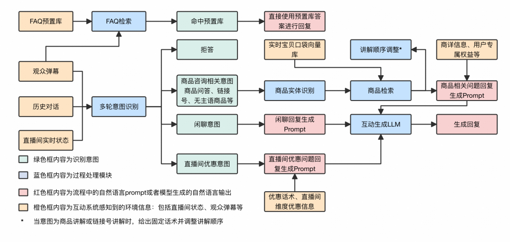
<figcaption class="publication-caption">The interaction workflow: intent and entities determine retrieval before response generation.</figcaption></figure>

The interaction pipeline includes the following components:

- Preset FAQ matching: retrieve merchant-configured FAQ pairs using the viewer comment. A match bypasses intent recognition; the configured intent and answer are used directly. Embeddings provide initial retrieval and a reranker filters candidates.
- Intent recognition: if there is no FAQ match, identify the actual intent using the comment, conversation history, and livestream state. Different intents lead to different downstream logic.
- Entity parsing: extract product names, attributes, and item-link numbers from the history and recognized intent.
- Retrieval:

- For item-link product questions or presentation requests, retrieve product information by link number.
- For questions without an explicit product subject, use the product currently being presented.
- For general product questions or presentation requests, use the current comment as a query to retrieve the best-matching product from the vector store.

- Generation: place retrieved information, the comment, and dialogue history into task-specific prompts for the LLM. Templates cover casual chat, product questions, and promotion questions.
- Presentation reordering: a product-presentation request changes the presentation order and receives a fixed response rather than an LLM-generated answer.

## Multi-Turn Intent Recognition

### Background and challenges

Since December of the preceding year, we have been developing a multi-turn interaction LLM to improve conversations between viewers and hosts. We wanted to avoid losing viewer interest when brittle single-turn interactions reveal the host's AI identity. Two challenges emerged:

- Design a suitable multi-turn dialogue architecture and accumulate data to support the desired interaction quality.
- Improve the existing intent model while reusing the substantial single-turn classification dataset and supporting new capabilities.

We developed a multi-turn framework for digital-avatar livestreams and redefined the input/output format for intent recognition. The inputs now include system instructions, livestream product information, and viewer comments, and an LLM replaces BERT as the base model. Our model achieved 80% accuracy on the multi-turn task, versus 71% for DeepSeek-R1, and substantially outperformed BERT trained on the same data.

### Multi-turn interaction architecture

<figure class="publication-figure figure-landscape" id="blog-figure-2">
Figure 2<button aria-label="Enlarge Figure 2" class="figure-expand" type="button">View figure ↗</button>

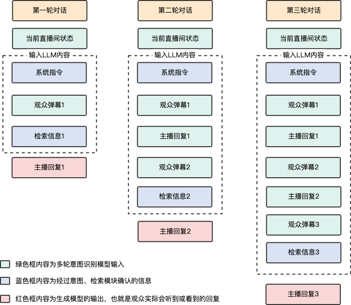
<figcaption class="publication-caption">Context flow across turns.</figcaption></figure>

- Before each turn, the information in the green boxes is passed to the intent model.
- The recognized intent determines retrieval behavior and system instructions.
- After retrieving intent-specific information, the content in the dashed box becomes the generation LLM's input for the next host response.

### Intent categories

<figure class="publication-figure figure-landscape" id="blog-figure-3">
Figure 3<button aria-label="Enlarge Figure 3" class="figure-expand" type="button">View figure ↗</button>

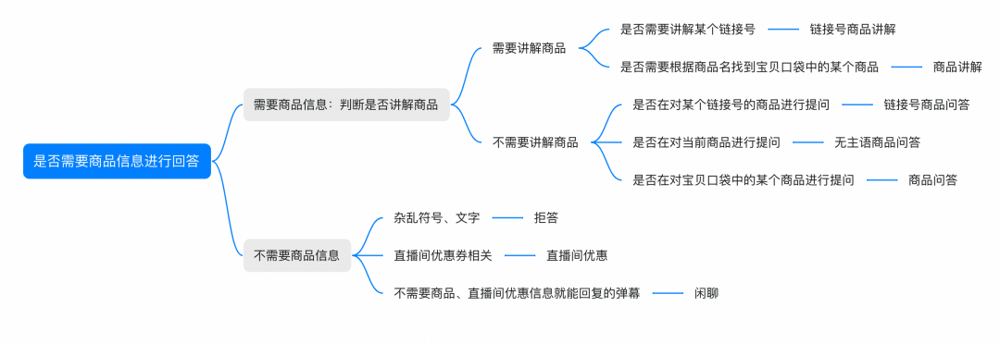
<figcaption class="publication-caption">Business intents and their downstream routes.</figcaption></figure>

The intent taxonomy changed twice:

- July 2024: added product recommendations and livestream promotion questions.
- January 2025: merged product recommendations and product searches into product questions.

### Example interactions

| Viewer comment | Dialogue history | Recognized intent | Avatar response |
| --- | --- | --- | --- |
| Smart toilet | User: Can you recommend a toilet? Assistant: Look at link 17. This smart toilet supports power-outage flushing, automatic seat and water temperature control, and foot-sensor flushing. It suits small homes and offers good value. | Product question | The Jomoo smart toilet at link 17 supports power-outage flushing, automatic water-temperature adjustment, and foot-sensor flushing. The post-coupon price is 2199. |
| Which one connects through Bluetooth? | User: Does the lapel microphone need Bluetooth? Assistant: This lapel microphone connects through Bluetooth and is convenient to use. | Product question | Look at the Jinyun wireless Bluetooth headphones at link 6 or the in-ear model at link 11. Both use Bluetooth. |
| Okay | User: How do I enter the draw? Assistant: Please ask customer service about the detailed draw rules. | Casual chat | Okay, good luck with the draw! |

### Multi-turn intent model

<figure class="publication-figure figure-landscape" id="blog-figure-4">
Figure 4<button aria-label="Enlarge Figure 4" class="figure-expand" type="button">View figure ↗</button>

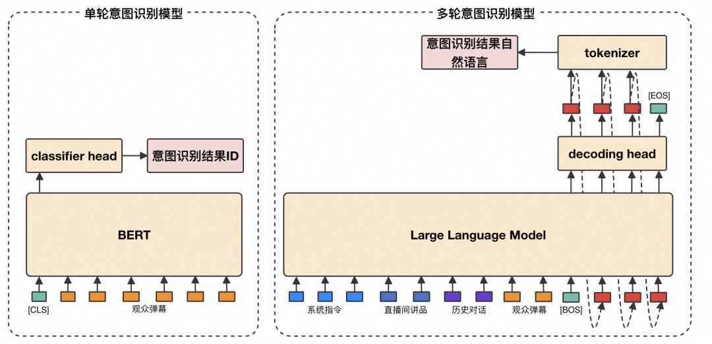
<figcaption class="publication-caption">Moving from single-turn classification to an LLM with live-room context.</figcaption></figure>

- The single-turn model uses the current comment for BERT sequence classification and outputs an intent `label_id`.
- The multi-turn model uses the current product, dialogue history, and comment as input to an LLM and directly generates the intent label.

### Building the training data

1. Run the single-turn model and DeepSeek-V3 on approximately 20k cleaned examples. Keep only disagreements; the existing single-turn data can cover examples where they agree.
2. Manually remove unsuitable comments, including traffic from conversations with real hosts mistakenly collected during avatar streams and repetitive spam.
3. Send the remaining examples to annotators.
4. Algorithm engineers review annotations individually and remove examples humans cannot reliably interpret. The final dataset contains over 3000 multi-turn intent examples.

### Experiments and case analysis

| Method | Description | Accuracy |
| --- | --- | --- |
| DeepSeek-V3 | Prompt engineering | 0.66 |
| DeepSeek-R1 | Prompt engineering | 0.71 |
| Qwen2.5 7B, multi-turn SFT | 3000 multi-turn examples, direct answers without CoT | 0.77 |
| Qwen2.5 7B, multi-turn + single-turn SFT | 3000 multi-turn + 16000 single-turn examples, direct answers without CoT | 0.80 |
| BERT, multi-turn + single-turn fine-tuning | Same 3000 + 16000 examples as Qwen | 0.69 |

- Multi-turn labeling is much harder: determining the true intent may take 30–60 seconds per example.
- The current product, viewer-specific dialogue history, and current comment provide sufficient information to identify intent.
- Ambiguity is greater than in single-turn classification. Context can support either a link number or product keywords; a previously requested product may now be the current presentation. Some apparent classification errors can nevertheless lead to a correct answer downstream.

#### Successful cases

| Comment | Current product | Dialogue history | Single-turn intent | Multi-turn intent | Explanation |
| --- | --- | --- | --- | --- | --- |
| Smart toilet | — | User: Can you recommend a toilet? Assistant: Consider link 17, a smart toilet with power-outage flushing, automatic temperature control, and foot-sensor flushing, suitable for a small home. | Product presentation | Product question | In isolation the product name looks like a presentation request; context shows that the user wants a recommendation. |
| Drying hair | — | User: Which one is suitable for drying hair? Assistant: Consider link 2, a cotton hair towel with good absorbency and several designs. | Refusal | Product question | The fragment is unclear alone; history identifies a requested product for drying hair. |
| Host, does this tracker need charging? | In-car GPS anti-loss/anti-theft tracker with recording | User: Does it need charging? Assistant: I am not sure; please ask customer service. | Product question | Question without an explicit product subject | The comment alone could trigger product search, while the current presentation makes the intended product clear. |

#### Comparison with DeepSeek-R1

- DeepSeek-R1 makes intent errors on broadly distributed, long-tail boundary cases that prompt tuning alone cannot resolve.
- Data-driven SFT handles these cases and can improve further with more annotated production examples.

### Reasoning experiment

To test whether R1's reasoning could benefit intent recognition, we asked it to generate chains of thought conditioned on the true intent labels and trained the LLM on these augmented examples.

| Method | Description | Accuracy |
| --- | --- | --- |
| Qwen2.5 7B, multi-turn SFT | 3000 examples, direct label without CoT | 0.77 |
| Qwen2.5 7B, multi-turn CoT SFT | 3000 examples with CoT, reasoning before the label | 0.68 |

- Generated CoT diluted supervision on the true labels, performing worse than directly predicting the labels.
- R1 annotation can work well in an open label space, but generating reasoning for examples with existing ground-truth labels did not meet expectations here.

## Entity Parsing

The multi-turn product-entity parser extracts product names, attributes, and link numbers from dialogue history and recognized intent.

The core challenges include history dependence, numerical interference, and generalization from specific products to broader categories.

- Input: current comment, dialogue history, and multi-turn intent.
- Output: three types of structured entities:

- Product entities, such as Telunsu pure milk.
- Product attributes, such as 2 HP, size 39, or iPhone15.
- Item-link numbers, such as 107 or 39.

<figure class="publication-figure figure-landscape" id="blog-figure-5">
Figure 5<button aria-label="Enlarge Figure 5" class="figure-expand" type="button">View figure ↗</button>

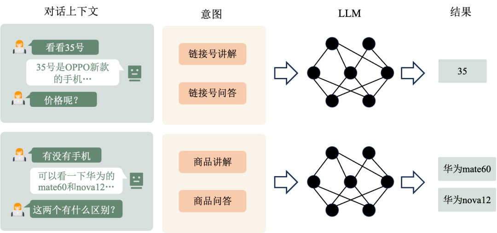
<figcaption class="publication-caption">Entity-parser inputs and structured outputs.</figcaption></figure>

### Training data

We reuse the intent-recognition data, retaining product questions, product presentation requests, and their link-number variants. DeepSeek-R1, the most accurate model on the test set, combined with manual filtering yields 2100 high-quality multi-turn entity-parsing examples.

| Data component | Description |
| --- | --- |
| Base examples | Retain product questions (840), presentation requests (210), and link-number examples (770). |
| Augmentation | Add 1000 adversarial examples covering pronunciation, spelling, dialect, and other interference. |
| Quality assurance | Multi-stage DeepSeek-R1 generation followed by human verification. |

### Data augmentation

#### Numerical ambiguity

Numbers elsewhere in the conversation can be mistaken for item links. We improve sensitivity to their roles using three kinds of interference:

| Interference | Example | Error |
| --- | --- | --- |
| Power rating | 2-HP air conditioner → extract 2 | Confusing a specification with a link number |
| Size or dimensions | Size-39 trainers → extract 39 | Failing to distinguish an attribute from a link identifier |
| Product generation | iPhone15 → extract 15 | Mistaking digits in a product name for a link |

We use two-stage DeepSeek-R1 generation: first generate the interference type, then generate a dialogue exhibiting it. This improves diversity.

<figure class="publication-figure figure-natural" id="blog-figure-6">
Figure 6<button aria-label="Enlarge Figure 6" class="figure-expand" type="button">View figure ↗</button>

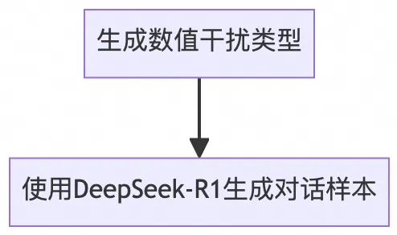
<figcaption class="publication-caption">Numerical-ambiguity examples separate product specifications from link IDs.</figcaption></figure>

#### Product generalization

When history names a specific product, the model may extract it even when the current request is generic. For example:

User: Which milk has a promotion? → Incorrect extraction: Telunsu pure milk.

We generate three kinds of generalization:

| Generalization | Specific product | Broader category |
| --- | --- | --- |
| Product | Zespri kiwifruit | Fruit |
| Brand | Telunsu pure milk | Milk |
| Specification | Nongfu Spring 5L | Large bottled water |

We manually annotate an initial product set, expand the pool with DeepSeek-R1, and generate dialogues using product categories.

<figure class="publication-figure figure-natural" id="blog-figure-7">
Figure 7<button aria-label="Enlarge Figure 7" class="figure-expand" type="button">View figure ↗</button>

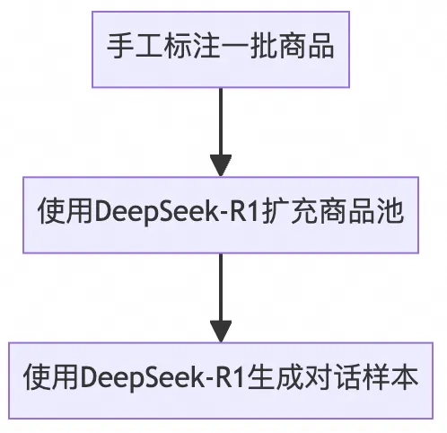
<figcaption class="publication-caption">Generalization examples cover brands, categories, and specifications.</figcaption></figure>

#### Historical noise

When the product in history conflicts with the current comment, the model can incorrectly favor the historical product. Adversarial examples improve robustness to the following issues:

| Issue | Generation strategy | Example |
| --- | --- | --- |
| Abbreviation | Initial letters plus digits | i12 → iPhone12 |
| Misspelling | Adjacent-key substitution or omitted letters | iQO10 → iQOO10 |
| Series confusion | Mix product generations | Xiaomi13 → Xiaomi14 |
| Dialect/homophone | Vary the pronunciation or pinyin | Aiku11 → iQOO11 |

DeepSeek-R1 first generates product pairs exhibiting these issues, then generates corresponding dialogues.

<figure class="publication-figure figure-natural" id="blog-figure-8">
Figure 8<button aria-label="Enlarge Figure 8" class="figure-expand" type="button">View figure ↗</button>

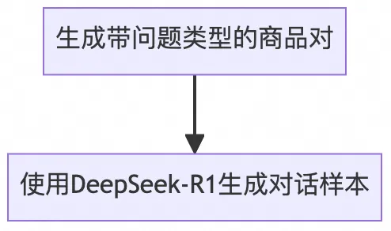
<figcaption class="publication-caption">Constructing examples with historical noise and perturbed product names.</figcaption></figure>

### Experiments and examples

Training: LoRA fine-tuning of a 7B base model.

Evaluation: compute Jaccard similarity between the predicted and true product strings' character 2-gram sets. A similarity of at least 0.7 counts as correct; report accuracy.

<figure class="publication-figure figure-landscape" id="blog-figure-9">
Figure 9<button aria-label="Enlarge Figure 9" class="figure-expand" type="button">View figure ↗</button>

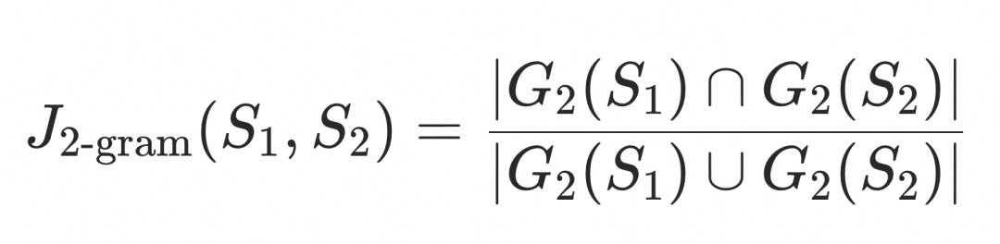
<figcaption class="publication-caption">Entity parsing is evaluated using string 2-gram Jaccard similarity.</figcaption></figure>

- 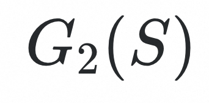 denotes the set of 2-grams of string S.

| model | acc |
| --- | --- |
| gpt4-fewshot-cot | 0.77 |
| deepseek-r1 | 0.87 |
| ours | 0.92 |

| Current comment | Dialogue history | Multi-turn intent | Parsed product |
| --- | --- | --- | --- |
| The warm version | Viewer: Shoes. Host: You can inspect link 154's product page; I will present it later, after finishing link 107. | Product question | Warm shoes |
| Don't they look similar? | Viewer: Is 12 or 13 better value? Host: iQOO 12 costs 3999 before coupons and 3118.3 after; iQOO 13 costs 3999 before coupons and 3928.3 after. iQOO 12 is better value. Viewer: Which performs better? Host: iQOO 13 has Snapdragon 8 Elite, versus the third-generation Snapdragon 8 in iQOO 12. Viewer: Which takes better pictures? Host: Look at link 39, with 50MP main, 16MP front, and 50MP ultrawide cameras. | Product question | iQOO 12, iQOO 13 |
| What differs between links one and seven? | Viewer: Can 7 record audio? Host: The high-end tracker at link 7 can; ask customer service for details. Viewer: Does link seven need Wi-Fi? Host: A Wi-Fi version is available; customer service can explain setup. | Link-number product question | 1, 7 |
| Difference | Viewer: Promotions for links 30 and 27. Host: Before ordering, open the product list at the bottom right and claim the shop coupon after entering the product page. | Link-number product question | 30, 27 |

## Product Information Retrieval

<figure class="publication-figure figure-landscape" id="blog-figure-10">
Figure 10<button aria-label="Enlarge Figure 10" class="figure-expand" type="button">View figure ↗</button>

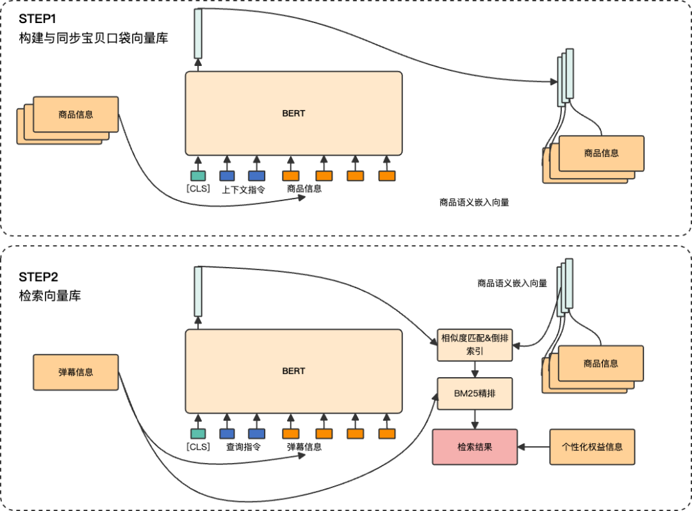
<figcaption class="publication-caption">Live catalog synchronization, semantic retrieval, and lexical ranking.</figcaption></figure>

- Before searching, synchronize with the live product list. Compute BERT context embeddings, add missing vectors, and remove vectors for products no longer available. Each vector corresponds to an `itemId`.
- Compute a BERT query embedding and retrieve semantically similar products. Rerank using BM25 over product information and the comment, then apply combined lexical–semantic filtering. Return the final product-information list.
- Lexical reranking improves retrieval for short queries.

## Response Generation

### Generation tasks

- Casual chat: respond using the conversation history and current comment.

| Dialogue history | Current comment | Host response |
| --- | --- | --- |
| User: Ordered. Assistant: Great, thanks for your support! User: What if I forgot to enter my phone number? Assistant: Contact customer service; they can help you check. | I contacted customer service. | Okay, they will help you as soon as possible. Don't worry. |

- Product questions: answer from product information, including recommendations and searches.

| Viewer comment | Host response | Retrieved products, with unrelated details omitted |
| --- | --- | --- |
| Do you have a 3-HP wall-mounted air conditioner? | The Gree air conditioner at link 209 is a 3-HP wall-mounted model. Its post-coupon price is 6399. | Link 208: Gree inverter heating/cooling, 2-HP wall unit, Qingxuanfeng. Link 209: Gree inverter heating/cooling, 3-HP wall unit, Qingxuanfeng. Link 288: Gree first-level-efficiency inverter heating/cooling, small 2-HP wall unit, Fengjiyuan. |

- Livestream promotion questions:

- When the merchant configures promotions, answer questions, searches, and recommendations using that information.
- If no promotion is configured or the information cannot answer the question, use general guidance about coupons, red packets, and government subsidies.

| Viewer comment | Host response | Promotion information |
| --- | --- | --- |
| How can I get the best price? | Before ordering, open the product list at the bottom right and claim the fan red packet after entering the product page. | Type: pre-purchase coupon; name: fan red packet; no minimum spend; discount: 4.0 yuan; fans only; claim by entering the product page. |
| Are government subsidies still available? | Check the product list for a government-subsidy label and open the product to claim it. Policies vary by region. | — |

### Interaction LLM training data

<figure class="publication-figure figure-landscape" id="blog-figure-11">
Figure 11<button aria-label="Enlarge Figure 11" class="figure-expand" type="button">View figure ↗</button>

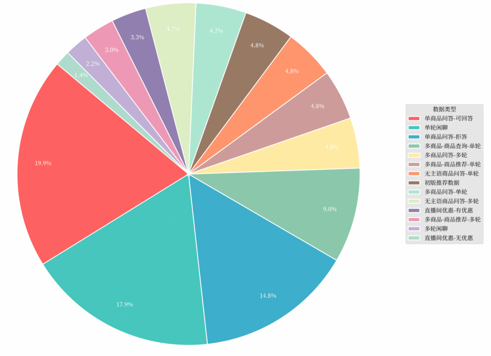
<figcaption class="publication-caption">Context differences between single-turn and multi-turn interaction.</figcaption></figure>

| Intent | Data type | Examples |
| --- | --- | --- |
| Casual chat | Single-turn | 1509 |
| Casual chat | Multi-turn | 181 |
| Promotions | Configured promotion | 278 |
| Promotions | No configured promotion | 121 |
| Product questions | Single product, answerable | 1678 |
| Product questions | Single product, refusal | 1249 |
| Product questions | Multiple products, multi-turn | 400 |
| Product questions | Multiple products, single-turn | 399 |
| Product recommendations | Initial recommendation dataset | 400 |
| Product recommendations | Multiple products, single-turn | 400 |
| Product recommendations | Multiple products, multi-turn | 249 |
| Product searches | Multiple products, single-turn | 400 |
| Product searches | Multiple products, multi-turn | 354 |
| Questions without an explicit subject | Single-turn | 400 |
| Questions without an explicit subject | Multi-turn | 398 |
| Total | All data | 8416 |

### Distinguishing interaction modes

| Viewer comment | Text response | Spoken/TTS response |
| --- | --- | --- |
| Any deals on smart toilets? | Link 17 was 9999 and is now 2199 after coupons. Links 45 and 31 are 2799 and 2599. These are strong offers. | I see a viewer asking about smart-toilet deals. Link seventeen was nine thousand nine hundred and ninety-nine; now it is two thousand one hundred and ninety-nine after coupons. Link forty-five is two thousand seven hundred and ninety-nine, and link thirty-one is two thousand five hundred and ninety-nine. The offer may end, so take a look. Now I will continue the presentation. |

- Text: answer directly, without normalizing numbers or English, and limit the response to 60 Chinese characters to fit the comment box.
- TTS: briefly restate the viewer's question so they know the host is responding to them, normalize numbers and English for speech synthesis, and apply no character limit.
- Implementation:

- Text: use an LLM to remove the question-restatement portion from original examples.
- TTS: normalize the original data for speech.
- Distinguish the two data variants through system instructions.

A problem introduced by the two modes:

The same underlying example may be seen twice during training, increasing the risk of overfitting.

Our solution:

- Split training and validation before generating mode variants. Otherwise two versions of the same example can leak across the split and invalidate validation: evaluation accuracy may exceed 95%, whereas a converged generative fine-tuning task more typically reaches 70–80%.
- Adjust the learning rate from the learning curves and select the checkpoint with the lowest validation loss.

## Checks that matter in deployment

Evaluate complete requests as well as individual modules. A correct intent can still lead to a wrong entity; a correct entity can still retrieve a stale catalog item. Preserve enough of the replay trace to identify the product and evidence behind the final answer.

Split original conversations before augmentation. Paraphrases, numerical perturbations, and noisy-history variants of one source conversation should remain on the same side of the split. Otherwise the validation set can contain near-duplicates of training examples. An unusually high validation score deserves a data audit before another model experiment.

The reported intent and entity accuracies describe these business datasets and scoring rules. They are not universal model rankings. Continually labeling real boundary cases remains a practical way to improve a deployed classifier.
