{
  "slug": "llm-distillation-and-reasoning-compression-en",
  "title": "Taobao Live Digital Avatars: Model Distillation and Reasoning-Path Compression",
  "shortTitle": "Distillation & Reasoning Compression",
  "language": "en",
  "tags": [
    "LLM",
    "Distillation",
    "Efficient Reasoning"
  ],
  "description": "Distilling DeepSeek-R1 and balancing response quality with low latency through quality–length Dual-Preference DPO.",
  "lead": "Bring reasoning into the livestream, and bring the waiting time down.",
  "highlights": [
    [
      "Transfer reasoning",
      "Compare three distillation strategies, model sizes, and quantization choices."
    ],
    [
      "Compress the path",
      "Align length and quality preferences to shorten reasoning without losing response quality."
    ],
    [
      "Preserve generalization",
      "Use fresh production traffic and larger preference datasets to test and improve robustness."
    ]
  ],
  "date": "2025-06-20",
  "authors": "Taobao Live AIGC Team",
  "readingMinutes": 20,
  "source": "https://mp.weixin.qq.com/s/pnn6jyudY7iv426hyO-WIw",
  "publicationType": "Technical practice",
  "workId": "llm-distillation-and-reasoning-compression",
  "counterpart": "llm-distillation-and-reasoning-compression",
  "secondaryVersion": true,
  "sourceTitle": "淘宝直播数字人LLM推理优化：模型蒸馏与路径压缩实践",
  "isTranslation": true,
  "sourceLanguage": "zh-CN"
}

This series shares our experience building intelligent digital avatars across six areas: LLM script generation for reasoning and content creation; LLM interaction for dialogue and natural conversation; TTS for expressive voices; avatar animation for synchronized expressions, lips, and gestures; audio/video engineering for real-time rendering and low-latency delivery; and backend engineering for a stable, elastic, concurrent service platform. We welcome discussion and exchange.

## TL;DR

Viewer-comment interaction is an important part of digital-avatar livestreaming, but it poses difficult reasoning challenges. Comments are diverse and ambiguous; the model must understand products, current questions, and multi-turn history and respond almost immediately. It must also maintain conversational coherence and strictly follow business rules and product facts, avoiding incorrect answers that damage user experience or reputation. Open reasoning models such as DeepSeek-R1 and QwQ offer new possibilities.

We first verified DeepSeek-R1's strong performance, then explored three distillation approaches because its latency was unsuitable for live interaction. Distilling into DeepSeek-R1-Distill-Qwen improved performance by 8 points over the production non-distilled model. However, the 14B student remained too slow: after int8 quantization, average latency was 5.58 seconds and the longest latency 11.87 seconds. The 7B model was 9 points worse than 14B and failed the quality requirement.

We therefore explored reasoning-path compression. Reproducing the Kimi 1.5 long2short DPO method reduced average latency to 4.24 seconds and the longest latency to 6.24 seconds, nearly halving the latter. However, response quality fell by 1 point.

We improved long2short DPO with dual preferences for quality and length. Our Dual-Preference DPO (DP-DPO) compresses reasoning almost as effectively as Kimi's method while improving quality by 0.4 points relative to the SFT model. Performance came within 0.2 points of DeepSeek-R1.

After deployment, evaluation on fresh production traffic revealed reduced generalization after DPO. Expanding the preference dataset addressed this: the larger-data DP-DPO model gained 2.3 points on the production test set and surpassed DeepSeek-R1 by 1.8 points on validation, while retaining effective reasoning compression.

## Digital-Avatar Interaction Tasks

### 2.1 Tasks and dataset selection

The interaction system comprises eight tasks, selected by an upstream intent model with different information sources and instructions. We use the more demanding product-question task for the initial distillation experiments and generate reasoning supervision with DeepSeek-R1.

| Task | Mode | Task | Mode |
| --- | --- | --- | --- |
| Product questions, selected for the experiment | Speech | Livestream promotions | Speech |
| Product questions | Comments | Livestream promotions | Comments |
| Casual chat | Speech | Questions without an explicit product subject | Speech |
| Casual chat | Comments | Questions without an explicit product subject | Comments |

- Randomly sample 5800 production product-question examples and split training/validation 9:1.
- Spoken and text-comment response modes differ in some requirements.

### 2.2 Example product question

| Product information | Dialogue history | Viewer question | Answerable? | Host response |
| --- | --- | --- | --- | --- |
| X-brand Hong Kong PQQ nutritional tablets with bird's-nest acid and ergothioneine; merchant/brand: X; category: oral beauty/nutritional health food; tablet form, bottled, Hong Kong origin; shelf life: at least 24 months; adults of either sex; two tablets once a day; ingredients and effects: see details; options: 1 bottle trial, 3 bottles (buy 2 get 1), 5 bottles (buy 3 get 2), 8 bottles (buy 5 get 3), anti-aging/brightening variant; usage guidance: see details; free shipping; link 11; original price 4200.0; discounts 20.0 and 150.0; post-coupon price 1008.0. | Viewer: Please introduce PQQ. Host: Link 11 is next; let me finish link 12 first. | Why is a single bottle of PQQ much more expensive? | Yes | You are asking about the single-bottle price. X-brand PQQ at link 11 is made in Hong Kong and individually packaged, which raises quality-related costs and the single-bottle price. Additional discounts are available now. |

This illustration does not establish actual model quality. Appendix B contains real production examples.

### 2.3 Evaluation

DeepSeek-R1 scores responses from the product information, dialogue history, viewer question, and AI-host answer. Evaluation combines four dimensions:

- Consistency with the question: understand the viewer's actual intent and answer correctly, using history when present.
- Consistency with product information: neither invent facts nor refuse when the provided information suffices. If information is insufficient or the question concerns another product, refer the viewer to customer service.
- Internal consistency: avoid logical contradictions and produce natural language suitable for speech.
- Instruction consistency: follow the avatar-host requirements in the prompt.

## Distilling DeepSeek-R1

On product questions, DeepSeek-R1 scores 86/100 versus 75 for the production model, an 11-point gap. We investigate three ways to transfer its capabilities to compact models:

1. Start from Qwen and distill only R1's final answer, excluding thinking.
2. Start from Qwen and distill the complete response, including thinking.
3. Start from DeepSeek-R1-Distill-Qwen and distill the complete response, including thinking.

The experiments support three conclusions:

1. Scheme C achieves the best response quality, 83/100, supporting DeepSeek-R1-Distill-Qwen as the starting point.
2. With Qwen2.5-Instruct as the base, including CoT makes little difference.
3. Refusal agreement with R1 increases with model size under identical training data. Agreement does not directly determine response quality: many partially answerable boundary cases limit agreement to approximately 85%.

### 3.1 Distillation schemes

| Scheme | Method | Description |
| --- | --- | --- |
| A | Qwen, direct answer | R1-generated data excluding the thinking inside `<think>` tags; Qwen2.5-Instruct bases at several sizes. |
| B | Qwen with CoT | R1-generated data including `<think>` sequences; Qwen2.5-Instruct bases at several sizes. |
| C | DeepSeek-R1-Distill-Qwen with CoT | Complete R1-generated sequences including thinking; DeepSeek-R1-Distill-Qwen bases at several sizes. |

### 3.2 Generation quality

| Scheme | Model/method | Mean quality score |
| --- | --- | --- |
| — | DeepSeek-R1 | 86 |
| A | Qwen14B, direct answer, 5.8k dataset | 78 |
| B | Qwen14B with CoT, 5.8k dataset | 78 |
| C | DeepSeek-R1-Distill-Qwen-14B with CoT, 5.8k dataset | 83 |
| — | Production model | 75 |

Evaluate generated responses using Section 2.3's procedure.

### 3.3 Model size

- The model also predicts whether the question is answerable. A mismatched product or insufficient facts means unanswerable; answerable requires both a matching product and sufficient information.
- We study how model size relates to distillation by measuring refusal agreement with DeepSeek-R1. This is an approximate behavioral indicator rather than a complete quality metric.
- Compare schemes A, B, and C at 1.5B, 7B, and 14B.

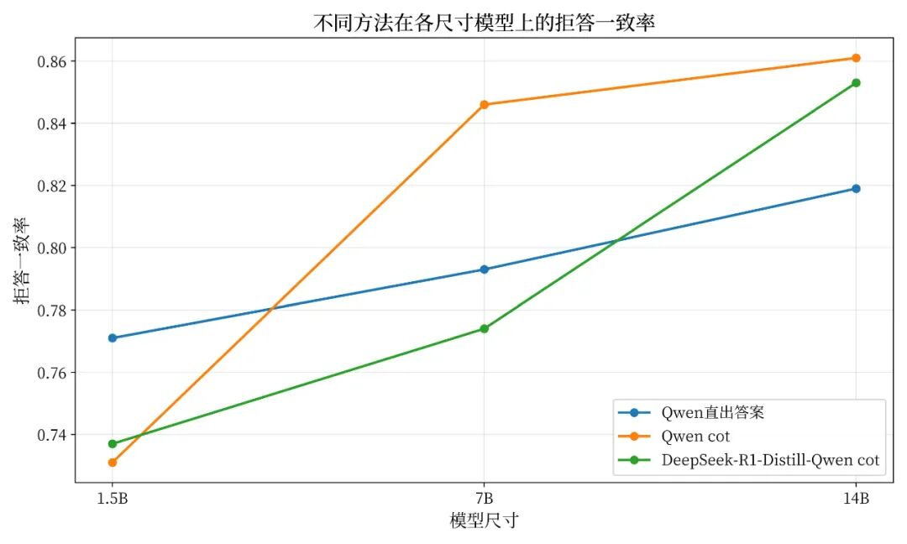

Refusal agreement with DeepSeek-R1 across distillation methods and model sizes.

- Agreement rises with model size for all three schemes. Direct-answer distillation is preferable at 1.5B.
- At 14B, DeepSeek-R1-Distill-Qwen exceeds direct-answer distillation and approaches Qwen-with-CoT agreement.

### 3.4 Quantization and smaller models

A bf16 14B reasoning model takes about 10 seconds per product answer, so quantization is necessary. Quantized latency reaches approximately 5 seconds. The 7B reasoning model has insufficient quality.

| Method | Precision | Quality /100 | Runtime |
| --- | --- | --- | --- |
| Scheme C, 14B | bf16 | 83 | 10s |
| Scheme C, 14B | int8 | 80 | 5s |
| Scheme C, 7B | bf16 | 74 | 2.5s |
| Scheme C, 7B | int8 | 69 | 2.5s |
| Production 14B | bf16 | 75 | 1s |

### 3.5 Findings from distillation

The three-way comparison led us to fine-tune DeepSeek-R1-Distill-Qwen on R1's complete reasoning sequences. Size and lightweight-deployment experiments ruled out 7B because of limited capability, leaving the 14B model for further optimization. Although int8 quantization reduces quality, its latency benefit makes it our deployment precision in subsequent experiments.

## Reasoning-Path Compression

### 4.1 Background

After selecting the distillation approach, we trained across all tasks using 30k production interactions. Before deployment, we found that students inherited R1's long outputs. Quality surpassed the non-reasoning model, but bf16 latency rose almost tenfold; even int8 latency increased more than fivefold. Such slow replies are unsuitable for rapidly changing livestreams.

To meet production latency requirements, we examine three CoT-compression methods:

A. Discard all training examples with outputs longer than 400 tokens during distillation.

B. Reproduce Kimi 1.5 long2short DPO. Resample the examples discarded in A; if a sufficiently short response is found, select the shortest response as chosen and the longest as rejected.

C. Extend length-only selection to quality–length Dual-Preference DPO, considering both response length and quality when choosing positive and negative examples.

### 4.2 Preliminaries

- Runtime estimates assume Qwen2.5-14B decoding at 62.5 tokens/s on one H20. All runtimes in this article are converted estimates.
- Decoding dominates reasoning latency. Infrastructure optimization makes prefill time negligible here.
- Generative reward models with CoT are widely used [3]. We use DeepSeek-R1 to score response-quality preferences with Section 2.3's evaluation.
- Related reasoning-compression work includes CoD, COCONUT, and long2short. For rejection-sampling DPO, see RS-DPO in the references below.

### 4.3 Distillation after removing long examples

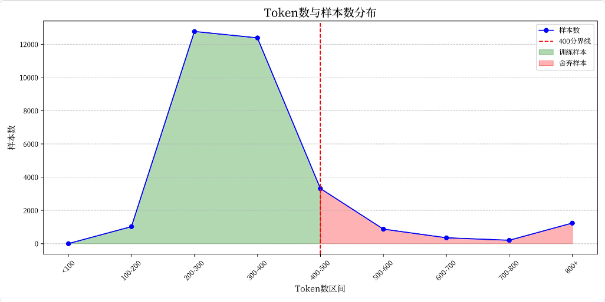

Output-length distribution of DeepSeek-R1-generated examples.

- Most generated outputs contain 200–400 tokens.
- Discarding outputs above 400 tokens lowers the average decoding length to 300 tokens.
- Limitation: filtering training examples does not prevent the trained model from generating more than 400 tokens at inference time.

### 4.4 Reproducing Kimi 1.5 long2short rejection-sampling DPO

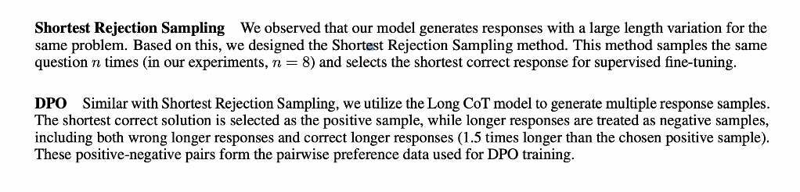

Excerpt from the original Kimi 1.5 long2short rejection-sampling DPO description.

Following Kimi, repeatedly sample R1 responses for the examples discarded by scheme A, shown in red. If an output under 400 tokens is found, use the shortest sampled response as chosen and the longest as rejected for DPO.

Sampling results:

| Mean chosen length | Mean rejected length | Successfully sampled examples | Total examples |
| --- | --- | --- | --- |
| 300.1 | 515.8 | 4650 | 4915 |

Limitation: as reported in Kimi 1.5, this effectively shortens reasoning but also reduces response quality.

### 4.5 Dual-Preference DPO: improving long2short with a generative reward model

Kimi's method selects only the shortest and longest responses as positive and negative examples. Its reported quality decrease suggests two issues:

- Short CoT can perform worse than long CoT, as Kimi 1.5 also observes.
- Short sampled responses may have lower quality than long ones.

We therefore prefer pairs where the shorter response also has higher quality, compensating for the disadvantage of short CoT. Pair construction becomes multi-objective optimization over short length and high response quality; their weights must be balanced empirically.

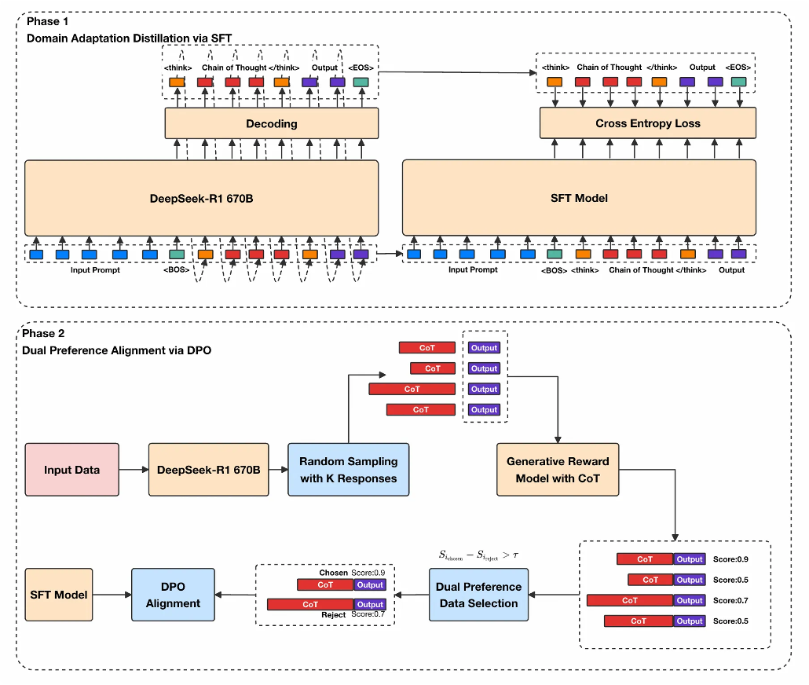

Two-stage DP-DPO preference-alignment pipeline.

- Stage 1: perform domain-adaptive distillation on 30k livestream interactions using DeepSeek-R1-Distill-Qwen-14B. Since removing long examples improves both length and quality, use the filtered data.
- Stage 2: compress reasoning through dual-preference rejection-sampling DPO:

- Randomly sample K responses with DeepSeek-R1.
- Evaluate them with the same benchmark procedure and normalize the quality scores to [0,1].
- Normalize both length and quality preferences to [0,1] and combine them with weights. Select the highest combined score as chosen and the lowest as rejected within each group.
- Discard a group if the positive–negative score gap is below a threshold determined by the desired drop ratio.
- Train the domain-distilled Stage 1 model on the resulting DPO pairs.

#### 4.5.1 Constructing quality–length preference pairs

Weighted score

For each valid example 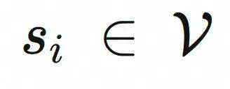, where 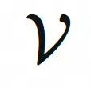 denotes the valid-example set and 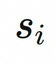 is the quality score of example 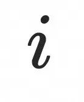, define its weighted score 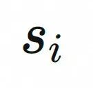 as:

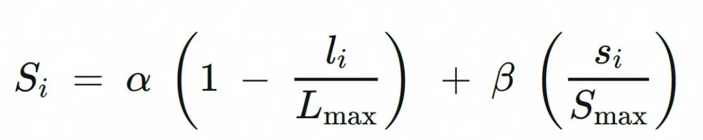

Here:

- 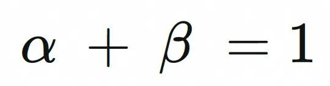 are weights controlling the relative importance of length and quality preferences.
- 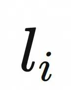 is the length of example 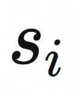.
- 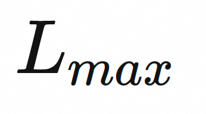 is the maximum output length used for normalization.
- 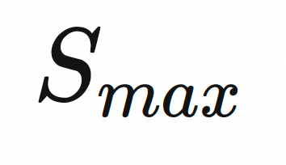 is the maximum quality score used for normalization.

Sample selection

Choose the highest-scoring example as chosen and the lowest-scoring one as rejected:

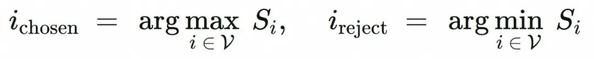

Preference-pair score gap

The final score gap 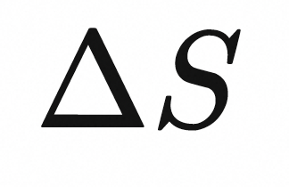 is:

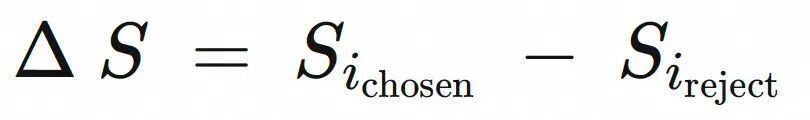

Select a pair for DPO only when 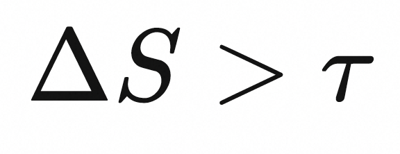. The choice of 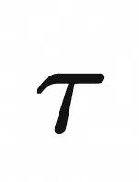 depends on the drop ratio.

#### 4.5.2 Hyperparameter search for the two preferences

Searching weights for reasoning length and response quality.

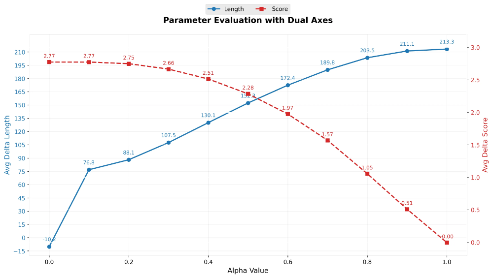

Mean chosen–rejected length and quality differences as the length-preference weight changes.

- The blue curve shows the mean length difference. Quality-only selection produces chosen responses about 10 tokens longer than rejected ones. At the other extreme, chosen responses are about 213 tokens shorter, close to Section 4.4's results.
- The red curve shows the mean quality gap. Quality-only selection gives chosen responses a 2.77/10 advantage; length-only selection yields almost no quality difference.
- The curves cross in the 0.4–0.6 range. Final weights account for business preferences and the effect of discarding low-gap pairs.

After selecting preference weights, discard pairs at the low end of the combined-score-gap distribution.

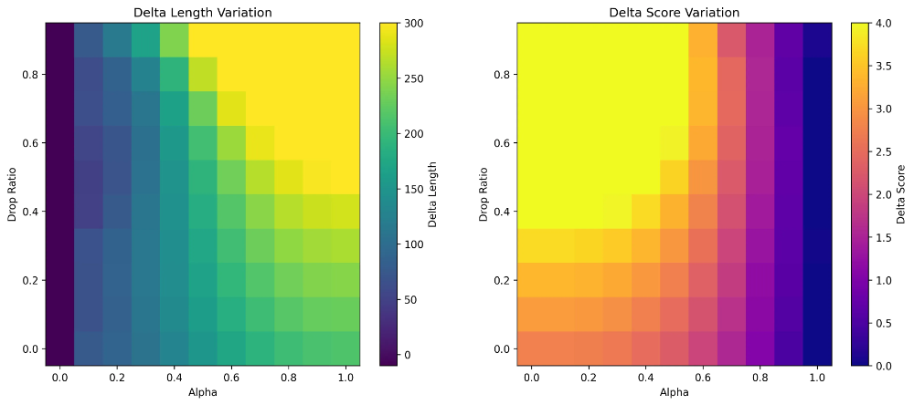

Left: mean chosen–rejected length gap versus drop ratio and length-preference weight. Right: corresponding quality gap.

- In the left heatmap, yellower regions indicate larger length differences as length weight and DropRatio vary.
- In the right quality heatmap, yellower regions indicate larger quality-score differences.
- Avoid an excessively large DropRatio 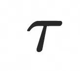: too few DPO examples can damage generalization.
- Final hyperparameters: 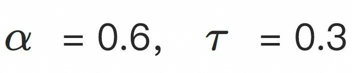.

#### 4.5.3 Pair-construction results

|  |  |  |  |
| --- | --- | --- | --- |
| 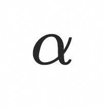 | 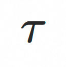 | 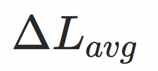 | 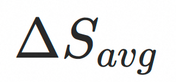 |
| 1.0 | 0.0 | 213 | 0 |
| 0.6 | 0.3 | 204 | 2.57 |

Under the selected hyperparameters, chosen responses are on average 204 tokens shorter and score 2.57 points higher than rejected responses.

#### 4.5.4 DPO preference training

The additional SFT loss helps prevent the chosen and rejected rewards from falling together. Otherwise, the model may learn a relative preference while its absolute quality deteriorates. We monitor reward values while tuning training hyperparameters.

### 4.6 Compression results

| Method | Product-QA score | Mean length | Mean RT | Longest length | Longest RT |
| --- | --- | --- | --- | --- | --- |
| Baseline | 84.0 | 349.0 | 5.58 | 742.1 | 11.87 |
| Long-example filtering, SFT | 84.9 | 308.1 | 4.93 | 567.9 | 9.07 |
| long2short-DPO | 83.9 (-1.0pt) | 265.1 | 4.24 (-1.34s) | 390.2 | 6.24 (-5.63s) |
| DP-DPO, ours | 85.3 (+0.4pt) | 266.0 | 4.26 (-1.32s) | 408.0 | 6.53 (-5.35s) |

- Baseline: the Section 3 distillation scheme using DeepSeek-R1-Distill-Qwen without additional filtering.
- Filtering long examples yields shorter reasoning and better quality than baseline.
- The source reports signed changes in the table relative to the filtered SFT method; values are reproduced as published.
- Both DPO models start from the filtered SFT model: Section 4.4 reproduces Kimi long2short and Section 4.5 introduces DP-DPO.

### 4.7 Generalization after DPO

Although DPO works well on validation, deployment traffic exposes a substantial score decrease: DP-DPO still exceeds long2short DPO but falls below the uncompressed SFT model. We attribute this to reduced generalization and take a straightforward approach: apply Section 4.5's pair-construction procedure to all training product questions, increasing preference data fivefold before DP-DPO.

| Method | Validation overall | Validation multi-turn | Production overall | Production multi-turn |
| --- | --- | --- | --- | --- |
| DeepSeek-R1 | 85.5 | 84.6 | 86.0 | 84.4 |
| Filtered SFT | 84.9 | 82.3 | 83.0 | 80.8 |
| long2short-DPO | 83.9 | 81.5 | 81.9 | 78.7 |
| DP-DPO, 3k examples | 85.3 | 83.3 | 82.5 | 81.2 |
| DP-DPO, 15k examples | 87.3 | 86.6 | 84.8 | 82.4 |

- Validation and production tests use the same construction procedure, but validation shares the training collection period while the production test uses traffic after the reasoning model went live.
- Expansion affects only the training-set DPO data; it does not include post-deployment traffic.
- All our trained models lose some quality on fresh traffic, indicating widespread overfitting. DPO drops more than SFT, consistent with reduced generalization from preference learning on a small dataset.
- DP-DPO continues to outperform long2short DPO on production traffic.
- Large-data DP-DPO substantially exceeds SFT on that traffic.

### 4.8 Ablation study

To determine whether quality, length, and generalization improvements come from DPO rather than pair construction alone, compare:

1. SFT using only chosen examples from dual-preference rejection sampling (DP-SFT).

2. Additional dual-preference DPO on the model from approach 1 (DP-DPO).

Both use exactly the same 15k preference pairs; only the subsequent DPO differs. The test set is the production-traffic test from Section 4.7. The long-filtered SFT model from Section 4.3 is also included as a reference.

Results:

| Method | Overall score | Multi-turn score | Mean length | Mean RT | Longest length | Longest RT |
| --- | --- | --- | --- | --- | --- | --- |
| SFT | 83.0 | 80.8 | 309.9 | 4.96 | 677.9 | 10.85 |
| DP-SFT only | 83.3 | 80.3 | 302.1 | 4.83 | 490.5 | 7.85 |
| DP-SFT + DP-DPO | 84.8 (+1.5pt) | 82.4 (+1.9pt) | 272.3 | 4.36 (-0.47s) | 382.8 | 6.12 (-1.73s) |

- SFT on chosen dual-preference examples does not directly improve model quality, although it reduces the longest outputs.
- DP-DPO yields clearly better response quality and reasoning compression than SFT on the chosen examples alone.

### 4.9 Quality and length across DPO epochs

| Epoch | Kimi long2short mean length | Kimi quality | DP-DPO mean length | DP-DPO quality |
| --- | --- | --- | --- | --- |
| 0 | 308.1 | 84.9 | 308.1 | 84.9 |
| 1 | 265.1 | 83.9 ↓ | 259.3 | 83.9 ↓ |
| 2 | 269.8 | 83.3 ↓ | 266.0 | 85.3 ↑ |
| 3 | 271.5 | 81.6 ↓ | 271.1 | 85.1 ↓ |

- Single-preference DPO continuously lowers mean response quality during training.
- Dual-preference DPO initially sacrifices quality while learning shorter reasoning, then surpasses the original model in the next two epochs.

## Conclusions

DeepSeek-R1's strong interaction benchmark performance motivated distillation into compact models. Comparing three approaches led us to choose DeepSeek-R1-Distill-Qwen-14B as the base.

Long reasoning still violated livestream response-time requirements. We first removed long examples before SFT, then reproduced Kimi 1.5 long2short DPO to compress reasoning substantially further.

Because length-only DPO reduced response quality, we proposed DP-DPO, using DeepSeek-R1 as a generative quality reward model and aligning both length and quality preferences. Compression remained comparable to long2short DPO, while response quality improved over SFT rather than deteriorating.

After deployment, fresh traffic revealed a significant DPO generalization problem. Expanding preference data fivefold greatly improved production-test performance, showing that more training data can mitigate this weakness.

### Future work

1. Our best production-test score, 84.8, still trails DeepSeek-R1's 86.0. We aim to develop a low-latency interaction model that exceeds R1.
2. A stronger reward model could evaluate and optimize interactions better than R1, allowing a transition from offline preference alignment to online reinforcement learning.
3. As the product develops, richer product facts, livestream state, spoken explanations, and multimodal information will pose new modeling challenges.

## References

1. KIMI K1.5:SCALING REINFORCEMENT LEARNING WITH LLMS

   https://arxiv.org/pdf/2501.12599
2. RS-DPO:A Hybrid Rejection Sampling and Direct Preference Optimization

   Method for Alignment of Large Language Models

   https://arxiv.org/pdf/2402.10038
3. Generative Verifiers: Reward Modeling as Next-Token Prediction

   https://arxiv.org/pdf/2408.15240
4. Chain of Draft:Thinking Faster by Writing Less

   https://arxiv.org/pdf/2502.18600
5. Training Large Language Models to Reason in a Continuous Latent Space

   https://arxiv.org/pdf/2412.06769

## Appendices

### A. Complete validation benchmark

| Method | Description | Overall score | Multi-turn response quality |
| --- | --- | --- | --- |
| Non-CoT interaction model | Qwen2.5-14B SFT on GPT4o, DeepSeek-V3, DeepSeek-R1, and some human data | 79.7 | 74.7 |
| DeepSeek-R1 | Direct inference | 85.5 | 84.6 |
| QwQ-32B | Direct inference | 84.6 | 80.5 |
| Distilled interaction model | Distill Qwen-Distill-DeepSeek-14B on 30k interactions | 84.0 | 82.0 |
| Reasoning compression via SFT | Remove outputs above 400 tokens before distillation | 84.9 | 82.3 |
| Length preference, long2short DPO | Reproduce Kimi rejection-sampling DPO | 83.9 | 81.5 |
| Dual preference, DP-DPO | Improve the sampling strategy of Kimi long2short DPO | 85.3 | 83.3 |
| Larger-data DP-DPO | More preference data to improve generalization | 87.3 | 86.6 |

### B. Real production interactions

- These are actual responses from the DP-DPO model before the generalization improvement.
- Brands and model identifiers are anonymized; other content is reproduced from production. Model reasoning is translated below as recorded, including any unsupported assumptions.

| Viewer comment | History | Response | Recorded model reasoning |
| --- | --- | --- | --- |
| Does H-brand 500 dissipate heat through the bottom or sides? | [] | You are asking about the H-brand 500 refrigerator. Links 50 and 51 both use side heat dissipation and near-zero-clearance embedding. Check their product pages. | I need to handle the question about H-brand 500's heat dissipation. Product link 51, model B, specifies side clearance for near-zero embedding, 0cm ≤ clearance < 2cm. Links 50 and 49, also model B, specify the same. All three mention the sides, not the bottom, so the information is sufficient. The reply must name links because no particular link was specified. I can summarize the common feature, use a conversational family-style address, end naturally, stay within 80 Chinese characters, and avoid unrelated information. |
| Which one removes bad breath? | [] | The probiotic toothpaste at link 22 and mouthwashes at links 54 and 55 all freshen breath. Take a look at the links if needed. | I need to answer which product removes bad breath. The information contains S-brand toothpaste and mouthwashes. The toothpaste cleans and freshens breath and excludes children; one mouthwash lists antibacterial action, fresh breath, periodontal care, and cavity prevention; the other lists fresh breath and periodontal care. All mention fresh breath, so I infer they can address bad breath. Since the information can answer, name links 22, 54, and 55, explain briefly, use natural and varied forms of address, and stay under 80 Chinese characters. |
| How effective is the Y-brand 1.5-HP air conditioner? What about installation and the price after government subsidy? | User: Please introduce the livestream offer for the Y-brand 1.5-HP air conditioner. Assistant: I will present link 21 next; please wait. | Performance and installation details are best checked with customer service. For the subsidy price, open the G-brand air conditioner at link 21 and claim the subsidy. Policies vary by region. | I need to address effectiveness, installation, and the subsidized price. Links 21 and 253 are Y-brand 1.5-HP units; link 171 is 1 HP, so exclude it. Product facts give cooling/heating capacities but no direct effectiveness description, and no installation service details. Links 21 and 253 have post-coupon prices of 4199, but the question concerns subsidies. Rule 5 says to check the product-page subsidy label because regional policies differ. History points to link 21, but the present performance and installation questions lack sufficient information. Refer to customer service, identify the link, remain conversational, and keep the reply under 80 Chinese characters. |
| Ordered and added the code word | User: What is the code word? Assistant: The livestream code word is I love D-brand. | Wow, you are faster than a rocket! Keep a screenshot of the code word and ask customer service to verify it after ordering for the exclusive discount. Thanks for your support. | History shows the viewer asked for the code word and now confirms ordering with it. The rules require thanking purchasers. Use a lively, conversational tone and stay under 80 Chinese characters. Avoid repeating the previous response. Acknowledge correct use of the code word and thank them again, perhaps with a friendly joke about being faster than a rocket. No after-sales issue or negative sentiment is present. Use only commas and periods, maintaining a professional, friendly tone. |
| What gift comes with link 12, 16+512? | [] | The O-brand phone at link 12 comes with half-in-ear wired headphones. Other specifications have the same gift. | Link 12 is an O-brand R-model13 phone, so no link clarification is needed. The gift is livestream headphones; the listed gift may be independent of storage capacity. The rules say to answer directly when gift information is explicit. No specification-specific difference is stated, so I assume the same gift applies across variants. State this conversationally and end naturally. |
| I thought you were a real host [-666] | [] | You caught me! I am a digital avatar that charges for two hours and lasts all day. My jokes are fresh, though. Want to hear a terrible joke? | This questions the host's identity. The rules require clearly disclosing that I am a digital avatar and responding humorously when asked whether I am AI, a robot, or an avatar. Rule 5 applies. Make a joke about an avatar characteristic, such as charging or eating data, while stating the identity. Keep the tone cheerful, use correct punctuation, stay under 80 Chinese characters, and avoid repeating history, which is empty. |
| Where does it ship from? | [] | This toast ships from Shandong and offers next-day delivery, so it should arrive quickly. | The product has a Province: Shandong field, establishing the shipping origin. When facts suffice, answer strictly from the information. Use a natural address, mention Shandong and next-day delivery, avoid special symbols and extra material, and stay within 80 Chinese characters. There is no history to consult. |
| What is the difference between links 35 and 36? | [] | Link 35 is a children's EVA model, 39.8 after coupons. Link 36 is a general-use PEVA model, 35.9. They differ in intended user and material. | Link 35 is a B-brand children's raincoat, model F-Ffr0046, EVA material, several colors, original price 45.8 and coupon price 39.8. Link 36 is B-brand model F040, PEVA, general-use, different colors, and 35.9 both before and after coupons. Compare model, material, intended user, and price. Name both links, be conversational, stay under 80 Chinese characters, and do not refer to customer service because facts suffice. |
| How do links 47 and 93 differ? | [] | Link 47 is the B-brand 1 Ring, Bluetooth 5.3, 138 after coupons. Link 93 is Xiaoyunduo MC1, Bluetooth 5.4, 269. The model, configuration, and price differ. | Link 47 is B-brand 1 Ring Bluetooth headphones, Bluetooth 5.3, original price 169 and coupon price 138. Link 93 is B-brand Xiaoyunduo MC1, Bluetooth 5.4, original price 409 and coupon price 269. They are different models. The viewer specifies both links, so compare them using model, Bluetooth version, and price; name the links, keep the response conversational and under 80 Chinese characters, and avoid unnecessary customer-service referral. |
| Any recommendations with more Type-C ports? | User: What differs between C1 and MC1? Assistant: I could not find that difference, but the A-brand MC1 at link 93 is on offer for 269. Is that the one? | For Type-C, look at the dock at link 59 and the headphones at link 84. The dock has Type-C and the headphones have a Type-C version. Tell me which link you need. | The phrase more Tc ports likely refers to Type-C devices. Product information includes A-brand wired Type-C headphones at link 84 and an A-brand Type-C dock at link 59. The request does not specify a product category. Since both match, name and briefly describe both and ask the viewer to clarify the intended product or link. Use natural, varied forms of address and stay under 80 Chinese characters. This respects the supplied facts while helping resolve ambiguity. |
