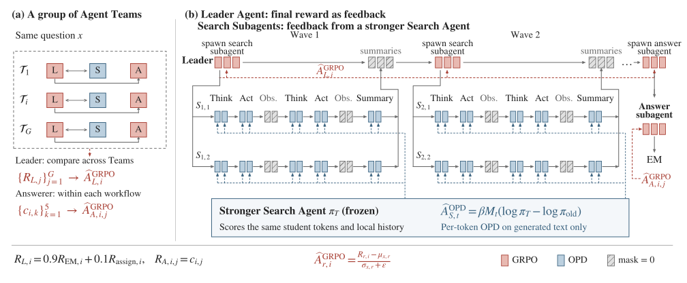
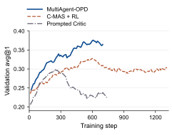
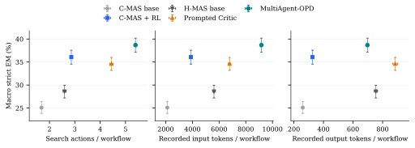

一个团队最后答错了，不代表每个成员都做错了。搜索子智能体可能找到了关键材料，只是协调者没有选中，或者回答者没有用好。如果把同一个“答错了”的分数发给整条链路，搜索过程很难知道下一次该怎么改。

MultiAgent-OPD 分别训练这几类决策：协调者与回答者学习最终结果，搜索子智能体在自己生成的轨迹上接受教师逐 token 的反馈。训练分两阶段，先得到搜索教师，再联合更新团队。

## 搜索子智能体的反馈问题 {#团队变复杂以后最终奖励就绕远了}

我们研究的是 Leader–Searcher–Answerer 结构。Leader 拆分问题，把子任务分发给多个 Searcher；Searcher 检索、读材料、整理报告；Leader 可以再开一轮搜索，最后选出报告交给 Answerer 回答。与固定的“搜一次再回答”相比，这个结构能根据已经找到的证据继续分工。

<figure class="publication-figure figure-natural" id="blog-figure-1">
图 1<button aria-label="放大查看：图 1" class="figure-expand" type="button">查看大图 ↗</button>

<figcaption class="publication-caption">Leader 多轮分派搜索任务。Searcher 使用教师提供的 OPD 反馈，Leader 和 Answerer 使用结果奖励；三个角色共享一个学生模型。</figcaption></figure>

分层流程让一份搜索报告经过选择和推理后才影响答案，最终反馈来得更晚。同一轨迹中的 Searcher 可能拿到一样的优势值，难以区分有效证据与重复检索。

同一问题的轨迹全部答对或全部答错时，结果奖励没有组内差异，相应优势值会消失。但这些轨迹的查询、补查和报告质量仍可能不同，需要能区分搜索过程的反馈。

另一条路是给搜索报告加 LLM Judge。它能提供局部评分，不过质量取决于评审自身的判断，而且一个报告分数仍然覆盖了前面整串动作。MultiAgent-OPD 尝试换一种局部信号：先训练一个会搜索、会总结的教师，让它在学生当前的上下文里评价学生实际生成的 token。

## 教师模型训练 {#先在简单链路里练好教师}

第一阶段不直接训练复杂团队，而是使用 Searcher–Answerer 串联流程。Searcher 拿到原问题，查询固定检索器并写出报告，Answerer 直接依据报告回答。这样，搜索证据与答案之间的联系更短，比较适合先用正确性奖励学习。

两个角色共享模型参数。训练时每次回答请求生成 5 个候选答案，每个候选有自己的归一化 Exact Match 得分；只要其中至少一个候选正确，这条轨迹的团队结果奖励就为 1。Searcher 主要拿结果奖励，另外获得一小部分行为奖励。

<mjx-container class="MathJax" jax="SVG" display="true"><svg aria-hidden="true" focusable="false" style="vertical-align: -5.457ex;" xmlns="http://www.w3.org/2000/svg" width="26.298ex" height="12.045ex" role="img" focusable="false" viewBox="0 -2911.9 11623.6 5323.8"><g stroke="currentColor" fill="currentColor" stroke-width="0" transform="scale(1,-1)"><g data-mml-node="math"><g data-mml-node="mtable"><g data-mml-node="mtr" transform="translate(0,2161.9)"><g data-mml-node="mtd" transform="translate(111.7,0)"><g data-mml-node="msub"><g data-mml-node="mi"><path data-c="1D445" d="M230 637Q203 637 198 638T193 649Q193 676 204 682Q206 683 378 683Q550 682 564 680Q620 672 658 652T712 606T733 563T739 529Q739 484 710 445T643 385T576 351T538 338L545 333Q612 295 612 223Q612 212 607 162T602 80V71Q602 53 603 43T614 25T640 16Q668 16 686 38T712 85Q717 99 720 102T735 105Q755 105 755 93Q755 75 731 36Q693 -21 641 -21H632Q571 -21 531 4T487 82Q487 109 502 166T517 239Q517 290 474 313Q459 320 449 321T378 323H309L277 193Q244 61 244 59Q244 55 245 54T252 50T269 48T302 46H333Q339 38 339 37T336 19Q332 6 326 0H311Q275 2 180 2Q146 2 117 2T71 2T50 1Q33 1 33 10Q33 12 36 24Q41 43 46 45Q50 46 61 46H67Q94 46 127 49Q141 52 146 61Q149 65 218 339T287 628Q287 635 230 637ZM630 554Q630 586 609 608T523 636Q521 636 500 636T462 637H440Q393 637 386 627Q385 624 352 494T319 361Q319 360 388 360Q466 361 492 367Q556 377 592 426Q608 449 619 486T630 554Z"></path></g><g data-mml-node="TeXAtom" transform="translate(792,-152.7) scale(0.707)" data-mjx-texclass="ORD"><g data-mml-node="mi"><path data-c="1D434" d="M208 74Q208 50 254 46Q272 46 272 35Q272 34 270 22Q267 8 264 4T251 0Q249 0 239 0T205 1T141 2Q70 2 50 0H42Q35 7 35 11Q37 38 48 46H62Q132 49 164 96Q170 102 345 401T523 704Q530 716 547 716H555H572Q578 707 578 706L606 383Q634 60 636 57Q641 46 701 46Q726 46 726 36Q726 34 723 22Q720 7 718 4T704 0Q701 0 690 0T651 1T578 2Q484 2 455 0H443Q437 6 437 9T439 27Q443 40 445 43L449 46H469Q523 49 533 63L521 213H283L249 155Q208 86 208 74ZM516 260Q516 271 504 416T490 562L463 519Q447 492 400 412L310 260L413 259Q516 259 516 260Z"></path></g><g data-mml-node="mo" transform="translate(750,0)"><path data-c="2C" d="M78 35T78 60T94 103T137 121Q165 121 187 96T210 8Q210 -27 201 -60T180 -117T154 -158T130 -185T117 -194Q113 -194 104 -185T95 -172Q95 -168 106 -156T131 -126T157 -76T173 -3V9L172 8Q170 7 167 6T161 3T152 1T140 0Q113 0 96 17Z"></path></g><g data-mml-node="mi" transform="translate(1028,0)"><path data-c="1D456" d="M184 600Q184 624 203 642T247 661Q265 661 277 649T290 619Q290 596 270 577T226 557Q211 557 198 567T184 600ZM21 287Q21 295 30 318T54 369T98 420T158 442Q197 442 223 419T250 357Q250 340 236 301T196 196T154 83Q149 61 149 51Q149 26 166 26Q175 26 185 29T208 43T235 78T260 137Q263 149 265 151T282 153Q302 153 302 143Q302 135 293 112T268 61T223 11T161 -11Q129 -11 102 10T74 74Q74 91 79 106T122 220Q160 321 166 341T173 380Q173 404 156 404H154Q124 404 99 371T61 287Q60 286 59 284T58 281T56 279T53 278T49 278T41 278H27Q21 284 21 287Z"></path></g><g data-mml-node="mo" transform="translate(1373,0)"><path data-c="2C" d="M78 35T78 60T94 103T137 121Q165 121 187 96T210 8Q210 -27 201 -60T180 -117T154 -158T130 -185T117 -194Q113 -194 104 -185T95 -172Q95 -168 106 -156T131 -126T157 -76T173 -3V9L172 8Q170 7 167 6T161 3T152 1T140 0Q113 0 96 17Z"></path></g><g data-mml-node="mi" transform="translate(1651,0)"><path data-c="1D457" d="M297 596Q297 627 318 644T361 661Q378 661 389 651T403 623Q403 595 384 576T340 557Q322 557 310 567T297 596ZM288 376Q288 405 262 405Q240 405 220 393T185 362T161 325T144 293L137 279Q135 278 121 278H107Q101 284 101 286T105 299Q126 348 164 391T252 441Q253 441 260 441T272 442Q296 441 316 432Q341 418 354 401T367 348V332L318 133Q267 -67 264 -75Q246 -125 194 -164T75 -204Q25 -204 7 -183T-12 -137Q-12 -110 7 -91T53 -71Q70 -71 82 -81T95 -112Q95 -148 63 -167Q69 -168 77 -168Q111 -168 139 -140T182 -74L193 -32Q204 11 219 72T251 197T278 308T289 365Q289 372 288 376Z"></path></g></g></g></g><g data-mml-node="mtd" transform="translate(2412.5,0)"><g data-mml-node="mi"></g><g data-mml-node="mo" transform="translate(277.8,0)"><path data-c="3D" d="M56 347Q56 360 70 367H707Q722 359 722 347Q722 336 708 328L390 327H72Q56 332 56 347ZM56 153Q56 168 72 173H708Q722 163 722 153Q722 140 707 133H70Q56 140 56 153Z"></path></g><g data-mml-node="msub" transform="translate(1333.6,0)"><g data-mml-node="mi"><path data-c="1D450" d="M34 159Q34 268 120 355T306 442Q362 442 394 418T427 355Q427 326 408 306T360 285Q341 285 330 295T319 325T330 359T352 380T366 386H367Q367 388 361 392T340 400T306 404Q276 404 249 390Q228 381 206 359Q162 315 142 235T121 119Q121 73 147 50Q169 26 205 26H209Q321 26 394 111Q403 121 406 121Q410 121 419 112T429 98T420 83T391 55T346 25T282 0T202 -11Q127 -11 81 37T34 159Z"></path></g><g data-mml-node="TeXAtom" transform="translate(466,-150) scale(0.707)" data-mjx-texclass="ORD"><g data-mml-node="mi"><path data-c="1D456" d="M184 600Q184 624 203 642T247 661Q265 661 277 649T290 619Q290 596 270 577T226 557Q211 557 198 567T184 600ZM21 287Q21 295 30 318T54 369T98 420T158 442Q197 442 223 419T250 357Q250 340 236 301T196 196T154 83Q149 61 149 51Q149 26 166 26Q175 26 185 29T208 43T235 78T260 137Q263 149 265 151T282 153Q302 153 302 143Q302 135 293 112T268 61T223 11T161 -11Q129 -11 102 10T74 74Q74 91 79 106T122 220Q160 321 166 341T173 380Q173 404 156 404H154Q124 404 99 371T61 287Q60 286 59 284T58 281T56 279T53 278T49 278T41 278H27Q21 284 21 287Z"></path></g><g data-mml-node="mo" transform="translate(345,0)"><path data-c="2C" d="M78 35T78 60T94 103T137 121Q165 121 187 96T210 8Q210 -27 201 -60T180 -117T154 -158T130 -185T117 -194Q113 -194 104 -185T95 -172Q95 -168 106 -156T131 -126T157 -76T173 -3V9L172 8Q170 7 167 6T161 3T152 1T140 0Q113 0 96 17Z"></path></g><g data-mml-node="mi" transform="translate(623,0)"><path data-c="1D457" d="M297 596Q297 627 318 644T361 661Q378 661 389 651T403 623Q403 595 384 576T340 557Q322 557 310 567T297 596ZM288 376Q288 405 262 405Q240 405 220 393T185 362T161 325T144 293L137 279Q135 278 121 278H107Q101 284 101 286T105 299Q126 348 164 391T252 441Q253 441 260 441T272 442Q296 441 316 432Q341 418 354 401T367 348V332L318 133Q267 -67 264 -75Q246 -125 194 -164T75 -204Q25 -204 7 -183T-12 -137Q-12 -110 7 -91T53 -71Q70 -71 82 -81T95 -112Q95 -148 63 -167Q69 -168 77 -168Q111 -168 139 -140T182 -74L193 -32Q204 11 219 72T251 197T278 308T289 365Q289 372 288 376Z"></path></g></g></g><g data-mml-node="mo" transform="translate(2581.4,0)"><path data-c="2C" d="M78 35T78 60T94 103T137 121Q165 121 187 96T210 8Q210 -27 201 -60T180 -117T154 -158T130 -185T117 -194Q113 -194 104 -185T95 -172Q95 -168 106 -156T131 -126T157 -76T173 -3V9L172 8Q170 7 167 6T161 3T152 1T140 0Q113 0 96 17Z"></path></g></g></g><g data-mml-node="mtr" transform="translate(0,314.9)"><g data-mml-node="mtd" transform="translate(673.9,0)"><g data-mml-node="msub"><g data-mml-node="mi"><path data-c="1D445" d="M230 637Q203 637 198 638T193 649Q193 676 204 682Q206 683 378 683Q550 682 564 680Q620 672 658 652T712 606T733 563T739 529Q739 484 710 445T643 385T576 351T538 338L545 333Q612 295 612 223Q612 212 607 162T602 80V71Q602 53 603 43T614 25T640 16Q668 16 686 38T712 85Q717 99 720 102T735 105Q755 105 755 93Q755 75 731 36Q693 -21 641 -21H632Q571 -21 531 4T487 82Q487 109 502 166T517 239Q517 290 474 313Q459 320 449 321T378 323H309L277 193Q244 61 244 59Q244 55 245 54T252 50T269 48T302 46H333Q339 38 339 37T336 19Q332 6 326 0H311Q275 2 180 2Q146 2 117 2T71 2T50 1Q33 1 33 10Q33 12 36 24Q41 43 46 45Q50 46 61 46H67Q94 46 127 49Q141 52 146 61Q149 65 218 339T287 628Q287 635 230 637ZM630 554Q630 586 609 608T523 636Q521 636 500 636T462 637H440Q393 637 386 627Q385 624 352 494T319 361Q319 360 388 360Q466 361 492 367Q556 377 592 426Q608 449 619 486T630 554Z"></path></g><g data-mml-node="TeXAtom" transform="translate(792,-150) scale(0.707)" data-mjx-texclass="ORD"><g data-mml-node="mi"><path data-c="1D446" d="M308 24Q367 24 416 76T466 197Q466 260 414 284Q308 311 278 321T236 341Q176 383 176 462Q176 523 208 573T273 648Q302 673 343 688T407 704H418H425Q521 704 564 640Q565 640 577 653T603 682T623 704Q624 704 627 704T632 705Q645 705 645 698T617 577T585 459T569 456Q549 456 549 465Q549 471 550 475Q550 478 551 494T553 520Q553 554 544 579T526 616T501 641Q465 662 419 662Q362 662 313 616T263 510Q263 480 278 458T319 427Q323 425 389 408T456 390Q490 379 522 342T554 242Q554 216 546 186Q541 164 528 137T492 78T426 18T332 -20Q320 -22 298 -22Q199 -22 144 33L134 44L106 13Q83 -14 78 -18T65 -22Q52 -22 52 -14Q52 -11 110 221Q112 227 130 227H143Q149 221 149 216Q149 214 148 207T144 186T142 153Q144 114 160 87T203 47T255 29T308 24Z"></path></g><g data-mml-node="mo" transform="translate(645,0)"><path data-c="2C" d="M78 35T78 60T94 103T137 121Q165 121 187 96T210 8Q210 -27 201 -60T180 -117T154 -158T130 -185T117 -194Q113 -194 104 -185T95 -172Q95 -168 106 -156T131 -126T157 -76T173 -3V9L172 8Q170 7 167 6T161 3T152 1T140 0Q113 0 96 17Z"></path></g><g data-mml-node="mi" transform="translate(923,0)"><path data-c="1D456" d="M184 600Q184 624 203 642T247 661Q265 661 277 649T290 619Q290 596 270 577T226 557Q211 557 198 567T184 600ZM21 287Q21 295 30 318T54 369T98 420T158 442Q197 442 223 419T250 357Q250 340 236 301T196 196T154 83Q149 61 149 51Q149 26 166 26Q175 26 185 29T208 43T235 78T260 137Q263 149 265 151T282 153Q302 153 302 143Q302 135 293 112T268 61T223 11T161 -11Q129 -11 102 10T74 74Q74 91 79 106T122 220Q160 321 166 341T173 380Q173 404 156 404H154Q124 404 99 371T61 287Q60 286 59 284T58 281T56 279T53 278T49 278T41 278H27Q21 284 21 287Z"></path></g></g></g></g><g data-mml-node="mtd" transform="translate(2412.5,0)"><g data-mml-node="mi"></g><g data-mml-node="mo" transform="translate(277.8,0)"><path data-c="3D" d="M56 347Q56 360 70 367H707Q722 359 722 347Q722 336 708 328L390 327H72Q56 332 56 347ZM56 153Q56 168 72 173H708Q722 163 722 153Q722 140 707 133H70Q56 140 56 153Z"></path></g><g data-mml-node="mn" transform="translate(1333.6,0)"><path data-c="30" d="M96 585Q152 666 249 666Q297 666 345 640T423 548Q460 465 460 320Q460 165 417 83Q397 41 362 16T301 -15T250 -22Q224 -22 198 -16T137 16T82 83Q39 165 39 320Q39 494 96 585ZM321 597Q291 629 250 629Q208 629 178 597Q153 571 145 525T137 333Q137 175 145 125T181 46Q209 16 250 16Q290 16 318 46Q347 76 354 130T362 333Q362 478 354 524T321 597Z"></path><path data-c="2E" d="M78 60Q78 84 95 102T138 120Q162 120 180 104T199 61Q199 36 182 18T139 0T96 17T78 60Z" transform="translate(500,0)"></path><path data-c="39" d="M352 287Q304 211 232 211Q154 211 104 270T44 396Q42 412 42 436V444Q42 537 111 606Q171 666 243 666Q245 666 249 666T257 665H261Q273 665 286 663T323 651T370 619T413 560Q456 472 456 334Q456 194 396 97Q361 41 312 10T208 -22Q147 -22 108 7T68 93T121 149Q143 149 158 135T173 96Q173 78 164 65T148 49T135 44L131 43Q131 41 138 37T164 27T206 22H212Q272 22 313 86Q352 142 352 280V287ZM244 248Q292 248 321 297T351 430Q351 508 343 542Q341 552 337 562T323 588T293 615T246 625Q208 625 181 598Q160 576 154 546T147 441Q147 358 152 329T172 282Q197 248 244 248Z" transform="translate(778,0)"></path></g><g data-mml-node="msub" transform="translate(2611.6,0)"><g data-mml-node="mi"><path data-c="1D445" d="M230 637Q203 637 198 638T193 649Q193 676 204 682Q206 683 378 683Q550 682 564 680Q620 672 658 652T712 606T733 563T739 529Q739 484 710 445T643 385T576 351T538 338L545 333Q612 295 612 223Q612 212 607 162T602 80V71Q602 53 603 43T614 25T640 16Q668 16 686 38T712 85Q717 99 720 102T735 105Q755 105 755 93Q755 75 731 36Q693 -21 641 -21H632Q571 -21 531 4T487 82Q487 109 502 166T517 239Q517 290 474 313Q459 320 449 321T378 323H309L277 193Q244 61 244 59Q244 55 245 54T252 50T269 48T302 46H333Q339 38 339 37T336 19Q332 6 326 0H311Q275 2 180 2Q146 2 117 2T71 2T50 1Q33 1 33 10Q33 12 36 24Q41 43 46 45Q50 46 61 46H67Q94 46 127 49Q141 52 146 61Q149 65 218 339T287 628Q287 635 230 637ZM630 554Q630 586 609 608T523 636Q521 636 500 636T462 637H440Q393 637 386 627Q385 624 352 494T319 361Q319 360 388 360Q466 361 492 367Q556 377 592 426Q608 449 619 486T630 554Z"></path></g><g data-mml-node="TeXAtom" transform="translate(792,-150) scale(0.707)" data-mjx-texclass="ORD"><g data-mml-node="TeXAtom" data-mjx-texclass="ORD"><g data-mml-node="mi"><path data-c="45" d="M128 619Q121 626 117 628T101 631T58 634H25V680H597V676Q599 670 611 560T625 444V440H585V444Q584 447 582 465Q578 500 570 526T553 571T528 601T498 619T457 629T411 633T353 634Q266 634 251 633T233 622Q233 622 233 621Q232 619 232 497V376H286Q359 378 377 385Q413 401 416 469Q416 471 416 473V493H456V213H416V233Q415 268 408 288T383 317T349 328T297 330Q290 330 286 330H232V196V114Q232 57 237 52Q243 47 289 47H340H391Q428 47 452 50T505 62T552 92T584 146Q594 172 599 200T607 247T612 270V273H652V270Q651 267 632 137T610 3V0H25V46H58Q100 47 109 49T128 61V619Z"></path><path data-c="4D" d="M132 622Q125 629 121 631T105 634T62 637H29V683H135Q221 683 232 682T249 675Q250 674 354 398L458 124L562 398Q666 674 668 675Q671 681 683 682T781 683H887V637H854Q814 636 803 634T785 622V61Q791 51 802 49T854 46H887V0H876Q855 3 736 3Q605 3 596 0H585V46H618Q660 47 669 49T688 61V347Q688 424 688 461T688 546T688 613L687 632Q454 14 450 7Q446 1 430 1T410 7Q409 9 292 316L176 624V606Q175 588 175 543T175 463T175 356L176 86Q187 50 261 46H278V0H269Q254 3 154 3Q52 3 37 0H29V46H46Q78 48 98 56T122 69T132 86V622Z" transform="translate(681,0)"></path></g></g><g data-mml-node="mo" transform="translate(1598,0)"><path data-c="2C" d="M78 35T78 60T94 103T137 121Q165 121 187 96T210 8Q210 -27 201 -60T180 -117T154 -158T130 -185T117 -194Q113 -194 104 -185T95 -172Q95 -168 106 -156T131 -126T157 -76T173 -3V9L172 8Q170 7 167 6T161 3T152 1T140 0Q113 0 96 17Z"></path></g><g data-mml-node="mi" transform="translate(1876,0)"><path data-c="1D456" d="M184 600Q184 624 203 642T247 661Q265 661 277 649T290 619Q290 596 270 577T226 557Q211 557 198 567T184 600ZM21 287Q21 295 30 318T54 369T98 420T158 442Q197 442 223 419T250 357Q250 340 236 301T196 196T154 83Q149 61 149 51Q149 26 166 26Q175 26 185 29T208 43T235 78T260 137Q263 149 265 151T282 153Q302 153 302 143Q302 135 293 112T268 61T223 11T161 -11Q129 -11 102 10T74 74Q74 91 79 106T122 220Q160 321 166 341T173 380Q173 404 156 404H154Q124 404 99 371T61 287Q60 286 59 284T58 281T56 279T53 278T49 278T41 278H27Q21 284 21 287Z"></path></g></g></g><g data-mml-node="mo" transform="translate(5246.3,0)"><path data-c="2B" d="M56 237T56 250T70 270H369V420L370 570Q380 583 389 583Q402 583 409 568V270H707Q722 262 722 250T707 230H409V-68Q401 -82 391 -82H389H387Q375 -82 369 -68V230H70Q56 237 56 250Z"></path></g><g data-mml-node="mn" transform="translate(6246.5,0)"><path data-c="30" d="M96 585Q152 666 249 666Q297 666 345 640T423 548Q460 465 460 320Q460 165 417 83Q397 41 362 16T301 -15T250 -22Q224 -22 198 -16T137 16T82 83Q39 165 39 320Q39 494 96 585ZM321 597Q291 629 250 629Q208 629 178 597Q153 571 145 525T137 333Q137 175 145 125T181 46Q209 16 250 16Q290 16 318 46Q347 76 354 130T362 333Q362 478 354 524T321 597Z"></path><path data-c="2E" d="M78 60Q78 84 95 102T138 120Q162 120 180 104T199 61Q199 36 182 18T139 0T96 17T78 60Z" transform="translate(500,0)"></path><path data-c="31" d="M213 578L200 573Q186 568 160 563T102 556H83V602H102Q149 604 189 617T245 641T273 663Q275 666 285 666Q294 666 302 660V361L303 61Q310 54 315 52T339 48T401 46H427V0H416Q395 3 257 3Q121 3 100 0H88V46H114Q136 46 152 46T177 47T193 50T201 52T207 57T213 61V578Z" transform="translate(778,0)"></path></g><g data-mml-node="msub" transform="translate(7524.5,0)"><g data-mml-node="mi"><path data-c="1D44F" d="M73 647Q73 657 77 670T89 683Q90 683 161 688T234 694Q246 694 246 685T212 542Q204 508 195 472T180 418L176 399Q176 396 182 402Q231 442 283 442Q345 442 383 396T422 280Q422 169 343 79T173 -11Q123 -11 82 27T40 150V159Q40 180 48 217T97 414Q147 611 147 623T109 637Q104 637 101 637H96Q86 637 83 637T76 640T73 647ZM336 325V331Q336 405 275 405Q258 405 240 397T207 376T181 352T163 330L157 322L136 236Q114 150 114 114Q114 66 138 42Q154 26 178 26Q211 26 245 58Q270 81 285 114T318 219Q336 291 336 325Z"></path></g><g data-mml-node="TeXAtom" transform="translate(462,-150) scale(0.707)" data-mjx-texclass="ORD"><g data-mml-node="mi"><path data-c="1D446" d="M308 24Q367 24 416 76T466 197Q466 260 414 284Q308 311 278 321T236 341Q176 383 176 462Q176 523 208 573T273 648Q302 673 343 688T407 704H418H425Q521 704 564 640Q565 640 577 653T603 682T623 704Q624 704 627 704T632 705Q645 705 645 698T617 577T585 459T569 456Q549 456 549 465Q549 471 550 475Q550 478 551 494T553 520Q553 554 544 579T526 616T501 641Q465 662 419 662Q362 662 313 616T263 510Q263 480 278 458T319 427Q323 425 389 408T456 390Q490 379 522 342T554 242Q554 216 546 186Q541 164 528 137T492 78T426 18T332 -20Q320 -22 298 -22Q199 -22 144 33L134 44L106 13Q83 -14 78 -18T65 -22Q52 -22 52 -14Q52 -11 110 221Q112 227 130 227H143Q149 221 149 216Q149 214 148 207T144 186T142 153Q144 114 160 87T203 47T255 29T308 24Z"></path></g><g data-mml-node="mo" transform="translate(645,0)"><path data-c="2C" d="M78 35T78 60T94 103T137 121Q165 121 187 96T210 8Q210 -27 201 -60T180 -117T154 -158T130 -185T117 -194Q113 -194 104 -185T95 -172Q95 -168 106 -156T131 -126T157 -76T173 -3V9L172 8Q170 7 167 6T161 3T152 1T140 0Q113 0 96 17Z"></path></g><g data-mml-node="mi" transform="translate(923,0)"><path data-c="1D456" d="M184 600Q184 624 203 642T247 661Q265 661 277 649T290 619Q290 596 270 577T226 557Q211 557 198 567T184 600ZM21 287Q21 295 30 318T54 369T98 420T158 442Q197 442 223 419T250 357Q250 340 236 301T196 196T154 83Q149 61 149 51Q149 26 166 26Q175 26 185 29T208 43T235 78T260 137Q263 149 265 151T282 153Q302 153 302 143Q302 135 293 112T268 61T223 11T161 -11Q129 -11 102 10T74 74Q74 91 79 106T122 220Q160 321 166 341T173 380Q173 404 156 404H154Q124 404 99 371T61 287Q60 286 59 284T58 281T56 279T53 278T49 278T41 278H27Q21 284 21 287Z"></path></g></g></g><g data-mml-node="mo" transform="translate(8933.1,0)"><path data-c="2C" d="M78 35T78 60T94 103T137 121Q165 121 187 96T210 8Q210 -27 201 -60T180 -117T154 -158T130 -185T117 -194Q113 -194 104 -185T95 -172Q95 -168 106 -156T131 -126T157 -76T173 -3V9L172 8Q170 7 167 6T161 3T152 1T140 0Q113 0 96 17Z"></path></g></g></g><g data-mml-node="mtr" transform="translate(0,-1522.2)"><g data-mml-node="mtd"><g data-mml-node="msub"><g data-mml-node="mi"><path data-c="1D445" d="M230 637Q203 637 198 638T193 649Q193 676 204 682Q206 683 378 683Q550 682 564 680Q620 672 658 652T712 606T733 563T739 529Q739 484 710 445T643 385T576 351T538 338L545 333Q612 295 612 223Q612 212 607 162T602 80V71Q602 53 603 43T614 25T640 16Q668 16 686 38T712 85Q717 99 720 102T735 105Q755 105 755 93Q755 75 731 36Q693 -21 641 -21H632Q571 -21 531 4T487 82Q487 109 502 166T517 239Q517 290 474 313Q459 320 449 321T378 323H309L277 193Q244 61 244 59Q244 55 245 54T252 50T269 48T302 46H333Q339 38 339 37T336 19Q332 6 326 0H311Q275 2 180 2Q146 2 117 2T71 2T50 1Q33 1 33 10Q33 12 36 24Q41 43 46 45Q50 46 61 46H67Q94 46 127 49Q141 52 146 61Q149 65 218 339T287 628Q287 635 230 637ZM630 554Q630 586 609 608T523 636Q521 636 500 636T462 637H440Q393 637 386 627Q385 624 352 494T319 361Q319 360 388 360Q466 361 492 367Q556 377 592 426Q608 449 619 486T630 554Z"></path></g><g data-mml-node="TeXAtom" transform="translate(792,-150) scale(0.707)" data-mjx-texclass="ORD"><g data-mml-node="TeXAtom" data-mjx-texclass="ORD"><g data-mml-node="mi"><path data-c="45" d="M128 619Q121 626 117 628T101 631T58 634H25V680H597V676Q599 670 611 560T625 444V440H585V444Q584 447 582 465Q578 500 570 526T553 571T528 601T498 619T457 629T411 633T353 634Q266 634 251 633T233 622Q233 622 233 621Q232 619 232 497V376H286Q359 378 377 385Q413 401 416 469Q416 471 416 473V493H456V213H416V233Q415 268 408 288T383 317T349 328T297 330Q290 330 286 330H232V196V114Q232 57 237 52Q243 47 289 47H340H391Q428 47 452 50T505 62T552 92T584 146Q594 172 599 200T607 247T612 270V273H652V270Q651 267 632 137T610 3V0H25V46H58Q100 47 109 49T128 61V619Z"></path><path data-c="4D" d="M132 622Q125 629 121 631T105 634T62 637H29V683H135Q221 683 232 682T249 675Q250 674 354 398L458 124L562 398Q666 674 668 675Q671 681 683 682T781 683H887V637H854Q814 636 803 634T785 622V61Q791 51 802 49T854 46H887V0H876Q855 3 736 3Q605 3 596 0H585V46H618Q660 47 669 49T688 61V347Q688 424 688 461T688 546T688 613L687 632Q454 14 450 7Q446 1 430 1T410 7Q409 9 292 316L176 624V606Q175 588 175 543T175 463T175 356L176 86Q187 50 261 46H278V0H269Q254 3 154 3Q52 3 37 0H29V46H46Q78 48 98 56T122 69T132 86V622Z" transform="translate(681,0)"></path></g></g><g data-mml-node="mo" transform="translate(1598,0)"><path data-c="2C" d="M78 35T78 60T94 103T137 121Q165 121 187 96T210 8Q210 -27 201 -60T180 -117T154 -158T130 -185T117 -194Q113 -194 104 -185T95 -172Q95 -168 106 -156T131 -126T157 -76T173 -3V9L172 8Q170 7 167 6T161 3T152 1T140 0Q113 0 96 17Z"></path></g><g data-mml-node="mi" transform="translate(1876,0)"><path data-c="1D456" d="M184 600Q184 624 203 642T247 661Q265 661 277 649T290 619Q290 596 270 577T226 557Q211 557 198 567T184 600ZM21 287Q21 295 30 318T54 369T98 420T158 442Q197 442 223 419T250 357Q250 340 236 301T196 196T154 83Q149 61 149 51Q149 26 166 26Q175 26 185 29T208 43T235 78T260 137Q263 149 265 151T282 153Q302 153 302 143Q302 135 293 112T268 61T223 11T161 -11Q129 -11 102 10T74 74Q74 91 79 106T122 220Q160 321 166 341T173 380Q173 404 156 404H154Q124 404 99 371T61 287Q60 286 59 284T58 281T56 279T53 278T49 278T41 278H27Q21 284 21 287Z"></path></g></g></g></g><g data-mml-node="mtd" transform="translate(2412.5,0)"><g data-mml-node="mi"></g><g data-mml-node="mo" transform="translate(277.8,0)"><path data-c="3D" d="M56 347Q56 360 70 367H707Q722 359 722 347Q722 336 708 328L390 327H72Q56 332 56 347ZM56 153Q56 168 72 173H708Q722 163 722 153Q722 140 707 133H70Q56 140 56 153Z"></path></g><g data-mml-node="munder" transform="translate(1333.6,0)"><g data-mml-node="mo"><path data-c="6D" d="M41 46H55Q94 46 102 60V68Q102 77 102 91T102 122T103 161T103 203Q103 234 103 269T102 328V351Q99 370 88 376T43 385H25V408Q25 431 27 431L37 432Q47 433 65 434T102 436Q119 437 138 438T167 441T178 442H181V402Q181 364 182 364T187 369T199 384T218 402T247 421T285 437Q305 442 336 442Q351 442 364 440T387 434T406 426T421 417T432 406T441 395T448 384T452 374T455 366L457 361L460 365Q463 369 466 373T475 384T488 397T503 410T523 422T546 432T572 439T603 442Q729 442 740 329Q741 322 741 190V104Q741 66 743 59T754 49Q775 46 803 46H819V0H811L788 1Q764 2 737 2T699 3Q596 3 587 0H579V46H595Q656 46 656 62Q657 64 657 200Q656 335 655 343Q649 371 635 385T611 402T585 404Q540 404 506 370Q479 343 472 315T464 232V168V108Q464 78 465 68T468 55T477 49Q498 46 526 46H542V0H534L510 1Q487 2 460 2T422 3Q319 3 310 0H302V46H318Q379 46 379 62Q380 64 380 200Q379 335 378 343Q372 371 358 385T334 402T308 404Q263 404 229 370Q202 343 195 315T187 232V168V108Q187 78 188 68T191 55T200 49Q221 46 249 46H265V0H257L234 1Q210 2 183 2T145 3Q42 3 33 0H25V46H41Z"></path><path data-c="61" d="M137 305T115 305T78 320T63 359Q63 394 97 421T218 448Q291 448 336 416T396 340Q401 326 401 309T402 194V124Q402 76 407 58T428 40Q443 40 448 56T453 109V145H493V106Q492 66 490 59Q481 29 455 12T400 -6T353 12T329 54V58L327 55Q325 52 322 49T314 40T302 29T287 17T269 6T247 -2T221 -8T190 -11Q130 -11 82 20T34 107Q34 128 41 147T68 188T116 225T194 253T304 268H318V290Q318 324 312 340Q290 411 215 411Q197 411 181 410T156 406T148 403Q170 388 170 359Q170 334 154 320ZM126 106Q126 75 150 51T209 26Q247 26 276 49T315 109Q317 116 318 175Q318 233 317 233Q309 233 296 232T251 223T193 203T147 166T126 106Z" transform="translate(833,0)"></path><path data-c="78" d="M201 0Q189 3 102 3Q26 3 17 0H11V46H25Q48 47 67 52T96 61T121 78T139 96T160 122T180 150L226 210L168 288Q159 301 149 315T133 336T122 351T113 363T107 370T100 376T94 379T88 381T80 383Q74 383 44 385H16V431H23Q59 429 126 429Q219 429 229 431H237V385Q201 381 201 369Q201 367 211 353T239 315T268 274L272 270L297 304Q329 345 329 358Q329 364 327 369T322 376T317 380T310 384L307 385H302V431H309Q324 428 408 428Q487 428 493 431H499V385H492Q443 385 411 368Q394 360 377 341T312 257L296 236L358 151Q424 61 429 57T446 50Q464 46 499 46H516V0H510H502Q494 1 482 1T457 2T432 2T414 3Q403 3 377 3T327 1L304 0H295V46H298Q309 46 320 51T331 63Q331 65 291 120L250 175Q249 174 219 133T185 88Q181 83 181 74Q181 63 188 55T206 46Q208 46 208 23V0H201Z" transform="translate(1333,0)"></path></g><g data-mml-node="mi" transform="translate(784.8,-645.4) scale(0.707)"><path data-c="1D457" d="M297 596Q297 627 318 644T361 661Q378 661 389 651T403 623Q403 595 384 576T340 557Q322 557 310 567T297 596ZM288 376Q288 405 262 405Q240 405 220 393T185 362T161 325T144 293L137 279Q135 278 121 278H107Q101 284 101 286T105 299Q126 348 164 391T252 441Q253 441 260 441T272 442Q296 441 316 432Q341 418 354 401T367 348V332L318 133Q267 -67 264 -75Q246 -125 194 -164T75 -204Q25 -204 7 -183T-12 -137Q-12 -110 7 -91T53 -71Q70 -71 82 -81T95 -112Q95 -148 63 -167Q69 -168 77 -168Q111 -168 139 -140T182 -74L193 -32Q204 11 219 72T251 197T278 308T289 365Q289 372 288 376Z"></path></g></g><g data-mml-node="msub" transform="translate(3361.2,0)"><g data-mml-node="mi"><path data-c="1D450" d="M34 159Q34 268 120 355T306 442Q362 442 394 418T427 355Q427 326 408 306T360 285Q341 285 330 295T319 325T330 359T352 380T366 386H367Q367 388 361 392T340 400T306 404Q276 404 249 390Q228 381 206 359Q162 315 142 235T121 119Q121 73 147 50Q169 26 205 26H209Q321 26 394 111Q403 121 406 121Q410 121 419 112T429 98T420 83T391 55T346 25T282 0T202 -11Q127 -11 81 37T34 159Z"></path></g><g data-mml-node="TeXAtom" transform="translate(466,-150) scale(0.707)" data-mjx-texclass="ORD"><g data-mml-node="mi"><path data-c="1D456" d="M184 600Q184 624 203 642T247 661Q265 661 277 649T290 619Q290 596 270 577T226 557Q211 557 198 567T184 600ZM21 287Q21 295 30 318T54 369T98 420T158 442Q197 442 223 419T250 357Q250 340 236 301T196 196T154 83Q149 61 149 51Q149 26 166 26Q175 26 185 29T208 43T235 78T260 137Q263 149 265 151T282 153Q302 153 302 143Q302 135 293 112T268 61T223 11T161 -11Q129 -11 102 10T74 74Q74 91 79 106T122 220Q160 321 166 341T173 380Q173 404 156 404H154Q124 404 99 371T61 287Q60 286 59 284T58 281T56 279T53 278T49 278T41 278H27Q21 284 21 287Z"></path></g><g data-mml-node="mo" transform="translate(345,0)"><path data-c="2C" d="M78 35T78 60T94 103T137 121Q165 121 187 96T210 8Q210 -27 201 -60T180 -117T154 -158T130 -185T117 -194Q113 -194 104 -185T95 -172Q95 -168 106 -156T131 -126T157 -76T173 -3V9L172 8Q170 7 167 6T161 3T152 1T140 0Q113 0 96 17Z"></path></g><g data-mml-node="mi" transform="translate(623,0)"><path data-c="1D457" d="M297 596Q297 627 318 644T361 661Q378 661 389 651T403 623Q403 595 384 576T340 557Q322 557 310 567T297 596ZM288 376Q288 405 262 405Q240 405 220 393T185 362T161 325T144 293L137 279Q135 278 121 278H107Q101 284 101 286T105 299Q126 348 164 391T252 441Q253 441 260 441T272 442Q296 441 316 432Q341 418 354 401T367 348V332L318 133Q267 -67 264 -75Q246 -125 194 -164T75 -204Q25 -204 7 -183T-12 -137Q-12 -110 7 -91T53 -71Q70 -71 82 -81T95 -112Q95 -148 63 -167Q69 -168 77 -168Q111 -168 139 -140T182 -74L193 -32Q204 11 219 72T251 197T278 308T289 365Q289 372 288 376Z"></path></g></g></g><g data-mml-node="mo" transform="translate(4609.1,0)"><path data-c="2E" d="M78 60Q78 84 95 102T138 120Q162 120 180 104T199 61Q199 36 182 18T139 0T96 17T78 60Z"></path></g></g></g></g></g></g></svg></mjx-container>\begin{aligned}R_{A,i,j}&amp;=c_{i,j},\\[5pt]R_{S,i}&amp;=0.9R_{\mathrm{EM},i}+0.1b_{S,i},\\[5pt]R_{\mathrm{EM},i}&amp;=\max_j c_{i,j}.\end{aligned}

行为项在搜索一次后给出总结时为 0.5，搜索两次及以上再总结时为 1，否则为 0；格式无效的输出总奖励为 −1。正确性仍占主要权重，行为项则鼓励搜索后形成可供回答使用的报告。它并不直接衡量材料是否真正相关，因此不能把行为奖励本身当作证据质量。

这一阶段的策略在串联流程中评测，就是后面的 C-MAS + RL；冻结后作为第二阶段教师。它使用相同的搜索接口，并已做过任务训练，替代了通用模型对报告打分的方式。

## 学生模型的 On-Policy 蒸馏 {#第二阶段学生走自己的轨迹}

学生从原始指令模型初始化，不继承教师权重。Leader 不断更新任务拆分方式，Searcher 接到的子问题和材料也会变。因此，监督需要覆盖学生当前访问的状态，固定的教师轨迹不足以表达这种变化。

<figure class="publication-figure figure-landscape" id="blog-figure-2">
图 2<button aria-label="放大查看：图 2" class="figure-expand" type="button">查看大图 ↗</button>

<figcaption class="publication-caption">同一问题采样多组团队轨迹。教师在 Searcher 的局部历史上评分学生 token；检索返回和收到的报告不作为接收者生成的动作训练。</figcaption></figure>

学生先生成团队搜索轨迹，教师再读取相同的角色提示、子任务、检索材料和生成前缀，计算学生 token 的概率。教师只评分这些已有输出，不另走自己的路径，也不生成供逐字模仿的标准报告。

on-policy distillation 的样本来自当前学生，教师在学生到达的历史上给出偏好。Leader 改变分工，教师就评新的子任务历史。两阶段的 Searcher 都接收问题并返回报告，因此可以沿用教师的搜索接口。

### Token 级优势计算 {#把教师偏好写成-token-优势}

蒸馏目标采用学生到教师方向的反向 KL。下面的 mask 只保留 Searcher 生成的 token；检索器返回的材料和 padding 都被排除。

<mjx-container class="MathJax" jax="SVG" display="true"><svg aria-hidden="true" focusable="false" style="vertical-align: -4.863ex;" xmlns="http://www.w3.org/2000/svg" width="37.243ex" height="10.857ex" role="img" focusable="false" viewBox="0 -2649.5 16461.3 4799"><g stroke="currentColor" fill="currentColor" stroke-width="0" transform="scale(1,-1)"><g data-mml-node="math"><g data-mml-node="mtable"><g data-mml-node="mtr" transform="translate(0,900)"><g data-mml-node="mtd"><g data-mml-node="msub"><g data-mml-node="TeXAtom" data-mjx-texclass="ORD"><g data-mml-node="mi"><path data-c="4C" d="M62 -22T47 -22T32 -11Q32 -1 56 24T83 55Q113 96 138 172T180 320T234 473T323 609Q364 649 419 677T531 705Q559 705 578 696T604 671T615 645T618 623V611Q618 582 615 571T598 548Q581 531 558 520T518 509Q503 509 503 520Q503 523 505 536T507 560Q507 590 494 610T452 630Q423 630 410 617Q367 578 333 492T271 301T233 170Q211 123 204 112L198 103L224 102Q281 102 369 79T509 52H523Q535 64 544 87T579 128Q616 152 641 152Q656 152 656 142Q656 101 588 40T433 -22Q381 -22 289 1T156 28L141 29L131 20Q111 0 87 -11Z"></path></g></g><g data-mml-node="TeXAtom" transform="translate(723,-150) scale(0.707)" data-mjx-texclass="ORD"><g data-mml-node="TeXAtom" data-mjx-texclass="ORD"><g data-mml-node="mi"><path data-c="4F" d="M56 340Q56 423 86 494T164 610T270 680T388 705Q521 705 621 601T722 341Q722 260 693 191T617 75T510 4T388 -22T267 3T160 74T85 189T56 340ZM467 647Q426 665 388 665Q360 665 331 654T269 620T213 549T179 439Q174 411 174 354Q174 144 277 61Q327 20 385 20H389H391Q474 20 537 99Q603 188 603 354Q603 411 598 439Q577 592 467 647Z"></path><path data-c="50" d="M130 622Q123 629 119 631T103 634T60 637H27V683H214Q237 683 276 683T331 684Q419 684 471 671T567 616Q624 563 624 489Q624 421 573 372T451 307Q429 302 328 301H234V181Q234 62 237 58Q245 47 304 46H337V0H326Q305 3 182 3Q47 3 38 0H27V46H60Q102 47 111 49T130 61V622ZM507 488Q507 514 506 528T500 564T483 597T450 620T397 635Q385 637 307 637H286Q237 637 234 628Q231 624 231 483V342H302H339Q390 342 423 349T481 382Q507 411 507 488Z" transform="translate(778,0)"></path><path data-c="44" d="M130 622Q123 629 119 631T103 634T60 637H27V683H228Q399 682 419 682T461 676Q504 667 546 641T626 573T685 470T708 336Q708 210 634 116T442 3Q429 1 228 0H27V46H60Q102 47 111 49T130 61V622ZM593 338Q593 439 571 501T493 602Q439 637 355 637H322H294Q238 637 234 628Q231 624 231 344Q231 62 232 59Q233 49 248 48T339 46H350Q456 46 515 95Q561 133 577 191T593 338Z" transform="translate(1459,0)"></path></g></g></g></g><g data-mml-node="mo" transform="translate(2344.9,0)"><path data-c="28" d="M94 250Q94 319 104 381T127 488T164 576T202 643T244 695T277 729T302 750H315H319Q333 750 333 741Q333 738 316 720T275 667T226 581T184 443T167 250T184 58T225 -81T274 -167T316 -220T333 -241Q333 -250 318 -250H315H302L274 -226Q180 -141 137 -14T94 250Z"></path></g><g data-mml-node="mi" transform="translate(2733.9,0)"><path data-c="1D703" d="M35 200Q35 302 74 415T180 610T319 704Q320 704 327 704T339 705Q393 701 423 656Q462 596 462 495Q462 380 417 261T302 66T168 -10H161Q125 -10 99 10T60 63T41 130T35 200ZM383 566Q383 668 330 668Q294 668 260 623T204 521T170 421T157 371Q206 370 254 370L351 371Q352 372 359 404T375 484T383 566ZM113 132Q113 26 166 26Q181 26 198 36T239 74T287 161T335 307L340 324H145Q145 321 136 286T120 208T113 132Z"></path></g><g data-mml-node="mo" transform="translate(3202.9,0)"><path data-c="29" d="M60 749L64 750Q69 750 74 750H86L114 726Q208 641 251 514T294 250Q294 182 284 119T261 12T224 -76T186 -143T145 -194T113 -227T90 -246Q87 -249 86 -250H74Q66 -250 63 -250T58 -247T55 -238Q56 -237 66 -225Q221 -64 221 250T66 725Q56 737 55 738Q55 746 60 749Z"></path></g></g><g data-mml-node="mtd" transform="translate(3591.9,0)"><g data-mml-node="mi"></g><g data-mml-node="mo" transform="translate(277.8,0)"><path data-c="3D" d="M56 347Q56 360 70 367H707Q722 359 722 347Q722 336 708 328L390 327H72Q56 332 56 347ZM56 153Q56 168 72 173H708Q722 163 722 153Q722 140 707 133H70Q56 140 56 153Z"></path></g><g data-mml-node="msub" transform="translate(1333.6,0)"><g data-mml-node="TeXAtom" data-mjx-texclass="ORD"><g data-mml-node="mi"><path data-c="1D53C" d="M12 666Q12 675 24 683H582Q590 680 593 672V588Q593 514 591 502T575 490Q567 490 563 495T555 517Q552 556 517 590Q486 623 445 634T340 648H282Q266 636 264 620T260 492V370H277Q329 375 358 391T404 439Q420 480 420 506Q420 529 436 529Q445 529 451 521Q455 517 455 361Q455 333 455 298T456 253Q456 217 453 207T437 197Q420 196 420 217Q420 240 406 270Q377 328 284 335H260V201Q261 174 261 134Q262 73 264 61T278 38Q281 36 282 35H331Q400 35 449 50Q571 93 602 179Q605 203 622 203Q629 203 634 197T640 183Q638 181 624 95T604 3L600 -1H24Q12 5 12 16Q12 35 51 35Q92 38 97 52Q102 60 102 341T97 632Q91 645 51 648Q12 648 12 666ZM137 341Q137 131 136 89T130 37Q129 36 129 35H235Q233 41 231 48L226 61V623L231 635L235 648H129Q132 641 133 638T135 603T137 517T137 341ZM557 603V648H504Q504 646 515 639Q527 634 542 619L557 603ZM420 317V397L406 383Q394 370 380 363L366 355Q373 350 382 346Q400 333 409 328L420 317ZM582 61L586 88Q585 88 582 83Q557 61 526 46L511 37L542 35H577Q577 36 578 39T580 49T582 61Z"></path></g></g><g data-mml-node="TeXAtom" transform="translate(700,-150) scale(0.707)" data-mjx-texclass="ORD"><g data-mml-node="mi"><path data-c="1D70F" d="M39 284Q18 284 18 294Q18 301 45 338T99 398Q134 425 164 429Q170 431 332 431Q492 431 497 429Q517 424 517 402Q517 388 508 376T485 360Q479 358 389 358T299 356Q298 355 283 274T251 109T233 20Q228 5 215 -4T186 -13Q153 -13 153 20V30L203 192Q214 228 227 272T248 336L254 357Q254 358 208 358Q206 358 197 358T183 359Q105 359 61 295Q56 287 53 286T39 284Z"></path></g><g data-mml-node="mo" transform="translate(517,0)"><path data-c="223C" d="M55 166Q55 241 101 304T222 367Q260 367 296 349T362 304T421 252T484 208T554 189Q616 189 655 236T694 338Q694 350 698 358T708 367Q722 367 722 334Q722 260 677 197T562 134H554Q517 134 481 152T414 196T355 248T292 293T223 311Q179 311 145 286Q109 257 96 218T80 156T69 133Q55 133 55 166Z"></path></g><g data-mml-node="msub" transform="translate(1295,0)"><g data-mml-node="mi"><path data-c="1D70B" d="M132 -11Q98 -11 98 22V33L111 61Q186 219 220 334L228 358H196Q158 358 142 355T103 336Q92 329 81 318T62 297T53 285Q51 284 38 284Q19 284 19 294Q19 300 38 329T93 391T164 429Q171 431 389 431Q549 431 553 430Q573 423 573 402Q573 371 541 360Q535 358 472 358H408L405 341Q393 269 393 222Q393 170 402 129T421 65T431 37Q431 20 417 5T381 -10Q370 -10 363 -7T347 17T331 77Q330 86 330 121Q330 170 339 226T357 318T367 358H269L268 354Q268 351 249 275T206 114T175 17Q164 -11 132 -11Z"></path></g><g data-mml-node="mi" transform="translate(603,-150) scale(0.707)"><path data-c="1D703" d="M35 200Q35 302 74 415T180 610T319 704Q320 704 327 704T339 705Q393 701 423 656Q462 596 462 495Q462 380 417 261T302 66T168 -10H161Q125 -10 99 10T60 63T41 130T35 200ZM383 566Q383 668 330 668Q294 668 260 623T204 521T170 421T157 371Q206 370 254 370L351 371Q352 372 359 404T375 484T383 566ZM113 132Q113 26 166 26Q181 26 198 36T239 74T287 161T335 307L340 324H145Q145 321 136 286T120 208T113 132Z"></path></g></g></g></g><g data-mml-node="mstyle" transform="translate(3695.5,0)"><g data-mml-node="mspace"></g></g><g data-mml-node="mrow" transform="translate(3695.2,0)"><g data-mml-node="mo" transform="translate(0 -0.5)"><path data-c="5B" d="M269 -1249V1750H577V1677H342V-1176H577V-1249H269Z"></path></g><g data-mml-node="munder" transform="translate(583,0)"><g data-mml-node="mo"><path data-c="2211" d="M60 948Q63 950 665 950H1267L1325 815Q1384 677 1388 669H1348L1341 683Q1320 724 1285 761Q1235 809 1174 838T1033 881T882 898T699 902H574H543H251L259 891Q722 258 724 252Q725 250 724 246Q721 243 460 -56L196 -356Q196 -357 407 -357Q459 -357 548 -357T676 -358Q812 -358 896 -353T1063 -332T1204 -283T1307 -196Q1328 -170 1348 -124H1388Q1388 -125 1381 -145T1356 -210T1325 -294L1267 -449L666 -450Q64 -450 61 -448Q55 -446 55 -439Q55 -437 57 -433L590 177Q590 178 557 222T452 366T322 544L56 909L55 924Q55 945 60 948Z"></path></g><g data-mml-node="mi" transform="translate(594.4,-1059.6) scale(0.707)"><path data-c="1D461" d="M26 385Q19 392 19 395Q19 399 22 411T27 425Q29 430 36 430T87 431H140L159 511Q162 522 166 540T173 566T179 586T187 603T197 615T211 624T229 626Q247 625 254 615T261 596Q261 589 252 549T232 470L222 433Q222 431 272 431H323Q330 424 330 420Q330 398 317 385H210L174 240Q135 80 135 68Q135 26 162 26Q197 26 230 60T283 144Q285 150 288 151T303 153H307Q322 153 322 145Q322 142 319 133Q314 117 301 95T267 48T216 6T155 -11Q125 -11 98 4T59 56Q57 64 57 83V101L92 241Q127 382 128 383Q128 385 77 385H26Z"></path></g></g><g data-mml-node="msub" transform="translate(2193.7,0)"><g data-mml-node="mi"><path data-c="1D440" d="M289 629Q289 635 232 637Q208 637 201 638T194 648Q194 649 196 659Q197 662 198 666T199 671T201 676T203 679T207 681T212 683T220 683T232 684Q238 684 262 684T307 683Q386 683 398 683T414 678Q415 674 451 396L487 117L510 154Q534 190 574 254T662 394Q837 673 839 675Q840 676 842 678T846 681L852 683H948Q965 683 988 683T1017 684Q1051 684 1051 673Q1051 668 1048 656T1045 643Q1041 637 1008 637Q968 636 957 634T939 623Q936 618 867 340T797 59Q797 55 798 54T805 50T822 48T855 46H886Q892 37 892 35Q892 19 885 5Q880 0 869 0Q864 0 828 1T736 2Q675 2 644 2T609 1Q592 1 592 11Q592 13 594 25Q598 41 602 43T625 46Q652 46 685 49Q699 52 704 61Q706 65 742 207T813 490T848 631L654 322Q458 10 453 5Q451 4 449 3Q444 0 433 0Q418 0 415 7Q413 11 374 317L335 624L267 354Q200 88 200 79Q206 46 272 46H282Q288 41 289 37T286 19Q282 3 278 1Q274 0 267 0Q265 0 255 0T221 1T157 2Q127 2 95 1T58 0Q43 0 39 2T35 11Q35 13 38 25T43 40Q45 46 65 46Q135 46 154 86Q158 92 223 354T289 629Z"></path></g><g data-mml-node="mi" transform="translate(1003,-150) scale(0.707)"><path data-c="1D461" d="M26 385Q19 392 19 395Q19 399 22 411T27 425Q29 430 36 430T87 431H140L159 511Q162 522 166 540T173 566T179 586T187 603T197 615T211 624T229 626Q247 625 254 615T261 596Q261 589 252 549T232 470L222 433Q222 431 272 431H323Q330 424 330 420Q330 398 317 385H210L174 240Q135 80 135 68Q135 26 162 26Q197 26 230 60T283 144Q285 150 288 151T303 153H307Q322 153 322 145Q322 142 319 133Q314 117 301 95T267 48T216 6T155 -11Q125 -11 98 4T59 56Q57 64 57 83V101L92 241Q127 382 128 383Q128 385 77 385H26Z"></path></g></g><g data-mml-node="msub" transform="translate(3501.9,0)"><g data-mml-node="mi"><path data-c="2113" d="M345 104T349 104T361 95T369 80T352 59Q268 -20 206 -20Q170 -20 146 3T113 53T99 104L94 129Q94 130 79 116T48 86T28 70Q22 70 15 79T7 94Q7 98 12 103T58 147L91 179V185Q91 186 91 191T92 200Q92 282 128 400T223 612T336 705Q397 705 397 636V627Q397 453 194 233Q185 223 180 218T174 211T171 208T165 201L163 186Q159 142 159 123Q159 17 208 17Q228 17 253 30T293 56T335 94Q345 104 349 104ZM360 634Q360 655 354 661T336 668Q328 668 322 666T302 645T272 592Q252 547 229 467T192 330L179 273Q179 272 186 280T204 300T221 322Q327 453 355 590Q360 612 360 634Z"></path></g><g data-mml-node="mi" transform="translate(450,-150) scale(0.707)"><path data-c="1D461" d="M26 385Q19 392 19 395Q19 399 22 411T27 425Q29 430 36 430T87 431H140L159 511Q162 522 166 540T173 566T179 586T187 603T197 615T211 624T229 626Q247 625 254 615T261 596Q261 589 252 549T232 470L222 433Q222 431 272 431H323Q330 424 330 420Q330 398 317 385H210L174 240Q135 80 135 68Q135 26 162 26Q197 26 230 60T283 144Q285 150 288 151T303 153H307Q322 153 322 145Q322 142 319 133Q314 117 301 95T267 48T216 6T155 -11Q125 -11 98 4T59 56Q57 64 57 83V101L92 241Q127 382 128 383Q128 385 77 385H26Z"></path></g></g><g data-mml-node="mo" transform="translate(4257.2,0)"><path data-c="28" d="M94 250Q94 319 104 381T127 488T164 576T202 643T244 695T277 729T302 750H315H319Q333 750 333 741Q333 738 316 720T275 667T226 581T184 443T167 250T184 58T225 -81T274 -167T316 -220T333 -241Q333 -250 318 -250H315H302L274 -226Q180 -141 137 -14T94 250Z"></path></g><g data-mml-node="mi" transform="translate(4646.2,0)"><path data-c="1D703" d="M35 200Q35 302 74 415T180 610T319 704Q320 704 327 704T339 705Q393 701 423 656Q462 596 462 495Q462 380 417 261T302 66T168 -10H161Q125 -10 99 10T60 63T41 130T35 200ZM383 566Q383 668 330 668Q294 668 260 623T204 521T170 421T157 371Q206 370 254 370L351 371Q352 372 359 404T375 484T383 566ZM113 132Q113 26 166 26Q181 26 198 36T239 74T287 161T335 307L340 324H145Q145 321 136 286T120 208T113 132Z"></path></g><g data-mml-node="mo" transform="translate(5115.2,0)"><path data-c="29" d="M60 749L64 750Q69 750 74 750H86L114 726Q208 641 251 514T294 250Q294 182 284 119T261 12T224 -76T186 -143T145 -194T113 -227T90 -246Q87 -249 86 -250H74Q66 -250 63 -250T58 -247T55 -238Q56 -237 66 -225Q221 -64 221 250T66 725Q56 737 55 738Q55 746 60 749Z"></path></g><g data-mml-node="mo" transform="translate(5504.2,0) translate(0 -0.5)"><path data-c="5D" d="M5 1677V1750H313V-1249H5V-1176H240V1677H5Z"></path></g></g><g data-mml-node="mo" transform="translate(9782.4,0)"><path data-c="2C" d="M78 35T78 60T94 103T137 121Q165 121 187 96T210 8Q210 -27 201 -60T180 -117T154 -158T130 -185T117 -194Q113 -194 104 -185T95 -172Q95 -168 106 -156T131 -126T157 -76T173 -3V9L172 8Q170 7 167 6T161 3T152 1T140 0Q113 0 96 17Z"></path></g></g></g><g data-mml-node="mtr" transform="translate(0,-1899.5)"><g data-mml-node="mtd" transform="translate(1589.6,0)"><g data-mml-node="msub"><g data-mml-node="mi"><path data-c="2113" d="M345 104T349 104T361 95T369 80T352 59Q268 -20 206 -20Q170 -20 146 3T113 53T99 104L94 129Q94 130 79 116T48 86T28 70Q22 70 15 79T7 94Q7 98 12 103T58 147L91 179V185Q91 186 91 191T92 200Q92 282 128 400T223 612T336 705Q397 705 397 636V627Q397 453 194 233Q185 223 180 218T174 211T171 208T165 201L163 186Q159 142 159 123Q159 17 208 17Q228 17 253 30T293 56T335 94Q345 104 349 104ZM360 634Q360 655 354 661T336 668Q328 668 322 666T302 645T272 592Q252 547 229 467T192 330L179 273Q179 272 186 280T204 300T221 322Q327 453 355 590Q360 612 360 634Z"></path></g><g data-mml-node="mi" transform="translate(450,-150) scale(0.707)"><path data-c="1D461" d="M26 385Q19 392 19 395Q19 399 22 411T27 425Q29 430 36 430T87 431H140L159 511Q162 522 166 540T173 566T179 586T187 603T197 615T211 624T229 626Q247 625 254 615T261 596Q261 589 252 549T232 470L222 433Q222 431 272 431H323Q330 424 330 420Q330 398 317 385H210L174 240Q135 80 135 68Q135 26 162 26Q197 26 230 60T283 144Q285 150 288 151T303 153H307Q322 153 322 145Q322 142 319 133Q314 117 301 95T267 48T216 6T155 -11Q125 -11 98 4T59 56Q57 64 57 83V101L92 241Q127 382 128 383Q128 385 77 385H26Z"></path></g></g><g data-mml-node="mo" transform="translate(755.3,0)"><path data-c="28" d="M94 250Q94 319 104 381T127 488T164 576T202 643T244 695T277 729T302 750H315H319Q333 750 333 741Q333 738 316 720T275 667T226 581T184 443T167 250T184 58T225 -81T274 -167T316 -220T333 -241Q333 -250 318 -250H315H302L274 -226Q180 -141 137 -14T94 250Z"></path></g><g data-mml-node="mi" transform="translate(1144.3,0)"><path data-c="1D703" d="M35 200Q35 302 74 415T180 610T319 704Q320 704 327 704T339 705Q393 701 423 656Q462 596 462 495Q462 380 417 261T302 66T168 -10H161Q125 -10 99 10T60 63T41 130T35 200ZM383 566Q383 668 330 668Q294 668 260 623T204 521T170 421T157 371Q206 370 254 370L351 371Q352 372 359 404T375 484T383 566ZM113 132Q113 26 166 26Q181 26 198 36T239 74T287 161T335 307L340 324H145Q145 321 136 286T120 208T113 132Z"></path></g><g data-mml-node="mo" transform="translate(1613.3,0)"><path data-c="29" d="M60 749L64 750Q69 750 74 750H86L114 726Q208 641 251 514T294 250Q294 182 284 119T261 12T224 -76T186 -143T145 -194T113 -227T90 -246Q87 -249 86 -250H74Q66 -250 63 -250T58 -247T55 -238Q56 -237 66 -225Q221 -64 221 250T66 725Q56 737 55 738Q55 746 60 749Z"></path></g></g><g data-mml-node="mtd" transform="translate(3591.9,0)"><g data-mml-node="mi"></g><g data-mml-node="mo" transform="translate(277.8,0)"><path data-c="3D" d="M56 347Q56 360 70 367H707Q722 359 722 347Q722 336 708 328L390 327H72Q56 332 56 347ZM56 153Q56 168 72 173H708Q722 163 722 153Q722 140 707 133H70Q56 140 56 153Z"></path></g><g data-mml-node="msub" transform="translate(1333.6,0)"><g data-mml-node="mi"><path data-c="1D437" d="M287 628Q287 635 230 637Q207 637 200 638T193 647Q193 655 197 667T204 682Q206 683 403 683Q570 682 590 682T630 676Q702 659 752 597T803 431Q803 275 696 151T444 3L430 1L236 0H125H72Q48 0 41 2T33 11Q33 13 36 25Q40 41 44 43T67 46Q94 46 127 49Q141 52 146 61Q149 65 218 339T287 628ZM703 469Q703 507 692 537T666 584T629 613T590 629T555 636Q553 636 541 636T512 636T479 637H436Q392 637 386 627Q384 623 313 339T242 52Q242 48 253 48T330 47Q335 47 349 47T373 46Q499 46 581 128Q617 164 640 212T683 339T703 469Z"></path></g><g data-mml-node="TeXAtom" transform="translate(861,-150) scale(0.707)" data-mjx-texclass="ORD"><g data-mml-node="TeXAtom" data-mjx-texclass="ORD"><g data-mml-node="mi"><path data-c="4B" d="M128 622Q121 629 117 631T101 634T58 637H25V683H36Q57 680 180 680Q315 680 324 683H335V637H313Q235 637 233 620Q232 618 232 462L233 307L379 449Q425 494 479 546Q518 584 524 591T531 607V608Q531 630 503 636Q501 636 498 636T493 637H489V683H499Q517 680 630 680Q704 680 716 683H722V637H708Q633 633 589 597Q584 592 495 506T406 419T515 254T631 80Q644 60 662 54T715 46H736V0H728Q719 3 615 3Q493 3 472 0H461V46H469Q515 46 515 72Q515 78 512 84L336 351Q332 348 278 296L232 251V156Q232 62 235 58Q243 47 302 46H335V0H324Q303 3 180 3Q45 3 36 0H25V46H58Q100 47 109 49T128 61V622Z"></path><path data-c="4C" d="M128 622Q121 629 117 631T101 634T58 637H25V683H36Q48 680 182 680Q324 680 348 683H360V637H333Q273 637 258 635T233 622L232 342V129Q232 57 237 52Q243 47 313 47Q384 47 410 53Q470 70 498 110T536 221Q536 226 537 238T540 261T542 272T562 273H582V268Q580 265 568 137T554 5V0H25V46H58Q100 47 109 49T128 61V622Z" transform="translate(778,0)"></path></g></g></g></g><g data-mml-node="mstyle" transform="translate(3236.6,0)"><g data-mml-node="mspace"></g></g><g data-mml-node="mrow" transform="translate(3236.3,0)"><g data-mml-node="mo"><path data-c="28" d="M94 250Q94 319 104 381T127 488T164 576T202 643T244 695T277 729T302 750H315H319Q333 750 333 741Q333 738 316 720T275 667T226 581T184 443T167 250T184 58T225 -81T274 -167T316 -220T333 -241Q333 -250 318 -250H315H302L274 -226Q180 -141 137 -14T94 250Z"></path></g><g data-mml-node="msub" transform="translate(389,0)"><g data-mml-node="mi"><path data-c="1D70B" d="M132 -11Q98 -11 98 22V33L111 61Q186 219 220 334L228 358H196Q158 358 142 355T103 336Q92 329 81 318T62 297T53 285Q51 284 38 284Q19 284 19 294Q19 300 38 329T93 391T164 429Q171 431 389 431Q549 431 553 430Q573 423 573 402Q573 371 541 360Q535 358 472 358H408L405 341Q393 269 393 222Q393 170 402 129T421 65T431 37Q431 20 417 5T381 -10Q370 -10 363 -7T347 17T331 77Q330 86 330 121Q330 170 339 226T357 318T367 358H269L268 354Q268 351 249 275T206 114T175 17Q164 -11 132 -11Z"></path></g><g data-mml-node="mi" transform="translate(603,-150) scale(0.707)"><path data-c="1D703" d="M35 200Q35 302 74 415T180 610T319 704Q320 704 327 704T339 705Q393 701 423 656Q462 596 462 495Q462 380 417 261T302 66T168 -10H161Q125 -10 99 10T60 63T41 130T35 200ZM383 566Q383 668 330 668Q294 668 260 623T204 521T170 421T157 371Q206 370 254 370L351 371Q352 372 359 404T375 484T383 566ZM113 132Q113 26 166 26Q181 26 198 36T239 74T287 161T335 307L340 324H145Q145 321 136 286T120 208T113 132Z"></path></g></g><g data-mml-node="mo" transform="translate(1373.6,0)"><path data-c="28" d="M94 250Q94 319 104 381T127 488T164 576T202 643T244 695T277 729T302 750H315H319Q333 750 333 741Q333 738 316 720T275 667T226 581T184 443T167 250T184 58T225 -81T274 -167T316 -220T333 -241Q333 -250 318 -250H315H302L274 -226Q180 -141 137 -14T94 250Z"></path></g><g data-mml-node="mo" transform="translate(1762.6,0)"><path data-c="22C5" d="M78 250Q78 274 95 292T138 310Q162 310 180 294T199 251Q199 226 182 208T139 190T96 207T78 250Z"></path></g><g data-mml-node="mo" transform="translate(2318.4,0)"><path data-c="2223" d="M139 -249H137Q125 -249 119 -235V251L120 737Q130 750 139 750Q152 750 159 735V-235Q151 -249 141 -249H139Z"></path></g><g data-mml-node="msub" transform="translate(2874.2,0)"><g data-mml-node="mi"><path data-c="210E" d="M137 683Q138 683 209 688T282 694Q294 694 294 685Q294 674 258 534Q220 386 220 383Q220 381 227 388Q288 442 357 442Q411 442 444 415T478 336Q478 285 440 178T402 50Q403 36 407 31T422 26Q450 26 474 56T513 138Q516 149 519 151T535 153Q555 153 555 145Q555 144 551 130Q535 71 500 33Q466 -10 419 -10H414Q367 -10 346 17T325 74Q325 90 361 192T398 345Q398 404 354 404H349Q266 404 205 306L198 293L164 158Q132 28 127 16Q114 -11 83 -11Q69 -11 59 -2T48 16Q48 30 121 320L195 616Q195 629 188 632T149 637H128Q122 643 122 645T124 664Q129 683 137 683Z"></path></g><g data-mml-node="mi" transform="translate(609,-150) scale(0.707)"><path data-c="1D461" d="M26 385Q19 392 19 395Q19 399 22 411T27 425Q29 430 36 430T87 431H140L159 511Q162 522 166 540T173 566T179 586T187 603T197 615T211 624T229 626Q247 625 254 615T261 596Q261 589 252 549T232 470L222 433Q222 431 272 431H323Q330 424 330 420Q330 398 317 385H210L174 240Q135 80 135 68Q135 26 162 26Q197 26 230 60T283 144Q285 150 288 151T303 153H307Q322 153 322 145Q322 142 319 133Q314 117 301 95T267 48T216 6T155 -11Q125 -11 98 4T59 56Q57 64 57 83V101L92 241Q127 382 128 383Q128 385 77 385H26Z"></path></g></g><g data-mml-node="mo" transform="translate(3788.5,0)"><path data-c="29" d="M60 749L64 750Q69 750 74 750H86L114 726Q208 641 251 514T294 250Q294 182 284 119T261 12T224 -76T186 -143T145 -194T113 -227T90 -246Q87 -249 86 -250H74Q66 -250 63 -250T58 -247T55 -238Q56 -237 66 -225Q221 -64 221 250T66 725Q56 737 55 738Q55 746 60 749Z"></path></g><g data-mml-node="mstyle" transform="translate(4177.5,0)"><g data-mml-node="mspace"></g></g><g data-mml-node="mo" transform="translate(4344.5,0)"><path data-c="2016" d="M133 736Q138 750 153 750Q164 750 170 739Q172 735 172 250T170 -239Q164 -250 152 -250Q144 -250 138 -244L137 -243Q133 -241 133 -179T132 250Q132 731 133 736ZM329 739Q334 750 346 750Q353 750 361 744L362 743Q366 741 366 679T367 250T367 -178T362 -243L361 -244Q355 -250 347 -250Q335 -250 329 -239Q327 -235 327 250T329 739Z"></path></g><g data-mml-node="mstyle" transform="translate(4844.5,0)"><g data-mml-node="mspace"></g></g><g data-mml-node="msub" transform="translate(5011.5,0)"><g data-mml-node="mi"><path data-c="1D70B" d="M132 -11Q98 -11 98 22V33L111 61Q186 219 220 334L228 358H196Q158 358 142 355T103 336Q92 329 81 318T62 297T53 285Q51 284 38 284Q19 284 19 294Q19 300 38 329T93 391T164 429Q171 431 389 431Q549 431 553 430Q573 423 573 402Q573 371 541 360Q535 358 472 358H408L405 341Q393 269 393 222Q393 170 402 129T421 65T431 37Q431 20 417 5T381 -10Q370 -10 363 -7T347 17T331 77Q330 86 330 121Q330 170 339 226T357 318T367 358H269L268 354Q268 351 249 275T206 114T175 17Q164 -11 132 -11Z"></path></g><g data-mml-node="mi" transform="translate(603,-150) scale(0.707)"><path data-c="1D447" d="M40 437Q21 437 21 445Q21 450 37 501T71 602L88 651Q93 669 101 677H569H659Q691 677 697 676T704 667Q704 661 687 553T668 444Q668 437 649 437Q640 437 637 437T631 442L629 445Q629 451 635 490T641 551Q641 586 628 604T573 629Q568 630 515 631Q469 631 457 630T439 622Q438 621 368 343T298 60Q298 48 386 46Q418 46 427 45T436 36Q436 31 433 22Q429 4 424 1L422 0Q419 0 415 0Q410 0 363 1T228 2Q99 2 64 0H49Q43 6 43 9T45 27Q49 40 55 46H83H94Q174 46 189 55Q190 56 191 56Q196 59 201 76T241 233Q258 301 269 344Q339 619 339 625Q339 630 310 630H279Q212 630 191 624Q146 614 121 583T67 467Q60 445 57 441T43 437H40Z"></path></g></g><g data-mml-node="mo" transform="translate(6162.3,0)"><path data-c="28" d="M94 250Q94 319 104 381T127 488T164 576T202 643T244 695T277 729T302 750H315H319Q333 750 333 741Q333 738 316 720T275 667T226 581T184 443T167 250T184 58T225 -81T274 -167T316 -220T333 -241Q333 -250 318 -250H315H302L274 -226Q180 -141 137 -14T94 250Z"></path></g><g data-mml-node="mo" transform="translate(6551.3,0)"><path data-c="22C5" d="M78 250Q78 274 95 292T138 310Q162 310 180 294T199 251Q199 226 182 208T139 190T96 207T78 250Z"></path></g><g data-mml-node="mo" transform="translate(7107,0)"><path data-c="2223" d="M139 -249H137Q125 -249 119 -235V251L120 737Q130 750 139 750Q152 750 159 735V-235Q151 -249 141 -249H139Z"></path></g><g data-mml-node="msub" transform="translate(7662.8,0)"><g data-mml-node="mi"><path data-c="210E" d="M137 683Q138 683 209 688T282 694Q294 694 294 685Q294 674 258 534Q220 386 220 383Q220 381 227 388Q288 442 357 442Q411 442 444 415T478 336Q478 285 440 178T402 50Q403 36 407 31T422 26Q450 26 474 56T513 138Q516 149 519 151T535 153Q555 153 555 145Q555 144 551 130Q535 71 500 33Q466 -10 419 -10H414Q367 -10 346 17T325 74Q325 90 361 192T398 345Q398 404 354 404H349Q266 404 205 306L198 293L164 158Q132 28 127 16Q114 -11 83 -11Q69 -11 59 -2T48 16Q48 30 121 320L195 616Q195 629 188 632T149 637H128Q122 643 122 645T124 664Q129 683 137 683Z"></path></g><g data-mml-node="mi" transform="translate(609,-150) scale(0.707)"><path data-c="1D461" d="M26 385Q19 392 19 395Q19 399 22 411T27 425Q29 430 36 430T87 431H140L159 511Q162 522 166 540T173 566T179 586T187 603T197 615T211 624T229 626Q247 625 254 615T261 596Q261 589 252 549T232 470L222 433Q222 431 272 431H323Q330 424 330 420Q330 398 317 385H210L174 240Q135 80 135 68Q135 26 162 26Q197 26 230 60T283 144Q285 150 288 151T303 153H307Q322 153 322 145Q322 142 319 133Q314 117 301 95T267 48T216 6T155 -11Q125 -11 98 4T59 56Q57 64 57 83V101L92 241Q127 382 128 383Q128 385 77 385H26Z"></path></g></g><g data-mml-node="mo" transform="translate(8577.1,0)"><path data-c="29" d="M60 749L64 750Q69 750 74 750H86L114 726Q208 641 251 514T294 250Q294 182 284 119T261 12T224 -76T186 -143T145 -194T113 -227T90 -246Q87 -249 86 -250H74Q66 -250 63 -250T58 -247T55 -238Q56 -237 66 -225Q221 -64 221 250T66 725Q56 737 55 738Q55 746 60 749Z"></path></g><g data-mml-node="mo" transform="translate(8966.1,0)"><path data-c="29" d="M60 749L64 750Q69 750 74 750H86L114 726Q208 641 251 514T294 250Q294 182 284 119T261 12T224 -76T186 -143T145 -194T113 -227T90 -246Q87 -249 86 -250H74Q66 -250 63 -250T58 -247T55 -238Q56 -237 66 -225Q221 -64 221 250T66 725Q56 737 55 738Q55 746 60 749Z"></path></g></g><g data-mml-node="mo" transform="translate(12591.4,0)"><path data-c="2E" d="M78 60Q78 84 95 102T138 120Q162 120 180 104T199 61Q199 36 182 18T139 0T96 17T78 60Z"></path></g></g></g></g></g></g></svg></mjx-container>\begin{aligned}\mathcal L_{\mathrm{OPD}}(\theta)&amp;=\mathbb E_{\tau\sim\pi_\theta}\!\left[\sum_t M_t\ell_t(\theta)\right],\\[5pt]\ell_t(\theta)&amp;=D_{\mathrm{KL}}\!\left(\pi_\theta(\cdot\mid h_t)\,\Vert\,\pi_T(\cdot\mid h_t)\right).\end{aligned}

在实际 PPO 更新里，学生采样策略记作 π_old。每个搜索 token 的优势，使用教师与采样策略对同一个 token 的 log-probability 差值，再乘以系数 β。论文中 β 为 0.01。

<mjx-container class="MathJax" jax="SVG" display="true"><svg aria-hidden="true" focusable="false" style="vertical-align: -0.946ex;" xmlns="http://www.w3.org/2000/svg" width="57.044ex" height="3.467ex" role="img" focusable="false" viewBox="0 -1114 25213.6 1532.2"><g stroke="currentColor" fill="currentColor" stroke-width="0" transform="scale(1,-1)"><g data-mml-node="math"><g data-mml-node="msubsup"><g data-mml-node="TeXAtom" data-mjx-texclass="ORD"><g data-mml-node="mover"><g data-mml-node="mi"><path data-c="1D434" d="M208 74Q208 50 254 46Q272 46 272 35Q272 34 270 22Q267 8 264 4T251 0Q249 0 239 0T205 1T141 2Q70 2 50 0H42Q35 7 35 11Q37 38 48 46H62Q132 49 164 96Q170 102 345 401T523 704Q530 716 547 716H555H572Q578 707 578 706L606 383Q634 60 636 57Q641 46 701 46Q726 46 726 36Q726 34 723 22Q720 7 718 4T704 0Q701 0 690 0T651 1T578 2Q484 2 455 0H443Q437 6 437 9T439 27Q443 40 445 43L449 46H469Q523 49 533 63L521 213H283L249 155Q208 86 208 74ZM516 260Q516 271 504 416T490 562L463 519Q447 492 400 412L310 260L413 259Q516 259 516 260Z"></path></g><g data-mml-node="mo" transform="translate(514,270) translate(-278 0)"><path data-c="2C6" d="M279 669Q273 669 142 610T9 551L0 569Q-8 585 -8 587Q-8 588 -7 588L12 598Q30 608 66 628T136 666L277 744L564 587L555 569Q549 556 547 554T544 552Q539 555 410 612T279 669Z"></path></g></g></g><g data-mml-node="TeXAtom" transform="translate(783,413) scale(0.707)" data-mjx-texclass="ORD"><g data-mml-node="TeXAtom" data-mjx-texclass="ORD"><g data-mml-node="mi"><path data-c="4F" d="M56 340Q56 423 86 494T164 610T270 680T388 705Q521 705 621 601T722 341Q722 260 693 191T617 75T510 4T388 -22T267 3T160 74T85 189T56 340ZM467 647Q426 665 388 665Q360 665 331 654T269 620T213 549T179 439Q174 411 174 354Q174 144 277 61Q327 20 385 20H389H391Q474 20 537 99Q603 188 603 354Q603 411 598 439Q577 592 467 647Z"></path><path data-c="50" d="M130 622Q123 629 119 631T103 634T60 637H27V683H214Q237 683 276 683T331 684Q419 684 471 671T567 616Q624 563 624 489Q624 421 573 372T451 307Q429 302 328 301H234V181Q234 62 237 58Q245 47 304 46H337V0H326Q305 3 182 3Q47 3 38 0H27V46H60Q102 47 111 49T130 61V622ZM507 488Q507 514 506 528T500 564T483 597T450 620T397 635Q385 637 307 637H286Q237 637 234 628Q231 624 231 483V342H302H339Q390 342 423 349T481 382Q507 411 507 488Z" transform="translate(778,0)"></path><path data-c="44" d="M130 622Q123 629 119 631T103 634T60 637H27V683H228Q399 682 419 682T461 676Q504 667 546 641T626 573T685 470T708 336Q708 210 634 116T442 3Q429 1 228 0H27V46H60Q102 47 111 49T130 61V622ZM593 338Q593 439 571 501T493 602Q439 637 355 637H322H294Q238 637 234 628Q231 624 231 344Q231 62 232 59Q233 49 248 48T339 46H350Q456 46 515 95Q561 133 577 191T593 338Z" transform="translate(1459,0)"></path></g></g></g><g data-mml-node="TeXAtom" transform="translate(783,-281.1) scale(0.707)" data-mjx-texclass="ORD"><g data-mml-node="mi"><path data-c="1D446" d="M308 24Q367 24 416 76T466 197Q466 260 414 284Q308 311 278 321T236 341Q176 383 176 462Q176 523 208 573T273 648Q302 673 343 688T407 704H418H425Q521 704 564 640Q565 640 577 653T603 682T623 704Q624 704 627 704T632 705Q645 705 645 698T617 577T585 459T569 456Q549 456 549 465Q549 471 550 475Q550 478 551 494T553 520Q553 554 544 579T526 616T501 641Q465 662 419 662Q362 662 313 616T263 510Q263 480 278 458T319 427Q323 425 389 408T456 390Q490 379 522 342T554 242Q554 216 546 186Q541 164 528 137T492 78T426 18T332 -20Q320 -22 298 -22Q199 -22 144 33L134 44L106 13Q83 -14 78 -18T65 -22Q52 -22 52 -14Q52 -11 110 221Q112 227 130 227H143Q149 221 149 216Q149 214 148 207T144 186T142 153Q144 114 160 87T203 47T255 29T308 24Z"></path></g><g data-mml-node="mo" transform="translate(645,0)"><path data-c="2C" d="M78 35T78 60T94 103T137 121Q165 121 187 96T210 8Q210 -27 201 -60T180 -117T154 -158T130 -185T117 -194Q113 -194 104 -185T95 -172Q95 -168 106 -156T131 -126T157 -76T173 -3V9L172 8Q170 7 167 6T161 3T152 1T140 0Q113 0 96 17Z"></path></g><g data-mml-node="mi" transform="translate(923,0)"><path data-c="1D461" d="M26 385Q19 392 19 395Q19 399 22 411T27 425Q29 430 36 430T87 431H140L159 511Q162 522 166 540T173 566T179 586T187 603T197 615T211 624T229 626Q247 625 254 615T261 596Q261 589 252 549T232 470L222 433Q222 431 272 431H323Q330 424 330 420Q330 398 317 385H210L174 240Q135 80 135 68Q135 26 162 26Q197 26 230 60T283 144Q285 150 288 151T303 153H307Q322 153 322 145Q322 142 319 133Q314 117 301 95T267 48T216 6T155 -11Q125 -11 98 4T59 56Q57 64 57 83V101L92 241Q127 382 128 383Q128 385 77 385H26Z"></path></g></g></g><g data-mml-node="mo" transform="translate(2682.7,0)"><path data-c="3D" d="M56 347Q56 360 70 367H707Q722 359 722 347Q722 336 708 328L390 327H72Q56 332 56 347ZM56 153Q56 168 72 173H708Q722 163 722 153Q722 140 707 133H70Q56 140 56 153Z"></path></g><g data-mml-node="mi" transform="translate(3738.5,0)"><path data-c="1D6FD" d="M29 -194Q23 -188 23 -186Q23 -183 102 134T186 465Q208 533 243 584T309 658Q365 705 429 705H431Q493 705 533 667T573 570Q573 465 469 396L482 383Q533 332 533 252Q533 139 448 65T257 -10Q227 -10 203 -2T165 17T143 40T131 59T126 65L62 -188Q60 -194 42 -194H29ZM353 431Q392 431 427 419L432 422Q436 426 439 429T449 439T461 453T472 471T484 495T493 524T501 560Q503 569 503 593Q503 611 502 616Q487 667 426 667Q384 667 347 643T286 582T247 514T224 455Q219 439 186 308T152 168Q151 163 151 147Q151 99 173 68Q204 26 260 26Q302 26 349 51T425 137Q441 171 449 214T457 279Q457 337 422 372Q380 358 347 358H337Q258 358 258 389Q258 396 261 403Q275 431 353 431Z"></path></g><g data-mml-node="msub" transform="translate(4304.5,0)"><g data-mml-node="mi"><path data-c="1D440" d="M289 629Q289 635 232 637Q208 637 201 638T194 648Q194 649 196 659Q197 662 198 666T199 671T201 676T203 679T207 681T212 683T220 683T232 684Q238 684 262 684T307 683Q386 683 398 683T414 678Q415 674 451 396L487 117L510 154Q534 190 574 254T662 394Q837 673 839 675Q840 676 842 678T846 681L852 683H948Q965 683 988 683T1017 684Q1051 684 1051 673Q1051 668 1048 656T1045 643Q1041 637 1008 637Q968 636 957 634T939 623Q936 618 867 340T797 59Q797 55 798 54T805 50T822 48T855 46H886Q892 37 892 35Q892 19 885 5Q880 0 869 0Q864 0 828 1T736 2Q675 2 644 2T609 1Q592 1 592 11Q592 13 594 25Q598 41 602 43T625 46Q652 46 685 49Q699 52 704 61Q706 65 742 207T813 490T848 631L654 322Q458 10 453 5Q451 4 449 3Q444 0 433 0Q418 0 415 7Q413 11 374 317L335 624L267 354Q200 88 200 79Q206 46 272 46H282Q288 41 289 37T286 19Q282 3 278 1Q274 0 267 0Q265 0 255 0T221 1T157 2Q127 2 95 1T58 0Q43 0 39 2T35 11Q35 13 38 25T43 40Q45 46 65 46Q135 46 154 86Q158 92 223 354T289 629Z"></path></g><g data-mml-node="mi" transform="translate(1003,-150) scale(0.707)"><path data-c="1D461" d="M26 385Q19 392 19 395Q19 399 22 411T27 425Q29 430 36 430T87 431H140L159 511Q162 522 166 540T173 566T179 586T187 603T197 615T211 624T229 626Q247 625 254 615T261 596Q261 589 252 549T232 470L222 433Q222 431 272 431H323Q330 424 330 420Q330 398 317 385H210L174 240Q135 80 135 68Q135 26 162 26Q197 26 230 60T283 144Q285 150 288 151T303 153H307Q322 153 322 145Q322 142 319 133Q314 117 301 95T267 48T216 6T155 -11Q125 -11 98 4T59 56Q57 64 57 83V101L92 241Q127 382 128 383Q128 385 77 385H26Z"></path></g></g><g data-mml-node="mstyle" transform="translate(5612.7,0)"><g data-mml-node="mspace"></g></g><g data-mml-node="mrow" transform="translate(5612.4,0)"><g data-mml-node="mo"><path data-c="5B" d="M118 -250V750H255V710H158V-210H255V-250H118Z"></path></g><g data-mml-node="mi" transform="translate(278,0)"><path data-c="6C" d="M42 46H56Q95 46 103 60V68Q103 77 103 91T103 124T104 167T104 217T104 272T104 329Q104 366 104 407T104 482T104 542T103 586T103 603Q100 622 89 628T44 637H26V660Q26 683 28 683L38 684Q48 685 67 686T104 688Q121 689 141 690T171 693T182 694H185V379Q185 62 186 60Q190 52 198 49Q219 46 247 46H263V0H255L232 1Q209 2 183 2T145 3T107 3T57 1L34 0H26V46H42Z"></path><path data-c="6F" d="M28 214Q28 309 93 378T250 448Q340 448 405 380T471 215Q471 120 407 55T250 -10Q153 -10 91 57T28 214ZM250 30Q372 30 372 193V225V250Q372 272 371 288T364 326T348 362T317 390T268 410Q263 411 252 411Q222 411 195 399Q152 377 139 338T126 246V226Q126 130 145 91Q177 30 250 30Z" transform="translate(278,0)"></path><path data-c="67" d="M329 409Q373 453 429 453Q459 453 472 434T485 396Q485 382 476 371T449 360Q416 360 412 390Q410 404 415 411Q415 412 416 414V415Q388 412 363 393Q355 388 355 386Q355 385 359 381T368 369T379 351T388 325T392 292Q392 230 343 187T222 143Q172 143 123 171Q112 153 112 133Q112 98 138 81Q147 75 155 75T227 73Q311 72 335 67Q396 58 431 26Q470 -13 470 -72Q470 -139 392 -175Q332 -206 250 -206Q167 -206 107 -175Q29 -140 29 -75Q29 -39 50 -15T92 18L103 24Q67 55 67 108Q67 155 96 193Q52 237 52 292Q52 355 102 398T223 442Q274 442 318 416L329 409ZM299 343Q294 371 273 387T221 404Q192 404 171 388T145 343Q142 326 142 292Q142 248 149 227T179 192Q196 182 222 182Q244 182 260 189T283 207T294 227T299 242Q302 258 302 292T299 343ZM403 -75Q403 -50 389 -34T348 -11T299 -2T245 0H218Q151 0 138 -6Q118 -15 107 -34T95 -74Q95 -84 101 -97T122 -127T170 -155T250 -167Q319 -167 361 -139T403 -75Z" transform="translate(778,0)"></path></g><g data-mml-node="mo" transform="translate(1556,0)"><path data-c="2061" d=""></path></g><g data-mml-node="msub" transform="translate(1722.7,0)"><g data-mml-node="mi"><path data-c="1D70B" d="M132 -11Q98 -11 98 22V33L111 61Q186 219 220 334L228 358H196Q158 358 142 355T103 336Q92 329 81 318T62 297T53 285Q51 284 38 284Q19 284 19 294Q19 300 38 329T93 391T164 429Q171 431 389 431Q549 431 553 430Q573 423 573 402Q573 371 541 360Q535 358 472 358H408L405 341Q393 269 393 222Q393 170 402 129T421 65T431 37Q431 20 417 5T381 -10Q370 -10 363 -7T347 17T331 77Q330 86 330 121Q330 170 339 226T357 318T367 358H269L268 354Q268 351 249 275T206 114T175 17Q164 -11 132 -11Z"></path></g><g data-mml-node="mi" transform="translate(603,-150) scale(0.707)"><path data-c="1D447" d="M40 437Q21 437 21 445Q21 450 37 501T71 602L88 651Q93 669 101 677H569H659Q691 677 697 676T704 667Q704 661 687 553T668 444Q668 437 649 437Q640 437 637 437T631 442L629 445Q629 451 635 490T641 551Q641 586 628 604T573 629Q568 630 515 631Q469 631 457 630T439 622Q438 621 368 343T298 60Q298 48 386 46Q418 46 427 45T436 36Q436 31 433 22Q429 4 424 1L422 0Q419 0 415 0Q410 0 363 1T228 2Q99 2 64 0H49Q43 6 43 9T45 27Q49 40 55 46H83H94Q174 46 189 55Q190 56 191 56Q196 59 201 76T241 233Q258 301 269 344Q339 619 339 625Q339 630 310 630H279Q212 630 191 624Q146 614 121 583T67 467Q60 445 57 441T43 437H40Z"></path></g></g><g data-mml-node="mo" transform="translate(2873.5,0)"><path data-c="28" d="M94 250Q94 319 104 381T127 488T164 576T202 643T244 695T277 729T302 750H315H319Q333 750 333 741Q333 738 316 720T275 667T226 581T184 443T167 250T184 58T225 -81T274 -167T316 -220T333 -241Q333 -250 318 -250H315H302L274 -226Q180 -141 137 -14T94 250Z"></path></g><g data-mml-node="msub" transform="translate(3262.5,0)"><g data-mml-node="mi"><path data-c="1D44E" d="M33 157Q33 258 109 349T280 441Q331 441 370 392Q386 422 416 422Q429 422 439 414T449 394Q449 381 412 234T374 68Q374 43 381 35T402 26Q411 27 422 35Q443 55 463 131Q469 151 473 152Q475 153 483 153H487Q506 153 506 144Q506 138 501 117T481 63T449 13Q436 0 417 -8Q409 -10 393 -10Q359 -10 336 5T306 36L300 51Q299 52 296 50Q294 48 292 46Q233 -10 172 -10Q117 -10 75 30T33 157ZM351 328Q351 334 346 350T323 385T277 405Q242 405 210 374T160 293Q131 214 119 129Q119 126 119 118T118 106Q118 61 136 44T179 26Q217 26 254 59T298 110Q300 114 325 217T351 328Z"></path></g><g data-mml-node="mi" transform="translate(562,-150) scale(0.707)"><path data-c="1D461" d="M26 385Q19 392 19 395Q19 399 22 411T27 425Q29 430 36 430T87 431H140L159 511Q162 522 166 540T173 566T179 586T187 603T197 615T211 624T229 626Q247 625 254 615T261 596Q261 589 252 549T232 470L222 433Q222 431 272 431H323Q330 424 330 420Q330 398 317 385H210L174 240Q135 80 135 68Q135 26 162 26Q197 26 230 60T283 144Q285 150 288 151T303 153H307Q322 153 322 145Q322 142 319 133Q314 117 301 95T267 48T216 6T155 -11Q125 -11 98 4T59 56Q57 64 57 83V101L92 241Q127 382 128 383Q128 385 77 385H26Z"></path></g></g><g data-mml-node="mo" transform="translate(4407.5,0)"><path data-c="2223" d="M139 -249H137Q125 -249 119 -235V251L120 737Q130 750 139 750Q152 750 159 735V-235Q151 -249 141 -249H139Z"></path></g><g data-mml-node="msub" transform="translate(4963.3,0)"><g data-mml-node="mi"><path data-c="210E" d="M137 683Q138 683 209 688T282 694Q294 694 294 685Q294 674 258 534Q220 386 220 383Q220 381 227 388Q288 442 357 442Q411 442 444 415T478 336Q478 285 440 178T402 50Q403 36 407 31T422 26Q450 26 474 56T513 138Q516 149 519 151T535 153Q555 153 555 145Q555 144 551 130Q535 71 500 33Q466 -10 419 -10H414Q367 -10 346 17T325 74Q325 90 361 192T398 345Q398 404 354 404H349Q266 404 205 306L198 293L164 158Q132 28 127 16Q114 -11 83 -11Q69 -11 59 -2T48 16Q48 30 121 320L195 616Q195 629 188 632T149 637H128Q122 643 122 645T124 664Q129 683 137 683Z"></path></g><g data-mml-node="mi" transform="translate(609,-150) scale(0.707)"><path data-c="1D461" d="M26 385Q19 392 19 395Q19 399 22 411T27 425Q29 430 36 430T87 431H140L159 511Q162 522 166 540T173 566T179 586T187 603T197 615T211 624T229 626Q247 625 254 615T261 596Q261 589 252 549T232 470L222 433Q222 431 272 431H323Q330 424 330 420Q330 398 317 385H210L174 240Q135 80 135 68Q135 26 162 26Q197 26 230 60T283 144Q285 150 288 151T303 153H307Q322 153 322 145Q322 142 319 133Q314 117 301 95T267 48T216 6T155 -11Q125 -11 98 4T59 56Q57 64 57 83V101L92 241Q127 382 128 383Q128 385 77 385H26Z"></path></g></g><g data-mml-node="mo" transform="translate(5877.6,0)"><path data-c="29" d="M60 749L64 750Q69 750 74 750H86L114 726Q208 641 251 514T294 250Q294 182 284 119T261 12T224 -76T186 -143T145 -194T113 -227T90 -246Q87 -249 86 -250H74Q66 -250 63 -250T58 -247T55 -238Q56 -237 66 -225Q221 -64 221 250T66 725Q56 737 55 738Q55 746 60 749Z"></path></g><g data-mml-node="mo" transform="translate(6488.8,0)"><path data-c="2212" d="M84 237T84 250T98 270H679Q694 262 694 250T679 230H98Q84 237 84 250Z"></path></g><g data-mml-node="mi" transform="translate(7489,0)"><path data-c="6C" d="M42 46H56Q95 46 103 60V68Q103 77 103 91T103 124T104 167T104 217T104 272T104 329Q104 366 104 407T104 482T104 542T103 586T103 603Q100 622 89 628T44 637H26V660Q26 683 28 683L38 684Q48 685 67 686T104 688Q121 689 141 690T171 693T182 694H185V379Q185 62 186 60Q190 52 198 49Q219 46 247 46H263V0H255L232 1Q209 2 183 2T145 3T107 3T57 1L34 0H26V46H42Z"></path><path data-c="6F" d="M28 214Q28 309 93 378T250 448Q340 448 405 380T471 215Q471 120 407 55T250 -10Q153 -10 91 57T28 214ZM250 30Q372 30 372 193V225V250Q372 272 371 288T364 326T348 362T317 390T268 410Q263 411 252 411Q222 411 195 399Q152 377 139 338T126 246V226Q126 130 145 91Q177 30 250 30Z" transform="translate(278,0)"></path><path data-c="67" d="M329 409Q373 453 429 453Q459 453 472 434T485 396Q485 382 476 371T449 360Q416 360 412 390Q410 404 415 411Q415 412 416 414V415Q388 412 363 393Q355 388 355 386Q355 385 359 381T368 369T379 351T388 325T392 292Q392 230 343 187T222 143Q172 143 123 171Q112 153 112 133Q112 98 138 81Q147 75 155 75T227 73Q311 72 335 67Q396 58 431 26Q470 -13 470 -72Q470 -139 392 -175Q332 -206 250 -206Q167 -206 107 -175Q29 -140 29 -75Q29 -39 50 -15T92 18L103 24Q67 55 67 108Q67 155 96 193Q52 237 52 292Q52 355 102 398T223 442Q274 442 318 416L329 409ZM299 343Q294 371 273 387T221 404Q192 404 171 388T145 343Q142 326 142 292Q142 248 149 227T179 192Q196 182 222 182Q244 182 260 189T283 207T294 227T299 242Q302 258 302 292T299 343ZM403 -75Q403 -50 389 -34T348 -11T299 -2T245 0H218Q151 0 138 -6Q118 -15 107 -34T95 -74Q95 -84 101 -97T122 -127T170 -155T250 -167Q319 -167 361 -139T403 -75Z" transform="translate(778,0)"></path></g><g data-mml-node="mo" transform="translate(8767,0)"><path data-c="2061" d=""></path></g><g data-mml-node="msub" transform="translate(8933.7,0)"><g data-mml-node="mi"><path data-c="1D70B" d="M132 -11Q98 -11 98 22V33L111 61Q186 219 220 334L228 358H196Q158 358 142 355T103 336Q92 329 81 318T62 297T53 285Q51 284 38 284Q19 284 19 294Q19 300 38 329T93 391T164 429Q171 431 389 431Q549 431 553 430Q573 423 573 402Q573 371 541 360Q535 358 472 358H408L405 341Q393 269 393 222Q393 170 402 129T421 65T431 37Q431 20 417 5T381 -10Q370 -10 363 -7T347 17T331 77Q330 86 330 121Q330 170 339 226T357 318T367 358H269L268 354Q268 351 249 275T206 114T175 17Q164 -11 132 -11Z"></path></g><g data-mml-node="TeXAtom" transform="translate(603,-150) scale(0.707)" data-mjx-texclass="ORD"><g data-mml-node="TeXAtom" data-mjx-texclass="ORD"><g data-mml-node="mi"><path data-c="6F" d="M28 214Q28 309 93 378T250 448Q340 448 405 380T471 215Q471 120 407 55T250 -10Q153 -10 91 57T28 214ZM250 30Q372 30 372 193V225V250Q372 272 371 288T364 326T348 362T317 390T268 410Q263 411 252 411Q222 411 195 399Q152 377 139 338T126 246V226Q126 130 145 91Q177 30 250 30Z"></path><path data-c="6C" d="M42 46H56Q95 46 103 60V68Q103 77 103 91T103 124T104 167T104 217T104 272T104 329Q104 366 104 407T104 482T104 542T103 586T103 603Q100 622 89 628T44 637H26V660Q26 683 28 683L38 684Q48 685 67 686T104 688Q121 689 141 690T171 693T182 694H185V379Q185 62 186 60Q190 52 198 49Q219 46 247 46H263V0H255L232 1Q209 2 183 2T145 3T107 3T57 1L34 0H26V46H42Z" transform="translate(500,0)"></path><path data-c="64" d="M376 495Q376 511 376 535T377 568Q377 613 367 624T316 637H298V660Q298 683 300 683L310 684Q320 685 339 686T376 688Q393 689 413 690T443 693T454 694H457V390Q457 84 458 81Q461 61 472 55T517 46H535V0Q533 0 459 -5T380 -11H373V44L365 37Q307 -11 235 -11Q158 -11 96 50T34 215Q34 315 97 378T244 442Q319 442 376 393V495ZM373 342Q328 405 260 405Q211 405 173 369Q146 341 139 305T131 211Q131 155 138 120T173 59Q203 26 251 26Q322 26 373 103V342Z" transform="translate(778,0)"></path></g></g></g></g><g data-mml-node="mo" transform="translate(10529.9,0)"><path data-c="28" d="M94 250Q94 319 104 381T127 488T164 576T202 643T244 695T277 729T302 750H315H319Q333 750 333 741Q333 738 316 720T275 667T226 581T184 443T167 250T184 58T225 -81T274 -167T316 -220T333 -241Q333 -250 318 -250H315H302L274 -226Q180 -141 137 -14T94 250Z"></path></g><g data-mml-node="msub" transform="translate(10918.9,0)"><g data-mml-node="mi"><path data-c="1D44E" d="M33 157Q33 258 109 349T280 441Q331 441 370 392Q386 422 416 422Q429 422 439 414T449 394Q449 381 412 234T374 68Q374 43 381 35T402 26Q411 27 422 35Q443 55 463 131Q469 151 473 152Q475 153 483 153H487Q506 153 506 144Q506 138 501 117T481 63T449 13Q436 0 417 -8Q409 -10 393 -10Q359 -10 336 5T306 36L300 51Q299 52 296 50Q294 48 292 46Q233 -10 172 -10Q117 -10 75 30T33 157ZM351 328Q351 334 346 350T323 385T277 405Q242 405 210 374T160 293Q131 214 119 129Q119 126 119 118T118 106Q118 61 136 44T179 26Q217 26 254 59T298 110Q300 114 325 217T351 328Z"></path></g><g data-mml-node="mi" transform="translate(562,-150) scale(0.707)"><path data-c="1D461" d="M26 385Q19 392 19 395Q19 399 22 411T27 425Q29 430 36 430T87 431H140L159 511Q162 522 166 540T173 566T179 586T187 603T197 615T211 624T229 626Q247 625 254 615T261 596Q261 589 252 549T232 470L222 433Q222 431 272 431H323Q330 424 330 420Q330 398 317 385H210L174 240Q135 80 135 68Q135 26 162 26Q197 26 230 60T283 144Q285 150 288 151T303 153H307Q322 153 322 145Q322 142 319 133Q314 117 301 95T267 48T216 6T155 -11Q125 -11 98 4T59 56Q57 64 57 83V101L92 241Q127 382 128 383Q128 385 77 385H26Z"></path></g></g><g data-mml-node="mo" transform="translate(12064,0)"><path data-c="2223" d="M139 -249H137Q125 -249 119 -235V251L120 737Q130 750 139 750Q152 750 159 735V-235Q151 -249 141 -249H139Z"></path></g><g data-mml-node="msub" transform="translate(12619.8,0)"><g data-mml-node="mi"><path data-c="210E" d="M137 683Q138 683 209 688T282 694Q294 694 294 685Q294 674 258 534Q220 386 220 383Q220 381 227 388Q288 442 357 442Q411 442 444 415T478 336Q478 285 440 178T402 50Q403 36 407 31T422 26Q450 26 474 56T513 138Q516 149 519 151T535 153Q555 153 555 145Q555 144 551 130Q535 71 500 33Q466 -10 419 -10H414Q367 -10 346 17T325 74Q325 90 361 192T398 345Q398 404 354 404H349Q266 404 205 306L198 293L164 158Q132 28 127 16Q114 -11 83 -11Q69 -11 59 -2T48 16Q48 30 121 320L195 616Q195 629 188 632T149 637H128Q122 643 122 645T124 664Q129 683 137 683Z"></path></g><g data-mml-node="mi" transform="translate(609,-150) scale(0.707)"><path data-c="1D461" d="M26 385Q19 392 19 395Q19 399 22 411T27 425Q29 430 36 430T87 431H140L159 511Q162 522 166 540T173 566T179 586T187 603T197 615T211 624T229 626Q247 625 254 615T261 596Q261 589 252 549T232 470L222 433Q222 431 272 431H323Q330 424 330 420Q330 398 317 385H210L174 240Q135 80 135 68Q135 26 162 26Q197 26 230 60T283 144Q285 150 288 151T303 153H307Q322 153 322 145Q322 142 319 133Q314 117 301 95T267 48T216 6T155 -11Q125 -11 98 4T59 56Q57 64 57 83V101L92 241Q127 382 128 383Q128 385 77 385H26Z"></path></g></g><g data-mml-node="mo" transform="translate(13534,0)"><path data-c="29" d="M60 749L64 750Q69 750 74 750H86L114 726Q208 641 251 514T294 250Q294 182 284 119T261 12T224 -76T186 -143T145 -194T113 -227T90 -246Q87 -249 86 -250H74Q66 -250 63 -250T58 -247T55 -238Q56 -237 66 -225Q221 -64 221 250T66 725Q56 737 55 738Q55 746 60 749Z"></path></g><g data-mml-node="mo" transform="translate(13923,0)"><path data-c="5D" d="M22 710V750H159V-250H22V-210H119V710H22Z"></path></g></g><g data-mml-node="mo" transform="translate(19813.4,0)"><path data-c="2C" d="M78 35T78 60T94 103T137 121Q165 121 187 96T210 8Q210 -27 201 -60T180 -117T154 -158T130 -185T117 -194Q113 -194 104 -185T95 -172Q95 -168 106 -156T131 -126T157 -76T173 -3V9L172 8Q170 7 167 6T161 3T152 1T140 0Q113 0 96 17Z"></path></g><g data-mml-node="mstyle" transform="translate(20091.4,0)"><g data-mml-node="mspace"></g></g><g data-mml-node="mi" transform="translate(21258.1,0)"><path data-c="1D6FD" d="M29 -194Q23 -188 23 -186Q23 -183 102 134T186 465Q208 533 243 584T309 658Q365 705 429 705H431Q493 705 533 667T573 570Q573 465 469 396L482 383Q533 332 533 252Q533 139 448 65T257 -10Q227 -10 203 -2T165 17T143 40T131 59T126 65L62 -188Q60 -194 42 -194H29ZM353 431Q392 431 427 419L432 422Q436 426 439 429T449 439T461 453T472 471T484 495T493 524T501 560Q503 569 503 593Q503 611 502 616Q487 667 426 667Q384 667 347 643T286 582T247 514T224 455Q219 439 186 308T152 168Q151 163 151 147Q151 99 173 68Q204 26 260 26Q302 26 349 51T425 137Q441 171 449 214T457 279Q457 337 422 372Q380 358 347 358H337Q258 358 258 389Q258 396 261 403Q275 431 353 431Z"></path></g><g data-mml-node="mo" transform="translate(22101.9,0)"><path data-c="3D" d="M56 347Q56 360 70 367H707Q722 359 722 347Q722 336 708 328L390 327H72Q56 332 56 347ZM56 153Q56 168 72 173H708Q722 163 722 153Q722 140 707 133H70Q56 140 56 153Z"></path></g><g data-mml-node="mn" transform="translate(23157.6,0)"><path data-c="30" d="M96 585Q152 666 249 666Q297 666 345 640T423 548Q460 465 460 320Q460 165 417 83Q397 41 362 16T301 -15T250 -22Q224 -22 198 -16T137 16T82 83Q39 165 39 320Q39 494 96 585ZM321 597Q291 629 250 629Q208 629 178 597Q153 571 145 525T137 333Q137 175 145 125T181 46Q209 16 250 16Q290 16 318 46Q347 76 354 130T362 333Q362 478 354 524T321 597Z"></path><path data-c="2E" d="M78 60Q78 84 95 102T138 120Q162 120 180 104T199 61Q199 36 182 18T139 0T96 17T78 60Z" transform="translate(500,0)"></path><path data-c="30" d="M96 585Q152 666 249 666Q297 666 345 640T423 548Q460 465 460 320Q460 165 417 83Q397 41 362 16T301 -15T250 -22Q224 -22 198 -16T137 16T82 83Q39 165 39 320Q39 494 96 585ZM321 597Q291 629 250 629Q208 629 178 597Q153 571 145 525T137 333Q137 175 145 125T181 46Q209 16 250 16Q290 16 318 46Q347 76 354 130T362 333Q362 478 354 524T321 597Z" transform="translate(778,0)"></path><path data-c="31" d="M213 578L200 573Q186 568 160 563T102 556H83V602H102Q149 604 189 617T245 641T273 663Q275 666 285 666Q294 666 302 660V361L303 61Q310 54 315 52T339 48T401 46H427V0H416Q395 3 257 3Q121 3 100 0H88V46H114Q136 46 152 46T177 47T193 50T201 52T207 57T213 61V578Z" transform="translate(1278,0)"></path></g><g data-mml-node="mo" transform="translate(24935.6,0)"><path data-c="2E" d="M78 60Q78 84 95 102T138 120Q162 120 180 104T199 61Q199 36 182 18T139 0T96 17T78 60Z"></path></g></g></g></svg></mjx-container>\widehat A^{\mathrm{OPD}}_{S,t}=\beta M_t\!\left[\log\pi_T(a_t\mid h_t)-\log\pi_{\mathrm{old}}(a_t\mid h_t)\right],\quad\beta=0.01.

教师认为这个 token 比采样策略认为的更合适时，优势为正，更新会倾向于提高它的概率；反之则降低。这个信号可以覆盖查询生成、过程中的文字和最终总结，不只给整份报告一个统一分数。即使最终答案错误，或者组内结果奖励全部相同，搜索 token 仍可能获得非零反馈。

这个优势表示教师在局部历史下对 token 的偏好，并不估计 token 对最终答案的因果贡献。教师也有局限，OPD 提供了更细的过程监督，尚未解决完整的因果信用分配。

### Leader 与 Answerer 的奖励 {#另外两个角色继续看结果}

Leader 的主要目标仍然是团队答对，另加一个有上限的搜索活动奖励。这里统计的是包含至少一个 Searcher 搜索动作的环境步数，计数超过 6 后不再增加奖励，不是简单地给每个搜索子智能体发一份奖励。

<mjx-container class="MathJax" jax="SVG" display="true"><svg aria-hidden="true" focusable="false" style="vertical-align: -2.705ex;" xmlns="http://www.w3.org/2000/svg" width="31.845ex" height="6.541ex" role="img" focusable="false" viewBox="0 -1695.7 14075.6 2891.3"><g stroke="currentColor" fill="currentColor" stroke-width="0" transform="scale(1,-1)"><g data-mml-node="math"><g data-mml-node="mtable"><g data-mml-node="mtr" transform="translate(0,945.7)"><g data-mml-node="mtd" transform="translate(1372.5,0)"><g data-mml-node="msub"><g data-mml-node="mi"><path data-c="1D445" d="M230 637Q203 637 198 638T193 649Q193 676 204 682Q206 683 378 683Q550 682 564 680Q620 672 658 652T712 606T733 563T739 529Q739 484 710 445T643 385T576 351T538 338L545 333Q612 295 612 223Q612 212 607 162T602 80V71Q602 53 603 43T614 25T640 16Q668 16 686 38T712 85Q717 99 720 102T735 105Q755 105 755 93Q755 75 731 36Q693 -21 641 -21H632Q571 -21 531 4T487 82Q487 109 502 166T517 239Q517 290 474 313Q459 320 449 321T378 323H309L277 193Q244 61 244 59Q244 55 245 54T252 50T269 48T302 46H333Q339 38 339 37T336 19Q332 6 326 0H311Q275 2 180 2Q146 2 117 2T71 2T50 1Q33 1 33 10Q33 12 36 24Q41 43 46 45Q50 46 61 46H67Q94 46 127 49Q141 52 146 61Q149 65 218 339T287 628Q287 635 230 637ZM630 554Q630 586 609 608T523 636Q521 636 500 636T462 637H440Q393 637 386 627Q385 624 352 494T319 361Q319 360 388 360Q466 361 492 367Q556 377 592 426Q608 449 619 486T630 554Z"></path></g><g data-mml-node="TeXAtom" transform="translate(792,-150) scale(0.707)" data-mjx-texclass="ORD"><g data-mml-node="mi"><path data-c="1D43F" d="M228 637Q194 637 192 641Q191 643 191 649Q191 673 202 682Q204 683 217 683Q271 680 344 680Q485 680 506 683H518Q524 677 524 674T522 656Q517 641 513 637H475Q406 636 394 628Q387 624 380 600T313 336Q297 271 279 198T252 88L243 52Q243 48 252 48T311 46H328Q360 46 379 47T428 54T478 72T522 106T564 161Q580 191 594 228T611 270Q616 273 628 273H641Q647 264 647 262T627 203T583 83T557 9Q555 4 553 3T537 0T494 -1Q483 -1 418 -1T294 0H116Q32 0 32 10Q32 17 34 24Q39 43 44 45Q48 46 59 46H65Q92 46 125 49Q139 52 144 61Q147 65 216 339T285 628Q285 635 228 637Z"></path></g><g data-mml-node="mo" transform="translate(681,0)"><path data-c="2C" d="M78 35T78 60T94 103T137 121Q165 121 187 96T210 8Q210 -27 201 -60T180 -117T154 -158T130 -185T117 -194Q113 -194 104 -185T95 -172Q95 -168 106 -156T131 -126T157 -76T173 -3V9L172 8Q170 7 167 6T161 3T152 1T140 0Q113 0 96 17Z"></path></g><g data-mml-node="mi" transform="translate(959,0)"><path data-c="1D456" d="M184 600Q184 624 203 642T247 661Q265 661 277 649T290 619Q290 596 270 577T226 557Q211 557 198 567T184 600ZM21 287Q21 295 30 318T54 369T98 420T158 442Q197 442 223 419T250 357Q250 340 236 301T196 196T154 83Q149 61 149 51Q149 26 166 26Q175 26 185 29T208 43T235 78T260 137Q263 149 265 151T282 153Q302 153 302 143Q302 135 293 112T268 61T223 11T161 -11Q129 -11 102 10T74 74Q74 91 79 106T122 220Q160 321 166 341T173 380Q173 404 156 404H154Q124 404 99 371T61 287Q60 286 59 284T58 281T56 279T53 278T49 278T41 278H27Q21 284 21 287Z"></path></g></g></g></g><g data-mml-node="mtd" transform="translate(3136.6,0)"><g data-mml-node="mi"></g><g data-mml-node="mo" transform="translate(277.8,0)"><path data-c="3D" d="M56 347Q56 360 70 367H707Q722 359 722 347Q722 336 708 328L390 327H72Q56 332 56 347ZM56 153Q56 168 72 173H708Q722 163 722 153Q722 140 707 133H70Q56 140 56 153Z"></path></g><g data-mml-node="mn" transform="translate(1333.6,0)"><path data-c="30" d="M96 585Q152 666 249 666Q297 666 345 640T423 548Q460 465 460 320Q460 165 417 83Q397 41 362 16T301 -15T250 -22Q224 -22 198 -16T137 16T82 83Q39 165 39 320Q39 494 96 585ZM321 597Q291 629 250 629Q208 629 178 597Q153 571 145 525T137 333Q137 175 145 125T181 46Q209 16 250 16Q290 16 318 46Q347 76 354 130T362 333Q362 478 354 524T321 597Z"></path><path data-c="2E" d="M78 60Q78 84 95 102T138 120Q162 120 180 104T199 61Q199 36 182 18T139 0T96 17T78 60Z" transform="translate(500,0)"></path><path data-c="39" d="M352 287Q304 211 232 211Q154 211 104 270T44 396Q42 412 42 436V444Q42 537 111 606Q171 666 243 666Q245 666 249 666T257 665H261Q273 665 286 663T323 651T370 619T413 560Q456 472 456 334Q456 194 396 97Q361 41 312 10T208 -22Q147 -22 108 7T68 93T121 149Q143 149 158 135T173 96Q173 78 164 65T148 49T135 44L131 43Q131 41 138 37T164 27T206 22H212Q272 22 313 86Q352 142 352 280V287ZM244 248Q292 248 321 297T351 430Q351 508 343 542Q341 552 337 562T323 588T293 615T246 625Q208 625 181 598Q160 576 154 546T147 441Q147 358 152 329T172 282Q197 248 244 248Z" transform="translate(778,0)"></path></g><g data-mml-node="msub" transform="translate(2611.6,0)"><g data-mml-node="mi"><path data-c="1D445" d="M230 637Q203 637 198 638T193 649Q193 676 204 682Q206 683 378 683Q550 682 564 680Q620 672 658 652T712 606T733 563T739 529Q739 484 710 445T643 385T576 351T538 338L545 333Q612 295 612 223Q612 212 607 162T602 80V71Q602 53 603 43T614 25T640 16Q668 16 686 38T712 85Q717 99 720 102T735 105Q755 105 755 93Q755 75 731 36Q693 -21 641 -21H632Q571 -21 531 4T487 82Q487 109 502 166T517 239Q517 290 474 313Q459 320 449 321T378 323H309L277 193Q244 61 244 59Q244 55 245 54T252 50T269 48T302 46H333Q339 38 339 37T336 19Q332 6 326 0H311Q275 2 180 2Q146 2 117 2T71 2T50 1Q33 1 33 10Q33 12 36 24Q41 43 46 45Q50 46 61 46H67Q94 46 127 49Q141 52 146 61Q149 65 218 339T287 628Q287 635 230 637ZM630 554Q630 586 609 608T523 636Q521 636 500 636T462 637H440Q393 637 386 627Q385 624 352 494T319 361Q319 360 388 360Q466 361 492 367Q556 377 592 426Q608 449 619 486T630 554Z"></path></g><g data-mml-node="TeXAtom" transform="translate(792,-150) scale(0.707)" data-mjx-texclass="ORD"><g data-mml-node="TeXAtom" data-mjx-texclass="ORD"><g data-mml-node="mi"><path data-c="45" d="M128 619Q121 626 117 628T101 631T58 634H25V680H597V676Q599 670 611 560T625 444V440H585V444Q584 447 582 465Q578 500 570 526T553 571T528 601T498 619T457 629T411 633T353 634Q266 634 251 633T233 622Q233 622 233 621Q232 619 232 497V376H286Q359 378 377 385Q413 401 416 469Q416 471 416 473V493H456V213H416V233Q415 268 408 288T383 317T349 328T297 330Q290 330 286 330H232V196V114Q232 57 237 52Q243 47 289 47H340H391Q428 47 452 50T505 62T552 92T584 146Q594 172 599 200T607 247T612 270V273H652V270Q651 267 632 137T610 3V0H25V46H58Q100 47 109 49T128 61V619Z"></path><path data-c="4D" d="M132 622Q125 629 121 631T105 634T62 637H29V683H135Q221 683 232 682T249 675Q250 674 354 398L458 124L562 398Q666 674 668 675Q671 681 683 682T781 683H887V637H854Q814 636 803 634T785 622V61Q791 51 802 49T854 46H887V0H876Q855 3 736 3Q605 3 596 0H585V46H618Q660 47 669 49T688 61V347Q688 424 688 461T688 546T688 613L687 632Q454 14 450 7Q446 1 430 1T410 7Q409 9 292 316L176 624V606Q175 588 175 543T175 463T175 356L176 86Q187 50 261 46H278V0H269Q254 3 154 3Q52 3 37 0H29V46H46Q78 48 98 56T122 69T132 86V622Z" transform="translate(681,0)"></path></g></g><g data-mml-node="mo" transform="translate(1598,0)"><path data-c="2C" d="M78 35T78 60T94 103T137 121Q165 121 187 96T210 8Q210 -27 201 -60T180 -117T154 -158T130 -185T117 -194Q113 -194 104 -185T95 -172Q95 -168 106 -156T131 -126T157 -76T173 -3V9L172 8Q170 7 167 6T161 3T152 1T140 0Q113 0 96 17Z"></path></g><g data-mml-node="mi" transform="translate(1876,0)"><path data-c="1D456" d="M184 600Q184 624 203 642T247 661Q265 661 277 649T290 619Q290 596 270 577T226 557Q211 557 198 567T184 600ZM21 287Q21 295 30 318T54 369T98 420T158 442Q197 442 223 419T250 357Q250 340 236 301T196 196T154 83Q149 61 149 51Q149 26 166 26Q175 26 185 29T208 43T235 78T260 137Q263 149 265 151T282 153Q302 153 302 143Q302 135 293 112T268 61T223 11T161 -11Q129 -11 102 10T74 74Q74 91 79 106T122 220Q160 321 166 341T173 380Q173 404 156 404H154Q124 404 99 371T61 287Q60 286 59 284T58 281T56 279T53 278T49 278T41 278H27Q21 284 21 287Z"></path></g></g></g><g data-mml-node="mo" transform="translate(5246.3,0)"><path data-c="2B" d="M56 237T56 250T70 270H369V420L370 570Q380 583 389 583Q402 583 409 568V270H707Q722 262 722 250T707 230H409V-68Q401 -82 391 -82H389H387Q375 -82 369 -68V230H70Q56 237 56 250Z"></path></g><g data-mml-node="mn" transform="translate(6246.5,0)"><path data-c="30" d="M96 585Q152 666 249 666Q297 666 345 640T423 548Q460 465 460 320Q460 165 417 83Q397 41 362 16T301 -15T250 -22Q224 -22 198 -16T137 16T82 83Q39 165 39 320Q39 494 96 585ZM321 597Q291 629 250 629Q208 629 178 597Q153 571 145 525T137 333Q137 175 145 125T181 46Q209 16 250 16Q290 16 318 46Q347 76 354 130T362 333Q362 478 354 524T321 597Z"></path><path data-c="2E" d="M78 60Q78 84 95 102T138 120Q162 120 180 104T199 61Q199 36 182 18T139 0T96 17T78 60Z" transform="translate(500,0)"></path><path data-c="31" d="M213 578L200 573Q186 568 160 563T102 556H83V602H102Q149 604 189 617T245 641T273 663Q275 666 285 666Q294 666 302 660V361L303 61Q310 54 315 52T339 48T401 46H427V0H416Q395 3 257 3Q121 3 100 0H88V46H114Q136 46 152 46T177 47T193 50T201 52T207 57T213 61V578Z" transform="translate(778,0)"></path></g><g data-mml-node="msub" transform="translate(7524.5,0)"><g data-mml-node="mi"><path data-c="1D445" d="M230 637Q203 637 198 638T193 649Q193 676 204 682Q206 683 378 683Q550 682 564 680Q620 672 658 652T712 606T733 563T739 529Q739 484 710 445T643 385T576 351T538 338L545 333Q612 295 612 223Q612 212 607 162T602 80V71Q602 53 603 43T614 25T640 16Q668 16 686 38T712 85Q717 99 720 102T735 105Q755 105 755 93Q755 75 731 36Q693 -21 641 -21H632Q571 -21 531 4T487 82Q487 109 502 166T517 239Q517 290 474 313Q459 320 449 321T378 323H309L277 193Q244 61 244 59Q244 55 245 54T252 50T269 48T302 46H333Q339 38 339 37T336 19Q332 6 326 0H311Q275 2 180 2Q146 2 117 2T71 2T50 1Q33 1 33 10Q33 12 36 24Q41 43 46 45Q50 46 61 46H67Q94 46 127 49Q141 52 146 61Q149 65 218 339T287 628Q287 635 230 637ZM630 554Q630 586 609 608T523 636Q521 636 500 636T462 637H440Q393 637 386 627Q385 624 352 494T319 361Q319 360 388 360Q466 361 492 367Q556 377 592 426Q608 449 619 486T630 554Z"></path></g><g data-mml-node="TeXAtom" transform="translate(792,-150) scale(0.707)" data-mjx-texclass="ORD"><g data-mml-node="TeXAtom" data-mjx-texclass="ORD"><g data-mml-node="mi"><path data-c="61" d="M137 305T115 305T78 320T63 359Q63 394 97 421T218 448Q291 448 336 416T396 340Q401 326 401 309T402 194V124Q402 76 407 58T428 40Q443 40 448 56T453 109V145H493V106Q492 66 490 59Q481 29 455 12T400 -6T353 12T329 54V58L327 55Q325 52 322 49T314 40T302 29T287 17T269 6T247 -2T221 -8T190 -11Q130 -11 82 20T34 107Q34 128 41 147T68 188T116 225T194 253T304 268H318V290Q318 324 312 340Q290 411 215 411Q197 411 181 410T156 406T148 403Q170 388 170 359Q170 334 154 320ZM126 106Q126 75 150 51T209 26Q247 26 276 49T315 109Q317 116 318 175Q318 233 317 233Q309 233 296 232T251 223T193 203T147 166T126 106Z"></path><path data-c="73" d="M295 316Q295 356 268 385T190 414Q154 414 128 401Q98 382 98 349Q97 344 98 336T114 312T157 287Q175 282 201 278T245 269T277 256Q294 248 310 236T342 195T359 133Q359 71 321 31T198 -10H190Q138 -10 94 26L86 19L77 10Q71 4 65 -1L54 -11H46H42Q39 -11 33 -5V74V132Q33 153 35 157T45 162H54Q66 162 70 158T75 146T82 119T101 77Q136 26 198 26Q295 26 295 104Q295 133 277 151Q257 175 194 187T111 210Q75 227 54 256T33 318Q33 357 50 384T93 424T143 442T187 447H198Q238 447 268 432L283 424L292 431Q302 440 314 448H322H326Q329 448 335 442V310L329 304H301Q295 310 295 316Z" transform="translate(500,0)"></path><path data-c="73" d="M295 316Q295 356 268 385T190 414Q154 414 128 401Q98 382 98 349Q97 344 98 336T114 312T157 287Q175 282 201 278T245 269T277 256Q294 248 310 236T342 195T359 133Q359 71 321 31T198 -10H190Q138 -10 94 26L86 19L77 10Q71 4 65 -1L54 -11H46H42Q39 -11 33 -5V74V132Q33 153 35 157T45 162H54Q66 162 70 158T75 146T82 119T101 77Q136 26 198 26Q295 26 295 104Q295 133 277 151Q257 175 194 187T111 210Q75 227 54 256T33 318Q33 357 50 384T93 424T143 442T187 447H198Q238 447 268 432L283 424L292 431Q302 440 314 448H322H326Q329 448 335 442V310L329 304H301Q295 310 295 316Z" transform="translate(894,0)"></path><path data-c="69" d="M69 609Q69 637 87 653T131 669Q154 667 171 652T188 609Q188 579 171 564T129 549Q104 549 87 564T69 609ZM247 0Q232 3 143 3Q132 3 106 3T56 1L34 0H26V46H42Q70 46 91 49Q100 53 102 60T104 102V205V293Q104 345 102 359T88 378Q74 385 41 385H30V408Q30 431 32 431L42 432Q52 433 70 434T106 436Q123 437 142 438T171 441T182 442H185V62Q190 52 197 50T232 46H255V0H247Z" transform="translate(1288,0)"></path><path data-c="67" d="M329 409Q373 453 429 453Q459 453 472 434T485 396Q485 382 476 371T449 360Q416 360 412 390Q410 404 415 411Q415 412 416 414V415Q388 412 363 393Q355 388 355 386Q355 385 359 381T368 369T379 351T388 325T392 292Q392 230 343 187T222 143Q172 143 123 171Q112 153 112 133Q112 98 138 81Q147 75 155 75T227 73Q311 72 335 67Q396 58 431 26Q470 -13 470 -72Q470 -139 392 -175Q332 -206 250 -206Q167 -206 107 -175Q29 -140 29 -75Q29 -39 50 -15T92 18L103 24Q67 55 67 108Q67 155 96 193Q52 237 52 292Q52 355 102 398T223 442Q274 442 318 416L329 409ZM299 343Q294 371 273 387T221 404Q192 404 171 388T145 343Q142 326 142 292Q142 248 149 227T179 192Q196 182 222 182Q244 182 260 189T283 207T294 227T299 242Q302 258 302 292T299 343ZM403 -75Q403 -50 389 -34T348 -11T299 -2T245 0H218Q151 0 138 -6Q118 -15 107 -34T95 -74Q95 -84 101 -97T122 -127T170 -155T250 -167Q319 -167 361 -139T403 -75Z" transform="translate(1566,0)"></path><path data-c="6E" d="M41 46H55Q94 46 102 60V68Q102 77 102 91T102 122T103 161T103 203Q103 234 103 269T102 328V351Q99 370 88 376T43 385H25V408Q25 431 27 431L37 432Q47 433 65 434T102 436Q119 437 138 438T167 441T178 442H181V402Q181 364 182 364T187 369T199 384T218 402T247 421T285 437Q305 442 336 442Q450 438 463 329Q464 322 464 190V104Q464 66 466 59T477 49Q498 46 526 46H542V0H534L510 1Q487 2 460 2T422 3Q319 3 310 0H302V46H318Q379 46 379 62Q380 64 380 200Q379 335 378 343Q372 371 358 385T334 402T308 404Q263 404 229 370Q202 343 195 315T187 232V168V108Q187 78 188 68T191 55T200 49Q221 46 249 46H265V0H257L234 1Q210 2 183 2T145 3Q42 3 33 0H25V46H41Z" transform="translate(2066,0)"></path></g></g><g data-mml-node="mo" transform="translate(2622,0)"><path data-c="2C" d="M78 35T78 60T94 103T137 121Q165 121 187 96T210 8Q210 -27 201 -60T180 -117T154 -158T130 -185T117 -194Q113 -194 104 -185T95 -172Q95 -168 106 -156T131 -126T157 -76T173 -3V9L172 8Q170 7 167 6T161 3T152 1T140 0Q113 0 96 17Z"></path></g><g data-mml-node="mi" transform="translate(2900,0)"><path data-c="1D456" d="M184 600Q184 624 203 642T247 661Q265 661 277 649T290 619Q290 596 270 577T226 557Q211 557 198 567T184 600ZM21 287Q21 295 30 318T54 369T98 420T158 442Q197 442 223 419T250 357Q250 340 236 301T196 196T154 83Q149 61 149 51Q149 26 166 26Q175 26 185 29T208 43T235 78T260 137Q263 149 265 151T282 153Q302 153 302 143Q302 135 293 112T268 61T223 11T161 -11Q129 -11 102 10T74 74Q74 91 79 106T122 220Q160 321 166 341T173 380Q173 404 156 404H154Q124 404 99 371T61 287Q60 286 59 284T58 281T56 279T53 278T49 278T41 278H27Q21 284 21 287Z"></path></g></g></g><g data-mml-node="mo" transform="translate(10661,0)"><path data-c="2C" d="M78 35T78 60T94 103T137 121Q165 121 187 96T210 8Q210 -27 201 -60T180 -117T154 -158T130 -185T117 -194Q113 -194 104 -185T95 -172Q95 -168 106 -156T131 -126T157 -76T173 -3V9L172 8Q170 7 167 6T161 3T152 1T140 0Q113 0 96 17Z"></path></g></g></g><g data-mml-node="mtr" transform="translate(0,-900)"><g data-mml-node="mtd"><g data-mml-node="msub"><g data-mml-node="mi"><path data-c="1D445" d="M230 637Q203 637 198 638T193 649Q193 676 204 682Q206 683 378 683Q550 682 564 680Q620 672 658 652T712 606T733 563T739 529Q739 484 710 445T643 385T576 351T538 338L545 333Q612 295 612 223Q612 212 607 162T602 80V71Q602 53 603 43T614 25T640 16Q668 16 686 38T712 85Q717 99 720 102T735 105Q755 105 755 93Q755 75 731 36Q693 -21 641 -21H632Q571 -21 531 4T487 82Q487 109 502 166T517 239Q517 290 474 313Q459 320 449 321T378 323H309L277 193Q244 61 244 59Q244 55 245 54T252 50T269 48T302 46H333Q339 38 339 37T336 19Q332 6 326 0H311Q275 2 180 2Q146 2 117 2T71 2T50 1Q33 1 33 10Q33 12 36 24Q41 43 46 45Q50 46 61 46H67Q94 46 127 49Q141 52 146 61Q149 65 218 339T287 628Q287 635 230 637ZM630 554Q630 586 609 608T523 636Q521 636 500 636T462 637H440Q393 637 386 627Q385 624 352 494T319 361Q319 360 388 360Q466 361 492 367Q556 377 592 426Q608 449 619 486T630 554Z"></path></g><g data-mml-node="TeXAtom" transform="translate(792,-150) scale(0.707)" data-mjx-texclass="ORD"><g data-mml-node="TeXAtom" data-mjx-texclass="ORD"><g data-mml-node="mi"><path data-c="61" d="M137 305T115 305T78 320T63 359Q63 394 97 421T218 448Q291 448 336 416T396 340Q401 326 401 309T402 194V124Q402 76 407 58T428 40Q443 40 448 56T453 109V145H493V106Q492 66 490 59Q481 29 455 12T400 -6T353 12T329 54V58L327 55Q325 52 322 49T314 40T302 29T287 17T269 6T247 -2T221 -8T190 -11Q130 -11 82 20T34 107Q34 128 41 147T68 188T116 225T194 253T304 268H318V290Q318 324 312 340Q290 411 215 411Q197 411 181 410T156 406T148 403Q170 388 170 359Q170 334 154 320ZM126 106Q126 75 150 51T209 26Q247 26 276 49T315 109Q317 116 318 175Q318 233 317 233Q309 233 296 232T251 223T193 203T147 166T126 106Z"></path><path data-c="73" d="M295 316Q295 356 268 385T190 414Q154 414 128 401Q98 382 98 349Q97 344 98 336T114 312T157 287Q175 282 201 278T245 269T277 256Q294 248 310 236T342 195T359 133Q359 71 321 31T198 -10H190Q138 -10 94 26L86 19L77 10Q71 4 65 -1L54 -11H46H42Q39 -11 33 -5V74V132Q33 153 35 157T45 162H54Q66 162 70 158T75 146T82 119T101 77Q136 26 198 26Q295 26 295 104Q295 133 277 151Q257 175 194 187T111 210Q75 227 54 256T33 318Q33 357 50 384T93 424T143 442T187 447H198Q238 447 268 432L283 424L292 431Q302 440 314 448H322H326Q329 448 335 442V310L329 304H301Q295 310 295 316Z" transform="translate(500,0)"></path><path data-c="73" d="M295 316Q295 356 268 385T190 414Q154 414 128 401Q98 382 98 349Q97 344 98 336T114 312T157 287Q175 282 201 278T245 269T277 256Q294 248 310 236T342 195T359 133Q359 71 321 31T198 -10H190Q138 -10 94 26L86 19L77 10Q71 4 65 -1L54 -11H46H42Q39 -11 33 -5V74V132Q33 153 35 157T45 162H54Q66 162 70 158T75 146T82 119T101 77Q136 26 198 26Q295 26 295 104Q295 133 277 151Q257 175 194 187T111 210Q75 227 54 256T33 318Q33 357 50 384T93 424T143 442T187 447H198Q238 447 268 432L283 424L292 431Q302 440 314 448H322H326Q329 448 335 442V310L329 304H301Q295 310 295 316Z" transform="translate(894,0)"></path><path data-c="69" d="M69 609Q69 637 87 653T131 669Q154 667 171 652T188 609Q188 579 171 564T129 549Q104 549 87 564T69 609ZM247 0Q232 3 143 3Q132 3 106 3T56 1L34 0H26V46H42Q70 46 91 49Q100 53 102 60T104 102V205V293Q104 345 102 359T88 378Q74 385 41 385H30V408Q30 431 32 431L42 432Q52 433 70 434T106 436Q123 437 142 438T171 441T182 442H185V62Q190 52 197 50T232 46H255V0H247Z" transform="translate(1288,0)"></path><path data-c="67" d="M329 409Q373 453 429 453Q459 453 472 434T485 396Q485 382 476 371T449 360Q416 360 412 390Q410 404 415 411Q415 412 416 414V415Q388 412 363 393Q355 388 355 386Q355 385 359 381T368 369T379 351T388 325T392 292Q392 230 343 187T222 143Q172 143 123 171Q112 153 112 133Q112 98 138 81Q147 75 155 75T227 73Q311 72 335 67Q396 58 431 26Q470 -13 470 -72Q470 -139 392 -175Q332 -206 250 -206Q167 -206 107 -175Q29 -140 29 -75Q29 -39 50 -15T92 18L103 24Q67 55 67 108Q67 155 96 193Q52 237 52 292Q52 355 102 398T223 442Q274 442 318 416L329 409ZM299 343Q294 371 273 387T221 404Q192 404 171 388T145 343Q142 326 142 292Q142 248 149 227T179 192Q196 182 222 182Q244 182 260 189T283 207T294 227T299 242Q302 258 302 292T299 343ZM403 -75Q403 -50 389 -34T348 -11T299 -2T245 0H218Q151 0 138 -6Q118 -15 107 -34T95 -74Q95 -84 101 -97T122 -127T170 -155T250 -167Q319 -167 361 -139T403 -75Z" transform="translate(1566,0)"></path><path data-c="6E" d="M41 46H55Q94 46 102 60V68Q102 77 102 91T102 122T103 161T103 203Q103 234 103 269T102 328V351Q99 370 88 376T43 385H25V408Q25 431 27 431L37 432Q47 433 65 434T102 436Q119 437 138 438T167 441T178 442H181V402Q181 364 182 364T187 369T199 384T218 402T247 421T285 437Q305 442 336 442Q450 438 463 329Q464 322 464 190V104Q464 66 466 59T477 49Q498 46 526 46H542V0H534L510 1Q487 2 460 2T422 3Q319 3 310 0H302V46H318Q379 46 379 62Q380 64 380 200Q379 335 378 343Q372 371 358 385T334 402T308 404Q263 404 229 370Q202 343 195 315T187 232V168V108Q187 78 188 68T191 55T200 49Q221 46 249 46H265V0H257L234 1Q210 2 183 2T145 3Q42 3 33 0H25V46H41Z" transform="translate(2066,0)"></path></g></g><g data-mml-node="mo" transform="translate(2622,0)"><path data-c="2C" d="M78 35T78 60T94 103T137 121Q165 121 187 96T210 8Q210 -27 201 -60T180 -117T154 -158T130 -185T117 -194Q113 -194 104 -185T95 -172Q95 -168 106 -156T131 -126T157 -76T173 -3V9L172 8Q170 7 167 6T161 3T152 1T140 0Q113 0 96 17Z"></path></g><g data-mml-node="mi" transform="translate(2900,0)"><path data-c="1D456" d="M184 600Q184 624 203 642T247 661Q265 661 277 649T290 619Q290 596 270 577T226 557Q211 557 198 567T184 600ZM21 287Q21 295 30 318T54 369T98 420T158 442Q197 442 223 419T250 357Q250 340 236 301T196 196T154 83Q149 61 149 51Q149 26 166 26Q175 26 185 29T208 43T235 78T260 137Q263 149 265 151T282 153Q302 153 302 143Q302 135 293 112T268 61T223 11T161 -11Q129 -11 102 10T74 74Q74 91 79 106T122 220Q160 321 166 341T173 380Q173 404 156 404H154Q124 404 99 371T61 287Q60 286 59 284T58 281T56 279T53 278T49 278T41 278H27Q21 284 21 287Z"></path></g></g></g></g><g data-mml-node="mtd" transform="translate(3136.6,0)"><g data-mml-node="mi"></g><g data-mml-node="mo" transform="translate(277.8,0)"><path data-c="3D" d="M56 347Q56 360 70 367H707Q722 359 722 347Q722 336 708 328L390 327H72Q56 332 56 347ZM56 153Q56 168 72 173H708Q722 163 722 153Q722 140 707 133H70Q56 140 56 153Z"></path></g><g data-mml-node="mo" transform="translate(1333.6,0)"><path data-c="6D" d="M41 46H55Q94 46 102 60V68Q102 77 102 91T102 122T103 161T103 203Q103 234 103 269T102 328V351Q99 370 88 376T43 385H25V408Q25 431 27 431L37 432Q47 433 65 434T102 436Q119 437 138 438T167 441T178 442H181V402Q181 364 182 364T187 369T199 384T218 402T247 421T285 437Q305 442 336 442Q351 442 364 440T387 434T406 426T421 417T432 406T441 395T448 384T452 374T455 366L457 361L460 365Q463 369 466 373T475 384T488 397T503 410T523 422T546 432T572 439T603 442Q729 442 740 329Q741 322 741 190V104Q741 66 743 59T754 49Q775 46 803 46H819V0H811L788 1Q764 2 737 2T699 3Q596 3 587 0H579V46H595Q656 46 656 62Q657 64 657 200Q656 335 655 343Q649 371 635 385T611 402T585 404Q540 404 506 370Q479 343 472 315T464 232V168V108Q464 78 465 68T468 55T477 49Q498 46 526 46H542V0H534L510 1Q487 2 460 2T422 3Q319 3 310 0H302V46H318Q379 46 379 62Q380 64 380 200Q379 335 378 343Q372 371 358 385T334 402T308 404Q263 404 229 370Q202 343 195 315T187 232V168V108Q187 78 188 68T191 55T200 49Q221 46 249 46H265V0H257L234 1Q210 2 183 2T145 3Q42 3 33 0H25V46H41Z"></path><path data-c="69" d="M69 609Q69 637 87 653T131 669Q154 667 171 652T188 609Q188 579 171 564T129 549Q104 549 87 564T69 609ZM247 0Q232 3 143 3Q132 3 106 3T56 1L34 0H26V46H42Q70 46 91 49Q100 53 102 60T104 102V205V293Q104 345 102 359T88 378Q74 385 41 385H30V408Q30 431 32 431L42 432Q52 433 70 434T106 436Q123 437 142 438T171 441T182 442H185V62Q190 52 197 50T232 46H255V0H247Z" transform="translate(833,0)"></path><path data-c="6E" d="M41 46H55Q94 46 102 60V68Q102 77 102 91T102 122T103 161T103 203Q103 234 103 269T102 328V351Q99 370 88 376T43 385H25V408Q25 431 27 431L37 432Q47 433 65 434T102 436Q119 437 138 438T167 441T178 442H181V402Q181 364 182 364T187 369T199 384T218 402T247 421T285 437Q305 442 336 442Q450 438 463 329Q464 322 464 190V104Q464 66 466 59T477 49Q498 46 526 46H542V0H534L510 1Q487 2 460 2T422 3Q319 3 310 0H302V46H318Q379 46 379 62Q380 64 380 200Q379 335 378 343Q372 371 358 385T334 402T308 404Q263 404 229 370Q202 343 195 315T187 232V168V108Q187 78 188 68T191 55T200 49Q221 46 249 46H265V0H257L234 1Q210 2 183 2T145 3Q42 3 33 0H25V46H41Z" transform="translate(1111,0)"></path></g><g data-mml-node="mo" transform="translate(3000.6,0)"><path data-c="28" d="M94 250Q94 319 104 381T127 488T164 576T202 643T244 695T277 729T302 750H315H319Q333 750 333 741Q333 738 316 720T275 667T226 581T184 443T167 250T184 58T225 -81T274 -167T316 -220T333 -241Q333 -250 318 -250H315H302L274 -226Q180 -141 137 -14T94 250Z"></path></g><g data-mml-node="msub" transform="translate(3389.6,0)"><g data-mml-node="mi"><path data-c="1D436" d="M50 252Q50 367 117 473T286 641T490 704Q580 704 633 653Q642 643 648 636T656 626L657 623Q660 623 684 649Q691 655 699 663T715 679T725 690L740 705H746Q760 705 760 698Q760 694 728 561Q692 422 692 421Q690 416 687 415T669 413H653Q647 419 647 422Q647 423 648 429T650 449T651 481Q651 552 619 605T510 659Q484 659 454 652T382 628T299 572T226 479Q194 422 175 346T156 222Q156 108 232 58Q280 24 350 24Q441 24 512 92T606 240Q610 253 612 255T628 257Q648 257 648 248Q648 243 647 239Q618 132 523 55T319 -22Q206 -22 128 53T50 252Z"></path></g><g data-mml-node="TeXAtom" transform="translate(748,-150) scale(0.707)" data-mjx-texclass="ORD"><g data-mml-node="TeXAtom" data-mjx-texclass="ORD"><g data-mml-node="mi"><path data-c="74" d="M27 422Q80 426 109 478T141 600V615H181V431H316V385H181V241Q182 116 182 100T189 68Q203 29 238 29Q282 29 292 100Q293 108 293 146V181H333V146V134Q333 57 291 17Q264 -10 221 -10Q187 -10 162 2T124 33T105 68T98 100Q97 107 97 248V385H18V422H27Z"></path><path data-c="6F" d="M28 214Q28 309 93 378T250 448Q340 448 405 380T471 215Q471 120 407 55T250 -10Q153 -10 91 57T28 214ZM250 30Q372 30 372 193V225V250Q372 272 371 288T364 326T348 362T317 390T268 410Q263 411 252 411Q222 411 195 399Q152 377 139 338T126 246V226Q126 130 145 91Q177 30 250 30Z" transform="translate(389,0)"></path><path data-c="6F" d="M28 214Q28 309 93 378T250 448Q340 448 405 380T471 215Q471 120 407 55T250 -10Q153 -10 91 57T28 214ZM250 30Q372 30 372 193V225V250Q372 272 371 288T364 326T348 362T317 390T268 410Q263 411 252 411Q222 411 195 399Q152 377 139 338T126 246V226Q126 130 145 91Q177 30 250 30Z" transform="translate(889,0)"></path><path data-c="6C" d="M42 46H56Q95 46 103 60V68Q103 77 103 91T103 124T104 167T104 217T104 272T104 329Q104 366 104 407T104 482T104 542T103 586T103 603Q100 622 89 628T44 637H26V660Q26 683 28 683L38 684Q48 685 67 686T104 688Q121 689 141 690T171 693T182 694H185V379Q185 62 186 60Q190 52 198 49Q219 46 247 46H263V0H255L232 1Q209 2 183 2T145 3T107 3T57 1L34 0H26V46H42Z" transform="translate(1389,0)"></path></g></g><g data-mml-node="mo" transform="translate(1667,0)"><path data-c="2C" d="M78 35T78 60T94 103T137 121Q165 121 187 96T210 8Q210 -27 201 -60T180 -117T154 -158T130 -185T117 -194Q113 -194 104 -185T95 -172Q95 -168 106 -156T131 -126T157 -76T173 -3V9L172 8Q170 7 167 6T161 3T152 1T140 0Q113 0 96 17Z"></path></g><g data-mml-node="mi" transform="translate(1945,0)"><path data-c="1D456" d="M184 600Q184 624 203 642T247 661Q265 661 277 649T290 619Q290 596 270 577T226 557Q211 557 198 567T184 600ZM21 287Q21 295 30 318T54 369T98 420T158 442Q197 442 223 419T250 357Q250 340 236 301T196 196T154 83Q149 61 149 51Q149 26 166 26Q175 26 185 29T208 43T235 78T260 137Q263 149 265 151T282 153Q302 153 302 143Q302 135 293 112T268 61T223 11T161 -11Q129 -11 102 10T74 74Q74 91 79 106T122 220Q160 321 166 341T173 380Q173 404 156 404H154Q124 404 99 371T61 287Q60 286 59 284T58 281T56 279T53 278T49 278T41 278H27Q21 284 21 287Z"></path></g></g></g><g data-mml-node="mo" transform="translate(5806.8,0)"><path data-c="2C" d="M78 35T78 60T94 103T137 121Q165 121 187 96T210 8Q210 -27 201 -60T180 -117T154 -158T130 -185T117 -194Q113 -194 104 -185T95 -172Q95 -168 106 -156T131 -126T157 -76T173 -3V9L172 8Q170 7 167 6T161 3T152 1T140 0Q113 0 96 17Z"></path></g><g data-mml-node="mn" transform="translate(6251.5,0)"><path data-c="36" d="M42 313Q42 476 123 571T303 666Q372 666 402 630T432 550Q432 525 418 510T379 495Q356 495 341 509T326 548Q326 592 373 601Q351 623 311 626Q240 626 194 566Q147 500 147 364L148 360Q153 366 156 373Q197 433 263 433H267Q313 433 348 414Q372 400 396 374T435 317Q456 268 456 210V192Q456 169 451 149Q440 90 387 34T253 -22Q225 -22 199 -14T143 16T92 75T56 172T42 313ZM257 397Q227 397 205 380T171 335T154 278T148 216Q148 133 160 97T198 39Q222 21 251 21Q302 21 329 59Q342 77 347 104T352 209Q352 289 347 316T329 361Q302 397 257 397Z"></path></g><g data-mml-node="mo" transform="translate(6751.5,0)"><path data-c="29" d="M60 749L64 750Q69 750 74 750H86L114 726Q208 641 251 514T294 250Q294 182 284 119T261 12T224 -76T186 -143T145 -194T113 -227T90 -246Q87 -249 86 -250H74Q66 -250 63 -250T58 -247T55 -238Q56 -237 66 -225Q221 -64 221 250T66 725Q56 737 55 738Q55 746 60 749Z"></path></g><g data-mml-node="TeXAtom" data-mjx-texclass="ORD" transform="translate(7140.5,0)"><g data-mml-node="mo"><path data-c="2F" d="M423 750Q432 750 438 744T444 730Q444 725 271 248T92 -240Q85 -250 75 -250Q68 -250 62 -245T56 -231Q56 -221 230 257T407 740Q411 750 423 750Z"></path></g></g><g data-mml-node="mn" transform="translate(7640.5,0)"><path data-c="36" d="M42 313Q42 476 123 571T303 666Q372 666 402 630T432 550Q432 525 418 510T379 495Q356 495 341 509T326 548Q326 592 373 601Q351 623 311 626Q240 626 194 566Q147 500 147 364L148 360Q153 366 156 373Q197 433 263 433H267Q313 433 348 414Q372 400 396 374T435 317Q456 268 456 210V192Q456 169 451 149Q440 90 387 34T253 -22Q225 -22 199 -14T143 16T92 75T56 172T42 313ZM257 397Q227 397 205 380T171 335T154 278T148 216Q148 133 160 97T198 39Q222 21 251 21Q302 21 329 59Q342 77 347 104T352 209Q352 289 347 316T329 361Q302 397 257 397Z"></path><path data-c="2E" d="M78 60Q78 84 95 102T138 120Q162 120 180 104T199 61Q199 36 182 18T139 0T96 17T78 60Z" transform="translate(500,0)"></path></g></g></g></g></g></g></svg></mjx-container>\begin{aligned}R_{L,i}&amp;=0.9R_{\mathrm{EM},i}+0.1R_{\mathrm{assign},i},\\[5pt]R_{\mathrm{assign},i}&amp;=\min(C_{\mathrm{tool},i},6)/6.\end{aligned}

Answerer 按候选正确性学习。Leader 在同一问题的团队轨迹间归一化奖励，Answerer 在各自 workflow 内比较候选，两种组相对训练使用不同范围。

<mjx-container class="MathJax" jax="SVG" display="true"><svg aria-hidden="true" focusable="false" style="vertical-align: -6.366ex;" xmlns="http://www.w3.org/2000/svg" width="27.12ex" height="13.863ex" role="img" focusable="false" viewBox="0 -3313.8 11986.8 6127.6"><g stroke="currentColor" fill="currentColor" stroke-width="0" transform="scale(1,-1)"><g data-mml-node="math"><g data-mml-node="msub"><g data-mml-node="TeXAtom" data-mjx-texclass="ORD"><g data-mml-node="mover"><g data-mml-node="mi"><path data-c="1D434" d="M208 74Q208 50 254 46Q272 46 272 35Q272 34 270 22Q267 8 264 4T251 0Q249 0 239 0T205 1T141 2Q70 2 50 0H42Q35 7 35 11Q37 38 48 46H62Q132 49 164 96Q170 102 345 401T523 704Q530 716 547 716H555H572Q578 707 578 706L606 383Q634 60 636 57Q641 46 701 46Q726 46 726 36Q726 34 723 22Q720 7 718 4T704 0Q701 0 690 0T651 1T578 2Q484 2 455 0H443Q437 6 437 9T439 27Q443 40 445 43L449 46H469Q523 49 533 63L521 213H283L249 155Q208 86 208 74ZM516 260Q516 271 504 416T490 562L463 519Q447 492 400 412L310 260L413 259Q516 259 516 260Z"></path></g><g data-mml-node="mo" transform="translate(514,270) translate(-278 0)"><path data-c="2C6" d="M279 669Q273 669 142 610T9 551L0 569Q-8 585 -8 587Q-8 588 -7 588L12 598Q30 608 66 628T136 666L277 744L564 587L555 569Q549 556 547 554T544 552Q539 555 410 612T279 669Z"></path></g></g></g><g data-mml-node="mi" transform="translate(783,-150) scale(0.707)"><path data-c="1D461" d="M26 385Q19 392 19 395Q19 399 22 411T27 425Q29 430 36 430T87 431H140L159 511Q162 522 166 540T173 566T179 586T187 603T197 615T211 624T229 626Q247 625 254 615T261 596Q261 589 252 549T232 470L222 433Q222 431 272 431H323Q330 424 330 420Q330 398 317 385H210L174 240Q135 80 135 68Q135 26 162 26Q197 26 230 60T283 144Q285 150 288 151T303 153H307Q322 153 322 145Q322 142 319 133Q314 117 301 95T267 48T216 6T155 -11Q125 -11 98 4T59 56Q57 64 57 83V101L92 241Q127 382 128 383Q128 385 77 385H26Z"></path></g></g><g data-mml-node="mo" transform="translate(1366,0)"><path data-c="3D" d="M56 347Q56 360 70 367H707Q722 359 722 347Q722 336 708 328L390 327H72Q56 332 56 347ZM56 153Q56 168 72 173H708Q722 163 722 153Q722 140 707 133H70Q56 140 56 153Z"></path></g><g data-mml-node="mrow" transform="translate(2421.8,0)"><g data-mml-node="mo"><path data-c="23A7" d="M712 899L718 893V876V865Q718 854 704 846Q627 793 577 710T510 525Q510 524 509 521Q505 493 504 349Q504 345 504 334Q504 277 504 240Q504 -2 503 -4Q502 -8 494 -9T444 -10Q392 -10 390 -9Q387 -8 386 -5Q384 5 384 230Q384 262 384 312T383 382Q383 481 392 535T434 656Q510 806 664 892L677 899H712Z" transform="translate(0,2414.8)"></path><path data-c="23A9" d="M718 -893L712 -899H677L666 -893Q542 -825 468 -714T385 -476Q384 -466 384 -282Q384 3 385 5L389 9Q392 10 444 10Q486 10 494 9T503 4Q504 2 504 -239V-310V-366Q504 -470 508 -513T530 -609Q546 -657 569 -698T617 -767T661 -812T699 -843T717 -856T718 -876V-893Z" transform="translate(0,-1914.8)"></path><path data-c="23A8" d="M389 1159Q391 1160 455 1160Q496 1160 498 1159Q501 1158 502 1155Q504 1145 504 924Q504 691 503 682Q494 549 425 439T243 259L229 250L243 241Q349 175 421 66T503 -182Q504 -191 504 -424Q504 -600 504 -629T499 -659H498Q496 -660 444 -660T390 -659Q387 -658 386 -655Q384 -645 384 -425V-282Q384 -176 377 -116T342 10Q325 54 301 92T255 155T214 196T183 222T171 232Q170 233 170 250T171 268Q171 269 191 284T240 331T300 407T354 524T383 679Q384 691 384 925Q384 1152 385 1155L389 1159Z" transform="translate(0,0)"></path><svg aria-hidden="true" focusable="false" width="889" height="1444.8" y="1060" x="0" viewBox="0 254.6 889 1444.8"><path data-c="23AA" d="M384 150V266Q384 304 389 309Q391 310 455 310Q496 310 498 309Q502 308 503 298Q504 283 504 150Q504 32 504 12T499 -9H498Q496 -10 444 -10T390 -9Q386 -8 385 2Q384 17 384 150Z" transform="scale(1,7.105)"></path></svg><svg aria-hidden="true" focusable="false" width="889" height="1444.8" y="-2004.8" x="0" viewBox="0 254.6 889 1444.8"><path data-c="23AA" d="M384 150V266Q384 304 389 309Q391 310 455 310Q496 310 498 309Q502 308 503 298Q504 283 504 150Q504 32 504 12T499 -9H498Q496 -10 444 -10T390 -9Q386 -8 385 2Q384 17 384 150Z" transform="scale(1,7.105)"></path></svg></g><g data-mml-node="mtable" transform="translate(889,0)"><g data-mml-node="mtr" transform="translate(0,2199.8)"><g data-mml-node="mtd"><g data-mml-node="msubsup"><g data-mml-node="TeXAtom" data-mjx-texclass="ORD"><g data-mml-node="mover"><g data-mml-node="mi"><path data-c="1D434" d="M208 74Q208 50 254 46Q272 46 272 35Q272 34 270 22Q267 8 264 4T251 0Q249 0 239 0T205 1T141 2Q70 2 50 0H42Q35 7 35 11Q37 38 48 46H62Q132 49 164 96Q170 102 345 401T523 704Q530 716 547 716H555H572Q578 707 578 706L606 383Q634 60 636 57Q641 46 701 46Q726 46 726 36Q726 34 723 22Q720 7 718 4T704 0Q701 0 690 0T651 1T578 2Q484 2 455 0H443Q437 6 437 9T439 27Q443 40 445 43L449 46H469Q523 49 533 63L521 213H283L249 155Q208 86 208 74ZM516 260Q516 271 504 416T490 562L463 519Q447 492 400 412L310 260L413 259Q516 259 516 260Z"></path></g><g data-mml-node="mo" transform="translate(514,270) translate(-278 0)"><path data-c="2C6" d="M279 669Q273 669 142 610T9 551L0 569Q-8 585 -8 587Q-8 588 -7 588L12 598Q30 608 66 628T136 666L277 744L564 587L555 569Q549 556 547 554T544 552Q539 555 410 612T279 669Z"></path></g></g></g><g data-mml-node="TeXAtom" transform="translate(783,369.2) scale(0.707)" data-mjx-texclass="ORD"><g data-mml-node="TeXAtom" data-mjx-texclass="ORD"><g data-mml-node="mi"><path data-c="47" d="M56 342Q56 428 89 500T174 615T283 681T391 705Q394 705 400 705T408 704Q499 704 569 636L582 624L612 663Q639 700 643 704Q644 704 647 704T653 705H657Q660 705 666 699V419L660 413H626Q620 419 619 430Q610 512 571 572T476 651Q457 658 426 658Q401 658 376 654T316 633T254 592T205 519T177 411Q173 369 173 335Q173 259 192 201T238 111T302 58T370 31T431 24Q478 24 513 45T559 100Q562 110 562 160V212Q561 213 557 216T551 220T542 223T526 225T502 226T463 227H437V273H449L609 270Q715 270 727 273H735V227H721Q674 227 668 215Q666 211 666 108V6Q660 0 657 0Q653 0 639 10Q617 25 600 42L587 54Q571 27 524 3T406 -22Q317 -22 238 22T108 151T56 342Z"></path><path data-c="52" d="M130 622Q123 629 119 631T103 634T60 637H27V683H202H236H300Q376 683 417 677T500 648Q595 600 609 517Q610 512 610 501Q610 468 594 439T556 392T511 361T472 343L456 338Q459 335 467 332Q497 316 516 298T545 254T559 211T568 155T578 94Q588 46 602 31T640 16H645Q660 16 674 32T692 87Q692 98 696 101T712 105T728 103T732 90Q732 59 716 27T672 -16Q656 -22 630 -22Q481 -16 458 90Q456 101 456 163T449 246Q430 304 373 320L363 322L297 323H231V192L232 61Q238 51 249 49T301 46H334V0H323Q302 3 181 3Q59 3 38 0H27V46H60Q102 47 111 49T130 61V622ZM491 499V509Q491 527 490 539T481 570T462 601T424 623T362 636Q360 636 340 636T304 637H283Q238 637 234 628Q231 624 231 492V360H289Q390 360 434 378T489 456Q491 467 491 499Z" transform="translate(785,0)"></path><path data-c="50" d="M130 622Q123 629 119 631T103 634T60 637H27V683H214Q237 683 276 683T331 684Q419 684 471 671T567 616Q624 563 624 489Q624 421 573 372T451 307Q429 302 328 301H234V181Q234 62 237 58Q245 47 304 46H337V0H326Q305 3 182 3Q47 3 38 0H27V46H60Q102 47 111 49T130 61V622ZM507 488Q507 514 506 528T500 564T483 597T450 620T397 635Q385 637 307 637H286Q237 637 234 628Q231 624 231 483V342H302H339Q390 342 423 349T481 382Q507 411 507 488Z" transform="translate(1521,0)"></path><path data-c="4F" d="M56 340Q56 423 86 494T164 610T270 680T388 705Q521 705 621 601T722 341Q722 260 693 191T617 75T510 4T388 -22T267 3T160 74T85 189T56 340ZM467 647Q426 665 388 665Q360 665 331 654T269 620T213 549T179 439Q174 411 174 354Q174 144 277 61Q327 20 385 20H389H391Q474 20 537 99Q603 188 603 354Q603 411 598 439Q577 592 467 647Z" transform="translate(2202,0)"></path></g></g></g><g data-mml-node="TeXAtom" transform="translate(783,-309.4) scale(0.707)" data-mjx-texclass="ORD"><g data-mml-node="mi"><path data-c="1D43F" d="M228 637Q194 637 192 641Q191 643 191 649Q191 673 202 682Q204 683 217 683Q271 680 344 680Q485 680 506 683H518Q524 677 524 674T522 656Q517 641 513 637H475Q406 636 394 628Q387 624 380 600T313 336Q297 271 279 198T252 88L243 52Q243 48 252 48T311 46H328Q360 46 379 47T428 54T478 72T522 106T564 161Q580 191 594 228T611 270Q616 273 628 273H641Q647 264 647 262T627 203T583 83T557 9Q555 4 553 3T537 0T494 -1Q483 -1 418 -1T294 0H116Q32 0 32 10Q32 17 34 24Q39 43 44 45Q48 46 59 46H65Q92 46 125 49Q139 52 144 61Q147 65 216 339T285 628Q285 635 228 637Z"></path></g><g data-mml-node="mo" transform="translate(681,0)"><path data-c="2C" d="M78 35T78 60T94 103T137 121Q165 121 187 96T210 8Q210 -27 201 -60T180 -117T154 -158T130 -185T117 -194Q113 -194 104 -185T95 -172Q95 -168 106 -156T131 -126T157 -76T173 -3V9L172 8Q170 7 167 6T161 3T152 1T140 0Q113 0 96 17Z"></path></g><g data-mml-node="mi" transform="translate(959,0)"><path data-c="1D456" d="M184 600Q184 624 203 642T247 661Q265 661 277 649T290 619Q290 596 270 577T226 557Q211 557 198 567T184 600ZM21 287Q21 295 30 318T54 369T98 420T158 442Q197 442 223 419T250 357Q250 340 236 301T196 196T154 83Q149 61 149 51Q149 26 166 26Q175 26 185 29T208 43T235 78T260 137Q263 149 265 151T282 153Q302 153 302 143Q302 135 293 112T268 61T223 11T161 -11Q129 -11 102 10T74 74Q74 91 79 106T122 220Q160 321 166 341T173 380Q173 404 156 404H154Q124 404 99 371T61 287Q60 286 59 284T58 281T56 279T53 278T49 278T41 278H27Q21 284 21 287Z"></path></g></g></g><g data-mml-node="mo" transform="translate(2940.2,0)"><path data-c="2C" d="M78 35T78 60T94 103T137 121Q165 121 187 96T210 8Q210 -27 201 -60T180 -117T154 -158T130 -185T117 -194Q113 -194 104 -185T95 -172Q95 -168 106 -156T131 -126T157 -76T173 -3V9L172 8Q170 7 167 6T161 3T152 1T140 0Q113 0 96 17Z"></path></g></g><g data-mml-node="mtd" transform="translate(4218.2,0)"><g data-mml-node="mi"><path data-c="1D45F" d="M21 287Q22 290 23 295T28 317T38 348T53 381T73 411T99 433T132 442Q161 442 183 430T214 408T225 388Q227 382 228 382T236 389Q284 441 347 441H350Q398 441 422 400Q430 381 430 363Q430 333 417 315T391 292T366 288Q346 288 334 299T322 328Q322 376 378 392Q356 405 342 405Q286 405 239 331Q229 315 224 298T190 165Q156 25 151 16Q138 -11 108 -11Q95 -11 87 -5T76 7T74 17Q74 30 114 189T154 366Q154 405 128 405Q107 405 92 377T68 316T57 280Q55 278 41 278H27Q21 284 21 287Z"></path></g><g data-mml-node="mo" transform="translate(451,0)"><path data-c="28" d="M94 250Q94 319 104 381T127 488T164 576T202 643T244 695T277 729T302 750H315H319Q333 750 333 741Q333 738 316 720T275 667T226 581T184 443T167 250T184 58T225 -81T274 -167T316 -220T333 -241Q333 -250 318 -250H315H302L274 -226Q180 -141 137 -14T94 250Z"></path></g><g data-mml-node="msub" transform="translate(840,0)"><g data-mml-node="mi"><path data-c="1D44E" d="M33 157Q33 258 109 349T280 441Q331 441 370 392Q386 422 416 422Q429 422 439 414T449 394Q449 381 412 234T374 68Q374 43 381 35T402 26Q411 27 422 35Q443 55 463 131Q469 151 473 152Q475 153 483 153H487Q506 153 506 144Q506 138 501 117T481 63T449 13Q436 0 417 -8Q409 -10 393 -10Q359 -10 336 5T306 36L300 51Q299 52 296 50Q294 48 292 46Q233 -10 172 -10Q117 -10 75 30T33 157ZM351 328Q351 334 346 350T323 385T277 405Q242 405 210 374T160 293Q131 214 119 129Q119 126 119 118T118 106Q118 61 136 44T179 26Q217 26 254 59T298 110Q300 114 325 217T351 328Z"></path></g><g data-mml-node="mi" transform="translate(562,-150) scale(0.707)"><path data-c="1D461" d="M26 385Q19 392 19 395Q19 399 22 411T27 425Q29 430 36 430T87 431H140L159 511Q162 522 166 540T173 566T179 586T187 603T197 615T211 624T229 626Q247 625 254 615T261 596Q261 589 252 549T232 470L222 433Q222 431 272 431H323Q330 424 330 420Q330 398 317 385H210L174 240Q135 80 135 68Q135 26 162 26Q197 26 230 60T283 144Q285 150 288 151T303 153H307Q322 153 322 145Q322 142 319 133Q314 117 301 95T267 48T216 6T155 -11Q125 -11 98 4T59 56Q57 64 57 83V101L92 241Q127 382 128 383Q128 385 77 385H26Z"></path></g></g><g data-mml-node="mo" transform="translate(1707.3,0)"><path data-c="29" d="M60 749L64 750Q69 750 74 750H86L114 726Q208 641 251 514T294 250Q294 182 284 119T261 12T224 -76T186 -143T145 -194T113 -227T90 -246Q87 -249 86 -250H74Q66 -250 63 -250T58 -247T55 -238Q56 -237 66 -225Q221 -64 221 250T66 725Q56 737 55 738Q55 746 60 749Z"></path></g><g data-mml-node="mo" transform="translate(2374,0)"><path data-c="3D" d="M56 347Q56 360 70 367H707Q722 359 722 347Q722 336 708 328L390 327H72Q56 332 56 347ZM56 153Q56 168 72 173H708Q722 163 722 153Q722 140 707 133H70Q56 140 56 153Z"></path></g><g data-mml-node="mi" transform="translate(3429.8,0)"><path data-c="1D43F" d="M228 637Q194 637 192 641Q191 643 191 649Q191 673 202 682Q204 683 217 683Q271 680 344 680Q485 680 506 683H518Q524 677 524 674T522 656Q517 641 513 637H475Q406 636 394 628Q387 624 380 600T313 336Q297 271 279 198T252 88L243 52Q243 48 252 48T311 46H328Q360 46 379 47T428 54T478 72T522 106T564 161Q580 191 594 228T611 270Q616 273 628 273H641Q647 264 647 262T627 203T583 83T557 9Q555 4 553 3T537 0T494 -1Q483 -1 418 -1T294 0H116Q32 0 32 10Q32 17 34 24Q39 43 44 45Q48 46 59 46H65Q92 46 125 49Q139 52 144 61Q147 65 216 339T285 628Q285 635 228 637Z"></path></g><g data-mml-node="mo" transform="translate(4110.8,0)"><path data-c="2C" d="M78 35T78 60T94 103T137 121Q165 121 187 96T210 8Q210 -27 201 -60T180 -117T154 -158T130 -185T117 -194Q113 -194 104 -185T95 -172Q95 -168 106 -156T131 -126T157 -76T173 -3V9L172 8Q170 7 167 6T161 3T152 1T140 0Q113 0 96 17Z"></path></g></g></g><g data-mml-node="mtr" transform="translate(0,-60.8)"><g data-mml-node="mtd"><g data-mml-node="msubsup"><g data-mml-node="TeXAtom" data-mjx-texclass="ORD"><g data-mml-node="mover"><g data-mml-node="mi"><path data-c="1D434" d="M208 74Q208 50 254 46Q272 46 272 35Q272 34 270 22Q267 8 264 4T251 0Q249 0 239 0T205 1T141 2Q70 2 50 0H42Q35 7 35 11Q37 38 48 46H62Q132 49 164 96Q170 102 345 401T523 704Q530 716 547 716H555H572Q578 707 578 706L606 383Q634 60 636 57Q641 46 701 46Q726 46 726 36Q726 34 723 22Q720 7 718 4T704 0Q701 0 690 0T651 1T578 2Q484 2 455 0H443Q437 6 437 9T439 27Q443 40 445 43L449 46H469Q523 49 533 63L521 213H283L249 155Q208 86 208 74ZM516 260Q516 271 504 416T490 562L463 519Q447 492 400 412L310 260L413 259Q516 259 516 260Z"></path></g><g data-mml-node="mo" transform="translate(514,270) translate(-278 0)"><path data-c="2C6" d="M279 669Q273 669 142 610T9 551L0 569Q-8 585 -8 587Q-8 588 -7 588L12 598Q30 608 66 628T136 666L277 744L564 587L555 569Q549 556 547 554T544 552Q539 555 410 612T279 669Z"></path></g></g></g><g data-mml-node="TeXAtom" transform="translate(783,369.2) scale(0.707)" data-mjx-texclass="ORD"><g data-mml-node="TeXAtom" data-mjx-texclass="ORD"><g data-mml-node="mi"><path data-c="47" d="M56 342Q56 428 89 500T174 615T283 681T391 705Q394 705 400 705T408 704Q499 704 569 636L582 624L612 663Q639 700 643 704Q644 704 647 704T653 705H657Q660 705 666 699V419L660 413H626Q620 419 619 430Q610 512 571 572T476 651Q457 658 426 658Q401 658 376 654T316 633T254 592T205 519T177 411Q173 369 173 335Q173 259 192 201T238 111T302 58T370 31T431 24Q478 24 513 45T559 100Q562 110 562 160V212Q561 213 557 216T551 220T542 223T526 225T502 226T463 227H437V273H449L609 270Q715 270 727 273H735V227H721Q674 227 668 215Q666 211 666 108V6Q660 0 657 0Q653 0 639 10Q617 25 600 42L587 54Q571 27 524 3T406 -22Q317 -22 238 22T108 151T56 342Z"></path><path data-c="52" d="M130 622Q123 629 119 631T103 634T60 637H27V683H202H236H300Q376 683 417 677T500 648Q595 600 609 517Q610 512 610 501Q610 468 594 439T556 392T511 361T472 343L456 338Q459 335 467 332Q497 316 516 298T545 254T559 211T568 155T578 94Q588 46 602 31T640 16H645Q660 16 674 32T692 87Q692 98 696 101T712 105T728 103T732 90Q732 59 716 27T672 -16Q656 -22 630 -22Q481 -16 458 90Q456 101 456 163T449 246Q430 304 373 320L363 322L297 323H231V192L232 61Q238 51 249 49T301 46H334V0H323Q302 3 181 3Q59 3 38 0H27V46H60Q102 47 111 49T130 61V622ZM491 499V509Q491 527 490 539T481 570T462 601T424 623T362 636Q360 636 340 636T304 637H283Q238 637 234 628Q231 624 231 492V360H289Q390 360 434 378T489 456Q491 467 491 499Z" transform="translate(785,0)"></path><path data-c="50" d="M130 622Q123 629 119 631T103 634T60 637H27V683H214Q237 683 276 683T331 684Q419 684 471 671T567 616Q624 563 624 489Q624 421 573 372T451 307Q429 302 328 301H234V181Q234 62 237 58Q245 47 304 46H337V0H326Q305 3 182 3Q47 3 38 0H27V46H60Q102 47 111 49T130 61V622ZM507 488Q507 514 506 528T500 564T483 597T450 620T397 635Q385 637 307 637H286Q237 637 234 628Q231 624 231 483V342H302H339Q390 342 423 349T481 382Q507 411 507 488Z" transform="translate(1521,0)"></path><path data-c="4F" d="M56 340Q56 423 86 494T164 610T270 680T388 705Q521 705 621 601T722 341Q722 260 693 191T617 75T510 4T388 -22T267 3T160 74T85 189T56 340ZM467 647Q426 665 388 665Q360 665 331 654T269 620T213 549T179 439Q174 411 174 354Q174 144 277 61Q327 20 385 20H389H391Q474 20 537 99Q603 188 603 354Q603 411 598 439Q577 592 467 647Z" transform="translate(2202,0)"></path></g></g></g><g data-mml-node="TeXAtom" transform="translate(783,-332.7) scale(0.707)" data-mjx-texclass="ORD"><g data-mml-node="mi"><path data-c="1D434" d="M208 74Q208 50 254 46Q272 46 272 35Q272 34 270 22Q267 8 264 4T251 0Q249 0 239 0T205 1T141 2Q70 2 50 0H42Q35 7 35 11Q37 38 48 46H62Q132 49 164 96Q170 102 345 401T523 704Q530 716 547 716H555H572Q578 707 578 706L606 383Q634 60 636 57Q641 46 701 46Q726 46 726 36Q726 34 723 22Q720 7 718 4T704 0Q701 0 690 0T651 1T578 2Q484 2 455 0H443Q437 6 437 9T439 27Q443 40 445 43L449 46H469Q523 49 533 63L521 213H283L249 155Q208 86 208 74ZM516 260Q516 271 504 416T490 562L463 519Q447 492 400 412L310 260L413 259Q516 259 516 260Z"></path></g><g data-mml-node="mo" transform="translate(750,0)"><path data-c="2C" d="M78 35T78 60T94 103T137 121Q165 121 187 96T210 8Q210 -27 201 -60T180 -117T154 -158T130 -185T117 -194Q113 -194 104 -185T95 -172Q95 -168 106 -156T131 -126T157 -76T173 -3V9L172 8Q170 7 167 6T161 3T152 1T140 0Q113 0 96 17Z"></path></g><g data-mml-node="mi" transform="translate(1028,0)"><path data-c="1D456" d="M184 600Q184 624 203 642T247 661Q265 661 277 649T290 619Q290 596 270 577T226 557Q211 557 198 567T184 600ZM21 287Q21 295 30 318T54 369T98 420T158 442Q197 442 223 419T250 357Q250 340 236 301T196 196T154 83Q149 61 149 51Q149 26 166 26Q175 26 185 29T208 43T235 78T260 137Q263 149 265 151T282 153Q302 153 302 143Q302 135 293 112T268 61T223 11T161 -11Q129 -11 102 10T74 74Q74 91 79 106T122 220Q160 321 166 341T173 380Q173 404 156 404H154Q124 404 99 371T61 287Q60 286 59 284T58 281T56 279T53 278T49 278T41 278H27Q21 284 21 287Z"></path></g><g data-mml-node="mo" transform="translate(1373,0)"><path data-c="2C" d="M78 35T78 60T94 103T137 121Q165 121 187 96T210 8Q210 -27 201 -60T180 -117T154 -158T130 -185T117 -194Q113 -194 104 -185T95 -172Q95 -168 106 -156T131 -126T157 -76T173 -3V9L172 8Q170 7 167 6T161 3T152 1T140 0Q113 0 96 17Z"></path></g><g data-mml-node="mi" transform="translate(1651,0)"><path data-c="1D457" d="M297 596Q297 627 318 644T361 661Q378 661 389 651T403 623Q403 595 384 576T340 557Q322 557 310 567T297 596ZM288 376Q288 405 262 405Q240 405 220 393T185 362T161 325T144 293L137 279Q135 278 121 278H107Q101 284 101 286T105 299Q126 348 164 391T252 441Q253 441 260 441T272 442Q296 441 316 432Q341 418 354 401T367 348V332L318 133Q267 -67 264 -75Q246 -125 194 -164T75 -204Q25 -204 7 -183T-12 -137Q-12 -110 7 -91T53 -71Q70 -71 82 -81T95 -112Q95 -148 63 -167Q69 -168 77 -168Q111 -168 139 -140T182 -74L193 -32Q204 11 219 72T251 197T278 308T289 365Q289 372 288 376Z"></path></g></g></g><g data-mml-node="mo" transform="translate(2940.2,0)"><path data-c="2C" d="M78 35T78 60T94 103T137 121Q165 121 187 96T210 8Q210 -27 201 -60T180 -117T154 -158T130 -185T117 -194Q113 -194 104 -185T95 -172Q95 -168 106 -156T131 -126T157 -76T173 -3V9L172 8Q170 7 167 6T161 3T152 1T140 0Q113 0 96 17Z"></path></g></g><g data-mml-node="mtd" transform="translate(4218.2,0)"><g data-mml-node="mi"><path data-c="1D45F" d="M21 287Q22 290 23 295T28 317T38 348T53 381T73 411T99 433T132 442Q161 442 183 430T214 408T225 388Q227 382 228 382T236 389Q284 441 347 441H350Q398 441 422 400Q430 381 430 363Q430 333 417 315T391 292T366 288Q346 288 334 299T322 328Q322 376 378 392Q356 405 342 405Q286 405 239 331Q229 315 224 298T190 165Q156 25 151 16Q138 -11 108 -11Q95 -11 87 -5T76 7T74 17Q74 30 114 189T154 366Q154 405 128 405Q107 405 92 377T68 316T57 280Q55 278 41 278H27Q21 284 21 287Z"></path></g><g data-mml-node="mo" transform="translate(451,0)"><path data-c="28" d="M94 250Q94 319 104 381T127 488T164 576T202 643T244 695T277 729T302 750H315H319Q333 750 333 741Q333 738 316 720T275 667T226 581T184 443T167 250T184 58T225 -81T274 -167T316 -220T333 -241Q333 -250 318 -250H315H302L274 -226Q180 -141 137 -14T94 250Z"></path></g><g data-mml-node="msub" transform="translate(840,0)"><g data-mml-node="mi"><path data-c="1D44E" d="M33 157Q33 258 109 349T280 441Q331 441 370 392Q386 422 416 422Q429 422 439 414T449 394Q449 381 412 234T374 68Q374 43 381 35T402 26Q411 27 422 35Q443 55 463 131Q469 151 473 152Q475 153 483 153H487Q506 153 506 144Q506 138 501 117T481 63T449 13Q436 0 417 -8Q409 -10 393 -10Q359 -10 336 5T306 36L300 51Q299 52 296 50Q294 48 292 46Q233 -10 172 -10Q117 -10 75 30T33 157ZM351 328Q351 334 346 350T323 385T277 405Q242 405 210 374T160 293Q131 214 119 129Q119 126 119 118T118 106Q118 61 136 44T179 26Q217 26 254 59T298 110Q300 114 325 217T351 328Z"></path></g><g data-mml-node="mi" transform="translate(562,-150) scale(0.707)"><path data-c="1D461" d="M26 385Q19 392 19 395Q19 399 22 411T27 425Q29 430 36 430T87 431H140L159 511Q162 522 166 540T173 566T179 586T187 603T197 615T211 624T229 626Q247 625 254 615T261 596Q261 589 252 549T232 470L222 433Q222 431 272 431H323Q330 424 330 420Q330 398 317 385H210L174 240Q135 80 135 68Q135 26 162 26Q197 26 230 60T283 144Q285 150 288 151T303 153H307Q322 153 322 145Q322 142 319 133Q314 117 301 95T267 48T216 6T155 -11Q125 -11 98 4T59 56Q57 64 57 83V101L92 241Q127 382 128 383Q128 385 77 385H26Z"></path></g></g><g data-mml-node="mo" transform="translate(1707.3,0)"><path data-c="29" d="M60 749L64 750Q69 750 74 750H86L114 726Q208 641 251 514T294 250Q294 182 284 119T261 12T224 -76T186 -143T145 -194T113 -227T90 -246Q87 -249 86 -250H74Q66 -250 63 -250T58 -247T55 -238Q56 -237 66 -225Q221 -64 221 250T66 725Q56 737 55 738Q55 746 60 749Z"></path></g><g data-mml-node="mo" transform="translate(2374,0)"><path data-c="3D" d="M56 347Q56 360 70 367H707Q722 359 722 347Q722 336 708 328L390 327H72Q56 332 56 347ZM56 153Q56 168 72 173H708Q722 163 722 153Q722 140 707 133H70Q56 140 56 153Z"></path></g><g data-mml-node="mi" transform="translate(3429.8,0)"><path data-c="1D434" d="M208 74Q208 50 254 46Q272 46 272 35Q272 34 270 22Q267 8 264 4T251 0Q249 0 239 0T205 1T141 2Q70 2 50 0H42Q35 7 35 11Q37 38 48 46H62Q132 49 164 96Q170 102 345 401T523 704Q530 716 547 716H555H572Q578 707 578 706L606 383Q634 60 636 57Q641 46 701 46Q726 46 726 36Q726 34 723 22Q720 7 718 4T704 0Q701 0 690 0T651 1T578 2Q484 2 455 0H443Q437 6 437 9T439 27Q443 40 445 43L449 46H469Q523 49 533 63L521 213H283L249 155Q208 86 208 74ZM516 260Q516 271 504 416T490 562L463 519Q447 492 400 412L310 260L413 259Q516 259 516 260Z"></path></g><g data-mml-node="mo" transform="translate(4179.8,0)"><path data-c="2C" d="M78 35T78 60T94 103T137 121Q165 121 187 96T210 8Q210 -27 201 -60T180 -117T154 -158T130 -185T117 -194Q113 -194 104 -185T95 -172Q95 -168 106 -156T131 -126T157 -76T173 -3V9L172 8Q170 7 167 6T161 3T152 1T140 0Q113 0 96 17Z"></path></g></g></g><g data-mml-node="mtr" transform="translate(0,-2351.7)"><g data-mml-node="mtd"><g data-mml-node="msubsup"><g data-mml-node="TeXAtom" data-mjx-texclass="ORD"><g data-mml-node="mover"><g data-mml-node="mi"><path data-c="1D434" d="M208 74Q208 50 254 46Q272 46 272 35Q272 34 270 22Q267 8 264 4T251 0Q249 0 239 0T205 1T141 2Q70 2 50 0H42Q35 7 35 11Q37 38 48 46H62Q132 49 164 96Q170 102 345 401T523 704Q530 716 547 716H555H572Q578 707 578 706L606 383Q634 60 636 57Q641 46 701 46Q726 46 726 36Q726 34 723 22Q720 7 718 4T704 0Q701 0 690 0T651 1T578 2Q484 2 455 0H443Q437 6 437 9T439 27Q443 40 445 43L449 46H469Q523 49 533 63L521 213H283L249 155Q208 86 208 74ZM516 260Q516 271 504 416T490 562L463 519Q447 492 400 412L310 260L413 259Q516 259 516 260Z"></path></g><g data-mml-node="mo" transform="translate(514,270) translate(-278 0)"><path data-c="2C6" d="M279 669Q273 669 142 610T9 551L0 569Q-8 585 -8 587Q-8 588 -7 588L12 598Q30 608 66 628T136 666L277 744L564 587L555 569Q549 556 547 554T544 552Q539 555 410 612T279 669Z"></path></g></g></g><g data-mml-node="TeXAtom" transform="translate(783,369.2) scale(0.707)" data-mjx-texclass="ORD"><g data-mml-node="TeXAtom" data-mjx-texclass="ORD"><g data-mml-node="mi"><path data-c="4F" d="M56 340Q56 423 86 494T164 610T270 680T388 705Q521 705 621 601T722 341Q722 260 693 191T617 75T510 4T388 -22T267 3T160 74T85 189T56 340ZM467 647Q426 665 388 665Q360 665 331 654T269 620T213 549T179 439Q174 411 174 354Q174 144 277 61Q327 20 385 20H389H391Q474 20 537 99Q603 188 603 354Q603 411 598 439Q577 592 467 647Z"></path><path data-c="50" d="M130 622Q123 629 119 631T103 634T60 637H27V683H214Q237 683 276 683T331 684Q419 684 471 671T567 616Q624 563 624 489Q624 421 573 372T451 307Q429 302 328 301H234V181Q234 62 237 58Q245 47 304 46H337V0H326Q305 3 182 3Q47 3 38 0H27V46H60Q102 47 111 49T130 61V622ZM507 488Q507 514 506 528T500 564T483 597T450 620T397 635Q385 637 307 637H286Q237 637 234 628Q231 624 231 483V342H302H339Q390 342 423 349T481 382Q507 411 507 488Z" transform="translate(778,0)"></path><path data-c="44" d="M130 622Q123 629 119 631T103 634T60 637H27V683H228Q399 682 419 682T461 676Q504 667 546 641T626 573T685 470T708 336Q708 210 634 116T442 3Q429 1 228 0H27V46H60Q102 47 111 49T130 61V622ZM593 338Q593 439 571 501T493 602Q439 637 355 637H322H294Q238 637 234 628Q231 624 231 344Q231 62 232 59Q233 49 248 48T339 46H350Q456 46 515 95Q561 133 577 191T593 338Z" transform="translate(1459,0)"></path></g></g></g><g data-mml-node="TeXAtom" transform="translate(783,-324.9) scale(0.707)" data-mjx-texclass="ORD"><g data-mml-node="mi"><path data-c="1D446" d="M308 24Q367 24 416 76T466 197Q466 260 414 284Q308 311 278 321T236 341Q176 383 176 462Q176 523 208 573T273 648Q302 673 343 688T407 704H418H425Q521 704 564 640Q565 640 577 653T603 682T623 704Q624 704 627 704T632 705Q645 705 645 698T617 577T585 459T569 456Q549 456 549 465Q549 471 550 475Q550 478 551 494T553 520Q553 554 544 579T526 616T501 641Q465 662 419 662Q362 662 313 616T263 510Q263 480 278 458T319 427Q323 425 389 408T456 390Q490 379 522 342T554 242Q554 216 546 186Q541 164 528 137T492 78T426 18T332 -20Q320 -22 298 -22Q199 -22 144 33L134 44L106 13Q83 -14 78 -18T65 -22Q52 -22 52 -14Q52 -11 110 221Q112 227 130 227H143Q149 221 149 216Q149 214 148 207T144 186T142 153Q144 114 160 87T203 47T255 29T308 24Z"></path></g><g data-mml-node="mo" transform="translate(645,0)"><path data-c="2C" d="M78 35T78 60T94 103T137 121Q165 121 187 96T210 8Q210 -27 201 -60T180 -117T154 -158T130 -185T117 -194Q113 -194 104 -185T95 -172Q95 -168 106 -156T131 -126T157 -76T173 -3V9L172 8Q170 7 167 6T161 3T152 1T140 0Q113 0 96 17Z"></path></g><g data-mml-node="mi" transform="translate(923,0)"><path data-c="1D461" d="M26 385Q19 392 19 395Q19 399 22 411T27 425Q29 430 36 430T87 431H140L159 511Q162 522 166 540T173 566T179 586T187 603T197 615T211 624T229 626Q247 625 254 615T261 596Q261 589 252 549T232 470L222 433Q222 431 272 431H323Q330 424 330 420Q330 398 317 385H210L174 240Q135 80 135 68Q135 26 162 26Q197 26 230 60T283 144Q285 150 288 151T303 153H307Q322 153 322 145Q322 142 319 133Q314 117 301 95T267 48T216 6T155 -11Q125 -11 98 4T59 56Q57 64 57 83V101L92 241Q127 382 128 383Q128 385 77 385H26Z"></path></g></g></g><g data-mml-node="mo" transform="translate(2404.9,0)"><path data-c="2C" d="M78 35T78 60T94 103T137 121Q165 121 187 96T210 8Q210 -27 201 -60T180 -117T154 -158T130 -185T117 -194Q113 -194 104 -185T95 -172Q95 -168 106 -156T131 -126T157 -76T173 -3V9L172 8Q170 7 167 6T161 3T152 1T140 0Q113 0 96 17Z"></path></g></g><g data-mml-node="mtd" transform="translate(4218.2,0)"><g data-mml-node="mi"><path data-c="1D45F" d="M21 287Q22 290 23 295T28 317T38 348T53 381T73 411T99 433T132 442Q161 442 183 430T214 408T225 388Q227 382 228 382T236 389Q284 441 347 441H350Q398 441 422 400Q430 381 430 363Q430 333 417 315T391 292T366 288Q346 288 334 299T322 328Q322 376 378 392Q356 405 342 405Q286 405 239 331Q229 315 224 298T190 165Q156 25 151 16Q138 -11 108 -11Q95 -11 87 -5T76 7T74 17Q74 30 114 189T154 366Q154 405 128 405Q107 405 92 377T68 316T57 280Q55 278 41 278H27Q21 284 21 287Z"></path></g><g data-mml-node="mo" transform="translate(451,0)"><path data-c="28" d="M94 250Q94 319 104 381T127 488T164 576T202 643T244 695T277 729T302 750H315H319Q333 750 333 741Q333 738 316 720T275 667T226 581T184 443T167 250T184 58T225 -81T274 -167T316 -220T333 -241Q333 -250 318 -250H315H302L274 -226Q180 -141 137 -14T94 250Z"></path></g><g data-mml-node="msub" transform="translate(840,0)"><g data-mml-node="mi"><path data-c="1D44E" d="M33 157Q33 258 109 349T280 441Q331 441 370 392Q386 422 416 422Q429 422 439 414T449 394Q449 381 412 234T374 68Q374 43 381 35T402 26Q411 27 422 35Q443 55 463 131Q469 151 473 152Q475 153 483 153H487Q506 153 506 144Q506 138 501 117T481 63T449 13Q436 0 417 -8Q409 -10 393 -10Q359 -10 336 5T306 36L300 51Q299 52 296 50Q294 48 292 46Q233 -10 172 -10Q117 -10 75 30T33 157ZM351 328Q351 334 346 350T323 385T277 405Q242 405 210 374T160 293Q131 214 119 129Q119 126 119 118T118 106Q118 61 136 44T179 26Q217 26 254 59T298 110Q300 114 325 217T351 328Z"></path></g><g data-mml-node="mi" transform="translate(562,-150) scale(0.707)"><path data-c="1D461" d="M26 385Q19 392 19 395Q19 399 22 411T27 425Q29 430 36 430T87 431H140L159 511Q162 522 166 540T173 566T179 586T187 603T197 615T211 624T229 626Q247 625 254 615T261 596Q261 589 252 549T232 470L222 433Q222 431 272 431H323Q330 424 330 420Q330 398 317 385H210L174 240Q135 80 135 68Q135 26 162 26Q197 26 230 60T283 144Q285 150 288 151T303 153H307Q322 153 322 145Q322 142 319 133Q314 117 301 95T267 48T216 6T155 -11Q125 -11 98 4T59 56Q57 64 57 83V101L92 241Q127 382 128 383Q128 385 77 385H26Z"></path></g></g><g data-mml-node="mo" transform="translate(1707.3,0)"><path data-c="29" d="M60 749L64 750Q69 750 74 750H86L114 726Q208 641 251 514T294 250Q294 182 284 119T261 12T224 -76T186 -143T145 -194T113 -227T90 -246Q87 -249 86 -250H74Q66 -250 63 -250T58 -247T55 -238Q56 -237 66 -225Q221 -64 221 250T66 725Q56 737 55 738Q55 746 60 749Z"></path></g><g data-mml-node="mo" transform="translate(2374,0)"><path data-c="3D" d="M56 347Q56 360 70 367H707Q722 359 722 347Q722 336 708 328L390 327H72Q56 332 56 347ZM56 153Q56 168 72 173H708Q722 163 722 153Q722 140 707 133H70Q56 140 56 153Z"></path></g><g data-mml-node="mi" transform="translate(3429.8,0)"><path data-c="1D446" d="M308 24Q367 24 416 76T466 197Q466 260 414 284Q308 311 278 321T236 341Q176 383 176 462Q176 523 208 573T273 648Q302 673 343 688T407 704H418H425Q521 704 564 640Q565 640 577 653T603 682T623 704Q624 704 627 704T632 705Q645 705 645 698T617 577T585 459T569 456Q549 456 549 465Q549 471 550 475Q550 478 551 494T553 520Q553 554 544 579T526 616T501 641Q465 662 419 662Q362 662 313 616T263 510Q263 480 278 458T319 427Q323 425 389 408T456 390Q490 379 522 342T554 242Q554 216 546 186Q541 164 528 137T492 78T426 18T332 -20Q320 -22 298 -22Q199 -22 144 33L134 44L106 13Q83 -14 78 -18T65 -22Q52 -22 52 -14Q52 -11 110 221Q112 227 130 227H143Q149 221 149 216Q149 214 148 207T144 186T142 153Q144 114 160 87T203 47T255 29T308 24Z"></path></g><g data-mml-node="mo" transform="translate(4074.8,0)"><path data-c="2E" d="M78 60Q78 84 95 102T138 120Q162 120 180 104T199 61Q199 36 182 18T139 0T96 17T78 60Z"></path></g></g></g></g><g data-mml-node="mo" transform="translate(9565,0) translate(0 250)"></g></g></g></g></svg></mjx-container>\widehat A_t=\begin{cases}\widehat A^{\mathrm{GRPO}}_{L,i},&amp;r(a_t)=L,\\[5pt]\widehat A^{\mathrm{GRPO}}_{A,i,j},&amp;r(a_t)=A,\\[5pt]\widehat A^{\mathrm{OPD}}_{S,t},&amp;r(a_t)=S.\end{cases}

最后把各角色的优势放回各自生成的 token，用 PPO clipped objective 和 entropy bonus 一起更新共享学生。Leader 与 Answerer 的奖励还包含系数为 10⁻³、指向教师的 KL 惩罚；Searcher 已经用 OPD 替换结果优势，不再额外叠加同样的 KL policy loss。

推理时只保留学生，三个角色通过不同提示调用同一个模型，教师不参与运行。共享参数也意味着一个角色的更新会影响另外两个角色：角色分工并没有把模型隔离成三份独立参数。

## 评测设置 {#先把评测口径说清楚}

实验统一使用 Qwen3-4B-Instruct-2507，接同一个 E5 检索器，每条查询返回 3 段材料。训练数据来自 79,168 条 NQ 和 90,447 条 HotpotQA。训练使用 veRL 与 SGLang，batch size 为 32，每个问题采样 5 条轨迹，学习率为 10⁻⁶，进行 5 次 PPO minibatch 更新。

串联流程允许 5 个环境步，分层流程允许 12 个环境步，后者最多有 5 轮 Leader 分派。比较它们时，需要把结构、训练和运行预算一起看。Prompted Critic 与 MultiAgent-OPD 则使用同样的分层结构和 Leader 目标，主要差别是 Searcher 的学习信号。

测试包含固定的 5,000 个问题，覆盖 NQ、TriviaQA、PopQA、HotpotQA、2Wiki、MuSiQue 和 Bamboogle。每个问题独立运行 4 次，评测时每个回答请求只生成 1 个候选，不能和训练时的 5 候选混用。

- avg@4 是四次运行得分的平均，估计单次尝试的正确率。
- pass@4 是四次中至少答对一次的问题比例，表示覆盖上界，没有附带一个能挑中正确答案的选择器。
- Macro 对七个数据集等权平均，不是把全部问题混在一起算一个总体分数。

最终答案用归一化 Exact Match 判分，缺失或格式错误的答案都算错，不丢弃失败轨迹。去重检查排除了跨训练、开发和测试的规范化同题，但没有证明不存在改写重复或预训练污染。

## 主要结果 {#结果提高了先看提高在哪}

| 系统 | Macro avg@4 | Macro pass@4 |
| --- | ---: | ---: |
| C-MAS base | 25.09% | 34.02% |
| C-MAS + RL | 36.07% | 45.97% |
| H-MAS base | 28.60% | 39.32% |
| Prompted Critic | 34.62% | 45.96% |
| MultiAgent-OPD | 38.68% | 48.73% |

未训练时，H-MAS 优于 C-MAS；训练后，C-MAS + RL 又优于 Prompted Critic。分层架构的优势没有自动转化为更高的训练分数，Searcher 的监督方式仍会影响结果。

MultiAgent-OPD 的 Macro avg@4 比 Prompted Critic 高 4.06 个百分点，比 C-MAS + RL 高 2.61 个百分点。相应的配对 95% 区间分别为 [2.98, 5.12] 和 [1.49, 3.73]。这些区间来自对固定模型的测试问题重采样，不是跨多次独立训练得到的稳定性结论。

MultiAgent-OPD 在七个数据集上的 avg@4 都高于 Prompted Critic，但与串联教师相比有升有降。NQ 上 C-MAS + RL 为 43.7%，MultiAgent-OPD 为 42.3%；Bamboogle 从 39.4% 到 46.8%。团队结构的收益随问题类型而异。

论文还统一骨干与协议比较了五个 RL 搜索系统。最接近的 Tree-GRPO 为 37.37% Macro avg@4，MultiAgent-OPD 高 1.31 个百分点。这些外部系统只有聚合分数，没有与主要比较相同的逐题配对区间，因此应把它们作为该协议下的描述性比较。

<figure class="publication-figure figure-natural" id="blog-figure-3">
图 3<button aria-label="放大查看：图 3" class="figure-expand" type="button">查看大图 ↗</button>

<figcaption class="publication-caption">历史验证曲线。横轴是训练步数，不是计算量；每条曲线也不是多次训练的均值。</figcaption></figure>

四次都答对的比例，MultiAgent-OPD 为 29.27%，C-MAS + RL 为 27.05%，Prompted Critic 为 23.24%。覆盖与一致性都提高了，但这里仍未提供从多次尝试中选出正确答案的方法。

## 消融：搜索行为退化 {#消融里最值得追的是不搜索了}

| Searcher 的训练方式 | Macro avg@4 | Macro pass@4 |
| --- | ---: | ---: |
| 完整方法：任务教师 OPD | 38.68% | 48.73% |
| 换成最终答案奖励的 RL | 17.78% | 22.79% |
| 换成未做任务训练的教师 | 29.50% | 40.86% |
| 去掉 Searcher 的直接监督 | 29.82% | 39.86% |

最终奖励版本的分数下降，同时不再搜索：20,000 条测试 workflow 没有记录到搜索动作，99.51% 却仍有子任务和报告，99.03% 仍生成最终答案。流程可以完成，但证据获取环节已经消失。

开发集在第 300 到 400 步也发生了相同变化：无搜索 workflow 从 0.5% 升到 100%，EM 从 26.0% 降至 21.8%。完成率没有反映检索退化，必须一起检查中间行为。

这一配置下，最终答案奖励没能维持检索。各消融保留了主要设置，但训练 batch 不同，也未单独隔离每项训练选择的作用，结论应限于这组对照。

换成基础教师、保留 OPD 后分数下降，说明教师来源有影响；移除直接监督也下降，说明只训练 Leader 和 Answerer 不够。移除监督并未冻结 Searcher，其他角色仍会更新它们共享的参数。

## 检索开销 {#更好的答案也用了更多检索}

<figure class="publication-figure figure-natural" id="blog-figure-4">
图 4<button aria-label="放大查看：图 4" class="figure-expand" type="button">查看大图 ↗</button>

<figcaption class="publication-caption">正确率与记录到的推理工作量。Token 统计包含重复历史，不等于延迟、唯一上下文长度或服务账单。</figcaption></figure>

| 系统 | 每 workflow 搜索动作 | 记录的输入 token |
| --- | ---: | ---: |
| C-MAS + RL | 2.86 | 3,886 |
| Prompted Critic | 4.45 | 6,786 |
| MultiAgent-OPD | 5.39 | 9,172 |

相比 Prompted Critic，搜索动作增加 21.4%，输入 token 增加 35.2%，输出 token 从 885 降到 697。教师不参与推理，但训练后的学生选择了更多检索与输入处理，收益仍伴随额外运行工作量。

Token 记录会重复计算多轮历史，未测端到端延迟、实际费用或总训练成本。串联与分层系统的步数上限也不同，这张图用于观察正确率及相应工作量，不构成等算力条件下的效率比较。

论文还估计了格式失败的影响：假设 Prompted Critic 的全部格式失败都能修成正确答案，MultiAgent-OPD 剩余差距为 0.33 个百分点，区间跨零。这是假设的完美修复上界，并非实际收益；总分差距中包含格式完成因素，不能全部归于证据推理。

## 两跳问答示例 {#用一条两跳问题看清接口}

用“某部电影的导演出生在哪里”作接口示例：Leader 可以先让 Searcher 查导演，再根据报告分派出生地查询；已知部分信息时，也可以直接安排具体补查。后一轮任务取决于前一轮证据，这个示例不是新增实验。

Searcher 与教师看到相同的子问题和局部历史，不使用事后正确答案。如果上游查错人，教师仍只在学生实际访问的历史里评分，未必能纠正分工。Leader 的任务组织、Answerer 的证据使用，仍需最终结果奖励来训练。

若 Searcher 找对了导演，Leader 却没选这份报告，团队奖励仍可能为零。局部教师反馈在这种失败中仍可提供不同信号，让搜索过程继续学习，同时保留最终正确性这一团队目标。

## 训练批次中的分组 {#一个-batch-里有几种不同的组}

训练配置里既有每题 5 条团队轨迹，也有每个回答请求 5 个候选。两层采样承担不同工作。前者帮助比较同一问题下不同的协作路径，后者帮助比较给定报告之后的不同答案。把候选答案的得分直接在所有团队之间混合归一化，会改变论文所定义的 Answerer 学习问题。

Searcher 使用局部历史下的教师与采样策略比值，不沿用上述结果优势。不能将整条轨迹压成一个分数再复制给所有搜索 token。训练数据需保留角色、workflow、候选和局部调用的归属，才能逐 token 分配优势。

冻结教师提供目标偏好，旧学生生成样本，更新中的学生计算 PPO 概率比。教师不变，学生访问的状态仍在变化。在策略蒸馏需要随这些新状态评分，缓存一份静态教师轨迹会改变训练流程。

## 格式完成与证据使用 {#把格式完成和证据使用分开检查}

主要评测严格提取最后一次 Answerer 输出中的答案标签，没拿到合规答案就记零。这个规则让所有失败都进入分母，但也意味着格式控制是任务分数的一部分。论文另用预先选定的宽松规则重新提取保存的输出，检查是否只是格式差异掩盖了正确内容；它不使用标准答案来挑选候选。

宽松提取不改变主评测，也不将格式失败直接算对。它重新解析已有输出；完美修复上界则假设每个失败都能变成正确答案。实际重提取得分与假设上界需要分别报告。

记录到搜索动作，也要继续检查返回材料是否有用。区分调用、材料、报告和答案，能发现不检索却完成流程的问题；进一步还需检查材料相关性、报告保留的信息，以及 Leader 是否采用报告。工作量只能提供诊断线索。

这些检查能把退化定位到具体接口。平均分停滞，可能来自回答格式、查询生成或信息选择的不同变化。调整奖励前，先确认哪一段行为发生了变化。

## 轨迹与反馈的对齐 {#真正需要接好的是轨迹和反馈}

复现时先沿完整轨迹核对角色、局部历史、生成 token 和 mask。Searcher 写的报告接受监督，被 Leader 收到时则是观察，不参与 Leader 生成动作的 loss。教师应看到学生当时的材料和前缀，才能比较同一个决策状态。

第二个检查是归一化范围：Leader 比较团队，Answerer 比较同一 workflow 的候选，Searcher 使用局部教师信号。还要区分学生采样策略、当前更新策略与冻结教师，避免把公式里不同的概率都读成“当前模型的概率”。

任务训练过的教师，为多轮拆解和搜索提供了比最终分数更细的反馈，但仍有教师偏好，也不保证复杂团队总是划算。是否采用这套方法，需要一起检查正确率、检索是否持续、格式完成与运行预算。
